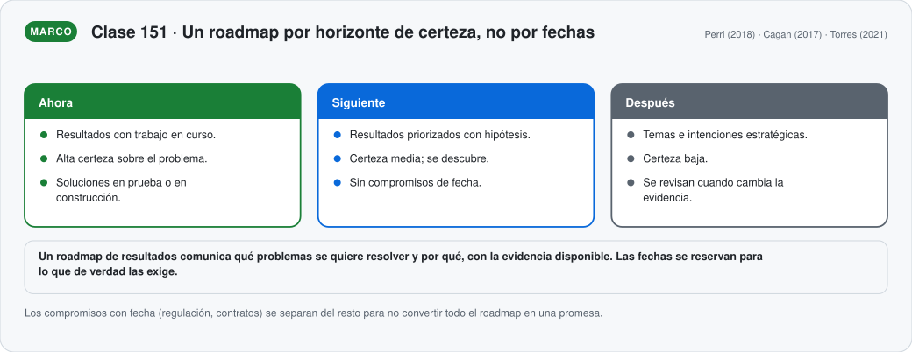

# Clase 151 — Roadmap orientado a outcomes

<!-- nav:inicio -->
> **Parte 12 · Producto e innovación** — clase 7 de 12 · [índice de la parte](../../README.md) · [temario](../../../../SYLLABUS.md)
<!-- nav:fin -->

**Parte:** 12 — Producto e innovación  
**Nivel:** Etapa 3 — Manager → Gerente  
**Duración sugerida:** 150–180 minutos · **Estándar:** deep-class-v2

## 🎯 Propósito

La hoja de ruta (*roadmap*) es una de las herramientas más usadas y más abusadas de producto. En muchas empresas es un calendario de funciones con fechas que ventas promete a clientes, que dirección usa para evaluar al equipo y que ingeniería vive como un contrato imposible. Cuando la fecha pasa y la función no llega, todos se frustran; cuando llega, nadie verifica si sirvió. Un roadmap orientado a **resultados** (*outcomes*) cambia el contenido y la conversación: comunica **qué problemas se quiere resolver, por qué importan y qué evidencia hay**, y deja las soluciones y las fechas para cuando se sabe lo suficiente.

La clase se apoya en la crítica a las hojas de ruta de funciones de Perri, en el enfoque de equipos empoderados de Cagan, en el descubrimiento continuo de Torres y en la gestión del flujo de trabajo de Reinertsen. Al terminar sabrás construir un roadmap por horizontes de certeza, escribir objetivos como resultados con evidencia, separar compromisos con fecha del resto, comunicarlo a distintas audiencias y mantenerlo vivo con la información que se aprende.

## 📚 Resultados de aprendizaje

Al finalizar podrás:

1. **Distinguir** un roadmap de funciones de uno de resultados.
2. **Estructurar** un roadmap por horizontes de certeza (ahora, siguiente, después).
3. **Escribir** cada elemento como problema, resultado esperado y evidencia.
4. **Separar** compromisos con fecha de apuestas por descubrir.
5. **Comunicar** y actualizar el roadmap con ventas, dirección y clientes.

## 🧭 Agenda

| Tramo | Qué se hace |
|---|---|
| 0–20 min | Recuperación: toma tu roadmap y marca cuántos elementos son funciones y cuántos problemas o resultados. |
| 20–60 min | Funciones y resultados, horizontes, compromisos y comunicación. |
| 60–105 min | Ejemplo trabajado: reescribir un roadmap de seis funciones como resultados. |
| 105–150 min | Caso ejecutivo y práctica. |
| 150–175 min | Límites y entregable. |

## 🧩 Conceptos centrales

| Concepto | Definición | Cómo se reconoce |
|---|---|---|
| **Roadmap** | Comunicación de la dirección del producto y sus prioridades en el tiempo. | Muestra el rumbo, no un contrato. |
| **Roadmap de funciones** | Lista de funciones con fechas. | «Módulo X en el segundo trimestre». |
| **Roadmap de resultados** | Lista de problemas o resultados con evidencia y nivel de certeza. | «Reducir el abandono en el pago». |
| **Horizonte de certeza** | Agrupación por nivel de conocimiento: ahora, siguiente, después. | Sin fechas exactas en lo incierto. |
| **Compromiso con fecha** | Entrega que debe ocurrir en un plazo por razones externas. | Regulación, contratos, eventos. |
| **Apuesta** | Iniciativa de resultado incierto que se explora. | Se financia por etapas. |

## 🧠 Modelo mental

**Cómo leer el diagrama.** Tres columnas con certeza decreciente. **Ahora** reúne los resultados con trabajo en curso, alta certeza sobre el problema y soluciones en prueba o en construcción. **Siguiente** reúne resultados priorizados con hipótesis, con certeza media, sin compromiso de fecha. **Después** reúne temas e intenciones estratégicas, con certeza baja, que se revisan cuando cambia la evidencia. La nota recoge la idea de que el roadmap comunica qué problemas se quiere resolver y por qué, y que las fechas se reservan para lo que realmente las exige.

## 📖 Desarrollo

### 1. El problema de las hojas de ruta de funciones

Perri describe que, en muchas organizaciones, el roadmap es un **calendario de funciones**: se decide lo que se construirá con meses de anticipación, se compromete a clientes y a la dirección, y el éxito del equipo se mide por cumplir lo prometido. Sus consecuencias: se **pierde la capacidad de reaccionar** a lo que se aprende; se **construyen funciones sin evidencia** de que sirvan; se **sobrecarga** a los equipos con compromisos poco realistas; y se **destruye la confianza** entre producto, ventas e ingeniería cuando se incumplen fechas basadas en estimaciones de cosas desconocidas. La alternativa no es la ausencia de planificación sino planificar **resultados y aprendizaje**.

### 2. Qué contiene un roadmap de resultados

Cada elemento responde cuatro preguntas: **¿qué problema o resultado?** («aumentar de 38 % a 60 % los servicios que usan la aplicación en 90 días»), **¿para quién?** (el segmento y el usuario), **¿por qué importa?** (conexión con la estrategia y el negocio) y **¿qué evidencia tenemos?** (entrevistas, datos, pruebas). Se añade el **estado**: descubriendo, probando, construyendo, midiendo. No se enumeran las soluciones como compromisos; se mencionan como **hipótesis** en prueba. Un roadmap de este tipo permite que el equipo escoja la mejor solución cuando sabe más, y que la dirección entienda por qué se trabaja en cada cosa.

### 3. Horizontes de certeza

Un formato conocido es **ahora–siguiente–después** (*now–next–later*). **Ahora**: lo que se está trabajando, con mayor certeza sobre el problema y soluciones en construcción o prueba. **Siguiente**: resultados priorizados que se descubrirán pronto, con hipótesis y sin fecha. **Después**: temas e intenciones estratégicas que se explorarán más adelante, con baja certeza. La clave es que **la certeza y el detalle disminuyen con la distancia**: hablar con precisión de lo que ocurrirá en nueve meses es ficción. Cagan sostiene que los equipos de producto deben tener claros la visión y los objetivos, y que la hoja de ruta de funciones a largo plazo es un síntoma de equipos que ejecutan pedidos.

### 4. Compromisos con fecha: separarlos

Algunas entregas **sí** exigen fecha: cumplimiento regulatorio, contratos con clientes estratégicos, eventos (una feria, el cierre de un año fiscal), dependencias de otros equipos. Se identifican, se **separan** del roadmap de resultados (en un carril de compromisos), se **estiman con rangos** y con la visión desde afuera (clase 076), y se gestionan con lógica de proyecto (clase 073). Se comunica el **nivel de confianza** de cada fecha y qué se sacrifica si hay desvíos. Mezclar todo en un solo calendario convierte cualquier resultado en una promesa y quita al equipo su capacidad de aprender.

### 5. Priorizar y conectar con estrategia

Cada elemento se conecta con un **objetivo estratégico** (clases 097 a 099) y se prioriza con criterios explícitos (clase 105 y 152): valor esperado, alcance, costo del retraso, riesgo, esfuerzo, aprendizaje. Se hace visible lo que **no** se hará y por qué, que es tan importante como lo que sí. Torres propone conectar el roadmap con un **árbol de oportunidades y soluciones** (clase 146): los resultados deseados son la raíz, las oportunidades que se explorarán son las ramas, y los experimentos que se hacen son las hojas. El roadmap se vuelve una vista resumida de un trabajo de descubrimiento continuo.

### 6. Comunicar a distintas audiencias

El mismo roadmap se cuenta distinto: a la **dirección**, con la conexión a estrategia y resultados esperados; a **ventas y clientes**, con la dirección del producto y los problemas que se atacan, sin prometer funciones ni fechas (se explica por qué); a **ingeniería y diseño**, con contexto y evidencia para que propongan soluciones; y a **finanzas**, con las inversiones por apuesta. Se anticipa la pregunta «¿cuándo estará X?» con una respuesta honesta: el estado, el nivel de confianza y qué se está aprendiendo. La confianza se construye cuando lo comunicado coincide con lo que ocurre.

### 7. Mantenerlo vivo

El roadmap se **revisa** en un ritmo definido (mensual o trimestral, clase 103): ¿qué resultados se lograron?, ¿qué aprendimos?, ¿qué cambió en el mercado o la estrategia?, ¿qué pasa a «ahora»?, ¿qué se detiene? Reinertsen recuerda que la **variabilidad** y la capacidad limitada hacen que cargar los equipos al máximo vuelva impredecibles los plazos: el roadmap debe dejar holgura para lo imprevisto y para el descubrimiento. Se registran las decisiones y su razón. Un roadmap que nunca cambia o que cambia sin explicación pierde su valor.

## 📚 Lectura comparada

| Obra | Qué aporta | Qué no resuelve | Pregunta para contrastar |
|---|---|---|---|
| Perri | Crítica del roadmap de funciones y el enfoque en resultados. | Describe patrones organizacionales. | ¿Tu roadmap es una lista de funciones? |
| Cagan | Equipos empoderados con objetivos y visión. | Experiencia de empresas de tecnología. | ¿Quién decide la solución? |
| Torres | Roadmap como vista del árbol de oportunidades. | Exige descubrimiento continuo. | ¿Cómo se conecta con tus entrevistas? |
| Reinertsen | Variabilidad, colas y capacidad en el desarrollo. | Orientado a desarrollo de productos en general. | ¿Cuánta holgura tienes? |
| Kerzner | Gestión de compromisos con fecha y alcance. | Lógica de proyecto. | ¿Qué compromisos exigen fecha? |

## 🧮 Ejemplo trabajado

**Situación (hipotética).** Una empresa de software de gestión de turnos para clínicas tiene este roadmap anual: (1) módulo de reportes (T1), (2) integración con nómina (T2), (3) aplicación móvil nueva (T2), (4) intercambio de turnos (T3), (5) predicción de ausencias con IA (T3), (6) panel de costos (T4). Ventas promete algunas fechas a clientes; en T1 se atrasó el módulo de reportes y se afectaron otras entregas.

**Reescritura como resultados con evidencia.**

| Horizonte | Resultado | Evidencia | Hipótesis de solución |
|---|---|---|---|
| Ahora | Subir de 38 % a 60 % los servicios que arman todos sus turnos en la aplicación (90 días) | Entrevistas: cubrir turnos de último momento es el mayor dolor; adopción con 3 o más servicios retiene 91 % | Aviso masivo con aceptación en un toque; lista de reemplazos |
| Ahora | Reducir de 52 a 15 minutos el tiempo para cubrir un turno de última hora | Datos de uso y 18 entrevistas | La misma |
| Siguiente | Reducir 50 % el cálculo manual de reglas laborales de horas (por servicio) | 14 de 18 entrevistados lo hacen en planilla | Reglas configurables y alertas de límites |
| Siguiente | Que gerencias vean el costo de horas extra por servicio | 6 de 9 gerentes lo piden, evidencia más débil | Panel simple de costos |
| Después | Prever ausencias y reforzar turnos de forma proactiva | Solo hipótesis; sin datos suficientes | Se explorará con datos acumulados |

**Compromisos con fecha (carril separado).** (1) Integración con el sistema de nómina de un cliente estratégico (contrato, fecha de abril, confianza media: rango de 4 a 7 semanas); (2) cambio normativo de registro de asistencia (fecha legal verificada con la fuente oficial y con el asesor).

**Capacidad.** Los dos equipos asignan 30 % de su capacidad a compromisos y a deuda técnica, 50 % a resultados de «ahora» y 20 % a descubrimiento de «siguiente».

**Comunicación.** A ventas: «Estamos atacando la cobertura de turnos de último momento y la adopción; no comprometemos fechas de funciones, pero sí informamos el estado cada mes». A la dirección: un tablero con los resultados y su avance. A clientes: sesión trimestral sobre los problemas que se atacan y por qué.

**Resultado a seis meses.** Se logra el resultado de «ahora» a los 90 días (adopción de 61 %); el módulo de reportes, dado de baja del roadmap por falta de evidencia, no se construyó y la capacidad se destinó a las reglas laborales. Las fechas comprometidas se cumplieron con una desviación de una semana.

**Qué muestra.** (1) El roadmap pasó de funciones a resultados con evidencia. (2) Los compromisos con fecha quedaron separados. (3) La capacidad se asignó con holgura.

## 🔀 Comparación y límites

**Roadmap frente a plan de entrega.** El roadmap comunica dirección y prioridades; el plan de entrega detalla tareas, dependencias y fechas de lo que se está construyendo. Se complementan: el primero es estratégico; el segundo, operativo.

**Límites.** Las organizaciones con clientes que exigen fechas, con regulación o con ventas basadas en funciones pueden necesitar más compromisos que los ideales. El enfoque requiere confianza entre áreas y equipos capaces de decidir; sin ellas, se vuelve una excusa para no comprometerse. Los resultados no siempre son medibles con rapidez. Las normas y plazos regulatorios deben verificarse en su fuente vigente y con asesoría. El ejemplo es ilustrativo.

## 🪜 De profesional a owner

| Nivel | Cómo participa en el roadmap |
|---|---|
| **Profesional** | Aporta evidencia y propone soluciones al resultado. |
| **Jefe / Team Lead** | Mantiene el roadmap del equipo con problemas y evidencia. |
| **Gerente** | Conecta el roadmap con estrategia y comunica a ventas y dirección. |
| **CEO / Director** | Evita exigir fechas de funciones y pide resultados con evidencia. |
| **Founder / Owner** | Sabe qué problema ataca este trimestre y por qué no otros. |

## 🏢 Caso ejecutivo

Una empresa de software de gestión para constructoras tiene un roadmap de 18 meses con 42 funciones y fechas. Ventas ha prometido 11 de ellas a clientes grandes; el 40 % de las funciones del año pasado se entregó con atraso y el 25 % tiene uso inferior al 5 % de los clientes. Los equipos de ingeniería trabajan al 110 % de su capacidad. Hay un nuevo requisito regulatorio con fecha límite en seis meses, un cliente que exige integración con su sistema contable para renovar un contrato de USD 800.000 y una caída de retención en clientes pequeños. La dirección pide «un roadmap confiable» y a la vez «velocidad». El gerente de ventas se opone a quitar fechas; el de producto, a mantener funciones sin evidencia.

Entrega un **roadmap orientado a resultados** que contenga: (a) la reclasificación del roadmap actual en funciones con evidencia, funciones sin evidencia y compromisos con fecha; (b) los resultados por horizonte con problema, segmento, evidencia y medida; (c) el carril de compromisos con rangos y confianza; (d) la asignación de capacidad con holgura; (e) la forma de comunicarlo a ventas, dirección y clientes sin prometer funciones; (f) el ritmo de revisión y los criterios para cambiar el roadmap, y las verificaciones normativas del requisito regulatorio.

## 🧪 Práctica

1. Clasifica los elementos de tu roadmap en función, problema o resultado.
2. Reescribe tres funciones como resultados con evidencia y medida.
3. Separa los compromisos con fecha y estima sus rangos.
4. Asigna la capacidad de tu equipo entre compromisos, resultados y descubrimiento.
5. Escribe cómo responderías «¿cuándo estará X?» sin prometer una fecha falsa.

## ⚠️ Errores frecuentes

| Error | Por qué ocurre | Cómo corregirlo |
|---|---|---|
| Roadmap de funciones con fechas | Se quiere certeza | Resultados y horizontes de certeza. |
| Fechas en lo incierto | Presión comercial | Rangos y confianza; fechas solo donde importan. |
| Sin evidencia | Se priorizan pedidos | Cada elemento con evidencia. |
| Capacidad al 100 % | Se quiere eficiencia | Holgura para lo imprevisto y descubrimiento. |
| Roadmap que no se revisa | Se considera un plan | Revisión periódica y registro de cambios. |
| Mezclar compromisos y apuestas | Un solo calendario | Carriles separados. |

## ❓ Preguntas de comprobación

1. ¿Qué diferencia hay entre un roadmap de funciones y uno de resultados?
2. ¿Qué preguntas responde cada elemento de un roadmap de resultados?
3. ¿Qué son los horizontes de certeza?
4. ¿Cómo se tratan los compromisos con fecha?
5. ¿Cómo se comunica el roadmap a ventas y clientes?
6. ¿Por qué se deja holgura de capacidad?
7. ¿Qué límites tiene este enfoque?

Claves de respuesta

1. El de funciones lista soluciones con fechas; el de resultados comunica problemas, resultados esperados y evidencia, y deja soluciones y fechas para cuando se sabe más.
2. Qué problema o resultado, para quién, por qué importa y qué evidencia hay, más el estado.
3. Una agrupación por nivel de conocimiento (ahora, siguiente, después) en que la certeza y el detalle disminuyen con la distancia.
4. Se separan en un carril aparte, se estiman con rangos y confianza y se gestionan con lógica de proyecto.
5. Explicando los problemas que se atacan y el estado, sin prometer funciones ni fechas, con una respuesta honesta sobre el nivel de confianza.
6. Porque la variabilidad y la carga máxima vuelven impredecibles los plazos y se necesita espacio para lo imprevisto y el descubrimiento.
7. Requiere confianza y equipos capaces; clientes y regulaciones pueden exigir fechas, y los resultados no siempre se miden rápido.

## 📥 Entregable

Guarda en `portfolio/151-roadmap-orientado-a-outcomes/`:

- `product-evidence-brief.md` (plantilla [Product evidence brief](../../../../templates/product-evidence-brief.md)) con el roadmap del caso ejecutivo;
- `leadership-decision-brief.md` (plantilla [Leadership Decision Brief](../../../../templates/leadership-decision-brief.md)) con la asignación de capacidad y las decisiones;
- `decision-journal.md` con las reglas de comunicación y de revisión.

## 📗 Fuentes y verificación

- Melissa Perri — *Escaping the Build Trap* (O'Reilly, 2019). **Uso en esta clase:** crítica del roadmap de funciones y enfoque en resultados. Lectura selectiva sobre **roadmap orientado a outcomes**. **Localizador:** [ISBN-13 9781491973790](https://openlibrary.org/isbn/9781491973790).
- Marty Cagan — *Inspired* (Shroff, 2008). **Uso en esta clase:** equipos empoderados con objetivos y visión. Lectura selectiva sobre **roadmap orientado a outcomes**. **Localizador:** [ISBN-13 9789352131501](https://openlibrary.org/isbn/9789352131501).
- Teresa Torres — *Continuous Discovery Habits* (Product Talk LLC, 2021). **Uso en esta clase:** roadmap como vista del árbol de oportunidades. Lectura selectiva sobre **roadmap orientado a outcomes**. **Localizador:** [ISBN-13 9781736633304](https://openlibrary.org/isbn/9781736633304).
- Donald G. Reinertsen — *The Principles of Product Development Flow* (Celeritas Publishing, 2009). **Uso en esta clase:** variabilidad, colas y capacidad en el desarrollo. Lectura selectiva sobre **roadmap orientado a outcomes**. **Localizador:** [ISBN-13 9781935401001](https://openlibrary.org/isbn/9781935401001).
- Harold Kerzner — *Project Management* (John Wiley & Sons Inc, 2003). **Uso en esta clase:** gestión de compromisos con fecha y alcance. Lectura selectiva sobre **roadmap orientado a outcomes**. **Localizador:** [ISBN-13 9780471281580](https://openlibrary.org/isbn/9780471281580).

> **Regla de fuentes para Roadmap orientado a outcomes:** las obras anteriores estructuran las perspectivas de esta materia; cualquier norma, ley o estándar vivo mencionado debe comprobarse nuevamente en su fuente primaria vigente, incluidos los plazos regulatorios y contractuales. Los ejemplos y casos son hipotéticos, con cifras ilustrativas. El desarrollo es original y no reproduce capítulos protegidos.

<!-- pie:inicio -->
---

| Anterior | Índice | Siguiente |
|---|---|---|
| [← 150 · MVP: prueba de hipótesis](../150-mvp-prueba-de-hipotesis/README.md) | [Parte 12](../../README.md) · [Programa](../../../../SYLLABUS.md) | [152 · Priorización y costo de oportunidad →](../152-priorizacion-y-costo-de-oportunidad/README.md) |
<!-- pie:fin -->
