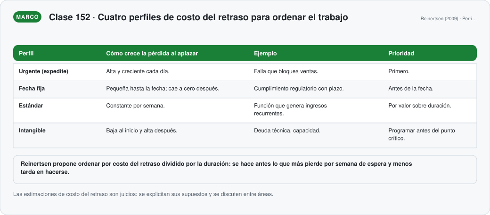

# Clase 152 — Priorización y costo de oportunidad

<!-- nav:inicio -->
> **Parte 12 · Producto e innovación** — clase 8 de 12 · [índice de la parte](../../README.md) · [temario](../../../../SYLLABUS.md)
<!-- nav:fin -->

**Parte:** 12 — Producto e innovación  
**Nivel:** Etapa 3 — Manager → Gerente  
**Duración sugerida:** 150–180 minutos · **Estándar:** deep-class-v2

## 🎯 Propósito

Todo equipo de producto tiene más ideas que capacidad, y cada «sí» es un «no» a otra cosa: ese es el **costo de oportunidad**. Sin embargo, la mayoría prioriza con métodos informales: el que grita más fuerte, el cliente más grande, el pedido del directivo, la idea más novedosa o la que parece más fácil. Cuando se usan marcos formales, suelen basarse en puntajes subjetivos que se perciben objetivos. La prioridad bien decidida combina **valor esperado**, **esfuerzo**, **riesgo** y, sobre todo, **tiempo**: no es lo mismo una función que genera valor desde el día 1 que otra que lo hace después de seis meses, ni una que pierde valor cada semana que se retrasa que otra cuyo valor no depende de la fecha.

La clase se apoya en el análisis de flujo y costo del retraso de Reinertsen, en la lógica de producto orientada a resultados de Perri y de Cagan, en la teoría de decisión de inversión de Brealey, Myers y Allen y en la reducción de ruido en decisiones de Kahneman, Sibony y Sunstein. Al terminar sabrás estimar el costo del retraso, ordenar iniciativas por costo del retraso sobre duración, distinguir perfiles de urgencia, comparar con puntajes y retornos y sostener la decisión ante presiones.

## 📚 Resultados de aprendizaje

Al finalizar podrás:

1. **Explicar** el costo de oportunidad de una decisión de producto.
2. **Estimar** el costo del retraso de una iniciativa y reconocer su perfil.
3. **Ordenar** iniciativas por costo del retraso dividido por duración.
4. **Comparar** esta lógica con puntajes ponderados y con el retorno simple.
5. **Reducir** el sesgo y el ruido al priorizar.

## 🧭 Agenda

| Tramo | Qué se hace |
|---|---|
| 0–20 min | Recuperación: lista cinco iniciativas de tu equipo y estima cuánto pierde la empresa por semana de retraso de cada una. |
| 20–60 min | Costo de oportunidad, costo del retraso, perfiles y orden. |
| 60–105 min | Ejemplo trabajado: ordenar cinco iniciativas con dos criterios y comparar el costo total del retraso. |
| 105–150 min | Caso ejecutivo y práctica. |
| 150–175 min | Límites y entregable. |

## 🧩 Conceptos centrales

| Concepto | Definición | Cómo se reconoce |
|---|---|---|
| **Costo de oportunidad** | Valor de la mejor alternativa a la que se renuncia al elegir. | «Si hacemos X, no hacemos Y». |
| **Costo del retraso (CoD)** | Valor económico que se pierde por cada unidad de tiempo que se aplaza una iniciativa. | Pesos por semana. |
| **CD3** | Costo del retraso dividido por la duración. | Prioriza lo que más pierde y menos tarda. |
| **Perfil de urgencia** | Forma en que el costo del retraso evoluciona con el tiempo. | Urgente, fecha fija, estándar, intangible. |
| **Trabajo en curso** | Iniciativas empezadas y no terminadas. | Cuanto más, más tarda cada una. |
| **Ruido** | Variabilidad injustificada en los juicios sobre una misma decisión. | Distintas personas priorizan distinto. |

## 🧠 Modelo mental

**Cómo leer el diagrama.** Una tabla con cuatro perfiles. Lo **urgente** pierde mucho cada día y va primero. Lo de **fecha fija** pierde poco hasta la fecha y cae a cero después: se programa para terminar antes. Lo **estándar** pierde de forma constante y se ordena por valor sobre duración. Lo **intangible** (deuda técnica, capacidad) pierde poco al principio y mucho después: se programa antes del punto crítico. La nota resume la regla de Reinertsen: se hace antes lo que más pierde por semana de espera y menos tarda en hacerse.

## 📖 Desarrollo

### 1. Prioridad es una decisión económica

Reinertsen sostiene que la mayoría de las decisiones de desarrollo de productos se toman con una **visión incompleta de la economía**: se analizan costos de desarrollo y se ignora el valor del tiempo. Propone que el **costo del retraso** —cuánto se pierde por cada semana que se demora una iniciativa— sea la información económica más importante para priorizar. Si un equipo no puede decir cuánto cuesta aplazar un trabajo, no puede decidir con criterio entre dos opciones: toma decisiones por intuición y por presión. El costo del retraso no es exacto, pero obliga a explicitar supuestos de ingresos, ahorros, riesgos o aprendizajes.

### 2. Estimar el costo del retraso

Se estima en dinero por unidad de tiempo, a partir de componentes: **ingresos o ahorros** que se capturarían (si una función generaría USD 40.000 al mes, su costo del retraso es unos USD 9.000 por semana); **riesgos** que se evitan (multas, pérdida de un cliente, incidentes); **aprendizaje** que se ganaría antes (valor de información); y **ventanas de oportunidad** (si un competidor lanzará algo similar). Se estima en conjunto con negocio, finanzas y producto, en rangos, y se **discuten los supuestos**. Kahneman, Sibony y Sunstein sugieren hacer estimaciones individuales independientes antes de la discusión para reducir el ruido.

### 3. Perfiles de urgencia

No todos los costos del retraso evolucionan igual. **Urgente**: la pérdida es alta y continua (un error que impide cobrar). **Fecha fija**: la pérdida es pequeña hasta una fecha y luego se vuelve alta o total (cumplimiento regulatorio, un evento); la tarea debe terminar con un colchón antes de la fecha. **Estándar**: pérdida proporcional al tiempo (una función que genera ingresos recurrentes). **Intangible**: pérdida baja inicialmente y creciente (deuda técnica, formación, infraestructura); se programa antes del punto en que se vuelve crítica. Distinguirlos evita tratar todo como urgente, y también permite ver que la deuda técnica no es una prioridad menor sino una apuesta con costo creciente.

### 4. CD3: costo del retraso dividido por duración

Con el costo del retraso y la **duración estimada** de cada iniciativa, Reinertsen propone la regla **WSJF** (*weighted shortest job first*) o **CD3**: ordenar por **costo del retraso dividido por duración**. Prioriza lo que más pierde por semana de espera y menos tarda en completarse. Por ejemplo, una iniciativa que pierde USD 12.000 por semana y tarda una semana (CD3 = 12.000) va antes que una que pierde USD 9.000 por semana y tarda seis (CD3 = 1.500). Con esta regla, el orden minimiza el costo total del retraso del conjunto. Se complementa con el trabajo en curso limitado: terminar antes de empezar (clase 080).

### 5. Comparar con otros métodos

Los **puntajes ponderados** (valor, esfuerzo, riesgo, urgencia, alineación) ordenan la conversación pero mezclan escalas y ocultan supuestos; su resultado depende de los pesos. El **retorno simple** (beneficio dividido por costo) ignora el tiempo y la capacidad. El **valor presente neto** (Brealey, Myers y Allen) es riguroso para inversiones grandes, pero se aplica a flujos estimables. El cuadrante de **valor y esfuerzo** (clase 105) sirve para clasificar. El costo del retraso aporta la dimensión del **tiempo** y es complementario: los métodos ayudan a decidir **qué** hacer; el costo del retraso, **en qué orden**. Perri y Cagan añaden que la prioridad debe subordinarse a los **resultados** y a la estrategia, no a funciones aisladas.

### 6. Costo de oportunidad y trabajo en curso

Cada iniciativa que se empieza consume capacidad y **retrasa a las demás**. Reinertsen muestra que, con capacidad limitada, aumentar el trabajo en curso **alarga los tiempos de ciclo** de todos los trabajos (por colas y cambios de contexto). Por eso se limita el número de iniciativas simultáneas y se termina antes de empezar. El costo de oportunidad también incluye **no hacer**: la atención de la dirección, la agenda de los equipos y la deuda que se acumula. Se hace visible la lista de lo que **no** se hará (y cuándo se revisará), para que la decisión sea explícita y no un olvido.

### 7. Decidir con menos sesgo y ruido

Los sesgos más comunes: **voz más fuerte** (el cliente o directivo con más poder), **novedad**, **costo hundido** («ya empezamos»), **optimismo en estimaciones**, **anclaje** al primer número. El ruido: dos personas del mismo equipo priorizan distinto la misma lista. Kahneman, Sibony y Sunstein proponen **estructurar** el juicio (evaluar por dimensiones antes de dar una opinión global), **recoger juicios independientes** antes de discutir, **agregarlos** y usar **reglas** o fórmulas simples como contrapeso. Se registra la decisión y su razón, y se revisa cuando cambia la evidencia. Priorizar es una decisión explicable.

## 📚 Lectura comparada

| Obra | Qué aporta | Qué no resuelve | Pregunta para contrastar |
|---|---|---|---|
| Reinertsen | Costo del retraso, CD3 y trabajo en curso. | Exige estimaciones económicas que no siempre existen. | ¿Cuánto pierdes por semana de retraso? |
| Perri | Prioridad subordinada a resultados y estrategia. | No entrega fórmula de priorización. | ¿A qué resultado sirve esto? |
| Cagan | Prioridades de producto desde problemas y riesgos. | Marco cualitativo. | ¿Qué riesgo resuelve primero? |
| Brealey, Myers y Allen | Valor presente y costo de oportunidad del capital. | Teoría con supuestos. | ¿Cuál es el valor de la mejor alternativa? |
| Kahneman, Sibony y Sunstein | Ruido y sesgo en juicios, y cómo estructurarlos. | No es un manual de producto. | ¿Dos personas priorizarían igual? |

## 🧮 Ejemplo trabajado

**Situación (hipotética).** Un equipo único de producto de una empresa de software de facturación tiene seis iniciativas y una capacidad de un equipo. Cada una con su costo del retraso estimado (por semana) y su duración:

| Iniciativa | Perfil | Costo del retraso (USD/semana) | Duración (semanas) | CD3 |
|---|---|---|---|---|
| A. Corregir fallo en el cobro con tarjeta | Urgente | 12.000 | 1 | 12.000 |
| B. Cambio exigido por la autoridad tributaria | Fecha fija (en 8 semanas) | Multa y bloqueo si no se cumple | 4 | — |
| C. Nuevo plan de precios | Estándar | 6.000 | 3 | 2.000 |
| D. Integración con el sistema contable de un cliente estratégico | Estándar | 9.000 | 6 | 1.500 |
| E. Rediseño de la aplicación móvil | Estándar | 4.000 | 10 | 400 |
| F. Infraestructura de pruebas automáticas (deuda técnica) | Intangible | 1.000 (crece) | 5 | 200 |

**Plan.** B se programa aparte: se reserva su capacidad para terminar antes de la fecha (se inicia, a más tardar, en la semana 4 para tener colchón, y se verifica la norma en la fuente oficial). El resto se ordena por CD3: A, C, D, E, F.

**Costo total del retraso (sin B).**

| Orden | Semana de término | Costo del retraso acumulado |
|---|---|---|
| **Por CD3:** A, C, D, E, F | 1, 4, 10, 20, 25 | 12.000×1 + 6.000×4 + 9.000×10 + 4.000×20 + 1.000×25 = **231.000** |
| **Por tamaño o visibilidad:** E, D, C, A, F | 10, 16, 19, 20, 25 | 4.000×10 + 9.000×16 + 6.000×19 + 12.000×20 + 1.000×25 = **563.000** |

**Lectura.** Ordenar por CD3 reduce el costo de espera en unos USD 332.000 respecto de empezar por lo más grande o visible. Y el equipo no empieza todo a la vez: termina antes de empezar. La infraestructura de pruebas (F) queda al final pero con una **fecha de revisión**: si las fallas por falta de pruebas aumentan por encima de un umbral, su costo del retraso se reestima y sube de prioridad.

**Sensibilidad y ruido.** Tres personas estiman de forma independiente el costo del retraso de D: 5.000, 9.000 y 14.000. Se discute por qué difieren (probabilidad de perder el contrato) y se acuerda un rango de 7.000 a 11.000; con 7.000, el CD3 de D baja a 1.167 y sigue por encima de E. Se registra la razón.

**Lo que no se hará.** El rediseño móvil se pospone hasta que haya evidencia de que el uso móvil limita retención; se reevalúa en el siguiente trimestre.

**Qué muestra.** (1) Incorporar el tiempo cambió el orden y el costo. (2) Los perfiles distinguieron lo urgente de lo de fecha fija y de lo intangible. (3) Las estimaciones se discutieron con juicios independientes.

## 🔀 Comparación y límites

**Costo del retraso frente a retorno de inversión.** El retorno compara beneficio y costo; el costo del retraso compara el valor del tiempo. Una iniciativa con retorno modesto pero que pierde mucho por semana puede merecer ir antes que una de retorno mayor que no depende del tiempo.

**Límites.** Las estimaciones de costo del retraso son juicios inciertos, especialmente en valor de aprendizaje o de reputación. La regla de CD3 supone iniciativas independientes y divisibles en el tiempo; con dependencias técnicas o complementariedades, el orden cambia. Los costos del retraso pueden manipularse para favorecer una idea. Las obligaciones regulatorias y los compromisos contractuales se verifican en sus fuentes y con asesoría. Las cifras del ejemplo son ilustrativas.

## 🪜 De profesional a owner

| Nivel | Cómo participa en la priorización |
|---|---|
| **Profesional** | Aporta estimaciones de esfuerzo y de impacto con honestidad. |
| **Jefe / Team Lead** | Facilita la estimación del costo del retraso y limita el trabajo en curso. |
| **Gerente** | Prioriza por costo del retraso y resultados, y comunica los «no». |
| **CEO / Director** | Resiste presiones de la voz más fuerte y pide el costo de oportunidad. |
| **Founder / Owner** | Elige lo que más pierde por semana de espera con el equipo disponible. |

## 🏢 Caso ejecutivo

Una empresa de comercio electrónico tiene un equipo de producto con capacidad para tres iniciativas al trimestre y una lista de catorce solicitadas. El cliente más grande exige una integración con su sistema (USD 1,2 millones de ventas anuales en riesgo); el gerente comercial pide un programa de fidelidad; el de operaciones, un rediseño del proceso de devoluciones (12 % de los pedidos tienen problemas); el de tecnología, migrar la base de datos (el riesgo de caída aumenta y el próximo evento de ventas masivas es en 16 semanas); el director general, un lanzamiento en otro país. Hay una nueva norma de protección al consumidor con fecha en 20 semanas. Cada gerente defiende la suya con un puntaje de 1 a 10 que resulta casi siempre 9.

Entrega una **priorización fundamentada** que contenga: (a) la estimación del costo del retraso de cada iniciativa con sus supuestos y su perfil; (b) las duraciones estimadas con rango; (c) el orden por CD3 y el tratamiento de fecha fija e intangibles; (d) la comparación con el uso de puntajes por gerente y la corrección del ruido; (e) la lista de lo que no se hará y cuándo se revisará; (f) la verificación de la norma de consumo en su fuente oficial y el plan de comunicación de la decisión.

## 🧪 Práctica

1. Estima el costo del retraso semanal de cinco iniciativas de tu equipo y su perfil.
2. Calcula el CD3 y ordena la lista; compara con tu orden actual.
3. Calcula el costo total de espera de dos órdenes distintos.
4. Haz que tres colegas estimen de forma independiente un costo del retraso y discute las diferencias.
5. Escribe la lista de lo que no harás este trimestre y cuándo la revisarás.

## ⚠️ Errores frecuentes

| Error | Por qué ocurre | Cómo corregirlo |
|---|---|---|
| Priorizar por voz más fuerte | Hay presión | Criterios explícitos y estimaciones independientes. |
| Ignorar el tiempo | Se mira valor y costo | Costo del retraso y duración. |
| Todo urgente | No se distinguen perfiles | Clasificar urgente, fecha fija, estándar e intangible. |
| Empezar todo a la vez | Se quiere avance | Limitar el trabajo en curso. |
| Puntajes como verdad | Parecen objetivos | Explicitar supuestos y pesos. |
| Postergar la deuda técnica | Es invisible | Estimar su costo creciente y programarla. |

## ❓ Preguntas de comprobación

1. ¿Qué es el costo de oportunidad?
2. ¿Qué es el costo del retraso y cómo se estima?
3. ¿Qué cuatro perfiles de urgencia existen?
4. ¿Cómo se calcula y qué hace el CD3?
5. ¿Qué limitaciones tienen los puntajes ponderados?
6. ¿Por qué se limita el trabajo en curso?
7. ¿Cómo se reduce el ruido al priorizar?

Claves de respuesta

1. El valor de la mejor alternativa a la que se renuncia al elegir una opción.
2. El valor que se pierde por cada unidad de tiempo que se aplaza una iniciativa; se estima con ingresos o ahorros, riesgos evitados, aprendizaje y ventanas de oportunidad, en rangos y con supuestos discutidos.
3. Urgente, fecha fija, estándar e intangible.
4. Costo del retraso dividido por la duración; ordena primero lo que más pierde por semana y menos tarda, minimizando el costo total del retraso.
5. Mezclan escalas, ocultan supuestos y dependen de los pesos elegidos.
6. Porque con capacidad limitada más trabajo en curso alarga el tiempo de ciclo de todo por colas y cambios de contexto.
7. Con estimaciones independientes antes de discutir, juicios estructurados por dimensiones, agregación y reglas simples.

## 📥 Entregable

Guarda en `portfolio/152-priorizacion-y-costo-de-oportunidad/`:

- `leadership-decision-brief.md` (plantilla [Leadership Decision Brief](../../../../templates/leadership-decision-brief.md)) con la priorización del caso ejecutivo;
- `product-evidence-brief.md` (plantilla [Product evidence brief](../../../../templates/product-evidence-brief.md)) con los costos del retraso y su evidencia;
- `decision-journal.md` con las razones, los «no» y las fechas de revisión.

## 📗 Fuentes y verificación

- Donald G. Reinertsen — *The Principles of Product Development Flow* (Celeritas Publishing, 2009). **Uso en esta clase:** costo del retraso, CD3 y trabajo en curso. Lectura selectiva sobre **priorización y costo de oportunidad**. **Localizador:** [ISBN-13 9781935401001](https://openlibrary.org/isbn/9781935401001).
- Melissa Perri — *Escaping the Build Trap* (O'Reilly, 2019). **Uso en esta clase:** prioridad subordinada a resultados y estrategia. Lectura selectiva sobre **priorización y costo de oportunidad**. **Localizador:** [ISBN-13 9781491973790](https://openlibrary.org/isbn/9781491973790).
- Marty Cagan — *Inspired* (Shroff, 2008). **Uso en esta clase:** prioridades de producto desde problemas y riesgos. Lectura selectiva sobre **priorización y costo de oportunidad**. **Localizador:** [ISBN-13 9789352131501](https://openlibrary.org/isbn/9789352131501).
- Richard Brealey, Stewart Myers & Franklin Allen — *Principles of Corporate Finance* (McGraw-Hill International Book Co, 1984). **Uso en esta clase:** valor presente y costo de oportunidad. Lectura selectiva sobre **priorización y costo de oportunidad**. **Localizador:** [ISBN-13 9780070662025](https://openlibrary.org/isbn/9780070662025).
- Daniel Kahneman, Olivier Sibony & Cass R. Sunstein — *Noise* (Little, Brown Spark, 2021). **Uso en esta clase:** ruido y sesgo en juicios y cómo estructurarlos. Lectura selectiva sobre **priorización y costo de oportunidad**. **Localizador:** [ISBN-13 9780316451383](https://openlibrary.org/isbn/9780316451383).

> **Regla de fuentes para Priorización y costo de oportunidad:** las obras anteriores estructuran las perspectivas de esta materia; cualquier norma, ley o estándar vivo mencionado debe comprobarse nuevamente en su fuente primaria vigente, incluidas las normas de protección al consumidor y los plazos regulatorios. Los ejemplos y casos son hipotéticos, con cifras ilustrativas. El desarrollo es original y no reproduce capítulos protegidos.

<!-- pie:inicio -->
---

| Anterior | Índice | Siguiente |
|---|---|---|
| [← 151 · Roadmap orientado a outcomes](../151-roadmap-orientado-a-outcomes/README.md) | [Parte 12](../../README.md) · [Programa](../../../../SYLLABUS.md) | [153 · Experimentos y evidencia →](../153-experimentos-y-evidencia/README.md) |
<!-- pie:fin -->
