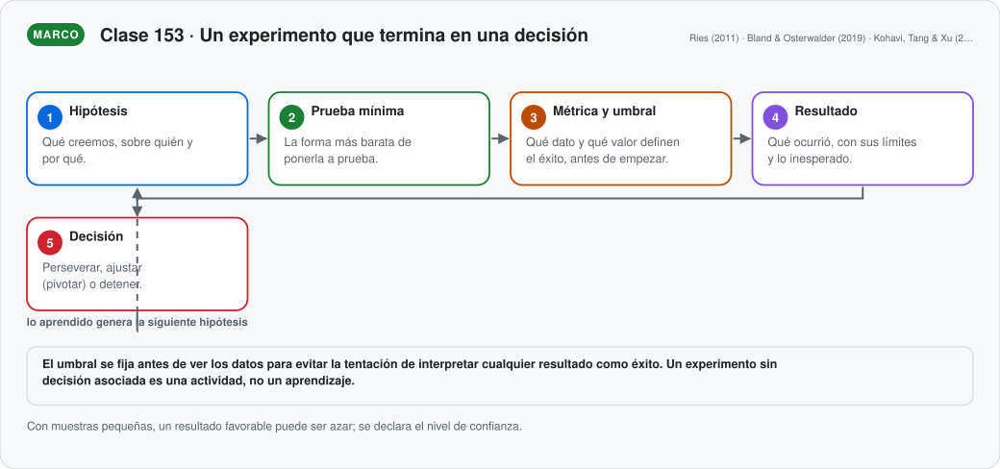

# Clase 153 — Experimentos y evidencia

<!-- nav:inicio -->
> **Parte 12 · Producto e innovación** — clase 9 de 12 · [índice de la parte](../../README.md) · [temario](../../../../SYLLABUS.md)
<!-- nav:fin -->

**Parte:** 12 — Producto e innovación  
**Nivel:** Etapa 3 — Manager → Gerente  
**Duración sugerida:** 150–180 minutos · **Estándar:** deep-class-v2

## 🎯 Propósito

«Hicimos una prueba y funcionó» es una de las frases más peligrosas en una empresa. ¿Qué se probó?, ¿con quién?, ¿funcionó respecto de qué?, ¿se habría obtenido el mismo resultado sin el cambio? Los equipos de producto que dicen «basarse en datos» a menudo toman decisiones sobre resultados de experimentos mal diseñados: muestras pequeñas, métricas elegidas después, comparaciones con períodos distintos o efectos de novedad. La **experimentación** es una disciplina para saber, con un grado de confianza razonable, si un cambio causa un efecto, y para decidir con esa evidencia sin autoengañarse.

La clase se apoya en el rigor de las pruebas controladas de Kohavi, Tang y Xu, en el aprendizaje validado de Ries, en el catálogo de experimentos de Bland y Osterwalder y en la gestión de riesgos de producto de Cagan. Al terminar sabrás formular una hipótesis comprobable, elegir un diseño de experimento adecuado, definir métricas principal y de protección y tamaño de muestra, interpretar resultados con humildad y registrar el aprendizaje para que la organización lo use.

## 📚 Resultados de aprendizaje

Al finalizar podrás:

1. **Formular** una hipótesis con métrica, umbral y decisión asociada.
2. **Elegir** un diseño: prueba controlada, prueba piloto, experimento cualitativo o análisis observacional.
3. **Definir** la métrica principal, las métricas de protección y la muestra.
4. **Interpretar** resultados distinguiendo señal, ruido y efectos secundarios.
5. **Registrar** y compartir el aprendizaje.

## 🧭 Agenda

| Tramo | Qué se hace |
|---|---|
| 0–20 min | Recuperación: recuerda una decisión de producto que tomaste con «datos» y pregunta qué habría ocurrido sin el cambio. |
| 20–60 min | Hipótesis, diseños, métricas, muestra e interpretación. |
| 60–105 min | Ejemplo trabajado: probar un cambio de precio y de pantalla de pago. |
| 105–150 min | Caso ejecutivo y práctica. |
| 150–175 min | Límites y entregable. |

## 🧩 Conceptos centrales

| Concepto | Definición | Cómo se reconoce |
|---|---|---|
| **Experimento controlado (A/B)** | Comparación de una versión con otra, con asignación aleatoria de personas. | Grupo de control y de tratamiento. |
| **Hipótesis** | Afirmación que el experimento busca confirmar o refutar. | «Si cambiamos X, Y mejorará en Z». |
| **Métrica principal** | Indicador que decide el experimento. | Se define antes. |
| **Métrica de protección (guardrail)** | Indicador que no debe empeorar. | Retención, quejas, rendimiento. |
| **Significancia y potencia** | Control de falsos positivos y capacidad de detectar un efecto real. | Muestra y duración calculadas. |
| **Efecto de novedad** | Cambio inicial que se disipa con el tiempo. | El efecto cae en semanas. |

## 🧠 Modelo mental

**Cómo leer el diagrama.** Cinco pasos con retorno. Se parte de una **hipótesis**; se elige la **prueba mínima** más barata; se definen **métrica y umbral** antes de empezar; se analiza el **resultado** con sus límites y lo inesperado; y se toma la **decisión** (perseverar, ajustar o detener). Lo aprendido genera la siguiente hipótesis. La nota recuerda que el umbral se fija antes de ver los datos para no interpretar cualquier resultado como éxito, y que un experimento sin decisión asociada es una actividad, no un aprendizaje.

## 📖 Desarrollo

### 1. Qué es evidencia

Evidencia es información que cambia razonablemente nuestra creencia sobre algo. En producto, la evidencia más débil es la **opinión** (de expertos, de directivos, del cliente enojado); luego, la **anécdota** (un caso); después, los **datos observacionales** (correlaciones en el uso); y la más fuerte para saber si un cambio **causa** un efecto es el **experimento controlado**. Kohavi, Tang y Xu sostienen que la intuición de los expertos falla con frecuencia al predecir qué cambios mejorarán una métrica, y que los experimentos controlados son la forma más confiable de establecer causalidad. Esto no elimina el juicio: ayuda a dirigirlo a lo que importa y a corregirlo con evidencia.

### 2. Hipótesis y decisión

Un experimento comienza con una **hipótesis**: «Si mostramos el costo total desde la ficha del producto, aumentará la tasa de compra en 5 %, porque reduce la sorpresa al pagar». Contiene el **cambio**, la **métrica** y el **mecanismo**. Antes de empezar se define la **decisión asociada**: «Si la tasa sube al menos 3 % y las devoluciones no aumentan, se lanza a todos; si sube menos, se descarta; si hay un aumento de devoluciones, se revisa». Sin decisión asociada, cualquier resultado será interpretado a conveniencia. Ries insiste en esta disciplina: el objetivo es el **aprendizaje validado**, no la confirmación de lo que ya creíamos.

### 3. Elegir el diseño

No todo se puede probar con un experimento A/B. Se elige según el **riesgo**, la **cantidad de usuarios** y la **pregunta**. **Experimento controlado en línea**: ideal con tráfico suficiente y cambios que se pueden asignar al azar. **Piloto con grupo de comparación**: cuando no es posible aleatorizar por usuario (se piloteá en una sucursal frente a otra comparable). **Experimentos de bajo costo** (clase 150): páginas de prueba, preventas, mago de Oz. **Experimentos cualitativos**: entrevistas y pruebas de usabilidad para entender el porqué. **Análisis observacional** con técnicas para reducir sesgos: cuando no hay otra opción; se interpreta con cautela. Bland y Osterwalder organizan experimentos según el tipo de suposición que prueban y el nivel de evidencia que entregan.

### 4. Métricas, protección y muestra

Se define una **métrica principal** (la que decide), unas pocas **métricas secundarias** (para entender) y **métricas de protección** que no deben empeorar (retención, quejas, rendimiento, ingresos por usuario). Se calcula el **tamaño de muestra** y la **duración** para detectar un efecto mínimo relevante con una probabilidad razonable (potencia) y controlando el riesgo de falsos positivos (significancia). Kohavi y sus coautores recomiendan duraciones de al menos una o dos semanas completas para cubrir ciclos semanales, y cuidado con **detener** el experimento apenas se ve un resultado favorable (inflación de falsos positivos).

### 5. Errores comunes de diseño

Los más frecuentes: **asignación defectuosa** (los grupos no son comparables, por ejemplo por errores técnicos: el sistema de asignación es lo primero que se verifica con pruebas A/A); **muestra insuficiente**; **mirar muchas métricas** hasta encontrar una favorable; **cambiar el diseño durante la prueba**; **efecto de novedad o de aprendizaje**; **contaminación entre grupos** (usuarios que se influyen mutuamente); y **segmentación a posteriori** (buscar subgrupos donde «funcionó»). Los resultados que parecen «demasiado buenos» suelen ser errores: se desconfía y se replica antes de actuar.

### 6. Interpretar y decidir

Se interpreta el resultado con su **intervalo de confianza** (no solo el valor): «la conversión subió entre 5 % y 15 % en términos relativos» es distinto de «subió 2,1 %». Se examinan las **métricas de protección** y los segmentos principales para detectar efectos opuestos. Se pregunta si el efecto es **práctico**: una mejora estadísticamente real pero minúscula puede no justificar la complejidad. Se distingue **causalidad del cambio** (lo que mide el experimento) de **por qué** (que se explica con investigación cualitativa). Si el resultado es inconcluso, se decide con criterios previos (repetir, ampliar la muestra, aceptar el riesgo o detener).

### 7. Cultura y registro

Una organización aprende cuando **registra** cada experimento (hipótesis, diseño, resultado, decisión, aprendizaje) en una biblioteca consultable, **comparte** los resultados negativos (la mayoría de las ideas no mejoran la métrica) y **evita castigar** el fracaso de hipótesis. También cuida la **ética**: los experimentos con personas deben respetar la transparencia, la privacidad y el no daño; los cambios que afectan precios, salud, finanzas o decisiones relevantes requieren especial cuidado y, en algunos casos, consentimiento y revisión legal. Los datos personales se tratan conforme a la normativa vigente.

## 📚 Lectura comparada

| Obra | Qué aporta | Qué no resuelve | Pregunta para contrastar |
|---|---|---|---|
| Kohavi, Tang y Xu | Diseño, trampas y cultura de experimentos controlados. | Escala de plataformas con mucho tráfico. | ¿Tu asignación y tu muestra son confiables? |
| Ries | Aprendizaje validado y decisiones de perseverar o pivotar. | Casos de startups. | ¿Qué decisión depende de este resultado? |
| Bland y Osterwalder | Experimentos por tipo de suposición y nivel de evidencia. | Etapa de validación temprana. | ¿Qué suposición pruebas y con qué fuerza de evidencia? |
| Cagan | Experimentos para reducir riesgos de producto. | No profundiza en estadística. | ¿Qué riesgo reduce este experimento? |
| Kahneman et al. (*Noise*) | Sesgo y ruido en juicios; cómo estructurarlos. | No es manual de experimentos. | ¿Qué sesgo puede afectar tu interpretación? |

## 🧮 Ejemplo trabajado

**Situación (hipotética).** Una tienda en línea de accesorios para bicicletas tiene 120.000 visitas semanales, una tasa de compra de 2,4 % y un abandono en el pago de 68 %. El equipo plantea dos cambios para la pantalla de pago: (A) mostrar el costo de envío estimado desde la ficha del producto y (B) cambiar el orden de los pasos de pago.

**Hipótesis y decisión (cambio A).** «Si mostramos el costo de envío estimado desde la ficha, aumentará en al menos 5 % relativo la tasa de compra, porque reduce la sorpresa en el último paso, sin aumentar las devoluciones ni reducir el valor del carrito.» Decisión: lanzar si la mejora relativa mínima es ≥ 3 % con confianza razonable y las métricas de protección no empeoran.

**Diseño.** Asignación aleatoria por usuario (50 % control y 50 % tratamiento); prueba A/A previa de una semana para verificar la asignación (sin diferencias); duración de dos semanas completas (para cubrir los ciclos semanales). Métrica principal: tasa de compra por visitante. Protección: valor medio del pedido, devoluciones a 30 días, quejas por costos, velocidad de carga.

**Tamaño de muestra.** Con tasa base de 2,4 %, para detectar una mejora relativa de 5 % (de 2,4 % a 2,52 %) con potencia de 80 % y un nivel de significancia de 5 %, se necesitan unas 255.000 visitas por grupo; con 120.000 visitas semanales (60.000 por grupo), dos semanas dan unas 120.000 por grupo: la prueba tiene potencia insuficiente para 5 %. Se decide detectar un efecto mínimo relevante de 8 % relativo (de 2,4 % a 2,59 %), para lo que bastan unas 100.000 por grupo, y se mantienen las dos semanas por el ciclo semanal.

**Resultados.**

| Métrica | Control | Tratamiento | Diferencia |
|---|---|---|---|
| Visitantes | 118.400 | 118.900 | — |
| Tasa de compra | 2,40 % | 2,64 % | +10 % relativo (intervalo del 95 %: +5 % a +15 %) |
| Valor medio del pedido | USD 61 | USD 60 | −1,6 % (no concluyente) |
| Devoluciones a 30 días | 4,1 % | 4,0 % | Sin cambio |
| Quejas por costos de envío | 0,31 % | 0,18 % | −42 % |

**Interpretación.** El efecto es positivo, práctico y sostenido en las dos semanas, sin deterioro de protección. El efecto de novedad es poco probable: no cae entre la semana 1 y la 2 (+11 % y +9 %). Segmentos: la mejora es mayor en visitantes móviles (+14 %) que en computadores (+6 %); no se hace conclusión de subgrupos sin replicar.

**Decisión.** Lanzar el cambio A a todos y registrar el aprendizaje. El cambio B se descarta de la cola por falta de hipótesis fundamentada y se reformula tras entrevistas con compradores que abandonaron. El experimento se archiva en la biblioteca con sus datos y su razón.

**Qué muestra.** (1) Hipótesis y decisión definidas antes. (2) Muestra y duración calculadas y ajustadas con realismo. (3) Se usó intervalo de confianza y métricas de protección.

## 🔀 Comparación y límites

**Experimento frente a análisis de datos.** El análisis encuentra patrones en datos existentes; el experimento prueba causalidad con una intervención. Los análisis generan hipótesis; los experimentos las ponen a prueba.

**Límites.** Con poco tráfico o con ciclos de decisión largos (ventas empresariales) los experimentos A/B son inviables o lentos; se usan diseños cualitativos y pilotos. Los resultados de un experimento corresponden a una población y un período; no necesariamente se mantienen. Los efectos de largo plazo (retención, reputación) son difíciles de medir en pruebas cortas. Los experimentos con precios, información o decisiones de personas pueden plantear problemas éticos y legales, que se verifican con las normas vigentes y asesoría. Las cifras del ejemplo son ilustrativas.

## 🪜 De profesional a owner

| Nivel | Cómo participa en la experimentación |
|---|---|
| **Profesional** | Diseña y analiza con rigor y reporta también lo que no funcionó. |
| **Jefe / Team Lead** | Exige hipótesis, umbrales y decisión antes de cada prueba. |
| **Gerente** | Construye una cultura de experimentación y una biblioteca de aprendizajes. |
| **CEO / Director** | Protege el fracaso informativo y desconfía de resultados demasiado buenos. |
| **Founder / Owner** | Prueba con pocos clientes antes de apostar y confía en datos, no en la intuición. |

## 🏢 Caso ejecutivo

Una empresa de suscripción de contenidos lanzó, tras un «experimento» de una semana con 400 usuarios, un nuevo diseño de la página de precios que mostraba el plan anual como opción predeterminada y ocultaba la opción de cancelar. La conversión a pago subió 18 %, y la dirección lo generalizó. Tres meses después, las cancelaciones en el primer mes aumentaron 25 %, los reclamos por cobros se triplicaron y la autoridad de consumo abrió un proceso. El equipo de datos revela que el experimento no tenía grupo de control (se comparó con la semana anterior, que fue feriado), que la métrica principal se eligió después y que no se midió la retención. El gerente de crecimiento defiende que «los datos mostraban un aumento claro».

Entrega un **diseño de experimentación responsable** que contenga: (a) el análisis crítico del experimento original; (b) una hipótesis con métrica principal, umbral y decisión; (c) el diseño (asignación, grupo de control, duración y muestra) y las métricas de protección, incluida la retención a 90 días; (d) el análisis de riesgos éticos y legales del diseño de la página de precios; (e) el plan de interpretación (intervalos, segmentos, novedad); (f) el registro del aprendizaje y las verificaciones de las normas de consumo vigentes.

## 🧪 Práctica

1. Escribe una hipótesis con métrica, umbral y decisión para un cambio real de tu producto.
2. Define las métricas de protección que vigilarías.
3. Calcula, de forma aproximada, la muestra necesaria con la tasa base y el efecto mínimo relevante.
4. Identifica tres formas en que podrías engañarte con los resultados de esta prueba.
5. Registra un experimento reciente con hipótesis, resultado, decisión y aprendizaje.

## ⚠️ Errores frecuentes

| Error | Por qué ocurre | Cómo corregirlo |
|---|---|---|
| Comparar con períodos distintos | Es más fácil | Grupo de control concurrente. |
| Elegir la métrica después | Se busca un éxito | Métrica principal y umbral antes. |
| Detener al primer resultado favorable | Impaciencia | Duración y muestra definidas. |
| No medir protección | Se mira solo la conversión | Retención, quejas y devoluciones. |
| Subgrupos a posteriori | Se quiere salvar el experimento | Replicar antes de concluir. |
| No registrar | Se olvida | Biblioteca de aprendizajes. |

## ❓ Preguntas de comprobación

1. ¿Qué hace más fuerte la evidencia de un experimento controlado?
2. ¿Qué debe contener una hipótesis de experimento?
3. ¿Qué es una métrica de protección?
4. ¿Por qué se calculan muestra y duración antes?
5. ¿Qué errores comunes invalidan un experimento?
6. ¿Por qué se interpretan intervalos de confianza y no solo el valor?
7. ¿Qué cuidados éticos requieren los experimentos con personas?

Claves de respuesta

1. La asignación aleatoria y el grupo de control concurrente, que permiten atribuir la diferencia al cambio y no a otros factores.
2. El cambio, la métrica, el umbral, el mecanismo esperado y la decisión asociada.
3. Un indicador que no debe empeorar (retención, quejas, rendimiento) y que protege contra efectos secundarios dañinos.
4. Para tener capacidad de detectar un efecto relevante y para no detener la prueba al ver un resultado favorable por azar.
5. Asignación defectuosa, muestra insuficiente, mirar muchas métricas, cambiar el diseño en curso, efecto de novedad, contaminación y segmentación a posteriori.
6. Porque el valor puntual esconde la incertidumbre; el intervalo muestra el rango de efectos compatibles con los datos.
7. Transparencia, privacidad y no daño, con especial cuidado en precios, salud y finanzas, y cumplimiento de normas de consumo y datos.

## 📥 Entregable

Guarda en `portfolio/153-experimentos-y-evidencia/`:

- `product-evidence-brief.md` (plantilla [Product evidence brief](../../../../templates/product-evidence-brief.md)) con el análisis y el rediseño del caso ejecutivo;
- `product-experiment.md` (plantilla [Product experiment](../../../../templates/product-experiment.md)) con la hipótesis, el diseño y las métricas;
- `decision-journal.md` con los resultados, la decisión y el aprendizaje registrado.

## 📗 Fuentes y verificación

- Ron Kohavi, Diane Tang & Ya Xu — *Trustworthy Online Controlled Experiments* (Cambridge University Press, 2020). **Uso en esta clase:** diseño, trampas y cultura de experimentos controlados. Lectura selectiva sobre **experimentos y evidencia**. **Localizador:** [ISBN-13 9781108724265](https://openlibrary.org/isbn/9781108724265).
- Eric Ries — *The Lean Startup* (Crown Business, 2011). **Uso en esta clase:** aprendizaje validado y decisiones de perseverar o pivotar. Lectura selectiva sobre **experimentos y evidencia**. **Localizador:** [ISBN-13 9780307887894](https://openlibrary.org/isbn/9780307887894).
- David J. Bland & Alexander Osterwalder — *Testing Business Ideas* (Wiley, 2019). **Uso en esta clase:** experimentos por tipo de suposición y nivel de evidencia. Lectura selectiva sobre **experimentos y evidencia**. **Localizador:** [ISBN-13 9781119551447](https://openlibrary.org/isbn/9781119551447).
- Marty Cagan — *Inspired* (Shroff, 2008). **Uso en esta clase:** experimentos para reducir riesgos de producto. Lectura selectiva sobre **experimentos y evidencia**. **Localizador:** [ISBN-13 9789352131501](https://openlibrary.org/isbn/9789352131501).
- Daniel Kahneman, Olivier Sibony & Cass R. Sunstein — *Noise* (Little, Brown Spark, 2021). **Uso en esta clase:** sesgo y ruido en juicios y cómo estructurarlos. Lectura selectiva sobre **experimentos y evidencia**. **Localizador:** [ISBN-13 9780316451383](https://openlibrary.org/isbn/9780316451383).

> **Regla de fuentes para Experimentos y evidencia:** las obras anteriores estructuran las perspectivas de esta materia; cualquier norma, ley o estándar vivo mencionado debe comprobarse nuevamente en su fuente primaria vigente, incluidas las de protección al consumidor, publicidad y datos personales. Los ejemplos y casos son hipotéticos, con cifras ilustrativas. El desarrollo es original y no reproduce capítulos protegidos.

<!-- pie:inicio -->
---

| Anterior | Índice | Siguiente |
|---|---|---|
| [← 152 · Priorización y costo de oportunidad](../152-priorizacion-y-costo-de-oportunidad/README.md) | [Parte 12](../../README.md) · [Programa](../../../../SYLLABUS.md) | [154 · Métricas de producto →](../154-metricas-de-producto/README.md) |
<!-- pie:fin -->
