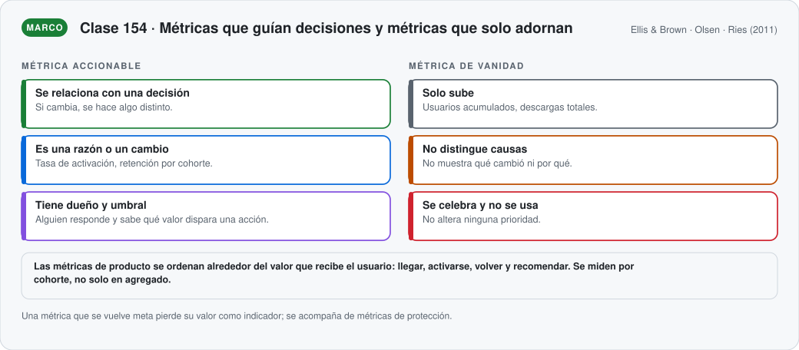

# Clase 154 — Métricas de producto

<!-- nav:inicio -->
> **Parte 12 · Producto e innovación** — clase 10 de 12 · [índice de la parte](../../README.md) · [temario](../../../../SYLLABUS.md)
<!-- nav:fin -->

**Parte:** 12 — Producto e innovación  
**Nivel:** Etapa 3 — Manager → Gerente  
**Duración sugerida:** 150–180 minutos · **Estándar:** deep-class-v2

## 🎯 Propósito

Un equipo de producto sin métricas decide por opinión; con demasiadas métricas, decide por la que sube. Las métricas de producto buscan responder cuatro preguntas básicas: ¿las personas llegan?, ¿obtienen el valor que prometimos?, ¿vuelven?, ¿y el negocio gana? Pero la mayoría de los tableros mezclan indicadores de vanidad (usuarios acumulados, descargas, visitas) con otros accionables, y no distinguen entre medir el **uso** del producto y medir si el uso genera **valor** para el usuario y para la empresa. Elegir bien pocas métricas, definirlas con precisión y leerlas por cohortes es una de las tareas de mayor impacto de un líder de producto.

La clase se apoya en el enfoque de métricas de crecimiento de Ellis y Brown, en la contabilidad de la innovación de Ries, en el análisis de ajuste producto–mercado de Olsen, en el rigor de los experimentos de Kohavi, Tang y Xu y en la guía de indicadores de la clase 100. Al terminar sabrás construir un conjunto jerarquizado de métricas —una guía de valor, indicadores de entrada, de salud y de protección—, leer activación y retención por cohortes, distinguir métricas accionables de las de vanidad y evitar que las metas distorsionen el producto.

## 📚 Resultados de aprendizaje

Al finalizar podrás:

1. **Definir** una métrica guía que capture el valor que recibe el usuario.
2. **Descomponer** esa métrica en indicadores de entrada accionables.
3. **Medir** activación, retención y uso por cohortes.
4. **Distinguir** métricas accionables de métricas de vanidad.
5. **Proteger** el producto de los efectos de convertir métricas en metas.

## 🧭 Agenda

| Tramo | Qué se hace |
|---|---|
| 0–20 min | Recuperación: ¿qué métrica de tu producto celebras más y qué decisión cambió cuando se movió? |
| 20–60 min | Métrica guía, entradas, cohortes, vanidad y protección. |
| 60–105 min | Ejemplo trabajado: métricas de una aplicación de aprendizaje de idiomas. |
| 105–150 min | Caso ejecutivo y práctica. |
| 150–175 min | Límites y entregable. |

## 🧩 Conceptos centrales

| Concepto | Definición | Cómo se reconoce |
|---|---|---|
| **Métrica guía (north star)** | Indicador que mejor refleja el valor que el producto entrega al usuario y se relaciona con el negocio. | Sube cuando el usuario recibe más valor. |
| **Indicador de entrada** | Variable que influye en la métrica guía y que un equipo puede mover. | Activación, frecuencia, amplitud. |
| **Activación** | Momento en que el usuario experimenta el valor central por primera vez. | Evento observable. |
| **Retención por cohorte** | Proporción de usuarios de un mismo período que sigue activa con el tiempo. | Curvas por semana o mes. |
| **Métrica de vanidad** | Cifra que sube sin informar decisiones. | Descargas totales, usuarios registrados. |
| **Métrica de protección** | Indicador que no debe empeorar al optimizar otro. | Calidad, quejas, rendimiento. |

## 🧠 Modelo mental

**Cómo leer el diagrama.** Dos paneles. Una **métrica accionable** se relaciona con una decisión (si cambia, se hace algo distinto), es una razón o un cambio (tasa de activación, retención por cohorte) y tiene dueño y umbral. Una **métrica de vanidad** solo sube (usuarios acumulados, descargas totales), no distingue causas y se celebra sin que altere ninguna prioridad. La nota indica que las métricas de producto se ordenan alrededor del valor que recibe el usuario —llegar, activarse, volver y recomendar— y se miden por cohorte.

## 📖 Desarrollo

### 1. Una métrica guía

Muchos equipos adoptan una **métrica guía** que resume el valor que entregan: por ejemplo, **«semanas con al menos tres sesiones de aprendizaje completadas»** para una aplicación de idiomas, **«pedidos entregados a tiempo por cliente activo»** para un servicio de reparto, **«proyectos con colaboración activa»** para una herramienta de trabajo. Una buena métrica guía: (1) **refleja valor para el usuario**, no solo actividad; (2) **se correlaciona con el éxito del negocio** (retención, ingresos); (3) **es medible y comprensible** para todos; (4) **responde a las acciones del equipo**. Los ingresos mismos son un resultado, no una guía: llegan tarde y no dicen qué mejorar.

### 2. Descomponer en indicadores de entrada

La métrica guía se descompone en **indicadores de entrada** que los equipos pueden mover: **amplitud** (cuántos usuarios llegan y se activan), **profundidad** (cuánto usan), **frecuencia** (cada cuánto vuelven) y **eficiencia** (cuán rápido logran el valor). Ellis y Brown proponen que cada equipo de crecimiento trabaje con **una métrica de entrada principal** a la vez y con experimentos que la muevan. Se evita fijar la métrica guía como meta de cada persona: sirve para alinear. Los indicadores de entrada se revisan semanalmente (clase 103), la métrica guía, mensualmente.

### 3. Activación

La **activación** es el paso crítico entre registrarse y quedarse: el usuario experimenta por primera vez el valor central. Se identifica con datos: ¿qué acción realizada en los primeros días distingue a quienes se quedan de quienes se van? («completar la primera lección», «invitar a un colega», «cargar los primeros datos»). Ellis y Brown llaman a esto el momento «aha». Se mide la **tasa de activación** (usuarios que alcanzan el evento en un plazo, sobre usuarios nuevos) y el **tiempo hasta el primer valor**. Es una de las métricas que más influye en la retención y, por lo tanto, una de las más rentables de mejorar (clases 141 y 142).

### 4. Retención y cohortes

La **retención** muestra si el producto genera hábito o necesidad. Se mide por **cohortes**: se agrupan los usuarios que comenzaron en un mismo período (semana o mes) y se sigue qué porcentaje permanece activo en cada intervalo posterior (curva de retención). Una curva que **se aplana** indica un grupo que se queda; una que cae hasta cero indica falta de ajuste producto–mercado (clase 155). Olsen usa la retención como una de las señales más concretas de ajuste. Se comparan cohortes entre sí para ver si el producto mejora, y por segmentos para saber a quién sirve mejor. El promedio global oculta cohortes buenas y malas.

### 5. Métricas del negocio y economía unitaria

Las métricas de producto deben conectarse con la economía del negocio (clase 117): ingresos por usuario, costo de servir, CAC por canal, margen de contribución, retención de ingresos. Ries propone la **contabilidad de la innovación**: medir con un MVP el punto de partida, ajustar con experimentos y decidir si perseverar o pivotar con métricas **accionables** (basadas en cohortes y con relación causal comprobable) en vez de vanidad. Una métrica de uso que sube mientras los ingresos por usuario bajan puede esconder un problema de modelo de negocio.

### 6. Métricas de vanidad y de protección

Las métricas de **vanidad** (total de registros, descargas acumuladas, visitas) casi siempre suben y no informan decisiones. Se acompañan de métricas **accionables** (razones, tasas, cohortes) y, para evitar daños colaterales, de **métricas de protección**: calidad del servicio, quejas, tiempo de respuesta, rendimiento técnico, satisfacción, tasa de errores. Cuando una métrica se convierte en meta, tiende a ser **manipulada** o a **distorsionar** el producto (clase 100): un equipo premiado por «sesiones por usuario» puede empujar notificaciones molestas. Kohavi, Tang y Xu aconsejan combinar métricas de objetivo y de protección en los experimentos y diseñar un **criterio de evaluación global** que incorpore el equilibrio entre ambas.

### 7. Ritmo, tablero y decisiones

Un buen tablero de producto cabe en una página: métrica guía con su tendencia, tres a cinco indicadores de entrada, activación y retención por cohortes recientes, métricas de protección y los resultados de los experimentos en curso. Se revisa con un **ritmo** (semanal para entradas, mensual para guía y cohortes) y siempre termina en **decisiones**: ¿qué hipótesis probamos?, ¿qué detenemos?, ¿qué escalamos? Se definen **definiciones únicas** de cada métrica (qué es «usuario activo», qué ventana usar) y se documentan los cambios. Las métricas basadas en datos personales deben respetar la normativa de protección de datos y el consentimiento aplicable.

## 📚 Lectura comparada

| Obra | Qué aporta | Qué no resuelve | Pregunta para contrastar |
|---|---|---|---|
| Ellis y Brown | Métrica guía, activación y equipos de crecimiento. | Enfoque en productos digitales. | ¿Cuál es tu momento «aha»? |
| Ries | Contabilidad de la innovación y métricas accionables. | Contexto de startups. | ¿Tu métrica es accionable o de vanidad? |
| Olsen | Retención y señales de ajuste producto–mercado. | Marco general. | ¿Se aplana tu curva de retención? |
| Kohavi, Tang y Xu | Métricas en experimentos: objetivo, protección y criterio global. | Escala de plataformas con tráfico alto. | ¿Qué métrica vigilas para no dañar el producto? |
| Marr (clase 100) | Cómo definir y documentar indicadores. | Visión de gestión general. | ¿Qué decisión informa tu métrica? |

## 🧮 Ejemplo trabajado

**Situación (hipotética).** Una aplicación de aprendizaje de idiomas tiene 900.000 descargas acumuladas, 180.000 usuarios activos mensuales y una suscripción de USD 8 al mes pagada por el 6 % de los activos. El equipo celebra el crecimiento de descargas, pero la retención parece baja y los ingresos crecen más lento.

**Métrica guía.** «Usuarios con al menos tres sesiones completadas por semana durante cuatro semanas» (hábito de aprendizaje). Se correlaciona con la suscripción y la retención: entre quienes la alcanzan, el 38 % paga y retiene al 70 % a 6 meses; en el resto, el 2 % paga y retiene el 31 %.

**Descomposición.**

| Indicador de entrada | Valor actual |
|---|---|
| Usuarios nuevos por semana | 24.000 |
| Activación: completar 2 lecciones en 3 días | 41 % |
| Retención semana 4 de cohorte | 19 % |
| Sesiones por semana de usuarios activos | 2,3 |
| Usuarios que alcanzan la métrica guía | 7 % de los nuevos |

**Lectura por cohortes.** Retención a la semana 4: cohortes de enero 15 %, febrero 17 %, marzo 19 %; la curva se aplana alrededor de la semana 8 (11 %). Los usuarios que llegan por recomendación retienen a 4 semanas al 31 %; los de publicidad pagada, al 12 %. El tiempo medio hasta la primera lección completada es de 2 días y medio; quienes la completan en menos de 24 horas retienen el doble.

**Vanidad frente a accionables.** Descargas acumuladas (vanidad), usuarios registrados (vanidad), sesiones totales (engañosa: crecen con el número de usuarios). Accionables: tasa de activación, retención por cohorte, tiempo hasta la primera lección, porcentaje que alcanza la métrica guía, conversión a pago.

**Experimento.** Mostrar una «lección de 3 minutos» con recompensa inmediata en la primera sesión. Hipótesis: aumenta la activación de 41 % a 50 %. Protección: calidad percibida, quejas y velocidad de carga. Resultado a 3 semanas: activación 48 %; retención a 4 semanas de la cohorte tratada: 22 % (frente a 19 %); sin deterioro de protección.

**Decisión.** Priorizar el primer día (activación), reasignar presupuesto de publicidad hacia canales con mejor retención, y definir tableros con definiciones únicas. El equipo se mide por la métrica guía y la retención, no por descargas. Las notificaciones se limitan para proteger la experiencia.

**Qué muestra.** (1) La métrica guía reflejó valor. (2) Cohortes y canales explicaron la retención. (3) Las métricas de protección evitaron optimizar a costa de la experiencia.

## 🔀 Comparación y límites

**Métricas de producto frente a indicadores de gestión.** Las métricas de producto miden el valor para el usuario y el uso; los indicadores de gestión (clase 100) miden el desempeño del negocio y de los procesos. Se conectan en la economía unitaria y en los OKR.

**Límites.** Ninguna métrica captura todo el valor: el aprendizaje, la confianza o la satisfacción profunda son difíciles de medir. Las métricas de uso pueden premiar la adicción en lugar del beneficio. Las correlaciones entre métrica guía y negocio no prueban causalidad. Las definiciones de «activo» varían entre empresas. Y las métricas basadas en datos de personas deben cumplir las normas de privacidad y consentimiento. Los números del ejemplo son ilustrativos.

## 🪜 De profesional a owner

| Nivel | Cómo trabaja las métricas de producto |
|---|---|
| **Profesional** | Mide con definiciones claras y comparte los datos con el equipo. |
| **Jefe / Team Lead** | Mueve un indicador de entrada con experimentos y lo reporta por cohorte. |
| **Gerente** | Define la métrica guía y protege contra efectos colaterales. |
| **CEO / Director** | Exige métricas ligadas a valor y no a vanidad. |
| **Founder / Owner** | Mira la retención y el pago de los primeros usuarios antes de escalar. |

## 🏢 Caso ejecutivo

Una aplicación de transporte compartido para empresas reporta al directorio: 1,2 millones de usuarios registrados, 60 % de crecimiento mensual de viajes en el último trimestre y un NPS de 52. Los ingresos crecen 18 %. El análisis por cohortes muestra que el crecimiento de viajes proviene de un programa de incentivos con descuentos del 50 % que termina en dos meses; que la retención a 90 días de los usuarios captados con incentivo es de 14 %, frente a 41 % de los orgánicos; que las cancelaciones de conductores subieron de 6 % a 13 % y que las quejas de seguridad se duplicaron. El equipo propone una meta de «viajes por usuario» para el próximo semestre.

Entrega una **arquitectura de métricas de producto** que contenga: (a) la métrica guía propuesta con su justificación y su relación con el negocio; (b) los indicadores de entrada y de protección; (c) la lectura por cohortes y canales del análisis; (d) la identificación de métricas de vanidad en el informe actual; (e) el tablero y el ritmo de revisión con definiciones únicas; (f) los riesgos de la meta «viajes por usuario» y los cuidados de seguridad, datos y normas de transporte que se verificarán.

## 🧪 Práctica

1. Propón una métrica guía para tu producto y justifica su relación con el valor y el negocio.
2. Descompónla en tres a cinco indicadores de entrada.
3. Construye una tabla de retención por cohortes de los últimos seis meses.
4. Identifica tres métricas de vanidad de tu informe y reemplázalas por métricas accionables.
5. Define dos métricas de protección para el próximo experimento.

## ⚠️ Errores frecuentes

| Error | Por qué ocurre | Cómo corregirlo |
|---|---|---|
| Métrica guía = ingresos | Es lo que importa al negocio | Elegir una que refleje valor para el usuario. |
| Medir en agregado | Es más simple | Cohortes y segmentos. |
| Métricas de vanidad | Suben siempre | Razones, tasas y cohortes. |
| Sin protección | Se mira una sola métrica | Calidad, quejas y rendimiento. |
| Metas que distorsionan | Se premia lo medido | Contrapesos y criterios globales. |
| Definiciones variables | No se documentan | Definiciones únicas y control de cambios. |

## ❓ Preguntas de comprobación

1. ¿Qué es una métrica guía y qué cualidades tiene?
2. ¿Cómo se descompone en indicadores de entrada?
3. ¿Qué es la activación y cómo se identifica?
4. ¿Qué ventaja tiene medir por cohortes?
5. ¿Qué distingue una métrica accionable de una de vanidad?
6. ¿Para qué sirven las métricas de protección?
7. ¿Qué límites tienen las métricas de producto?

Claves de respuesta

1. Un indicador que refleja el valor que recibe el usuario, se relaciona con el negocio, es comprensible y responde a las acciones del equipo.
2. En variables que un equipo puede mover, como amplitud, profundidad, frecuencia y eficiencia, con una principal a la vez.
3. El momento en que el usuario experimenta el valor central por primera vez; se identifica con datos comparando qué acciones tempranas distinguen a quienes se quedan.
4. Permite ver cómo evoluciona la retención de grupos comparables y si el producto mejora, evitando que el promedio oculte diferencias.
5. La accionable se relaciona con una decisión, es una razón o cambio y tiene dueño y umbral; la de vanidad solo sube y no cambia prioridades.
6. Para vigilar efectos colaterales, como calidad, quejas o rendimiento, al optimizar otra métrica.
7. Ninguna captura todo el valor, las de uso pueden premiar la adicción, las correlaciones no prueban causalidad y los datos de personas requieren privacidad y consentimiento.

## 📥 Entregable

Guarda en `portfolio/154-metricas-de-producto/`:

- `product-evidence-brief.md` (plantilla [Product evidence brief](../../../../templates/product-evidence-brief.md)) con la arquitectura de métricas del caso ejecutivo;
- `kpi-tree.md` (plantilla [KPI tree](../../../../templates/kpi-tree.md)) con la métrica guía y los indicadores de entrada;
- `decision-journal.md` con las definiciones, el ritmo y los criterios de protección.

## 📗 Fuentes y verificación

- Sean Ellis & Morgan Brown — *Hacking Growth* (Ebury Publishing, 2017). **Uso en esta clase:** métrica guía, activación y equipos de crecimiento. Lectura selectiva sobre **métricas de producto**. **Localizador:** [ISBN-13 9780753545386](https://openlibrary.org/isbn/9780753545386).
- Eric Ries — *The Lean Startup* (Crown Business, 2011). **Uso en esta clase:** contabilidad de la innovación y métricas accionables. Lectura selectiva sobre **métricas de producto**. **Localizador:** [ISBN-13 9780307887894](https://openlibrary.org/isbn/9780307887894).
- Dan Olsen — *The Lean Product Playbook* (Wiley, 2015). **Uso en esta clase:** retención y señales de ajuste producto–mercado. Lectura selectiva sobre **métricas de producto**. **Localizador:** [ISBN-13 9781118960875](https://openlibrary.org/isbn/9781118960875).
- Ron Kohavi, Diane Tang & Ya Xu — *Trustworthy Online Controlled Experiments* (Cambridge University Press, 2020). **Uso en esta clase:** métricas en experimentos: objetivo, protección y criterio global. Lectura selectiva sobre **métricas de producto**. **Localizador:** [ISBN-13 9781108724265](https://openlibrary.org/isbn/9781108724265).
- Bernard Marr — *Key Performance Indicators* (Pearson Financial Times Pub., 2012). **Uso en esta clase:** cómo definir y documentar indicadores. Lectura selectiva sobre **métricas de producto**. **Localizador:** [ISBN-13 9780273750116](https://openlibrary.org/isbn/9780273750116).

> **Regla de fuentes para Métricas de producto:** las obras anteriores estructuran las perspectivas de esta materia; cualquier norma, ley o estándar vivo mencionado debe comprobarse nuevamente en su fuente primaria vigente, incluidas las de protección de datos y de seguridad en transporte. Los ejemplos y casos son hipotéticos, con cifras ilustrativas. El desarrollo es original y no reproduce capítulos protegidos.

<!-- pie:inicio -->
---

| Anterior | Índice | Siguiente |
|---|---|---|
| [← 153 · Experimentos y evidencia](../153-experimentos-y-evidencia/README.md) | [Parte 12](../../README.md) · [Programa](../../../../SYLLABUS.md) | [155 · Product-market fit →](../155-product-market-fit/README.md) |
<!-- pie:fin -->
