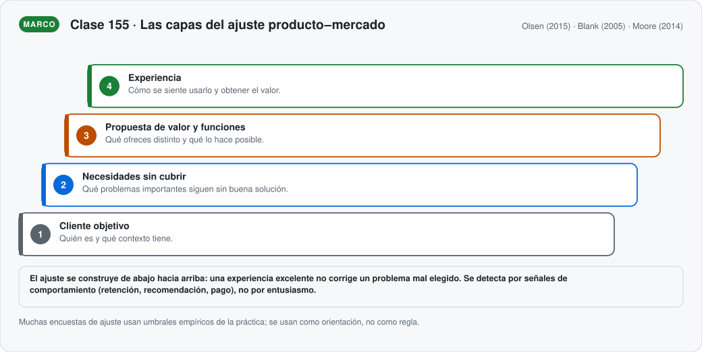

# Clase 155 — Product-market fit

<!-- nav:inicio -->
> **Parte 12 · Producto e innovación** — clase 11 de 12 · [índice de la parte](../../README.md) · [temario](../../../../SYLLABUS.md)
<!-- nav:fin -->

**Parte:** 12 — Producto e innovación  
**Nivel:** Etapa 3 — Manager → Gerente  
**Duración sugerida:** 150–180 minutos · **Estándar:** deep-class-v2

## 🎯 Propósito

«Product-market fit» (ajuste entre producto y mercado) se menciona como la frontera entre una idea y un negocio: antes de él, la empresa busca; después, escala. El término se usa para justificar inversiones, contrataciones y rondas de financiamiento, y pocas veces se define. Algunos lo declaran cuando consiguen sus primeros clientes; otros, cuando crecen rápido gracias a una promoción; otros, nunca. Entender qué significa realmente, cómo se detecta con evidencia y qué hacer cuando no se tiene es una de las competencias más valiosas de un líder de producto o de un fundador, porque escalar sin ajuste quema caja y reputación, y no escalar con ajuste pierde la ventana.

La clase se apoya en la propuesta de Blank sobre desarrollo de clientes y la validación antes de escalar, en la pirámide de ajuste producto–mercado de Olsen, en la visión de adopción por segmentos de Moore, en las prácticas de crecimiento de Ellis y Brown y en la contabilidad de la innovación de Ries. Al terminar sabrás definir el ajuste por señales de comportamiento, usar las pruebas de retención, de pago y de recomendación, distinguir ajuste de entusiasmo de primeros adoptantes, construir un plan para encontrarlo y decidir cuándo escalar.

## 📚 Resultados de aprendizaje

Al finalizar podrás:

1. **Definir** el ajuste producto–mercado en términos de comportamiento observable.
2. **Aplicar** señales de retención, de disposición a pagar y de decepción si desaparece.
3. **Distinguir** ajuste de entusiasmo de primeros adoptantes y de crecimiento comprado.
4. **Ordenar** las capas: cliente objetivo, necesidades, propuesta y experiencia.
5. **Decidir** cuándo escalar, cuándo seguir buscando y cuándo pivotar.

## 🧭 Agenda

| Tramo | Qué se hace |
|---|---|
| 0–20 min | Recuperación: si tu producto desapareciera mañana, ¿cuántos clientes se quedarían realmente sin un reemplazo? |
| 20–60 min | Definición, señales, capas, falsos positivos y decisión. |
| 60–105 min | Ejemplo trabajado: evaluar el ajuste de una plataforma para educadores. |
| 105–150 min | Caso ejecutivo y práctica. |
| 150–175 min | Límites y entregable. |

## 🧩 Conceptos centrales

| Concepto | Definición | Cómo se reconoce |
|---|---|---|
| **Ajuste producto–mercado** | Situación en que un producto satisface bien una necesidad fuerte de un mercado que lo valora. | Retención, pago y recomendación orgánica. |
| **Primeros adoptantes** | Clientes que aceptan novedades imperfectas por una necesidad intensa. | Entusiastas tolerantes a fallas. |
| **Mercado principal** | Clientes pragmáticos que quieren una solución completa y confiable. | Pasan por «el abismo». |
| **Prueba de decepción** | Pregunta «¿cómo te sentirías si no pudieras usar el producto?». | Proporción de «muy decepcionado». |
| **Retención aplanada** | Curva de retención que se estabiliza en un nivel sano. | Un grupo estable permanece. |
| **Crecimiento comprado** | Crecimiento sostenido con incentivos o publicidad que no persiste. | Cae al retirar el estímulo. |

## 🧠 Modelo mental

**Cómo leer el diagrama.** Una escalera de cuatro capas. La base es el **cliente objetivo**: quién es y qué contexto tiene. Sobre él están las **necesidades sin cubrir**: qué problemas importantes siguen sin buena solución. Luego, la **propuesta de valor y las funciones** que la hacen posible. En la cima, la **experiencia**. La nota recuerda que el ajuste se construye de abajo hacia arriba: una experiencia excelente no corrige un problema mal elegido, y que se detecta por señales de comportamiento (retención, recomendación, pago), no por entusiasmo.

## 📖 Desarrollo

### 1. Qué significa estar ajustado

Olsen describe el ajuste producto–mercado como **satisfacer bien las necesidades de un mercado** con una propuesta de valor mejor que las alternativas. Blank lo sitúa en el proceso de desarrollo de clientes: tras descubrir y validar que hay clientes con un problema que pagarían por resolver, se pasa a la creación de clientes y a la expansión. Observacionalmente, el ajuste se manifiesta como **demanda que tira**: los clientes llegan por recomendación, se quedan, pagan, piden más y se quejan cuando falla algo porque dependen del producto. Sin ajuste, el equipo empuja: persigue clientes, descuenta, explica y ve cómo se van.

### 2. Señales de comportamiento

Las señales más confiables son conductas, no opiniones. **Retención**: la curva por cohortes se aplana en un nivel sano (clase 154); si cae hasta cero, no hay ajuste. **Pago y expansión**: los clientes pagan sin descuentos excesivos y amplían su uso. **Recomendación orgánica**: una fracción creciente llega por boca a boca. **Intensidad de la necesidad**: las personas dicen que sería muy difícil volver a la alternativa anterior. **Crecimiento sin estímulo**: el uso continúa cuando se retiran incentivos. Ninguna señal basta sola; la evidencia mejora cuando varias coinciden y se observan en un segmento definido.

### 3. La prueba de decepción

Ellis (con otros coautores) popularizó una pregunta sencilla a los usuarios: **«¿Cómo te sentirías si ya no pudieras usar este producto?»**, con opciones «muy decepcionado», «algo decepcionado» o «no decepcionado». La práctica de Ellis sugiere que, cuando al menos alrededor del 40 % de los usuarios activos responde «muy decepcionado», hay una señal razonable de ajuste. Es una **regla empírica de la práctica**, no una ley: depende de a quién se pregunta (usuarios activos con experiencia suficiente), del tamaño de la muestra y del segmento. Se complementa con preguntas abiertas: ¿qué alternativa usarías?, ¿qué beneficio principal obtienes?, ¿para quién crees que es más útil?

### 4. Las capas del ajuste

La pirámide de Olsen ayuda a diagnosticar: si falta ajuste, ¿en qué capa está el problema? **Cliente objetivo**: ¿se eligió bien a quién servir? **Necesidades insatisfechas**: ¿el problema es importante y está mal resuelto? **Propuesta de valor**: ¿es distinta y mejor que las alternativas? **Conjunto de funciones**: ¿incluye lo necesario para entregar el valor? **Experiencia**: ¿es fácil y agradable? Las capas inferiores condicionan las superiores. Un error común es pulir la experiencia o agregar funciones cuando el problema está en la capa del cliente o de la necesidad. El diagnóstico dirige dónde invertir.

### 5. Entusiastas, abismo y mercado principal

Moore advierte que existe un **abismo** entre los primeros adoptantes —tecnológicamente entusiastas y visionarios, dispuestos a tolerar un producto incompleto— y el **mercado principal**, de pragmáticos que quieren una solución completa, con referencias de pares y soporte. El entusiasmo y las primeras ventas pueden dar una **ilusión de ajuste** que desaparece al intentar vender a los pragmáticos. Su recomendación: concentrar el esfuerzo en un **segmento inicial** específico (clase 135), ofrecer un «producto completo» para él, y expandirse desde allí. El ajuste debe probarse en el segmento al que se quiere escalar, no solo en los entusiastas.

### 6. Falsos positivos

Hay patrones que parecen ajuste y no lo son: **crecimiento comprado** (publicidad o descuentos que impulsan registros que no se quedan); **picos de novedad** (interés inicial que decae); **uso gratuito sin disposición a pagar**; **clientes a medida** (el producto es en realidad un servicio personalizado que no escala); **ajuste con un solo cliente grande**; **entusiasmo de amigos y comunidad**. Se desconfía de métricas agregadas y se examinan cohortes, canales y segmentos. Un test sencillo: ¿qué ocurre si dejamos de gastar en adquisición durante dos meses?

### 7. Qué hacer: escalar, ajustar o pivotar

Con ajuste razonable, se invierte en **escalar** lo que funciona: canales, capacidad, soporte, procesos, y se vigila la economía unitaria (clase 117). Sin ajuste, se **itera** sobre la capa débil: afinar el cliente objetivo, descubrir mejores necesidades, rediseñar la propuesta. Si tras varios ciclos no hay señales, se considera **pivotar** (clase 150) o detener. Ries recomienda definir con anticipación qué indicadores justifican perseverar o pivotar para no decidir por inercia o por orgullo. Escalar antes de tener ajuste multiplica el gasto y la deuda operativa; esperar demasiado tras tenerlo pierde la ventana ante competidores.

## 📚 Lectura comparada

| Obra | Qué aporta | Qué no resuelve | Pregunta para contrastar |
|---|---|---|---|
| Olsen | Capas del ajuste y diagnóstico de dónde falla. | Marco práctico general. | ¿En qué capa está tu problema? |
| Blank | Descubrir y validar antes de escalar. | Contexto de startups. | ¿Qué hipótesis validaste con clientes reales? |
| Moore | Abismo entre primeros adoptantes y mercado principal. | Mercado tecnológico. | ¿Tu ajuste es con entusiastas o pragmáticos? |
| Ellis y Brown | Prueba de decepción y métricas de crecimiento. | La regla del 40 % es empírica. | ¿Qué proporción se decepcionaría? |
| Ries | Criterios de perseverar o pivotar. | Casos seleccionados. | ¿Qué indicadores definen tu decisión? |

## 🧮 Ejemplo trabajado

**Situación (hipotética).** Una plataforma para docentes que crea y comparte evaluaciones con corrección asistida tiene 12.000 docentes registrados en 14 meses, 3.100 activos mensuales, 8 % de ellos en el plan de pago (USD 6 al mes) y un crecimiento de 25 % mensual en registros, apoyado en un programa de referidos con premios. El fundador cree que hay ajuste; el inversionista dudoso pide evidencia.

**Evidencia.**

| Señal | Dato |
|---|---|
| Retención por cohorte a 12 semanas | Cohortes de docentes de educación media: 34 %; de básica: 17 %; universidad: 41 % |
| Prueba de decepción (320 respuestas de usuarios activos) | 31 % «muy decepcionados»; entre docentes de media y universitarios: 47 %; en básica: 14 % |
| Conversión a pago | 11 % en media y universidad; 3 % en básica |
| Origen del crecimiento | 58 % de nuevos viene del programa de referidos con premios; sin premio, la tasa de referido orgánico es 9 % |
| Alternativa que usarían sin el producto | «Planillas y documentos propios» (62 %); «otra plataforma» (21 %) |
| Beneficio principal citado | «Ahorro de tiempo de corrección» (70 %) |

**Diagnóstico por capas.** Cliente objetivo: docentes de educación media y universitarios con grupos grandes (muchas evaluaciones) tienen el problema más intenso; los de básica evalúan de forma distinta. Necesidad: corrección rápida de respuestas abiertas. Propuesta: corrección asistida; en básica, no hay encaje con el tipo de evaluación. Experiencia: aceptable.

**Lectura.** Hay señales de ajuste en un **segmento** (media y universidad: retención 34 % a 41 %, decepción 47 %, pago 11 %), no en el mercado completo. El crecimiento total está inflado por un programa con premios (crecimiento comprado). El 31 % total se debe a la mezcla.

**Prueba del estímulo.** Se suspende el programa de premios en una región durante 8 semanas. Resultado: los registros caen 52 % pero la retención a 12 semanas de los nuevos usuarios de media y universidad se mantiene; los de básica caen más.

**Decisión.** Concentrar el producto, el mensaje y los canales en docentes de educación media y universitarios con grupos grandes; reducir el gasto en el programa de premios; probar una versión para básica solo si hay evidencia con entrevistas; escalar con métricas de segmento. Criterios para escalar inversión: retención a 12 semanas ≥ 35 %, decepción ≥ 40 % en el segmento y conversión a pago ≥ 10 %.

**Qué muestra.** (1) El ajuste existía en un segmento, no en el total. (2) Se identificó crecimiento comprado. (3) La decisión de escalar tuvo criterios previos.

## 🔀 Comparación y límites

**Ajuste frente a éxito de negocio.** El ajuste es necesario, no suficiente: se necesita además economía unitaria sana, canales sostenibles y capacidad de ejecución. Algunos productos con ajuste fracasan por costos o competencia.

**Límites.** El ajuste no es un estado binario sino un **continuo** que varía por segmento y se puede perder si cambian el mercado o la competencia. La regla del 40 % es una orientación de práctica, con muestras pequeñas es poco confiable. Los criterios aplican mejor a productos digitales de adopción individual que a ventas empresariales largas, donde las señales son contratos, renovaciones y expansión. Las declaraciones sobre «ajuste» a inversionistas o clientes deben ser veraces y respaldables.

## 🪜 De profesional a owner

| Nivel | Cómo participa en el ajuste producto–mercado |
|---|---|
| **Profesional** | Trae datos de retención y voz de cliente. |
| **Jefe / Team Lead** | Diagnostica por capas y por segmento. |
| **Gerente** | Define señales y criterios para escalar y los defiende ante la dirección. |
| **CEO / Director** | Evita escalar sin ajuste y evita demorar cuando lo hay. |
| **Founder / Owner** | Desconfía del entusiasmo y mira retención, pago y recomendación. |

## 🏢 Caso ejecutivo

Una empresa de software de gestión para restaurantes ha crecido a 1.800 clientes en dos años con una fuerte inversión en ventas y descuentos de 40 % en el primer año. Su retención de clientes a 12 meses es de 58 %; el equipo de ventas reporta que los clientes de cadenas pequeñas (3 a 10 locales) retienen al 83 %, mientras que los restaurantes independientes retienen al 41 %. Una encuesta de decepción muestra 52 % «muy decepcionados» entre cadenas pequeñas y 17 % entre independientes. La junta directiva propone duplicar el gasto comercial para llegar a 4.000 clientes; el director financiero advierte que el costo de adquirir un cliente independiente supera su valor de vida; el de producto quiere ampliar a cadenas medianas.

Entrega un **diagnóstico de ajuste producto–mercado y decisión** que contenga: (a) las señales por segmento (retención, pago, decepción, origen del crecimiento); (b) el diagnóstico por capas; (c) la identificación de crecimiento comprado y de falsos positivos; (d) los criterios para escalar, ajustar o pivotar y los experimentos que los respaldarían; (e) la recomendación sobre la propuesta de duplicar el gasto y la ampliación a cadenas medianas; (f) los puntos de veracidad en comunicaciones a inversionistas y clientes y las verificaciones legales aplicables.

## 🧪 Práctica

1. Calcula la retención por cohortes y por segmento de tu producto.
2. Aplica la pregunta de decepción a al menos 30 usuarios activos y analiza por segmento.
3. Diagnostica por capas dónde está tu mayor debilidad.
4. Identifica si tu crecimiento depende de estímulos que podrían retirarse.
5. Define tres criterios numéricos para decidir escalar, ajustar o pivotar.

## ⚠️ Errores frecuentes

| Error | Por qué ocurre | Cómo corregirlo |
|---|---|---|
| Declarar ajuste por las primeras ventas | Se confunde interés con ajuste | Retención, pago y recomendación orgánica. |
| Agregar funciones para un problema de cliente | Se corrige la capa equivocada | Diagnóstico por capas. |
| Escalar con crecimiento comprado | Se mira el volumen | Probar sin estímulos. |
| Promediar segmentos | Es más simple | Analizar por segmento y cohorte. |
| Confiar en entusiastas | Son quienes responden | Probar con el mercado al que se quiere llegar. |
| Aplicar el 40 % como ley | Es una regla simple | Usarla como orientación con muestra suficiente. |

## ❓ Preguntas de comprobación

1. ¿Qué es el ajuste producto–mercado en términos de comportamiento?
2. ¿Qué señales confiables lo indican?
3. ¿Qué es la prueba de decepción y qué límites tiene?
4. ¿Cuáles son las capas del ajuste y por qué importa su orden?
5. ¿Qué es el abismo según Moore?
6. ¿Qué son los falsos positivos de ajuste?
7. ¿Cuándo conviene escalar, ajustar o pivotar?

Claves de respuesta

1. Que los clientes llegan por recomendación, se quedan, pagan, amplían su uso y sentirían la falta del producto, es decir, demanda que tira.
2. Retención aplanada en un nivel sano, pago y expansión, recomendación orgánica, intensidad de la necesidad y crecimiento sin estímulos.
3. Preguntar cómo se sentirían sin el producto; en la práctica, alrededor del 40 % de «muy decepcionados» entre usuarios activos sugiere ajuste, pero es una regla empírica sensible a la muestra y al segmento.
4. Cliente objetivo, necesidades sin cubrir, propuesta de valor y funciones, y experiencia; se construye de abajo hacia arriba, y las capas inferiores condicionan las superiores.
5. La brecha entre los primeros adoptantes, tolerantes a productos incompletos, y el mercado principal de pragmáticos que quieren soluciones completas.
6. Patrones que parecen ajuste pero no lo son, como crecimiento comprado, picos de novedad, uso gratuito sin pago, clientes a medida o dependencia de un cliente grande.
7. Se escala cuando las señales se sostienen en el segmento objetivo; se ajusta la capa débil si faltan señales; se pivota o detiene si tras varios ciclos no aparecen.

## 📥 Entregable

Guarda en `portfolio/155-product-market-fit/`:

- `product-evidence-brief.md` (plantilla [Product evidence brief](../../../../templates/product-evidence-brief.md)) con el diagnóstico del caso ejecutivo;
- `venture-validation.md` (plantilla [Venture validation](../../../../templates/venture-validation.md)) con las señales y los criterios de decisión;
- `decision-journal.md` con los experimentos, el segmento elegido y las condiciones de escalamiento.

## 📗 Fuentes y verificación

- Dan Olsen — *The Lean Product Playbook* (Wiley, 2015). **Uso en esta clase:** capas del ajuste y diagnóstico de dónde falla. Lectura selectiva sobre **product-market fit**. **Localizador:** [ISBN-13 9781118960875](https://openlibrary.org/isbn/9781118960875).
- Steve Blank — *The Four Steps to the Epiphany* ([Steve Blank?], 2013). **Uso en esta clase:** descubrir y validar antes de escalar. Lectura selectiva sobre **product-market fit**. **Localizador:** [ISBN-13 9780989200509](https://openlibrary.org/isbn/9780989200509).
- Geoffrey A. Moore — *Crossing the Chasm* (HarperBusiness, 1995). **Uso en esta clase:** abismo entre primeros adoptantes y mercado principal. Lectura selectiva sobre **product-market fit**. **Localizador:** [ISBN-13 9780887307171](https://openlibrary.org/isbn/9780887307171).
- Sean Ellis & Morgan Brown — *Hacking Growth* (Ebury Publishing, 2017). **Uso en esta clase:** prueba de decepción y métricas de crecimiento. Lectura selectiva sobre **product-market fit**. **Localizador:** [ISBN-13 9780753545386](https://openlibrary.org/isbn/9780753545386).
- Eric Ries — *The Lean Startup* (Crown Business, 2011). **Uso en esta clase:** criterios de perseverar o pivotar. Lectura selectiva sobre **product-market fit**. **Localizador:** [ISBN-13 9780307887894](https://openlibrary.org/isbn/9780307887894).

> **Regla de fuentes para Product-market fit:** las obras anteriores estructuran las perspectivas de esta materia; cualquier norma, ley o estándar vivo mencionado debe comprobarse nuevamente en su fuente primaria vigente, incluidas las que rigen las declaraciones a inversionistas y clientes. Los ejemplos y casos son hipotéticos, con cifras ilustrativas. El desarrollo es original y no reproduce capítulos protegidos.

<!-- pie:inicio -->
---

| Anterior | Índice | Siguiente |
|---|---|---|
| [← 154 · Métricas de producto](../154-metricas-de-producto/README.md) | [Parte 12](../../README.md) · [Programa](../../../../SYLLABUS.md) | [156 · Capstone: comité de producto →](../156-capstone-comite-de-producto/README.md) |
<!-- pie:fin -->
