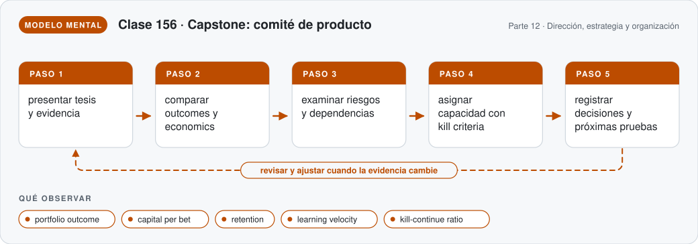

# Clase 156 — Capstone: comité de producto

<!-- nav:inicio -->
> **Parte 12 · Producto e innovación** — clase 12 de 12 · [índice de la parte](../../README.md) · [temario](../../../../SYLLABUS.md)
<!-- nav:fin -->

**Parte:** 12 — Producto e innovación  
**Nivel:** Etapa 3 — Manager → Gerente  
**Duración sugerida:** 150–180 minutos · **Estándar:** deep-class-v2

## 🎯 Propósito

Un comité de producto es el lugar donde se decide en qué apostar, con cuánta evidencia y cuánto riesgo. Es también donde con más frecuencia se toman malas decisiones por buenas razones aparentes: se premia la presentación más pulida y no la evidencia más sólida, se aprueban funciones que alguien poderoso quiere, se financian iniciativas completas sin haber probado sus supuestos centrales, o se cancelan apuestas valiosas por una métrica mal interpretada. Lo que distingue a un buen comité no es la brillantez de sus miembros sino la calidad de su **proceso**: qué evidencia exige, qué preguntas hace y cómo registra sus decisiones.

Este capstone integra la parte 12: producto frente a proyecto (145), problema y resultado (146), descubrimiento de clientes (147), trabajos a realizar (148), prototipos (149), producto mínimo viable (150), roadmap de resultados (151), priorización por costo de oportunidad (152), experimentos (153), métricas (154) y ajuste producto–mercado (155). Se apoya en Cagan, Perri, Torres, Ries, Olsen, Christensen, Reinertsen y en la literatura sobre gestión de la innovación (Henderson y Clark; Cooper). Al terminar sabrás preparar y evaluar una propuesta con evidencia, someterla a preguntas críticas y decidir por etapas con criterios de detención.

## 📚 Resultados de aprendizaje

Al finalizar podrás:

1. **Estructurar** una propuesta de producto con problema, evidencia, valor, riesgos y decisión solicitada.
2. **Evaluar** la fuerza de la evidencia de cada afirmación.
3. **Decidir** la inversión por etapas, con hitos y criterios de detención.
4. **Distinguir** tipos de innovación y su riesgo organizacional.
5. **Registrar** la decisión y el aprendizaje del comité.

## 🧭 Agenda

| Tramo | Qué se hace |
|---|---|
| 0–20 min | Recuperación: ordena cuatro tipos de evidencia (opinión, anécdota, dato observacional, experimento) de más débil a más fuerte y da un ejemplo de cada una de tu empresa. |
| 20–60 min | Estructura de la propuesta, escala de evidencia, tipos de innovación y decisión por etapas. |
| 60–105 min | Ejemplo trabajado: un comité evalúa tres propuestas con evidencia distinta. |
| 105–150 min | Caso ejecutivo integrado. |
| 150–175 min | Rúbrica, límites y entregable. |

## 🧩 Conceptos centrales

| Concepto | Definición | Cómo se reconoce |
|---|---|---|
| **Comité de producto** | Instancia que decide inversión y prioridades en producto. | Decide con criterios y registra sus razones. |
| **Escala de evidencia** | Ordenamiento de las fuentes de información según su fuerza para sostener una afirmación. | Opinión, anécdota, observacional, experimento. |
| **Inversión por etapas** | Financiamiento de una apuesta en tramos ligados a hitos de aprendizaje. | Cada tramo desbloquea el siguiente. |
| **Innovación incremental y arquitectónica** | Mejora de componentes frente a reconfiguración de cómo se combinan. | Distinto impacto en la organización. |
| **Puerta (gate)** | Punto de decisión para continuar, ajustar o detener. | Criterios definidos de antemano. |
| **Registro de decisiones** | Documento con lo decidido, razón, evidencia y supuestos. | Permite aprender después. |

## 🧠 Modelo mental

**Cómo leer el diagrama.** Tres columnas. La **evidencia** reúne el problema y el usuario validados (146–148), las pruebas y experimentos (149, 150, 153) y las métricas y señales de ajuste (154–155). **Valor y estrategia** reúne el resultado esperado y el roadmap (151), la priorización y el costo de oportunidad (152) y la distinción entre producto y proyecto (145). **Decisión** reúne lo que se pide al comité y con qué condiciones, los criterios para perseverar, ajustar o detener y el dueño, calendario y revisión. La nota recuerda que el comité no premia la mejor idea sino la mejor evidencia.

## 📖 Desarrollo

### 1. La propuesta que un comité puede juzgar

Una propuesta útil cabe en dos a cuatro páginas: **problema y usuario** (clase 146) con evidencia; **resultado esperado** con línea base, meta y plazo; **trabajo a realizar** y alternativas del cliente (148); **solución propuesta y alternativas** consideradas; **suposiciones críticas** y cuáles se probaron (149, 150, 153); **riesgos** de valor, usabilidad, viabilidad técnica y de negocio (145); **economía** (inversión, costos, ingresos esperados, sensibilidad); **plan por etapas** con hitos y criterios; y **decisión solicitada**. Cagan recomienda que las propuestas lleguen al comité con **evidencia de descubrimiento**, no con intuiciones. Un comité que solo recibe presentaciones de solución no puede evaluar si el problema existe.

### 2. Evaluar la fuerza de la evidencia

Se aplica una escala. **Opinión** (de expertos o directivos): la más débil. **Anécdota** (un cliente, un caso). **Datos observacionales** (patrones de uso, encuestas): útiles, con riesgo de confusión. **Experimento** con grupo de control o **compromisos reales de clientes** (pagos, pilotos, contratos): la más fuerte. Para cada afirmación central de la propuesta —«hay un problema grande», «los clientes pagarán», «podemos construirlo», «el costo es X»— se pregunta: **¿qué evidencia tenemos y cuán fuerte es?** Kahneman, Sibony y Sunstein sugieren además recoger juicios individuales antes de discutir, para reducir la influencia de quien habla primero o tiene más rango.

### 3. Tipos de innovación y riesgo organizacional

No todas las apuestas son iguales. Henderson y Clark distinguen la innovación **incremental** (mejora componentes dentro de la arquitectura existente), **modular** (cambia un componente sin cambiar la arquitectura), **arquitectónica** (reconfigura cómo se combinan los componentes) y **radical** (cambia componentes y arquitectura). La arquitectónica es la más difícil para las empresas establecidas porque exige cambiar canales de información y formas de trabajo que el éxito pasado consolidó. Christensen añade que las innovaciones **disruptivas** suelen empezar en segmentos que los líderes ignoran por poco rentables. Un comité debe preguntar qué tipo de apuesta es y si la organización tiene la capacidad de ejecutarla.

### 4. Inversión por etapas y puertas

Cooper describe los sistemas de **etapas y puertas** (*stage-gate*) para gestionar desarrollos de productos: se divide el trabajo en etapas (descubrimiento, definición, desarrollo, prueba, lanzamiento), con una **puerta** al final de cada una en que se decide continuar, ajustar o detener, con criterios definidos. Aplicado con rigidez, puede volverse burocrático y lento; aplicado con criterio (y adaptado a ciclos ágiles), da **disciplina de inversión**: se libera dinero a medida que se reduce la incertidumbre. En la práctica: una primera etapa de bajo costo para probar la suposición más arriesgada, una segunda para validar la economía y una tercera para escalar. Reinertsen añade que las decisiones deben tomarse con rapidez y con la mejor información económica disponible.

### 5. Preguntas críticas del comité

Un comité efectivo hace preguntas que desafían sin humillar: **¿Cuál es la suposición que, si fuera falsa, invalida la propuesta? ¿Cómo la probaron? ¿Qué harían con un resultado contrario? ¿Qué alternativa cero (no hacer nada) y qué otras soluciones consideraron? ¿Qué sabemos de los clientes que no compran? ¿Cuál es el costo del retraso y el costo de oportunidad? ¿Qué cambia en la organización si funciona? ¿Qué falla primero en la ejecución? ¿Cuál es la peor consecuencia razonable?** También se realiza un **premortem** («imaginemos que fracasó en dos años: ¿por qué?») y se pide a alguien que haga de **abogado del diablo**. Se registran los desacuerdos y las condiciones.

### 6. Decidir con condiciones

Las decisiones posibles son: **aprobar por etapas** (liberar el primer tramo con hitos), **aprobar con condiciones** (por ejemplo, contratos firmados o aprobación regulatoria), **pedir más evidencia** con plazo y criterio de lo que se necesita, **aprobar una versión menor** o **rechazar** con razones. Se definen **criterios de detención** antes de comenzar (qué resultado, en qué fecha, hará que se pause o se cierre, clase 083), un **dueño** con autoridad, un **calendario de informes** y la **revisión posterior** (a 6 y 12 meses). Perri destaca que la responsabilidad por **resultados** requiere que el comité asigne objetivos y no listas de funciones.

### 7. Registrar y aprender

El comité registra cada decisión: propuesta, evidencia presentada, preguntas y respuestas, desacuerdos, decisión, condiciones, criterios y fecha de revisión. A los 6 y 12 meses se compara lo ocurrido con lo esperado: ¿qué supuestos se cumplieron?, ¿qué sesgos aparecieron (optimismo, costo hundido)?, ¿qué haríamos distinto? También se evalúa el **proceso del comité**: ¿qué proporción de aprobaciones llegó a sus metas?, ¿cuánto tardó en decidir?, ¿se usaron las preguntas críticas?, ¿se detuvieron a tiempo las apuestas que no funcionaban? Un comité que no mide su propia calidad repite sus errores.

## 📚 Lectura comparada

| Obra | Qué aporta | Qué no resuelve | Pregunta para contrastar |
|---|---|---|---|
| Cagan | Descubrimiento, cuatro riesgos y equipos empoderados. | Experiencia de empresas de tecnología. | ¿Qué riesgo no se ha probado? |
| Perri | Resultados y estrategia de producto. | Enfoque organizacional. | ¿Qué resultado se le pide al equipo? |
| Henderson y Clark (1990) | Tipos de innovación y fracaso de empresas establecidas ante la arquitectónica. | Estudio de industrias específicas. | ¿Qué tipo de apuesta es esta? |
| Cooper (1990) | Sistema de etapas y puertas. | Puede volverse rígido. | ¿Qué criterio tiene cada puerta? |
| Christensen (*Innovator's Dilemma*) | Innovación disruptiva y segmentos ignorados. | Teoría con excepciones. | ¿Qué segmento estás desatendiendo? |

## 🧮 Ejemplo trabajado

**Situación (hipotética).** El comité de producto de una empresa de software para clínicas, con un presupuesto trimestral de USD 900.000 para nuevas apuestas, evalúa tres propuestas.

| Propuesta | Inversión pedida | Evidencia presentada |
|---|---|---|
| A. Módulo de telemedicina | USD 600.000 | Una encuesta a 40 clientes (80 % «sería útil»); dos clientes lo piden; cinco competidores lo ofrecen |
| B. Recordatorios inteligentes para reducir inasistencias | USD 250.000 | 18 entrevistas; datos propios (inasistencia de 17 %); prueba de concepto con 3 clínicas durante 8 semanas: la inasistencia bajó de 17 % a 12 % frente a clínicas de comparación sin cambio |
| C. Reconfigurar la plataforma como red abierta de aplicaciones de terceros | USD 1,4 millones | Visión estratégica; entrevistas a 6 aliados potenciales; sin pruebas |

**Evaluación del comité con la escala de evidencia.**

- **A**: la evidencia es de opinión y de encuesta de intención (débil); la telemedicina es una función que casi todos tienen; hay riesgos regulatorios (se verifican con la normativa de salud vigente y con el área legal) y de adopción; el valor diferencial es incierto. Decisión: **no financiar el módulo completo**; aprobar USD 40.000 para entrevistas de decisión y un piloto de «mago de Oz» con dos clínicas, con criterios: al menos 30 % de los pacientes de esas clínicas con consulta virtual usándola dos veces en un mes y disposición a pagar.
- **B**: evidencia fuerte (comparación con grupo de control, aunque pequeño); valor medible: reducir 5 puntos de inasistencia en una clínica con 8.000 citas al mes equivale a 400 citas más atendidas, unos USD 24.000 mensuales a USD 60 por cita; con 70 clínicas clientes, el potencial es considerable. Riesgo: la muestra es pequeña y el efecto de novedad. Decisión: **aprobar USD 250.000 por etapas**: USD 80.000 para ampliar a 15 clínicas durante 12 semanas con un diseño de control y métricas de protección (quejas, opt-out), y el resto condicionado a que la reducción sea ≥ 3 puntos con intervalo de confianza que excluya cero.
- **C**: innovación arquitectónica y de alto riesgo para una empresa cuyo éxito depende de su arquitectura actual; sin evidencia de demanda; alta inversión. Decisión: **no aprobar**; encargar a un equipo pequeño un descubrimiento de 8 semanas (USD 60.000) con 10 aliados en un caso específico, y volver al comité con evidencia de compromiso (acuerdos de integración o ingresos).

**Registro.** Se anotan las preguntas y los desacuerdos (el director comercial insistió en A por presión de clientes; el de tecnología, en C por visión). Se acuerdan criterios, dueños y revisión a 90 días. Premortem de B: «fracasó porque los mensajes molestaron a los pacientes o porque las clínicas no los configuraron»; mitigación: control de frecuencia y configuración asistida.

**Asignación.** Aprobado en total USD 80.000 + 40.000 + 60.000 = USD 180.000 de los USD 900.000 disponibles para el trimestre; el resto se reserva para el siguiente tramo de B si se cumplen los criterios y para nuevas apuestas.

**Qué muestra.** (1) La evidencia de cada propuesta fue distinta y se juzgó en consecuencia. (2) Las decisiones fueron por etapas con criterios. (3) Se registró el proceso y se distinguieron tipos de innovación.

## 🔀 Comparación y límites

**Comité de producto frente a equipo de producto.** El equipo descubre y construye; el comité asigna inversión y define el contexto estratégico. Si el comité decide qué funciones construir, vuelve a la trampa de la construcción (clase 145).

**Límites.** Los comités pueden volverse lentos y burocráticos; la rapidez se logra con criterios claros y delegación para decisiones pequeñas. Las etapas y puertas pueden frenar la innovación si se aplican de forma rígida. La evidencia perfecta no existe, y esperar a tenerla también cuesta. Los casos de innovación arquitectónica son difíciles de evaluar con la misma vara que las mejoras incrementales. Las cifras son ilustrativas. Las propuestas con implicancias regulatorias, de datos o contractuales requieren asesoría especializada.

## 🪜 De profesional a owner

| Nivel | Cómo participa en el comité de producto |
|---|---|
| **Profesional** | Aporta evidencia precisa y reconoce lo que no sabe. |
| **Jefe / Team Lead** | Presenta propuestas con problema, evidencia y plan por etapas. |
| **Gerente** | Evalúa con la escala de evidencia y decide con condiciones. |
| **CEO / Director** | Protege el proceso, la evidencia y el derecho a detener apuestas. |
| **Founder / Owner** | Decide con su propio capital y se obliga a probar antes de comprometerlo todo. |

## 🏢 Caso ejecutivo

Una empresa de tecnología financiera para pequeños comercios (800 empleados) tiene un comité de producto que se reúne cada trimestre. Este trimestre recibe cuatro propuestas con un presupuesto total de USD 6 millones: (A) tarjeta de crédito propia para clientes comerciantes (USD 3 millones; evidencia: encuesta de interés a 300 comercios, 62 % «interesados»; riesgo regulatorio y de crédito); (B) automatizar la conciliación contable con un asistente de inteligencia artificial (USD 1,2 millones; piloto con 25 comercios: ahorro de 6 horas mensuales y 78 % lo mantiene tras tres meses; se paga en 60 % de los casos); (C) rediseñar la aplicación móvil (USD 1,5 millones; evidencia: opiniones del equipo y reseñas, sin métricas de uso); (D) programa de educación financiera para comerciantes (USD 300.000; entrevistas, sin datos de efecto). El director general quiere aprobar A por su potencial; el de riesgo advierte exposición de crédito y regulación; el de producto, B; marketing, C.

Entrega un **memo de decisión del comité** que contenga: (a) la evaluación de cada propuesta con la escala de evidencia y los tipos de riesgo; (b) la clasificación de los tipos de innovación y las capacidades requeridas; (c) la decisión por propuesta con etapas, hitos, criterios de detención y dueños; (d) el análisis del costo de oportunidad y del costo del retraso para el orden; (e) las preguntas críticas y el premortem de la propuesta que se apruebe; (f) las verificaciones regulatorias (crédito, datos financieros) con las fuentes vigentes y asesoría legal, y el registro de la decisión.

## 🧪 Práctica

1. Reescribe una propuesta real como documento de tres páginas con evidencia clasificada.
2. Clasifica cada afirmación de una propuesta según la escala de evidencia.
3. Diseña una inversión por etapas con tres hitos y criterios de detención.
4. Escribe diez preguntas críticas y un premortem para una propuesta.
5. Redacta el registro de una decisión con evidencia, desacuerdos y fecha de revisión.

## ⚠️ Errores frecuentes

| Error | Por qué ocurre | Cómo corregirlo |
|---|---|---|
| Premiar la mejor presentación | Se juzga la forma | Escala de evidencia y preguntas críticas. |
| Financiar todo de una vez | Se evita volver al comité | Inversión por etapas. |
| No tener criterios de detención | Se evita el conflicto | Definirlos antes de gastar. |
| Decidir por la voz más fuerte | Presión de poder | Juicios independientes antes de discutir. |
| Tratar toda innovación igual | Se ignora la arquitectura | Distinguir tipos y capacidades. |
| No revisar decisiones | Se pasa al siguiente tema | Revisión posterior a 6 y 12 meses. |

## ❓ Preguntas de comprobación

1. ¿Qué debe contener una propuesta evaluable?
2. ¿Cómo se ordena la evidencia de más débil a más fuerte?
3. ¿Qué diferencia hay entre innovación incremental y arquitectónica?
4. ¿Qué es una puerta y para qué sirve?
5. ¿Qué preguntas críticas debe hacer un comité?
6. ¿Qué decisiones posibles tiene, además de aprobar o rechazar?
7. ¿Qué se registra y se revisa después?

Claves de respuesta

1. Problema y usuario con evidencia, resultado esperado, trabajo a realizar, alternativas, suposiciones críticas y su prueba, riesgos, economía, plan por etapas y decisión solicitada.
2. Opinión, anécdota, datos observacionales y experimento o compromisos reales de clientes.
3. La incremental mejora componentes dentro de la arquitectura existente; la arquitectónica reconfigura cómo se combinan, lo que exige cambiar canales de información y formas de trabajo.
4. Un punto de decisión al final de una etapa para continuar, ajustar o detener, con criterios definidos de antemano; permite liberar inversión a medida que se reduce la incertidumbre.
5. Cuál es la suposición que invalida la propuesta, cómo se probó, qué alternativas hay, qué pasa si falla, qué cambia en la organización y cuál es la peor consecuencia razonable.
6. Aprobar por etapas, con condiciones, pedir más evidencia con plazo, aprobar una versión menor o rechazar con razones.
7. La decisión, la evidencia, las preguntas, los desacuerdos, las condiciones, los criterios y la fecha de revisión; luego se compara con lo ocurrido a los 6 y 12 meses.

## 📥 Entregable

Guarda en `portfolio/156-capstone-comite-de-producto/`:

- `product-evidence-brief.md` (plantilla [Product evidence brief](../../../../templates/product-evidence-brief.md)) con la evaluación de las cuatro propuestas del caso ejecutivo;
- `leadership-decision-brief.md` (plantilla [Leadership Decision Brief](../../../../templates/leadership-decision-brief.md)) con el memo de decisión y las etapas;
- `modelo-financiero-y-memo-de-decision.md` (plantilla [Modelo financiero y memo de decisión](../../../../templates/modelo-financiero-y-memo-de-decision.md)) con la economía y la sensibilidad de la propuesta aprobada;
- `decision-journal.md` con las preguntas, los desacuerdos, los criterios y la fecha de revisión.

## 📗 Fuentes y verificación

- Marty Cagan — *Inspired* (Shroff, 2008). **Uso en esta clase:** descubrimiento, cuatro riesgos y equipos empoderados. Lectura selectiva sobre **capstone: comité de producto**. **Localizador:** [ISBN-13 9789352131501](https://openlibrary.org/isbn/9789352131501).
- Melissa Perri — *Escaping the Build Trap* (O'Reilly, 2019). **Uso en esta clase:** resultados y estrategia de producto. Lectura selectiva sobre **capstone: comité de producto**. **Localizador:** [ISBN-13 9781491973790](https://openlibrary.org/isbn/9781491973790).
- Rebecca M. Henderson & Kim B. Clark — *Architectural Innovation: The Reconfiguration of Existing Product Technologies and the Failure of Established Firms* (Administrative Science Quarterly, 1990). **Uso en esta clase:** tipos de innovación y fracaso de empresas establecidas ante la arquitectónica. Lectura selectiva sobre **capstone: comité de producto**. **Localizador:** [DOI 10.2307/2393549](https://doi.org/10.2307/2393549).
- Robert G. Cooper — *Stage-gate systems: A new tool for managing new products* (Business Horizons, 1990). **Uso en esta clase:** sistema de etapas y puertas. Lectura selectiva sobre **capstone: comité de producto**. **Localizador:** [DOI 10.1016/0007-6813(90)90040-i](https://doi.org/10.1016/0007-6813(90)90040-i).
- Clayton M. Christensen — *The Innovator's Dilemma* (Harvard Business School Press, 1997). **Uso en esta clase:** innovación disruptiva y segmentos ignorados. Lectura selectiva sobre **capstone: comité de producto**. **Localizador:** [ISBN-13 9780875845852](https://openlibrary.org/isbn/9780875845852).

> **Regla de fuentes para Capstone: comité de producto:** las obras anteriores estructuran las perspectivas de esta materia; cualquier norma, ley o estándar vivo mencionado debe comprobarse nuevamente en su fuente primaria vigente, incluidas las regulaciones de salud, crédito y datos financieros. Los ejemplos y casos son hipotéticos y no describen a ninguna empresa real. El desarrollo es original y no reproduce capítulos protegidos.

<!-- pie:inicio -->
---

| Anterior | Índice | Siguiente |
|---|---|---|
| [← 155 · Product-market fit](../155-product-market-fit/README.md) | [Parte 12](../../README.md) · [Programa](../../../../SYLLABUS.md) | [157 · Qué es y qué no es estrategia →](../../../13-strategy-competition/classes/157-que-es-y-que-no-es-estrategia/README.md) |
<!-- pie:fin -->
