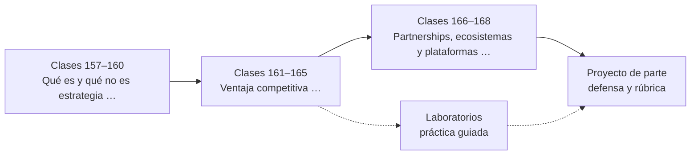

# Parte 13 — Estrategia y competencia

<!-- parte:inicio -->

> ← [Parte 12 — Producto e innovación](../12-product-innovation/README.md) · [Temario](../../SYLLABUS.md) · [Parte 14 — Diseño organizacional, cultura y cambio](../14-organization-design-culture-change/README.md) →

*Hacer elecciones coherentes sobre dónde competir, cómo ganar y qué no hacer*

**Etapa:** 4 — Dirección, estrategia y organización  
**Duración:** 12 clases · 30 horas  
**Resultado de salida:** Hacer elecciones coherentes sobre dónde competir, cómo ganar y qué no hacer.

🟠 [Ver las 6 etapas](../../SYLLABUS.md) · 12 clases (157–168) · 4 laboratorios · [proyecto de parte](project.md)

## 🎯 De qué trata esta parte

Estrategia no es un plan ni un deseo: es un conjunto de elecciones que renuncian a algo. Esta parte enseña a diagnosticar, elegir y hacer coherentes las decisiones con esa elección.

El eje es **trade-off explícito**. Una estrategia que no deja nada fuera no es estrategia. Se estudian industria, capacidades, ventaja, modelo de negocio, escenarios y crecimiento.

## 🧱 Con qué hay que llegar

| Parte | Qué aporta |
|---|---|
| [09 — Finanzas y contabilidad para gerentes](../09-managerial-finance-accounting/README.md) | Economía del negocio. |
| [11 — Marketing, cliente y crecimiento](../11-marketing-customers-growth/README.md) | Mercado y posicionamiento. |
| [12 — Producto e innovación](../12-product-innovation/README.md) | Producto y evidencia. |

Cada clase supone la anterior: el orden importa, y saltarse una deja sin base a las que vienen después.

## 📚 Resultados de la parte

Al terminar esta parte podrás:

1. **Diferenciar** estrategia de plan y de aspiración.
2. **Diagnosticar** industria, competidores y capacidades.
3. **Sustentar** una ventaja y los trade-offs que exige.
4. **Comparar** modelos de negocio y opciones de crecimiento.
5. **Redactar** un strategy memo que pueda ser refutado.

## 🗺️ Mapa de la parte

## 🧭 Cómo se encadenan las 12 clases

Las clases **157 a 160** diagnostican: qué es estrategia, el diagnóstico, la industria y las capacidades.

Las clases **161 a 165** eligen: ventaja, trade-offs, modelo de negocio, escenarios y crecimiento.

Las clases **166 a 168** ejecutan y cierran: alianzas, adaptación y el capstone de strategy memo.

## 📘 Las 12 clases

| # | Clase | Qué se trabaja | Entregable | Min |
|---:|---|---|---|---:|
| 157 | [Qué es y qué no es estrategia](classes/157-que-es-y-que-no-es-estrategia/README.md) | Estrategia, Desafío crítico, Política guía | [strategy-memo](../../templates/strategy-memo.md) | 150 |
| 158 | [Diagnóstico estratégico](classes/158-diagnostico-estrategico/README.md) | Diagnóstico estratégico, Desafío crítico, Hecho | [strategy-memo](../../templates/strategy-memo.md) | 150 |
| 159 | [Industria y fuerzas competitivas](classes/159-industria-y-fuerzas-competitivas/README.md) | Estructura de la industria, Barrera de entrada, Costo de cambio | [strategy-memo](../../templates/strategy-memo.md) | 150 |
| 160 | [Capacidades y recursos](classes/160-capacidades-y-recursos/README.md) | Recurso, Capacidad, Ventaja sostenida | [operating-improvement-brief](../../templates/operating-improvement-brief.md) | 150 |
| 161 | [Ventaja competitiva](classes/161-ventaja-competitiva/README.md) | Ventaja competitiva, Liderazgo en costos, Diferenciación | [strategy-memo](../../templates/strategy-memo.md) | 150 |
| 162 | [Trade-offs y coherencia](classes/162-trade-offs-y-coherencia/README.md) | Trade-off, Encaje (fit), Atrapado en el medio | [risk-governance-brief](../../templates/risk-governance-brief.md) | 150 |
| 163 | [Modelo de negocio](classes/163-modelo-de-negocio/README.md) | Modelo de negocio, Propuesta de valor, Fuente de ingresos | [strategy-memo](../../templates/strategy-memo.md) | 150 |
| 164 | [Escenarios estratégicos](classes/164-escenarios-estrategicos/README.md) | Escenario, Pregunta focal, Fuerza motriz | [strategy-memo](../../templates/strategy-memo.md) | 150 |
| 165 | [Opciones de crecimiento](classes/165-opciones-de-crecimiento/README.md) | Penetración, Nuevos mercados, Nuevos productos | [strategy-memo](../../templates/strategy-memo.md) | 150 |
| 166 | [Partnerships, ecosistemas y plataformas](classes/166-partnerships-ecosistemas-y-plataformas/README.md) | Alianza, Plataforma, Efecto de red | [leadership-decision-brief](../../templates/leadership-decision-brief.md) | 150 |
| 167 | [Ejecución y adaptación de estrategia](classes/167-ejecucion-y-adaptacion-de-estrategia/README.md) | Brecha de ejecución, Supuesto crítico, Señal temprana | [strategy-memo](../../templates/strategy-memo.md) | 150 |
| 168 | [Capstone: strategy memo](classes/168-capstone-strategy-memo/README.md) | Memo de estrategia, Decisión solicitada, Alternativa cero | [leadership-decision-brief](../../templates/leadership-decision-brief.md) | 150 |

## ⚠️ Riesgos característicos

- Llamar estrategia a una lista de iniciativas.
- No renunciar a nada.
- Copiar la ventaja de otro sin sus capacidades.
- No definir qué señal obligaría a cambiar de rumbo.

## 🔤 Glosario de la parte

70 conceptos definidos en las clases, con la definición operacional que usa cada una.

| Concepto | Definición operacional |
|---|---|
| **Acciones coherentes** | Decisiones coordinadas que se refuerzan entre sí. |
| **Adaptación coherente** | Cambios que mantienen la lógica de la estrategia. |
| **Alianza** | Acuerdo entre organizaciones para combinar capacidades. |
| **Alternativa cero** | No hacer nada o continuar como hasta ahora. |
| **Ambigüedad causal** | Dificultad para entender qué produce el resultado. |
| **Ancla** | Idea previa que sesga la lectura de los datos. |
| **Apuesta robusta** | Decisión que funciona razonablemente en varios escenarios. |
| **Atrapado en el medio** | Intentar varias estrategias incompatibles sin lograr ventaja en ninguna. |
| **Barrera de entrada** | Obstáculo que dificulta a nuevos competidores ingresar. |
| **Brecha de ejecución** | Diferencia entre lo que se decidió y lo que la organización hace. |
| **Capacidad** | Habilidad de la organización para combinar y desplegar recursos para lograr un fin. |
| **Capacidad dinámica** | Capacidad de detectar cambios, aprovechar oportunidades y reconfigurar recursos. |
| **Captura de valor** | Capacidad de retener una parte del valor creado. |
| **Causa de fondo** | Factor que explica los síntomas visibles. |
| **Coherencia** | Consistencia entre diagnóstico, política y acciones. |
| **Compromiso creíble** | Acción que hace creíble una amenaza o promesa. |
| **Concentración de recursos** | Dirigir esfuerzos a pocos frentes. |
| **Costo de cambio** | Costo que enfrenta un cliente al cambiar de proveedor. |
| **Costo de oportunidad** | Valor de lo que se renuncia. |
| **Crecimiento rentable** | Crecimiento cuyo retorno supera el costo del capital. |
| **Decisión solicitada** | Lo que se pide aprobar al comité o directorio. |
| **Desafío crítico** | Obstáculo principal cuya superación destraba el avance. |
| **Diagnóstico estratégico** | Análisis que identifica la naturaleza del desafío que enfrenta una organización. |
| **Diferenciación** | Valor único que el cliente paga más por tener. |
| **Dilema del prisionero** | Situación en que cada parte, actuando por su interés, produce un resultado peor para ambas. |
| **Diversificación** | Producto nuevo en mercado nuevo. |
| **Ecosistema** | Conjunto de actores que se complementan para entregar una propuesta de valor. |
| **Efecto de red** | El valor para un participante aumenta con el número de otros participantes. |
| **Elecciones en cascada** | Aspiración, dónde jugar, cómo ganar, capacidades y sistemas de gestión. |
| **Elemento predeterminado** | Fuerza cuyo efecto es casi seguro. |
| **Encaje (fit)** | Grado en que las actividades se refuerzan entre sí. |
| **Enfoque** | Servir a un segmento mejor que los generalistas. |
| **Escenario** | Relato coherente de un futuro plausible, no una predicción. |
| **Estrategia** | Conjunto coherente de diagnóstico, política guía y acciones para superar un desafío crítico. |
| **Estructura de costos** | Costos de operar el modelo. |
| **Estructura de la industria** | Características que determinan la rentabilidad promedio de sus participantes. |
| **Fuente de ingresos** | Forma en que se cobra: venta, suscripción, comisión, licencia, publicidad. |
| **Fuerza motriz** | Factor que influye en el futuro (tecnología, regulación, demografía, economía). |
| **Gobernanza** | Reglas sobre quién participa, cómo y con qué reparto. |
| **Hecho** | Dato verificable. |
| **Incertidumbre crítica** | Factor de alto impacto y baja previsibilidad. |
| **Innovación en valor** | Salto de valor para el comprador con costos bajos mediante eliminar, reducir, elevar y crear. |
| **Interpretación** | Explicación de los hechos. |
| **Liderazgo en costos** | Costo unitario menor que el de los competidores. |
| **Mala estrategia** | Plan que evita el problema y lo reemplaza por aspiraciones, metas o jerga. |
| **Mapa de estrategia** | Diagrama de causas y efectos entre los objetivos de la estrategia. |
| **Memo de estrategia** | Documento breve que argumenta una decisión estratégica. |
| **Mercado de dos lados** | Plataforma con dos grupos que se necesitan mutuamente. |
| **Modelo de negocio** | Lógica con que una organización crea, entrega y captura valor. |
| **Nuevos mercados** | Llevar el producto actual a clientes, segmentos o geografías nuevas. |
| **Nuevos productos** | Ofrecer productos nuevos a clientes actuales. |
| **Opción real** | Derecho a invertir más si el aprendizaje es favorable. |
| **Penetración** | Vender más del producto actual al mercado actual. |
| **Plataforma** | Negocio que facilita interacciones entre grupos de participantes. |
| **Poder (Helmer)** | Condición que permite un beneficio duradero y una barrera que impide a los rivales arbitrarlo. |
| **Política guía** | Enfoque general para enfrentar el desafío. |
| **Pregunta focal** | Decisión o asunto que el ejercicio ayuda a iluminar. |
| **Propuesta de valor** | Conjunto de productos y servicios que resuelven el problema de un segmento. |
| **Recurso** | Activo que la empresa controla: físico, financiero, humano, organizacional. |
| **Renuncia explícita** | Lo que la estrategia decide no hacer. |
| **Revisión crítica** | Contraste del memo por personas que no lo escribieron. |
| **Revisión estratégica** | Reunión periódica para contrastar la estrategia con la evidencia. |
| **Rigidez central** | Capacidad que, al consolidarse, frena el cambio. |
| **Señal temprana** | Indicador que anticipa si un supuesto se cumple. |
| **Supuesto crítico** | Creencia cuya falsedad invalidaría la estrategia. |
| **Sustituto** | Producto de otra categoría que cumple la misma función. |
| **Trade-off** | Elección en que obtener más de una cosa implica obtener menos de otra. |
| **Ventaja competitiva** | Capacidad de lograr rentabilidad superior de forma persistente frente a los rivales. |
| **Ventaja sostenida** | Ventaja que los rivales no pueden replicar en el corto plazo. |
| **Ventaja transitoria** | Ventaja de duración limitada que se renueva. |

## 📦 Qué queda como evidencia

- Un diagnóstico estratégico con evidencia.
- Una matriz de trade-offs explícitos.
- Escenarios con señales de cambio.
- El capstone: strategy memo.

## 🔗 Cómo se conecta

Alimenta la parte 14 (organización), la 17 (supervisión de estrategia en el directorio) y la 18 (capital y M&A).

## 🧪 Cómo se trabaja

Son **12 clases de 150 minutos** —30 horas— con **4 laboratorios** y un proyecto integrador. Cada clase trae su propósito, sus conceptos, un caso, práctica, errores frecuentes, preguntas de comprobación, entregable y fuentes, y se evalúa con su `assessment.md`. Los laboratorios se resuelven con datos propios o sintéticos, nunca con datos reales de terceros, y la parte se cierra con el proyecto y su defensa. Las reglas de recorrido están en [la guía de navegación](../../docs/NAVIGATION.md).

<!-- parte:fin -->

## Laboratorios

- [Lab 01 — Five forces clinic](labs/lab-01.md)
- [Lab 02 — Capability map](labs/lab-02.md)
- [Lab 03 — Strategy choice cascade](labs/lab-03.md)
- [Lab 04 — Strategy memo defense](labs/lab-04.md)

## Proyecto de parte

Escribir y defender un strategy memo con diagnóstico, elección, acciones y riesgos.

## Bibliografía rectora

- Michael E. Porter — *Competitive Strategy* (Estrategia)
- Michael E. Porter — *Competitive Advantage* (Estrategia)
- Richard Rumelt — *Good Strategy/Bad Strategy* (Estrategia)
- A.G. Lafley & Roger L. Martin — *Playing to Win* (Estrategia)
- W. Chan Kim & Renée Mauborgne — *Blue Ocean Strategy* (Estrategia)

## Criterio de aprobación

80/100 y entrega del proyecto integrador.
