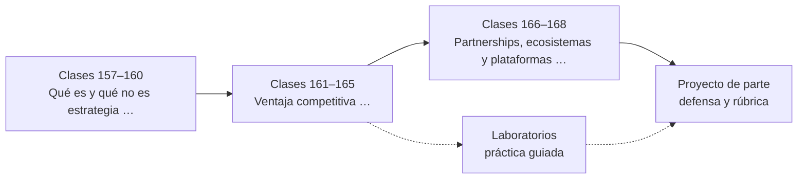

# Parte 13 — Estrategia y competencia

<!-- parte:inicio -->

> ← [Parte 12 — Producto e innovación](../12-product-innovation/README.md) · [Temario](../../SYLLABUS.md) · [Parte 14 — Diseño organizacional, cultura y cambio](../14-organization-design-culture-change/README.md) →

*Hacer elecciones coherentes sobre dónde competir, cómo ganar y qué no hacer*

**Etapa:** 4 — Dirección, estrategia y organización  
**Duración:** 12 clases · 30 horas  
**Resultado de salida:** Hacer elecciones coherentes sobre dónde competir, cómo ganar y qué no hacer.

🟠 [Ver las 6 etapas](../../SYLLABUS.md) · 12 clases (157–168) · 4 laboratorios · [proyecto de parte](project.md)

## 🎯 De qué trata esta parte

Estrategia no es un plan ni un deseo: es un conjunto de elecciones que renuncian a algo. Esta parte enseña a diagnosticar, elegir y hacer coherentes las decisiones con esa elección.

El eje es **trade-off explícito**. Una estrategia que no deja nada fuera no es estrategia. Se estudian industria, capacidades, ventaja, modelo de negocio, escenarios y crecimiento.

## 🧱 Con qué hay que llegar

| Parte | Qué aporta |
|---|---|
| [09 — Finanzas y contabilidad para gerentes](../09-managerial-finance-accounting/README.md) | Economía del negocio. |
| [11 — Marketing, cliente y crecimiento](../11-marketing-customers-growth/README.md) | Mercado y posicionamiento. |
| [12 — Producto e innovación](../12-product-innovation/README.md) | Producto y evidencia. |

Cada clase supone la anterior: el orden importa, y saltarse una deja sin base a las que vienen después.

## 📚 Resultados de la parte

Al terminar esta parte podrás:

1. **Diferenciar** estrategia de plan y de aspiración.
2. **Diagnosticar** industria, competidores y capacidades.
3. **Sustentar** una ventaja y los trade-offs que exige.
4. **Comparar** modelos de negocio y opciones de crecimiento.
5. **Redactar** un strategy memo que pueda ser refutado.

## 🗺️ Mapa de la parte

## 🧭 Cómo se encadenan las 12 clases

Las clases **157 a 160** diagnostican: qué es estrategia, el diagnóstico, la industria y las capacidades.

Las clases **161 a 165** eligen: ventaja, trade-offs, modelo de negocio, escenarios y crecimiento.

Las clases **166 a 168** ejecutan y cierran: alianzas, adaptación y el capstone de strategy memo.

## 📘 Las 12 clases

| # | Clase | Qué se trabaja | Entregable | Min |
|---:|---|---|---|---:|
| 157 | [Qué es y qué no es estrategia](classes/157-que-es-y-que-no-es-estrategia/README.md) | strategy, goal, diagnosis | [strategy-memo](../../templates/strategy-memo.md) | 150 |
| 158 | [Diagnóstico estratégico](classes/158-diagnostico-estrategico/README.md) | symptom, root cause, strategic issue | [strategy-memo](../../templates/strategy-memo.md) | 150 |
| 159 | [Industria y fuerzas competitivas](classes/159-industria-y-fuerzas-competitivas/README.md) | rivalry, buyer power, supplier power | [strategy-memo](../../templates/strategy-memo.md) | 150 |
| 160 | [Capacidades y recursos](classes/160-capacidades-y-recursos/README.md) | resource, capability, VRIO | [operating-improvement-brief](../../templates/operating-improvement-brief.md) | 150 |
| 161 | [Ventaja competitiva](classes/161-ventaja-competitiva/README.md) | competitive advantage, willingness to pay, relative cost | [strategy-memo](../../templates/strategy-memo.md) | 150 |
| 162 | [Trade-offs y coherencia](classes/162-trade-offs-y-coherencia/README.md) | trade-off, fit, activity system | [risk-governance-brief](../../templates/risk-governance-brief.md) | 150 |
| 163 | [Modelo de negocio](classes/163-modelo-de-negocio/README.md) | value proposition, revenue model, cost structure | [strategy-memo](../../templates/strategy-memo.md) | 150 |
| 164 | [Escenarios estratégicos](classes/164-escenarios-estrategicos/README.md) | scenario, critical uncertainty, signpost | [strategy-memo](../../templates/strategy-memo.md) | 150 |
| 165 | [Opciones de crecimiento](classes/165-opciones-de-crecimiento/README.md) | market penetration, market development, product development | [strategy-memo](../../templates/strategy-memo.md) | 150 |
| 166 | [Partnerships, ecosistemas y plataformas](classes/166-partnerships-ecosistemas-y-plataformas/README.md) | ecosystem, platform, complementor | [leadership-decision-brief](../../templates/leadership-decision-brief.md) | 150 |
| 167 | [Ejecución y adaptación de estrategia](classes/167-ejecucion-y-adaptacion-de-estrategia/README.md) | strategic initiative, leading indicator, lagging indicator | [strategy-memo](../../templates/strategy-memo.md) | 150 |
| 168 | [Capstone: strategy memo](classes/168-capstone-strategy-memo/README.md) | strategy memo, strategic thesis, assumption | [leadership-decision-brief](../../templates/leadership-decision-brief.md) | 150 |

## ⚠️ Riesgos característicos

- Llamar estrategia a una lista de iniciativas.
- No renunciar a nada.
- Copiar la ventaja de otro sin sus capacidades.
- No definir qué señal obligaría a cambiar de rumbo.

## 🔤 Glosario de la parte

60 conceptos definidos en las clases, con la definición operacional que usa cada una.

| Concepto | Definición operacional |
|---|---|
| **activity system** | mapa de actividades que materializan una posición. |
| **adjacency** | movimiento cercano que reutiliza capacidades o clientes. |
| **assumption** | condición incierta que debe cumplirse. |
| **business model coherence** | compatibilidad económica y operativa entre componentes. |
| **buyer power** | capacidad de clientes para capturar valor. |
| **capability** | habilidad organizacional repetible para realizar una actividad. |
| **capability gap** | distancia entre capacidad requerida y actual. |
| **coherent actions** | acciones coordinadas que materializan la política. |
| **competitive advantage** | fuente defendible de desempeño superior frente a alternativas. |
| **complementor** | actor cuya oferta aumenta valor de otra. |
| **constraint** | limitación que reduce opciones viables. |
| **cost structure** | patrón de costos necesario para entregar la propuesta. |
| **critical uncertainty** | variable material cuya evolución es impredecible. |
| **dependency risk** | exposición creada al depender de un tercero crítico. |
| **diagnosis** | explicación simplificada de qué desafío importa realmente. |
| **diversification** | nuevo producto y nuevo mercado simultáneamente. |
| **dynamic capability** | habilidad para detectar aprovechar y reconfigurar frente al cambio. |
| **ecosystem** | conjunto de actores interdependientes que crean una propuesta conjunta. |
| **entry barrier** | condición que dificulta entrada sostenible de nuevos competidores. |
| **fit** | grado en que actividades se refuerzan como sistema. |
| **goal** | resultado deseado que no especifica cómo ganar. |
| **governance rules** | reglas de acceso calidad datos y monetización. |
| **guiding policy** | enfoque elegido para enfrentar el diagnóstico. |
| **hypothesis tree** | descomposición de explicaciones mutuamente distinguibles. |
| **key activity** | actividad crítica que habilita el valor. |
| **lagging indicator** | resultado que confirma desempeño después. |
| **leading indicator** | señal temprana del mecanismo estratégico. |
| **market development** | llevar oferta actual a nuevos mercados. |
| **market penetration** | crecer con oferta actual en mercado actual. |
| **moat** | mecanismo que dificulta replicar o erosionar la ventaja. |
| **option** | capacidad preservada para actuar cuando haya más información. |
| **platform** | modelo que facilita interacciones entre grupos y puede generar efectos de red. |
| **product development** | nuevas ofertas para clientes existentes. |
| **relative cost** | posición de costo respecto a competidores. |
| **resource** | activo tangible o intangible disponible para la firma. |
| **resource commitment** | capital talento y capacidad dedicados a una choice. |
| **resource reallocation** | movimiento deliberado de capital y talento hacia prioridades. |
| **revenue model** | mecanismo por el que la organización captura ingresos. |
| **rivalry** | intensidad con que competidores erosionan precio o elevan costo. |
| **robust move** | acción valiosa bajo varios escenarios. |
| **root cause** | mecanismo subyacente que explica una parte material del resultado. |
| **scenario** | futuro plausible y coherente construido alrededor de incertidumbres. |
| **signpost** | señal observable que indica qué escenario gana probabilidad. |
| **straddling** | intento de ocupar posiciones incompatibles simultáneamente. |
| **strategic consistency** | coherencia entre propuesta operaciones y recursos. |
| **strategic control** | señal y foro que permiten adaptar sin perder dirección. |
| **strategic initiative** | intervención temporal que construye una capacidad o posición. |
| **strategic issue** | desafío que puede alterar valor o ventaja de forma material. |
| **strategic thesis** | argumento causal de por qué una elección puede ganar. |
| **strategy** | conjunto coherente de elecciones para superar un desafío y crear valor diferencial. |
| **strategy memo** | documento ejecutivo que articula problema choice y razonamiento. |
| **strategy review** | foro para evaluar hipótesis y no solo status. |
| **substitute** | solución distinta que satisface necesidad comparable. |
| **supplier power** | capacidad de proveedores para elevar precio o restringir condiciones. |
| **switching cost** | costo económico operativo o psicológico de cambiar. |
| **symptom** | manifestación observable de un problema. |
| **trade-off** | elección donde perseguir una opción limita otra. |
| **value proposition** | razón concreta por la que un segmento elige una oferta. |
| **VRIO** | prueba de valor rareza imitabilidad y organización. |
| **willingness to pay** | valor máximo que un cliente atribuye a la oferta. |

## 📦 Qué queda como evidencia

- Un diagnóstico estratégico con evidencia.
- Una matriz de trade-offs explícitos.
- Escenarios con señales de cambio.
- El capstone: strategy memo.

## 🔗 Cómo se conecta

Alimenta la parte 14 (organización), la 17 (supervisión de estrategia en el directorio) y la 18 (capital y M&A).

## 🧪 Cómo se trabaja

Son **12 clases de 150 minutos** —30 horas— con **4 laboratorios** y un proyecto integrador. Cada clase trae su propósito, sus conceptos, un caso, práctica, errores frecuentes, preguntas de comprobación, entregable y fuentes, y se evalúa con su `assessment.md`. Los laboratorios se resuelven con datos propios o sintéticos, nunca con datos reales de terceros, y la parte se cierra con el proyecto y su defensa. Las reglas de recorrido están en [la guía de navegación](../../docs/NAVIGATION.md).

<!-- parte:fin -->

## Laboratorios

- [Lab 01 — Five forces clinic](labs/lab-01.md)
- [Lab 02 — Capability map](labs/lab-02.md)
- [Lab 03 — Strategy choice cascade](labs/lab-03.md)
- [Lab 04 — Strategy memo defense](labs/lab-04.md)

## Proyecto de parte

Escribir y defender un strategy memo con diagnóstico, elección, acciones y riesgos.

## Bibliografía rectora

- Michael E. Porter — *Competitive Strategy* (Estrategia)
- Michael E. Porter — *Competitive Advantage* (Estrategia)
- Richard Rumelt — *Good Strategy/Bad Strategy* (Estrategia)
- A.G. Lafley & Roger L. Martin — *Playing to Win* (Estrategia)
- W. Chan Kim & Renée Mauborgne — *Blue Ocean Strategy* (Estrategia)

## Criterio de aprobación

80/100 y entrega del proyecto integrador.
