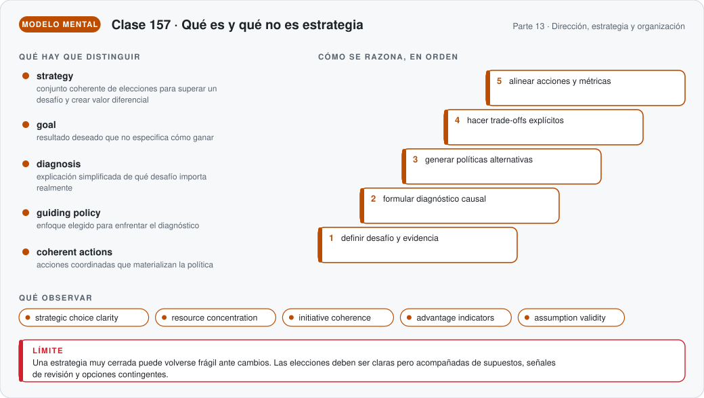

# Clase 157 — Qué es y qué no es estrategia

<!-- nav:inicio -->
> **Parte 13 · Estrategia y competencia** — clase 1 de 12 · [índice de la parte](../../README.md) · [temario](../../../../SYLLABUS.md)
<!-- nav:fin -->

**Parte:** 13 — Estrategia y competencia  
**Nivel:** Etapa 4 — Gerente → Director  
**Duración sugerida:** 150–180 minutos · **Estándar:** deep-class-v2

## 🎯 Propósito

La palabra «estrategia» se aplica a casi todo: un plan anual, una lista de objetivos, un eslogan, una campaña, una aspiración de «ser líderes». Esa inflación tiene un costo: cuando todo es estrategia, nada orienta las decisiones difíciles, los equipos no saben qué dejar de hacer y la dirección confunde producir documentos con elegir un rumbo. Una **estrategia** de verdad es una respuesta a un problema concreto: identifica el obstáculo principal que impide avanzar, elige un enfoque para superarlo y coordina acciones que se refuerzan entre sí. Es, por definición, selectiva: obliga a decir que sí a algunas cosas y que no a muchas otras.

La clase se apoya en el análisis de Rumelt sobre buena y mala estrategia, en la descripción de Lafley y Martin de una estrategia como un conjunto de elecciones integradas y en la visión de Porter sobre la posición competitiva y la rentabilidad de las industrias. Al terminar sabrás distinguir estrategia de meta, plan y aspiración, reconocer los signos de una mala estrategia, aplicar el núcleo de diagnóstico, política guía y acciones coherentes y evaluar la estrategia de una organización con preguntas concretas.

## 📚 Resultados de aprendizaje

Al finalizar podrás:

1. **Distinguir** estrategia de meta, plan, visión y aspiración.
2. **Reconocer** los signos de la mala estrategia.
3. **Aplicar** el núcleo: diagnóstico, política guía y acciones coherentes.
4. **Identificar** las elecciones que una estrategia implica y lo que descarta.
5. **Evaluar** una estrategia con preguntas de contraste.

## 🧭 Agenda

| Tramo | Qué se hace |
|---|---|
| 0–20 min | Recuperación: escribe en tres líneas la estrategia de tu empresa y marca qué decisiones difíciles guía. |
| 20–60 min | Mala estrategia, núcleo, elecciones y evaluación. |
| 60–105 min | Ejemplo trabajado: reescribir el «plan estratégico» de una cadena de supermercados. |
| 105–150 min | Caso ejecutivo y práctica. |
| 150–175 min | Límites y entregable. |

## 🧩 Conceptos centrales

| Concepto | Definición | Cómo se reconoce |
|---|---|---|
| **Estrategia** | Conjunto coherente de diagnóstico, política guía y acciones para superar un desafío crítico. | Elige y renuncia. |
| **Desafío crítico** | Obstáculo principal cuya superación destraba el avance. | Se puede enunciar en una frase. |
| **Política guía** | Enfoque general para enfrentar el desafío. | Excluye caminos posibles. |
| **Acciones coherentes** | Decisiones coordinadas que se refuerzan entre sí. | Cada una tiene sentido por las otras. |
| **Mala estrategia** | Plan que evita el problema y lo reemplaza por aspiraciones, metas o jerga. | Lista de metas sin camino. |
| **Elecciones en cascada** | Aspiración, dónde jugar, cómo ganar, capacidades y sistemas de gestión. | Cada elección condiciona la siguiente. |

## 🧠 Modelo mental

**Cómo leer el diagrama.** Cuatro pasos. El **desafío crítico** es el obstáculo que más pesa, con un diagnóstico de por qué existe. La **política guía** es el enfoque para superarlo: dice qué se hará y qué no. Las **acciones coherentes** son decisiones que siguen la política y se refuerzan entre sí. La **evidencia** muestra si el diagnóstico y la política funcionan; si la contradice, se revisa el diagnóstico. La nota recuerda que una meta, una lista de deseos o un eslogan no son estrategia.

## 📖 Desarrollo

### 1. La inflación de la palabra

Rumelt sostiene que gran parte de lo que se presenta como estrategia no lo es. Los **signos de la mala estrategia** son cuatro. **Lenguaje vacío** («aprovechar sinergias», «liderazgo transformacional»), que imita profundidad sin decir nada. **No enfrentar el desafío**: se enumeran metas pero no se explica qué obstáculo impide alcanzarlas. **Confundir metas con estrategia**: «aumentar las ventas 20 %» es un resultado deseado, no un camino. **Objetivos estratégicos malos**: listas de cosas «importantes» sin jerarquía, de modo que todo es prioridad o impracticable. Detectar estos signos en los documentos propios es la primera disciplina.

### 2. El núcleo: diagnóstico, política guía y acciones coherentes

Rumelt llama **núcleo** (*kernel*) de la buena estrategia a tres elementos. El **diagnóstico** explica la naturaleza del desafío y lo simplifica: de la complejidad de la situación extrae lo esencial («los competidores de bajo costo nos quitan el consumo básico semanal, que es el 60 % de la visita; el margen está en frescos y no los destacamos»). La **política guía** es el enfoque elegido («competir por calidad y servicio en frescos y ceder el precio en el surtido básico»). Las **acciones coherentes** son los pasos concretos y coordinados (surtido, ubicación, personal, proveedores, precios) que ejecutan la política. Un buen test: quitar cualquier elemento debería dejar un hueco notorio.

### 3. Estrategia como elección

Lafley y Martin describen la estrategia como un **conjunto integrado de cinco elecciones**: la **aspiración ganadora** (cuál es el propósito y qué significa ganar), **dónde jugar** (en qué mercados, segmentos, canales y productos), **cómo ganar** (qué propuesta de valor y qué ventaja frente a los rivales), **las capacidades** necesarias (qué hay que hacer excepcionalmente bien) y **los sistemas de gestión** (cómo se medirá y asegurará). Cada elección condiciona a las demás y debe ser coherente con ellas. Lo importante: elegir es **renunciar**; una estrategia que no deja afuera ningún segmento ni ninguna actividad probablemente no eligió.

### 4. Posición, rentabilidad y diferencia

Porter argumenta que la rentabilidad de una empresa depende de dos cosas: la **estructura de la industria** (qué tan atractiva es, clase 159) y la **posición relativa** de la empresa en ella (si logra una ventaja sostenible, clase 161). Una estrategia, entonces, no es solo eficiencia operativa (hacer lo mismo mejor) sino **ser distinto**: realizar actividades diferentes o las mismas de manera diferente. La eficiencia operativa es necesaria pero se imita rápido; la diferencia estratégica, al exigir elecciones y coherencia, es más difícil de copiar. Una empresa que solo compite en eficiencia puede estar en una carrera sin ganadores.

### 5. Lo que no es estrategia

No son estrategia: una **visión** o **misión** (dicen hacia dónde y por qué, no cómo); una **meta** o un **objetivo** (resultados deseados, clase 097); un **plan de acción** o **presupuesto** (traducen una estrategia a tareas y recursos, clase 115); una **política operativa** (reglas de trabajo); ni un **proyecto**. Todos son útiles y se derivan de la estrategia, o la sirven. Cuando una empresa tiene metas y planes pero no sabe cuál es su desafío ni qué eligió, la ejecución es intensa y la dirección, incierta.

### 6. Evaluar una estrategia

Se puede someter cualquier estrategia a preguntas simples: ¿**cuál es el desafío** que enfrenta y está claro el diagnóstico?; ¿**qué eligió** y qué descartó?; ¿**las acciones se refuerzan** o se estorban?; ¿**qué evidencia** muestra que funciona?; ¿**qué haría falta creer** para que sea correcta (supuestos críticos)?; ¿**quién se beneficiaría** si se equivoca y es difícil de verificar?; ¿**qué haría un competidor** en respuesta (Dixit y Nalebuff, clase 159)? Estas preguntas se plantean antes de comprometer recursos y se revisan cuando llegan señales (clase 167).

### 7. Estrategia, ejecución y humildad

Una estrategia es una **apuesta razonada** sobre un futuro incierto: puede estar equivocada. Por eso se acompaña de **señales** que indicarían que los supuestos fallan y de **procesos de revisión**. La mejor estrategia mal ejecutada fracasa, y la mala bien ejecutada también: sin diagnóstico, el esfuerzo se dirige a lo equivocado. Los líderes deben cuidar tres cosas: **claridad** (que todos entiendan el desafío y la política), **coherencia** (que decisiones cotidianas respeten las elecciones) y **adaptabilidad** (que se revise cuando la evidencia lo exige).

## 📚 Lectura comparada

| Obra | Qué aporta | Qué no resuelve | Pregunta para contrastar |
|---|---|---|---|
| Rumelt | Mala estrategia y el núcleo de diagnóstico, política y acciones. | Se basa en casos y criterio; no ofrece método cuantitativo. | ¿Cuál es el desafío crítico? |
| Lafley y Martin | Cascada de cinco elecciones. | Enfoque de empresas grandes de consumo. | ¿Qué elegiste y qué descartaste? |
| Porter (*Competitive Strategy*) | Estructura de la industria y posicionamiento. | Visión estática. | ¿Qué posición te da ventaja? |
| McGrath | Ventajas transitorias y reconfiguración. | Menos guía para decidir una elección concreta. | ¿Cuánto durará esta ventaja? |
| Helmer | Siete fuentes de poder estratégico. | Enfoque en ventajas duraderas. | ¿Cuál es tu fuente de poder? |

## 🧮 Ejemplo trabajado

**Situación (hipotética).** Una cadena regional de 40 supermercados presenta su «plan estratégico 2026–2030»: «Ser el supermercado preferido de la región, aumentar las ventas 15 % anual, mejorar la satisfacción del cliente y avanzar en la transformación digital y la sostenibilidad». Las ventas por local crecieron 1 % real en los últimos tres años y el margen operacional bajó de 4,1 % a 2,6 %.

**Análisis del documento.** Tiene lenguaje vacío («preferido», «transformación»), metas sin camino (+15 %), cinco prioridades sin jerarquía y ningún diagnóstico.

**Diagnóstico con datos.**

| Dato | Hallazgo |
|---|---|
| Ventas por categoría | Abarrotes básicos (60 % de la visita) con margen de 14 %; frescos (panadería, carnes, frutas), 28 % de las ventas con margen de 31 % |
| Competencia | Dos cadenas de descuento abrieron 9 locales en la zona y ofrecen la canasta básica 12 % más barata |
| Clientes | Quienes compran frescos y abarrotes en el mismo local gastan 2,3 veces más y retienen más; quienes solo compran básicos migran a descuento |
| Capacidad | Los equipos de frescos reciben buenas calificaciones; las cadenas de descuento tienen un surtido de frescos limitado |

**Desafío crítico.** «El tráfico de básicos se está yendo a competidores de menor precio y arrastra la compra de frescos; sin cambiar el modelo, el margen seguirá cayendo.»

**Política guía.** «Competir por calidad y servicio en frescos y comida preparada, que es donde somos mejores y donde los descuentos son débiles; defender el básico con una canasta de precios clave, sin intentar igualar a los descuentos en todo el surtido.»

**Acciones coherentes.** (1) Rediseñar 18 locales para destacar frescos y comida preparada (inversión de USD 9 millones); (2) canasta de 120 productos de precios competitivos con compra centralizada; (3) cerrar o convertir 4 locales de bajo desempeño en zonas de descuento; (4) programa de proveedores locales de frescos con contratos y calidad; (5) incentivos del personal ligados a ventas de frescos y a frescura; (6) abandonar el plan de expandir a nuevas regiones por tres años.

**Evidencia.** Indicadores: participación de frescos en la venta (28 % → 36 %), margen bruto por visita, retención de clientes de frescos, ventas de la canasta clave; criterios para revisar en 12 meses.

**Qué muestra.** (1) El plan original tenía metas pero no estrategia. (2) El diagnóstico simplificó la situación en un desafío. (3) La política y las acciones eligieron y renunciaron.

## 🔀 Comparación y límites

**Estrategia frente a planeamiento.** El planeamiento programa cómo se hará algo ya decidido; la estrategia decide qué y por qué. En entornos estables, un buen plan basta; en entornos cambiantes, la estrategia se renueva con frecuencia.

**Límites.** El marco de Rumelt es una guía de criterio, no una fórmula: dos analistas pueden hacer diagnósticos distintos. Los casos exitosos se explican a posteriori. Los datos del ejemplo son ilustrativos. Algunas decisiones estratégicas (fusiones, cierres, cambios de modelo con efectos laborales o regulatorios) tienen implicancias legales y de competencia que se verifican con asesoría y normas vigentes.

## 🪜 De profesional a owner

| Nivel | Cómo participa en la estrategia |
|---|---|
| **Profesional** | Entiende el desafío y alinea su trabajo con las elecciones. |
| **Jefe / Team Lead** | Traduce la política en prioridades de su equipo. |
| **Gerente** | Propone diagnósticos con datos y acciones coherentes en su área. |
| **CEO / Director** | Define el desafío, elige y renuncia, y sostiene la coherencia. |
| **Founder / Owner** | Decide en qué no se va a distraer la empresa. |

## 🏢 Caso ejecutivo

Una empresa de educación superior técnica con 12.000 estudiantes presenta su «Plan Estratégico 2030»: «Convertirnos en la institución de referencia en educación técnica con foco en la empleabilidad, innovar en metodologías, aumentar la matrícula 30 %, expandirnos a nuevas regiones y consolidar nuestra marca». La matrícula nueva cayó 11 % en los últimos dos años; la deserción en el primer año es de 31 %; el 38 % de los egresados trabaja en áreas distintas a su carrera; tres competidores ofrecen carreras cortas en línea a un tercio del arancel; la empresa recibió observaciones de la autoridad de educación sobre indicadores de calidad. Los directivos están divididos: unos quieren abrir sedes, otros digitalizar, otros reducir carreras.

Entrega un **análisis y rediseño estratégico** que contenga: (a) la evaluación del plan con los signos de mala estrategia; (b) el diagnóstico con datos y el desafío crítico; (c) una política guía y de cuatro a seis acciones coherentes, con lo que se renuncia; (d) la evaluación con las preguntas de contraste y los supuestos críticos; (e) las señales para revisar y el ritmo de revisión; (f) las verificaciones regulatorias del sector educativo que se harán en las normas vigentes y con asesoría.

## 🧪 Práctica

1. Escribe la estrategia de tu organización en tres líneas: desafío, política y acciones.
2. Marca en un documento estratégico real los signos de mala estrategia.
3. Lista cinco cosas a las que tu organización renuncia por su estrategia.
4. Aplica las cinco elecciones de Lafley y Martin a una unidad de negocio.
5. Formula tres preguntas de contraste que le harías a tu estrategia.

## ⚠️ Errores frecuentes

| Error | Por qué ocurre | Cómo corregirlo |
|---|---|---|
| Meta como estrategia | Es lo que se quiere lograr | Explicar el camino y el obstáculo. |
| Lista de prioridades | Se teme dejar áreas afuera | Jerarquizar y renunciar. |
| Sin diagnóstico | Se salta a las acciones | Definir el desafío crítico. |
| Lenguaje vacío | Suena profundo | Decir qué se hará y qué no. |
| Estrategia = eficiencia | Es medible | Buscar diferencia además de eficiencia. |
| Nunca revisar | Se considera plan cerrado | Señales y revisiones. |

## ❓ Preguntas de comprobación

1. ¿Cuáles son los signos de la mala estrategia?
2. ¿Qué es el núcleo de una buena estrategia?
3. ¿Qué cinco elecciones describen Lafley y Martin?
4. ¿Por qué elegir implica renunciar?
5. ¿Qué diferencia hay entre estrategia, meta y plan?
6. ¿Qué preguntas sirven para evaluar una estrategia?
7. ¿Qué límite tiene el marco de diagnóstico, política y acciones?

Claves de respuesta

1. Lenguaje vacío, no enfrentar el desafío, confundir metas con estrategia y objetivos estratégicos malos o sin jerarquía.
2. Diagnóstico del desafío, política guía y acciones coherentes.
3. Aspiración ganadora, dónde jugar, cómo ganar, capacidades y sistemas de gestión.
4. Porque los recursos son limitados y una estrategia que no excluye nada no guía decisiones.
5. La estrategia decide qué hacer y por qué frente a un desafío; la meta es un resultado deseado; el plan traduce lo decidido en tareas y recursos.
6. Cuál es el desafío, qué eligió y descartó, si las acciones se refuerzan, qué evidencia hay, qué supuestos críticos y cómo respondería la competencia.
7. Es una guía de criterio, no una fórmula: los diagnósticos pueden diferir y los casos exitosos se explican a posteriori.

## 📥 Entregable

Guarda en `portfolio/157-que-es-y-que-no-es-estrategia/`:

- `strategy-memo.md` (plantilla [Strategy memo](../../../../templates/strategy-memo.md)) con el rediseño estratégico del caso ejecutivo;
- `leadership-decision-brief.md` (plantilla [Leadership Decision Brief](../../../../templates/leadership-decision-brief.md)) con la evaluación del plan original;
- `decision-journal.md` con el diagnóstico, las renuncias y las señales.

## 📗 Fuentes y verificación

- Richard Rumelt — *Good Strategy/Bad Strategy* (Profile Books, 2011). **Uso en esta clase:** mala estrategia y núcleo de diagnóstico, política y acciones. Lectura selectiva sobre **qué es y qué no es estrategia**. **Localizador:** [ISBN-13 9781846684807](https://openlibrary.org/isbn/9781846684807).
- A.G. Lafley & Roger L. Martin — *Playing to Win* (Harvard Business Review Press, 2013). **Uso en esta clase:** cascada de cinco elecciones. Lectura selectiva sobre **qué es y qué no es estrategia**. **Localizador:** [ISBN-13 9781422187395](https://openlibrary.org/isbn/9781422187395).
- Michael E. Porter — *Competitive Strategy* (Free Press, 1980). **Uso en esta clase:** estructura de la industria y posicionamiento. Lectura selectiva sobre **qué es y qué no es estrategia**. **Localizador:** [ISBN-13 9780684841489](https://openlibrary.org/isbn/9780684841489).
- Rita Gunther McGrath — *The End of Competitive Advantage* (Harvard Business Review Press, 2013). **Uso en esta clase:** ventajas transitorias y reconfiguración. Lectura selectiva sobre **qué es y qué no es estrategia**. **Localizador:** [ISBN-13 9781422172810](https://openlibrary.org/isbn/9781422172810).
- Hamilton Helmer — *7 Powers* (Deep Strategy, 2016). **Uso en esta clase:** siete fuentes de poder estratégico. Lectura selectiva sobre **qué es y qué no es estrategia**. **Localizador:** [ISBN-13 9780998116303](https://openlibrary.org/isbn/9780998116303).

> **Regla de fuentes para Qué es y qué no es estrategia:** las obras anteriores estructuran las perspectivas de esta materia; cualquier norma, ley o estándar vivo mencionado debe comprobarse nuevamente en su fuente primaria vigente, incluidas las normas del sector educativo y de competencia. Los ejemplos y casos son hipotéticos, con cifras ilustrativas. El desarrollo es original y no reproduce capítulos protegidos.

<!-- pie:inicio -->
---

| Anterior | Índice | Siguiente |
|---|---|---|
| [← 156 · Capstone: comité de producto](../../../12-product-innovation/classes/156-capstone-comite-de-producto/README.md) | [Parte 13](../../README.md) · [Programa](../../../../SYLLABUS.md) | [158 · Diagnóstico estratégico →](../158-diagnostico-estrategico/README.md) |
<!-- pie:fin -->
