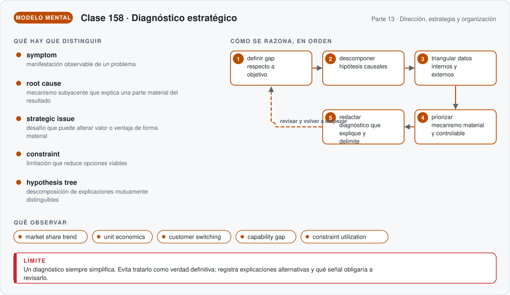

# Clase 158 — Diagnóstico estratégico

<!-- nav:inicio -->
> **Parte 13 · Estrategia y competencia** — clase 2 de 12 · [índice de la parte](../../README.md) · [temario](../../../../SYLLABUS.md)
<!-- nav:fin -->

**Parte:** 13 — Estrategia y competencia  
**Nivel:** Etapa 4 — Gerente → Director  
**Duración sugerida:** 150–180 minutos · **Estándar:** deep-class-v2

## 🎯 Propósito

Ninguna estrategia es mejor que el diagnóstico en que se apoya. Un diagnóstico débil produce estrategias que resuelven el problema equivocado con enorme esfuerzo; uno bueno **simplifica una situación compleja en un desafío sobre el cual se puede actuar**. Sin embargo, en la práctica los diagnósticos estratégicos suelen ser inventarios: una matriz de fortalezas y debilidades con veinte ítems, un análisis del entorno con tendencias generales y un informe de resultados sin explicación. Todos describen y ninguno decide. El diagnóstico estratégico es el trabajo de mirar la evidencia —del entorno, de la industria, de los clientes, de las capacidades y de los resultados— y concluir qué importa más y por qué.

La clase se apoya en el enfoque de diagnóstico de Rumelt, en el análisis de la industria y la posición de Porter y en las elecciones de dónde jugar y cómo ganar de Lafley y Martin. Al terminar sabrás formular las preguntas del diagnóstico, reunir y contrastar la evidencia con fuentes, distinguir hechos de interpretaciones, identificar las causas de fondo de un desempeño y condensar todo en un desafío crítico enunciado en pocas líneas.

## 📚 Resultados de aprendizaje

Al finalizar podrás:

1. **Formular** las preguntas del diagnóstico: entorno, industria, capacidades y resultados.
2. **Reunir** evidencia con fuentes y distinguir hechos de interpretaciones.
3. **Identificar** las causas de fondo de un desempeño.
4. **Condensar** el diagnóstico en un desafío crítico con sus supuestos.
5. **Evitar** los errores típicos: inventario, anclaje y atribución a la suerte.

## 🧭 Agenda

| Tramo | Qué se hace |
|---|---|
| 0–20 min | Recuperación: escribe las dos explicaciones más probables de por qué tu empresa gana o pierde dinero, y qué dato las distinguiría. |
| 20–60 min | Preguntas, evidencia, causas y desafío. |
| 60–105 min | Ejemplo trabajado: diagnóstico de un fabricante de envases con margen decreciente. |
| 105–150 min | Caso ejecutivo y práctica. |
| 150–175 min | Límites y entregable. |

## 🧩 Conceptos centrales

| Concepto | Definición | Cómo se reconoce |
|---|---|---|
| **Diagnóstico estratégico** | Análisis que identifica la naturaleza del desafío que enfrenta una organización. | Termina en un desafío, no en una lista. |
| **Desafío crítico** | Obstáculo principal cuya superación destraba el avance. | Se enuncia en una o dos frases. |
| **Hecho** | Dato verificable. | Tiene fuente. |
| **Interpretación** | Explicación de los hechos. | Se puede contrastar con otros datos. |
| **Causa de fondo** | Factor que explica los síntomas visibles. | Persiste al corregir los síntomas. |
| **Ancla** | Idea previa que sesga la lectura de los datos. | «Siempre hemos competido en precio». |

## 🧠 Modelo mental

**Cómo leer el diagrama.** Una tabla con cuatro preguntas: **qué cambió en el entorno**, **cómo gana dinero la industria**, **qué hace bien la empresa y por qué**, y **cuál es el desafío crítico**. Cada una indica el dato que la responde y el error típico: mirar solo el pasado propio, confundir tamaño con rentabilidad, atribuir a la suerte lo que es capacidad, o listar diez problemas sin jerarquía. La nota subraya que un buen diagnóstico simplifica: reduce la complejidad a un desafío sobre el que se puede actuar.

## 📖 Desarrollo

### 1. Simplificar para poder decidir

Rumelt sostiene que el valor del diagnóstico está en **reducir la complejidad**: ante una situación con muchos factores, se identifica cuáles importan y se ordenan. Un buen diagnóstico dice, por ejemplo: «el verdadero problema no es la competencia en general sino que el 40 % de nuestro margen depende de un cliente que está desarrollando capacidades propias». Esa frase orienta decisiones; una lista de 20 «desafíos» no. El diagnóstico es una **hipótesis explicativa** que se somete a contraste, no una verdad: se formula con lo que se sabe y se revisa cuando aparece evidencia nueva.

### 2. Las preguntas

Un diagnóstico útil responde cuatro preguntas. **¿Qué cambió?** (entorno): clientes, tecnología, regulación, competidores, costos; qué tendencias alteran la lógica del negocio. **¿Cómo gana dinero la industria y dónde?** (industria, clase 159): quién captura el valor, qué fuerzas presionan. **¿Qué hacemos bien y por qué?** (capacidades, clase 160): dónde estamos por sobre los rivales y qué lo explica. **¿Cuál es el desafío crítico?** (síntesis). Se agrega una cuestión de método: **¿qué evidencia contradeciría nuestra explicación?** Buscar activamente evidencia contraria protege del sesgo de confirmación.

### 3. Reunir evidencia con fuentes

Se reúnen **datos internos** (ventas, márgenes por cliente, producto, canal; costos; retención; productividad), **datos de clientes** (entrevistas, encuestas, comportamiento), **datos de la industria** (informes sectoriales, estadísticas oficiales, estados financieros de competidores) y **datos de capacidades** (benchmarks de procesos y de talento). Cada afirmación del diagnóstico lleva su **fuente** y su **grado de confianza**. Se distinguen **hechos** (ventas cayeron 8 %) de **interpretaciones** (cayeron por la competencia de bajo precio). Un error frecuente es tratar la interpretación como hecho porque aparece en un informe o la dice un directivo con autoridad.

### 4. De los síntomas a las causas

Los síntomas son lo visible (caen las ventas, sube la rotación, bajan los márgenes). Las **causas de fondo** son lo que los explica. Una técnica útil: preguntar **«¿por qué?»** repetidas veces con datos, y descomponer los resultados: un margen que baja puede deberse a **precio**, **volumen**, **mezcla** o **costos** (clase 110), y cada uno apunta a un diagnóstico distinto. Se contrasta con **comparaciones**: con competidores, con períodos anteriores, con otras unidades de la propia empresa. Si una unidad logra mejores resultados con el mismo entorno, la causa está en la empresa; si todas bajan, probablemente en el entorno o en la industria.

### 5. El desafío crítico

El diagnóstico culmina en el **desafío crítico**: el obstáculo que, de superarse, destraba más valor. Se evalúa con criterios: ¿es **importante** (afecta el resultado de forma material)?, ¿es **resoluble** (hay palancas para actuar)?, ¿es **específico** (se puede enunciar claramente)?, ¿es **causal** (explica síntomas)?, ¿es **prioritario** frente a otros? Rumelt sugiere que, a menudo, el trabajo más valioso consiste en **elegir** qué desafío abordar entre varios posibles y renunciar a los demás por ahora. También se explicita qué **supuestos** sostienen el diagnóstico y qué evidencia futura los pondría en duda.

### 6. Sesgos del diagnóstico

Los equipos directivos tienen sesgos previsibles: **anclaje** en la historia exitosa de la empresa; **confirmación** (buscar datos que respalden la explicación preferida); **atribución** (éxitos a la capacidad propia y fracasos al entorno); **exceso de confianza**; **pensamiento de grupo**. Dixit y Nalebuff recuerdan, además, que los competidores y otros actores **reaccionan** y que el análisis debe considerar sus incentivos. Medidas útiles: pedir a alguien que sostenga la **explicación alternativa**, hacer un **premortem**, usar **datos externos**, recoger **juicios independientes** antes de discutir y poner por escrito las **hipótesis rivales**.

### 7. Del diagnóstico a la acción

Con el desafío claro, se pasa a elegir una **política guía** y **acciones coherentes** (clase 162). El diagnóstico se documenta en un **memo breve**: hechos principales con fuentes, interpretación, desafío crítico, supuestos clave y señales que lo revisarían. Se comparte con quienes lo cuestionarán y ejecutarán. Se actualiza cuando llegan datos nuevos (clase 167). Un diagnóstico no es un acto único sino un proceso: la organización que mira su situación con rigor de forma periódica detecta antes los cambios.

## 📚 Lectura comparada

| Obra | Qué aporta | Qué no resuelve | Pregunta para contrastar |
|---|---|---|---|
| Rumelt | El diagnóstico como simplificación y base de la estrategia. | Método cualitativo; no da técnica cuantitativa. | ¿Cuál es el desafío crítico? |
| Porter | Análisis de industria y posición para entender la rentabilidad. | Marco estático. | ¿Dónde se captura el valor en tu industria? |
| Lafley y Martin | Dónde jugar y cómo ganar como elecciones sobre el diagnóstico. | Enfoque de grandes empresas de consumo. | ¿Qué te dice el diagnóstico sobre dónde jugar? |
| Dixit y Nalebuff | Incentivos y reacciones de otros actores. | Teoría de juegos aplicada; supone racionalidad. | ¿Cómo responderán los competidores? |
| Kahneman et al. (*Noise*) | Sesgos y ruido en los juicios directivos. | No trata de estrategia. | ¿Qué explicación alternativa sostiene alguien? |

## 🧮 Ejemplo trabajado

**Situación (hipotética).** Una empresa fabricante de envases plásticos para alimentos (ventas USD 85 millones) ve caer su margen operacional de 11 % a 6,5 % en tres años, con ventas estables. La dirección atribuye la caída a «los precios agresivos de competidores asiáticos» y propone un recorte general de costos de 8 %.

**Descomposición del margen.**

| Factor | Efecto en el margen (puntos) |
|---|---|
| Precio promedio | −1,4 |
| Volumen | +0,2 |
| Mezcla de productos y clientes | −2,1 |
| Costos de materia prima | −1,3 |
| Costos de producción y logística | −0,8 |
| Gastos administrativos | +0,9 |
| **Total** | **−4,5** |

**Hechos clave.** (1) La caída por mezcla es la mayor: el cliente más grande (28 % de las ventas) renegoció precios y exige entregas más frecuentes; los clientes pequeños y medianos con envases especiales (margen de 24 %) bajaron del 22 % al 15 % de las ventas. (2) El cliente más grande invirtió en una línea propia de envasado que cubriría 30 % de su demanda en dos años. (3) Los competidores asiáticos compiten en envases estándar y casi no ofrecen envases especiales con servicio técnico. (4) El 70 % del margen de los últimos tres años proviene del 15 % de los clientes.

**Interpretaciones rivales.** H1: «los precios asiáticos» explican la caída. H2: «la dependencia de un cliente grande, que presiona precios y se integra hacia atrás, es el problema». H3: «la empresa descuidó su segmento especializado». Evidencia: el precio de envases estándar bajó 6 %, pero el de especiales se mantuvo; los clientes especiales que se fueron eligieron proveedores locales por servicio, no asiáticos.

**Desafío crítico.** «La empresa depende de un cliente que está integrándose hacia atrás y ha descuidado el segmento de envases especiales con servicio, donde tiene ventaja y margen; recortar costos generales no resuelve ni la dependencia ni la pérdida de mezcla.»

**Supuestos y señales.** Supuesto: el segmento especializado puede crecer con servicio técnico. Señales: retención de clientes especiales, margen por cliente, avance de la línea propia del cliente grande.

**Decisión.** Descartar el recorte uniforme; abrir la etapa de política guía y acciones con foco en el segmento especializado y la reducción de la dependencia (clase 162). El memo se revisa con tres personas que sostienen H1 y H3.

**Qué muestra.** (1) La descomposición mostró que el precio asiático explicaba menos de lo supuesto. (2) Las hipótesis rivales se contrastaron con datos. (3) El diagnóstico terminó en un desafío accionable.

## 🔀 Comparación y límites

**Diagnóstico frente a análisis FODA.** El FODA clasifica fortalezas, oportunidades, debilidades y amenazas; el diagnóstico jerarquiza y explica. Un FODA sin interpretación ni prioridad no orienta decisiones.

**Límites.** Los datos disponibles son imperfectos y las explicaciones de resultados pasados no garantizan el futuro. Dos buenos analistas pueden llegar a diagnósticos distintos; por eso se contrastan. Los datos de competidores y de industria tienen sesgos y límites de calidad. El ejemplo es ilustrativo. En sectores regulados, el diagnóstico debe considerar normativa vigente verificada en su fuente, y los datos de personas o de clientes se tratan conforme a la normativa de protección de datos.

## 🪜 De profesional a owner

| Nivel | Cómo participa en el diagnóstico |
|---|---|
| **Profesional** | Aporta datos con fuente y distingue hecho de opinión. |
| **Jefe / Team Lead** | Descompone resultados de su área en causas. |
| **Gerente** | Lidera diagnósticos con hipótesis rivales y datos comparables. |
| **CEO / Director** | Exige un desafío crítico claro y evidencia contraria. |
| **Founder / Owner** | Revisa con frialdad qué explica sus resultados, no solo qué le gustaría que los explicara. |

## 🏢 Caso ejecutivo

Una aseguradora de salud con 600.000 afiliados ha perdido 9 % de sus afiliados en dos años y su siniestralidad subió de 78 % a 86 %. La dirección ha lanzado un plan de «transformación digital» y subió las primas 7 % cada año. Los datos: las salidas se concentran en afiliados de 25 a 39 años (que se van a planes más baratos con menos cobertura), mientras que los de más de 60 años aumentan su participación; las clínicas de la red concentran 45 % del gasto en tres prestadores; los reclamos por demoras en reembolsos suben; la autoridad de salud ha limitado el reajuste de primas para adultos mayores; un competidor ofrece planes con red cerrada de menor costo. Cada gerente atribuye el problema a una causa distinta: precios, tecnología, red, regulación o servicio.

Entrega un **diagnóstico estratégico** que contenga: (a) las preguntas sobre entorno, industria, capacidades y resultados con la evidencia y su fuente; (b) la descomposición de los resultados en volumen, precio, mezcla y costos; (c) tres hipótesis rivales y cómo se contrastarían; (d) el desafío crítico en una o dos frases y los supuestos que lo sostienen; (e) las señales que lo revisarían; (f) las verificaciones regulatorias del sector salud y de protección de datos que se harán en las normas vigentes.

## 🧪 Práctica

1. Descompón la variación de tu margen o de tus ventas en volumen, precio, mezcla y costo.
2. Escribe tres explicaciones rivales de un resultado y el dato que las distinguiría.
3. Redacta el desafío crítico de tu organización en dos frases.
4. Marca en un informe qué afirmaciones son hechos con fuente y cuáles interpretaciones.
5. Pide a un colega que defienda la explicación contraria y anota qué evidencia cambia.

## ⚠️ Errores frecuentes

| Error | Por qué ocurre | Cómo corregirlo |
|---|---|---|
| Diagnóstico como inventario | Se quiere cubrir todo | Jerarquizar y llegar a un desafío. |
| Tratar interpretaciones como hechos | Aparecen en informes | Fuente y grado de confianza. |
| Atribuir al entorno | Es cómodo | Comparar con rivales y unidades propias. |
| Confirmar la explicación preferida | Sesgo | Hipótesis rivales y evidencia contraria. |
| Saltar a las acciones | Impaciencia | Cerrar el diagnóstico antes de elegir. |
| No actualizarlo | Se considera hecho | Revisar con señales. |

## ❓ Preguntas de comprobación

1. ¿Qué diferencia hay entre un diagnóstico y un inventario?
2. ¿Qué cuatro preguntas ordena el diagnóstico?
3. ¿Cómo se distinguen hechos de interpretaciones?
4. ¿Cómo se pasa de síntomas a causas?
5. ¿Qué criterios cumple un buen desafío crítico?
6. ¿Qué sesgos afectan al diagnóstico y cómo se mitigan?
7. ¿Qué límites tiene el diagnóstico?

Claves de respuesta

1. El diagnóstico jerarquiza y explica hasta llegar a un desafío; el inventario describe sin priorizar.
2. Qué cambió en el entorno, cómo gana dinero la industria, qué hace bien la empresa y por qué, y cuál es el desafío crítico.
3. Los hechos son datos verificables con fuente; las interpretaciones son explicaciones que se contrastan con otros datos.
4. Con la pregunta «¿por qué?» repetida con datos, descomponiendo resultados (precio, volumen, mezcla, costo) y comparando con rivales y unidades propias.
5. Es importante, resoluble, específico, causal y prioritario.
6. Anclaje, confirmación, atribución, exceso de confianza y pensamiento de grupo; se mitigan con hipótesis rivales, premortem, datos externos y juicios independientes.
7. Los datos son imperfectos, diagnósticos distintos son posibles y explicar el pasado no garantiza el futuro.

## 📥 Entregable

Guarda en `portfolio/158-diagnostico-estrategico/`:

- `strategy-memo.md` (plantilla [Strategy memo](../../../../templates/strategy-memo.md)) con el diagnóstico del caso ejecutivo;
- `leadership-decision-brief.md` (plantilla [Leadership Decision Brief](../../../../templates/leadership-decision-brief.md)) con las hipótesis rivales y su contraste;
- `decision-journal.md` con las fuentes, los supuestos y las señales.

## 📗 Fuentes y verificación

- Richard Rumelt — *Good Strategy/Bad Strategy* (Profile Books, 2011). **Uso en esta clase:** el diagnóstico como simplificación y base de la estrategia. Lectura selectiva sobre **diagnóstico estratégico**. **Localizador:** [ISBN-13 9781846684807](https://openlibrary.org/isbn/9781846684807).
- Michael E. Porter — *Competitive Strategy* (Free Press, 1980). **Uso en esta clase:** análisis de industria y posición. Lectura selectiva sobre **diagnóstico estratégico**. **Localizador:** [ISBN-13 9780684841489](https://openlibrary.org/isbn/9780684841489).
- A.G. Lafley & Roger L. Martin — *Playing to Win* (Harvard Business Review Press, 2013). **Uso en esta clase:** dónde jugar y cómo ganar sobre el diagnóstico. Lectura selectiva sobre **diagnóstico estratégico**. **Localizador:** [ISBN-13 9781422187395](https://openlibrary.org/isbn/9781422187395).
- Avinash K. Dixit & Barry J. Nalebuff — *The Art of Strategy* (Norton & Company, Incorporated, W. W., 2008). **Uso en esta clase:** incentivos y reacciones de otros actores. Lectura selectiva sobre **diagnóstico estratégico**. **Localizador:** [ISBN-13 9780393069952](https://openlibrary.org/isbn/9780393069952).
- Daniel Kahneman, Olivier Sibony & Cass R. Sunstein — *Noise* (Little, Brown Spark, 2021). **Uso en esta clase:** sesgos y ruido en los juicios directivos. Lectura selectiva sobre **diagnóstico estratégico**. **Localizador:** [ISBN-13 9780316451383](https://openlibrary.org/isbn/9780316451383).

> **Regla de fuentes para Diagnóstico estratégico:** las obras anteriores estructuran las perspectivas de esta materia; cualquier norma, ley o estándar vivo mencionado debe comprobarse nuevamente en su fuente primaria vigente, incluidas las normas del sector salud y de protección de datos. Los ejemplos y casos son hipotéticos, con cifras ilustrativas. El desarrollo es original y no reproduce capítulos protegidos.

<!-- pie:inicio -->
---

| Anterior | Índice | Siguiente |
|---|---|---|
| [← 157 · Qué es y qué no es estrategia](../157-que-es-y-que-no-es-estrategia/README.md) | [Parte 13](../../README.md) · [Programa](../../../../SYLLABUS.md) | [159 · Industria y fuerzas competitivas →](../159-industria-y-fuerzas-competitivas/README.md) |
<!-- pie:fin -->
