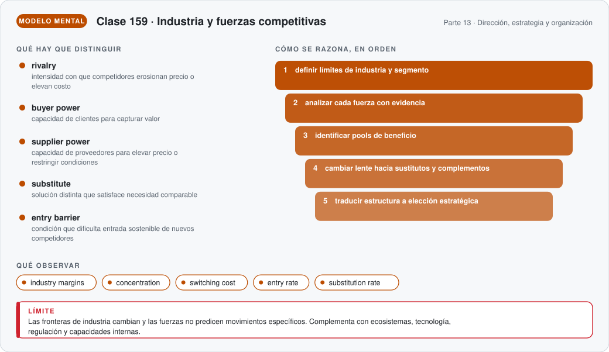

# Clase 159 — Industria y fuerzas competitivas

<!-- nav:inicio -->
> **Parte 13 · Estrategia y competencia** — clase 3 de 12 · [índice de la parte](../../README.md) · [temario](../../../../SYLLABUS.md)
<!-- nav:fin -->

**Parte:** 13 — Estrategia y competencia  
**Nivel:** Etapa 4 — Gerente → Director  
**Duración sugerida:** 150–180 minutos · **Estándar:** deep-class-v2

## 🎯 Propósito

¿Por qué algunas industrias son rentables para casi todos los que participan, y otras destruyen valor aunque sus empresas trabajen bien? La respuesta no está solo en la calidad de la gestión sino en la **estructura de la industria**: cuántos competidores hay y qué tan parecidos son, qué tan fácil es entrar, qué alternativas tiene el cliente, cuánto poder de negociación tienen compradores y proveedores. Porter organizó estas fuerzas en un marco que sigue siendo el punto de partida del análisis competitivo. Entenderlo permite decidir **dónde competir** y **cómo posicionarse** o, mejor aún, cómo **cambiar la estructura** a favor propio.

La clase se apoya en el análisis de Porter de la estructura de las industrias y la competencia, en la teoría de juegos aplicada a la estrategia de Dixit y Nalebuff, que ayuda a anticipar las respuestas de los rivales, y en la observación de McGrath de que las industrias se reconfiguran más rápido que antes. Al terminar sabrás analizar las cinco fuerzas con evidencia, evaluar la rentabilidad estructural de una industria, anticipar movimientos de competidores, reconocer los límites del marco y diseñar jugadas que mejoren la posición.

## 📚 Resultados de aprendizaje

Al finalizar podrás:

1. **Analizar** las cinco fuerzas de una industria con datos.
2. **Explicar** por qué la rentabilidad depende de la estructura y no solo de la gestión.
3. **Anticipar** las respuestas de competidores con razonamiento de juegos.
4. **Identificar** jugadas que mejoran la posición o cambian la estructura.
5. **Reconocer** los límites del marco en industrias dinámicas y de plataformas.

## 🧭 Agenda

| Tramo | Qué se hace |
|---|---|
| 0–20 min | Recuperación: ¿qué fuerza limita más el margen de tu industria y por qué? |
| 20–60 min | Cinco fuerzas, evidencia, juegos y jugadas. |
| 60–105 min | Ejemplo trabajado: industria de distribución de materiales de construcción y guerra de precios. |
| 105–150 min | Caso ejecutivo y práctica. |
| 150–175 min | Límites y entregable. |

## 🧩 Conceptos centrales

| Concepto | Definición | Cómo se reconoce |
|---|---|---|
| **Estructura de la industria** | Características que determinan la rentabilidad promedio de sus participantes. | Concentración, barreras, poder de negociación. |
| **Barrera de entrada** | Obstáculo que dificulta a nuevos competidores ingresar. | Escala, marca, acceso a canales, regulación. |
| **Costo de cambio** | Costo que enfrenta un cliente al cambiar de proveedor. | Datos, integración, aprendizaje. |
| **Sustituto** | Producto de otra categoría que cumple la misma función. | Alternativa distinta al competidor directo. |
| **Dilema del prisionero** | Situación en que cada parte, actuando por su interés, produce un resultado peor para ambas. | Guerras de precios. |
| **Compromiso creíble** | Acción que hace creíble una amenaza o promesa. | Costo irrecuperable, contrato. |

## 🧠 Modelo mental

**Cómo leer el diagrama.** Una tabla con las cinco fuerzas: **rivalidad** entre competidores, **entrada** de nuevos, **sustitutos**, **poder de los compradores** y **poder de los proveedores**. Para cada una se indica cuándo se intensifica y qué efecto tiene en la rentabilidad. La nota recuerda que el análisis explica por qué algunas industrias son más rentables y dónde puede una empresa posicionarse o cambiar la estructura, y que es estático: en industrias de plataformas o de cambio rápido se complementa con otros análisis.

## 📖 Desarrollo

### 1. Estructura y rentabilidad

Porter parte de una observación empírica: la rentabilidad promedio varía mucho entre industrias de forma persistente, y esa diferencia no se explica por la calidad de la gestión sino por la **estructura**. Una industria con muchos rivales parecidos, bajas barreras de entrada, sustitutos cercanos y clientes y proveedores poderosos tiende a ofrecer márgenes bajos a casi todos; una con pocos competidores diferenciados, barreras altas y compradores dispersos, márgenes altos. La estructura determina **cuánto valor se reparte** y cómo; la estrategia, a su vez, busca una posición favorable dentro de ella o modificarla.

### 2. Rivalidad entre competidores

La rivalidad es más intensa cuando hay **muchos competidores de tamaño similar**, **crecimiento lento** (la expansión de uno es a costa de otro), **costos fijos altos** (presión para llenar capacidad), **productos poco diferenciados** o con **bajos costos de cambio** y **barreras de salida altas**. Se manifiesta en **guerras de precios**, publicidad agresiva y rápida imitación. Es el factor más visible y, con frecuencia, el menos determinante de largo plazo: la rivalidad se modera si hay diferenciación y un reparto estable del mercado.

### 3. Entrada y sustitutos

La **amenaza de entrada** depende de las barreras: **economías de escala**, **diferenciación** y lealtad de marca, **requisitos de capital**, **costos de cambio de los clientes**, **acceso a canales de distribución**, **ventajas de costo independientes de la escala** (tecnología propietaria, acceso a insumos), **política gubernamental** y la expectativa de represalia. La **amenaza de sustitutos** es la presión de productos de otras categorías que cumplen la misma función (el video por internet frente al cine, el transporte por aplicación frente al taxi); se evalúa por la **relación valor–precio** relativa y por los **costos de cambio**. Los sustitutos fijan un techo a los precios.

### 4. Poder de compradores y de proveedores

Los **compradores** tienen más poder cuando son **pocos y compran en grandes volúmenes**, cuando el producto es **estándar**, cuando los **costos de cambio son bajos**, cuando pueden **integrarse hacia atrás** o cuando están bien informados. Presionan por precios más bajos y mejores condiciones. Los **proveedores** tienen más poder cuando hay **pocos**, ofrecen **insumos críticos** o diferenciados, los costos de cambio son altos o amenazan con **integrarse hacia adelante**. Capturan valor vía mayores precios. Se analiza **cada grupo** de compradores y de proveedores por separado: no todos tienen el mismo poder.

### 5. Teoría de juegos: anticipar respuestas

Dixit y Nalebuff muestran cómo pensar estratégicamente: tus resultados dependen de lo que hagan los demás, que también razonan sobre ti. En un **dilema del prisionero** de precios, cada empresa gana más si baja precios mientras el rival mantiene los suyos, pero si ambas bajan, ambas ganan menos que si hubieran mantenido. Las salidas incluyen **repetición** (la perspectiva de futuras interacciones sostiene la cooperación tácita), **compromisos creíbles**, **diferenciación** (para salir del juego de precios) y **señales** (anunciar políticas de igualación de precios). Un principio útil: ponerse en el lugar del otro y anticipar su respuesta antes de actuar.

### 6. Jugadas que mejoran la posición

Con el diagnóstico de las fuerzas se identifican **jugadas**: **posicionarse** donde las fuerzas son más débiles (segmentos con compradores menos poderosos); **construir defensas** (marca, costos de cambio, relaciones, escala); **cambiar el equilibrio** (integración, estandarización, alianzas con proveedores o clientes); **expandir la industria** (nuevos usos, nuevos clientes) en lugar de disputar la porción existente; y **evitar guerras destructivas** con señales de disciplina y diferenciación. Se piensa en el **efecto de segunda ronda**: cómo reaccionan los otros actores y cómo se reconfigura el equilibrio.

### 7. Límites y complementos

El marco es **estático** y de **industria definida**; en industrias de plataformas (clase 166), de límites difusos o con innovaciones rápidas, las fuerzas cambian y los límites entre industrias se desdibujan. McGrath sostiene que la ventaja se ha vuelto **transitoria** y que conviene gestionar **portafolios de ventajas** que se renuevan. Además, el análisis no incluye de forma explícita a los **complementadores** (empresas cuyos productos aumentan el valor del tuyo), ni **el papel del gobierno**, que a menudo es decisivo. Se utiliza como punto de partida de un análisis que se complementa con datos y con otras lentes.

## 📚 Lectura comparada

| Obra | Qué aporta | Qué no resuelve | Pregunta para contrastar |
|---|---|---|---|
| Porter (*Competitive Strategy*) | Cinco fuerzas y estructura de la industria. | Marco estático; industrias bien delimitadas. | ¿Qué fuerza limita más tu margen? |
| Dixit y Nalebuff | Teoría de juegos: respuestas, compromisos y credibilidad. | Supone actores racionales con información. | ¿Qué hará el rival ante tu jugada? |
| McGrath | Ventajas transitorias e industrias que se reconfiguran. | Menos detalle sobre análisis estructural. | ¿Cuánto durará tu posición? |
| Helmer | Fuentes de poder que sostienen la ventaja. | Se centra en la ventaja propia. | ¿Qué poder te protege de la rivalidad? |
| Kim y Mauborgne | Cambiar la estructura creando espacios nuevos. | Casos seleccionados. | ¿Qué factor de competencia puedes eliminar? |

## 🧮 Ejemplo trabajado

**Situación (hipotética).** Una empresa distribuidora de materiales de construcción en una región (ventas USD 120 millones, margen operacional 3,5 %) evalúa su industria.

**Análisis de las cinco fuerzas con evidencia.**

| Fuerza | Evidencia | Intensidad |
|---|---|---|
| Rivalidad | 11 distribuidores en la región; los cuatro mayores suman 48 %; productos estándar; precios publicados | Alta |
| Entrada | Bajas barreras de capital para bodegas pequeñas; un fabricante vende en línea directo a constructoras | Media a alta |
| Sustitutos | Prefabricados y soluciones modulares sustituyen parte de los insumos | Media |
| Compradores | Cinco constructoras compran el 38 % del volumen y comparan cotizaciones cada semana | Alta |
| Proveedores | Dos fabricantes de cemento y acero controlan 70 % de la oferta y fijan listas de precios | Alta |

**Conclusión estructural.** La industria tiene una rentabilidad estructural baja: el margen está presionado desde ambos lados (compradores y proveedores poderosos) y la rivalidad es alta.

**Un dilema de precios.** La empresa y su rival principal (R) pueden mantener precios o bajarlos 5 %. Resultados anuales de margen operativo en USD millones:

| | R mantiene | R baja |
|---|---|---|
| **Empresa mantiene** | 4,2 / 4,0 | 1,0 / 5,0 |
| **Empresa baja** | 5,0 / 1,0 | 2,0 / 2,0 |

Bajar es la mejor respuesta de cada uno frente a lo que haga el otro (5,0 > 4,2 si el rival mantiene; 2,0 > 1,0 si baja); el equilibrio es que ambos bajen y ganen 2,0 cada uno, en lugar de 4,2 y 4,0. La salida no pasa por rogar disciplina, sino por **cambiar el juego**.

**Jugadas posibles.** (1) **Diferenciar**: servicio de entrega en obra con ventanas horarias y despacho programado, que las constructoras valoran más que el precio de lista; (2) **costos de cambio**: plataforma de pedidos y facturación integrada con los sistemas de las constructoras; (3) **proveedores**: marca propia para productos de menor complejidad (cerámicas, pinturas) con fabricantes alternativos; (4) **segmentos**: servir a contratistas pequeños y a la construcción de viviendas (menos poder de compra) con un modelo de bajo contacto; (5) **señales**: no iniciar bajadas de precio y anunciar igualación en productos estándar.

**Estimación.** Si los servicios de entrega y la plataforma elevan 1,2 puntos el margen en el 40 % de las ventas, el margen operacional sube de 3,5 % a unos 4,0 % (más 0,5 puntos totales), sin iniciar guerras de precio. Se vigila la reacción de R y de las constructoras.

**Qué muestra.** (1) La estructura explicaba un margen bajo más que la gestión. (2) El juego de precios mostró por qué «bajar» era inestable. (3) Las jugadas cambiaron el equilibrio en lugar de pelear precio.

## 🔀 Comparación y límites

**Fuerzas competitivas frente a ventaja competitiva.** Las fuerzas describen la atractividad de la industria; la ventaja (clase 161) describe la posición de la empresa en ella. Una buena posición en una mala industria rinde menos que una posición promedio en una industria atractiva.

**Límites.** El análisis es estático y depende de definir bien la industria. En plataformas y ecosistemas, los límites cambian y aparecen complementadores. La teoría de juegos asume actores racionales con información; en la realidad hay errores, emociones y asimetrías. Los acuerdos o señales entre competidores sobre precios pueden violar las normas de **libre competencia**: la disciplina de precios no puede coordinarse con rivales y debe revisarse con asesoría legal. Las cifras del ejemplo son ilustrativas.

## 🪜 De profesional a owner

| Nivel | Cómo trabaja la industria y la competencia |
|---|---|
| **Profesional** | Observa clientes, proveedores y rivales y registra cambios. |
| **Jefe / Team Lead** | Aporta datos sobre precios, costos y movimientos competitivos. |
| **Gerente** | Analiza las fuerzas y propone jugadas de posicionamiento. |
| **CEO / Director** | Decide en qué industrias y posiciones competir y evita guerras destructivas. |
| **Founder / Owner** | Elige un nicho donde las fuerzas lo favorezcan. |

## 🏢 Caso ejecutivo

Una empresa de aplicaciones de reparto de comida en una ciudad grande tiene tres competidores locales y uno internacional. Los restaurantes (proveedores del servicio) pagan comisiones de 25 % y se quejan; los repartidores, que son independientes, han organizado paros y exigen tarifas mayores; los clientes cambian de aplicación según los cupones y el 70 % tiene instaladas dos o más; los restaurantes grandes han lanzado sus propias aplicaciones para recuperar el cliente directo. La regulación local discute una ley que limita las comisiones y regula la relación con los repartidores. La empresa pierde USD 0,8 por pedido y su directorio debate entre «subir comisiones», «reducir cupones» o «lanzar suscripción».

Entrega un **análisis de industria y plan de jugadas** que contenga: (a) las cinco fuerzas con evidencia y el análisis de la rentabilidad estructural; (b) un juego simplificado de precios o de cupones con los incentivos de cada actor y su equilibrio; (c) tres o cuatro jugadas para mejorar la posición o cambiar la estructura; (d) el análisis de la posible regulación y de los complementadores; (e) las señales de seguimiento; (f) los límites legales de libre competencia y laborales que se verificarán con las normas vigentes y asesoría.

## 🧪 Práctica

1. Evalúa las cinco fuerzas de tu industria con un dato por fuerza.
2. Construye un juego 2×2 con tus decisiones y las de tu principal rival, y encuentra su equilibrio.
3. Propón tres jugadas que reduzcan la presión de la fuerza más intensa.
4. Identifica un complementador clave en tu industria.
5. Define qué señales indicarían que la estructura de tu industria está cambiando.

## ⚠️ Errores frecuentes

| Error | Por qué ocurre | Cómo corregirlo |
|---|---|---|
| Definir mal la industria | Se usa la categoría de siempre | Definir por el problema y los sustitutos. |
| Mirar solo rivales directos | Son los más visibles | Evaluar las cinco fuerzas. |
| Guerra de precios | Se reacciona al rival | Diferenciar y cambiar el juego. |
| Ignorar respuestas del otro | Se piensa solo en la propia jugada | Razonamiento de juegos. |
| Coordinar precios con competidores | Se busca disciplina | Respetar la libre competencia. |
| Análisis estático | El marco lo es | Revisar con señales y complementar. |

## ❓ Preguntas de comprobación

1. ¿Por qué la rentabilidad depende de la estructura de la industria?
2. ¿Cuáles son las cinco fuerzas y cuándo se intensifica cada una?
3. ¿Qué es un dilema del prisionero y cómo aparece en los precios?
4. ¿Qué salidas existen frente a las guerras de precios?
5. ¿Qué es un compromiso creíble?
6. ¿Qué tipos de jugadas mejoran la posición?
7. ¿Qué límites tiene el análisis de cinco fuerzas?

Claves de respuesta

1. Porque las diferencias persistentes de rentabilidad entre industrias se explican por la estructura (rivalidad, entrada, sustitutos, poder de compradores y proveedores) más que por la calidad de la gestión.
2. Rivalidad, entrada, sustitutos, poder de compradores y poder de proveedores; cada una se intensifica con las condiciones descritas (muchos rivales, barreras bajas, sustitutos cercanos, pocos compradores o proveedores grandes).
3. Una situación en que cada parte, actuando por su interés, produce un resultado peor para ambas; en precios, ambas bajan y ganan menos que si mantenían.
4. Repetición, compromisos creíbles, diferenciación y señales, sin coordinar precios de forma ilegal.
5. Una acción que hace creíble una amenaza o promesa, como un costo irrecuperable o un contrato.
6. Posicionarse donde las fuerzas son débiles, construir defensas, cambiar el equilibrio, expandir la industria y evitar guerras destructivas.
7. Es estático, depende de definir bien la industria, no recoge bien plataformas y complementadores, y la teoría de juegos supone actores racionales.

## 📥 Entregable

Guarda en `portfolio/159-industria-y-fuerzas-competitivas/`:

- `strategy-memo.md` (plantilla [Strategy memo](../../../../templates/strategy-memo.md)) con el análisis y las jugadas del caso ejecutivo;
- `risk-governance-brief.md` (plantilla [Risk & Governance Brief](../../../../templates/risk-governance-brief.md)) con los límites de libre competencia y regulatorios;
- `decision-journal.md` con el juego analizado, las jugadas y las señales.

## 📗 Fuentes y verificación

- Michael E. Porter — *Competitive Strategy* (Free Press, 1980). **Uso en esta clase:** cinco fuerzas y estructura de la industria. Lectura selectiva sobre **industria y fuerzas competitivas**. **Localizador:** [ISBN-13 9780684841489](https://openlibrary.org/isbn/9780684841489).
- Avinash K. Dixit & Barry J. Nalebuff — *The Art of Strategy* (Norton & Company, Incorporated, W. W., 2008). **Uso en esta clase:** teoría de juegos: respuestas, compromisos y credibilidad. Lectura selectiva sobre **industria y fuerzas competitivas**. **Localizador:** [ISBN-13 9780393069952](https://openlibrary.org/isbn/9780393069952).
- Rita Gunther McGrath — *The End of Competitive Advantage* (Harvard Business Review Press, 2013). **Uso en esta clase:** ventajas transitorias e industrias que se reconfiguran. Lectura selectiva sobre **industria y fuerzas competitivas**. **Localizador:** [ISBN-13 9781422172810](https://openlibrary.org/isbn/9781422172810).
- Hamilton Helmer — *7 Powers* (Deep Strategy, 2016). **Uso en esta clase:** fuentes de poder que sostienen la ventaja. Lectura selectiva sobre **industria y fuerzas competitivas**. **Localizador:** [ISBN-13 9780998116303](https://openlibrary.org/isbn/9780998116303).
- W. Chan Kim & Renée Mauborgne — *Blue Ocean Strategy* (Coach Series, 2006). **Uso en esta clase:** cambiar la estructura creando espacios nuevos. Lectura selectiva sobre **industria y fuerzas competitivas**. **Localizador:** [ISBN-13 9781596590687](https://openlibrary.org/isbn/9781596590687).

> **Regla de fuentes para Industria y fuerzas competitivas:** las obras anteriores estructuran las perspectivas de esta materia; cualquier norma, ley o estándar vivo mencionado debe comprobarse nuevamente en su fuente primaria vigente, incluidas las normas de libre competencia, laborales y de plataformas. Los ejemplos y casos son hipotéticos, con cifras ilustrativas. El desarrollo es original y no reproduce capítulos protegidos.

<!-- pie:inicio -->
---

| Anterior | Índice | Siguiente |
|---|---|---|
| [← 158 · Diagnóstico estratégico](../158-diagnostico-estrategico/README.md) | [Parte 13](../../README.md) · [Programa](../../../../SYLLABUS.md) | [160 · Capacidades y recursos →](../160-capacidades-y-recursos/README.md) |
<!-- pie:fin -->
