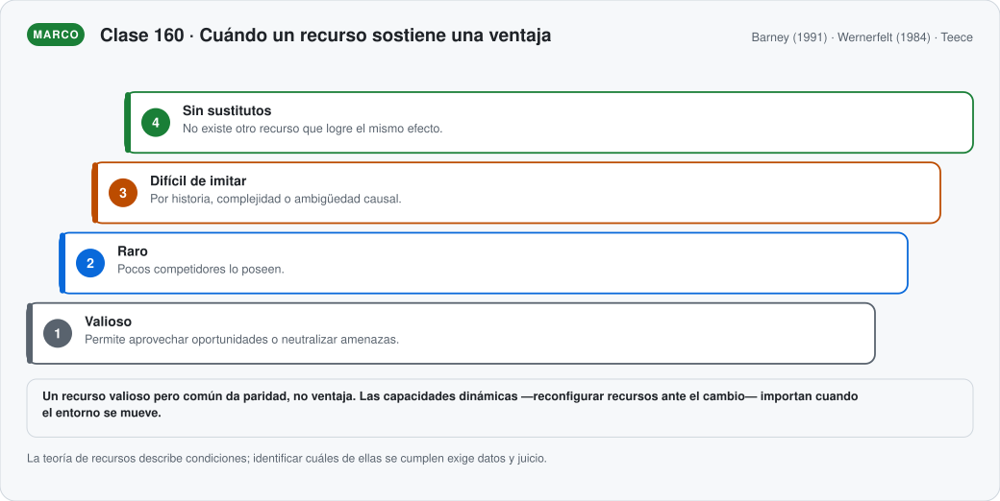

# Clase 160 — Capacidades y recursos

<!-- nav:inicio -->
> **Parte 13 · Estrategia y competencia** — clase 4 de 12 · [índice de la parte](../../README.md) · [temario](../../../../SYLLABUS.md)
<!-- nav:fin -->

**Parte:** 13 — Estrategia y competencia  
**Nivel:** Etapa 4 — Gerente → Director  
**Duración sugerida:** 150–180 minutos · **Estándar:** deep-class-v2

## 🎯 Propósito

Dos empresas de la misma industria, con acceso a los mismos mercados y tecnologías, obtienen resultados persistentemente distintos. ¿Por qué? Una respuesta es que **tienen recursos y capacidades diferentes**: activos, conocimientos, relaciones y formas de trabajar que no se pueden comprar de un día para otro ni copiar fácilmente. La mirada «basada en recursos» desplaza el análisis estratégico desde afuera (la industria) hacia adentro (la empresa): si la ventaja de una empresa proviene de algo que otros no pueden replicar, la estrategia consiste en identificar, proteger y desplegar esos recursos y capacidades, y desarrollar los que faltan.

La clase se apoya en el modelo de Wernerfelt (el que pone a los recursos en el centro de la estrategia), en las condiciones de Barney para que un recurso sostenga una ventaja, en la teoría de capacidades dinámicas de Teece y en la visión de ventajas transitorias de McGrath. Al terminar sabrás distinguir recursos de capacidades, evaluar si un recurso puede sostener ventaja, identificar capacidades críticas y brechas, reconocer el riesgo de rigideces centrales y planificar cómo desarrollar o adquirir lo que falta.

## 📚 Resultados de aprendizaje

Al finalizar podrás:

1. **Distinguir** recursos tangibles e intangibles de capacidades organizacionales.
2. **Evaluar** un recurso con las condiciones de valor, rareza, imitabilidad y sustitución.
3. **Identificar** las capacidades críticas y las brechas respecto de la estrategia.
4. **Explicar** las capacidades dinámicas y su papel en entornos cambiantes.
5. **Decidir** si construir, comprar o aliarse para cubrir una brecha.

## 🧭 Agenda

| Tramo | Qué se hace |
|---|---|
| 0–20 min | Recuperación: ¿qué hace tu empresa mejor que sus rivales y qué le impediría a otro copiarlo en dos años? |
| 20–60 min | Recursos, capacidades, condiciones de ventaja y capacidades dinámicas. |
| 60–105 min | Ejemplo trabajado: evaluar los recursos de una empresa de logística. |
| 105–150 min | Caso ejecutivo y práctica. |
| 150–175 min | Límites y entregable. |

## 🧩 Conceptos centrales

| Concepto | Definición | Cómo se reconoce |
|---|---|---|
| **Recurso** | Activo que la empresa controla: físico, financiero, humano, organizacional. | Se puede listar. |
| **Capacidad** | Habilidad de la organización para combinar y desplegar recursos para lograr un fin. | Se ve en lo que hace bien repetidamente. |
| **Ventaja sostenida** | Ventaja que los rivales no pueden replicar en el corto plazo. | Persiste en el tiempo. |
| **Ambigüedad causal** | Dificultad para entender qué produce el resultado. | Dificulta la imitación. |
| **Capacidad dinámica** | Capacidad de detectar cambios, aprovechar oportunidades y reconfigurar recursos. | Renueva la ventaja. |
| **Rigidez central** | Capacidad que, al consolidarse, frena el cambio. | El éxito pasado bloquea lo nuevo. |

## 🧠 Modelo mental

**Cómo leer el diagrama.** Una escalera de cuatro condiciones. Un recurso es **valioso** si permite aprovechar oportunidades o neutralizar amenazas; **raro** si pocos competidores lo tienen; **difícil de imitar** por historia, complejidad o ambigüedad causal; y **sin sustitutos** si no hay otro recurso que logre el mismo efecto. A medida que se cumplen más condiciones, la ventaja es más sostenible. La nota recuerda que un recurso valioso pero común da paridad, no ventaja, y que las capacidades dinámicas importan cuando el entorno cambia.

## 📖 Desarrollo

### 1. De afuera hacia adentro

Wernerfelt propuso mirar a la empresa como un **conjunto de recursos** y no solo como un conjunto de productos: lo que una empresa hace bien se explica por lo que controla (marcas, tecnología, personal calificado, contratos, conocimiento, relaciones), y esos recursos condicionan los mercados que le conviene atender. Esta mirada complementa el análisis de industria (clase 159): la industria dice dónde es atractivo competir; los recursos, **dónde se puede ganar**. Una estrategia sólida combina ambas: un mercado atractivo y recursos adecuados para competir en él.

### 2. Recursos y capacidades

Los **recursos** son los insumos: **físicos** (plantas, equipos, ubicaciones), **financieros** (caja, acceso a capital), **humanos** (conocimiento, experiencia, liderazgo), **organizacionales** (sistemas, cultura, procesos, reputación) y **tecnológicos** (patentes, datos, software). Las **capacidades** son la habilidad de combinarlos para producir un resultado de forma repetida: desarrollar productos, entregar a tiempo, vender soluciones complejas, adaptarse. Los recursos por sí solos rara vez son suficientes; la ventaja suele residir en **cómo** se combinan. Dos empresas con la misma tecnología y equipos obtienen resultados distintos por sus rutinas, conocimiento y coordinación.

### 3. Cuándo un recurso sostiene una ventaja

Barney propone cuatro condiciones para que un recurso sea fuente de ventaja competitiva sostenida: debe ser **valioso** (permite aprovechar oportunidades o neutralizar amenazas), **raro** (pocos competidores lo tienen), **difícil de imitar** y **sin sustitutos equivalentes**. La imitación es difícil por tres razones: **condiciones históricas únicas** (un recurso que depende de la trayectoria de la empresa), **ambigüedad causal** (ni los propios ni los rivales saben exactamente qué lo produce) y **complejidad social** (relaciones, cultura, reputación que no se compran). Un recurso que cumple solo la primera condición da **paridad**, no ventaja.

### 4. Evaluar y mapear

Para evaluar se listan los recursos y capacidades relevantes y se aplican las cuatro condiciones con evidencia: ¿**qué valor** crean (qué se pierde sin ellos)?, ¿**quién más** los tiene?, ¿**cuánto costaría y tardaría** replicarlos?, ¿**qué alternativas** logran el mismo efecto? Se clasifican como **desventaja** (los rivales los tienen y nosotros no), **paridad** (necesarios, pero comunes), **ventaja temporal** (valiosos y raros, pero imitables) y **ventaja sostenida**. El resultado es un mapa que indica dónde invertir para protegerlos, dónde bastan niveles de paridad y qué brechas cerrar. Se contrasta con la estrategia: ¿las capacidades que necesitamos coinciden con las que tenemos?

### 5. Capacidades dinámicas

Teece sostiene que, en entornos que cambian con rapidez, las capacidades «ordinarias» (hacer bien lo que se hace) no bastan: la ventaja sostenida exige **capacidades dinámicas**, la habilidad de **detectar** oportunidades y amenazas (*sensing*), **aprovecharlas** movilizando recursos y tomando decisiones de inversión (*seizing*) y **transformar** la organización y reconfigurar sus activos (*transforming*). Estas capacidades residen en procesos de la empresa y en el liderazgo: escaneo del entorno, toma de decisiones, gestión de portafolio, alineación de la organización. Explican por qué algunas empresas se reinventan y otras, con buenos recursos, quedan atrapadas en su éxito pasado.

### 6. Rigideces y ventajas transitorias

Las capacidades que hicieron exitosa a una empresa pueden convertirse en **rigideces centrales**: rutinas, relaciones y valores que dificultan cambiar. McGrath argumenta que las ventajas son cada vez más **transitorias** y que la gestión debe cambiar el foco de «proteger una ventaja» a **gestionar un portafolio de ventajas** que se lanzan, se explotan, se reconfiguran y se abandonan. Preguntas para detectar rigideces: ¿qué cosas hacemos igual que hace diez años sin preguntarnos por qué?, ¿qué recursos nos ligan a un modelo que se agota?, ¿qué nuevas capacidades necesitaríamos si cambiara la industria?

### 7. Cerrar brechas: construir, comprar o aliarse

Si la estrategia exige capacidades que faltan, se decide cómo obtenerlas: **construir** (desarrollo interno: más control, más tiempo, aprendizaje); **comprar** (adquirir una empresa o talento: rapidez, riesgo de integración y de pérdida de lo adquirido); **aliarse** (acuerdos, joint ventures, licencias: flexibilidad, dependencia). La elección depende de **qué tan crítica** es la capacidad, **cuánto tiempo** hay, **qué tan transferible** es y del **costo y riesgo**. Se evalúan también los riesgos de integración cultural y de dependencia de terceros (clase 093). Las adquisiciones y alianzas tienen implicancias legales y de competencia que requieren asesoría.

## 📚 Lectura comparada

| Obra | Qué aporta | Qué no resuelve | Pregunta para contrastar |
|---|---|---|---|
| Wernerfelt (1984) | Mirada de la empresa como conjunto de recursos. | Marco conceptual; poco operativo. | ¿Qué recursos controlas que otros no? |
| Barney (1991) | Condiciones para la ventaja sostenida. | Difícil de medir; algo circular. | ¿Cuántas condiciones cumple tu recurso? |
| Teece | Capacidades dinámicas: detectar, aprovechar y transformar. | Concepto amplio; difícil de observar. | ¿Quién en tu empresa detecta y reconfigura? |
| McGrath | Ventajas transitorias y gestión de portafolio de ventajas. | Menos énfasis en recursos específicos. | ¿Cuánto dura tu ventaja principal? |
| Helmer | Fuentes de poder que sostienen una ventaja. | Se centra en poderes ya identificables. | ¿Cuál de las siete fuentes tienes? |

## 🧮 Ejemplo trabajado

**Situación (hipotética).** Una empresa de logística de última milla en una región (ventas USD 90 millones, margen operacional 5 %) quiere decidir en qué invertir. Hace un inventario de recursos y capacidades.

| Recurso o capacidad | Valioso | Raro | Difícil de imitar | Sin sustituto | Clasificación |
|---|---|---|---|---|---|
| Flota de 600 vehículos | Sí | No (rivales tienen o subcontratan) | No | No | Paridad |
| Base de datos de rutas y tiempos de 8 años en 40 ciudades intermedias | Sí (reduce 11 % el tiempo de ruta) | Sí | Parcialmente (los datos se acumulan con el tiempo) | Parcial | Ventaja temporal a sostenida |
| Red de 120 puntos de entrega con comercios locales en ciudades pequeñas | Sí | Sí | Sí (relaciones con comercios, contratos, historia) | No | Ventaja sostenida |
| Capacidad de planificación de rutas con IA | Sí | Parcial | Parcial (hay proveedores de software) | No | Paridad creciente |
| Cultura de cumplimiento de plazos (97 % a tiempo) | Sí | Sí | Sí (hábito organizacional y ambigüedad causal) | No | Ventaja sostenida |
| Marca | Parcial | No | No | No | Desventaja frente a líderes nacionales |

**Lectura.** Las ventajas sostenidas son la red de puntos locales y la cultura de cumplimiento; la base de datos de rutas es valiosa y tarda en copiarse, pero el software de planificación está disponible en el mercado. La marca es una desventaja en grandes ciudades.

**Capacidades dinámicas.** La empresa detecta tarde los cambios (se enteró de la entrada de un competidor de plataforma cuando ya perdía clientes); no tiene un proceso de portafolio de apuestas; sus decisiones de inversión demoran 6 meses. Se identifica una brecha de *sensing* y de *seizing*.

**Estrategia coherente.** Competir en **ciudades intermedias y pequeñas** (donde la red local y los datos pesan) y con **comercios y empresas regionales**; usar paridad en tecnología (comprar software), invertir en proteger y ampliar la red local, y en una unidad de inteligencia de mercado con revisión trimestral. No competir por marca en grandes ciudades.

**Brechas y decisión.** Falta de talento en ciencia de datos: se evalúa **construir** (formar 4 analistas, 12 meses), **comprar** (adquirir una consultora de 20 personas, USD 3 millones y riesgo de integración) o **aliarse** (acuerdo con una universidad y un proveedor tecnológico). Se elige construir un núcleo pequeño y aliarse con un proveedor para lo estándar, con revisión a los 12 meses.

**Qué muestra.** (1) El inventario distinguió paridad de ventaja. (2) Las capacidades dinámicas explicaron una vulnerabilidad. (3) La estrategia se alineó con los recursos y la brecha se cubrió con una decisión explícita.

## 🔀 Comparación y límites

**Recursos frente a posicionamiento.** La visión basada en recursos pregunta qué puede hacer la empresa que otros no; la de posicionamiento, dónde conviene competir. Se necesitan ambas: un recurso valioso aplicado en un mercado poco atractivo rinde menos.

**Límites.** La teoría de recursos es, en parte, circular («la ventaja es lo que da ventaja») y difícil de contrastar. Los recursos intangibles son difíciles de medir. Las capacidades dinámicas son un concepto amplio. La imitación es lenta pero posible, y las ventajas se erosionan. Los análisis internos pueden estar sesgados por autopercepción. Las adquisiciones, alianzas y uso de datos tienen implicancias legales (competencia, datos, laborales) que se verifican con asesoría. El ejemplo es ilustrativo.

## 🪜 De profesional a owner

| Nivel | Cómo participa en capacidades y recursos |
|---|---|
| **Profesional** | Desarrolla y comparte conocimiento que hace valiosa a la organización. |
| **Jefe / Team Lead** | Protege y mejora las capacidades de su equipo. |
| **Gerente** | Mapea recursos y brechas y propone cómo cubrirlas. |
| **CEO / Director** | Decide qué capacidades construir, comprar o abandonar. |
| **Founder / Owner** | Cuida el conocimiento que lo diferencia y evita depender de un solo recurso. |

## 🏢 Caso ejecutivo

Una editorial de libros de texto escolares, líder durante 30 años en su país, ve caer sus ventas 7 % anual por la digitalización, el uso de materiales gratuitos y los cambios de política de compras públicas. Sus recursos: un catálogo de 3.200 títulos con derechos de autor, una fuerza de ventas de 180 personas con relaciones con 5.000 colegios, un equipo editorial de alta calidad, una imprenta propia con baja utilización y una marca respetada. Sus capacidades: producción editorial, ventas a colegios, gestión de derechos. Le faltan capacidades de desarrollo de software educativo, análisis de datos de aprendizaje y distribución digital. Un competidor tecnológico ofrece plataformas de contenidos adaptativos; los directores de colegio piden integración con sus sistemas. Hay tres opciones: adquirir una empresa de tecnología educativa (USD 25 millones), construir un área digital interna, o aliarse con una plataforma.

Entrega un **análisis de recursos y capacidades** que contenga: (a) el inventario con evaluación de valor, rareza, imitabilidad y sustitución; (b) la clasificación en desventaja, paridad y ventaja y las rigideces centrales; (c) las capacidades dinámicas actuales y las brechas; (d) la evaluación de construir, comprar o aliarse con criterios; (e) la estrategia coherente y los riesgos; (f) las verificaciones de derechos de autor, competencia y datos de estudiantes que se harán con las normas vigentes y asesoría.

## 🧪 Práctica

1. Lista diez recursos y capacidades de tu organización y evalúalos con las cuatro condiciones.
2. Clasifícalos en desventaja, paridad, ventaja temporal y ventaja sostenida.
3. Identifica una rigidez central que podría frenarte.
4. Describe cómo detectas, aprovechas y transformas ante un cambio del entorno.
5. Para una brecha, compara construir, comprar y aliarse con tres criterios.

## ⚠️ Errores frecuentes

| Error | Por qué ocurre | Cómo corregirlo |
|---|---|---|
| Confundir recurso valioso con ventaja | Se cree que valor basta | Evaluar rareza e imitabilidad. |
| Listar sin evaluar | Se hace inventario | Aplicar las cuatro condiciones con evidencia. |
| Idealizar lo propio | Sesgo de autopercepción | Comparar con rivales y datos. |
| Proteger una ventaja que se agota | Inercia | Portafolio de ventajas y reconfiguración. |
| Comprar capacidades sin integrarlas | Se busca rapidez | Plan de integración y riesgos. |
| No alinear con la estrategia | Se mira lo interno aislado | Contrastar con el desafío y la política. |

## ❓ Preguntas de comprobación

1. ¿Qué diferencia hay entre recursos y capacidades?
2. ¿Cuáles son las cuatro condiciones de Barney?
3. ¿Por qué un recurso valioso y común no da ventaja?
4. ¿Qué son las capacidades dinámicas?
5. ¿Qué es una rigidez central?
6. ¿Qué criterios orientan construir, comprar o aliarse?
7. ¿Qué límites tiene la teoría de recursos?

Claves de respuesta

1. Los recursos son los activos que se controlan; las capacidades, la habilidad de combinarlos y desplegarlos para lograr un fin de forma repetida.
2. Valioso, raro, difícil de imitar y sin sustitutos equivalentes.
3. Porque los rivales también lo tienen: da paridad, no ventaja.
4. La habilidad de detectar oportunidades y amenazas, aprovecharlas movilizando recursos y transformar la organización y reconfigurar activos.
5. Una capacidad o rutina que, por haber sido exitosa, dificulta el cambio.
6. Qué tan crítica es la capacidad, el tiempo disponible, su transferibilidad, el costo y el riesgo de integración o de dependencia.
7. Es en parte circular, difícil de medir y contrastar, y los análisis internos pueden estar sesgados; las ventajas se erosionan.

## 📥 Entregable

Guarda en `portfolio/160-capacidades-y-recursos/`:

- `operating-improvement-brief.md` (plantilla [Operating Improvement Brief](../../../../templates/operating-improvement-brief.md)) con el análisis de capacidades y brechas del caso ejecutivo;
- `strategy-memo.md` (plantilla [Strategy memo](../../../../templates/strategy-memo.md)) con la estrategia coherente con los recursos;
- `decision-journal.md` con la evaluación de construir, comprar o aliarse.

## 📗 Fuentes y verificación

- Birger Wernerfelt — *A resource-based view of the firm* (Strategic Management Journal, 1984). **Uso en esta clase:** mirada de la empresa como conjunto de recursos. Lectura selectiva sobre **capacidades y recursos**. **Localizador:** [DOI 10.1002/smj.4250050207](https://doi.org/10.1002/smj.4250050207).
- Jay Barney — *Firm Resources and Sustained Competitive Advantage* (Journal of Management, 1991). **Uso en esta clase:** condiciones para la ventaja sostenida. Lectura selectiva sobre **capacidades y recursos**. **Localizador:** [DOI 10.1177/014920639101700108](https://doi.org/10.1177/014920639101700108).
- David J. Teece — *Dynamic Capabilities and Strategic Management* (Strategic Management Journal, 1997). **Uso en esta clase:** capacidades dinámicas: detectar, aprovechar y transformar. Lectura selectiva sobre **capacidades y recursos**. **Localizador:** [DOI 10.1002/(SICI)1097-0266(199708)18:7<509::AID-SMJ882>3.0.CO;2-Z](https://doi.org/10.1002/(SICI)1097-0266(199708)18:7<509::AID-SMJ882>3.0.CO;2-Z).
- Rita Gunther McGrath — *The End of Competitive Advantage* (Harvard Business Review Press, 2013). **Uso en esta clase:** ventajas transitorias y portafolio de ventajas. Lectura selectiva sobre **capacidades y recursos**. **Localizador:** [ISBN-13 9781422172810](https://openlibrary.org/isbn/9781422172810).
- Hamilton Helmer — *7 Powers* (Deep Strategy, 2016). **Uso en esta clase:** fuentes de poder que sostienen una ventaja. Lectura selectiva sobre **capacidades y recursos**. **Localizador:** [ISBN-13 9780998116303](https://openlibrary.org/isbn/9780998116303).

> **Regla de fuentes para Capacidades y recursos:** las obras anteriores estructuran las perspectivas de esta materia; cualquier norma, ley o estándar vivo mencionado debe comprobarse nuevamente en su fuente primaria vigente, incluidas las de derechos de autor, competencia y datos de estudiantes. Los ejemplos y casos son hipotéticos, con cifras ilustrativas. El desarrollo es original y no reproduce capítulos protegidos.

<!-- pie:inicio -->
---

| Anterior | Índice | Siguiente |
|---|---|---|
| [← 159 · Industria y fuerzas competitivas](../159-industria-y-fuerzas-competitivas/README.md) | [Parte 13](../../README.md) · [Programa](../../../../SYLLABUS.md) | [161 · Ventaja competitiva →](../161-ventaja-competitiva/README.md) |
<!-- pie:fin -->
