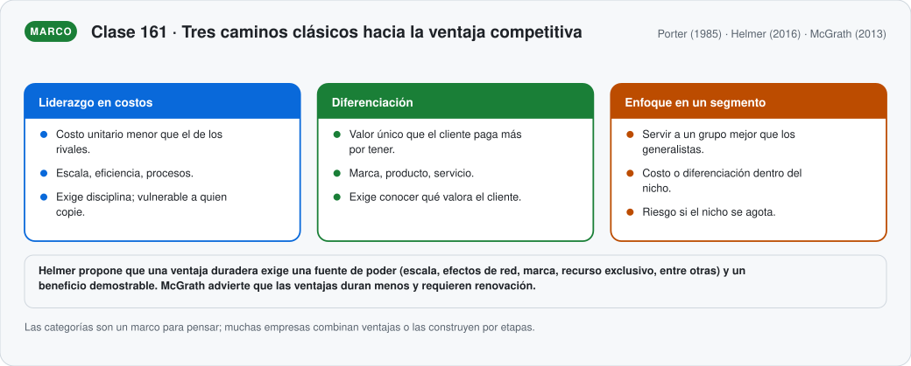

# Clase 161 — Ventaja competitiva

<!-- nav:inicio -->
> **Parte 13 · Estrategia y competencia** — clase 5 de 12 · [índice de la parte](../../README.md) · [temario](../../../../SYLLABUS.md)
<!-- nav:fin -->

**Parte:** 13 — Estrategia y competencia  
**Nivel:** Etapa 4 — Gerente → Director  
**Duración sugerida:** 150–180 minutos · **Estándar:** deep-class-v2

## 🎯 Propósito

Una empresa tiene **ventaja competitiva** cuando logra de forma sostenida una rentabilidad superior a la de sus competidores. El resto son matices: ser grande, ser conocido, crecer rápido o tener buenos productos no es lo mismo. Hay ventaja cuando algo permite **cobrar más, gastar menos o ambas cosas** frente a los rivales, y cuando ese algo no se puede copiar fácilmente. La pregunta estratégica central es de dónde proviene esa ventaja, por qué durará y qué haría falta para erosionarla. Sin respuestas concretas, una empresa depende de la suerte y de la inercia.

La clase se apoya en la tipología de ventajas de Porter (costo, diferenciación y enfoque), en la propuesta de Helmer de siete fuentes de poder que sostienen la ventaja y un beneficio medible, en la tesis de McGrath sobre ventajas transitorias y en las condiciones de recursos de Barney. Al terminar sabrás identificar el tipo de ventaja de una empresa, distinguirla de la mera eficiencia, analizar si cumple las dos condiciones de poder (beneficio y barrera), evaluar su duración y planificar su renovación.

## 📚 Resultados de aprendizaje

Al finalizar podrás:

1. **Definir** la ventaja competitiva en términos de rentabilidad persistente y sus orígenes.
2. **Distinguir** liderazgo en costos, diferenciación y enfoque.
3. **Aplicar** las siete fuentes de poder para evaluar la sostenibilidad.
4. **Medir** si la ventaja es real con datos de costo, precio y margen.
5. **Planificar** la renovación de ventajas que se erosionan.

## 🧭 Agenda

| Tramo | Qué se hace |
|---|---|
| 0–20 min | Recuperación: ¿qué hace que un cliente te elija a ti en lugar de a un rival, y qué impediría a un rival ofrecer lo mismo? |
| 20–60 min | Tipos de ventaja, siete poderes, medición y renovación. |
| 60–105 min | Ejemplo trabajado: escala en una empresa de pagos y análisis de las siete fuentes de poder. |
| 105–150 min | Caso ejecutivo y práctica. |
| 150–175 min | Límites y entregable. |

## 🧩 Conceptos centrales

| Concepto | Definición | Cómo se reconoce |
|---|---|---|
| **Ventaja competitiva** | Capacidad de lograr rentabilidad superior de forma persistente frente a los rivales. | Margen o retorno mayor y sostenido. |
| **Liderazgo en costos** | Costo unitario menor que el de los competidores. | Precio igual con más margen o precio menor con igual margen. |
| **Diferenciación** | Valor único que el cliente paga más por tener. | Prima de precio o mayor preferencia. |
| **Enfoque** | Servir a un segmento mejor que los generalistas. | Costo o diferenciación dentro de un nicho. |
| **Poder (Helmer)** | Condición que permite un beneficio duradero y una barrera que impide a los rivales arbitrarlo. | Beneficio más barrera. |
| **Ventaja transitoria** | Ventaja de duración limitada que se renueva. | Se lanza, explota y reconfigura. |

## 🧠 Modelo mental

**Cómo leer el diagrama.** Tres columnas. El **liderazgo en costos** logra un costo unitario menor por escala, eficiencia y procesos; exige disciplina y es vulnerable a quien copie. La **diferenciación** crea un valor único por el cual el cliente paga más (marca, producto, servicio); exige conocer qué valora el cliente. El **enfoque** sirve a un segmento mejor que los generalistas; arriesga si el nicho se agota. La nota recoge que Helmer exige una fuente de poder y un beneficio demostrable, y que McGrath advierte que las ventajas duran menos.

## 📖 Desarrollo

### 1. Qué es y qué no es ventaja

Una ventaja competitiva se mide en **resultados**: un retorno sobre el capital o un margen superior al de los rivales de forma persistente. No son ventajas por sí mismas: el **tamaño**, la **tecnología** (se compra), el **crecimiento** (se puede comprar con descuentos), la **eficiencia operativa** (se imita) o la **calidad** (si todos la tienen). Porter distingue la **eficiencia operativa** (hacer lo mismo mejor) de la **posición estratégica** (hacer cosas distintas o las mismas de distinta manera): la primera es necesaria y se difunde; la segunda, al exigir elecciones, es más difícil de copiar. La ventaja se origina en **cómo la empresa crea valor para el cliente a un costo menor** que el valor que crea.

### 2. Los caminos clásicos

Porter identifica tres **estrategias genéricas**. **Liderazgo en costos**: lograr el costo más bajo de la industria mediante escala, curva de experiencia, control de costos, diseño para producir y acceso preferente a insumos; permite ganar con precios similares a los de los rivales o competir con precios menores. **Diferenciación**: ofrecer algo único que el cliente valora (diseño, marca, servicio, tecnología) y por lo que paga una prima mayor que el costo de crearlo. **Enfoque**: aplicar cualquiera de las dos a un segmento específico. Las empresas que intentan ser todo a la vez se arriesgan a quedar «atrapadas en el medio» (clase 162).

### 3. Las siete fuentes de poder

Helmer sostiene que una ventaja duradera requiere un **poder**, definido por dos condiciones: un **beneficio** (mayor margen o menor costo que un rival) y una **barrera** (impide que los rivales arbitren esa diferencia). Identifica siete: **economías de escala** (el costo unitario cae con el volumen y el rival más pequeño no puede igualarlo); **efectos de red** (el producto vale más a cada usuario cuantos más haya); **contra-posicionamiento** (un modelo nuevo que el líder no puede copiar sin dañar su negocio actual); **costos de cambio** (el cliente pierde al migrar); **marca** (percepción que permite cobrar más o vender más); **recurso exclusivo** (acceso preferente a un activo valioso) y **poder de proceso** (procesos internos difíciles de replicar que dan mejor costo o calidad). Cada uno puede evaluarse con datos y apunta a distintas acciones de defensa.

### 4. Medir si la ventaja es real

Se contrasta con evidencia: **margen** y **retorno sobre el capital** frente a rivales de forma persistente; **costo unitario** por unidad y por componente; **prima de precio** que los clientes pagan por la diferencia; **retención** y **cuota** de los clientes ganados; **elasticidad** al precio. Se pregunta: si un rival igualara el precio, ¿qué clientes se quedarían y por qué?; si un rival copiara un atributo, ¿cuánto tiempo y dinero necesitaría? Un indicio de falta de ventaja: **la empresa necesita competir en precio** para mantener cuota. McGrath sugiere mirar también la **trayectoria**: si la ventaja se ha estado erosionando.

### 5. Ventajas transitorias

McGrath sostiene que, en muchos sectores, las ventajas duran cada vez menos porque la tecnología, la regulación, los clientes y los competidores cambian con rapidez. Propone gestionar un **portafolio de ventajas transitorias** en un ciclo: **lanzar** una nueva ventaja (explorar oportunidades), **expandir** (aprovechar y escalar), **explotar** (obtener el máximo), **reconfigurar** (renovar recursos y modelo antes de que se agote) y **abandonar** con disciplina las que ya no rinden. La cuestión pasa de «¿cómo defiendo mi ventaja?» a «¿cómo renuevo mis ventajas antes de que las erosionen otros?». Esto exige capacidades dinámicas (clase 160).

### 6. Construir y proteger

Construir una ventaja es una decisión de **inversión y de elección**: elegir en qué se quiere ser el mejor y renunciar a lo demás (clase 162); invertir en el **recurso o proceso** que sostendrá el poder (capacidad, datos, relaciones, escala); y **proteger** con barreras (contratos, patentes cuando corresponde, integración, costos de cambio, marca). También supone **moverse antes** que los rivales cuando el entorno cambia. Se evita defender ventajas que ya no importan al cliente y se vigilan los **competidores emergentes** que atacan por segmentos desatendidos (Christensen, clase 156).

### 7. Ventaja y ética

Una ventaja legítima proviene de **crear más valor** para clientes, empleados y sociedad a un menor costo relativo. Existen «ventajas» basadas en prácticas cuestionables: **colusión** o acuerdos de precios, abuso de poder de mercado, explotación de proveedores o de trabajadores, información privilegiada, incumplimientos de normas ambientales o laborales. Además de ser dañinas, pueden ser **ilegales** y producir sanciones y daño a la reputación. Las decisiones que afecten competencia, exclusividades, integración o prácticas con proveedores y clientes se revisan con asesoría legal y con las normas de libre competencia vigentes.

## 📚 Lectura comparada

| Obra | Qué aporta | Qué no resuelve | Pregunta para contrastar |
|---|---|---|---|
| Porter (*Competitive Advantage*) | Estrategias genéricas, cadena de valor y fuentes de ventaja. | Visión de industria más estable. | ¿Compites por costo, por diferenciación o por enfoque? |
| Helmer | Siete poderes con las condiciones de beneficio y barrera. | Marco útil pero con casos seleccionados. | ¿Qué poder tienes y qué beneficio produce? |
| McGrath | Ventajas transitorias y portafolio. | Menos detalle sobre cómo construir cada una. | ¿Cuándo renovarás tu ventaja? |
| Barney | Condiciones de recursos para sostener la ventaja. | Concepto algo circular. | ¿Tu recurso es raro y difícil de imitar? |
| Kim y Mauborgne | Crear espacios donde la competencia no es relevante. | Evidencia de casos. | ¿Qué factor eliminarías o crearías? |

## 🧮 Ejemplo trabajado

**Situación (hipotética).** Una empresa de procesamiento de pagos con comercios (A) compite con otra (B) en un país. Costos fijos anuales: A USD 6 millones; B USD 6 millones (plataforma, cumplimiento, soporte). Costo variable por transacción: USD 0,12 (comisiones de redes y procesamiento) para ambas.

**Economías de escala.**

| Empresa | Transacciones al año | Costo fijo por transacción | Costo total por transacción |
|---|---|---|---|
| A | 60 millones | 0,10 | 0,22 |
| B | 20 millones | 0,30 | 0,42 |

**Lectura.** A tiene un costo unitario de USD 0,22 frente a 0,42 de B: casi la mitad. Si ambas cobran USD 0,45 por transacción, el margen por transacción de A es 0,23 y el de B 0,03; si A baja el precio a 0,35, mantiene 0,13 de margen y B pierde 0,07 por operación. La **escala** es el poder: beneficio (menor costo unitario) y **barrera** (B no puede igualar sin volumen, y para obtener volumen necesita precio bajo que no puede sostener).

**Evaluación de las siete fuentes de poder.**

| Poder | Evidencia | Fuerza |
|---|---|---|
| Economías de escala | Costo unitario de 0,22 frente a 0,42 | Alta |
| Efectos de red | Débiles: el comercio y el cliente no se benefician de más comercios | Baja |
| Contra-posicionamiento | Un nuevo entrante con pagos instantáneos sin comisión desafía el modelo | Amenaza |
| Costos de cambio | Integración con el sistema de caja del comercio y conciliación; cambio demora 6 semanas | Media |
| Marca | Reconocida en grandes comercios; poco peso en pequeños | Media |
| Recurso exclusivo | Licencia regulatoria que otros pueden obtener en 12 meses | Baja |
| Poder de proceso | Detección de fraude con 8 años de datos propios: reduce el fraude 18 % | Media |

**Riesgo principal.** La amenaza de **pagos instantáneos** promovidos por el sistema financiero: si se masifican, la escala de A pierde valor porque el costo de las redes tradicionales deja de ser relevante. McGrath diría que la ventaja de escala es transitoria si cambia la tecnología de pagos.

**Plan.** (1) **Explotar** la escala mientras dure: precios que defiendan cuota; (2) **construir** costos de cambio con servicios adicionales (conciliación, financiamiento a comercios); (3) **lanzar** una oferta de pagos instantáneos antes de que otros erosionen; (4) mejorar el **poder de proceso** (fraude) como segundo pilar; (5) vigilar señales: porcentaje de transacciones instantáneas, precio de rivales, tasa de cambio de comercios.

**Aspectos legales.** Las decisiones de precios por debajo de costo para sacar a un rival pueden ser **prácticas predatorias** según las normas de libre competencia: se verifica con asesoría que la política de precios respete la normativa vigente.

**Qué muestra.** (1) La escala se midió con datos de costo. (2) El análisis de siete poderes reveló dependencia de un solo poder. (3) El plan renovó y diversificó las fuentes de ventaja.

## 🔀 Comparación y límites

**Ventaja frente a posición.** La posición es dónde está la empresa en el mercado; la ventaja es la razón sostenible de por qué rinde más. Se puede tener buena cuota sin ventaja si se compró con precio.

**Límites.** Las siete fuentes de poder de Helmer son una clasificación útil pero basada en casos seleccionados; algunos casos caben en varias categorías. Las ventajas son más difíciles de medir en servicios y en empresas diversificadas. Las estimaciones de costos por escala dependen de cómo se asignen costos fijos. La competencia puede erosionar una ventaja con innovaciones imprevisibles. Y toda conducta que busque excluir competidores se somete a las normas de libre competencia. El ejemplo es ilustrativo.

## 🪜 De profesional a owner

| Nivel | Cómo participa en la ventaja competitiva |
|---|---|
| **Profesional** | Mejora lo que el cliente más valora y reduce el desperdicio. |
| **Jefe / Team Lead** | Protege las capacidades y procesos que sostienen la ventaja. |
| **Gerente** | Mide costo, precio y margen frente a rivales y propone mejoras. |
| **CEO / Director** | Decide qué ventaja construir, cuál renovar y cuál abandonar. |
| **Founder / Owner** | Busca una ventaja que otros no puedan copiar con dinero. |

## 🏢 Caso ejecutivo

Una cadena de farmacias regional con 120 locales, líder histórico en su zona, ve caer su margen operacional de 6,5 % a 4,1 % en tres años. Una cadena nacional entró con 35 locales y precios 9 % menores en medicamentos de venta libre; un portal de comparación de precios permite a los clientes ver ofertas en tiempo real; un laboratorio vende directamente a los consumidores algunos productos; la regulación limita los márgenes de medicamentos con receta. La cadena regional tiene fuerte presencia, relaciones con médicos y programas de fidelidad, un servicio de atención farmacéutica bien valorado y un sistema logístico regional eficiente. El directorio debate entre «igualar precios», «reforzar el servicio» o «integrarse con una clínica».

Entrega un **análisis de ventaja competitiva** que contenga: (a) la evidencia de si hoy hay ventaja (márgenes, costos, retención, prima de precio); (b) la evaluación de las siete fuentes de poder y de los caminos genéricos; (c) la duración probable de cada ventaja y las amenazas; (d) las opciones (igualar precios, reforzar servicio, integrarse) con sus efectos esperados y riesgos; (e) un plan de construcción y renovación con señales; (f) los límites regulatorios (medicamentos, precios, publicidad, libre competencia) que se verificarán con las normas vigentes y asesoría.

## 🧪 Práctica

1. Escribe en una frase la ventaja de tu organización y qué evidencia la respalda.
2. Evalúa las siete fuentes de poder con un dato por cada una.
3. Calcula tu costo unitario y compáralo con el de un rival estimado.
4. Estima cuánto tardaría un rival en igualar tu ventaja principal.
5. Define dos señales que indicarían que tu ventaja se está erosionando.

## ⚠️ Errores frecuentes

| Error | Por qué ocurre | Cómo corregirlo |
|---|---|---|
| Confundir tamaño con ventaja | Se mira la cuota | Medir margen y retorno persistentes. |
| Eficiencia como estrategia | Es medible | Buscar posición distinta además de eficiencia. |
| Sin barrera | Se cree que el beneficio basta | Preguntar por qué los rivales no lo copian. |
| Defender lo que ya no importa | Inercia | Revisar con el cliente qué valora. |
| Un solo poder | Comodidad | Diversificar y renovar. |
| Prácticas dudosas de competencia | Presión por ganar | Respetar las normas y asesorarse. |

## ❓ Preguntas de comprobación

1. ¿Cómo se define y se mide la ventaja competitiva?
2. ¿Qué tres estrategias genéricas identifica Porter?
3. ¿Qué dos condiciones cumple un poder según Helmer?
4. ¿Cuáles son las siete fuentes de poder?
5. ¿Por qué las ventajas son hoy más transitorias según McGrath?
6. ¿Qué indicios muestran falta de ventaja?
7. ¿Qué límites legales rodean a las estrategias de precios?

Claves de respuesta

1. Rentabilidad superior y persistente frente a rivales; se mide con margen, retorno, costo unitario, prima de precio y retención.
2. Liderazgo en costos, diferenciación y enfoque.
3. Un beneficio (mayor margen o menor costo) y una barrera que impide a los rivales arbitrar esa diferencia.
4. Economías de escala, efectos de red, contra-posicionamiento, costos de cambio, marca, recurso exclusivo y poder de proceso.
5. Porque la tecnología, la regulación, los clientes y los competidores cambian rápido, por lo que conviene gestionar un portafolio de ventajas que se renuevan.
6. Competir principalmente en precio para mantener cuota, erosión del margen y baja prima frente a rivales.
7. Normas de libre competencia (precios predatorios, acuerdos entre competidores, abuso de posición) y de consumo.

## 📥 Entregable

Guarda en `portfolio/161-ventaja-competitiva/`:

- `strategy-memo.md` (plantilla [Strategy memo](../../../../templates/strategy-memo.md)) con el análisis y el plan del caso ejecutivo;
- `modelo-financiero-y-memo-de-decision.md` (plantilla [Modelo financiero y memo de decisión](../../../../templates/modelo-financiero-y-memo-de-decision.md)) con la comparación de costos y márgenes;
- `decision-journal.md` con las fuentes de poder, las señales y las verificaciones legales.

## 📗 Fuentes y verificación

- Michael E. Porter — *Competitive Advantage* (Free Press, 1985). **Uso en esta clase:** estrategias genéricas, cadena de valor y fuentes de ventaja. Lectura selectiva sobre **ventaja competitiva**. **Localizador:** [ISBN-13 9780029250907](https://openlibrary.org/isbn/9780029250907).
- Hamilton Helmer — *7 Powers* (Deep Strategy, 2016). **Uso en esta clase:** siete poderes con beneficio y barrera. Lectura selectiva sobre **ventaja competitiva**. **Localizador:** [ISBN-13 9780998116303](https://openlibrary.org/isbn/9780998116303).
- Rita Gunther McGrath — *The End of Competitive Advantage* (Harvard Business Review Press, 2013). **Uso en esta clase:** ventajas transitorias y portafolio. Lectura selectiva sobre **ventaja competitiva**. **Localizador:** [ISBN-13 9781422172810](https://openlibrary.org/isbn/9781422172810).
- Jay Barney — *Firm Resources and Sustained Competitive Advantage* (Journal of Management, 1991). **Uso en esta clase:** condiciones de recursos para sostener la ventaja. Lectura selectiva sobre **ventaja competitiva**. **Localizador:** [DOI 10.1177/014920639101700108](https://doi.org/10.1177/014920639101700108).
- W. Chan Kim & Renée Mauborgne — *Blue Ocean Strategy* (Coach Series, 2006). **Uso en esta clase:** crear espacios donde la competencia no es relevante. Lectura selectiva sobre **ventaja competitiva**. **Localizador:** [ISBN-13 9781596590687](https://openlibrary.org/isbn/9781596590687).

> **Regla de fuentes para Ventaja competitiva:** las obras anteriores estructuran las perspectivas de esta materia; cualquier norma, ley o estándar vivo mencionado debe comprobarse nuevamente en su fuente primaria vigente, incluidas las normas de libre competencia, de medicamentos y de publicidad. Los ejemplos y casos son hipotéticos, con cifras ilustrativas. El desarrollo es original y no reproduce capítulos protegidos.

<!-- pie:inicio -->
---

| Anterior | Índice | Siguiente |
|---|---|---|
| [← 160 · Capacidades y recursos](../160-capacidades-y-recursos/README.md) | [Parte 13](../../README.md) · [Programa](../../../../SYLLABUS.md) | [162 · Trade-offs y coherencia →](../162-trade-offs-y-coherencia/README.md) |
<!-- pie:fin -->
