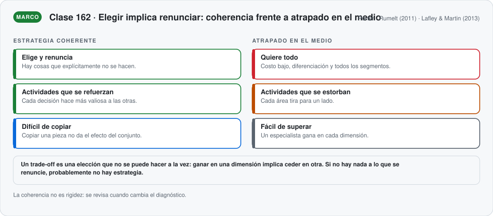

# Clase 162 — Trade-offs y coherencia

<!-- nav:inicio -->
> **Parte 13 · Estrategia y competencia** — clase 6 de 12 · [índice de la parte](../../README.md) · [temario](../../../../SYLLABUS.md)
<!-- nav:fin -->

**Parte:** 13 — Estrategia y competencia  
**Nivel:** Etapa 4 — Gerente → Director  
**Duración sugerida:** 150–180 minutos · **Estándar:** deep-class-v2

## 🎯 Propósito

La parte más difícil de una estrategia no es descubrir qué hacer, sino decidir **qué no hacer**. Cada empresa enfrenta tentaciones permanentes: atender a otro segmento, agregar una línea de producto, aceptar el pedido especial de un cliente grande, imitar la última función del competidor. Cada «sí» parece razonable en lo individual, y la suma de ellos produce una organización que intenta ser todo para todos, con procesos que se estorban, mensajes confusos y costos crecientes. Una estrategia coherente acepta **trade-offs** —elecciones en que ganar en una dimensión implica ceder en otra— y organiza sus actividades de modo que se **refuercen entre sí**.

La clase se apoya en la idea de Porter de que la estrategia consiste en elegir un conjunto de actividades distinto y coherente, en el énfasis de Rumelt en las acciones coordinadas y la concentración de recursos y en las elecciones integradas de Lafley y Martin. Al terminar sabrás identificar los trade-offs de una estrategia, evaluar la coherencia entre actividades, detectar el «atrapado en el medio», decidir qué abandonar y comunicar renuncias con claridad.

## 📚 Resultados de aprendizaje

Al finalizar podrás:

1. **Explicar** qué es un trade-off y por qué es la base de una estrategia.
2. **Mapear** las actividades de una empresa y su refuerzo mutuo (encaje).
3. **Detectar** señales de estar atrapado en el medio.
4. **Decidir** qué abandonar, con criterio y con costos de transición.
5. **Comunicar** las renuncias a clientes, equipos e inversionistas.

## 🧭 Agenda

| Tramo | Qué se hace |
|---|---|
| 0–20 min | Recuperación: escribe cinco cosas que tu empresa decidió no hacer y por qué; si no encuentras ninguna, anótalo. |
| 20–60 min | Trade-offs, encaje de actividades, atrapado en el medio y renuncias. |
| 60–105 min | Ejemplo trabajado: una cadena de restaurantes que intenta ser rápida, gourmet y económica. |
| 105–150 min | Caso ejecutivo y práctica. |
| 150–175 min | Límites y entregable. |

## 🧩 Conceptos centrales

| Concepto | Definición | Cómo se reconoce |
|---|---|---|
| **Trade-off** | Elección en que obtener más de una cosa implica obtener menos de otra. | No se puede lograr ambas a la vez. |
| **Encaje (fit)** | Grado en que las actividades se refuerzan entre sí. | Cada decisión hace más valiosa a otra. |
| **Atrapado en el medio** | Intentar varias estrategias incompatibles sin lograr ventaja en ninguna. | Mensaje confuso, costos altos. |
| **Concentración de recursos** | Dirigir esfuerzos a pocos frentes. | Pocas prioridades con recursos suficientes. |
| **Costo de oportunidad** | Valor de lo que se renuncia. | Lo que se deja de ganar por elegir. |
| **Coherencia** | Consistencia entre diagnóstico, política y acciones. | No hay decisiones que se contradicen. |

## 🧠 Modelo mental

**Cómo leer el diagrama.** Dos paneles. La **estrategia coherente** elige y renuncia, tiene actividades que se refuerzan entre sí y es difícil de copiar porque copiar una pieza no da el efecto del conjunto. La estrategia **atrapada en el medio** quiere todo (costo bajo, diferenciación y todos los segmentos), tiene actividades que se estorban y es fácil de superar por un especialista en cada dimensión. La nota recuerda que, si no hay nada a lo que se renuncie, probablemente no hay estrategia, y que la coherencia no es rigidez: se revisa si cambia el diagnóstico.

## 📖 Desarrollo

### 1. Por qué existen los trade-offs

Porter sostiene que los trade-offs surgen por tres razones. **Imagen o reputación**: una empresa conocida por bajo costo difícilmente puede ser vista como exclusiva, y viceversa. **Actividades**: diferentes posicionamientos exigen configuraciones distintas de actividades, equipos, procesos y sistemas que no se pueden combinar sin perder eficiencia. **Límites de coordinación**: los directivos solo pueden gestionar con claridad un conjunto acotado de prioridades; intentar muchas diluye el foco. Los trade-offs son la razón por la que una posición es sostenible: si el rival pudiera ofrecer lo mismo sin renunciar a nada, copiaría.

### 2. Encaje: cuando las actividades se refuerzan

Una estrategia no es una actividad sino un **sistema de actividades**. Porter distingue tres niveles de encaje: **consistencia simple** (cada actividad es coherente con la posición elegida), **refuerzo** (las actividades se potencian: el servicio de entrega rápida refuerza la compra de productos de alto valor) y **optimización conjunta** (la coordinación entre actividades produce eficiencias que ninguna logra por sí sola). El encaje explica por qué copiar una sola pieza no da ventaja: el rival que imita una actividad sin el sistema solo importa costos. Una prueba: si se saca una actividad, ¿las demás pierden valor?

### 3. Estar atrapado en el medio

Una empresa queda «atrapada en el medio» cuando intenta posiciones incompatibles: bajo costo **y** alta diferenciación, atender segmentos con necesidades opuestas, ofrecer servicio personalizado con procesos estandarizados. Síntomas: **mensaje difuso** (los clientes no saben para qué es mejor la empresa), **márgenes** inferiores a los de especialistas de cada lado, **conflictos internos** sobre prioridades, **procesos con excepciones** para cada cliente y **crecimiento en ingresos con rentabilidad decreciente**. Es frecuente tras años de agregar productos y segmentos «porque había oportunidad». La salida es elegir una posición y reorganizar las actividades en torno a ella.

### 4. Concentrar y renunciar

Rumelt destaca que una buena estrategia **concentra recursos** en pocos frentes donde se puede lograr ventaja; la dispersión es la forma más común de desperdiciarlos. Renunciar implica costos visibles (ingresos que se pierden, personas afectadas, clientes que se molestan) y beneficios invisibles (foco, simplicidad, calidad). Se decide con criterios: **contribución al desafío estratégico**, **margen y retorno**, **encaje con las capacidades**, **efecto en la coherencia** y **costos de salida**. Se evalúan alternativas al abandono (vender, licenciar, tercerizar, reducir). Lafley y Martin recomiendan explicitar para cada elección **lo que no se hará**.

### 5. El costo de las excepciones

Un cliente grande pide una versión especial, una unidad comercial negocia condiciones propias, un directivo quiere una línea nueva. Cada excepción tiene **costo directo** (desarrollo, soporte, inventario) y **costo de complejidad** (procesos más complicados, errores, decisiones más lentas, pérdida de economías de escala). Se evalúa con una **regla de excepciones**: se acepta si el margen incremental cubre el costo de complejidad total, si el patrón se repetirá en otros clientes (es decir, si puede ser parte del producto) y si no contradice la política guía. Muchas organizaciones descubren, al medirlo, que el 20 % de las excepciones consume la mayor parte de la capacidad y el margen que traen no compensa.

### 6. Coherencia a lo largo de la organización

La coherencia se verifica en los **sistemas de gestión**: **qué se mide** (indicadores y metas, clases 097 a 100), **qué se premia** (incentivos), **cómo se asignan recursos** (clase 106), **qué se prioriza** (clase 105), **cómo se contrata y se capacita**, **qué se comunica** y **cómo se decide** ante dilemas. Si la estrategia dice «calidad» pero se premia el volumen, la organización actúa según el incentivo. Lafley y Martin incluyen los sistemas de gestión como una de las cinco elecciones precisamente para que la estrategia se sostenga en las decisiones cotidianas, y no solo en un documento.

### 7. Comunicar las renuncias

Renunciar sin explicar genera desconfianza. Se comunica: **qué se elige y por qué** (diagnóstico), **qué se deja** y **qué ocurrirá con quienes se ven afectados** (clientes, empleados, socios), **cuándo** y **cómo se hará la transición**. Se acompaña de **apoyo** (alternativas para clientes, reubicación o capacitación para personas) y de **respeto**: la decisión no invalida el trabajo pasado. Las decisiones que afectan a personas (cierres de áreas, cambios de funciones) tienen condiciones laborales y legales que se verifican con asesoría y con las normas vigentes antes de anunciarlas.

## 📚 Lectura comparada

| Obra | Qué aporta | Qué no resuelve | Pregunta para contrastar |
|---|---|---|---|
| Porter (*Competitive Advantage*) | Trade-offs, encaje y sistema de actividades. | Descripción general; poco sobre cómo transicionar. | ¿Qué actividades se refuerzan entre sí? |
| Rumelt | Concentración de recursos y acciones coherentes. | No entrega método de decisión de abandono. | ¿Dónde concentras? |
| Lafley y Martin | Elecciones integradas y sistemas de gestión. | Visión de grandes empresas. | ¿Tus sistemas de gestión sostienen las elecciones? |
| Kim y Mauborgne | Eliminar y reducir factores como parte de crear valor. | Casos seleccionados. | ¿Qué factor eliminas? |
| Helmer | Contra-posicionamiento como poder. | Se centra en poderes duraderos. | ¿Qué puede hacer tu rival sin dañar su negocio? |

## 🧮 Ejemplo trabajado

**Situación (hipotética).** Una cadena de 30 restaurantes de comida casual promete simultáneamente tres cosas: servicio rápido (menos de 10 minutos), carta amplia de 85 platos con opciones «gourmet» y precios bajos. Sus ventas por local crecieron 2 % mientras el margen operativo cayó de 9 % a 4 %.

**Mapa de actividades y contradicciones.**

| Promesa | Actividades que exige | Conflicto |
|---|---|---|
| Rapidez | Menú corto, preparación estandarizada, cocinas simples | Choca con 85 platos y técnicas gourmet |
| Gourmet | Ingredientes frescos, cocineros calificados, platos elaborados | Choca con precios bajos y rapidez |
| Precio bajo | Compra masiva, desperdicio mínimo, menú acotado | Choca con una carta amplia y de ingredientes diversos |

**Datos de complejidad.** El 70 % de las ventas está en 18 platos; los otros 67 aportan 30 % de las ventas con 45 % del desperdicio y de las compras especiales; el tiempo medio de espera es de 17 minutos en horas pico; la rotación de cocineros es de 62 %; los clientes en encuestas no saben si el lugar «es rápido, barato o especial» (49 % no puede describir su propuesta).

**Decisión de coherencia.** Elegir una posición: **comida casual rápida de buena calidad a precio accesible**, renunciando a la carta amplia y al segmento gourmet. Acciones: (1) reducir la carta a 24 platos; (2) rediseñar cocinas con flujo estándar y equipo común; (3) acuerdos de compra con 12 proveedores para ingredientes frescos; (4) capacitación centrada en velocidad y consistencia; (5) incentivos del personal por tiempos y satisfacción; (6) retirar la promoción de «chef invitado» y la carta de vinos; (7) comunicación sencilla: «buena comida, lista en 8 minutos».

**Costos y beneficios de renunciar.** Se pierde parte de las ventas de los 61 platos eliminados (se estima que 40 % de esos clientes se cambia a platos que se mantienen): pérdida neta de ventas de 18 % de ese 30 % (≈ 5,4 % de las ventas), pero se reduce el desperdicio en 40 %, el tiempo de espera a 9 minutos y el costo de compras en 7 %. El efecto neto estimado en el margen: de 4 % a 8,5 % en 18 meses, con riesgo de rechazo de una parte de clientes fieles de platos especiales.

**Comunicación.** A los clientes: aviso con anticipación, platos favoritos conservados y una carta estacional. A los cocineros: reconversión de roles, capacitación y garantía de que no habrá despidos por el cambio durante la transición (una decisión de la dirección verificada con asesoría laboral). A los proveedores: plan de compras por volumen.

**Qué muestra.** (1) Los trade-offs entre rapidez, gourmet y precio eran reales. (2) La complejidad se midió con datos. (3) Se eligió, se renunció y se comunicó.

## 🔀 Comparación y límites

**Coherencia frente a rigidez.** Una estrategia coherente no impide adaptarse: lo que se revisa es el diagnóstico y, si cambia, se rediseña el conjunto; lo que no se hace es sumar piezas incoherentes por oportunismo.

**Límites.** A veces existen innovaciones que reducen un trade-off (tecnología que permite personalizar con bajo costo) y la frontera entre posiciones se mueve. Los efectos de renunciar son inciertos y los estimados pueden fallar. Una empresa con una cartera diversificada puede tener estrategias distintas en unidades distintas, siempre que estén separadas y bien dirigidas. Las decisiones de cierre o reducción afectan a personas y contratos y exigen cumplimiento laboral y comercial. Las cifras del ejemplo son ilustrativas.

## 🪜 De profesional a owner

| Nivel | Cómo trabaja los trade-offs y la coherencia |
|---|---|
| **Profesional** | Entiende qué se prioriza y qué no, y decide en consecuencia. |
| **Jefe / Team Lead** | Alinea las prioridades y los procesos del equipo con la política. |
| **Gerente** | Detecta excepciones costosas y propone qué abandonar. |
| **CEO / Director** | Elige, renuncia y mantiene la coherencia de los sistemas de gestión. |
| **Founder / Owner** | Resiste la tentación de aceptar cualquier cliente o idea. |

## 🏢 Caso ejecutivo

Una empresa de software de gestión para pymes tiene 4.500 clientes, 7 productos, 3 modelos de precios y soporte personalizado a cualquier cliente. Crece 14 % anual pero su margen operacional cayó de 18 % a 9 %. Los desarrolladores dedican 40 % de su tiempo a «personalizaciones» para clientes grandes; 28 % de los tickets de soporte proviene de 6 % de los clientes; los productos tienen bases de código distintas; los planes de precios se superponen. Los clientes grandes quieren más funciones a medida; los pequeños, simplicidad y precio; una cadena internacional ofrece una adquisición parcial. El gerente comercial quiere seguir aceptando pedidos a medida «porque pagan bien»; el de producto, simplificar a un solo producto y dos planes.

Entrega un **análisis de trade-offs y coherencia** que contenga: (a) el mapa de posiciones posibles y sus actividades; (b) la evidencia de complejidad y de atrapado en el medio; (c) la posición elegida y lo que se renuncia, con los costos de transición y los efectos estimados; (d) la regla de excepciones; (e) los cambios en medición, incentivos y asignación de recursos para sostener la coherencia; (f) la comunicación a clientes, equipos y socios y las verificaciones contractuales y laborales que se harán con asesoría.

## 🧪 Práctica

1. Lista tres trade-offs reales de tu estrategia y la actividad que hace posible cada lado.
2. Dibuja el mapa de actividades de tu empresa y marca cuáles se refuerzan y cuáles se estorban.
3. Calcula el costo de complejidad de tus tres excepciones más frecuentes.
4. Escribe una regla de excepciones para tu equipo.
5. Redacta cómo comunicarías la renuncia a un producto o segmento.

## ⚠️ Errores frecuentes

| Error | Por qué ocurre | Cómo corregirlo |
|---|---|---|
| Querer todo | Se teme perder oportunidades | Elegir y renunciar. |
| Excepciones sin costo | No se miden | Calcular complejidad total. |
| Estrategia sin sistemas | Se piensa en el documento | Alinear medición, incentivos y recursos. |
| Renunciar sin comunicar | Se evita el conflicto | Explicar razones y transición. |
| Copiar una pieza del rival | Parece fácil | Entender el sistema completo. |
| Coherencia como rigidez | Se confunde con inmovilidad | Revisar el diagnóstico cuando cambia. |

## ❓ Preguntas de comprobación

1. ¿Qué es un trade-off y por qué da sostenibilidad a la estrategia?
2. ¿Qué es el encaje entre actividades?
3. ¿Qué síntomas tiene una empresa atrapada en el medio?
4. ¿Cómo se decide qué abandonar?
5. ¿Qué costos tienen las excepciones?
6. ¿Dónde se verifica la coherencia en la organización?
7. ¿Cómo se comunican las renuncias?

Claves de respuesta

1. Una elección en que ganar en una dimensión implica ceder en otra; si el rival pudiera tener ambas, copiaría, por lo que los trade-offs hacen sostenible la posición.
2. El grado en que las actividades se refuerzan entre sí, de modo que copiar una sola no da el efecto del sistema.
3. Mensaje difuso, márgenes inferiores a los de especialistas, conflictos de prioridades, procesos con excepciones y crecimiento con rentabilidad decreciente.
4. Con criterios: contribución al desafío, margen y retorno, encaje con capacidades, efecto en la coherencia y costos de salida, evaluando alternativas al abandono.
5. Directo (desarrollo, soporte) y de complejidad (procesos más complicados, errores, decisiones lentas, pérdida de escala).
6. En lo que se mide, se premia, se asigna, se prioriza, se contrata y se comunica.
7. Explicando qué se elige y por qué, qué se deja, qué ocurrirá con los afectados, cuándo y cómo, con apoyo y respeto, y verificando condiciones legales.

## 📥 Entregable

Guarda en `portfolio/162-trade-offs-y-coherencia/`:

- `risk-governance-brief.md` (plantilla [Risk & Governance Brief](../../../../templates/risk-governance-brief.md)) con los riesgos de las renuncias del caso ejecutivo;
- `strategy-memo.md` (plantilla [Strategy memo](../../../../templates/strategy-memo.md)) con la posición elegida y lo que se renuncia;
- `decision-journal.md` con la regla de excepciones y la comunicación.

## 📗 Fuentes y verificación

- Michael E. Porter — *Competitive Advantage* (Free Press, 1985). **Uso en esta clase:** trade-offs, encaje y sistema de actividades. Lectura selectiva sobre **trade-offs y coherencia**. **Localizador:** [ISBN-13 9780029250907](https://openlibrary.org/isbn/9780029250907).
- Richard Rumelt — *Good Strategy/Bad Strategy* (Profile Books, 2011). **Uso en esta clase:** concentración de recursos y acciones coherentes. Lectura selectiva sobre **trade-offs y coherencia**. **Localizador:** [ISBN-13 9781846684807](https://openlibrary.org/isbn/9781846684807).
- A.G. Lafley & Roger L. Martin — *Playing to Win* (Harvard Business Review Press, 2013). **Uso en esta clase:** elecciones integradas y sistemas de gestión. Lectura selectiva sobre **trade-offs y coherencia**. **Localizador:** [ISBN-13 9781422187395](https://openlibrary.org/isbn/9781422187395).
- W. Chan Kim & Renée Mauborgne — *Blue Ocean Strategy* (Coach Series, 2006). **Uso en esta clase:** eliminar y reducir factores como parte de crear valor. Lectura selectiva sobre **trade-offs y coherencia**. **Localizador:** [ISBN-13 9781596590687](https://openlibrary.org/isbn/9781596590687).
- Hamilton Helmer — *7 Powers* (Deep Strategy, 2016). **Uso en esta clase:** contra-posicionamiento como poder. Lectura selectiva sobre **trade-offs y coherencia**. **Localizador:** [ISBN-13 9780998116303](https://openlibrary.org/isbn/9780998116303).

> **Regla de fuentes para Trade-offs y coherencia:** las obras anteriores estructuran las perspectivas de esta materia; cualquier norma, ley o estándar vivo mencionado debe comprobarse nuevamente en su fuente primaria vigente, incluidas las normas laborales y contractuales de cierres y reducciones. Los ejemplos y casos son hipotéticos, con cifras ilustrativas. El desarrollo es original y no reproduce capítulos protegidos.

<!-- pie:inicio -->
---

| Anterior | Índice | Siguiente |
|---|---|---|
| [← 161 · Ventaja competitiva](../161-ventaja-competitiva/README.md) | [Parte 13](../../README.md) · [Programa](../../../../SYLLABUS.md) | [163 · Modelo de negocio →](../163-modelo-de-negocio/README.md) |
<!-- pie:fin -->
