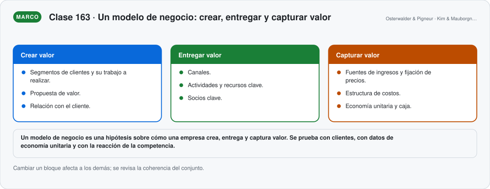

# Clase 163 — Modelo de negocio

<!-- nav:inicio -->
> **Parte 13 · Estrategia y competencia** — clase 7 de 12 · [índice de la parte](../../README.md) · [temario](../../../../SYLLABUS.md)
<!-- nav:fin -->

**Parte:** 13 — Estrategia y competencia  
**Nivel:** Etapa 4 — Gerente → Director  
**Duración sugerida:** 150–180 minutos · **Estándar:** deep-class-v2

## 🎯 Propósito

Dos empresas pueden vender el mismo producto y ser negocios completamente distintos: una cobra por unidad y la otra por suscripción; una produce y la otra usa la capacidad de terceros; una vende a consumidores y la otra a empresas que luego lo ofrecen a sus clientes. La estrategia decide **dónde competir y cómo ganar**; el **modelo de negocio** describe **cómo la empresa crea, entrega y captura valor**: a quién sirve, qué ofrece, cómo llega, qué actividades y recursos necesita, cuánto cobra y cuánto cuesta. Muchas innovaciones exitosas no son nuevos productos sino nuevos modelos de negocio, y muchas empresas fracasan con buenos productos porque su modelo no cierra.

La clase se apoya en el lienzo de modelo de negocio de Osterwalder y Pigneur, en la propuesta de innovación en valor de Kim y Mauborgne, en la visión de Teece sobre la relación entre modelo de negocio, capacidades dinámicas y captura de valor y en las ideas de economía unitaria vistas en la clase 117. Al terminar sabrás describir un modelo de negocio con sus nueve bloques, evaluar su coherencia y su economía, comparar alternativas, innovar en un bloque y detectar cuándo un modelo se agota.

## 📚 Resultados de aprendizaje

Al finalizar podrás:

1. **Describir** un modelo de negocio con los nueve bloques y sus relaciones.
2. **Distinguir** crear, entregar y capturar valor.
3. **Evaluar** la coherencia y la economía unitaria de un modelo.
4. **Comparar** alternativas de modelo con sus riesgos.
5. **Detectar** señales de agotamiento y opciones de innovación.

## 🧭 Agenda

| Tramo | Qué se hace |
|---|---|
| 0–20 min | Recuperación: describe en nueve cajas cómo gana dinero tu empresa y marca dónde hay más incertidumbre. |
| 20–60 min | Nueve bloques, crear–entregar–capturar, economía y alternativas. |
| 60–105 min | Ejemplo trabajado: comparar dos modelos para una aplicación de bienestar. |
| 105–150 min | Caso ejecutivo y práctica. |
| 150–175 min | Límites y entregable. |

## 🧩 Conceptos centrales

| Concepto | Definición | Cómo se reconoce |
|---|---|---|
| **Modelo de negocio** | Lógica con que una organización crea, entrega y captura valor. | Responde a quién, qué, cómo y cuánto. |
| **Propuesta de valor** | Conjunto de productos y servicios que resuelven el problema de un segmento. | Se define por el trabajo del cliente. |
| **Fuente de ingresos** | Forma en que se cobra: venta, suscripción, comisión, licencia, publicidad. | Se vincula a lo que el cliente valora. |
| **Estructura de costos** | Costos de operar el modelo. | Fijos y variables. |
| **Innovación en valor** | Salto de valor para el comprador con costos bajos mediante eliminar, reducir, elevar y crear. | Nuevo espacio de mercado. |
| **Captura de valor** | Capacidad de retener una parte del valor creado. | Depende de la posición y de barreras. |

## 🧠 Modelo mental

**Cómo leer el diagrama.** Tres columnas. **Crear valor**: los segmentos de clientes y su trabajo a realizar, la propuesta de valor y la relación con el cliente. **Entregar valor**: los canales, las actividades y recursos clave y los socios clave. **Capturar valor**: las fuentes de ingresos y la fijación de precios, la estructura de costos y la economía unitaria y la caja. La nota recuerda que un modelo de negocio es una hipótesis que se prueba con clientes, con datos de economía unitaria y con la reacción de la competencia, y que cambiar un bloque afecta a los demás.

## 📖 Desarrollo

### 1. Qué es un modelo de negocio

Osterwalder y Pigneur definen un modelo de negocio como la descripción de **cómo una organización crea, entrega y captura valor**. Su lienzo lo organiza en **nueve bloques**: **segmentos de clientes**, **propuesta de valor**, **canales**, **relaciones con clientes**, **fuentes de ingresos**, **recursos clave**, **actividades clave**, **socios clave** y **estructura de costos**. Es una herramienta de **conversación**: pone en una página lo que de otro modo se discute en abstracto y permite ver qué bloques se relacionan, qué supuestos hay detrás y dónde está el riesgo. No reemplaza el plan financiero ni la estrategia, pero los vuelve discutibles.

### 2. Crear, entregar y capturar

Teece, al analizar las capacidades dinámicas y la captura del valor de la innovación, sostiene que el modelo de negocio es el **mecanismo** por el cual la empresa convierte la tecnología o la idea en valor económico, y que un buen producto no garantiza captura de valor: se necesitan mecanismos para que el valor creado no se vaya a clientes, competidores o complementadores. Por eso conviene analizar **tres funciones**. **Crear valor**: ¿para quién y qué problema? **Entregar**: ¿con qué actividades, recursos, socios y canales llega al cliente? **Capturar**: ¿cuánto cobra, a quién, cómo y a qué costo, y qué impide que otro capture ese valor? Los fracasos suelen ocurrir en la captura: se crea valor (hay usuarios) pero no se logra cobrar o se cobra menos de lo que cuesta.

### 3. Las fuentes de ingresos y el precio

Hay muchas formas de cobrar: **venta de activos** (producto), **cuota por uso**, **suscripción**, **alquiler**, **licencias**, **comisiones** de intermediación, **publicidad** y **modelos mixtos** (freemium). Cada una alinea de forma distinta los incentivos de empresa y cliente: una suscripción incentiva retención y uso; una comisión, el volumen de transacciones; la publicidad, la atención. El precio (clase 129) debe reflejar el valor, y la **economía unitaria** (clase 117) mostrar si el modelo sostiene el crecimiento: CAC, margen, retención y payback. Un modelo que solo funciona con subsidios permanentes es un experimento financiado por capital, no un negocio.

### 4. Actividades, recursos y socios

La entrega exige **actividades clave** (producir, desarrollar plataforma, resolver problemas, gestionar red), **recursos clave** (físicos, intelectuales, humanos, financieros) y **socios clave** (proveedores, aliados, plataformas, reguladores). Se define qué se hace dentro y qué se obtiene fuera (clase 093). Un modelo liviano en activos (usa capacidad de terceros) escala con menos capital pero tiene menos control y depende de socios; uno pesado (activos propios) tiene más control, más costos fijos y más riesgo (clase 116). La elección depende de la estrategia, del mercado y de la capacidad financiera.

### 5. Innovación en valor y en modelo

Kim y Mauborgne llaman **innovación en valor** a ofrecer un salto de valor al comprador con costos más bajos, **eliminando** factores que la industria da por sentados, **reduciendo** otros, **elevando** algunos y **creando** otros nuevos. Muchas innovaciones de modelo son recombinaciones: cambiar quién paga (publicidad frente a usuario), cuándo se paga (suscripción frente a compra), qué se vende (resultado frente a producto), quién entrega (plataforma frente a empresa propia) o cómo se escala (franquicia, licencia). Para evaluar una innovación se pregunta: ¿qué supuestos cambia?, ¿qué capacidades exige?, ¿qué bloque del modelo actual se rompe?, ¿cómo reaccionarán los rivales y los clientes?

### 6. Evaluar un modelo

Se evalúa con cinco criterios. **Deseabilidad**: ¿hay clientes que lo quieran y paguen? **Viabilidad operativa**: ¿se puede entregar con las capacidades y los socios disponibles? **Viabilidad económica**: ¿los ingresos superan los costos con una economía unitaria sana? **Defensabilidad**: ¿qué impide que otros copien y capturen el valor (clase 161)? **Adaptabilidad**: ¿puede evolucionar si cambian los clientes, la tecnología o la regulación? Se prueban las hipótesis críticas con experimentos (clases 150 y 153) antes de invertir a escala. La **coherencia** entre bloques importa tanto como cada uno: un canal caro con un cliente de bajo valor no cierra.

### 7. Cuando el modelo se agota

Un modelo envejece cuando cambian los **clientes** (nuevas necesidades), la **tecnología** (reduce costos o permite alternativas), la **competencia** (nuevos entrantes con otro modelo) o la **regulación**. Señales: **márgenes que caen** sin razón operativa, **crecimiento que exige más gasto de adquisición**, **retención en descenso**, **clientes que migran a modelos alternativos**. McGrath recomienda gestionar un **portafolio de modelos y ventajas** y reconfigurar a tiempo. El cambio de modelo suele ser difícil por inercia, incentivos e identidad; se hace con pruebas en pequeño, cuidando a los clientes actuales y respetando contratos y regulaciones.

## 📚 Lectura comparada

| Obra | Qué aporta | Qué no resuelve | Pregunta para contrastar |
|---|---|---|---|
| Osterwalder y Pigneur | Lienzo de nueve bloques para describir y discutir modelos. | Es una herramienta descriptiva; no prueba el modelo. | ¿Qué bloque tiene más supuestos sin probar? |
| Kim y Mauborgne | Innovación en valor: eliminar, reducir, elevar y crear. | Casos seleccionados. | ¿Qué factor eliminarías? |
| Teece | Modelo de negocio, captura de valor y capacidades dinámicas. | Marco conceptual. | ¿Qué te permite capturar el valor que creas? |
| Helmer | Poderes que sostienen la captura de valor. | Se centra en la ventaja duradera. | ¿Qué poder protege tu modelo? |
| Christensen (*Innovator's Dilemma*) | Modelos disruptivos desde segmentos desatendidos. | Teoría con excepciones. | ¿Qué modelo podría desplazarte? |

## 🧮 Ejemplo trabajado

**Situación (hipotética).** Una empresa desarrolla una aplicación de bienestar mental con programas de ejercicios guiados. Tiene dos modelos candidatos.

**Modelo A: suscripción individual (B2C).** Segmento: personas que buscan bienestar. Canales: tiendas de aplicaciones y publicidad. Ingresos: USD 9 por mes. CAC: USD 38. Retención mensual: 91 % (baja mensual 9 %). Margen de contribución: 85 % (USD 7,65 mensuales).

**Modelo B: contrato con empresas (B2B2C).** Segmento: empresas con 500 a 5.000 empleados que ofrecen bienestar como beneficio. Canales: venta directa y corredores de beneficios. Ingresos: USD 2,2 por empleado elegible al mes, con 15 % de uso. Ciclo de venta: 4 meses. CAC por contrato: USD 18.000. Un contrato típico: 1.500 empleados → USD 3.300 mensuales (USD 39.600 al año); retención de contratos: 88 % anual; margen de contribución: 70 %.

**Economía unitaria.**

| Indicador | Modelo A (por usuario) | Modelo B (por contrato) |
|---|---|---|
| Duración esperada | 1 / 0,09 = 11,1 meses | 1 / 0,12 = 8,3 años |
| Margen mensual o anual | USD 7,65 al mes | USD 27.720 al año |
| Valor del cliente (sin descuento) | 7,65 × 11,1 ≈ USD 85 | 27.720 × 8,3 ≈ USD 230.000 |
| CAC | USD 38 | USD 18.000 |
| LTV/CAC | 2,2 | 12,8 |
| Payback | 5 meses | 7,8 meses |

**Lectura.** B2C tiene un LTV/CAC modesto de 2,2 con retención baja y mucha dependencia de las tiendas de aplicaciones y de la publicidad; B2B2C tiene una razón alta, retención mayor y ventas largas; el riesgo está en la concentración (pocos contratos grandes) y en la tasa de uso (si el 15 % no se sostiene, el cliente no renueva).

**Evaluación por criterios.** Deseabilidad: la B2C tiene alta demanda pero baja disposición a pagar sostenida; en B2B, las empresas piden evidencia de uso y resultados. Viabilidad operativa: B2B exige capacidad de implantación y soporte. Viabilidad económica: B2B más sólida. Defensabilidad: contratos plurianuales e integraciones (costos de cambio). Adaptabilidad: un modelo híbrido (usuarios individuales a través de empresas) combina ambos.

**Decisión.** Priorizar el modelo B2B2C con tres pilotos pagados y metas de uso (≥ 25 % de los empleados activos a 3 meses); mantener B2C como canal de entrada de bajo costo y fuente de datos de uso. Antes de escalar, probar los supuestos de uso y la capacidad de venta; revisar a los 6 meses.

**Aspectos legales.** Los datos de bienestar mental son datos sensibles: se verifica con asesoría el tratamiento, el consentimiento y la separación entre lo que ve el empleador y lo que no.

**Qué muestra.** (1) El mismo producto da dos negocios distintos. (2) La economía unitaria mostró la diferencia. (3) La decisión se acompañó de pruebas y de cuidados regulatorios.

## 🔀 Comparación y límites

**Modelo de negocio frente a estrategia.** La estrategia elige dónde competir y cómo ganar; el modelo describe cómo funciona la maquinaria de crear, entregar y capturar valor para ejecutarla. Una buena estrategia con un modelo que no cierra fracasa; un buen modelo sin estrategia no sostiene la posición.

**Límites.** El lienzo simplifica y puede dar falsa seguridad si se llenan los bloques con suposiciones no probadas. Los modelos cambian con el tiempo y entre segmentos. Las comparaciones de economía unitaria son sensibles a los supuestos de retención y de CAC. La innovación de modelo enfrenta restricciones regulatorias (datos, consumo, laboral, financiero) que se verifican en su fuente vigente y con asesoría. Las cifras del ejemplo son ilustrativas.

## 🪜 De profesional a owner

| Nivel | Cómo participa en el modelo de negocio |
|---|---|
| **Profesional** | Entiende cómo su trabajo afecta a ingresos y costos del modelo. |
| **Jefe / Team Lead** | Conecta su área con los bloques de actividades, recursos y canales. |
| **Gerente** | Evalúa la economía y propone ajustes de bloques. |
| **CEO / Director** | Decide el modelo y cuándo reconfigurarlo. |
| **Founder / Owner** | Prueba cada bloque con clientes antes de comprometer capital. |

## 🏢 Caso ejecutivo

Una cadena de gimnasios de bajo costo con 90 sedes (USD 20 de cuota mensual, 320.000 socios) tiene una baja anual de 55 % y gasta el 32 % de sus ingresos en adquirir socios; sus márgenes dependen de que muchos socios paguen y no asistan. Un nuevo competidor ofrece entrenamiento personalizado en grupos pequeños con una app y cobra USD 55; las empresas contratan convenios para sus empleados; una aplicación de entrenamiento en casa gana usuarios. El directorio considera cuatro caminos: (1) bajar a USD 15 la cuota, (2) agregar clases premium, (3) vender convenios corporativos con descuentos por volumen, (4) crear un modelo digital en casa con suscripción y venta de equipos.

Entrega un **análisis de modelo de negocio** que contenga: (a) el lienzo del modelo actual con sus supuestos; (b) la economía unitaria (CAC, retención, margen, LTV) y su relación con la baja; (c) la evaluación de los cuatro caminos con los cinco criterios; (d) una propuesta de modelo con las hipótesis críticas y cómo se probarán; (e) las señales de agotamiento del modelo actual; (f) las verificaciones de contratos con empresas, de datos de salud y de condiciones de cancelación en las normas de consumo vigentes.

## 🧪 Práctica

1. Dibuja el lienzo de tu modelo de negocio con nueve bloques y marca los supuestos sin probar.
2. Calcula la economía unitaria de tu modelo y la de una alternativa.
3. Evalúa una alternativa con los cinco criterios.
4. Aplica las cuatro acciones (eliminar, reducir, elevar, crear) a tu propuesta.
5. Define tres señales que indicarían que tu modelo se agota.

## ⚠️ Errores frecuentes

| Error | Por qué ocurre | Cómo corregirlo |
|---|---|---|
| Confundir producto con modelo | Se piensa en la oferta | Describir cómo se crea, entrega y captura valor. |
| Crear valor sin capturarlo | Se mide uso | Economía unitaria y fuentes de ingresos. |
| Lienzo con supuestos sin probar | Se llena en sala | Experimentos con clientes. |
| Ignorar la coherencia entre bloques | Se optimiza cada uno | Revisar relaciones entre bloques. |
| Modelo que depende de subsidios | Capital abundante | Verificar economía sin estímulos. |
| No ver señales de agotamiento | Inercia | Seguir indicadores de margen, retención y adquisición. |

## ❓ Preguntas de comprobación

1. ¿Qué es un modelo de negocio?
2. ¿Cuáles son los nueve bloques del lienzo?
3. ¿Qué diferencia hay entre crear, entregar y capturar valor?
4. ¿Cómo influye la fuente de ingresos en los incentivos?
5. ¿Qué es la innovación en valor?
6. ¿Qué cinco criterios evalúan un modelo?
7. ¿Qué señales muestran que un modelo se agota?

Claves de respuesta

1. La lógica con que una organización crea, entrega y captura valor.
2. Segmentos de clientes, propuesta de valor, canales, relaciones con clientes, fuentes de ingresos, recursos clave, actividades clave, socios clave y estructura de costos.
3. Crear es resolver un problema de un segmento; entregar es llevarlo al cliente con actividades, recursos y socios; capturar es retener una parte del valor creado mediante ingresos, costos y barreras.
4. Cada forma de cobrar alinea incentivos distintos: la suscripción incentiva retención; la comisión, volumen; la publicidad, atención.
5. Ofrecer un salto de valor al comprador con costos bajos, eliminando, reduciendo, elevando y creando factores.
6. Deseabilidad, viabilidad operativa, viabilidad económica, defensabilidad y adaptabilidad.
7. Márgenes que caen, adquisición más cara para crecer, retención en descenso y clientes que migran a modelos alternativos.

## 📥 Entregable

Guarda en `portfolio/163-modelo-de-negocio/`:

- `strategy-memo.md` (plantilla [Strategy memo](../../../../templates/strategy-memo.md)) con el análisis del caso ejecutivo;
- `modelo-financiero-y-memo-de-decision.md` (plantilla [Modelo financiero y memo de decisión](../../../../templates/modelo-financiero-y-memo-de-decision.md)) con la economía unitaria por modelo;
- `decision-journal.md` con las hipótesis críticas, los experimentos y las señales.

## 📗 Fuentes y verificación

- Alexander Osterwalder & Yves Pigneur — *Business Model Generation* (Wiley , 2010). **Uso en esta clase:** lienzo de nueve bloques para describir y discutir modelos. Lectura selectiva sobre **modelo de negocio**. **Localizador:** [ISBN-13 9780470876411](https://openlibrary.org/isbn/9780470876411).
- W. Chan Kim & Renée Mauborgne — *Blue Ocean Strategy* (Coach Series, 2006). **Uso en esta clase:** innovación en valor: eliminar, reducir, elevar y crear. Lectura selectiva sobre **modelo de negocio**. **Localizador:** [ISBN-13 9781596590687](https://openlibrary.org/isbn/9781596590687).
- David J. Teece — *Dynamic Capabilities and Strategic Management* (Strategic Management Journal, 1997). **Uso en esta clase:** modelo de negocio, captura de valor y capacidades dinámicas. **Localizador:** [DOI 10.1002/(SICI)1097-0266(199708)18:7<509::AID-SMJ882>3.0.CO;2-Z](https://doi.org/10.1002/(SICI)1097-0266(199708)18:7<509::AID-SMJ882>3.0.CO;2-Z).
- Hamilton Helmer — *7 Powers* (Deep Strategy, 2016). **Uso en esta clase:** poderes que sostienen la captura de valor. Lectura selectiva sobre **modelo de negocio**. **Localizador:** [ISBN-13 9780998116303](https://openlibrary.org/isbn/9780998116303).
- Clayton M. Christensen — *The Innovator's Dilemma* (Harvard Business School Press, 1997). **Uso en esta clase:** modelos disruptivos desde segmentos desatendidos. Lectura selectiva sobre **modelo de negocio**. **Localizador:** [ISBN-13 9780875845852](https://openlibrary.org/isbn/9780875845852).

> **Regla de fuentes para Modelo de negocio:** las obras anteriores estructuran las perspectivas de esta materia; cualquier norma, ley o estándar vivo mencionado debe comprobarse nuevamente en su fuente primaria vigente, incluidas las de protección de datos sensibles, consumo y contratos con empresas. Los ejemplos y casos son hipotéticos, con cifras ilustrativas. El desarrollo es original y no reproduce capítulos protegidos.

<!-- pie:inicio -->
---

| Anterior | Índice | Siguiente |
|---|---|---|
| [← 162 · Trade-offs y coherencia](../162-trade-offs-y-coherencia/README.md) | [Parte 13](../../README.md) · [Programa](../../../../SYLLABUS.md) | [164 · Escenarios estratégicos →](../164-escenarios-estrategicos/README.md) |
<!-- pie:fin -->
