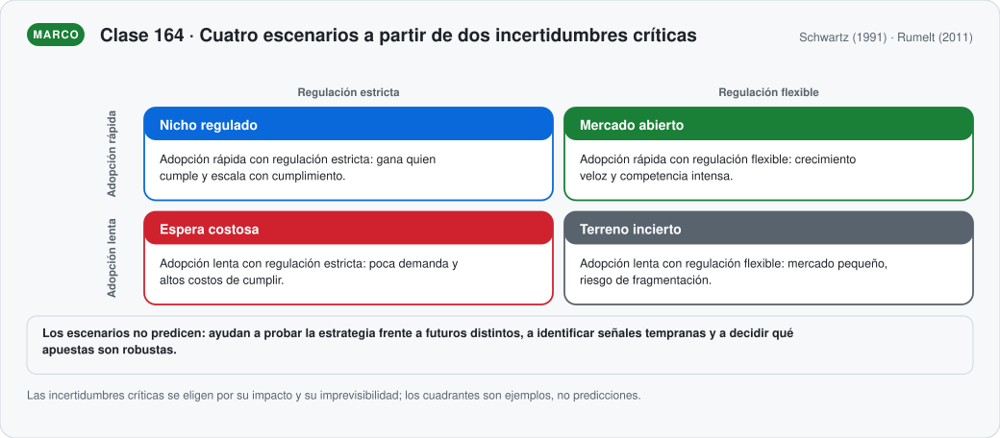

# Clase 164 — Escenarios estratégicos

<!-- nav:inicio -->
> **Parte 13 · Estrategia y competencia** — clase 8 de 12 · [índice de la parte](../../README.md) · [temario](../../../../SYLLABUS.md)
<!-- nav:fin -->

**Parte:** 13 — Estrategia y competencia  
**Nivel:** Etapa 4 — Gerente → Director  
**Duración sugerida:** 150–180 minutos · **Estándar:** deep-class-v2

## 🎯 Propósito

Casi todas las decisiones estratégicas se toman sobre un futuro que nadie conoce. Las empresas suelen manejar esa incertidumbre de dos modos igualmente frágiles: proyectar un único «caso base» con una variante optimista y otra pesimista que son simples escalas del mismo relato, o paralizarse porque «no se puede predecir». La **planificación por escenarios** ofrece una tercera vía: no pretende predecir, sino imaginar de forma disciplinada **varios futuros distintos y plausibles**, probar las estrategias contra cada uno, identificar qué apuestas son **robustas** (funcionan razonablemente en todos) y cuáles dependen de que ocurra un futuro específico, y definir **señales tempranas** que indiquen hacia dónde se mueve el mundo.

La clase se apoya en la obra de Schwartz sobre el arte de la visión a largo plazo y la construcción de escenarios, en el énfasis de Rumelt en el diagnóstico y las apuestas coherentes y en el razonamiento estratégico de Dixit y Nalebuff sobre los actores y su respuesta. Al terminar sabrás definir una pregunta focal, identificar fuerzas motrices e incertidumbres críticas, construir una matriz de escenarios, evaluar estrategias frente a ellos, elegir apuestas robustas y diseñar un sistema de señales de seguimiento.

## 📚 Resultados de aprendizaje

Al finalizar podrás:

1. **Formular** una pregunta focal y un horizonte de decisión.
2. **Distinguir** fuerzas predecibles de incertidumbres críticas.
3. **Construir** una matriz de escenarios con dos incertidumbres críticas.
4. **Evaluar** estrategias frente a cada escenario y buscar robustez.
5. **Definir** señales tempranas y disparadores de decisión.

## 🧭 Agenda

| Tramo | Qué se hace |
|---|---|
| 0–20 min | Recuperación: ¿qué decisión de tu empresa dependería de un futuro que hoy no conoces y qué dos cosas lo determinan? |
| 20–60 min | Pregunta focal, incertidumbres, matriz, evaluación y señales. |
| 60–105 min | Ejemplo trabajado: escenarios para un lanzamiento de seguros digitales. |
| 105–150 min | Caso ejecutivo y práctica. |
| 150–175 min | Límites y entregable. |

## 🧩 Conceptos centrales

| Concepto | Definición | Cómo se reconoce |
|---|---|---|
| **Escenario** | Relato coherente de un futuro plausible, no una predicción. | Tiene lógica interna y consecuencias. |
| **Pregunta focal** | Decisión o asunto que el ejercicio ayuda a iluminar. | Acotada y con horizonte. |
| **Fuerza motriz** | Factor que influye en el futuro (tecnología, regulación, demografía, economía). | Se puede listar. |
| **Elemento predeterminado** | Fuerza cuyo efecto es casi seguro. | Demografía, plazos de obras. |
| **Incertidumbre crítica** | Factor de alto impacto y baja previsibilidad. | Define los ejes de los escenarios. |
| **Apuesta robusta** | Decisión que funciona razonablemente en varios escenarios. | Pocos arrepentimientos. |

## 🧠 Modelo mental

**Cómo leer el diagrama.** Una matriz de 2 × 2 con dos incertidumbres críticas, en este ejemplo la **regulación** (estricta o flexible) y la **velocidad de adopción** (lenta o rápida). Cada cuadrante es un escenario con su propia lógica: **nicho regulado** (adopción rápida con regulación estricta), **mercado abierto** (rápida y flexible), **espera costosa** (lenta y estricta) y **terreno incierto** (lenta y flexible). La nota recuerda que los escenarios no predicen: sirven para probar la estrategia frente a futuros distintos, identificar señales tempranas y decidir qué apuestas son robustas.

## 📖 Desarrollo

### 1. Para qué sirven los escenarios

Schwartz describe los escenarios como **historias sobre el futuro** que ayudan a las organizaciones a ver más allá de sus supuestos habituales, a tomar decisiones más robustas y a reconocer antes las señales de cambio. Su propósito no es acertar sino **ampliar la percepción** y **mejorar las decisiones**. Una empresa que ha pensado en un futuro de regulación estricta y alta adopción reconoce los primeros indicios y reacciona con más rapidez que otra que solo había considerado una continuación del presente. Los escenarios también son útiles para **alinear al equipo directivo** en un lenguaje común sobre la incertidumbre.

### 2. La pregunta focal y el horizonte

Se comienza con una **pregunta focal** concreta: «¿Debemos entrar al negocio de seguros digitales en los próximos 5 años?», «¿Cómo cambiará la demanda de nuestros productos hasta 2035?». Una pregunta demasiado amplia genera relatos sin consecuencias; una demasiado estrecha, escenarios triviales. Se elige un **horizonte** suficientemente lejano para que cambien cosas importantes pero cercano para que las decisiones de hoy importen (típicamente 3 a 10 años). También se define **quiénes** participan: personas con perspectivas distintas (negocio, finanzas, tecnología, operaciones, voces externas), porque la diversidad amplía el rango de futuros considerados.

### 3. Fuerzas motrices e incertidumbres

Se listan las **fuerzas motrices** del entorno: sociales, tecnológicas, económicas, ambientales, políticas y regulatorias, de industria y de clientes. Se clasifican en dos grupos. Los **elementos predeterminados** son casi seguros (el envejecimiento de la población, el calendario de proyectos en construcción): se incorporan a todos los escenarios. Las **incertidumbres críticas** son de alto impacto en la pregunta focal y de baja previsibilidad (la regulación, la tecnología dominante, el comportamiento del consumidor). De ellas se eligen **dos** (o tres) que, además, sean **independientes** entre sí, para formar los ejes. Elegir mal las incertidumbres es el error más frecuente: se escogen las que más preocupan en vez de las que más importan.

### 4. Construir la matriz y los relatos

Con dos ejes y dos extremos para cada uno se obtienen cuatro cuadrantes. A cada uno se le da un **nombre evocador** y se escribe un **relato coherente**: cómo se llegó allí, qué características tiene el mundo, quiénes ganan y pierden, qué hacen los clientes, los competidores y los reguladores. Se agrega el **efecto sobre el negocio** (demanda, márgenes, riesgos). Los relatos deben ser **plausibles** (no fantasía), **diferentes** entre sí (no variantes del mismo) y **consecuentes** (con implicancias para las decisiones). Se evita construir un escenario «bueno», uno «malo» y uno «medio» que oculta la lógica de los ejes.

### 5. Evaluar las estrategias

Se prueban las **opciones estratégicas** contra cada escenario: ¿qué ocurre con cada alternativa si el mundo es así? Se obtiene una tabla de resultados por estrategia y escenario. Criterios de elección: **robustez** (resultados aceptables en todos), **arrepentimiento mínimo** (qué tanto se lamentaría no haber elegido otra), **opciones** (preferir decisiones que mantengan la flexibilidad y se pueden ampliar o abandonar según lo que se observe) y **apuestas** (reconocer las que valen la pena arriesgar por su alto resultado en un escenario). No se asignan probabilidades de forma mecánica; si se asignan, se hace con humildad y se prueba la sensibilidad. Rumelt y Dixit y Nalebuff recuerdan considerar cómo **responderán otros actores** en cada escenario.

### 6. Señales tempranas y disparadores

Para que los escenarios sirvan, se definen **indicadores observables** que muestran hacia cuál se mueve la realidad: variables de regulación (proyectos de ley, resoluciones), de tecnología (costos, adopción por competidores), de clientes (cambio de hábitos medidos con datos) y de industria (movimientos de rivales). Se asignan **responsables** de seguirlos y **umbrales** que activen decisiones: «si el regulador publica el reglamento antes de junio, se activa el plan A; si las ventas digitales superan el 15 % de la categoría, se acelera la inversión en plataforma». Así los escenarios dejan de ser un ejercicio y se convierten en un sistema de **alerta y decisión** (clase 167).

### 7. Errores y límites

Los errores frecuentes: **un solo escenario disfrazado**; **escenarios catastróficos que paralizan**; **incertidumbres mal elegidas**; **escenarios tan extremos que no se usan**; **no conectar con decisiones**; **no actualizar**. Un límite estructural: los escenarios **no cubren todos los futuros** y los eventos verdaderamente extremos (cisnes negros) escapan a cualquier matriz; por eso se acompañan de **capacidades de respuesta** (resiliencia, caja, flexibilidad). Se evita tratar los escenarios como pronósticos o como cuadro de probabilidades. Su valor depende de la calidad de la conversación y de las decisiones que provocan.

## 📚 Lectura comparada

| Obra | Qué aporta | Qué no resuelve | Pregunta para contrastar |
|---|---|---|---|
| Schwartz | Método de escenarios: pregunta focal, fuerzas, incertidumbres y señales. | Basado en la práctica de planificación de grandes organizaciones. | ¿Cuáles son tus incertidumbres críticas? |
| Rumelt | Diagnóstico y apuestas coherentes. | No entrega un método de escenarios. | ¿Qué apuesta resiste varios futuros? |
| Dixit y Nalebuff | Respuestas de otros actores y juegos estratégicos. | Análisis de decisiones con actores racionales. | ¿Cómo reaccionarán los rivales en cada escenario? |
| McGrath | Ventajas transitorias y reconfiguración ante el cambio. | Poco sobre cómo construir escenarios. | ¿Cuánto durará tu ventaja en cada escenario? |
| Kahneman et al. (*Noise*) | Reducir el sesgo y el ruido en juicios inciertos. | No es un método de escenarios. | ¿Los participantes juzgaron de forma independiente? |

## 🧮 Ejemplo trabajado

**Situación (hipotética).** Una aseguradora tradicional evalúa lanzar una línea de seguros digitales de salud complementarios con un horizonte de 5 años. Pregunta focal: «¿Cuánto y cómo invertir en una línea digital de salud complementaria en los próximos 5 años?».

**Incertidumbres críticas.** Se descartan factores predecibles (envejecimiento, aumento de costos de salud). Las dos elegidas, de impacto alto e independientes: (1) **regulación** (estricta, con requisitos de capital y límites a la selección de riesgos; o flexible); (2) **adopción** del canal digital para contratar y gestionar seguros de salud (lenta o rápida).

**Escenarios.** Nicho regulado (adopción rápida y regulación estricta); Mercado abierto (adopción rápida y regulación flexible); Espera costosa (adopción lenta y regulación estricta); Terreno incierto (adopción lenta y regulación flexible).

**Estrategias evaluadas** (resultado acumulado a 5 años, en USD millones, valor ilustrativo):

| Estrategia | Nicho regulado | Mercado abierto | Espera costosa | Terreno incierto | Promedio simple |
|---|---|---|---|---|---|
| A. Escalar de inmediato con una plataforma propia (inversión USD 30 M) | 4 | 12 | −8 | −3 | 1,25 |
| B. Piloto por etapas con inversión de USD 8 M y opción de ampliar | 3 | 8 | −1 | 0 | 2,5 |
| C. Alianza con una plataforma digital establecida (inversión de USD 6 M, ingresos compartidos) | 6 | 6 | 1 | 1 | 3,5 |

**Lectura.** La estrategia A rinde mucho en «mercado abierto» pero pierde mucho en dos escenarios; la B limita pérdidas y conserva la opción; la C rinde menos en el mejor escenario, pero es **robusta**: resultado positivo en los cuatro. Sin probabilidades creíbles, un criterio de arrepentimiento mínimo apunta a B o C. Se elige una combinación: **C como base** y **B como opción**: aliarse para operar con bajo capital y preparar capacidades propias que se activarían si las señales indican «mercado abierto».

**Señales y disparadores.**

| Señal | Umbral | Decisión |
|---|---|---|
| Publicación del reglamento de capital y selección de riesgos | Con requisitos de capital altos antes de junio | Priorizar la alianza y reforzar el cumplimiento |
| Participación de contratos de salud complementarios digitales en la industria | Sobre 12 % en 18 meses | Activar la inversión en plataforma propia (etapa 2) |
| Costo de adquirir por canal digital frente a presencial | Si baja de 60 % del costo presencial | Acelerar el canal digital |
| Entrada de plataformas globales con seguros embebidos | Primer lanzamiento en el país | Revisar la alianza y las condiciones |

**Verificaciones regulatorias.** Se revisan con asesoría las normas de seguros, de requisitos de capital, de protección de datos de salud y de contratación a distancia, en su fuente vigente.

**Qué muestra.** (1) Las incertidumbres críticas definieron los escenarios. (2) La tabla de resultados reveló una apuesta robusta. (3) Las señales conectaron los escenarios con decisiones.

## 🔀 Comparación y límites

**Escenarios frente a pronóstico.** El pronóstico estima un futuro más probable; los escenarios exploran varios futuros posibles. Se complementan: el pronóstico sirve cuando el entorno es estable; los escenarios, cuando la incertidumbre es estructural.

**Límites.** Los escenarios dependen de la imaginación y los sesgos de quienes los construyen; pueden incurrir en optimismo o en alarma. Los resultados numéricos de la tabla son estimaciones; usarlos como probabilidades da falsa precisión. Los eventos de baja probabilidad y alto impacto escapan a la matriz. La utilidad se pierde si los escenarios no se actualizan. Las decisiones sobre inversión regulada o con efectos laborales exigen asesoría y normas vigentes.

## 🪜 De profesional a owner

| Nivel | Cómo participa en los escenarios |
|---|---|
| **Profesional** | Aporta datos y señales de su campo. |
| **Jefe / Team Lead** | Sigue indicadores y alerta cuando se acercan los umbrales. |
| **Gerente** | Prueba sus planes frente a varios escenarios. |
| **CEO / Director** | Elige apuestas robustas y define disparadores. |
| **Founder / Owner** | Evita apostar toda la empresa a un único futuro. |

## 🏢 Caso ejecutivo

Una empresa de transporte público interurbano (buses) con 1.100 vehículos y 4.000 empleados enfrenta decisiones de renovación de flota por USD 180 millones en los próximos 8 años. Incertidumbres: la **política de transporte** (impuestos a combustibles y subsidios a vehículos eléctricos), el **costo y la autonomía** de buses eléctricos y la **demanda** (teletrabajo, vehículos compartidos, trenes de pasajeros en estudio). Hay concesiones con plazos fijos y obligaciones de servicio, contratos con sindicatos y financiamiento dependiente de bancos que piden claridad sobre la ruta tecnológica. El directorio está dividido entre renovar con diésel (más barato hoy), pasar rápido a eléctricos o esperar.

Entrega un **ejercicio de escenarios** que contenga: (a) la pregunta focal, el horizonte y los participantes; (b) los elementos predeterminados y las incertidumbres críticas, con la justificación de los dos ejes; (c) los cuatro escenarios con sus relatos y consecuencias; (d) la evaluación de al menos tres estrategias de flota en cada escenario y la elección de una combinación robusta con opciones; (e) las señales, umbrales y responsables; (f) las verificaciones regulatorias, de concesiones, laborales y de financiamiento que se harán con las normas vigentes y asesoría.

## 🧪 Práctica

1. Escribe una pregunta focal para una decisión de tu empresa con horizonte de cinco años.
2. Lista diez fuerzas motrices y clasifícalas en predeterminadas e incertidumbres.
3. Elige dos incertidumbres críticas independientes y nombra los cuatro escenarios.
4. Evalúa tres estrategias en cada escenario y busca la más robusta.
5. Define cuatro señales con umbral y decisión asociada.

## ⚠️ Errores frecuentes

| Error | Por qué ocurre | Cómo corregirlo |
|---|---|---|
| Un caso base con variantes | Se parte de una predicción | Escenarios con lógicas distintas. |
| Elegir incertidumbres que preocupan | Se trabaja con miedos | Elegir las de mayor impacto y menor previsibilidad. |
| Escenarios sin decisiones | Se queda en el relato | Evaluar estrategias y definir señales. |
| Asignar probabilidades con falsa precisión | Se busca un número | Sensibilidad y robustez. |
| No actualizar | Se considera hecho | Revisión periódica con señales. |
| Ignorar a los otros actores | Se piensa solo en la empresa | Considerar respuestas de rivales, clientes y reguladores. |

## ❓ Preguntas de comprobación

1. ¿Para qué sirven los escenarios si no predicen?
2. ¿Qué diferencia hay entre elementos predeterminados e incertidumbres críticas?
3. ¿Cómo se eligen los ejes de la matriz?
4. ¿Qué es una apuesta robusta?
5. ¿Qué criterios sirven para elegir sin probabilidades?
6. ¿Qué son las señales tempranas y los disparadores?
7. ¿Qué límites tienen los escenarios?

Claves de respuesta

1. Amplían la percepción, ayudan a decidir apuestas robustas, alinean al equipo y permiten reconocer antes las señales de cambio.
2. Los predeterminados son casi seguros y se incluyen en todos los escenarios; las incertidumbres críticas son de alto impacto y baja previsibilidad.
3. Se eligen dos (o tres) incertidumbres críticas independientes entre sí que más afecten a la pregunta focal.
4. Una decisión que funciona razonablemente en varios escenarios, con pocos arrepentimientos.
5. Robustez, arrepentimiento mínimo, preferencia por opciones que mantienen flexibilidad y reconocimiento explícito de apuestas arriesgadas.
6. Indicadores observables de hacia qué escenario se mueve la realidad y umbrales que activan decisiones definidas de antemano.
7. Dependen de la imaginación y los sesgos de sus autores, los números son estimaciones, los eventos extremos escapan a la matriz y pierden valor si no se actualizan.

## 📥 Entregable

Guarda en `portfolio/164-escenarios-estrategicos/`:

- `strategy-memo.md` (plantilla [Strategy memo](../../../../templates/strategy-memo.md)) con el ejercicio de escenarios del caso ejecutivo;
- `risk-governance-brief.md` (plantilla [Risk & Governance Brief](../../../../templates/risk-governance-brief.md)) con las señales, umbrales y responsables;
- `decision-journal.md` con la evaluación de estrategias y las decisiones por escenario.

## 📗 Fuentes y verificación

- Peter Schwartz — *The Art of the Long View* (Doubleday/Currency, 1991). **Uso en esta clase:** método de escenarios con pregunta focal, fuerzas y señales. Lectura selectiva sobre **escenarios estratégicos**. **Localizador:** [ISBN-13 9780385267311](https://openlibrary.org/isbn/9780385267311).
- Richard Rumelt — *Good Strategy/Bad Strategy* (Profile Books, 2011). **Uso en esta clase:** diagnóstico y apuestas coherentes. Lectura selectiva sobre **escenarios estratégicos**. **Localizador:** [ISBN-13 9781846684807](https://openlibrary.org/isbn/9781846684807).
- Avinash K. Dixit & Barry J. Nalebuff — *The Art of Strategy* (Norton & Company, Incorporated, W. W., 2008). **Uso en esta clase:** respuestas de otros actores y juegos estratégicos. Lectura selectiva sobre **escenarios estratégicos**. **Localizador:** [ISBN-13 9780393069952](https://openlibrary.org/isbn/9780393069952).
- Rita Gunther McGrath — *The End of Competitive Advantage* (Harvard Business Review Press, 2013). **Uso en esta clase:** ventajas transitorias y reconfiguración ante el cambio. Lectura selectiva sobre **escenarios estratégicos**. **Localizador:** [ISBN-13 9781422172810](https://openlibrary.org/isbn/9781422172810).
- Daniel Kahneman, Olivier Sibony & Cass R. Sunstein — *Noise* (Little, Brown Spark, 2021). **Uso en esta clase:** reducir el sesgo y el ruido en juicios inciertos. Lectura selectiva sobre **escenarios estratégicos**. **Localizador:** [ISBN-13 9780316451383](https://openlibrary.org/isbn/9780316451383).

> **Regla de fuentes para Escenarios estratégicos:** las obras anteriores estructuran las perspectivas de esta materia; cualquier norma, ley o estándar vivo mencionado debe comprobarse nuevamente en su fuente primaria vigente, incluidas las de seguros, concesiones de transporte, laboral y financiamiento. Los ejemplos y casos son hipotéticos, con cifras ilustrativas. El desarrollo es original y no reproduce capítulos protegidos.

<!-- pie:inicio -->
---

| Anterior | Índice | Siguiente |
|---|---|---|
| [← 163 · Modelo de negocio](../163-modelo-de-negocio/README.md) | [Parte 13](../../README.md) · [Programa](../../../../SYLLABUS.md) | [165 · Opciones de crecimiento →](../165-opciones-de-crecimiento/README.md) |
<!-- pie:fin -->
