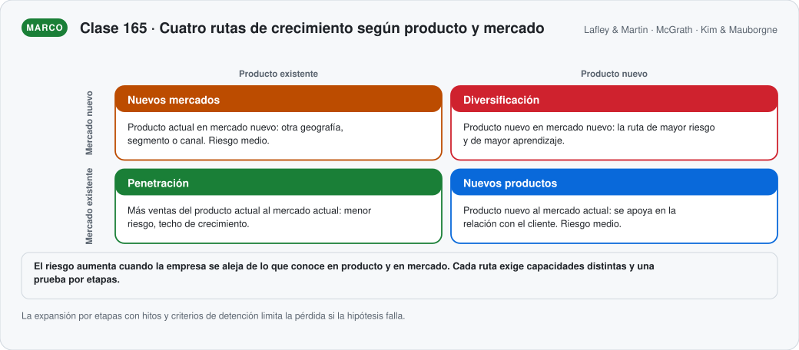

# Clase 165 — Opciones de crecimiento

<!-- nav:inicio -->
> **Parte 13 · Estrategia y competencia** — clase 9 de 12 · [índice de la parte](../../README.md) · [temario](../../../../SYLLABUS.md)
<!-- nav:fin -->

**Parte:** 13 — Estrategia y competencia  
**Nivel:** Etapa 4 — Gerente → Director  
**Duración sugerida:** 150–180 minutos · **Estándar:** deep-class-v2

## 🎯 Propósito

Crecer es el objetivo declarado de casi toda empresa y el origen de buena parte de sus errores más caros. Se abren sucursales sin entender por qué funcionan las existentes, se adquieren empresas por su tamaño y no por su encaje, se lanzan productos para clientes que no los pidieron, se entra a otros países con las mismas recetas. El crecimiento no es bueno en sí mismo: solo vale si **crea valor**, es decir, si el retorno de lo invertido supera el costo del capital (clase 118) y si no destruye la coherencia ni la capacidad que sostienen el negocio. Elegir **por dónde crecer** exige comparar alternativas con evidencia, considerar el riesgo creciente al alejarse de lo que se conoce y avanzar por etapas.

La clase se apoya en las elecciones de Lafley y Martin sobre dónde jugar y cómo ganar, en el análisis de McGrath sobre portafolios de ventajas transitorias, en la innovación en valor de Kim y Mauborgne y en la evaluación de inversiones de Brealey, Myers y Allen. Al terminar sabrás clasificar las rutas de crecimiento según producto y mercado, evaluar el riesgo y el retorno esperado de cada una, decidir entre crecer orgánicamente, adquirir o aliarse y planificar el crecimiento por etapas con criterios de detención.

## 📚 Resultados de aprendizaje

Al finalizar podrás:

1. **Clasificar** las rutas de crecimiento por producto y mercado.
2. **Evaluar** el valor esperado y el riesgo de cada ruta.
3. **Decidir** entre crecer orgánicamente, adquirir o aliarse.
4. **Diseñar** el crecimiento por etapas con hitos y criterios de detención.
5. **Reconocer** los errores típicos de crecimiento que destruyen valor.

## 🧭 Agenda

| Tramo | Qué se hace |
|---|---|
| 0–20 min | Recuperación: ¿cuál de tus últimas iniciativas de crecimiento creó valor y cuál no, y qué las distinguió? |
| 20–60 min | Rutas, riesgo, valor esperado, adquirir frente a construir y etapas. |
| 60–105 min | Ejemplo trabajado: comparar cuatro rutas de crecimiento de una panadería regional. |
| 105–150 min | Caso ejecutivo y práctica. |
| 150–175 min | Límites y entregable. |

## 🧩 Conceptos centrales

| Concepto | Definición | Cómo se reconoce |
|---|---|---|
| **Penetración** | Vender más del producto actual al mercado actual. | Más participación y frecuencia. |
| **Nuevos mercados** | Llevar el producto actual a clientes, segmentos o geografías nuevas. | Mismo producto, otro cliente. |
| **Nuevos productos** | Ofrecer productos nuevos a clientes actuales. | Mismo cliente, otra oferta. |
| **Diversificación** | Producto nuevo en mercado nuevo. | Mayor distancia y riesgo. |
| **Crecimiento rentable** | Crecimiento cuyo retorno supera el costo del capital. | ROIC sobre costo de capital. |
| **Opción real** | Derecho a invertir más si el aprendizaje es favorable. | Inversión por etapas. |

## 🧠 Modelo mental

**Cómo leer el diagrama.** Una matriz con producto (existente o nuevo) y mercado (existente o nuevo). **Penetración** (producto y mercado actuales) tiene el menor riesgo y un techo de crecimiento. **Nuevos mercados** (producto actual en mercado nuevo) y **nuevos productos** (producto nuevo al mercado actual) tienen riesgo medio y se apoyan en lo conocido. **Diversificación** (producto y mercado nuevos) tiene el mayor riesgo y el mayor aprendizaje. La nota recuerda que el riesgo crece cuando la empresa se aleja de lo que conoce y que se expande por etapas con hitos y criterios de detención.

## 📖 Desarrollo

### 1. Por dónde crecer: producto y mercado

La clasificación más usada ordena las rutas según se conserve o cambie el **producto** y el **mercado**. **Penetración**: más ventas de lo mismo a los mismos clientes (mayor frecuencia, más participación, precios). **Nuevos mercados**: lo mismo a otros clientes (segmentos, canales, regiones, países). **Nuevos productos**: otros productos a los mismos clientes. **Diversificación**: otros productos a otros clientes. La regla práctica: cuanto más se aleja la empresa de **lo que conoce** (clientes, tecnología, capacidades, canales), mayor el riesgo. Lafley y Martin enfatizan que el crecimiento debe responder a **dónde jugar** y **cómo ganar** elegidos, y no a la oportunidad del momento.

### 2. Crecer donde se tiene ventaja

El crecimiento más seguro suele ser el que **aprovecha ventajas existentes**: capacidades, marca, relaciones, datos, escala. Se evalúa para cada ruta: ¿qué ventaja se transfiere?, ¿qué capacidades nuevas se necesitan?, ¿qué ventaja tienen los competidores del nuevo terreno? Un error clásico es **extrapolar el éxito** a un terreno donde la ventaja no existe (un excelente operador de supermercados que abre restaurantes sin capacidades de restauración). McGrath recomienda ver el crecimiento como el **lanzamiento de nuevas ventajas** dentro de un portafolio, con una disciplina de inversión por etapas y un abandono ordenado de las que no funcionan.

### 3. Valor esperado y riesgo

Cada ruta se evalúa con **valor esperado** y **riesgo**: inversión requerida, beneficios si resulta, **probabilidad de éxito** (con la visión desde afuera: ¿cómo les fue a iniciativas similares?) y tiempo. El valor esperado simple es probabilidad de éxito × beneficio − inversión; con descuento (clase 118) para flujos futuros. Brealey, Myers y Allen subrayan que la clave es **comparar con el costo del capital ajustado por riesgo**: una ruta de alto riesgo exige un retorno mayor. Las estimaciones de crecimiento son optimistas por lo general; se contrastan con casos comparables y se prueban con escenarios (clase 164).

### 4. Crear, comprar o aliarse

Una vez elegida la ruta, se decide **cómo** crecer. **Orgánico**: se construye con recursos propios; más control y aprendizaje, más lento. **Adquisición**: se compra una empresa; rapidez y acceso a capacidades, con riesgos de sobreprecio, integración cultural y pérdida de talento; muchas adquisiciones destruyen valor para el comprador, de modo que se exige una tesis clara de **por qué la empresa vale más en nuestras manos** que en las suyas. **Alianza o licencia**: se comparte riesgo y se accede a capacidades; flexibilidad, con dependencia (clase 166). La decisión depende de la urgencia, de las capacidades, del precio y del riesgo.

### 4b. Adquisiciones: disciplina de valoración

Una adquisición se evalúa con la valoración de la clase 119 (flujos descontados y múltiplos), las **sinergias** esperadas (de costo, de ingreso) con su probabilidad y plazo, los **costos de integración** y los **riesgos** (clientes, talento, cultura, regulación). Un principio: **no pagar por las sinergias** que el vendedor no puede capturar sin la compradora. Se define quién integra y cómo antes de firmar, y se establecen **criterios de salida**. Las adquisiciones tienen requisitos legales (competencia, financieros, laborales) que se verifican con asesoría.

### 5. Crecer por etapas: opciones

Cuando la incertidumbre es alta, conviene **invertir por etapas**: un primer paso pequeño para aprender, con un hito que decide si continuar. Es una **opción**: se paga una prima (el costo de la etapa inicial) por el derecho a invertir más si el aprendizaje es favorable. Evita comprometer todo el capital sin evidencia. El costo de ir por etapas es la **velocidad** (los rivales pueden adelantarse) y la posible pérdida de economías de escala; se compensa con criterios claros de avance y recursos disponibles para acelerar cuando las señales sean positivas. Se definen también **criterios de detención** antes de comenzar (clase 083).

### 6. Capacidad de la organización para crecer

El crecimiento exige capacidades de **gestión**: tomar decisiones más rápido, mantener la cultura, contratar y formar, estandarizar procesos (clase 087), controlar la calidad (clase 091), financiar el capital de trabajo (clase 114) y sostener la **coherencia** (clase 162). Muchas empresas crecen más rápido de lo que su organización puede absorber y pierden calidad, margen o talento. Se evalúa la **capacidad de crecer sin romperse**: ¿qué proceso se rompería primero?, ¿qué personas son cuello de botella?, ¿qué ocurriría con el flujo de caja? Un crecimiento sostenible es el que la organización y la caja pueden financiar.

### 7. Errores que destruyen valor

Los más frecuentes: **crecer por tamaño** (más ingresos sin retorno), **diversificación sin ventaja**, **entrar a mercados atractivos sin capacidades**, **sobreestimar sinergias**, **adquirir por prestigio o por miedo**, **expandir sin probar un modelo repetible**, **ignorar el costo del capital** y **subestimar la integración**. Rumelt advierte contra la **dispersión** de recursos: demasiados frentes con pocos recursos cada uno. Una disciplina útil: antes de aprobar una ruta, exigir la tesis: «ganaremos aquí porque …» y los supuestos críticos con su prueba.

## 📚 Lectura comparada

| Obra | Qué aporta | Qué no resuelve | Pregunta para contrastar |
|---|---|---|---|
| Lafley y Martin | Dónde jugar y cómo ganar como base de las decisiones de crecimiento. | Marco general. | ¿En qué ventaja se apoya la ruta? |
| McGrath | Portafolio de ventajas transitorias y disciplina de lanzar y abandonar. | Poca guía cuantitativa. | ¿Qué abandonarás si no funciona? |
| Kim y Mauborgne | Crecer creando espacios nuevos con innovación en valor. | Casos seleccionados. | ¿Qué valor nuevo ofreces? |
| Brealey, Myers y Allen | Valor esperado, costo de capital y opciones reales. | Teoría con supuestos. | ¿Supera el retorno el costo del capital con riesgo? |
| Rumelt | Concentración de recursos y rechazo a la dispersión. | Sin método cuantitativo. | ¿Dónde concentras? |

## 🧮 Ejemplo trabajado

**Situación (hipotética).** Una panadería-pastelería regional con 14 locales (ventas USD 18 millones, margen operacional 8 %) evalúa cuatro rutas de crecimiento con capital disponible de USD 5 millones.

| Ruta | Descripción | Inversión (USD M) | Prob. de éxito | Valor si resulta (USD M, valor presente) | Valor esperado (USD M) |
|---|---|---|---|---|---|
| Penetración | Ampliar horarios y productos de media tarde en locales actuales | 0,4 | 70 % | 1,5 | 0,7 × 1,5 − 0,4 = **0,65** |
| Nuevos mercados | Abrir 5 locales en una ciudad vecina | 1,2 | 50 % | 3,5 | 0,5 × 3,5 − 1,2 = **0,55** |
| Nuevos productos | Línea de comidas preparadas para oficinas | 1,0 | 45 % | 3,0 | 0,45 × 3,0 − 1,0 = **0,35** |
| Diversificación | Cadena de cafeterías de especialidad con otra marca | 2,5 | 20 % | 9,0 | 0,2 × 9,0 − 2,5 = **−0,70** |

**Lectura.** La penetración tiene el mejor valor esperado y el menor riesgo, pero un techo de crecimiento; nuevos mercados es atractivo si el modelo de local es repetible; nuevos productos depende de capacidades de logística; diversificación tiene valor esperado negativo con la información actual, aunque su beneficio máximo es alto.

**Crecer por etapas (diversificación).** Etapa 1: prueba de 2 cafeterías piloto por USD 0,3 millones; si el desempeño cumple los criterios (ventas por local ≥ USD 450.000 anuales, margen de local ≥ 12 %, probabilidad de éxito sube a 50 %), invertir USD 2,2 millones más, con éxito del 50 % de escalar con valor de USD 9,0 millones. Valor esperado de la ruta por etapas: −0,3 + 0,4 × (0,5 × 9,0 − 2,2) = −0,3 + 0,4 × 2,3 = **0,62** millones, frente a −0,70 de comprometer todo desde el inicio. La opción de esperar cambia el signo.

**Capacidad de crecer.** La panadería tiene un solo centro de producción al 82 % de su capacidad; abrir 5 locales exige ampliarlo (USD 0,8 millones) y un jefe de operaciones adicional; el capital de trabajo (USD 0,3 millones) se recupera al cierre. Incorporar la ampliación reduce el valor esperado de «nuevos mercados» de 0,55 a −0,25 millones (0,5 × 3,5 − 1,2 − 0,8).

**Decisión.** (1) Ejecutar la penetración ahora; (2) un piloto de nuevos mercados en una sola ciudad con un local más; (3) probar las comidas preparadas con un grupo de 40 oficinas; (4) mantener la diversificación como opción por etapas condicionada a la caja generada. No se adquieren empresas en esta fase. Se revisan los resultados a los seis meses con criterios previos.

**Qué muestra.** (1) El riesgo aumentó al alejarse de lo conocido. (2) La inversión por etapas cambió el valor esperado. (3) Se consideró la capacidad de la organización para absorber el crecimiento.

## 🔀 Comparación y límites

**Crecimiento frente a creación de valor.** Crecer en ingresos no es crear valor: lo segundo exige retorno sobre capital por encima del costo de capital, que es el criterio decisivo.

**Límites.** Las probabilidades y los valores del ejemplo son juicios, no datos; la visión desde afuera ayuda pero no elimina el error. Las clasificaciones de rutas no recogen la complejidad de iniciativas mixtas. Las opciones reales tienen costos de velocidad y de coordinación. Las adquisiciones, alianzas y expansiones internacionales tienen implicancias de competencia, laborales, tributarias y regulatorias que se verifican con asesoría y con las normas vigentes.

## 🪜 De profesional a owner

| Nivel | Cómo participa en las decisiones de crecimiento |
|---|---|
| **Profesional** | Aporta información sobre clientes y operaciones que afecta a la tesis. |
| **Jefe / Team Lead** | Prueba pilotos con criterios y reporta con honestidad. |
| **Gerente** | Evalúa rutas con valor esperado y capacidad de absorber el crecimiento. |
| **CEO / Director** | Decide dónde crecer, cómo y cuándo detener. |
| **Founder / Owner** | Crece donde tiene ventaja y evita diversificarse por entusiasmo. |

## 🏢 Caso ejecutivo

Una empresa de software de gestión para clínicas tiene 1.600 clientes y USD 40 millones de ingresos anuales, con crecimiento de 8 % y buena rentabilidad. El directorio considera cinco rutas: (1) vender módulos adicionales (pagos, historia clínica avanzada) a clientes actuales; (2) entrar a hospitales públicos (ciclos largos, licitaciones); (3) expandirse a México y Colombia con el producto actual; (4) adquirir una empresa de telemedicina (USD 22 millones, 70 empleados, pérdidas de USD 3 millones anuales); (5) lanzar una aplicación de salud para pacientes. La empresa tiene USD 15 millones de caja, un equipo comercial de 35 personas, una organización de soporte al límite y un fuerte conocimiento del sector clínico privado. Las ventas de módulos a clientes actuales tuvieron una tasa de adopción de 22 % en un piloto.

Entrega un **análisis de rutas de crecimiento** que contenga: (a) la clasificación de las cinco rutas y las ventajas que cada una aprovecha; (b) el valor esperado y el riesgo de cada una con supuestos y fuentes; (c) la decisión de crecer orgánicamente, adquirir o aliarse para las rutas elegidas; (d) la evaluación de la adquisición, con sinergias, integración y riesgos; (e) el plan por etapas con hitos y criterios de detención, y la capacidad de la organización para absorber el crecimiento; (f) las verificaciones regulatorias, de competencia, de datos de salud y de licitaciones públicas que se harán con las normas vigentes y asesoría.

## 🧪 Práctica

1. Clasifica tus tres últimas iniciativas de crecimiento en las cuatro rutas y evalúa su resultado.
2. Estima el valor esperado de dos rutas con probabilidad de éxito basada en casos comparables.
3. Diseña un plan por etapas para la ruta de mayor riesgo con hitos y criterios de detención.
4. Identifica qué proceso de tu organización se rompería primero si crecieras el doble.
5. Redacta la tesis «ganaremos aquí porque…» de una ruta y los supuestos críticos.

## ⚠️ Errores frecuentes

| Error | Por qué ocurre | Cómo corregirlo |
|---|---|---|
| Crecer por tamaño | Se mide ingreso | Exigir retorno sobre el costo de capital. |
| Diversificar sin ventaja | Se extrapola el éxito | Evaluar qué ventaja se transfiere. |
| Sobreestimar sinergias | Se busca justificar la compra | Probabilidad y plazo realistas; no pagar por ellas. |
| Comprometer todo de una vez | Se teme llegar tarde | Invertir por etapas con hitos. |
| Ignorar la capacidad de la organización | Se mira el mercado | Medir qué se rompe al crecer. |
| Dispersar recursos | Muchas oportunidades | Concentrar y priorizar. |

## ❓ Preguntas de comprobación

1. ¿Cuáles son las cuatro rutas de crecimiento y cuál tiene más riesgo?
2. ¿Por qué se prefiere crecer donde hay ventaja?
3. ¿Cómo se calcula el valor esperado de una ruta?
4. ¿Cuándo conviene adquirir, construir o aliarse?
5. ¿Qué significa pagar por las sinergias?
6. ¿Por qué invertir por etapas cambia el valor esperado?
7. ¿Qué errores destruyen valor al crecer?

Claves de respuesta

1. Penetración, nuevos mercados, nuevos productos y diversificación; la diversificación tiene el mayor riesgo.
2. Porque aprovecha capacidades, relaciones o datos existentes y reduce el riesgo de entrar a un terreno donde no se tiene ventaja.
3. Probabilidad de éxito por el beneficio si resulta menos la inversión, idealmente con descuento y con probabilidades contrastadas con casos comparables.
4. Se construye cuando hay tiempo y control; se adquiere cuando la rapidez o la capacidad lo justifican y hay una tesis de valor; se opta por aliarse cuando se busca compartir riesgo con flexibilidad.
5. Pagar al vendedor valor que solo la compradora puede crear; se evita pagando por lo que el vendedor ya hace y no por sinergias futuras.
6. Porque limita la pérdida si el aprendizaje es desfavorable y conserva la opción de invertir más si es favorable.
7. Crecer por tamaño, diversificar sin ventaja, sobreestimar sinergias, no probar un modelo repetible, ignorar el costo del capital y subestimar la integración.

## 📥 Entregable

Guarda en `portfolio/165-opciones-de-crecimiento/`:

- `strategy-memo.md` (plantilla [Strategy memo](../../../../templates/strategy-memo.md)) con el análisis de rutas del caso ejecutivo;
- `capital-allocation.md` (plantilla [Capital allocation](../../../../templates/capital-allocation.md)) con el valor esperado, las etapas y la asignación de caja;
- `decision-journal.md` con las tesis, los supuestos críticos y los criterios de detención.

## 📗 Fuentes y verificación

- A.G. Lafley & Roger L. Martin — *Playing to Win* (Harvard Business Review Press, 2013). **Uso en esta clase:** dónde jugar y cómo ganar como base del crecimiento. Lectura selectiva sobre **opciones de crecimiento**. **Localizador:** [ISBN-13 9781422187395](https://openlibrary.org/isbn/9781422187395).
- Rita Gunther McGrath — *The End of Competitive Advantage* (Harvard Business Review Press, 2013). **Uso en esta clase:** portafolio de ventajas transitorias y disciplina de abandono. Lectura selectiva sobre **opciones de crecimiento**. **Localizador:** [ISBN-13 9781422172810](https://openlibrary.org/isbn/9781422172810).
- W. Chan Kim & Renée Mauborgne — *Blue Ocean Strategy* (Coach Series, 2006). **Uso en esta clase:** crecer creando espacios nuevos con innovación en valor. Lectura selectiva sobre **opciones de crecimiento**. **Localizador:** [ISBN-13 9781596590687](https://openlibrary.org/isbn/9781596590687).
- Richard Brealey, Stewart Myers & Franklin Allen — *Principles of Corporate Finance* (McGraw-Hill International Book Co, 1984). **Uso en esta clase:** valor esperado, costo de capital y opciones reales. Lectura selectiva sobre **opciones de crecimiento**. **Localizador:** [ISBN-13 9780070662025](https://openlibrary.org/isbn/9780070662025).
- Richard Rumelt — *Good Strategy/Bad Strategy* (Profile Books, 2011). **Uso en esta clase:** concentración de recursos y rechazo a la dispersión. Lectura selectiva sobre **opciones de crecimiento**. **Localizador:** [ISBN-13 9781846684807](https://openlibrary.org/isbn/9781846684807).

> **Regla de fuentes para Opciones de crecimiento:** las obras anteriores estructuran las perspectivas de esta materia; cualquier norma, ley o estándar vivo mencionado debe comprobarse nuevamente en su fuente primaria vigente, incluidas las de competencia, adquisiciones, datos de salud y licitaciones públicas. Los ejemplos y casos son hipotéticos, con cifras ilustrativas. El desarrollo es original y no reproduce capítulos protegidos.

<!-- pie:inicio -->
---

| Anterior | Índice | Siguiente |
|---|---|---|
| [← 164 · Escenarios estratégicos](../164-escenarios-estrategicos/README.md) | [Parte 13](../../README.md) · [Programa](../../../../SYLLABUS.md) | [166 · Partnerships, ecosistemas y plataformas →](../166-partnerships-ecosistemas-y-plataformas/README.md) |
<!-- pie:fin -->
