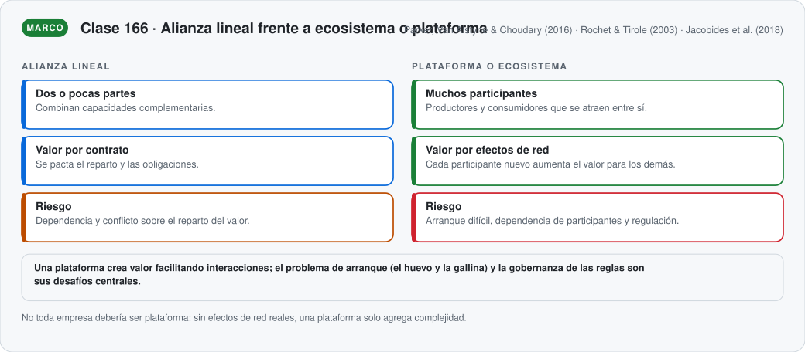

# Clase 166 — Partnerships, ecosistemas y plataformas

<!-- nav:inicio -->
> **Parte 13 · Estrategia y competencia** — clase 10 de 12 · [índice de la parte](../../README.md) · [temario](../../../../SYLLABUS.md)
<!-- nav:fin -->

**Parte:** 13 — Estrategia y competencia  
**Nivel:** Etapa 4 — Gerente → Director  
**Duración sugerida:** 150–180 minutos · **Estándar:** deep-class-v2

## 🎯 Propósito

Ninguna empresa lo hace todo sola, y cada vez menos lo intentan. Las alianzas, los ecosistemas y las plataformas han cambiado la forma de competir: el valor ya no se crea solo dentro de una cadena lineal de proveedor, fabricante y distribuidor, sino en **redes de actores que se complementan**, y algunas empresas ganan no por lo que producen sino por lo que **permiten que otros hagan** conectándolos. Esto abre oportunidades (alcance, velocidad, capacidades que no se tienen) y riesgos (dependencia, pérdida de control, conflictos sobre el reparto del valor, regulación). Decidir **con quién, cómo y bajo qué reglas** colaborar es hoy una decisión estratégica de primer orden.

La clase se apoya en el análisis de plataformas de Parker, Van Alstyne y Choudary, en la teoría económica de mercados de dos lados de Rochet y Tirole, en el marco de ecosistemas de Jacobides, Cennamo y Gawer y en la visión de dependencias de la clase 093. Al terminar sabrás distinguir alianzas lineales de plataformas y ecosistemas, entender los efectos de red y el problema del arranque, diseñar una estructura de precios y de reglas, evaluar la gobernanza y decidir cuándo conviene ser plataforma, participar en una o aliarse de forma lineal.

## 📚 Resultados de aprendizaje

Al finalizar podrás:

1. **Distinguir** alianza lineal, plataforma y ecosistema.
2. **Explicar** los efectos de red y el problema del arranque.
3. **Diseñar** una estructura de precios que equilibre los lados de una plataforma.
4. **Evaluar** la gobernanza: reglas, acceso, calidad y reparto del valor.
5. **Decidir** si conviene ser plataforma, participar o aliarse de forma lineal.

## 🧭 Agenda

| Tramo | Qué se hace |
|---|---|
| 0–20 min | Recuperación: ¿de qué plataformas o socios depende tu empresa y qué ocurriría si cambiaran sus reglas? |
| 20–60 min | Alianzas, plataformas, efectos de red, precios y gobernanza. |
| 60–105 min | Ejemplo trabajado: arranque de un mercado de servicios técnicos para hogares. |
| 105–150 min | Caso ejecutivo y práctica. |
| 150–175 min | Límites y entregable. |

## 🧩 Conceptos centrales

| Concepto | Definición | Cómo se reconoce |
|---|---|---|
| **Alianza** | Acuerdo entre organizaciones para combinar capacidades. | Dos o pocas partes con un contrato. |
| **Plataforma** | Negocio que facilita interacciones entre grupos de participantes. | Productores y consumidores conectados. |
| **Efecto de red** | El valor para un participante aumenta con el número de otros participantes. | Cada nuevo usuario beneficia a los demás. |
| **Mercado de dos lados** | Plataforma con dos grupos que se necesitan mutuamente. | Compradores y vendedores. |
| **Ecosistema** | Conjunto de actores que se complementan para entregar una propuesta de valor. | Complementadores y dependencias mutuas. |
| **Gobernanza** | Reglas sobre quién participa, cómo y con qué reparto. | Acceso, calidad, precios. |

## 🧠 Modelo mental

**Cómo leer el diagrama.** Dos paneles. La **alianza lineal** combina capacidades de pocas partes, el valor se reparte por contrato y su riesgo es la dependencia y el conflicto por el reparto. La **plataforma o ecosistema** coordina a muchos participantes que se atraen entre sí; el valor crece con los efectos de red y su riesgo es el arranque difícil, la dependencia de participantes y la regulación. La nota recuerda que el desafío central de una plataforma es el arranque y la gobernanza de las reglas, y que no toda empresa debería ser plataforma.

## 📖 Desarrollo

### 1. Alianzas lineales y plataformas

En una **cadena de valor lineal**, la empresa compra insumos, los transforma y vende el resultado; el valor se crea dentro de la empresa y se transfiere a lo largo de la cadena. Las **alianzas lineales** (licencias, joint ventures, acuerdos de distribución, desarrollo conjunto) combinan capacidades complementarias de pocas partes y se rigen por contratos. Una **plataforma**, en cambio, crea valor **facilitando intercambios** entre grupos: conecta a quienes ofrecen con quienes demandan y establece reglas. Parker, Van Alstyne y Choudary sostienen que la lógica de plataforma desplaza el foco de **controlar recursos** a **orquestar recursos**, y de **optimizar procesos internos** a **crear un ecosistema** que genere valor para todos.

### 2. Efectos de red y masa crítica

El **efecto de red directo** ocurre cuando el valor para un usuario aumenta con el número de usuarios del mismo tipo (un servicio de mensajería); el **indirecto** (entre lados), cuando más participantes de un lado atraen a más del otro (más conductores atraen a más pasajeros). Los efectos pueden ser **positivos** o **negativos** (la congestión, el spam). Las plataformas deben alcanzar una **masa crítica** a partir de la cual el crecimiento se sostiene. Antes de eso enfrentan el **problema del arranque** (huevo y gallina): sin vendedores no hay compradores y viceversa. Estrategias: **empezar en un nicho geográfico o temático**, **subsidiar un lado**, **aportar contenido o servicio propio al inicio**, **crear valor para un usuario solo** (la herramienta que sirve aunque no haya red).

### 3. Mercados de dos lados y estructura de precios

Rochet y Tirole analizan que, en mercados de dos lados, lo que importa no es solo el **nivel total** del precio sino cómo se **reparte** entre los lados: a menudo conviene **subsidiar** o dar gratis a un lado (el más sensible o el que atrae al otro) y cobrar al otro. Los precios reflejan quién valora más la participación del otro lado y el costo de servir a cada uno. Una consecuencia: una plataforma puede perder dinero en un lado y ganar en el otro, y los precios por lado no deben juzgarse como si el lado subsidiado fuera un negocio independiente. La estructura de precios es una decisión estratégica que afecta el crecimiento, la competencia y la regulación.

### 4. Ecosistemas y complementadores

Jacobides, Cennamo y Gawer definen un **ecosistema** como un conjunto de actores con distintos grados de **complementariedad no genérica** (cada uno aporta algo específico al valor del conjunto) que **se coordinan sin una jerarquía formal**. Un ecosistema se estudia desde su **propuesta de valor conjunta**, sus **actores**, las **dependencias** entre ellos (¿quién depende de quién?), los **cuellos de botella** (componentes escasos que concentran poder) y la **gobernanza**. En un ecosistema, la competencia ocurre entre ecosistemas y entre actores dentro de uno; la ventaja depende de **controlar los cuellos de botella** y de **atraer complementadores** sin ceder demasiado valor.

### 5. Gobernanza: reglas, acceso y reparto

Las reglas determinan la calidad y la sostenibilidad: **quién puede participar** (acceso abierto o curado), **qué estándares de calidad** se exigen, **cómo se resuelven disputas**, **qué datos se comparten y quién es dueño de ellos**, **cuánto se cobra** y **cómo se reparte el valor**. Una plataforma muy abierta atrae volumen pero puede deteriorar calidad y confianza; una cerrada, lo contrario. Las **comisiones** altas empujan a los participantes a salir de la plataforma o a intercambios «por fuera» (desintermediación). Cambios unilaterales de reglas dañan la confianza de los participantes y generan riesgo de **dependencia**: quien construyó su negocio sobre una plataforma queda expuesto (clase 139 y 093).

### 6. Participar en la plataforma de otro

Muchas empresas serán **participantes** de plataformas ajenas (marketplaces, sistemas operativos, redes sociales, pagos). Ventajas: **alcance** y **herramientas** sin construirlas. Riesgos: dependencia de reglas, comisiones y algoritmos; **pérdida de la relación y los datos** del cliente; **competencia con la propia plataforma**; riesgo de **desintermediación**. Estrategias: **diversificar** plataformas, **construir canal propio** para clientes recurrentes (clase 139), **diferenciarse** para no ser intercambiable, **negociar** cláusulas, **monitorear** la dependencia y tener un plan de contingencia. La decisión se evalúa con los criterios de dependencia de proveedores (clase 093).

### 7. Cuándo ser plataforma (y cuándo no)

Conviene considerar una plataforma cuando: hay **dos o más grupos** que se benefician de interactuar; existen **costos de búsqueda o de transacción** que la plataforma reduce; los **efectos de red** son reales y no se agotan rápido; se puede resolver el arranque; hay **capacidad de gobernanza**; y el entorno regulatorio lo permite. No conviene cuando el valor no depende de la interacción entre participantes, cuando la competencia ya concentró la masa crítica o cuando la empresa carece de la capacidad de operar la red. Muchas «plataformas» son un producto con una comunidad sin efectos de red reales. Las plataformas están sujetas a regulación creciente (competencia, datos, laboral, consumo) que se verifica en su fuente vigente y con asesoría.

## 📚 Lectura comparada

| Obra | Qué aporta | Qué no resuelve | Pregunta para contrastar |
|---|---|---|---|
| Parker, Van Alstyne y Choudary | Lógica de plataformas: efectos de red, arranque, gobernanza y estrategia. | Visión de plataformas exitosas. | ¿Tu negocio tiene efectos de red reales? |
| Rochet y Tirole (2003) | Economía de mercados de dos lados y estructura de precios. | Modelo teórico. | ¿Qué lado subsidias y por qué? |
| Jacobides, Cennamo y Gawer (2018) | Concepto de ecosistema, complementariedades y cuellos de botella. | Marco conceptual. | ¿Qué cuello de botella controlas? |
| Porter | Poder de proveedores y compradores en la cadena. | Visión lineal. | ¿Dependes de un actor poderoso? |
| McGrath | Ventajas transitorias en ecosistemas cambiantes. | Poco detalle operativo. | ¿Cuánto durará tu posición en el ecosistema? |

## 🧮 Ejemplo trabajado

**Situación (hipotética).** Un emprendimiento quiere crear un mercado digital de servicios técnicos para hogares (electricistas, gasfíteres) en una ciudad de 1,8 millones de habitantes. Debe resolver el arranque y definir su economía.

**Estructura de dos lados.** Lado A: técnicos (oferta); lado B: hogares (demanda). Efecto indirecto: más técnicos reducen el tiempo de espera; más hogares aseguran trabajo a los técnicos.

**Estrategia de arranque.** Se decide comenzar en una comuna con 60.000 hogares, con **200 técnicos** seleccionados y verificados (se les garantiza un mínimo de trabajos en los dos primeros meses y comisión reducida), y una oferta a los hogares de **primer servicio con 25 % de descuento**. Se mide la «liquidez» (porcentaje de solicitudes atendidas en menos de 24 horas).

**Economía unitaria.** Ticket promedio USD 80; comisión de 12 % → USD 9,6 por trabajo; costo de pagos y soporte USD 2,2; contribución USD 7,4. Costos fijos mensuales: USD 100.000 (equipo, tecnología, marketing). Punto de equilibrio: 100.000 / 7,4 = 13.514 trabajos al mes. Con 200 técnicos haciendo 30 trabajos mensuales = 6.000 trabajos: no alcanza. Se necesitaría llegar a 450 técnicos con 30 trabajos o ampliar a otra comuna.

**Datos del primer trimestre.**

| Indicador | Mes 1 | Mes 2 | Mes 3 |
|---|---|---|---|
| Técnicos activos | 200 | 230 | 260 |
| Solicitudes de hogares | 1.800 | 3.400 | 5.200 |
| Atendidas en menos de 24 horas | 52 % | 68 % | 79 % |
| Trabajos completados | 1.200 | 2.600 | 4.300 |
| Repetición de hogares (segundo servicio en 60 días) | — | 14 % | 24 % |
| Intermediación evitada («por fuera») estimada | — | 11 % | 17 % |

**Lectura.** El efecto de red indirecto funciona (más técnicos → más liquidez → más repetición), pero hay **desintermediación**: 17 % de los trabajos se estaría acordando por fuera. Respuestas: **valor que la plataforma agrega** (garantía, pago protegido, seguro por daños, financiamiento), comisiones decrecientes con el volumen de cada técnico y reglas claras (la plataforma no es un directorio de contactos). El punto de equilibrio se alcanzaría con unos 14.000 trabajos al mes; se proyecta en 9 meses.

**Gobernanza.** Verificación de técnicos, calificaciones, resolución de disputas, política de cancelación y de precios mínimos y máximos orientativos. Se revisa con asesoría la condición laboral de los técnicos (independientes) y las normas de plataformas, consumo, datos y competencia en su fuente vigente.

**Decisión.** Mantener el foco en la comuna hasta alcanzar 85 % de atención en 24 horas y 30 % de repetición antes de expandirse; subsidiar a hogares solo en el primer servicio; construir herramientas para técnicos (agenda, cobros, repuestos) que aumenten el valor de estar en la plataforma.

**Qué muestra.** (1) El arranque en un nicho y con un lado subsidiado construyó liquidez. (2) La economía unitaria mostró la escala necesaria. (3) La gobernanza abordó la desintermediación y los riesgos regulatorios.

## 🔀 Comparación y límites

**Plataforma frente a producto con comunidad.** Una plataforma requiere efectos de red reales, no solo una comunidad de usuarios; muchos negocios con foros o redes de usuarios no los tienen.

**Límites.** Las plataformas tienden a concentrar poder (el ganador se lleva casi todo en algunos mercados), pero hay mercados donde coexisten varias. Los resultados de arranque son inciertos y costosos. El análisis de ecosistemas es conceptual y difícil de aplicar con precisión. Las plataformas enfrentan regulación creciente sobre competencia, datos, relaciones laborales y protección de consumidores, y esta cambia por país; debe verificarse en su fuente vigente y con asesoría. Las cifras del ejemplo son ilustrativas.

## 🪜 De profesional a owner

| Nivel | Cómo participa en alianzas y plataformas |
|---|---|
| **Profesional** | Gestiona la relación diaria con socios y cuida la calidad. |
| **Jefe / Team Lead** | Monitorea el desempeño y las dependencias de su socio o canal. |
| **Gerente** | Negocia acuerdos y define condiciones de participación o de gobernanza. |
| **CEO / Director** | Decide si ser plataforma, participar o aliarse, y limita dependencias. |
| **Founder / Owner** | Resuelve el arranque en un nicho y cuida la confianza de ambos lados. |

## 🏢 Caso ejecutivo

Una empresa de software para gestión de talleres mecánicos (6.000 clientes en un país) considera lanzar un mercado de repuestos y servicios que conecte talleres con proveedores de repuestos y con conductores. Los talleres piden mejores precios y entrega rápida; los proveedores, acceso a más clientes sin descuentos; los conductores, transparencia y confianza. Un gran fabricante de repuestos ofrece una alianza exclusiva con descuentos para los talleres de la empresa; una plataforma global de comercio ya vende repuestos con envíos; un banco quiere financiar compras de talleres. La empresa teme que, al intermediar, pierda a los proveedores que hoy le pagan licencias, y que los talleres se vayan si cobra comisión; la regulación del país está discutiendo normas sobre plataformas y sobre libre competencia en repuestos.

Entrega un **análisis de alianza, ecosistema y plataforma** que contenga: (a) el mapa de actores, dependencias y cuellos de botella; (b) la evaluación de los efectos de red y de la posibilidad de arranque; (c) la estructura de precios por lado y el análisis de desintermediación; (d) la comparación entre alianza exclusiva con el fabricante, plataforma propia y participación en la plataforma global, con riesgos de dependencia; (e) las reglas de gobernanza y el plan por etapas con hitos; (f) las verificaciones de competencia, plataformas, datos y consumo que se harán con las normas vigentes y asesoría.

## 🧪 Práctica

1. Dibuja el ecosistema de tu empresa con actores, dependencias y cuellos de botella.
2. Evalúa si tu negocio tiene efectos de red directos o indirectos reales.
3. Define una estrategia de arranque para un mercado de dos lados con un lado subsidiado.
4. Evalúa tu dependencia de una plataforma o socio y un plan de contingencia.
5. Redacta tres reglas de gobernanza que protejan la calidad y la confianza.

## ⚠️ Errores frecuentes

| Error | Por qué ocurre | Cómo corregirlo |
|---|---|---|
| Llamar plataforma a un producto con comunidad | Es la moda | Verificar efectos de red reales. |
| Ignorar el arranque | Se piensa en la escala | Nicho, subsidio y liquidez. |
| Cobrar igual a ambos lados | Se copia el modelo lineal | Estructura de precios por lado. |
| No prever la desintermediación | Se confía en la lealtad | Agregar valor y reglas. |
| Depender de una sola plataforma | Es el canal que funciona | Diversificar y canal propio. |
| Cambiar reglas sin diálogo | Se prioriza el corto plazo | Gobernanza previsible y transparente. |

## ❓ Preguntas de comprobación

1. ¿Qué diferencia hay entre una alianza lineal y una plataforma?
2. ¿Qué es un efecto de red indirecto?
3. ¿Qué es el problema del arranque y cómo se enfrenta?
4. ¿Por qué se subsidia un lado de una plataforma?
5. ¿Qué es un cuello de botella en un ecosistema?
6. ¿Qué riesgos tiene participar en la plataforma de otro?
7. ¿Cuándo no conviene ser plataforma?

Claves de respuesta

1. La alianza lineal combina capacidades de pocas partes por contrato; la plataforma crea valor facilitando interacciones entre grupos con efectos de red.
2. Cuando más participantes de un lado aumentan el valor para los del otro lado.
3. Sin vendedores no hay compradores y viceversa; se enfrenta empezando en un nicho, subsidiando un lado, aportando oferta propia o creando valor para un usuario solo.
4. Porque el lado subsidiado atrae al otro y la plataforma gana en conjunto; lo que importa es el reparto de precios entre los lados.
5. Un componente escaso del ecosistema que concentra poder para quien lo controla.
6. Dependencia de reglas, comisiones y algoritmos, pérdida de relación y datos del cliente, competencia de la propia plataforma y desintermediación.
7. Cuando el valor no depende de la interacción entre participantes, ya hay masa crítica concentrada en otro o falta capacidad de gobernanza.

## 📥 Entregable

Guarda en `portfolio/166-partnerships-ecosistemas-y-plataformas/`:

- `leadership-decision-brief.md` (plantilla [Leadership Decision Brief](../../../../templates/leadership-decision-brief.md)) con el análisis del caso ejecutivo;
- `strategy-memo.md` (plantilla [Strategy memo](../../../../templates/strategy-memo.md)) con la estructura de precios, la gobernanza y el plan por etapas;
- `decision-journal.md` con las dependencias, los riesgos y las verificaciones normativas.

## 📗 Fuentes y verificación

- Geoffrey G. Parker, Marshall W. Van Alstyne & Sangeet Paul Choudary — *Platform Revolution* (W. W. Norton, 2016). **Uso en esta clase:** lógica de plataformas: efectos de red, arranque y gobernanza. Lectura selectiva sobre **partnerships, ecosistemas y plataformas**. **Localizador:** [ISBN-13 9780393249125](https://openlibrary.org/isbn/9780393249125).
- Jean-Charles Rochet & Jean Tirole — *Platform Competition in Two-Sided Markets* (Journal of the European Economic Association, 2003). **Uso en esta clase:** economía de mercados de dos lados y estructura de precios. Lectura selectiva sobre **partnerships, ecosistemas y plataformas**. **Localizador:** [DOI 10.1162/154247603322493212](https://doi.org/10.1162/154247603322493212).
- Michael G. Jacobides, Carmelo Cennamo & Annabelle Gawer — *Towards a theory of ecosystems* (Strategic Management Journal, 2018). **Uso en esta clase:** ecosistemas, complementariedades y cuellos de botella. Lectura selectiva sobre **partnerships, ecosistemas y plataformas**. **Localizador:** [DOI 10.1002/smj.2904](https://doi.org/10.1002/smj.2904).
- Michael E. Porter — *Competitive Strategy* (Free Press, 1980). **Uso en esta clase:** poder de proveedores y compradores en la cadena. Lectura selectiva sobre **partnerships, ecosistemas y plataformas**. **Localizador:** [ISBN-13 9780684841489](https://openlibrary.org/isbn/9780684841489).
- Rita Gunther McGrath — *The End of Competitive Advantage* (Harvard Business Review Press, 2013). **Uso en esta clase:** ventajas transitorias en ecosistemas cambiantes. Lectura selectiva sobre **partnerships, ecosistemas y plataformas**. **Localizador:** [ISBN-13 9781422172810](https://openlibrary.org/isbn/9781422172810).

> **Regla de fuentes para Partnerships, ecosistemas y plataformas:** las obras anteriores estructuran las perspectivas de esta materia; cualquier norma, ley o estándar vivo mencionado debe comprobarse nuevamente en su fuente primaria vigente, incluidas las normas de plataformas, competencia, datos, laborales y de consumo. Los ejemplos y casos son hipotéticos, con cifras ilustrativas. El desarrollo es original y no reproduce capítulos protegidos.

<!-- pie:inicio -->
---

| Anterior | Índice | Siguiente |
|---|---|---|
| [← 165 · Opciones de crecimiento](../165-opciones-de-crecimiento/README.md) | [Parte 13](../../README.md) · [Programa](../../../../SYLLABUS.md) | [167 · Ejecución y adaptación de estrategia →](../167-ejecucion-y-adaptacion-de-estrategia/README.md) |
<!-- pie:fin -->
