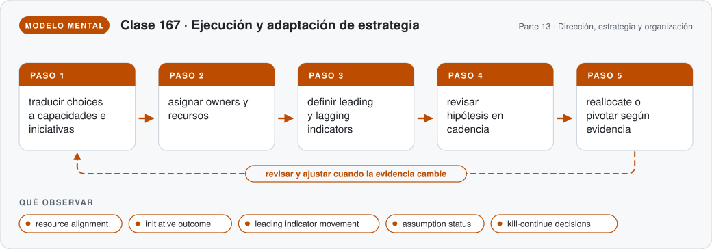

# Clase 167 — Ejecución y adaptación de estrategia

<!-- nav:inicio -->
> **Parte 13 · Estrategia y competencia** — clase 11 de 12 · [índice de la parte](../../README.md) · [temario](../../../../SYLLABUS.md)
<!-- nav:fin -->

**Parte:** 13 — Estrategia y competencia  
**Nivel:** Etapa 4 — Gerente → Director  
**Duración sugerida:** 150–180 minutos · **Estándar:** deep-class-v2

## 🎯 Propósito

Una estrategia que no se ejecuta es un documento; una que se ejecuta sin mirar lo que ocurre es una apuesta ciega. La mayoría de las estrategias fracasa por dos razones simétricas: la **brecha de ejecución** (se decidió algo que la organización no traduce en prioridades, recursos y rutinas) y la **rigidez** (se siguió un plan cuando los supuestos ya habían dejado de ser ciertos). Ejecutar bien una estrategia supone un **sistema** que conecte lo elegido con lo que cada área hace, mida si funciona y permita ajustar con rapidez cuando la evidencia lo exige, sin cambiar de rumbo con cada noticia.

La clase se apoya en el mapa de estrategia y el cuadro de mando de Kaplan y Norton, en la insistencia de Rumelt en que la estrategia debe concentrar y coordinar acciones, en el trabajo de Eisenhardt sobre decisiones rápidas con información abundante en entornos veloces y en los sistemas de gestión de Lafley y Martin. Al terminar sabrás traducir una estrategia en prioridades y resultados, diseñar el ritmo de revisión, definir señales que prueben los supuestos, decidir cuándo ajustar o perseverar y comunicar los cambios sin erosionar la confianza.

## 📚 Resultados de aprendizaje

Al finalizar podrás:

1. **Traducir** una estrategia en prioridades, resultados y responsables.
2. **Identificar** los supuestos críticos y las señales que los ponen a prueba.
3. **Diseñar** el ritmo de revisión estratégica y el sistema de medición.
4. **Decidir** cuándo ajustar, perseverar o detener con criterios previos.
5. **Comunicar** la adaptación manteniendo coherencia y confianza.

## 🧭 Agenda

| Tramo | Qué se hace |
|---|---|
| 0–20 min | Recuperación: toma la estrategia de tu empresa y pregunta a tres personas de distintas áreas cuál es y qué hacen distinto por ella. |
| 20–60 min | Traducción, supuestos y señales, ritmo, ajuste y comunicación. |
| 60–105 min | Ejemplo trabajado: estrategia digital de un banco regional con supuestos y umbrales. |
| 105–150 min | Caso ejecutivo y práctica. |
| 150–175 min | Límites y entregable. |

## 🧩 Conceptos centrales

| Concepto | Definición | Cómo se reconoce |
|---|---|---|
| **Brecha de ejecución** | Diferencia entre lo que se decidió y lo que la organización hace. | Las prioridades diarias no reflejan la estrategia. |
| **Supuesto crítico** | Creencia cuya falsedad invalidaría la estrategia. | Se puede enunciar y verificar. |
| **Señal temprana** | Indicador que anticipa si un supuesto se cumple. | Tiene umbral y responsable. |
| **Mapa de estrategia** | Diagrama de causas y efectos entre los objetivos de la estrategia. | Conecta aprendizaje, procesos, clientes y finanzas. |
| **Revisión estratégica** | Reunión periódica para contrastar la estrategia con la evidencia. | Decide ajustar, perseverar o detener. |
| **Adaptación coherente** | Cambios que mantienen la lógica de la estrategia. | Se explican por evidencia, no por estado de ánimo. |

## 🧠 Modelo mental

**Cómo leer el diagrama.** Cinco pasos con retorno. **Elegir**: diagnóstico, política y apuestas explícitas. **Traducir**: prioridades, recursos y responsables claros. **Ejecutar**: ritmo de gestión con decisiones y seguimiento. **Leer señales**: indicadores del entorno y de resultados que ponen a prueba los supuestos. **Ajustar**: cambiar, reforzar o detener con criterios previos. La estrategia se revisa con lo que se aprende. La nota recuerda que cambiar la estrategia con cada noticia destruye la coherencia y que no cambiarla ante evidencia contraria destruye valor.

## 📖 Desarrollo

### 1. La brecha de ejecución

Muchas organizaciones tienen una estrategia que la mayoría de sus miembros no puede explicar ni vincular con su trabajo. Kaplan y Norton sostienen que el problema no es la falta de ideas sino la falta de **traducción**: sin un lenguaje compartido para describir la estrategia y sin medidas conectadas, cada área optimiza lo suyo. Su propuesta es **hacer explícita la estrategia** mediante un **mapa de estrategia** que conecte objetivos de aprendizaje, procesos, clientes y finanzas, y un **cuadro de mando** con indicadores, metas e iniciativas (clase 102). El primer test de ejecución es simple: ¿puede cada área explicar cómo contribuye a la estrategia y qué dejaría de hacer por ella?

### 2. Traducir en prioridades y recursos

La traducción responde cuatro preguntas. **¿Qué resultados?** (pocos objetivos con medidas, clases 097 a 099). **¿Qué iniciativas?** (las pocas acciones que mueven esos resultados y su costo). **¿Quién responde?** (un dueño por objetivo con autoridad). **¿Con qué recursos?** (capital, personas y tiempo de dirección, clase 106). Rumelt insiste en la **concentración**: pocas prioridades con recursos suficientes; una lista de veinte iniciativas con recursos escasos garantiza que ninguna se complete. La traducción incluye lo que se **deja de hacer**: sin liberar capacidad no hay lugar para lo nuevo.

### 3. Supuestos críticos y señales

Toda estrategia descansa en **supuestos**: sobre clientes, competidores, tecnología, costos, regulación. Se listan los **críticos** (los que, si fallan, invalidan la estrategia) y para cada uno se define: un **indicador**, un **umbral**, un **responsable de seguirlo** y una **decisión asociada**. Ejemplo: «Supuesto: los clientes pasarán a canales digitales a ritmo de 4 puntos porcentuales al año. Indicador: porcentaje de transacciones digitales. Umbral: menos de 2 puntos al año por dos semestres. Decisión: revisar el plan de inversión en canales». Se definen **antes** de ejecutar, para evitar la tentación de reinterpretar la realidad a favor del plan.

### 4. El ritmo de revisión

El sistema de revisión combina niveles (clase 103): **seguimiento operativo** (semanal y mensual) de las iniciativas y resultados; **revisión de gestión** (mensual o trimestral) de la ejecución, los riesgos y los recursos; y **revisión estratégica** (trimestral o semestral, más una anual) de los supuestos críticos, el entorno y las decisiones de ajustar, perseverar o detener. La revisión estratégica no es una repetición de la operativa: se discute **qué cambió afuera**, **qué aprendimos**, **si los supuestos se sostienen** y **qué decisiones tomar**. Lafley y Martin incluyen entre las cinco elecciones los **sistemas de gestión**: sin ellos, la estrategia se diluye en la rutina.

### 5. Decidir con rapidez y con información

Eisenhardt estudió empresas en entornos de cambio rápido y encontró que los equipos que decidían bien y rápido **construían varias alternativas a la vez**, **usaban información en tiempo real** (indicadores actuales, no solo informes históricos), **recurrían a consejeros experimentados** y **resolvían conflictos con ayuda de reglas y de la jerarquía** sin postergarlos. No es improvisar: es tener un proceso para decidir rápido con evidencia. Para la adaptación, esto sugiere preparar **alternativas** y **planes de contingencia** (qué haríamos si la señal X cruza el umbral) y contar con **datos cercanos al presente**. Sin ello, las revisiones se vuelven tardías.

### 6. Ajustar, perseverar o detener

Cuando una señal cruza el umbral, se decide entre **perseverar** (el supuesto sigue en pie o la evidencia es insuficiente), **ajustar** (cambiar tácticas manteniendo la política: precios, canal, ritmo, recursos) o **cambiar la política** (el diagnóstico ya no es válido), y **detener** una iniciativa (clase 083). Los criterios se definen antes: umbrales, plazos y magnitudes. Se evitan los extremos: **cambiar de estrategia ante cada dato** (volatilidad que destruye la coherencia, la confianza y la ejecución) y **perseverar sin evidencia** por orgullo o costo hundido. Una regla útil: distinguir **ruido** (variación esperable, clase 091) de **señal** (cambio persistente o de gran magnitud).

### 7. Comunicar y sostener

La adaptación se comunica con **claridad y razones**: qué señal se observó, qué decisión se tomó, qué se mantiene y qué cambia, y qué se espera. Si no se explica, las personas interpretan los cambios como improvisación. Se mantienen **constantes** el propósito y la política guía y se ajustan las tácticas. Se **reconoce el aprendizaje** (también el de supuestos que fallaron) y se evita culpar. Los líderes dan el ejemplo: respetan las prioridades acordadas, no sobrecargan con nuevas iniciativas y toman decisiones difíciles a tiempo. Los cambios que afecten a personas, contratos o clientes deben cumplir normas laborales y comerciales vigentes.

## 📚 Lectura comparada

| Obra | Qué aporta | Qué no resuelve | Pregunta para contrastar |
|---|---|---|---|
| Kaplan y Norton (*Balanced Scorecard*) | Cuadro de mando para traducir la estrategia en medidas. | Aplicable con estrategia explícita. | ¿Cada objetivo tiene indicador y dueño? |
| Rumelt | Coherencia y concentración de acciones. | Poco método de seguimiento. | ¿Qué iniciativas dejaste de hacer? |
| Eisenhardt (1989) | Decidir con rapidez usando alternativas múltiples e información actual. | Estudio de empresas de entornos veloces. | ¿Qué alternativas preparas? |
| Lafley y Martin | Sistemas de gestión como parte de la estrategia. | Visión de grandes empresas. | ¿Tus sistemas respaldan tus elecciones? |
| McGrath | Reconfigurar ventajas ante cambios. | Menos detalle sobre medición. | ¿Qué señal te haría reconfigurar? |

## 🧮 Ejemplo trabajado

**Situación (hipotética).** Un banco regional (USD 4.000 millones en activos, 180 sucursales) adoptó una estrategia: **competir en banca de personas y pequeñas empresas con una oferta digital simple y servicio humano en puntos clave**, cerrando sucursales de bajo tráfico y reasignando personal a asesoría.

**Supuestos críticos con señales y decisiones.**

| Supuesto | Indicador | Umbral | Decisión si se cruza |
|---|---|---|---|
| Los clientes adoptarán canales digitales a un ritmo de 5 puntos al año | % de transacciones digitales | Menos de 3 puntos al año durante 2 semestres | Revisar ritmo de cierres y el plan de educación al cliente |
| El cierre de 40 sucursales no elevará la fuga de clientes más de 2 puntos | Fuga neta de clientes en zonas cerradas | Más de 4 puntos sobre la base | Pausar nuevos cierres; reforzar atención |
| Los asesores reasignados aumentarán las ventas de productos en 15 % | Ventas por asesor | Menos de 5 % en 2 trimestres | Revisar capacitación e incentivos |
| El costo de adquirir un cliente digital será menor a USD 45 | CAC digital | Más de USD 70 | Cambiar mezcla de canales |
| La regulación permitirá la apertura de cuentas 100 % digitales | Normas publicadas | Restricciones adicionales | Ajustar el modelo de verificación |

**Año 1: lo que mostraron las señales.** Transacciones digitales: +3,4 puntos (bajo el supuesto pero sobre el umbral); fuga en zonas cerradas: +3,1 puntos (entre el supuesto y el umbral); ventas por asesor: +11 %; CAC digital: USD 58; regulación: sin cambios. Lectura: los supuestos se cumplen parcialmente; ninguna señal cruzó el umbral; se **perseveró con ajustes**: más educación al cliente en zonas cerradas y una oferta de servicio móvil en dos localidades.

**Año 2: una señal cruza el umbral.** El CAC digital llega a USD 78 por aumento del costo de publicidad. Decisión: **ajustar la táctica**, no la estrategia: reasignar presupuesto a recomendaciones y a alianzas con comercios, reducir la publicidad en medios con mayor costo, y probar el canal de sucursales como punto de captación asistida. Se comunica al directorio y a los equipos con datos y plan; la política guía se mantiene.

**Revisión estratégica semestral.** Agenda de 3 horas: (1) qué cambió afuera (competidores digitales, tasas, regulación), (2) estado de supuestos, (3) resultados e iniciativas, (4) decisiones de ajuste, (5) lecciones. Registro de decisiones con razones.

**Qué muestra.** (1) Los supuestos tenían indicador, umbral y decisión previa. (2) Se distinguió ajustar tácticas de cambiar la política. (3) El ritmo de revisión permitió reaccionar sin improvisar.

## 🔀 Comparación y límites

**Ejecución frente a planificación.** La planificación define qué hacer; la ejecución lo convierte en rutinas y resultados; la adaptación lo corrige con evidencia. Un buen sistema integra los tres.

**Límites.** Los umbrales son juicios y pueden ser demasiado sensibles o insensibles. Los indicadores pueden no capturar lo importante o ser manipulados. Hay cambios que ocurren más rápido que los ciclos de revisión. La adaptación excesiva produce fatiga en la organización. Los procesos de cierre de sucursales y de reasignación de personal tienen requisitos laborales, regulatorios y de comunicación que se verifican con las normas vigentes y asesoría. Las cifras del ejemplo son ilustrativas.

## 🪜 De profesional a owner

| Nivel | Cómo participa en la ejecución y adaptación |
|---|---|
| **Profesional** | Entiende cómo su trabajo contribuye y señala lo que observa en terreno. |
| **Jefe / Team Lead** | Traduce las prioridades en resultados de su equipo y reporta señales. |
| **Gerente** | Gestiona iniciativas, supuestos e indicadores de su área. |
| **CEO / Director** | Conduce la revisión estratégica y decide ajustar o perseverar. |
| **Founder / Owner** | Mantiene el rumbo, pero cambia de táctica cuando la evidencia lo pide. |

## 🏢 Caso ejecutivo

Una cadena de tiendas de electrodomésticos (140 locales) definió hace 18 meses una estrategia: **pasar de vender cajas a vender soluciones para el hogar con servicio de instalación y garantía extendida**, concentrando la inversión en 60 locales «de servicio» y reduciendo los demás. Las ventas de servicios crecen 22 %, pero el volumen de productos cae 9 %; los locales de servicio tienen una rotación de personal de 41 %; los técnicos de instalación son insuficientes (tiempo de espera de 11 días); los competidores en línea bajaron precios 12 %; la dirección recibe indicadores trimestrales y los gerentes atribuyen los problemas a «el mercado». El presidente debate cambiar de rumbo o perseverar; un director quiere retomar la estrategia de precios.

Entrega un **sistema de ejecución y adaptación** que contenga: (a) la traducción de la estrategia en pocos resultados, iniciativas y dueños; (b) cinco supuestos críticos con indicador, umbral y decisión asociada; (c) el ritmo de revisión y los datos de ciclo corto que se necesitan; (d) la lectura de la situación actual con las señales disponibles y la recomendación de perseverar, ajustar o cambiar la política, con argumentos; (e) el plan de comunicación a equipos, clientes y directorio; (f) las verificaciones laborales, de garantías y de consumo que se harán con las normas vigentes y asesoría.

## 🧪 Práctica

1. Pregunta a tres personas de áreas distintas cuál es la estrategia y qué hacen por ella; anota las diferencias.
2. Lista tus cinco supuestos críticos con indicador, umbral y decisión.
3. Diseña la agenda de una revisión estratégica de tres horas.
4. Clasifica un cambio reciente de tu empresa como ruido, ajuste táctico o cambio de política.
5. Redacta un mensaje de comunicación de un ajuste con razón, qué cambia y qué se mantiene.

## ⚠️ Errores frecuentes

| Error | Por qué ocurre | Cómo corregirlo |
|---|---|---|
| Estrategia que nadie traduce | Se comunica una vez | Mapa, indicadores, dueños y recursos. |
| Supuestos implícitos | No se explicitan | Listar y asignar indicadores y umbrales. |
| Umbrales después de ver los datos | Se interpreta a conveniencia | Definirlos antes. |
| Cambiar con cada noticia | Se reacciona al ruido | Distinguir señal de ruido. |
| Perseverar por orgullo | Se defiende lo decidido | Criterios previos y evidencia. |
| Comunicar sin razones | Se evita el conflicto | Explicar qué cambia, qué se mantiene y por qué. |

## ❓ Preguntas de comprobación

1. ¿Qué es la brecha de ejecución?
2. ¿Qué es un supuesto crítico y qué lo acompaña?
3. ¿Qué diferencia hay entre revisión operativa y estratégica?
4. ¿Qué encontró Eisenhardt sobre las decisiones rápidas efectivas?
5. ¿Cuándo se ajusta, se persevera o se cambia la política?
6. ¿Por qué se definen los umbrales antes?
7. ¿Cómo se comunica una adaptación?

Claves de respuesta

1. La diferencia entre lo que se decidió como estrategia y lo que la organización realmente hace.
2. Una creencia cuya falsedad invalidaría la estrategia; se acompaña de indicador, umbral, responsable y decisión asociada.
3. La operativa sigue iniciativas y resultados; la estratégica contrasta los supuestos y el entorno con la evidencia y decide ajustar, perseverar o detener.
4. Que los equipos que decidían bien y rápido consideraban varias alternativas a la vez, usaban información actual y consejeros experimentados y resolvían conflictos con ayuda de reglas.
5. Se persevera si el supuesto sigue en pie o falta evidencia; se ajustan las tácticas si hay desviaciones; se cambia la política si el diagnóstico ya no es válido.
6. Para evitar reinterpretar la realidad a favor del plan una vez vistos los datos.
7. Con claridad y razones: qué señal se observó, qué se decidió, qué se mantiene, qué cambia y qué se espera.

## 📥 Entregable

Guarda en `portfolio/167-ejecucion-y-adaptacion-de-estrategia/`:

- `strategy-memo.md` (plantilla [Strategy memo](../../../../templates/strategy-memo.md)) con el sistema de ejecución y adaptación del caso ejecutivo;
- `ceo-dashboard.md` (plantilla [CEO dashboard](../../../../templates/ceo-dashboard.md)) con los indicadores, umbrales y responsables;
- `decision-journal.md` con la lectura de señales y las decisiones de ajuste.

## 📗 Fuentes y verificación

- Robert S. Kaplan & David P. Norton — *The Balanced Scorecard* (Harvard Business School Press, 1996). **Uso en esta clase:** cuadro de mando para traducir la estrategia en medidas. Lectura selectiva sobre **ejecución y adaptación de estrategia**. **Localizador:** [ISBN-13 9780875846514](https://openlibrary.org/isbn/9780875846514).
- Richard Rumelt — *Good Strategy/Bad Strategy* (Profile Books, 2011). **Uso en esta clase:** coherencia y concentración de acciones. Lectura selectiva sobre **ejecución y adaptación de estrategia**. **Localizador:** [ISBN-13 9781846684807](https://openlibrary.org/isbn/9781846684807).
- Kathleen M. Eisenhardt — *Making Fast Strategic Decisions in High-Velocity Environments* (Academy of Management Journal, 1989). **Uso en esta clase:** decidir con rapidez usando alternativas múltiples e información actual. Lectura selectiva sobre **ejecución y adaptación de estrategia**. **Localizador:** [DOI 10.2307/256434](https://doi.org/10.2307/256434).
- A.G. Lafley & Roger L. Martin — *Playing to Win* (Harvard Business Review Press, 2013). **Uso en esta clase:** sistemas de gestión como parte de la estrategia. Lectura selectiva sobre **ejecución y adaptación de estrategia**. **Localizador:** [ISBN-13 9781422187395](https://openlibrary.org/isbn/9781422187395).
- Rita Gunther McGrath — *The End of Competitive Advantage* (Harvard Business Review Press, 2013). **Uso en esta clase:** reconfigurar ventajas ante cambios. Lectura selectiva sobre **ejecución y adaptación de estrategia**. **Localizador:** [ISBN-13 9781422172810](https://openlibrary.org/isbn/9781422172810).

> **Regla de fuentes para Ejecución y adaptación de estrategia:** las obras anteriores estructuran las perspectivas de esta materia; cualquier norma, ley o estándar vivo mencionado debe comprobarse nuevamente en su fuente primaria vigente, incluidas las normas laborales, de consumo y regulatorias aplicables al sector. Los ejemplos y casos son hipotéticos, con cifras ilustrativas. El desarrollo es original y no reproduce capítulos protegidos.

<!-- pie:inicio -->
---

| Anterior | Índice | Siguiente |
|---|---|---|
| [← 166 · Partnerships, ecosistemas y plataformas](../166-partnerships-ecosistemas-y-plataformas/README.md) | [Parte 13](../../README.md) · [Programa](../../../../SYLLABUS.md) | [168 · Capstone: strategy memo →](../168-capstone-strategy-memo/README.md) |
<!-- pie:fin -->
