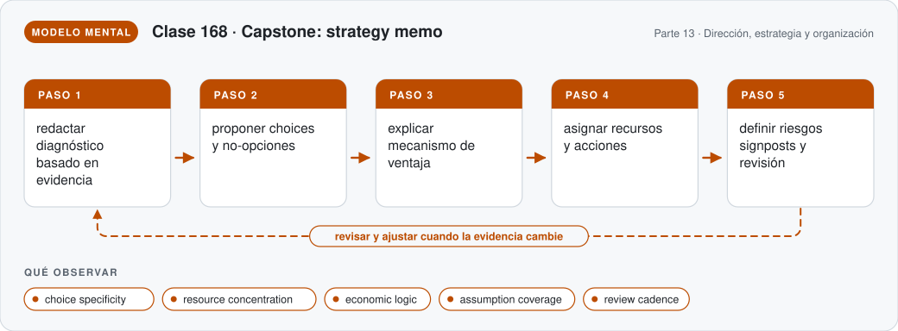

# Clase 168 — Capstone: strategy memo

<!-- nav:inicio -->
> **Parte 13 · Estrategia y competencia** — clase 12 de 12 · [índice de la parte](../../README.md) · [temario](../../../../SYLLABUS.md)
<!-- nav:fin -->

**Parte:** 13 — Estrategia y competencia  
**Nivel:** Etapa 4 — Gerente → Director  
**Duración sugerida:** 150–180 minutos · **Estándar:** deep-class-v2

## 🎯 Propósito

Escribir un memo de estrategia es el ejercicio que obliga a decidir. Un documento de treinta diapositivas puede ocultar la falta de elección; una página en que hay que nombrar el desafío, la política, lo que se renuncia y cómo se sabrá si funciona, no. El **memo de estrategia** no describe la empresa ni resume el mercado: argumenta una **decisión** ante quien debe tomarla, con evidencia, alternativas, riesgos y criterios de revisión. Escribirlo bien exige aplicar todo lo visto en la parte: diagnóstico, estructura de la industria, capacidades, ventaja, trade-offs, modelo de negocio, escenarios, crecimiento, alianzas y ejecución.

Este capstone integra la parte 13 y se apoya en Rumelt, Lafley y Martin, Porter, Helmer, McGrath y Schwartz. Al terminar sabrás redactar un memo de estrategia de dos a cuatro páginas que contenga un diagnóstico con evidencia, una política guía con acciones coherentes y renuncias explícitas, el análisis de alternativas y escenarios, la economía de la apuesta, los supuestos críticos con señales y un plan de decisión por etapas.

## 📚 Resultados de aprendizaje

Al finalizar podrás:

1. **Estructurar** un memo de estrategia con decisión, diagnóstico, política, acciones y renuncias.
2. **Sustentar** cada afirmación con evidencia y distinguir hechos de supuestos.
3. **Evaluar** alternativas con escenarios y valor esperado.
4. **Definir** supuestos críticos, señales, umbrales y criterios de detención.
5. **Someter** el memo a una revisión crítica y mejorarlo.

## 🧭 Agenda

| Tramo | Qué se hace |
|---|---|
| 0–20 min | Recuperación: resume tu estrategia en una página sin usar las palabras «liderazgo», «excelencia» ni «sinergias». |
| 20–60 min | Estructura del memo, evidencia, alternativas y plan. |
| 60–105 min | Ejemplo trabajado: un memo de estrategia para una empresa de envases. |
| 105–150 min | Caso ejecutivo integrado. |
| 150–175 min | Rúbrica, límites y entregable. |

## 🧩 Conceptos centrales

| Concepto | Definición | Cómo se reconoce |
|---|---|---|
| **Memo de estrategia** | Documento breve que argumenta una decisión estratégica. | Pide algo concreto. |
| **Decisión solicitada** | Lo que se pide aprobar al comité o directorio. | Está al inicio. |
| **Alternativa cero** | No hacer nada o continuar como hasta ahora. | Punto de comparación. |
| **Renuncia explícita** | Lo que la estrategia decide no hacer. | Afecta a áreas o clientes. |
| **Supuesto crítico** | Creencia que, si es falsa, invalida el memo. | Tiene señal y umbral. |
| **Revisión crítica** | Contraste del memo por personas que no lo escribieron. | Preguntas incómodas, premortem. |

## 🧠 Modelo mental

**Cómo leer el diagrama.** Tres columnas. **Diagnosticar** reúne qué es y qué no es estrategia (157), el diagnóstico, la industria y las capacidades (158–160) y los escenarios (164). **Elegir** reúne la ventaja competitiva y los trade-offs (161–162), el modelo de negocio (163) y las opciones de crecimiento y alianzas (165–166). **Ejecutar** reúne las prioridades y los recursos (105–106), las señales y criterios de ajuste (167) y el gobierno con revisión periódica. La nota recuerda que el memo nombra el desafío, elige y renuncia, y define cómo se sabrá si funciona; no describe la empresa.

## 📖 Desarrollo

### 1. La estructura que obliga a decidir

Un memo de estrategia de dos a cuatro páginas sigue un orden que protege al lector. **(1) Decisión solicitada** y recomendación en dos líneas. **(2) Diagnóstico**: el desafío crítico y la evidencia que lo sostiene. **(3) Política guía** y acciones coherentes, con **lo que se renuncia**. **(4) Alternativas** consideradas, incluida la alternativa cero, y por qué se descartaron. **(5) Economía**: inversión, retorno, caja, sensibilidad. **(6) Riesgos y supuestos críticos** con señales y umbrales. **(7) Plan por etapas** con hitos, dueños y criterios de detención. **(8) Anexos** con la evidencia. Rumelt insiste en la brevedad y en el diagnóstico como núcleo: si no se puede explicar el desafío en pocas frases, no se entiende.

### 2. Diagnóstico con evidencia

El diagnóstico (clase 158) se escribe con **hechos con fuente**, **descomposiciones** de resultados, **comparaciones** con rivales y **hipótesis rivales** contrastadas. Se incluye el análisis de **industria** (clase 159) y de **capacidades** (clase 160) que sostiene el desafío. Cada afirmación importante lleva su evidencia o se declara como supuesto. Una buena práctica es un cuadro de «qué sabemos / qué suponemos / qué no sabemos». Se evita la lista de factores sin jerarquía; el lector debe poder repetir el desafío al terminar la página.

### 3. Política, acciones y renuncias

La **política guía** es el enfoque elegido, y las **acciones** deben seguirla y reforzarse entre sí (clase 162). Las **renuncias** se escriben con nombre: productos, segmentos, canales, países, proyectos o capacidades que no se harán, con su costo estimado y la forma de gestionarlas. Lafley y Martin proponen verificar que las cinco elecciones (aspiración, dónde jugar, cómo ganar, capacidades y sistemas de gestión) sean consistentes. El memo explicita la **ventaja** que se busca (clase 161), por qué los rivales no podrán copiarla fácilmente y cuánto durará (McGrath), y cómo encaja el **modelo de negocio** (clase 163).

### 4. Alternativas y escenarios

Un memo honesto presenta **al menos tres alternativas**, incluida la alternativa cero, con su economía y riesgos. Se prueban en **escenarios** (clase 164): una tabla que muestra el resultado de cada alternativa en cada escenario y las razones para elegir la **más robusta** o la que mantiene **opciones** valiosas. Se exponen los **resultados en rangos**, no en un número. Se anticipa la **reacción de competidores y otros actores** (Dixit y Nalebuff, clase 159). Y se cuantifica el **costo de oportunidad**: lo que se deja de hacer al elegir (clase 152).

### 5. Economía de la apuesta

Se presenta la **inversión por etapas**, los **flujos** esperados con supuestos, el **retorno** frente al costo de capital (clase 118), la **caja** requerida y la **sensibilidad** a los supuestos clave (clases 116 y 119). Se incluye la **visión desde afuera**: cómo les fue a iniciativas similares. Se muestran los **hitos de decisión** que liberan cada tramo. Los valores se presentan con humildad: cifras de proyección son estimaciones. Un error frecuente es presentar solo el escenario favorable; otro, esconder los costos de implantación y de cambio organizacional.

### 6. Supuestos, señales y gobierno

Se listan los **cinco supuestos críticos** con **indicador, umbral y decisión** asociada (clase 167), y se asigna un **responsable** de seguimiento. Se define el **ritmo de revisión** (trimestral y anual), los **criterios de detención** y los **dueños**. Se indica cómo se vinculará con el **presupuesto**, los **objetivos** y el **sistema de medición** (clases 098 a 107). Se identifican los **riesgos regulatorios, legales y de personas** y quién los gestiona. El memo termina con la **decisión pedida** y su fecha.

### 7. Revisión crítica y mejora

Antes de presentarlo, el memo se somete a una **revisión crítica** por personas que no lo escribieron: ¿se entiende el desafío?, ¿la política es una elección real?, ¿qué renuncias faltan?, ¿qué evidencia contradice?, ¿qué alternativa no se consideró? Se aplica un **premortem** («imaginemos que fracasó: ¿por qué?») y un **abogado del diablo**. Se pide a un lector externo que lo resuma en tres frases; si no coincide con la intención, se reescribe. Kahneman, Sibony y Sunstein sugieren recoger juicios independientes antes de discutir para reducir la influencia del que habla primero.

## 📚 Lectura comparada

| Obra | Qué aporta | Qué no resuelve | Pregunta para contrastar |
|---|---|---|---|
| Rumelt | Diagnóstico, política y acciones coherentes; brevedad. | Es cualitativo. | ¿Cuál es el desafío en una frase? |
| Lafley y Martin | Cinco elecciones integradas y sistemas de gestión. | Visión de grandes empresas. | ¿Tus elecciones son consistentes? |
| Porter | Estructura de la industria y ventaja. | Marco estático. | ¿Qué fuerzas determinan tu margen? |
| Helmer | Fuentes de poder y su durabilidad. | Se centra en ventajas duraderas. | ¿Qué poder protege tu apuesta? |
| Schwartz | Escenarios para probar la estrategia. | No da una decisión por sí solo. | ¿Qué decisión es robusta? |

## 🧮 Ejemplo trabajado

**Situación (hipotética).** Una empresa fabricante de envases plásticos para alimentos (ventas USD 85 millones, margen operacional 6,5 % tras caer de 11 %) prepara un memo para su directorio (continuación del diagnóstico de la clase 158).

**1. Decisión solicitada.** «Aprobar un plan de tres años para concentrar la empresa en envases especiales con servicio técnico, reducir la dependencia del cliente más grande del 28 % al 18 % de las ventas y limitar los envases estándar a la capacidad que protege el margen, con una inversión escalonada de hasta USD 12 millones.»

**2. Diagnóstico (resumen).** El margen cayó 4,5 puntos: mezcla (−2,1), precio (−1,4), materias primas (−1,3), costos (−0,8), gastos (+0,9), volumen (+0,2). El cliente mayor se integra hacia atrás (línea propia para 30 % de su demanda en dos años). El segmento de envases especiales (margen 24 %) bajó del 22 % al 15 % de las ventas; los competidores asiáticos no ofrecen servicio técnico. **Desafío**: depender de un cliente que se integra y haber descuidado el segmento donde se tiene ventaja.

**3. Política y renuncias.** Política: «ganar en envases especiales con diseño, servicio técnico y entrega rápida para alimentos de valor agregado; defender el volumen estándar solo donde cubre costos». Acciones: (a) crear un equipo técnico de 12 personas y un laboratorio de aplicaciones; (b) línea flexible de producción para lotes pequeños (USD 5 millones); (c) contratos de 3 años con 25 clientes medianos; (d) reconvertir 30 % de la capacidad estándar. **Renuncias**: competir en precio en envases estándar de alto volumen; ampliar capacidad para el cliente mayor; entrar a mercados de exportación en estos tres años.

**4. Alternativas y escenarios.** Alternativa A: reducir costos y mantener el modelo (alternativa cero mejorada). B: el plan propuesto. C: integrarse verticalmente al reciclaje de plásticos. Escenarios: (1) cliente mayor integra rápido y regulación pro-reciclaje, (2) cliente mayor integra y regulación laxa, (3) cliente mayor se mantiene y regulación pro-reciclaje, (4) mantiene y regulación laxa.

| Alternativa | E1 | E2 | E3 | E4 | Promedio |
|---|---|---|---|---|---|
| A. Recorte de costos | −12 | −10 | −2 | 0 | −6,0 |
| B. Plan propuesto | 9 | 8 | 14 | 12 | 10,8 |
| C. Integración al reciclaje | 6 | −4 | 10 | −2 | 2,5 |

(Valores acumulados a 5 años, USD millones, ilustrativos.) B es la más robusta; C depende de la regulación.

**5. Economía.** Inversión por etapas: etapa 1 (USD 3 millones: equipo técnico y laboratorio), etapa 2 (USD 5 millones: línea flexible), etapa 3 (USD 4 millones: expansión). Retorno esperado de B: VPN de USD 21 millones al 10 % con un rango de 8 a 30 millones; sensibilidad: con un 20 % menos de crecimiento del segmento especial, el VPN baja a 9 millones; con la pérdida adelantada del cliente mayor, el plan sigue siendo positivo.

**6. Supuestos y señales.** (1) El segmento especial crece 12 % al año (umbral: menos de 7 % por dos semestres). (2) El margen de especiales se mantiene sobre 22 % (umbral: bajo 19 %). (3) La integración del cliente mayor no supera el 30 % (umbral: sobre 40 %). (4) El equipo técnico se contrata en 9 meses (umbral: menos de 8 personas al mes 12). (5) La regulación de plásticos no prohíbe usos de esos envases (señal: proyecto de ley).

**7. Plan y criterios.** Hitos: mes 12 (10 clientes con contrato y margen sobre 22 %) libera etapa 2; mes 24 (20 clientes, margen sobre 23 %, segmento especial 25 % de ventas) libera etapa 3. Detención: si en el mes 12 hay menos de 6 clientes o el margen está bajo 19 %, se revisa el plan. Dueño: el director general; revisión trimestral con el directorio.

**8. Revisión crítica.** Un director del directorio hace de abogado del diablo: «¿qué pasa si el cliente mayor compra a un competidor asiático y vuelve a presionar precios?»; se responde con un plan de contingencia (reducción de capacidad estándar con un programa de salida). El premortem revela dos riesgos: no conseguir ingenieros de aplicaciones y retrasos de la línea flexible; se anticipan mitigaciones. Los cierres de línea, los cambios de personal y los contratos con clientes se revisan con asesoría laboral y legal y con las normas ambientales vigentes.

**Qué muestra.** (1) El memo cabe en pocas páginas y pide una decisión. (2) Las alternativas se probaron en escenarios. (3) Las renuncias, los supuestos y los hitos estaban explícitos.

## 🔀 Comparación y límites

**Memo frente a presentación.** La presentación acompaña una conversación; el memo obliga a escribir argumentos completos y permite leer con calma. En decisiones importantes, se lee primero el memo y luego se discute.

**Límites.** El memo es tan bueno como su diagnóstico y sus datos. Las cifras del ejemplo son ilustrativas y los valores de escenarios son estimaciones. Un memo bien escrito no elimina la incertidumbre ni garantiza la decisión correcta. Las decisiones con efectos sobre personas, medioambiente, competencia o contratos exigen asesoría y las normas vigentes. Y un memo requiere un proceso de decisión que lo use: sin un comité que decida con criterios, es solo un documento.

## 🪜 De profesional a owner

| Nivel | Cómo participa en el memo de estrategia |
|---|---|
| **Profesional** | Aporta datos precisos y señala los supuestos débiles. |
| **Jefe / Team Lead** | Prepara el análisis de su área con evidencia. |
| **Gerente** | Redacta propuestas con diagnóstico, alternativas y plan. |
| **CEO / Director** | Presenta, defiende y decide con criterios y revisión. |
| **Founder / Owner** | Escribe la decisión para forzar claridad antes de comprometer su capital. |

## 🏢 Caso ejecutivo

Una empresa de educación en línea para adultos, con 400 empleados y ventas de USD 60 millones, enfrenta una caída del 12 % en matrículas nuevas, un aumento de 40 % en el costo de adquirir estudiantes, una alta deserción (46 % en los primeros tres meses) y la entrada de universidades tradicionales con programas en línea y de plataformas globales de cursos a bajo precio. Sus fortalezas: programas con alta empleabilidad (71 % de egresados consigue empleo en 6 meses), una red de 200 empresas que contratan egresados y una plataforma propia que registra datos de aprendizaje. Tiene USD 18 millones de caja, deuda baja y un directorio dividido: unos quieren comprar una plataforma de cursos cortos (USD 30 millones), otros ampliar a América Latina, otros enfocarse en programas corporativos de formación por encargo, y otros reducir costos y mantener el modelo. Hay regulación de educación superior y de acreditación que condiciona algunas opciones.

Entrega un **memo de estrategia** de tres a cuatro páginas con: (a) la decisión solicitada; (b) el diagnóstico con evidencia, el desafío crítico y la industria; (c) la política guía, las acciones coherentes y las renuncias; (d) al menos tres alternativas, incluida la cero, probadas en dos incertidumbres críticas y con valor esperado y robustez; (e) la economía por etapas con sensibilidad y supuestos críticos con señales y umbrales; (f) el plan de decisión con hitos, dueños y criterios de detención, el premortem y las verificaciones regulatorias, de acreditación, laborales y contractuales que se harán con las normas vigentes y asesoría.

## 🧪 Práctica

1. Redacta la decisión solicitada de un memo de tu empresa en dos líneas.
2. Escribe el diagnóstico en un párrafo con tres datos con fuente y un desafío crítico.
3. Lista cinco renuncias concretas de tu estrategia con su costo.
4. Construye una tabla de tres alternativas por tres escenarios.
5. Redacta cinco supuestos críticos con indicador, umbral y decisión.

## ⚠️ Errores frecuentes

| Error | Por qué ocurre | Cómo corregirlo |
|---|---|---|
| Memo descriptivo | Se explica la empresa | Pedir una decisión concreta. |
| Sin alternativa cero | Se presenta solo la preferida | Incluir no hacer nada y otras opciones. |
| Un solo escenario | Se busca simplicidad | Probar la decisión en varios. |
| Renuncias vagas | Se evita el conflicto | Nombrarlas con costos. |
| Supuestos sin señales | Se confía en el plan | Indicadores, umbrales y decisiones. |
| Sin revisión crítica | Se defiende lo escrito | Premortem y lectura externa. |

## ❓ Preguntas de comprobación

1. ¿Qué estructura tiene un memo de estrategia?
2. ¿Por qué se incluye la alternativa cero?
3. ¿Qué debe contener el diagnóstico?
4. ¿Cómo se prueban las alternativas con escenarios?
5. ¿Qué son las renuncias explícitas y por qué se escriben?
6. ¿Qué se define para cada supuesto crítico?
7. ¿Qué límites tiene un memo?

Claves de respuesta

1. Decisión solicitada, diagnóstico y desafío, política guía con acciones y renuncias, alternativas, economía, riesgos y supuestos con señales, plan por etapas y anexos.
2. Porque es el punto de comparación: toda estrategia debe superar a no hacer nada o a continuar como hasta ahora.
3. Hechos con fuente, descomposiciones, comparaciones con rivales, hipótesis rivales contrastadas y un desafío crítico jerarquizado.
4. Con una tabla del resultado de cada alternativa en cada escenario, buscando robustez, arrepentimiento mínimo y opciones, y presentando rangos.
5. Son lo que la estrategia decide no hacer; se escriben con costo para que la elección sea real y se pueda gestionar su efecto.
6. Un indicador, un umbral, un responsable de seguimiento y la decisión que se tomará si se cruza.
7. Depende de la calidad del diagnóstico y los datos, no elimina la incertidumbre y requiere un proceso de decisión que lo use.

## 📥 Entregable

Guarda en `portfolio/168-capstone-strategy-memo/`:

- `leadership-decision-brief.md` (plantilla [Leadership Decision Brief](../../../../templates/leadership-decision-brief.md)) con la síntesis de una página para el directorio;
- `strategy-memo.md` (plantilla [Strategy memo](../../../../templates/strategy-memo.md)) con el memo de estrategia del caso ejecutivo;
- `decision-journal.md` con la revisión crítica, el premortem y los criterios de detención.

## 📗 Fuentes y verificación

- Richard Rumelt — *Good Strategy/Bad Strategy* (Profile Books, 2011). **Uso en esta clase:** diagnóstico, política y acciones coherentes. Lectura selectiva sobre **capstone: strategy memo**. **Localizador:** [ISBN-13 9781846684807](https://openlibrary.org/isbn/9781846684807).
- A.G. Lafley & Roger L. Martin — *Playing to Win* (Harvard Business Review Press, 2013). **Uso en esta clase:** cinco elecciones integradas y sistemas de gestión. Lectura selectiva sobre **capstone: strategy memo**. **Localizador:** [ISBN-13 9781422187395](https://openlibrary.org/isbn/9781422187395).
- Michael E. Porter — *Competitive Strategy* (Free Press, 1980). **Uso en esta clase:** estructura de la industria y ventaja. Lectura selectiva sobre **capstone: strategy memo**. **Localizador:** [ISBN-13 9780684841489](https://openlibrary.org/isbn/9780684841489).
- Hamilton Helmer — *7 Powers* (Deep Strategy, 2016). **Uso en esta clase:** fuentes de poder y su durabilidad. Lectura selectiva sobre **capstone: strategy memo**. **Localizador:** [ISBN-13 9780998116303](https://openlibrary.org/isbn/9780998116303).
- Peter Schwartz — *The Art of the Long View* (Doubleday/Currency, 1991). **Uso en esta clase:** escenarios para probar la estrategia. Lectura selectiva sobre **capstone: strategy memo**. **Localizador:** [ISBN-13 9780385267311](https://openlibrary.org/isbn/9780385267311).

> **Regla de fuentes para Capstone: strategy memo:** las obras anteriores estructuran las perspectivas de esta materia; cualquier norma, ley o estándar vivo mencionado debe comprobarse nuevamente en su fuente primaria vigente, incluidas las normas de educación superior, acreditación, laborales y contractuales. Los ejemplos y casos son hipotéticos y no describen a ninguna empresa real. El desarrollo es original y no reproduce capítulos protegidos.

<!-- pie:inicio -->
---

| Anterior | Índice | Siguiente |
|---|---|---|
| [← 167 · Ejecución y adaptación de estrategia](../167-ejecucion-y-adaptacion-de-estrategia/README.md) | [Parte 13](../../README.md) · [Programa](../../../../SYLLABUS.md) | [169 · La organización como diseño →](../../../14-organization-design-culture-change/classes/169-la-organizacion-como-diseno/README.md) |
<!-- pie:fin -->
