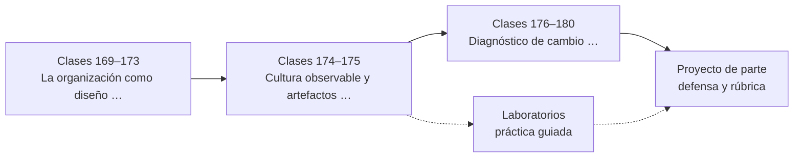

# Parte 14 — Diseño organizacional, cultura y cambio

<!-- parte:inicio -->

> ← [Parte 13 — Estrategia y competencia](../13-strategy-competition/README.md) · [Temario](../../SYLLABUS.md) · [Parte 15 — Riesgo, legal, compliance, ciberseguridad e IA](../15-risk-legal-compliance-cyber-ai-governance/README.md) →

*Una estructura, una cultura y un incentivo coherentes con la estrategia*

**Etapa:** 4 — Dirección, estrategia y organización  
**Duración:** 12 clases · 30 horas  
**Resultado de salida:** Diseñar estructuras, derechos de decisión, incentivos y cultura coherentes con la estrategia.

🟠 [Ver las 6 etapas](../../SYLLABUS.md) · 12 clases (169–180) · 4 laboratorios · [proyecto de parte](project.md)

## 🎯 De qué trata esta parte

Las organizaciones no fallan por falta de estrategia sino porque su diseño empuja en otra dirección. Esta parte enseña a ver estructura, derechos de decisión, incentivos y cultura como un sistema diseñable.

El eje es **derechos de decisión claros**: quién decide qué, con qué información y con qué incentivo. Cierra con cambio y transformación, y con los riesgos humanos de reorganizar.

## 🧱 Con qué hay que llegar

| Parte | Qué aporta |
|---|---|
| [13 — Estrategia y competencia](../13-strategy-competition/README.md) | Estrategia a la que el diseño debe servir. |
| [05 — Gestión de talento y personas](../05-talent-people-management/README.md) | Cargos, dotación y desempeño. |

Cada clase supone la anterior: el orden importa, y saltarse una deja sin base a las que vienen después.

## 📚 Resultados de la parte

Al terminar esta parte podrás:

1. **Evaluar** una estructura funcional, divisional o matricial.
2. **Dimensionar** spans, layers y carga gerencial.
3. **Asignar** derechos de decisión con RACI o RAPID.
4. **Leer** la cultura por artefactos e incentivos.
5. **Conducir** un cambio con diagnóstico, coalición y adopción.

## 🗺️ Mapa de la parte

## 🧭 Cómo se encadenan las 12 clases

Las clases **169 a 173** diseñan: organización, estructuras, spans, operating model y derechos de decisión.

Las clases **174 y 175** leen lo que no está en el organigrama: cultura e incentivos.

Las clases **176 a 180** conducen el cambio: diagnóstico, coalición, transformación, reorganización y el capstone de rediseño.

## 📘 Las 12 clases

| # | Clase | Qué se trabaja | Entregable | Min |
|---:|---|---|---|---:|
| 169 | [La organización como diseño](classes/169-la-organizacion-como-diseno/README.md) | Diseño organizacional, Modelo de la estrella, Diferenciación | [leadership-decision-brief](../../templates/leadership-decision-brief.md) | 150 |
| 170 | [Estructuras funcionales, divisionales y matriciales](classes/170-estructuras-funcionales-divisionales-y-matriciales/README.md) | Estructura funcional, Estructura divisional, Estructura matricial | [risk-governance-brief](../../templates/risk-governance-brief.md) | 150 |
| 171 | [Spans, layers y managerial load](classes/171-spans-layers-y-managerial-load/README.md) | Tramo de control (span), Capa (layer), Carga directiva | [risk-governance-brief](../../templates/risk-governance-brief.md) | 150 |
| 172 | [Operating model](classes/172-operating-model/README.md) | Modelo operativo, Capacidad crítica, Gobierno | [leadership-decision-brief](../../templates/leadership-decision-brief.md) | 150 |
| 173 | [RACI, RAPID y derechos de decisión](classes/173-raci-rapid-y-derechos-de-decision/README.md) | Derecho de decisión, RACI, RAPID | [leadership-decision-brief](../../templates/leadership-decision-brief.md) | 150 |
| 174 | [Cultura observable y artefactos](classes/174-cultura-observable-y-artefactos/README.md) | Cultura organizacional, Artefactos, Valores declarados | [leadership-decision-brief](../../templates/leadership-decision-brief.md) | 150 |
| 175 | [Incentivos y comportamientos](classes/175-incentivos-y-comportamientos/README.md) | Incentivo, Motivación intrínseca, Motivación extrínseca | [leadership-decision-brief](../../templates/leadership-decision-brief.md) | 150 |
| 176 | [Diagnóstico de cambio](classes/176-diagnostico-de-cambio/README.md) | Diagnóstico de cambio, Brecha de conducta, Grupo afectado | [risk-governance-brief](../../templates/risk-governance-brief.md) | 150 |
| 177 | [Coalición, narrativa y adopción](classes/177-coalicion-narrativa-y-adopcion/README.md) | Coalición guía, Narrativa del cambio, Adoptantes tempranos | [leadership-decision-brief](../../templates/leadership-decision-brief.md) | 150 |
| 178 | [Transformación empresarial](classes/178-transformacion-empresarial/README.md) | Transformación, Estructura dual, Estabilizar la base | [risk-governance-brief](../../templates/risk-governance-brief.md) | 150 |
| 179 | [Reorganizaciones y riesgos humanos](classes/179-reorganizaciones-y-riesgos-humanos/README.md) | Ambigüedad de rol, Conflicto de rol, Justicia procedimental | [risk-governance-brief](../../templates/risk-governance-brief.md) | 150 |
| 180 | [Capstone: rediseño organizacional](classes/180-capstone-rediseno-organizacional/README.md) | Rediseño organizacional, Hipótesis de diseño, Alternativa | [leadership-decision-brief](../../templates/leadership-decision-brief.md) | 150 |

## ⚠️ Riesgos característicos

- Reorganizar sin aclarar quién decide.
- Declarar valores que los incentivos contradicen.
- Lanzar un cambio sin diagnóstico ni coalición.
- Subestimar el costo humano de una reorganización.

## 🔤 Glosario de la parte

70 conceptos definidos en las clases, con la definición operacional que usa cada una.

| Concepto | Definición operacional |
|---|---|
| **Adoptantes tempranos** | Personas que prueban antes que la mayoría. |
| **Alternativa** | Opción de diseño comparable con otras. |
| **Ambigüedad de rol** | Falta de claridad sobre lo que se espera de una persona. |
| **Anclaje** | Integrar el cambio en la forma habitual de operar. |
| **Artefactos** | Elementos visibles: espacios, símbolos, lenguaje, ceremonias, historias, estructuras y procesos. |
| **Autonomía del equipo** | Capacidad de un equipo de decidir y actuar sin escalar. |
| **Brecha cultural** | Diferencia entre lo declarado y lo practicado. |
| **Brecha de conducta** | Diferencia entre cómo se trabaja hoy y cómo se trabajará. |
| **Capa (layer)** | Nivel jerárquico entre la cima y la base. |
| **Capacidad crítica** | Habilidad organizacional indispensable para ejecutar la estrategia. |
| **Carga directiva** | Tiempo y esfuerzo que un líder dedica a gestionar. |
| **Coalición guía** | Grupo con poder, credibilidad y compromiso que conduce el cambio. |
| **Coherencia** | Ajuste entre estructura, decisiones, incentivos, personas y cultura. |
| **Conciencia compartida** | Comprensión común de la situación entre equipos. |
| **Conflicto de rol** | Expectativas incompatibles sobre una misma persona. |
| **Costo de capa** | Costo directo de los líderes de ese nivel más la demora que agregan. |
| **Criterio de ajuste** | Umbral que obliga a revisar el diseño. |
| **Cultura organizacional** | Patrón de supuestos compartidos que un grupo aprendió al resolver problemas y que enseña a los nuevos. |
| **Decisión reversible** | Decisión cuyo error se corrige a bajo costo. |
| **Derecho de decisión** | Autoridad explícita para decidir un tipo de asunto. |
| **Diagnóstico de cambio** | Análisis previo de qué cambia, a quién afecta y con qué disposición. |
| **Diferenciación** | Grado en que las áreas se especializan y se distinguen en enfoque y lenguaje. |
| **Diseño organizacional** | Conjunto de decisiones sobre cómo se divide, coordina y orienta el trabajo. |
| **Disposición al cambio** | Grado en que las personas creen que el cambio es necesario, viable y bueno para ellas. |
| **Efecto de desplazamiento** | Una recompensa externa que reduce el interés intrínseco. |
| **Efecto lateral** | Conducta no buscada que provoca una métrica. |
| **Ejecución empoderada** | Autonomía de los equipos para actuar con información. |
| **Encaje (fit)** | Coherencia entre las decisiones de diseño y la estrategia. |
| **Equipo alineado al flujo** | Equipo responsable de un flujo de valor de punta a punta. |
| **Escalar** | Extender lo que funcionó a más áreas. |
| **Estabilizar la base** | Proteger y mejorar el negocio actual. |
| **Estructura divisional** | Agrupación por producto, mercado, cliente o región. |
| **Estructura dual** | Jerarquía para operar y red para impulsar el cambio. |
| **Estructura funcional** | Agrupación por especialidad o función. |
| **Estructura matricial** | Doble línea de autoridad: función y producto o proyecto. |
| **Expediente de rediseño** | Documento con diagnóstico, diseño, plan y métricas. |
| **Fatiga de cambio** | Cansancio por la acumulación de iniciativas simultáneas. |
| **Fuga de conocimiento** | Pérdida de saber tácito cuando se van las personas. |
| **Gestión sin valor** | Actividades de gestión que no mejoran el trabajo. |
| **Gobierno** | Estructuras y reglas de decisión, coordinación y control. |
| **Grupo afectado** | Conjunto de personas con el mismo tipo de impacto. |
| **Hipótesis de diseño** | Afirmación comprobable de cómo un cambio mejorará un resultado. |
| **Impacto** | Magnitud de lo que el cambio exige a un grupo: tareas, habilidades, poder, estatus. |
| **Incentivo** | Cualquier consecuencia anticipada que influye en la conducta: pago, reconocimiento, promoción, sanción. |
| **Integración** | Grado de colaboración entre áreas para lograr un resultado común. |
| **Interfaz** | Acuerdo sobre cómo interactúan dos unidades. |
| **Justicia procedimental** | Percepción de que el proceso para decidir es justo. |
| **Ley de Conway** | Observación de que los sistemas reflejan la estructura de comunicación de quien los construye. |
| **Mecanismo de integración** | Herramienta para coordinar: jerarquía, procesos, roles de enlace, equipos. |
| **Medida de equilibrio** | Indicador que vigila lo que la métrica principal podría dañar. |
| **Modelo de la estrella** | Marco con cinco decisiones: estrategia, estructura, procesos, recompensas y personas. |
| **Modelo operativo** | Forma concreta en que la organización crea y entrega valor. |
| **Modelo operativo objetivo** | Diseño deseado para ejecutar la estrategia. |
| **Motivación extrínseca** | Hacer algo por una consecuencia externa. |
| **Motivación intrínseca** | Hacer una actividad por interés o satisfacción propia. |
| **Narrativa del cambio** | Historia que explica por qué cambiar, adónde ir y cómo. |
| **Obstáculo** | Estructura, proceso o creencia que impide actuar. |
| **Persona crítica** | Quien concentra conocimiento o relaciones difíciles de reemplazar. |
| **Período de transición** | Lapso entre el anuncio y el nuevo funcionamiento estable. |
| **Piloto** | Prueba acotada para aprender antes de escalar. |
| **RACI** | Marco que asigna Responsable, Aprobador (Accountable), Consultado e Informado. |
| **RAPID** | Marco de decisiones con Recomienda, Acuerda, Aporta, Decide y Ejecuta. |
| **Rediseño organizacional** | Cambio deliberado de estructura, procesos, decisiones, incentivos y cultura para mejorar la coordinación. |
| **Seguridad psicológica** | Creencia compartida de que el equipo es seguro para asumir riesgos interpersonales. |
| **Sistema operativo organizacional** | Conjunto de prácticas con que una organización decide, coordina y aprende. |
| **Supuestos básicos** | Creencias tácitas sobre la realidad y cómo funcionan las cosas. |
| **Tramo de control (span)** | Número de personas que dependen directamente de un líder. |
| **Transformación** | Cambio profundo y simultáneo en modelo, organización y conducta. |
| **Valores declarados** | Principios que la organización dice sostener. |
| **Victoria temprana** | Resultado visible y atribuible logrado pronto. |

## 📦 Qué queda como evidencia

- Un diseño organizacional con spans y capas.
- Una matriz de derechos de decisión.
- Un diagnóstico y plan de cambio.
- El capstone: rediseño organizacional.

## 🔗 Cómo se conecta

Alimenta la parte 16 (equipo ejecutivo) y la 22 (empresa menos dependiente del fundador).

## 🧪 Cómo se trabaja

Son **12 clases de 150 minutos** —30 horas— con **4 laboratorios** y un proyecto integrador. Cada clase trae su propósito, sus conceptos, un caso, práctica, errores frecuentes, preguntas de comprobación, entregable y fuentes, y se evalúa con su `assessment.md`. Los laboratorios se resuelven con datos propios o sintéticos, nunca con datos reales de terceros, y la parte se cierra con el proyecto y su defensa. Las reglas de recorrido están en [la guía de navegación](../../docs/NAVIGATION.md).

<!-- parte:fin -->

## Laboratorios

- [Lab 01 — Org design canvas](labs/lab-01.md)
- [Lab 02 — Decision rights map](labs/lab-02.md)
- [Lab 03 — Culture diagnostic](labs/lab-03.md)
- [Lab 04 — Change plan](labs/lab-04.md)

## Proyecto de parte

Rediseñar una organización que duplicó su tamaño pero conserva procesos informales.

## Bibliografía rectora

- Edgar H. Schein & Peter A. Schein — *Organizational Culture and Leadership* (Cultura)
- Jay R. Galbraith — *Designing Organizations* (Diseño organizacional)
- John P. Kotter — *Leading Change* (Cambio)
- Chip Heath & Dan Heath — *Switch* (Cambio)
- Patrick Lencioni — *The Advantage* (Salud organizacional)

## Criterio de aprobación

80/100 y entrega del proyecto integrador.
