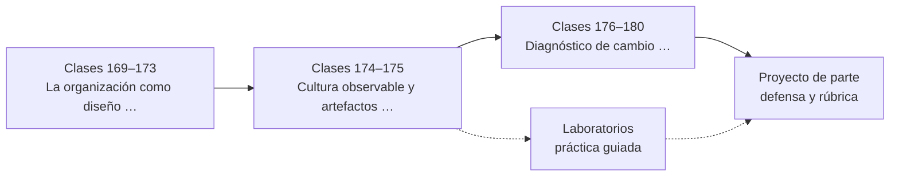

# Parte 14 — Diseño organizacional, cultura y cambio

<!-- parte:inicio -->

> ← [Parte 13 — Estrategia y competencia](../13-strategy-competition/README.md) · [Temario](../../SYLLABUS.md) · [Parte 15 — Riesgo, legal, compliance, ciberseguridad e IA](../15-risk-legal-compliance-cyber-ai-governance/README.md) →

*Una estructura, una cultura y un incentivo coherentes con la estrategia*

**Etapa:** 4 — Dirección, estrategia y organización  
**Duración:** 12 clases · 30 horas  
**Resultado de salida:** Diseñar estructuras, derechos de decisión, incentivos y cultura coherentes con la estrategia.

🟠 [Ver las 6 etapas](../../SYLLABUS.md) · 12 clases (169–180) · 4 laboratorios · [proyecto de parte](project.md)

## 🎯 De qué trata esta parte

Las organizaciones no fallan por falta de estrategia sino porque su diseño empuja en otra dirección. Esta parte enseña a ver estructura, derechos de decisión, incentivos y cultura como un sistema diseñable.

El eje es **derechos de decisión claros**: quién decide qué, con qué información y con qué incentivo. Cierra con cambio y transformación, y con los riesgos humanos de reorganizar.

## 🧱 Con qué hay que llegar

| Parte | Qué aporta |
|---|---|
| [13 — Estrategia y competencia](../13-strategy-competition/README.md) | Estrategia a la que el diseño debe servir. |
| [05 — Gestión de talento y personas](../05-talent-people-management/README.md) | Cargos, dotación y desempeño. |

Cada clase supone la anterior: el orden importa, y saltarse una deja sin base a las que vienen después.

## 📚 Resultados de la parte

Al terminar esta parte podrás:

1. **Evaluar** una estructura funcional, divisional o matricial.
2. **Dimensionar** spans, layers y carga gerencial.
3. **Asignar** derechos de decisión con RACI o RAPID.
4. **Leer** la cultura por artefactos e incentivos.
5. **Conducir** un cambio con diagnóstico, coalición y adopción.

## 🗺️ Mapa de la parte

## 🧭 Cómo se encadenan las 12 clases

Las clases **169 a 173** diseñan: organización, estructuras, spans, operating model y derechos de decisión.

Las clases **174 y 175** leen lo que no está en el organigrama: cultura e incentivos.

Las clases **176 a 180** conducen el cambio: diagnóstico, coalición, transformación, reorganización y el capstone de rediseño.

## 📘 Las 12 clases

| # | Clase | Qué se trabaja | Entregable | Min |
|---:|---|---|---|---:|
| 169 | [La organización como diseño](classes/169-la-organizacion-como-diseno/README.md) | organization design, structure, process | [leadership-decision-brief](../../templates/leadership-decision-brief.md) | 150 |
| 170 | [Estructuras funcionales, divisionales y matriciales](classes/170-estructuras-funcionales-divisionales-y-matriciales/README.md) | functional structure, divisional structure, matrix | [risk-governance-brief](../../templates/risk-governance-brief.md) | 150 |
| 171 | [Spans, layers y managerial load](classes/171-spans-layers-y-managerial-load/README.md) | span of control, layer, managerial load | [risk-governance-brief](../../templates/risk-governance-brief.md) | 150 |
| 172 | [Operating model](classes/172-operating-model/README.md) | operating model, business unit, shared capability | [leadership-decision-brief](../../templates/leadership-decision-brief.md) | 150 |
| 173 | [RACI, RAPID y derechos de decisión](classes/173-raci-rapid-y-derechos-de-decision/README.md) | RACI, RAPID, decision right | [leadership-decision-brief](../../templates/leadership-decision-brief.md) | 150 |
| 174 | [Cultura observable y artefactos](classes/174-cultura-observable-y-artefactos/README.md) | artifact, espoused value, basic assumption | [leadership-decision-brief](../../templates/leadership-decision-brief.md) | 150 |
| 175 | [Incentivos y comportamientos](classes/175-incentivos-y-comportamientos/README.md) | incentive, principal-agent problem, Goodhart law | [leadership-decision-brief](../../templates/leadership-decision-brief.md) | 150 |
| 176 | [Diagnóstico de cambio](classes/176-diagnostico-de-cambio/README.md) | change diagnosis, stakeholder, readiness | [risk-governance-brief](../../templates/risk-governance-brief.md) | 150 |
| 177 | [Coalición, narrativa y adopción](classes/177-coalicion-narrativa-y-adopcion/README.md) | guiding coalition, narrative, change agent | [leadership-decision-brief](../../templates/leadership-decision-brief.md) | 150 |
| 178 | [Transformación empresarial](classes/178-transformacion-empresarial/README.md) | transformation, transformation thesis, workstream | [risk-governance-brief](../../templates/risk-governance-brief.md) | 150 |
| 179 | [Reorganizaciones y riesgos humanos](classes/179-reorganizaciones-y-riesgos-humanos/README.md) | reorganization, role mapping, transition risk | [risk-governance-brief](../../templates/risk-governance-brief.md) | 150 |
| 180 | [Capstone: rediseño organizacional](classes/180-capstone-rediseno-organizacional/README.md) | target operating model, design principle, transition architecture | [leadership-decision-brief](../../templates/leadership-decision-brief.md) | 150 |

## ⚠️ Riesgos característicos

- Reorganizar sin aclarar quién decide.
- Declarar valores que los incentivos contradicen.
- Lanzar un cambio sin diagnóstico ni coalición.
- Subestimar el costo humano de una reorganización.

## 🔤 Glosario de la parte

60 conceptos definidos en las clases, con la definición operacional que usa cada una.

| Concepto | Definición operacional |
|---|---|
| **adoption** | uso sostenido de nueva conducta o sistema. |
| **artifact** | manifestación visible de cultura como ritual lenguaje o diseño. |
| **balanced incentive** | conjunto de señales que evita optimización local extrema. |
| **basic assumption** | creencia profundamente asumida que guía interpretación. |
| **benefit realization** | medición de resultados económicos u operativos obtenidos. |
| **business continuity** | capacidad de mantener operaciones críticas durante el cambio. |
| **business unit** | unidad con propósito clientes y accountability definidos. |
| **change agent** | persona que facilita adopción dentro de una comunidad. |
| **change diagnosis** | análisis de fuerzas que sostienen estado actual y obstaculizan estado deseado. |
| **consultation** | aporte previo que no equivale a veto. |
| **culture signal** | decisión o reacción que enseña qué se premia realmente. |
| **decision right** | autoridad explícita para tomar una decisión. |
| **delayering** | reducción deliberada de niveles. |
| **design principle** | regla que guía elecciones organizacionales. |
| **design test** | escenario real usado para comprobar si el diseño permite decidir y ejecutar. |
| **divisional structure** | agrupación por producto cliente o geografía con mayor autonomía. |
| **espoused value** | principio declarado por la organización. |
| **functional structure** | agrupación por disciplina o función. |
| **gaming** | optimización de la métrica sin lograr el propósito. |
| **Goodhart law** | cuando una medida se convierte en target puede degradarse como medida. |
| **governance forum** | foro con derechos de decisión explícitos. |
| **guiding coalition** | grupo con poder credibilidad y diversidad para conducir cambio. |
| **incentive** | consecuencia que aumenta o reduce atractivo de una conducta. |
| **layer** | nivel jerárquico entre frontline y cima. |
| **management cadence** | ritmo de planificación revisión y escalamiento. |
| **manager ratio** | proporción de managers respecto a contribuyentes individuales. |
| **managerial load** | demanda de coordinación coaching y decisión que soporta un rol. |
| **matrix** | doble o múltiple dimensión de responsabilidad. |
| **narrative** | explicación causal que conecta problema futuro y camino. |
| **norm** | expectativa informal sobre conducta aceptada. |
| **operating model** | conjunto de mecanismos que permiten ejecutar la estrategia de forma repetible. |
| **organization design** | elección deliberada de estructuras y mecanismos para ejecutar estrategia. |
| **organizational debt** | fricción acumulada por roles procesos o sistemas obsoletos. |
| **organizational justice** | percepción de equidad en proceso trato y resultados. |
| **P&L ownership** | accountability por ingresos y costos de una unidad. |
| **people practices** | sistemas de talento que soportan capacidades requeridas. |
| **principal-agent problem** | divergencia entre objetivos de quien delega y quien ejecuta. |
| **process** | flujo transversal de trabajo e información. |
| **RACI** | matriz de Responsible Accountable Consulted e Informed. |
| **RAPID** | marco Recommend Agree Perform Input Decide. |
| **readiness** | capacidad y disposición para adoptar. |
| **reinforcement** | mecanismo que estabiliza nuevas conductas. |
| **reorganization** | cambio deliberado en estructura y distribución de responsabilidades. |
| **resistance** | señal de costo pérdida riesgo o desacuerdo frente al cambio. |
| **reward** | señal formal o informal que orienta conducta. |
| **role mapping** | asignación de personas y posiciones al diseño futuro. |
| **shared capability** | capacidad reutilizada por múltiples unidades. |
| **shared service** | capacidad centralizada que sirve a varias unidades. |
| **single accountable** | principio de un owner final claramente identificable. |
| **social proof** | evidencia de pares que reduce incertidumbre. |
| **span of control** | número de reportes directos de un manager. |
| **stakeholder** | actor afectado o capaz de afectar el cambio. |
| **structure** | agrupación formal de responsabilidades y líneas de autoridad. |
| **target operating model** | diseño futuro integrado de unidades procesos decisiones y capabilities. |
| **transformation** | programa de cambio sistémico que modifica capacidades y resultados materiales. |
| **transformation office** | mecanismo temporal de coordinación escalamiento y evidencia. |
| **transformation thesis** | argumento de por qué un conjunto de cambios producirá valor. |
| **transition architecture** | secuencia de pasos para pasar al diseño futuro. |
| **transition risk** | riesgo durante el paso entre estructuras. |
| **workstream** | flujo coordinado de iniciativas dentro de la transformación. |

## 📦 Qué queda como evidencia

- Un diseño organizacional con spans y capas.
- Una matriz de derechos de decisión.
- Un diagnóstico y plan de cambio.
- El capstone: rediseño organizacional.

## 🔗 Cómo se conecta

Alimenta la parte 16 (equipo ejecutivo) y la 22 (empresa menos dependiente del fundador).

## 🧪 Cómo se trabaja

Son **12 clases de 150 minutos** —30 horas— con **4 laboratorios** y un proyecto integrador. Cada clase trae su propósito, sus conceptos, un caso, práctica, errores frecuentes, preguntas de comprobación, entregable y fuentes, y se evalúa con su `assessment.md`. Los laboratorios se resuelven con datos propios o sintéticos, nunca con datos reales de terceros, y la parte se cierra con el proyecto y su defensa. Las reglas de recorrido están en [la guía de navegación](../../docs/NAVIGATION.md).

<!-- parte:fin -->

## Laboratorios

- [Lab 01 — Org design canvas](labs/lab-01.md)
- [Lab 02 — Decision rights map](labs/lab-02.md)
- [Lab 03 — Culture diagnostic](labs/lab-03.md)
- [Lab 04 — Change plan](labs/lab-04.md)

## Proyecto de parte

Rediseñar una organización que duplicó su tamaño pero conserva procesos informales.

## Bibliografía rectora

- Edgar H. Schein & Peter A. Schein — *Organizational Culture and Leadership* (Cultura)
- Jay R. Galbraith — *Designing Organizations* (Diseño organizacional)
- John P. Kotter — *Leading Change* (Cambio)
- Chip Heath & Dan Heath — *Switch* (Cambio)
- Patrick Lencioni — *The Advantage* (Salud organizacional)

## Criterio de aprobación

80/100 y entrega del proyecto integrador.
