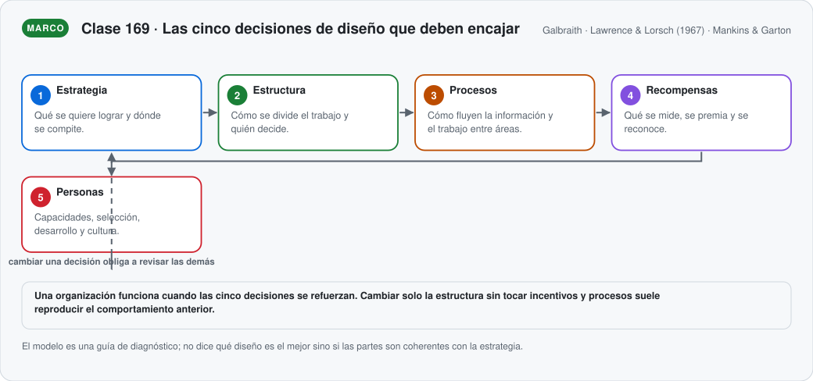

# Clase 169 — La organización como diseño

<!-- nav:inicio -->
> **Parte 14 · Diseño organizacional, cultura y cambio** — clase 1 de 12 · [índice de la parte](../../README.md) · [temario](../../../../SYLLABUS.md)
<!-- nav:fin -->

**Parte:** 14 — Diseño organizacional, cultura y cambio  
**Nivel:** Etapa 4 — Gerente → Director  
**Duración sugerida:** 150–180 minutos · **Estándar:** deep-class-v2

## 🎯 Propósito

Las organizaciones se heredan más de lo que se diseñan. Un área se crea porque apareció un problema, una jefatura porque hubo una persona valiosa que retener, un comité porque algo salió mal. Años después, el resultado es una estructura que nadie eligió en conjunto y que produce comportamientos que nadie quiere: decisiones lentas, áreas que compiten, información que no llega, personas con responsabilidades confusas. Pensar la organización **como un diseño** significa tratarla como un sistema de decisiones interdependientes —estructura, procesos, recompensas y personas— que se pueden examinar, ajustar y alinear con la estrategia.

La clase se apoya en el modelo de la estrella de Galbraith para el diseño organizacional, en el estudio clásico de Lawrence y Lorsch sobre diferenciación e integración, en el análisis de Mankins y Garton sobre el uso del tiempo y la energía de las organizaciones y en los aportes de McChrystal y otros sobre cómo coordinar equipos en entornos complejos. Al terminar sabrás describir una organización con cinco decisiones de diseño, evaluar su encaje con la estrategia, diagnosticar problemas de coordinación y plantear un rediseño por etapas.

## 📚 Resultados de aprendizaje

Al finalizar podrás:

1. **Describir** una organización con las cinco decisiones de diseño y sus relaciones.
2. **Evaluar** el encaje entre estrategia, estructura, procesos, recompensas y personas.
3. **Aplicar** la idea de diferenciación e integración para analizar la coordinación.
4. **Diagnosticar** síntomas de mal diseño y sus causas.
5. **Formular** un rediseño con hipótesis y pruebas.

## 🧭 Agenda

| Tramo | Qué se hace |
|---|---|
| 0–20 min | Recuperación: ¿qué decisión importante de tu empresa tarda más de lo razonable y por qué? |
| 20–60 min | Modelo de la estrella, diferenciación e integración, síntomas y diagnóstico. |
| 60–105 min | Ejemplo trabajado: diagnóstico del diseño de una red de clínicas. |
| 105–150 min | Caso ejecutivo y práctica. |
| 150–175 min | Límites y entregable. |

## 🧩 Conceptos centrales

| Concepto | Definición | Cómo se reconoce |
|---|---|---|
| **Diseño organizacional** | Conjunto de decisiones sobre cómo se divide, coordina y orienta el trabajo. | Estructura, procesos, recompensas y personas. |
| **Modelo de la estrella** | Marco con cinco decisiones: estrategia, estructura, procesos, recompensas y personas. | Se evalúa su encaje. |
| **Diferenciación** | Grado en que las áreas se especializan y se distinguen en enfoque y lenguaje. | Cada área ve el mundo distinto. |
| **Integración** | Grado de colaboración entre áreas para lograr un resultado común. | Mecanismos de coordinación. |
| **Encaje (fit)** | Coherencia entre las decisiones de diseño y la estrategia. | Las partes se refuerzan. |
| **Mecanismo de integración** | Herramienta para coordinar: jerarquía, procesos, roles de enlace, equipos. | Reduce la distancia entre áreas. |

## 🧠 Modelo mental

**Cómo leer el diagrama.** Cinco decisiones encadenadas. La **estrategia** dice qué se quiere lograr; la **estructura** cómo se divide el trabajo y quién decide; los **procesos** cómo fluyen la información y el trabajo; las **recompensas** qué se mide y se premia; las **personas** qué capacidades hay y cómo se seleccionan y desarrollan. La flecha de retorno indica que cambiar una decisión obliga a revisar las demás. La nota advierte que cambiar solo la estructura sin tocar incentivos y procesos suele reproducir el comportamiento anterior.

## 📖 Desarrollo

### 1. El diseño como sistema

Galbraith describe el diseño organizacional como un conjunto de **decisiones interdependientes** que deben ser coherentes entre sí y con la estrategia. Las cinco áreas del modelo de la estrella son: **estrategia** (dirección, objetivos, valores), **estructura** (poder y autoridad: dónde se agrupan las actividades, cómo se reparten las decisiones), **procesos** (flujos de información y de decisión, verticales y laterales), **recompensas** (indicadores, incentivos, reconocimiento) y **personas** (políticas de selección, movilidad, formación y desarrollo). Una organización con una estrategia de colaboración y recompensas por desempeño individual está incoherente: las personas seguirán lo que se premia.

### 2. Diferenciación e integración

Lawrence y Lorsch estudiaron empresas de distintas industrias y encontraron que las áreas se **diferencian** (en orientación al tiempo, a objetivos, en estructura formal y en estilo interpersonal) según las demandas de su entorno específico: ventas, producción e investigación enfrentan incertidumbres distintas. Pero cuanto más diferenciadas, más necesitan **integrarse** para producir un resultado común. Los hallazgos principales: las empresas de mejor desempeño en entornos más inciertos lograban **más diferenciación y más integración** a la vez, con mecanismos adecuados (equipos, roles de enlace, mecanismos de resolución de conflictos). La pregunta de diseño: ¿cuánta diferenciación necesita cada área y con qué mecanismos se integra?

### 3. Mecanismos de coordinación

Galbraith ordena los mecanismos de coordinación por su capacidad de procesar información: **reglas y procedimientos** (rutinas estables), **jerarquía** (derivar a un nivel superior), **planificación** y metas, **roles de enlace** y **equipos** (coordinación lateral), **fuerzas de tarea** y **estructuras matriciales** (coordinación intensa), y **sistemas de información** que amplían la capacidad de coordinar. A medida que aumenta la incertidumbre y la interdependencia, se necesitan mecanismos más ricos y más costosos. El error común es **sobrecargar la jerarquía**: las decisiones suben, se acumulan y se demoran; una buena coordinación lateral reduce la carga del nivel superior.

### 4. Síntomas de mal diseño

Algunos síntomas: **decisiones lentas** o que suben siempre; **duplicación** de esfuerzos; **áreas que compiten** por recursos o clientes; **información que no llega** o llega tarde; **responsabilidades ambiguas** (no se sabe quién decide); **reuniones sin fin**; **cuellos de botella** en pocas personas; **iniciativas que mueren** en traspasos; **rotación de personas clave**; **resultados distintos** entre áreas con las mismas reglas. Estos síntomas suelen atribuirse a personas; en muchos casos son consecuencias de un diseño que exige coordinar lo que no se puede coordinar con los mecanismos disponibles. Rizzo, House y Lirtzman mostraron que la ambigüedad y el conflicto de rol deterioran la satisfacción y el desempeño.

### 5. Energía, tiempo y atención

Mankins y Garton argumentan que el recurso más escaso de una organización es la **energía organizacional** y que muchas empresas la desperdician en **reuniones, procesos de coordinación y comités** que no agregan valor. Proponen medir el **uso del tiempo** de personas y equipos: cuánto se dedica a reuniones, a correos, a trabajo individual, a clientes. Un diseño que obliga a que cada decisión pase por seis personas consume horas y energía que no se ven en el presupuesto. Una buena pregunta de diseño es cuánto tiempo de la organización se dedica a **coordinarse** versus a **crear valor** y cómo reducir lo primero sin perder control.

### 6. Diseñar desde la estrategia

El diseño se deriva de la estrategia (parte 13): ¿qué capacidades críticas necesita? ¿qué debe hacerse excepcionalmente bien y dónde reside? ¿qué decisiones deben ser rápidas y cuáles deben tener control? ¿qué interdependencias son más importantes? A partir de ello se definen **criterios de diseño** (por ejemplo, «velocidad de decisión en el cliente», «escala en operaciones», «aprendizaje compartido entre sedes») y se evalúan **alternativas** de estructura y de coordinación contra esos criterios (clase 170). McChrystal y sus coautores muestran, desde un entorno militar, cómo la **conciencia compartida** y la **ejecución empoderada** permiten coordinar equipos en entornos que cambian demasiado rápido para una jerarquía clásica.

### 7. Cambiar el diseño con cuidado

Un rediseño es una **intervención sobre personas y relaciones**, con costos elevados y efectos difíciles de revertir. Se **diagnostica** antes (síntomas, causas, datos de uso del tiempo y de decisiones), se **formula** una hipótesis de diseño («si agrupamos por cliente y no por función, bajaremos el tiempo de respuesta de 12 a 5 días»), se **prueba** en una parte de la organización cuando es posible, se **mide** y se **ajusta**. Se alinean los cinco elementos y se gestiona el cambio con atención a las personas (clases 176 a 179). Los cambios de estructura que afectan a cargos o funciones tienen condiciones laborales que se verifican con asesoría y normas vigentes.

## 📚 Lectura comparada

| Obra | Qué aporta | Qué no resuelve | Pregunta para contrastar |
|---|---|---|---|
| Galbraith | Modelo de la estrella y mecanismos de coordinación. | Marco general; no dice qué diseño elegir. | ¿Las cinco decisiones encajan? |
| Lawrence y Lorsch (1967) | Diferenciación e integración según el entorno. | Estudio de pocas industrias, de otra época. | ¿Cuánta diferenciación e integración necesita tu entorno? |
| Mankins y Garton | Energía y tiempo como recursos del diseño. | Datos de grandes empresas. | ¿En qué se va el tiempo de la organización? |
| McChrystal et al. | Coordinación en entornos complejos con equipos de equipos. | Contexto militar. | ¿Cómo se comparte la información entre equipos? |
| Rizzo, House y Lirtzman | Efectos de la ambigüedad y el conflicto de rol. | Estudio de los años 70. | ¿Cada persona sabe qué se espera de ella? |

## 🧮 Ejemplo trabajado

**Situación (hipotética).** Una red de 9 clínicas privadas (2.200 empleados) quiere acortar el tiempo desde que un paciente pide un examen hasta que recibe resultados (promedio 6,5 días; meta: 3). Cada clínica tiene su laboratorio; hay una gerencia central de «procesos» y una de «calidad»; los médicos son evaluados por productividad individual; los técnicos, por exámenes procesados por turno.

**Diagnóstico con la estrella.**

| Elemento | Estado | Encaje con la meta |
|---|---|---|
| Estrategia | «Diagnóstico rápido y de calidad» | Declarada |
| Estructura | 9 laboratorios independientes; derivación entre clínicas pasa por gerencia central | Bajo: no hay quien responda por el flujo completo |
| Procesos | Pedidos en papel en 3 clínicas; resultados sin alerta al médico | Bajo |
| Recompensas | Técnicos por volumen; médicos por consultas; nadie por tiempo total | Contradictorio |
| Personas | Rotación de técnicos de 28 %; poca capacitación cruzada | Bajo |

**Datos de tiempos.** Del total de 6,5 días: 1,4 en espera de agenda del examen, 2,2 en procesamiento (de las cuales 1,3 son colas entre turnos), 1,6 en validación del resultado (un solo especialista por turno) y 1,3 en entrega al médico y al paciente. Las derivaciones entre clínicas tardan 2 días adicionales por la gerencia central. El 38 % del tiempo del jefe de laboratorio se va en reuniones de coordinación.

**Diferenciación e integración.** Los laboratorios y las clínicas están muy diferenciados (objetivos, lenguaje, tiempos), pero hay una integración débil: sin roles de enlace ni equipos de proceso.

**Hipótesis de diseño.** (1) Un **dueño del proceso** de punta a punta con indicadores compartidos (tiempo total); (2) laboratorio central de alto volumen para pruebas complejas y laboratorios locales para urgencias; (3) historia clínica digital con alertas; (4) recompensas por tiempo total y calidad; (5) capacitación cruzada y carrera técnica; (6) equipo de coordinación diaria de 20 minutos reemplaza reuniones largas.

**Piloto.** En 3 clínicas durante 6 meses. Resultado: tiempo total de 6,5 a 3,9 días; colas entre turnos bajan 55 %; reuniones del jefe de laboratorio bajan de 38 % a 20 % del tiempo; rotación de técnicos baja a 19 %. Se decide ampliar por etapas, ajustando los incentivos de los médicos y vigilando la calidad (retrabajos y errores).

**Aspectos legales.** Los cambios de funciones y turnos del personal se revisan con las normas laborales vigentes y con asesoría; los datos de salud y su circulación entre centros con la normativa de protección de datos.

**Qué muestra.** (1) El mal desempeño venía del diseño, no de las personas. (2) Las cinco decisiones debían moverse juntas. (3) El piloto probó la hipótesis antes de generalizar.

## 🔀 Comparación y límites

**Diseño formal frente a organización informal.** El diseño formal define estructuras y roles; la organización informal (redes, confianza, hábitos) determina en gran parte cómo se trabaja. Un buen diseño aprovecha lo informal y lo acompaña.

**Límites.** El modelo de la estrella es una guía de diagnóstico, no una fórmula. Los estudios de diferenciación e integración se hicieron en contextos y épocas específicas. Los datos de uso del tiempo y de decisiones son difíciles de reunir y pueden sentirse como vigilancia si no se explica su propósito. Los rediseños tienen efectos humanos y legales; deben respetar la normativa laboral y de protección de datos. Los números del ejemplo son ilustrativos.

## 🪜 De profesional a owner

| Nivel | Cómo participa en el diseño organizacional |
|---|---|
| **Profesional** | Señala cuellos de botella y traspasos que no funcionan. |
| **Jefe / Team Lead** | Ajusta procesos y roles de su equipo para coordinar mejor. |
| **Gerente** | Diagnostica el diseño de su área y propone cambios coherentes. |
| **CEO / Director** | Alinea estrategia, estructura, recompensas y personas. |
| **Founder / Owner** | Diseña desde temprano cómo se decidirá cuando la empresa crezca. |

## 🏢 Caso ejecutivo

Una empresa de software con 650 personas pasó de 80 a 650 empleados en cuatro años. Tiene cinco divisiones por producto, un área central de tecnología, una de ventas, una de «éxito del cliente» y un área de «transformación» con 30 personas. Las decisiones sobre precios se toman en tres comités; el lanzamiento de una función requiere aprobaciones de 7 áreas; los clientes grandes reciben ofertas contradictorias de distintas divisiones; los incentivos de ventas premian el cierre de contratos por producto; los ingenieros son evaluados por entregas, no por adopción; la rotación de gerentes medios es de 24 %. El CEO dice que «la cultura se diluyó»; el director de personas, que «falta estructura»; el de producto, que «hay demasiada estructura».

Entrega un **diagnóstico de diseño organizacional** que contenga: (a) la evaluación de las cinco decisiones de diseño y su encaje con la estrategia; (b) el análisis de diferenciación, integración y mecanismos de coordinación con los datos que pedirías; (c) los síntomas observados y sus causas probables; (d) tres hipótesis de rediseño con criterios de elección y un plan de prueba; (e) el uso del tiempo de la organización y cómo lo medirás sin vigilancia indebida; (f) las verificaciones laborales y de datos que se harán con las normas vigentes y asesoría.

## 🧪 Práctica

1. Evalúa las cinco decisiones de diseño de tu área con una nota de encaje del 1 al 5 y un dato por cada una.
2. Dibuja una decisión importante recientemente tomada y cuenta cuántas personas intervinieron y cuánto tardó.
3. Identifica un síntoma de mal diseño y tres causas posibles.
4. Formula una hipótesis de rediseño con su prueba y su medida.
5. Estima el porcentaje de tu tiempo dedicado a coordinación frente a trabajo de valor.

## ⚠️ Errores frecuentes

| Error | Por qué ocurre | Cómo corregirlo |
|---|---|---|
| Cambiar solo la estructura | Es lo más visible | Alinear procesos, recompensas y personas. |
| Atribuir problemas a las personas | Se ve la conducta, no el sistema | Buscar causas de diseño. |
| Sobrecargar la jerarquía | Es el mecanismo conocido | Coordinación lateral y reglas claras. |
| Diseñar sin datos | Se confía en la intuición | Medir uso del tiempo y de decisiones. |
| Rediseñar de golpe | Se busca rapidez | Pilotos y ajustes. |
| Ignorar lo informal | Se piensa en el organigrama | Considerar redes y hábitos. |

## ❓ Preguntas de comprobación

1. ¿Cuáles son las cinco decisiones del modelo de la estrella?
2. ¿Qué diferencia hay entre diferenciación e integración?
3. ¿Qué mecanismos de coordinación existen y cuándo se necesitan los más ricos?
4. ¿Qué síntomas muestran un mal diseño?
5. ¿Por qué Mankins y Garton hablan de energía organizacional?
6. ¿Cómo se deriva el diseño de la estrategia?
7. ¿Qué límites tiene el modelo?

Claves de respuesta

1. Estrategia, estructura, procesos, recompensas y personas.
2. La diferenciación es la especialización de las áreas en enfoque y estilo; la integración es la colaboración entre ellas para un resultado común; a más diferenciación, más integración.
3. Reglas, jerarquía, planificación, roles de enlace, equipos, fuerzas de tarea, matrices y sistemas de información; los más ricos se necesitan cuando hay más incertidumbre e interdependencia.
4. Decisiones lentas, duplicación, áreas que compiten, información que no llega, responsabilidades ambiguas, reuniones interminables y rotación de personas clave.
5. Porque el tiempo y la atención son el recurso más escaso y se desperdician en coordinación que no agrega valor.
6. A partir de las capacidades críticas, las decisiones que deben ser rápidas o controladas y las interdependencias, definiendo criterios de diseño y evaluando alternativas.
7. Es una guía de diagnóstico, los estudios son de contextos específicos y los datos de tiempo pueden percibirse como vigilancia.

## 📥 Entregable

Guarda en `portfolio/169-la-organizacion-como-diseno/`:

- `leadership-decision-brief.md` (plantilla [Leadership Decision Brief](../../../../templates/leadership-decision-brief.md)) con el diagnóstico del caso ejecutivo;
- `org-design.md` (plantilla [Org design](../../../../templates/org-design.md)) con las cinco decisiones, el encaje y las hipótesis de rediseño;
- `decision-journal.md` con los síntomas, los datos usados y el plan de prueba.

## 📗 Fuentes y verificación

- Jay R. Galbraith — *Designing Organizations* (Jossey-Bass Publishers, 1995). **Uso en esta clase:** modelo de la estrella y mecanismos de coordinación. Lectura selectiva sobre **la organización como diseño**. **Localizador:** [ISBN-13 9780787900915](https://openlibrary.org/isbn/9780787900915).
- Paul R. Lawrence & Jay W. Lorsch — *Differentiation and Integration in Complex Organizations* (Administrative Science Quarterly, 1967). **Uso en esta clase:** diferenciación e integración según el entorno. Lectura selectiva sobre **la organización como diseño**. **Localizador:** [DOI 10.2307/2391211](https://doi.org/10.2307/2391211).
- Michael C. Mankins & Eric Garton — *Time, Talent, Energy* (Harvard Business Review Press, 2017). **Uso en esta clase:** energía y tiempo como recursos del diseño. Lectura selectiva sobre **la organización como diseño**. **Localizador:** [ISBN-13 9781633691766](https://openlibrary.org/isbn/9781633691766).
- Stanley McChrystal et al. — *Team of Teams* (Penguin Books, Limited, 2015). **Uso en esta clase:** coordinación en entornos complejos con equipos de equipos. Lectura selectiva sobre **la organización como diseño**. **Localizador:** [ISBN-13 9780241250846](https://openlibrary.org/isbn/9780241250846).
- John R. Rizzo, Robert J. House & Sidney I. Lirtzman — *Role Conflict and Ambiguity in Complex Organizations* (Administrative Science Quarterly, 1970). **Uso en esta clase:** efectos de la ambigüedad y el conflicto de rol. Lectura selectiva sobre **la organización como diseño**. **Localizador:** [DOI 10.2307/2391486](https://doi.org/10.2307/2391486).

> **Regla de fuentes para La organización como diseño:** las obras anteriores estructuran las perspectivas de esta materia; cualquier norma, ley o estándar vivo mencionado debe comprobarse nuevamente en su fuente primaria vigente, incluidas las normas laborales y de protección de datos. Los ejemplos y casos son hipotéticos, con cifras ilustrativas. El desarrollo es original y no reproduce capítulos protegidos.

<!-- pie:inicio -->
---

| Anterior | Índice | Siguiente |
|---|---|---|
| [← 168 · Capstone: strategy memo](../../../13-strategy-competition/classes/168-capstone-strategy-memo/README.md) | [Parte 14](../../README.md) · [Programa](../../../../SYLLABUS.md) | [170 · Estructuras funcionales, divisionales y matriciales →](../170-estructuras-funcionales-divisionales-y-matriciales/README.md) |
<!-- pie:fin -->
