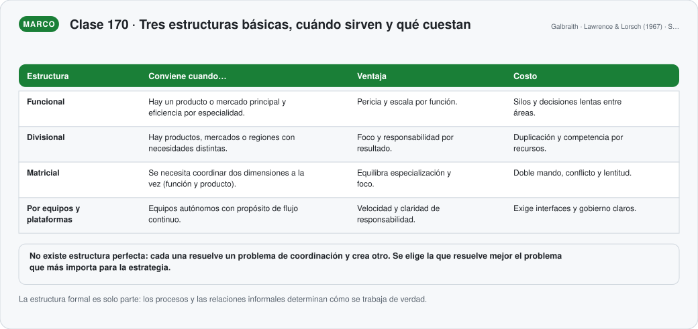

# Clase 170 — Estructuras funcionales, divisionales y matriciales

<!-- nav:inicio -->
> **Parte 14 · Diseño organizacional, cultura y cambio** — clase 2 de 12 · [índice de la parte](../../README.md) · [temario](../../../../SYLLABUS.md)
<!-- nav:fin -->

**Parte:** 14 — Diseño organizacional, cultura y cambio  
**Nivel:** Etapa 4 — Gerente → Director  
**Duración sugerida:** 150–180 minutos · **Estándar:** deep-class-v2

## 🎯 Propósito

Cada estructura organizacional es una **apuesta** sobre qué es más importante coordinar. Agrupar por función (ventas, producción, finanzas) favorece la especialización y la eficiencia; agrupar por producto, cliente o región favorece el foco y la responsabilidad por resultados; una matriz intenta tener ambas cosas a costa de doble mando. Ninguna es mejor en abstracto: resuelve un problema de coordinación y crea otro. Los reordenamientos recurrentes —centralizar, descentralizar, volver a centralizar— suelen ser oscilaciones entre dos soluciones imperfectas, cuando lo que se necesita es **decidir qué dimensión se prioriza** y **cómo se compensa la que se sacrifica**.

La clase se apoya en el análisis de estructuras de Galbraith, en la teoría de diferenciación e integración de Lawrence y Lorsch, en el trabajo de Skelton y Pais sobre topologías de equipos (que aplica la idea de que la estructura de la organización condiciona la arquitectura de los sistemas) y en la visión de McChrystal sobre equipos de equipos. Al terminar sabrás comparar las estructuras básicas, evaluar qué problema de coordinación resuelve cada una, diseñar interfaces entre unidades, decidir cuándo conviene una matriz y planificar una transición con los riesgos que implica.

## 📚 Resultados de aprendizaje

Al finalizar podrás:

1. **Describir** las estructuras funcional, divisional, matricial y por equipos.
2. **Evaluar** qué problema de coordinación resuelve cada una y qué costo genera.
3. **Diseñar** interfaces y reglas entre unidades para reducir el costo de la estructura elegida.
4. **Decidir** cuándo una matriz es justificable y cómo gestionarla.
5. **Planificar** una transición estructural con riesgos y medidas.

## 🧭 Agenda

| Tramo | Qué se hace |
|---|---|
| 0–20 min | Recuperación: dibuja tu organigrama y marca dónde ocurre la coordinación más difícil. |
| 20–60 min | Estructuras, criterios, interfaces y matriz. |
| 60–105 min | Ejemplo trabajado: de estructura funcional a divisional en una empresa de alimentos. |
| 105–150 min | Caso ejecutivo y práctica. |
| 150–175 min | Límites y entregable. |

## 🧩 Conceptos centrales

| Concepto | Definición | Cómo se reconoce |
|---|---|---|
| **Estructura funcional** | Agrupación por especialidad o función. | Ventas, producción, finanzas, tecnología. |
| **Estructura divisional** | Agrupación por producto, mercado, cliente o región. | Cada división tiene sus funciones. |
| **Estructura matricial** | Doble línea de autoridad: función y producto o proyecto. | Personas con dos jefaturas. |
| **Equipo alineado al flujo** | Equipo responsable de un flujo de valor de punta a punta. | Entrega con poca dependencia de otros. |
| **Interfaz** | Acuerdo sobre cómo interactúan dos unidades. | Servicios, plazos, información. |
| **Ley de Conway** | Observación de que los sistemas reflejan la estructura de comunicación de quien los construye. | La arquitectura copia el organigrama. |

## 🧠 Modelo mental

**Cómo leer el diagrama.** Una tabla con cuatro estructuras. La **funcional** conviene con un producto principal y eficiencia por especialidad; su costo son los silos. La **divisional** conviene cuando hay productos, mercados o regiones distintos; su costo es la duplicación y la competencia por recursos. La **matricial** coordina dos dimensiones a la vez; su costo es el doble mando. Los **equipos y plataformas** dan velocidad; exigen interfaces y gobierno claros. La nota recuerda que cada estructura resuelve un problema y crea otro y que se elige la que resuelve el que más importa.

## 📖 Desarrollo

### 1. La estructura funcional

Agrupa a las personas por **especialidad**: todos los vendedores juntos, todos los ingenieros juntos, todos los contadores juntos. **Ventajas**: **economías de escala** (recursos compartidos), **profundidad técnica** (las personas aprenden de colegas), **carreras claras** por especialidad y **control** central. **Costos**: **silos** (cada función optimiza lo suyo), **coordinación lenta** entre funciones para responder a un cliente o producto, **responsabilidad difusa** por el resultado global y **sobrecarga** de la alta dirección, que es el único punto de integración. Funciona bien en empresas con un producto o línea principal y entornos relativamente estables.

### 2. La estructura divisional

Agrupa por **producto, mercado, cliente o geografía**, y cada división reúne las funciones necesarias para operar con autonomía. **Ventajas**: **foco y responsabilidad** (un líder responde por el resultado de su negocio), **velocidad** de respuesta a clientes o mercados específicos, **medición clara** del desempeño. **Costos**: **duplicación** de funciones (cada división tiene sus propias áreas de finanzas, tecnología, personas), **pérdida de escala** y de pericia compartida, **competencia interna** por recursos y por clientes, y **dificultad para integrar** lo que sea común (marca, tecnología, relación con grandes clientes). Se justifica cuando las diferencias entre divisiones pesan más que las economías de compartir.

### 3. La estructura matricial

Combina dos dimensiones: por ejemplo, los especialistas dependen de su función y trabajan para proyectos o productos dirigidos por otros líderes. **Ventajas**: **flexibilidad** para asignar recursos, **coordinación** entre dimensiones y uso de **expertos** en varios frentes. **Costos**: **doble mando** (las personas responden a dos jefes con prioridades distintas), **conflictos de poder** entre las líneas, **decisiones lentas** y **sobrecarga de reuniones**. Galbraith y otros señalan que una matriz funciona solo si se **clarifican los derechos de decisión** (quién decide qué: prioridades, personas, presupuesto), se **forma a los líderes** para negociar y se **limita** su alcance a donde es indispensable (clase 173).

### 4. Equipos alineados al flujo y plataformas

Skelton y Pais proponen, para organizaciones que construyen software, cuatro tipos de equipos: **alineados al flujo de valor** (entregan un flujo de punta a punta), **habilitadores** (ayudan a otros a adquirir capacidades), **de subsistemas complicados** (con conocimiento muy especializado) y **de plataforma** (ofrecen servicios internos que reducen la carga de los demás), con **tres modos de interacción**: colaboración, servicio y facilitación. La idea de fondo se aplica más allá de la tecnología: reducir las **dependencias** que obligan a coordinar con muchos, dar a cada equipo **autonomía y claridad de propósito** y gestionar con cuidado las **interfaces**. Reconocen la llamada **ley de Conway**: los sistemas reflejan la estructura de comunicación de quien los diseña; por eso se diseña la organización para que genere la arquitectura que se desea.

### 5. Cómo elegir

Se parte de la **estrategia** y se pregunta: ¿qué dimensión es la más importante de coordinar (producto, cliente, región, tecnología, función)?, ¿dónde están las **mayores interdependencias** (mayor flujo de información y de decisiones)?, ¿qué **economías de escala** vale la pena conservar?, ¿qué capacidades críticas deben protegerse?, ¿qué tan **estable** es el entorno? Se evalúan alternativas con criterios explícitos (clase 169) y se explicita el **costo** de cada una y cómo se mitigará (por ejemplo, funciones compartidas en una estructura divisional, o un centro de excelencia para sostener la pericia). Una pregunta útil: ¿qué decisiones tomarán hoy más rápido con esta estructura y cuáles más lento?

### 6. Interfaces y mecanismos de integración

Toda estructura crea fronteras que hay que cruzar. Las **interfaces** definen cómo colaboran las unidades: **servicios internos** con niveles acordados (clase 092), **calendarios compartidos**, **roles de enlace**, **comités de coordinación**, **datos comunes**, **reglas de asignación de recursos** y **procesos de escalamiento** (clase 107). Lawrence y Lorsch muestran que, a mayor diferenciación entre unidades, más integración se necesita; una estructura divisional con poca integración produce islas, y una funcional con integración débil, silos. Se mide la **calidad de la coordinación**: tiempo de ciclo entre áreas, retrabajo, escalamientos, quejas internas.

### 7. Transición: riesgos y cuidados

Cambiar de estructura es una intervención compleja. **Riesgos**: pérdida de **talento** y de **relaciones** informales que funcionaban, **ambigüedad** durante la transición, **desmotivación** de quienes pierden poder o estatus, **doble trabajo** de adaptación y **caída del desempeño** mientras la gente aprende a trabajar de otra forma. Medidas: **explicar el porqué** con datos, **definir pronto los roles y los derechos de decisión**, **mantener estables** los procesos críticos, **hacer la transición por etapas**, **medir** el efecto y **ajustar**. Los cambios que afectan a cargos, funciones, jornadas o lugares de trabajo deben cumplir las normas laborales vigentes y verificarse con asesoría.

## 📚 Lectura comparada

| Obra | Qué aporta | Qué no resuelve | Pregunta para contrastar |
|---|---|---|---|
| Galbraith | Tipos de estructura y mecanismos de coordinación. | Marco general. | ¿Qué dimensión coordinas más? |
| Lawrence y Lorsch (1967) | Relación entre diferenciación e integración. | Estudio de una época. | ¿Cuánta integración exige tu estructura? |
| Skelton y Pais | Tipos de equipos, modos de interacción y ley de Conway. | Contexto de tecnología. | ¿Qué dependencias reducirías? |
| McChrystal et al. | Equipos de equipos y conciencia compartida. | Contexto militar. | ¿Cómo comparten información tus unidades? |
| Mankins y Garton | Costo de coordinación en tiempo y energía. | Visión de grandes empresas. | ¿Cuánto cuesta coordinar en tu estructura? |

## 🧮 Ejemplo trabajado

**Situación (hipotética).** Una empresa de alimentos (ventas USD 480 millones, 3.800 empleados) tiene una estructura funcional con ventas, producción, compras, marketing y finanzas centralizadas, y tres líneas: lácteos, snacks y congelados. Tardan 14 semanas en lanzar un producto nuevo; los clientes grandes (supermercados) quieren un solo interlocutor por categoría; hay conflictos permanentes sobre prioridades de producción.

**Datos.**

| Indicador | Valor |
|---|---|
| Tiempo de lanzamiento de un producto | 14 semanas |
| Reuniones de priorización por mes (producción–ventas–marketing) | 16 |
| Escalamientos a la dirección general por conflicto de prioridades | 9 al mes |
| Margen operacional | Lácteos 9 %, snacks 14 %, congelados 5 % |
| Costo de funciones corporativas | USD 38 millones (7,9 % de ventas) |

**Alternativas.**

| Alternativa | Lanzamiento | Costo adicional | Riesgos |
|---|---|---|---|
| A. Mantener funcional con comité de producto | 11 semanas | USD 0,5 millones | Los conflictos continúan; más reuniones |
| B. Divisional por línea (lácteos, snacks, congelados) con funciones compartidas de compras, finanzas y logística | 7 semanas | USD 6 millones (duplicación de roles comerciales y de marketing) | Competencia entre líneas por supermercados; pérdida de poder de compra |
| C. Matricial: línea (producto) × función | 9 semanas | USD 3 millones | Doble mando; lentitud si no se definen decisiones |

**Evaluación.** La interdependencia más fuerte es **producto–cliente** (supermercados quieren interlocutor por categoría y las líneas tienen mercados distintos), con economías de escala en compras y logística. Se elige **B con servicios compartidos** y un **responsable único de cliente clave** para integrar la oferta de las tres líneas ante los supermercados.

**Interfaces.** Servicios compartidos de compras y logística con acuerdos de nivel de servicio internos; regla de asignación de capacidad de producción por trimestre; un gerente de cuentas clave con autoridad sobre la propuesta integrada; ritmo mensual de revisión.

**Riesgos de la transición.** Los jefes funcionales pierden un nivel de autoridad; los especialistas de marketing temen perder comunidad profesional; se planifica una **comunidad de práctica** por función, roles definidos en 30 días y piloto en la línea de snacks durante 6 meses antes de extender.

**Resultados del piloto.** Tiempo de lanzamiento en snacks: de 14 a 8 semanas; escalamientos: de 9 a 3 al mes; costo adicional de la división: USD 1,6 millones al año; rotación de especialistas de marketing sube a 14 % en el semestre (se refuerza la comunidad de práctica y la carrera).

**Qué muestra.** (1) La elección partió de la interdependencia principal. (2) Se diseñaron interfaces para compensar el costo. (3) El piloto probó la estructura y reveló un riesgo de talento.

## 🔀 Comparación y límites

**Estructura formal frente a modelo operativo.** La estructura define agrupaciones y líneas de autoridad; el modelo operativo (clase 172) define cómo se trabaja de punta a punta, con procesos, información y gobierno. Una estructura sin modelo operativo es un organigrama.

**Límites.** No hay estructura que elimine los conflictos de coordinación. Los beneficios de un cambio son estimaciones y tardan en aparecer; los costos de transición son inmediatos. Las estructuras por equipos requieren madurez de gestión. La ley de Conway es una regularidad observada en software, no una ley universal. Los cambios que afecten a personas, contratos o ubicaciones deben respetar las normas laborales vigentes y verificarse con asesoría. Las cifras son ilustrativas.

## 🪜 De profesional a owner

| Nivel | Cómo participa en la estructura |
|---|---|
| **Profesional** | Cumple las interfaces acordadas y señala cuándo fallan. |
| **Jefe / Team Lead** | Gestiona la coordinación de su equipo con otras unidades. |
| **Gerente** | Diseña interfaces y mide la calidad de la coordinación. |
| **CEO / Director** | Elige la dimensión que se prioriza y acepta el costo de la elegida. |
| **Founder / Owner** | Evita crear funciones antes de necesitarlas y diseña con la próxima etapa en mente. |

## 🏢 Caso ejecutivo

Un grupo de servicios financieros con una aseguradora, un banco y una administradora de fondos (6.500 empleados) opera con estructuras separadas, cada una con su propia tecnología, canales y atención al cliente. Los clientes que tienen varios productos reciben tres facturas, tres claves y tres conversaciones distintas con ejecutivos de cada empresa. El directorio quiere «una sola relación con el cliente»; el CEO del banco teme perder autonomía regulatoria; la aseguradora ve riesgo de canibalización; las tres empresas están reguladas por autoridades distintas. Una consultora propone una estructura matricial por segmentos de clientes (personas, pymes, empresas) cruzada con las tres líneas de producto, con un nuevo canal único. El equipo directivo está dividido.

Entrega una **evaluación de alternativas de estructura** que contenga: (a) las interdependencias principales y las economías de escala que se desean preservar; (b) al menos tres alternativas (por ejemplo, mantener la separación con una capa de integración comercial, divisional por segmento, matricial) con sus ventajas, costos y riesgos; (c) la recomendación con criterios; (d) el diseño de interfaces y los derechos de decisión en la alternativa elegida; (e) el plan de transición por etapas con los riesgos humanos y regulatorios; (f) las verificaciones normativas de separación regulatoria, protección de datos y laborales que se harán en las normas vigentes y con asesoría.

## 🧪 Práctica

1. Dibuja tu estructura actual y señala la dimensión que prioriza y la que sacrifica.
2. Lista las tres interdependencias que más tiempo consumen y qué interfaz las gestiona.
3. Compara dos alternativas de estructura con ventajas, costos y riesgos.
4. Diseña una interfaz de servicio interno entre dos unidades con un acuerdo de nivel.
5. Escribe tres medidas para proteger el talento durante una transición.

## ⚠️ Errores frecuentes

| Error | Por qué ocurre | Cómo corregirlo |
|---|---|---|
| Reorganizar oscilando | Se cambia sin decidir qué priorizar | Elegir la dimensión y compensar el costo. |
| Matriz sin derechos de decisión | Se busca lo mejor de ambos mundos | Clarificar quién decide qué. |
| Dividir sin integrar | Se descentraliza sin interfaces | Diseñar mecanismos de coordinación. |
| Duplicar funciones sin medir | Se acepta como inevitable | Medir el costo y compartir lo que tiene escala. |
| Ignorar el talento | Se ve el organigrama | Medidas de retención y comunidades de práctica. |
| Cambiar sin piloto | Se busca rapidez | Probar y ajustar. |

## ❓ Preguntas de comprobación

1. ¿Qué dimensión agrupa cada estructura básica?
2. ¿Cuál es el principal costo de la estructura funcional?
3. ¿Cuál es el principal costo de la divisional?
4. ¿Qué exige una matriz para funcionar?
5. ¿Qué dicen Skelton y Pais sobre los tipos de equipo?
6. ¿Qué es una interfaz entre unidades?
7. ¿Qué riesgos tiene una transición de estructura?

Claves de respuesta

1. La funcional agrupa por especialidad; la divisional por producto, mercado, cliente o región; la matricial combina dos dimensiones.
2. Los silos: cada función optimiza lo suyo y la coordinación entre funciones es lenta.
3. La duplicación de funciones, la pérdida de escala y la competencia interna por recursos.
4. Derechos de decisión claros, líderes capacitados para negociar y alcance limitado a donde es indispensable.
5. Que conviene organizar equipos alineados al flujo, habilitadores, de subsistemas complicados y de plataforma, con modos de interacción definidos para reducir dependencias.
6. Un acuerdo sobre cómo interactúan dos unidades, con servicios, plazos e información compartida.
7. Pérdida de talento y relaciones informales, ambigüedad, desmotivación, doble trabajo y caída temporal del desempeño.

## 📥 Entregable

Guarda en `portfolio/170-estructuras-funcionales-divisionales-y-matriciales/`:

- `risk-governance-brief.md` (plantilla [Risk & Governance Brief](../../../../templates/risk-governance-brief.md)) con los riesgos de la transición del caso ejecutivo;
- `org-design.md` (plantilla [Org design](../../../../templates/org-design.md)) con la evaluación de alternativas y las interfaces;
- `decision-journal.md` con los criterios de elección y el plan por etapas.

## 📗 Fuentes y verificación

- Jay R. Galbraith — *Designing Organizations* (Jossey-Bass Publishers, 1995). **Uso en esta clase:** tipos de estructura y mecanismos de coordinación. Lectura selectiva sobre **estructuras funcionales, divisionales y matriciales**. **Localizador:** [ISBN-13 9780787900915](https://openlibrary.org/isbn/9780787900915).
- Paul R. Lawrence & Jay W. Lorsch — *Differentiation and Integration in Complex Organizations* (Administrative Science Quarterly, 1967). **Uso en esta clase:** relación entre diferenciación e integración. Lectura selectiva sobre **estructuras funcionales, divisionales y matriciales**. **Localizador:** [DOI 10.2307/2391211](https://doi.org/10.2307/2391211).
- Matthew Skelton & Manuel Pais — *Team Topologies* (IT Revolution Press, 2019). **Uso en esta clase:** tipos de equipo, modos de interacción y ley de Conway. Lectura selectiva sobre **estructuras funcionales, divisionales y matriciales**. **Localizador:** [ISBN-13 9781942788812](https://openlibrary.org/isbn/9781942788812).
- Stanley McChrystal et al. — *Team of Teams* (Penguin Books, Limited, 2015). **Uso en esta clase:** equipos de equipos y conciencia compartida. Lectura selectiva sobre **estructuras funcionales, divisionales y matriciales**. **Localizador:** [ISBN-13 9780241250846](https://openlibrary.org/isbn/9780241250846).
- Michael C. Mankins & Eric Garton — *Time, Talent, Energy* (Harvard Business Review Press, 2017). **Uso en esta clase:** costo de coordinación en tiempo y energía. Lectura selectiva sobre **estructuras funcionales, divisionales y matriciales**. **Localizador:** [ISBN-13 9781633691766](https://openlibrary.org/isbn/9781633691766).

> **Regla de fuentes para Estructuras funcionales, divisionales y matriciales:** las obras anteriores estructuran las perspectivas de esta materia; cualquier norma, ley o estándar vivo mencionado debe comprobarse nuevamente en su fuente primaria vigente, incluidas las normas laborales y de separación regulatoria de entidades financieras. Los ejemplos y casos son hipotéticos, con cifras ilustrativas. El desarrollo es original y no reproduce capítulos protegidos.

<!-- pie:inicio -->
---

| Anterior | Índice | Siguiente |
|---|---|---|
| [← 169 · La organización como diseño](../169-la-organizacion-como-diseno/README.md) | [Parte 14](../../README.md) · [Programa](../../../../SYLLABUS.md) | [171 · Spans, layers y managerial load →](../171-spans-layers-y-managerial-load/README.md) |
<!-- pie:fin -->
