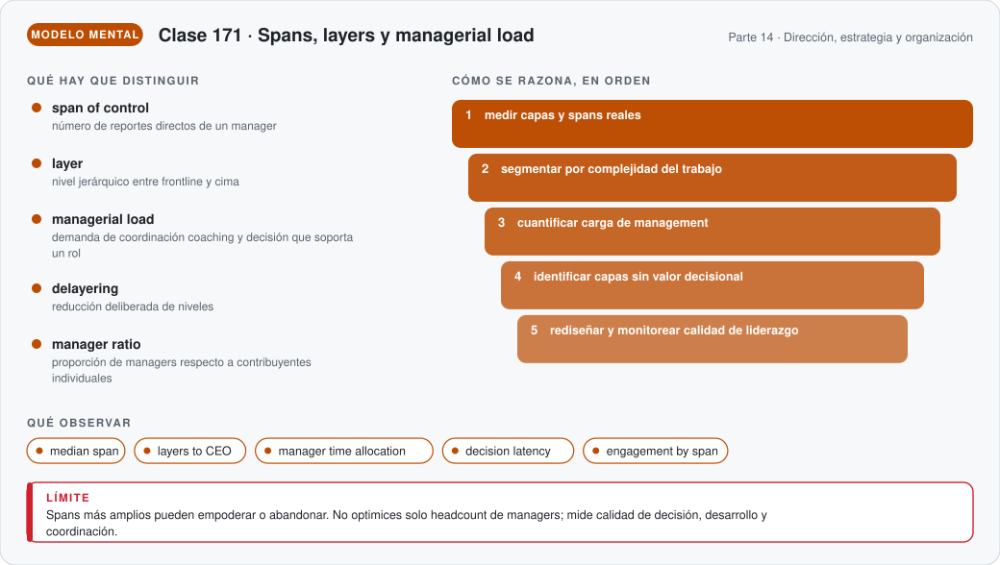

# Clase 171 — Spans, layers y managerial load

<!-- nav:inicio -->
> **Parte 14 · Diseño organizacional, cultura y cambio** — clase 3 de 12 · [índice de la parte](../../README.md) · [temario](../../../../SYLLABUS.md)
<!-- nav:fin -->

**Parte:** 14 — Diseño organizacional, cultura y cambio  
**Nivel:** Etapa 4 — Gerente → Director  
**Duración sugerida:** 150–180 minutos · **Estándar:** deep-class-v2

## 🎯 Propósito

Cada capa de gestión agrega un costo y una demora; cada persona que lidera a otras tiene un límite de tiempo y atención. El **tramo de control** (*span of control*, cuántas personas dependen directamente de un líder), las **capas** (*layers*, cuántos niveles hay entre la base y la cima) y la **carga directiva** (*managerial load*, cuánto del tiempo de un líder se va en gestionar frente a trabajar en el negocio) determinan la velocidad con que circula la información, el costo de gestión y la calidad del liderazgo. Muchas organizaciones crecen agregando capas por acumulación, y descubren que las decisiones suben y bajan por una cadena de cinco o seis niveles; otras recortan niveles sin ver que sobrecargan a los líderes que quedan.

La clase se apoya en el análisis de tiempo y energía de Mankins y Garton, en las reflexiones de Drucker sobre la efectividad de los ejecutivos y la gestión del tiempo, en el estudio de equipos de Hackman y en el diseño de organizaciones de Galbraith. Al terminar sabrás medir tramos, capas y carga directiva de una organización, entender qué determina un tramo razonable, calcular el costo de una capa, diagnosticar sobrecarga y diseñar cambios que reduzcan demora sin deteriorar el liderazgo.

## 📚 Resultados de aprendizaje

Al finalizar podrás:

1. **Medir** tramos de control, número de capas y carga directiva.
2. **Explicar** qué factores determinan un tramo razonable.
3. **Calcular** el costo y la demora que agrega una capa.
4. **Diagnosticar** sobrecarga y subutilización de líderes.
5. **Diseñar** ajustes que aplanen la estructura sin dañar el liderazgo.

## 🧭 Agenda

| Tramo | Qué se hace |
|---|---|
| 0–20 min | Recuperación: cuenta cuántas personas dependen directamente de ti y cuántos niveles hay entre tú y quien atiende al cliente. |
| 20–60 min | Tramos, capas, carga, factores y diagnóstico. |
| 60–105 min | Ejemplo trabajado: aplanar una organización de 1.200 personas. |
| 105–150 min | Caso ejecutivo y práctica. |
| 150–175 min | Límites y entregable. |

## 🧩 Conceptos centrales

| Concepto | Definición | Cómo se reconoce |
|---|---|---|
| **Tramo de control (span)** | Número de personas que dependen directamente de un líder. | Se cuenta en el organigrama. |
| **Capa (layer)** | Nivel jerárquico entre la cima y la base. | Se cuenta de arriba hacia abajo. |
| **Carga directiva** | Tiempo y esfuerzo que un líder dedica a gestionar. | Se mide con el uso del tiempo. |
| **Costo de capa** | Costo directo de los líderes de ese nivel más la demora que agregan. | Salarios y tiempo de decisión. |
| **Gestión sin valor** | Actividades de gestión que no mejoran el trabajo. | Reportes, reuniones de coordinación. |
| **Autonomía del equipo** | Capacidad de un equipo de decidir y actuar sin escalar. | Menos escalamientos. |

## 🧠 Modelo mental

**Cómo leer el diagrama.** Dos ejes: la **complejidad del trabajo** (complejo o rutinario) y el **tramo** (angosto o ancho). **Trabajo complejo con tramo ancho** produce riesgo de sobrecarga: el líder no alcanza a apoyar ni decidir. **Trabajo rutinario con tramo ancho** funciona: autonomía, estándares y poca supervisión. **Trabajo complejo con tramo angosto** da tiempo para desarrollar y coordinar. **Trabajo rutinario con tramo angosto** crea capas innecesarias con costo de gestión sin valor. La nota recuerda que el tramo es consecuencia del tipo de trabajo, de la madurez del equipo y de las herramientas de coordinación.

## 📖 Desarrollo

### 1. Tres medidas

El **tramo de control** es el número de reportes directos de un líder. Las **capas** son los niveles entre el máximo ejecutivo y quienes realizan el trabajo. La **carga directiva** es la fracción del tiempo de un líder dedicada a gestionar (reuniones, aprobaciones, reportes, coordinación) frente a trabajo propio o con clientes. Las tres están relacionadas: para un mismo número de empleados, tramos más angostos implican más capas y más gestores; tramos más anchos, menos capas y líderes con más personas a su cargo. Una organización de 1.200 personas con tramo promedio de 5 necesita cerca de 300 líderes y unas seis capas; con tramo promedio de 8, unos 170 líderes y cinco capas.

### 2. Qué determina un tramo razonable

No hay número mágico. Los factores que permiten tramos más anchos: **trabajo similar y estandarizado** entre los reportes, **personas experimentadas y autónomas**, **procesos y sistemas** que coordinan por sí mismos, **medidas claras de desempeño**, **menor necesidad de supervisión** y **líderes que también hacen trabajo operativo** poco. Los que exigen tramos más angostos: **trabajo complejo y variado**, **personas nuevas** o en transición, **alta interdependencia** entre los reportes, **necesidad de coaching**, **riesgo alto** (seguridad, regulación) y **geografía dispersa**. Hackman observa que los equipos eficaces necesitan una **estructura que los habilite** y un líder que dedique tiempo a las condiciones del equipo, no solo a las tareas.

### 3. El costo de una capa

Cada capa tiene **costos directos** (los salarios y beneficios de los líderes) e **indirectos**: **demora** (cada nivel agrega tiempo para pasar información y aprobar), **distorsión** de la información (cada traspaso la filtra), **dilución de la responsabilidad** (nadie siente que decide), **reducción de autonomía** y **costo de coordinación** entre niveles. Una estimación: si cada decisión pasa por tres niveles y cada uno demora tres días, la decisión tarda nueve días antes de comenzar a ejecutarse. Reducir una capa puede acortar los ciclos de decisión de forma notable, siempre que se defina quién decide qué (clase 173) y que los líderes restantes puedan asumir la carga.

### 4. Carga directiva y uso del tiempo

Drucker insistía en que el recurso más escaso de un ejecutivo es el **tiempo** y en la importancia de conocer en qué se va realmente. Mankins y Garton proponen **medir el uso del tiempo** de los líderes con **registros** o análisis de calendarios: cuántas horas por semana en reuniones, con quién, en qué tipo de decisión, cuánto en clientes o en desarrollo de personas. Los hallazgos típicos: **reuniones de coordinación** que concentran más de 30 % del tiempo, **reportes** que alimentan otros reportes, **aprobaciones** de decisiones que podrían tomar niveles inferiores y **poco tiempo** para conversar con personas y clientes. Se hace con transparencia y no se usa para vigilar individuos sino para rediseñar el sistema.

### 5. Diagnóstico: sobrecarga y subutilización

La **sobrecarga** se manifiesta en líderes con muchas personas a cargo y trabajo complejo, **reuniones de uno a uno** que se cancelan, **retrasos en aprobaciones**, **errores** de coordinación, **quejas del equipo** («no tengo con quién hablar»), **rotación** de líderes y de personas, y **desarrollo descuidado**. La **subutilización** aparece como líderes con muy pocos reportes (menos de 3) que dedican tiempo a supervisar de más, **capas con poco valor agregado** y **duplicación** entre niveles. Se compara el **tramo real** con un **rango razonable** según el tipo de trabajo, y se analizan **casos extremos** (líderes con 1 o 2 reportes, o con más de 15).

### 6. Cómo aplanar sin romper

Aplanar una organización no es eliminar cargos al azar. Una secuencia útil: **(1) definir qué decisiones se toman en cada nivel** (derechos de decisión, clase 173); **(2) diseñar procesos y herramientas** que permitan más autonomía (estándares, paneles, indicadores, formación); **(3) revisar roles** de los líderes, que pasan de supervisar a habilitar y desarrollar; **(4) ajustar tramos** según el tipo de trabajo; **(5) proteger el desarrollo** de nuevos líderes (si se eliminan las capas intermedias, ¿cómo se forman?); **(6) medir** tiempos de decisión, calidad, clima y rotación. Si los líderes quedan sobrecargados, el beneficio desaparece. Los cambios que afecten cargos, funciones o remuneraciones requieren verificar normas laborales.

### 7. Cuando las capas sí aportan

Las capas cumplen funciones legítimas: **traducir** estrategia en prioridades, **integrar** unidades, **desarrollar** a las personas, **asignar** recursos y **gestionar** riesgos. En organizaciones grandes y complejas, una capa puede ser necesaria para integrar y evitar que el nivel superior se sature. El objetivo no es el menor número de capas sino que **cada capa agregue valor** a las decisiones y a las personas. Una prueba: ¿qué se perdería si se eliminara esta capa? Si la respuesta es «nada, solo pasaría la información», probablemente sobra; si es «la integración entre estas cuatro unidades», se mantiene o se rediseña.

## 📚 Lectura comparada

| Obra | Qué aporta | Qué no resuelve | Pregunta para contrastar |
|---|---|---|---|
| Mankins y Garton | Medir tiempo y energía de la organización y de los líderes. | Datos de grandes empresas. | ¿En qué se va el tiempo de tus líderes? |
| Drucker | Efectividad personal y gestión del tiempo del ejecutivo. | Principios generales. | ¿Sabes en qué gastas tu tiempo realmente? |
| Hackman (*Leading Teams*) | Condiciones que habilitan a los equipos y rol del líder. | Se centra en equipos. | ¿Tu estructura habilita a los equipos? |
| Galbraith | Mecanismos de coordinación y diseño. | Marco general. | ¿Qué mecanismo reemplaza una capa? |
| McChrystal et al. | Coordinación y decisiones descentralizadas con información compartida. | Contexto militar. | ¿Qué información necesitan los equipos para decidir? |

## 🧮 Ejemplo trabajado

**Situación (hipotética).** Una empresa de servicios de ingeniería con 1.200 empleados tiene 6 capas y un tramo promedio de 4,6. Hay 262 personas con personal a cargo (22 % de la plantilla). Un análisis de calendarios de 60 líderes durante 4 semanas muestra que el 41 % de su tiempo se va en reuniones de coordinación y aprobaciones, el 17 % en reportes y solo el 9 % en conversaciones con clientes y con su equipo. El tiempo de aprobación de una oferta técnica es de 11 días.

**Distribución de tramos.**

| Tramo | Líderes | % |
|---|---|---|
| 1 a 3 reportes | 91 | 35 % |
| 4 a 7 | 128 | 49 % |
| 8 a 12 | 36 | 14 % |
| 13 o más | 7 | 3 % |

**Diagnóstico.** Un 35 % de los líderes tiene 3 o menos reportes (capas con poco valor); el 3 % tiene 13 o más con trabajo complejo (sobrecarga). La estructura no se explica por la complejidad del trabajo, sino por la acumulación de cargos.

**Cálculo del costo de capas.** Si el costo medio de un líder es USD 95.000 al año (con cargas), los 91 líderes con 1 a 3 reportes cuestan USD 8,6 millones. Pasar a un tramo medio de 7 en trabajo estándar y de 5 en proyectos complejos reduciría los líderes a unos 195 (−67), con un ahorro bruto de USD 6,4 millones, antes de costos de transición y del valor de las funciones que cumplen.

**Rediseño por principios.** (1) Reducir de 6 a 5 capas fusionando niveles de jefaturas con 1 a 3 reportes; (2) derechos de decisión: ofertas bajo USD 500.000 las aprueba el jefe de proyecto con un revisor técnico; entre 500.000 y 2 millones, el gerente de unidad; sobre 2 millones, comité; (3) rol de líder redefinido: 50 % en desarrollo del equipo y clientes; (4) tablero común de indicadores; (5) programa de desarrollo para quienes pasen a roles de especialista o de coach; (6) redistribución de los 7 líderes con 13 o más reportes en subunidades.

**Medidas.** Tiempo de aprobación de ofertas (11 días → meta 4), porcentaje de tiempo de líderes en clientes y equipo (9 % → 25 %), rotación de líderes, clima de equipo y calidad de las ofertas (tasa de adjudicación).

**Resultados a 9 meses (piloto en una división).** Tiempo de aprobación de 11 a 4,5 días; tiempo en clientes y equipo sube a 22 %; adjudicación sube de 28 % a 33 %; dos de los 12 líderes ajustados dejan la empresa y la rotación del equipo permanece estable. Se amplía a otras divisiones con ajustes en el rol de especialistas.

**Legal y personas.** Los cambios de cargos y las remuneraciones se tratan con las normas laborales vigentes y con asesoría, y se acompañan de conversación individual con cada afectado.

**Qué muestra.** (1) Tramos y capas se midieron con datos. (2) El rediseño incluyó decisiones, roles y herramientas, no solo eliminar cargos. (3) El piloto mostró beneficios y un costo en rotación que se gestionó.

## 🔀 Comparación y límites

**Aplanar frente a delegar.** Reducir capas sin delegar decisiones sobrecarga a los líderes que quedan; delegar sin reducir capas no acorta los ciclos. Ambas acciones se combinan.

**Límites.** No existe un tramo óptimo universal; los rangos son orientativos. La medición del tiempo es aproximada y puede percibirse como vigilancia. El aplanamiento puede reducir las oportunidades de promoción y requiere repensar las carreras. El ahorro bruto no incluye costos de indemnizaciones, reasignación ni pérdida de conocimiento. Los cambios de estructura exigen cumplimiento de la normativa laboral y de protección de datos de los registros de tiempo. Las cifras son ilustrativas.

## 🪜 De profesional a owner

| Nivel | Cómo participa en tramos y capas |
|---|---|
| **Profesional** | Decide dentro de su autonomía y escala solo lo necesario. |
| **Jefe / Team Lead** | Cuida su tramo, su tiempo y el desarrollo de su equipo. |
| **Gerente** | Diseña tramos y capas según el tipo de trabajo. |
| **CEO / Director** | Mide el costo de las capas y protege el tiempo de los líderes. |
| **Founder / Owner** | Evita agregar niveles antes de necesitarlos y delega con claridad. |

## 🏢 Caso ejecutivo

Una cadena de supermercados con 14.000 empleados y 210 tiendas tiene 7 capas desde el gerente general hasta el cajero. Cada tienda tiene un gerente, un subgerente, 6 jefes de sección con 3 a 5 personas cada uno y supervisores de turno. Entre las tiendas y la gerencia general hay jefes de zona (14), gerentes regionales (5) y directores (3). Una decisión de precio o de promoción pasa por 5 niveles y tarda 12 días. Los jefes de sección dedican 55 % de su tiempo a tareas operativas y 45 % a reportes. La rotación de jefes de sección es de 38 %. La directora de operaciones quiere aplanar a 5 capas; el director de personas teme perder el camino de carrera y una caída del servicio.

Entrega un **análisis de tramos, capas y carga directiva** que contenga: (a) las métricas actuales con los datos que pedirías; (b) los factores que justifican tramos más anchos o más angostos en cada nivel; (c) el costo de las capas y la demora; (d) un rediseño con derechos de decisión, roles y herramientas; (e) las medidas de transición, de desarrollo de líderes y de carrera; (f) las verificaciones laborales y de datos que se harán con las normas vigentes y asesoría.

## 🧪 Práctica

1. Calcula el tramo promedio y el número de capas de tu organización.
2. Analiza tu calendario de cuatro semanas: porcentaje en reuniones, reportes, clientes y personas.
3. Identifica cinco decisiones que suben más de dos niveles y propón dónde deberían tomarse.
4. Estima el costo de una capa y la demora que agrega a una decisión típica.
5. Define tres medidas para saber si aplanar mejora o daña.

## ⚠️ Errores frecuentes

| Error | Por qué ocurre | Cómo corregirlo |
|---|---|---|
| Tramo único para todos | Se busca simplicidad | Ajustar a la complejidad y madurez. |
| Aplanar sin delegar | Se piensa en cargos | Definir derechos de decisión y herramientas. |
| Capas por acumulación | Se agregan por conveniencia | Preguntar qué se perdería sin esa capa. |
| Líderes sin tiempo para su equipo | La carga lo impide | Medir y reducir gestión sin valor. |
| Ignorar las carreras | Se mira el costo | Rediseñar caminos de desarrollo. |
| Medir el tiempo como vigilancia | No se explica el propósito | Transparencia y foco en el sistema. |

## ❓ Preguntas de comprobación

1. ¿Qué son el tramo de control, las capas y la carga directiva?
2. ¿Qué factores permiten un tramo más ancho?
3. ¿Qué costos agrega una capa?
4. ¿Cómo se mide la carga directiva?
5. ¿Cuáles son signos de sobrecarga y de subutilización?
6. ¿Qué se debe hacer antes de aplanar?
7. ¿Cuándo aportan valor las capas?

Claves de respuesta

1. El tramo es el número de reportes directos; las capas son los niveles jerárquicos; la carga directiva es el tiempo y esfuerzo de un líder dedicado a gestionar.
2. Trabajo similar y estandarizado, personas experimentadas, procesos y sistemas que coordinan, medidas claras de desempeño y poca necesidad de supervisión.
3. Salarios y beneficios, demora, distorsión de información, dilución de responsabilidad y costos de coordinación.
4. Analizando calendarios y registros de uso del tiempo de los líderes, con transparencia y sin fines de vigilancia individual.
5. Sobrecarga: reuniones canceladas, aprobaciones demoradas, rotación de líderes; subutilización: líderes con muy pocos reportes y capas que solo pasan información.
6. Definir qué decisiones se toman en cada nivel, preparar procesos y herramientas, redefinir roles de los líderes y proteger el desarrollo de nuevos líderes.
7. Cuando traducen estrategia, integran unidades, desarrollan personas, asignan recursos o gestionan riesgos que el nivel superior no podría.

## 📥 Entregable

Guarda en `portfolio/171-spans-layers-y-managerial-load/`:

- `risk-governance-brief.md` (plantilla [Risk & Governance Brief](../../../../templates/risk-governance-brief.md)) con los riesgos del rediseño del caso ejecutivo;
- `org-design.md` (plantilla [Org design](../../../../templates/org-design.md)) con tramos, capas y derechos de decisión propuestos;
- `decision-journal.md` con las métricas de línea base y los criterios de éxito.

## 📗 Fuentes y verificación

- Michael C. Mankins & Eric Garton — *Time, Talent, Energy* (Harvard Business Review Press, 2017). **Uso en esta clase:** medir tiempo y energía de la organización y de los líderes. Lectura selectiva sobre **spans, layers y managerial load**. **Localizador:** [ISBN-13 9781633691766](https://openlibrary.org/isbn/9781633691766).
- Peter F. Drucker — *The Effective Executive* (Collins, 2002). **Uso en esta clase:** efectividad personal y gestión del tiempo del ejecutivo. Lectura selectiva sobre **spans, layers y managerial load**. **Localizador:** [ISBN-13 9780060516079](https://openlibrary.org/isbn/9780060516079).
- J. Richard Hackman — *Leading Teams* (Harvard Business School Press, 2002). **Uso en esta clase:** condiciones que habilitan a los equipos y rol del líder. Lectura selectiva sobre **spans, layers y managerial load**. **Localizador:** [ISBN-13 9781578513338](https://openlibrary.org/isbn/9781578513338).
- Jay R. Galbraith — *Designing Organizations* (Jossey-Bass Publishers, 1995). **Uso en esta clase:** mecanismos de coordinación y diseño. Lectura selectiva sobre **spans, layers y managerial load**. **Localizador:** [ISBN-13 9780787900915](https://openlibrary.org/isbn/9780787900915).
- Stanley McChrystal et al. — *Team of Teams* (Penguin Books, Limited, 2015). **Uso en esta clase:** coordinación y decisiones descentralizadas con información compartida. Lectura selectiva sobre **spans, layers y managerial load**. **Localizador:** [ISBN-13 9780241250846](https://openlibrary.org/isbn/9780241250846).

> **Regla de fuentes para Spans, layers y managerial load:** las obras anteriores estructuran las perspectivas de esta materia; cualquier norma, ley o estándar vivo mencionado debe comprobarse nuevamente en su fuente primaria vigente, incluidas las normas laborales y de protección de datos. Los ejemplos y casos son hipotéticos, con cifras ilustrativas. El desarrollo es original y no reproduce capítulos protegidos.

<!-- pie:inicio -->
---

| Anterior | Índice | Siguiente |
|---|---|---|
| [← 170 · Estructuras funcionales, divisionales y matriciales](../170-estructuras-funcionales-divisionales-y-matriciales/README.md) | [Parte 14](../../README.md) · [Programa](../../../../SYLLABUS.md) | [172 · Operating model →](../172-operating-model/README.md) |
<!-- pie:fin -->
