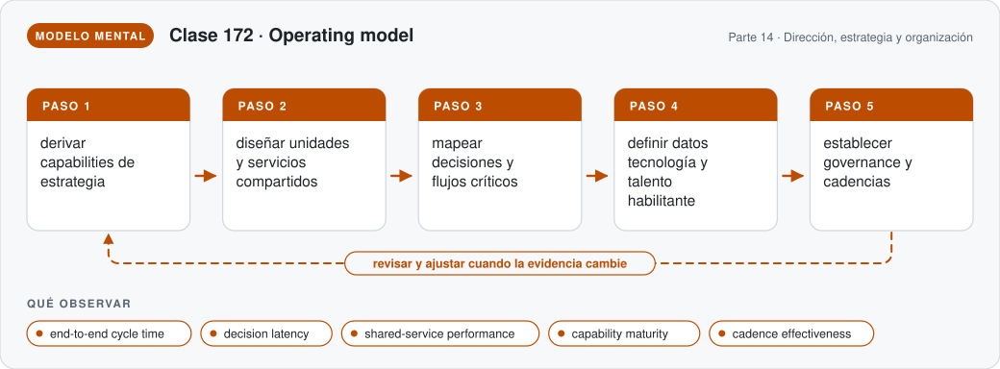

# Clase 172 — Operating model

<!-- nav:inicio -->
> **Parte 14 · Diseño organizacional, cultura y cambio** — clase 4 de 12 · [índice de la parte](../../README.md) · [temario](../../../../SYLLABUS.md)
<!-- nav:fin -->

**Parte:** 14 — Diseño organizacional, cultura y cambio  
**Nivel:** Etapa 4 — Gerente → Director  
**Duración sugerida:** 150–180 minutos · **Estándar:** deep-class-v2

## 🎯 Propósito

La estrategia dice dónde competir y cómo ganar; el **modelo operativo** (*operating model*) dice **cómo trabaja la organización** para lograrlo: qué entrega, quién lo hace, con qué procesos, información y tecnología, con qué gobierno y en qué ubicaciones. Es el puente entre una estrategia escrita y una organización que funciona. Muchas estrategias se quedan en un documento porque el modelo operativo existente no puede ejecutarlas: las decisiones requeridas no tienen dueño, los datos no circulan, los incentivos empujan en otra dirección o la estructura impide la colaboración que se necesita. Diseñar el modelo operativo es traducir las prioridades estratégicas en **capacidades concretas y formas de trabajar**.

La clase se apoya en el diseño organizacional de Galbraith, en el enfoque de salud organizacional de Lencioni (claridad, cohesión y reglas simples de comunicación), en la idea de equipos de equipos con conciencia compartida de McChrystal y en las ideas de operaciones de la parte 07. Al terminar sabrás describir un modelo operativo actual y objetivo en tres dimensiones (qué, quién, cómo), identificar las capacidades críticas que hay que construir, diseñar el gobierno y el ritmo de gestión, y planificar la transición de forma realista.

## 📚 Resultados de aprendizaje

Al finalizar podrás:

1. **Describir** un modelo operativo con sus componentes y relaciones.
2. **Derivar** el modelo operativo objetivo de las prioridades estratégicas.
3. **Identificar** las capacidades críticas y las brechas.
4. **Diseñar** el gobierno, el ritmo de gestión y los flujos de información.
5. **Planificar** la transición con pilotos y hitos.

## 🧭 Agenda

| Tramo | Qué se hace |
|---|---|
| 0–20 min | Recuperación: describe cómo se toma, se ejecuta y se corrige una decisión comercial importante en tu empresa. |
| 20–60 min | Componentes, derivación, capacidades, gobierno y transición. |
| 60–105 min | Ejemplo trabajado: modelo operativo de una empresa que pasa a omnicanal. |
| 105–150 min | Caso ejecutivo y práctica. |
| 150–175 min | Límites y entregable. |

## 🧩 Conceptos centrales

| Concepto | Definición | Cómo se reconoce |
|---|---|---|
| **Modelo operativo** | Forma concreta en que la organización crea y entrega valor. | Procesos, estructura, personas, información, gobierno. |
| **Capacidad crítica** | Habilidad organizacional indispensable para ejecutar la estrategia. | Se debe hacer excepcionalmente bien. |
| **Gobierno** | Estructuras y reglas de decisión, coordinación y control. | Foros, derechos de decisión, indicadores. |
| **Conciencia compartida** | Comprensión común de la situación entre equipos. | Información circula con rapidez. |
| **Ejecución empoderada** | Autonomía de los equipos para actuar con información. | Decisiones cerca de la acción. |
| **Modelo operativo objetivo** | Diseño deseado para ejecutar la estrategia. | Se contrasta con el actual. |

## 🧠 Modelo mental

**Cómo leer el diagrama.** Tres columnas. **Qué se entrega**: propuesta de valor y capacidades críticas, procesos de punta a punta que la sostienen y niveles de servicio. **Quién lo hace**: estructura, roles y equipos; talento, capacidades y ubicación; proveedores y socios. **Cómo se coordina**: derechos de decisión y gobierno; información, tecnología y ritmo de gestión; incentivos y métricas. La nota recuerda que el modelo operativo traduce la estrategia en una forma concreta de trabajar y que, si no lo permite, la estrategia se queda en un documento.

## 📖 Desarrollo

### 1. Qué es un modelo operativo

Un modelo operativo describe, a un nivel de diseño, cómo la organización convierte su estrategia en resultados cotidianos. Incluye: **la oferta y las capacidades** necesarias (qué entrega y qué debe hacer excepcionalmente bien), **los procesos** de punta a punta (clase 086), **la estructura y los roles** (clases 169 a 171), **las personas** y sus capacidades, **la información y la tecnología** que sostienen el trabajo, **el gobierno** (decisiones, coordinación, control) y **la ubicación** (dónde se hace cada cosa: sedes, centros de servicios, socios). Se describe en una **vista de pocas páginas** que permita discutir y alinear. No es un manual de procedimientos: es la arquitectura de cómo se trabaja.

### 2. Derivar desde la estrategia

El modelo operativo objetivo se deduce de la estrategia con una cadena de preguntas. **¿Qué prioridades estratégicas hay?** (por ejemplo, entregar a cualquier cliente en 24 horas y con experiencia consistente). **¿Qué capacidades críticas exigen?** (logística de punta a punta, datos de clientes unificados, gestión de inventario compartido). **¿Qué debe hacerse igual en toda la organización y qué puede variar localmente?** (estandarización frente a adaptación). **¿Qué decisiones deben ser rápidas y dónde se toman?** **¿Qué datos necesita cada rol?** **¿Qué se puede obtener de socios?** Lencioni subraya la importancia de la **claridad**: que todos entiendan por qué existe la organización, cómo se comporta, qué hace, cómo logrará el éxito, qué es lo más importante ahora y quién hace qué; esa claridad es parte del modelo.

### 3. Capacidades críticas y brechas

Se listan las capacidades críticas y se evalúa para cada una el **nivel actual** y el **nivel requerido**: ¿existe?, ¿es suficiente?, ¿dónde reside?, ¿depende de una persona?, ¿qué la limita (personas, procesos, tecnología, datos, estructura)? Se identifican **brechas** y se decide cómo cerrarlas (construir, comprar, aliarse; clase 160). Una buena práctica es priorizar las pocas capacidades que definen la ventaja (clase 161) y estandarizar las demás. La evaluación debe apoyarse en datos: tiempos de ciclo, calidad, costos, satisfacción de clientes internos y externos, y no solo en opiniones.

### 4. Información y conciencia compartida

McChrystal y sus coautores describen cómo, en un entorno que cambia rápido, la coordinación no se logra solo con órdenes jerárquicas sino con **conciencia compartida** (todos los equipos comprenden la situación) y **ejecución empoderada** (los equipos actúan con autonomía dentro de un propósito común). Se apoya en **canales de información** transparentes y frecuentes, **reuniones breves y de alta densidad** donde los equipos comparten estado y prioridades y **roles de enlace** entre unidades. Para el modelo operativo, esto significa decidir **qué información circula, con qué frecuencia y entre quiénes**, y qué decisiones se pueden tomar sin escalar.

### 5. Gobierno: foros, derechos y ritmo

El gobierno define **quién decide qué** (clase 173), **qué foros** existen (comités, revisiones, reuniones de coordinación), **qué ritmo** siguen (diario, semanal, mensual, trimestral; clase 103), **qué indicadores** se miran (clases 100 a 102) y **cómo se escalan** los conflictos (clase 107). Un buen gobierno es **liviano** y claro: pocos foros con propósito explícito y decisiones registradas. Lencioni advierte contra las reuniones mal diseñadas que mezclan propósitos: una reunión táctica semanal, una estratégica mensual, una de revisión trimestral y un retiro anual, cada una con su agenda, reducen el desperdicio de tiempo y mejoran las decisiones.

### 6. Estandarizar y variar

Todo modelo operativo decide **qué es común** y **qué es local**. Estandarizar (procesos, sistemas, datos, métricas) da **eficiencia**, **calidad consistente** y **aprendizaje compartido**; permitir variación da **adaptación** a mercados y clientes específicos. Un criterio: estandarizar **lo que el cliente no distingue** y **lo que genera economías de escala**; variar **lo que el cliente valora que sea distinto**. Se definen **servicios compartidos** (funciones que prestan a todos: finanzas, tecnología, compras) con acuerdos de nivel (clase 092) y **centros de excelencia** que conservan conocimiento especializado. El peligro es la sobreestandarización, que frena la adaptación, o la subestandarización, que genera costos duplicados.

### 7. Transición: del actual al objetivo

El modelo operativo objetivo se alcanza por etapas. Se hace un **mapa de la situación actual**, un **diseño objetivo**, un **análisis de brechas** y una **hoja de ruta** con **pilotos**: se prueba el nuevo modelo en una unidad, un proceso o una región, se miden los resultados (tiempo de ciclo, calidad, costo, satisfacción) y se ajusta antes de ampliar. Se planifican **cambios en personas** (roles, capacidades, incentivos), **procesos**, **sistemas** y **gobierno** de forma coordinada. Los modelos objetivo se prueban con casos reales («seguir una orden de punta a punta») y se evita diseñar en abstracto. Los cambios de roles y ubicaciones tienen implicancias laborales que se verifican con asesoría.

## 📚 Lectura comparada

| Obra | Qué aporta | Qué no resuelve | Pregunta para contrastar |
|---|---|---|---|
| Galbraith | Diseño organizacional y coordinación como base del modelo. | Marco general. | ¿Tu modelo coordina lo que tu estrategia necesita? |
| Lencioni (*The Advantage*) | Claridad organizacional y disciplina de reuniones. | Enfoque de salud organizacional; evidencia basada en consultoría. | ¿Todos pueden explicar por qué existe la organización y qué hacen? |
| McChrystal et al. | Conciencia compartida y ejecución empoderada. | Contexto militar. | ¿Qué información comparten tus equipos? |
| Mankins y Garton | Uso del tiempo como medida del modelo operativo. | Datos de grandes empresas. | ¿Qué parte del tiempo se va en coordinar? |
| Slack y Brandon-Jones | Diseño de operaciones y procesos. | Es general. | ¿Cuál es el proceso crítico de punta a punta? |

## 🧮 Ejemplo trabajado

**Situación (hipotética).** Una cadena de tiendas de ropa con 85 locales y un sitio de comercio en línea pasa a una estrategia **omnicanal**: «el cliente compra, recibe y devuelve donde quiera, con inventario único». Las operaciones actuales son separadas: el inventario en línea está en una bodega propia, los locales tienen inventarios independientes, los precios se actualizan por canal con 48 horas de diferencia, los vendedores de tienda no reciben comisión por ventas en línea que se recogen en el local.

**Modelo operativo actual.**

| Dimensión | Estado |
|---|---|
| Qué | Procesos de venta separados por canal; inventario sin visibilidad común |
| Quién | Equipos de tiendas, de e-commerce y de logística con jefaturas independientes |
| Cómo | Reuniones separadas; indicadores de venta por canal; incentivos por canal; sistemas distintos |

**Datos.** El 27 % de los pedidos en línea no puede entregarse por falta de inventario que sí existía en tiendas; la devolución en tienda de una compra en línea tarda 18 días en reflejarse; el costo de logística de pedidos en línea es USD 6,8 por pedido; el 14 % de los clientes compra en ambos canales y gasta 2,6 veces más.

**Modelo operativo objetivo.**

| Dimensión | Diseño |
|---|---|
| Qué | Inventario único visible; pedidos desde tienda o bodega según costo y plazo; devoluciones en cualquier canal en 3 días; precios y promociones sincronizados |
| Quién | Una organización de «cliente y canales» con dueño del proceso de punta a punta; equipos de tienda con rol de punto de entrega y devolución; equipo de inventario y planificación único |
| Cómo | Un tablero común (disponibilidad, tiempo de entrega, costo por pedido, devoluciones); derechos de decisión claros sobre asignación de inventario; incentivos por venta del cliente en cualquier canal; ritmo semanal de coordinación y trimestral de revisión |

**Capacidades críticas y brechas.** Visibilidad de inventario en tiempo real (brecha alta: sistemas separados), asignación inteligente de pedidos (nueva), logística de última milla propia o con socios (parcial), datos del cliente unificados (brecha media). Decisión: construir visibilidad de inventario y asignación; aliarse para la última milla.

**Piloto.** En 12 tiendas de una ciudad durante 6 meses. Resultados: pedidos entregados por falta de inventario baja de 27 % a 9 %; devolución en 4,2 días; costo logístico por pedido sube a 7,3 (más tráfico en tiendas) pero la venta por cliente omnicanal sube 18 %; los vendedores de tienda aceptan el rol cuando se ajustan las comisiones. Se descubre un problema: las tiendas pequeñas no tienen espacio para preparar pedidos; se ajusta el diseño (solo 40 tiendas actúan como centros de preparación).

**Gobierno.** Comité semanal de operaciones omnicanal de 45 minutos; reglas de decisión sobre quién puede reasignar inventario; escalamiento a un director si hay conflicto de prioridades más de 48 horas.

**Qué muestra.** (1) El modelo se derivó de las prioridades estratégicas. (2) Las brechas de capacidades se resolvieron con construir y aliarse. (3) El piloto corrigió el diseño antes de generalizar.

## 🔀 Comparación y límites

**Modelo operativo frente a estructura.** La estructura es solo uno de sus componentes. Un modelo operativo incluye procesos, información, tecnología, gobierno e incentivos que determinan si la estructura funciona.

**Límites.** Los modelos operativos objetivo son hipótesis y pueden fallar al contacto con la realidad. Las empresas confunden a veces el modelo operativo con un organigrama o un plan de tecnología. La claridad organizacional de Lencioni se apoya más en la práctica de consultoría que en estudios controlados. Las decisiones de estandarización pueden tener efectos laborales y de datos, que se verifican con las normas vigentes y asesoría. Las cifras del ejemplo son ilustrativas.

## 🪜 De profesional a owner

| Nivel | Cómo participa en el modelo operativo |
|---|---|
| **Profesional** | Sigue los procesos y comparte lo que aprende en la práctica. |
| **Jefe / Team Lead** | Coordina con otros equipos y mantiene la información fluyendo. |
| **Gerente** | Diseña procesos y gobierno de su área alineados con la estrategia. |
| **CEO / Director** | Asegura que el modelo permita ejecutar la estrategia. |
| **Founder / Owner** | Escribe cómo se trabaja antes de que la empresa crezca y el conocimiento se disperse. |

## 🏢 Caso ejecutivo

Una empresa de energías renovables con 900 empleados pasó de desarrollar proyectos a **operar activos a largo plazo y prestar servicios a clientes industriales**. Su modelo operativo, pensado para proyectos de construcción, se organiza por proyecto, con equipos que se disuelven al terminar; la operación de plantas se hace con contratistas distintos en cada sitio, sin datos comunes; el servicio de mantenimiento no tiene indicadores unificados; las ventas de servicios a industrias las hace el equipo que antes vendía proyectos. Los clientes industriales exigen disponibilidad contractual de 98,5 % y la empresa logra 96,1 % promedio. El CEO dice que la estrategia de servicios es el futuro; el director de proyectos defiende el modelo actual; el de operaciones quiere un centro de control único.

Entrega un **diseño de modelo operativo** que contenga: (a) el modelo actual y el objetivo en las dimensiones qué, quién y cómo; (b) las capacidades críticas y las brechas, con la decisión de construir, comprar o aliarse; (c) el gobierno, el ritmo y los flujos de información; (d) qué se estandariza y qué se deja variar; (e) el plan de transición con piloto, métricas y riesgos; (f) las verificaciones contractuales, laborales, de seguridad y de datos que se harán con las normas vigentes y asesoría.

## 🧪 Práctica

1. Describe tu modelo operativo actual en las dimensiones qué, quién y cómo.
2. Deriva dos capacidades críticas de tu estrategia y evalúa su nivel actual y requerido.
3. Diseña el ritmo de reuniones de tu área con propósito y agenda de cada una.
4. Decide qué estandarizar y qué dejar variar con un criterio.
5. Propón un piloto para probar el modelo objetivo con métricas y plazos.

## ⚠️ Errores frecuentes

| Error | Por qué ocurre | Cómo corregirlo |
|---|---|---|
| Confundir modelo operativo con organigrama | Es lo más visible | Incluir procesos, información, gobierno e incentivos. |
| Diseñar en abstracto | Se evita el piloto | Probar con casos reales de punta a punta. |
| Sobreestandarizar | Se busca eficiencia | Estandarizar lo que el cliente no distingue. |
| Gobierno pesado | Muchos foros | Pocos foros con propósito y decisiones. |
| Ignorar la información | Se piensa en estructuras | Definir qué circula, con qué frecuencia y entre quiénes. |
| Transición sin hitos | Se quiere cambiar de golpe | Etapas, métricas y ajustes. |

## ❓ Preguntas de comprobación

1. ¿Qué componentes tiene un modelo operativo?
2. ¿Cómo se deriva el modelo objetivo de la estrategia?
3. ¿Qué es la conciencia compartida y la ejecución empoderada?
4. ¿Qué define el gobierno de un modelo operativo?
5. ¿Qué criterio guía qué estandarizar y qué variar?
6. ¿Por qué se hacen pilotos de transición?
7. ¿Qué límites tiene el concepto?

Claves de respuesta

1. Oferta y capacidades, procesos, estructura y roles, personas, información y tecnología, gobierno y ubicación.
2. Desde las prioridades estratégicas se identifican capacidades críticas, qué debe ser común y qué local, qué decisiones deben ser rápidas, qué datos necesita cada rol y qué se obtiene de socios.
3. La conciencia compartida es que los equipos comprendan la situación; la ejecución empoderada es que actúen con autonomía dentro de un propósito común.
4. Quién decide qué, qué foros existen, su ritmo, qué indicadores se miran y cómo se escalan los conflictos.
5. Estandarizar lo que el cliente no distingue y lo que da economías de escala; variar lo que el cliente valora que sea distinto.
6. Para probar el diseño en pequeño, medir y ajustar antes de ampliar.
7. Son hipótesis que pueden fallar, se confunden con organigramas y parte de la evidencia proviene de la práctica de consultoría.

## 📥 Entregable

Guarda en `portfolio/172-operating-model/`:

- `leadership-decision-brief.md` (plantilla [Leadership Decision Brief](../../../../templates/leadership-decision-brief.md)) con el diseño del caso ejecutivo;
- `org-design.md` (plantilla [Org design](../../../../templates/org-design.md)) con el modelo actual y el objetivo;
- `decision-journal.md` con las brechas, el piloto y las métricas.

## 📗 Fuentes y verificación

- Jay R. Galbraith — *Designing Organizations* (Jossey-Bass Publishers, 1995). **Uso en esta clase:** diseño organizacional y coordinación como base del modelo. Lectura selectiva sobre **operating model**. **Localizador:** [ISBN-13 9780787900915](https://openlibrary.org/isbn/9780787900915).
- Patrick Lencioni — *The Advantage* (John Wiley & Sons, Incorporated, 2012). **Uso en esta clase:** claridad organizacional y disciplina de reuniones. Lectura selectiva sobre **operating model**. **Localizador:** [ISBN-13 9781118147856](https://openlibrary.org/isbn/9781118147856).
- Stanley McChrystal et al. — *Team of Teams* (Penguin Books, Limited, 2015). **Uso en esta clase:** conciencia compartida y ejecución empoderada. Lectura selectiva sobre **operating model**. **Localizador:** [ISBN-13 9780241250846](https://openlibrary.org/isbn/9780241250846).
- Michael C. Mankins & Eric Garton — *Time, Talent, Energy* (Harvard Business Review Press, 2017). **Uso en esta clase:** uso del tiempo como medida del modelo operativo. Lectura selectiva sobre **operating model**. **Localizador:** [ISBN-13 9781633691766](https://openlibrary.org/isbn/9781633691766).
- Nigel Slack & Alistair Brandon-Jones — *Operations Management* (Pearson Education, Limited, 2019). **Uso en esta clase:** diseño de operaciones y procesos. Lectura selectiva sobre **operating model**. **Localizador:** [ISBN-13 9781292254036](https://openlibrary.org/isbn/9781292254036).

> **Regla de fuentes para Operating model:** las obras anteriores estructuran las perspectivas de esta materia; cualquier norma, ley o estándar vivo mencionado debe comprobarse nuevamente en su fuente primaria vigente, incluidas las normas laborales, de seguridad, contractuales y de datos. Los ejemplos y casos son hipotéticos, con cifras ilustrativas. El desarrollo es original y no reproduce capítulos protegidos.

<!-- pie:inicio -->
---

| Anterior | Índice | Siguiente |
|---|---|---|
| [← 171 · Spans, layers y managerial load](../171-spans-layers-y-managerial-load/README.md) | [Parte 14](../../README.md) · [Programa](../../../../SYLLABUS.md) | [173 · RACI, RAPID y derechos de decisión →](../173-raci-rapid-y-derechos-de-decision/README.md) |
<!-- pie:fin -->
