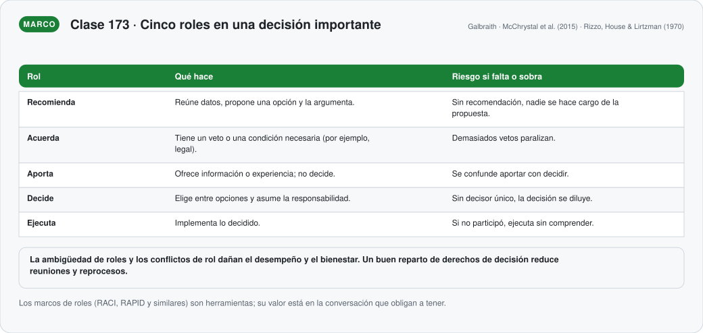

# Clase 173 — RACI, RAPID y derechos de decisión

<!-- nav:inicio -->
> **Parte 14 · Diseño organizacional, cultura y cambio** — clase 5 de 12 · [índice de la parte](../../README.md) · [temario](../../../../SYLLABUS.md)
<!-- nav:fin -->

**Parte:** 14 — Diseño organizacional, cultura y cambio  
**Nivel:** Etapa 4 — Gerente → Director  
**Duración sugerida:** 150–180 minutos · **Estándar:** deep-class-v2

## 🎯 Propósito

Una de las formas más caras de perder velocidad es no saber **quién decide**. Las decisiones se discuten en reuniones sin un responsable, se reabren cuando alguien que no participó se entera, suben al nivel superior por inseguridad, se frenan por vetos que nadie sabía que existían o se toman dos veces, en dos lugares, con resultados distintos. Los **derechos de decisión** —la asignación explícita de quién recomienda, quién debe estar de acuerdo, quién aporta información, quién decide y quién ejecuta— convierten esa niebla en reglas conocidas. Marcos como **RACI** y **RAPID** son herramientas para hacerlo; su valor está menos en la tabla que en la conversación que obligan a tener.

La clase se apoya en el análisis de rol y ambigüedad de Rizzo, House y Lirtzman, en los principios de coordinación de Galbraith y en la visión de McChrystal de decisiones cercanas a la acción con información compartida. Al terminar sabrás distinguir los roles de una decisión, usar RACI y RAPID, evitar los errores típicos (demasiados vetos, sin decisor, aportes que se confunden con decisión), definir qué decisiones se toman en cada nivel y medir la calidad del sistema de decisiones.

## 📚 Resultados de aprendizaje

Al finalizar podrás:

1. **Distinguir** los roles de una decisión: recomendar, acordar, aportar, decidir y ejecutar.
2. **Aplicar** RACI y RAPID a decisiones reales.
3. **Detectar** ambigüedad y conflicto de rol en una organización.
4. **Clasificar** las decisiones por nivel, riesgo y reversibilidad.
5. **Medir** la velocidad y la calidad del sistema de decisiones.

## 🧭 Agenda

| Tramo | Qué se hace |
|---|---|
| 0–20 min | Recuperación: elige una decisión reciente de tu equipo y anota quién recomendó, quién aportó, quién decidió y quién ejecutó. |
| 20–60 min | Roles, marcos, errores, clasificación y medición. |
| 60–105 min | Ejemplo trabajado: reparto de derechos de decisión en la fijación de precios. |
| 105–150 min | Caso ejecutivo y práctica. |
| 150–175 min | Límites y entregable. |

## 🧩 Conceptos centrales

| Concepto | Definición | Cómo se reconoce |
|---|---|---|
| **Derecho de decisión** | Autoridad explícita para decidir un tipo de asunto. | Se sabe quién tiene la última palabra. |
| **RACI** | Marco que asigna Responsable, Aprobador (Accountable), Consultado e Informado. | Matriz de tareas y roles. |
| **RAPID** | Marco de decisiones con Recomienda, Acuerda, Aporta, Decide y Ejecuta. | Foco en el flujo de la decisión. |
| **Ambigüedad de rol** | Falta de claridad sobre lo que se espera de una persona. | «No sé si esto me corresponde». |
| **Conflicto de rol** | Expectativas incompatibles sobre una misma persona. | Dos jefes piden cosas opuestas. |
| **Decisión reversible** | Decisión cuyo error se corrige a bajo costo. | Se puede delegar y decidir rápido. |

## 🧠 Modelo mental

**Cómo leer el diagrama.** Una tabla con los cinco roles. **Recomienda** reúne datos y propone una opción; sin él, nadie se hace cargo de la propuesta. **Acuerda** tiene un veto o una condición necesaria; demasiados vetos paralizan. **Aporta** da información o experiencia pero no decide; el riesgo es confundir aportar con decidir. **Decide** elige y asume la responsabilidad; sin decisor único la decisión se diluye. **Ejecuta** implementa lo decidido; si no participó, ejecuta sin comprender. La nota recuerda que la ambigüedad y el conflicto de rol dañan el desempeño y que un buen reparto reduce reuniones y reprocesos.

## 📖 Desarrollo

### 1. Por qué importan los derechos de decisión

Rizzo, House y Lirtzman estudiaron la **ambigüedad de rol** (falta de información clara sobre lo que se espera de una persona) y el **conflicto de rol** (demandas incompatibles) y encontraron que ambos se asocian con menor satisfacción, mayor tensión y peor desempeño. En organizaciones, la ambigüedad sobre decisiones se manifiesta como **parálisis** (nadie decide), **escalamiento excesivo** (todo sube), **decisiones duplicadas** y **resentimiento** por decisiones que se sienten arbitrarias. Aclarar quién decide es una de las intervenciones de diseño más baratas y de mayor efecto, siempre que se discuta de verdad y no sea una tabla que nadie usa.

### 2. Los cinco roles de una decisión

Una decisión importante tiene cinco funciones, que pueden recaer en personas distintas. **Recomienda**: reúne los datos, analiza las opciones y propone una; responde por la calidad del análisis. **Acuerda** (o veta): su conformidad es necesaria por razones legales, financieras, técnicas o de riesgo; debe ser **acotado** a quienes realmente tienen esa potestad. **Aporta**: ofrece información, experiencia o perspectiva; su opinión se escucha pero no decide. **Decide**: elige entre las opciones y asume la responsabilidad; debe haber **uno solo**. **Ejecuta**: implementa lo decidido; conviene que participe antes para comprender el porqué. Una buena práctica es **escribir** los roles de las diez decisiones más frecuentes y revisarlos.

### 3. RACI

RACI es una matriz que cruza actividades o entregables con personas o roles, asignando una letra: **R** (responsable: hace el trabajo), **A** (aprobador o dueño: responde del resultado y tiene la última palabra; **uno solo**), **C** (consultado: aporta antes de decidir) e **I** (informado: se entera después). Es útil para **proyectos y procesos** con muchas tareas. Sus problemas frecuentes: **demasiadas C** (consultar a todos), **más de un A**, **ninguna R**, **I que nunca reciben información** y **matrices que no se actualizan**. Se aplica con una regla simple: cada fila tiene exactamente un A y el menor número posible de C.

### 4. RAPID

RAPID, desarrollado en el ámbito de la consultoría de gestión, se centra en las **decisiones** (no en las tareas) y en su flujo. Sus cinco roles —**Recomienda, Acuerda, Aporta, Decide, Ejecuta** (en inglés, *Recommend, Agree, Perform, Input, Decide*, de donde sale la sigla)— describen quién propone, quién debe estar de acuerdo, quién aporta información, quién decide y quién implementa. Aclara la secuencia: la recomendación se construye con aportes, se somete a quienes deben acordar, y finalmente decide una persona. Se usa para **decisiones recurrentes o críticas** (precios, contrataciones clave, inversiones, lanzamientos) donde la ambigüedad es costosa.

### 5. Clasificar las decisiones

No todas las decisiones merecen el mismo proceso. Se clasifican por **impacto** (cuánto afectan al negocio), **reversibilidad** (si el error se corrige a bajo costo), **frecuencia** y **conocimiento necesario** (quién sabe más). Las decisiones **reversibles y de bajo impacto** se delegan al nivel más cercano a la información; las **irreversibles y de alto impacto** se elevan, con proceso explícito. McChrystal propone acercar las decisiones a quienes tienen la **información y el contexto**, con **conciencia compartida** sobre el propósito y los límites; el nivel superior define **principios y límites**, no cada decisión. Se establecen **umbrales** (por monto, riesgo o cliente) que indican cuándo una decisión sube.

### 6. Errores frecuentes

**Demasiados acuerdos**: cada área pide un veto «por si acaso»; se frena todo. **Decisores múltiples**: dos personas creen que deciden y se contradicen. **Consultas que son decisiones**: se pide opinión y luego se decide en contra sin explicar, lo que daña la confianza. **Reapertura constante**: quienes no participaron reabren la decisión. **Aportes sin cierre**: las opiniones se acumulan sin que alguien decida. **Decisiones sin ejecutor**: nadie las lleva adelante. **Matrices desactualizadas**: reflejan una organización que ya no existe. Para cada error hay una regla: un decisor, vetos acotados y justificados, razones comunicadas, registro de decisiones y revisión periódica.

### 7. Medir el sistema de decisiones

Se miden: **tiempo de decisión** (desde que surge hasta que se toma), **tiempo de ejecución**, **número de reuniones** por decisión, **escalamientos** innecesarios, **reaperturas** y **calidad percibida** de las decisiones (con retrospectivas). Mankins y Garton sugieren relacionar el sistema de decisiones con el uso del tiempo de la organización. Se establece un **registro de decisiones** (qué, quién, cuándo, por qué, qué alternativas, qué supuestos) y se revisa cada trimestre qué decisiones se demoraron y por qué. Se acuerda también la **forma de disentir y comprometerse**: quien disiente expone sus razones y, tomada la decisión, la apoya en la ejecución.

## 📚 Lectura comparada

| Obra | Qué aporta | Qué no resuelve | Pregunta para contrastar |
|---|---|---|---|
| Rizzo, House y Lirtzman (1970) | Ambigüedad y conflicto de rol y sus efectos. | Estudio de una época. | ¿Cada persona sabe qué se espera de ella? |
| Galbraith | Mecanismos de coordinación y derechos de decisión como parte del diseño. | Marco general. | ¿La decisión está en el nivel con la información? |
| McChrystal et al. | Decisiones cerca de la acción con información compartida. | Contexto militar. | ¿Qué principios y límites guían las decisiones locales? |
| Mankins y Garton | Costo del sistema de decisiones en tiempo y energía. | Datos de grandes empresas. | ¿Cuánto tiempo consume una decisión típica? |
| Lencioni (*Death by Meeting*) | Diseño de reuniones según el tipo de decisión. | Enfoque práctico. | ¿Qué reunión es táctica y cuál estratégica? |

## 🧮 Ejemplo trabajado

**Situación (hipotética).** Una empresa de equipos para laboratorios (USD 140 millones, 500 empleados) tiene un problema con la **fijación de precios** de ofertas a clientes: ventas, finanzas, producto y el gerente regional intervienen sin reglas claras. El tiempo medio para responder una oferta es de 16 días; el 30 % de las ofertas se reabre; los clientes se quejan de precios inconsistentes entre regiones.

**Diagnóstico.** Se mapean 40 ofertas de los últimos tres meses: en 22 intervinieron más de seis personas; en 9 hubo dos decisiones contradictorias; el tiempo se va en reuniones de aprobación y en reaperturas.

**Clasificación y reglas.**

| Tipo de oferta | Decide | Recomienda | Acuerda (veto) | Aporta | Ejecuta |
|---|---|---|---|---|---|
| Lista estándar, descuento hasta 10 % | Ejecutivo de ventas | Ejecutivo de ventas | — | — | Ventas |
| Descuento de 10 % a 20 % o cliente nuevo | Gerente regional | Ejecutivo de ventas | Finanzas (solo margen mínimo) | Producto | Ventas |
| Descuento sobre 20 % o contrato mayor a USD 500.000 | Comité de precios (3 personas) | Gerente regional | Finanzas (margen y riesgo de crédito) y Legal (cláusulas) | Producto, Servicio | Gerente regional |
| Condiciones especiales (garantías, plazos de pago) | Director financiero | Gerente regional | Legal | Ventas | Finanzas |

**Reglas adicionales.** Un solo decisor por oferta; los vetos de finanzas se limitan al margen mínimo y al riesgo de crédito; todo veto se justifica por escrito en 24 horas; las decisiones se registran con razones; una oferta decidida no se reabre salvo que cambie un hecho relevante.

**Registro y medición.** Línea base: 16 días de respuesta; 30 % de reaperturas; 9 contradicciones de cada 40. Metas: 5 días para ofertas de nivel 2, 8 para nivel 3; reaperturas menores a 8 %; cero contradicciones.

**Resultados a seis meses.** Tiempo medio de respuesta: 6,2 días; reaperturas: 9 %; ofertas de nivel 1: 58 % del total, decididas en el mismo día; el comité de precios se reúne dos veces por semana 30 minutos. Un problema: el margen bajó 0,8 puntos porque algunos ejecutivos usan el descuento del 10 % de forma sistemática; se agrega una regla de revisión mensual de descuentos por ejecutivo y una explicación de excepciones (clase 129).

**Qué muestra.** (1) Se clasificaron las decisiones por impacto. (2) Se acotaron los vetos y se unificó el decisor. (3) Se midió y se corrigió un efecto no deseado.

## 🔀 Comparación y límites

**Derechos de decisión frente a consenso.** El consenso busca que todos estén de acuerdo; los derechos de decisión buscan que alguien decida con la información de otros. No son excluyentes: se puede decidir de forma consultiva y comunicar las razones.

**Límites.** Los marcos son herramientas simples para situaciones complejas; no sustituyen la confianza ni la cultura. Las matrices se desactualizan. Demasiada formalización puede volver rígida la organización; pocos derechos definidos producen ambigüedad. Los derechos de decisión en cuestiones legales, financieras o de seguridad pueden estar fijados por normas (por ejemplo, responsabilidades de directores y apoderados) que se verifican en las fuentes vigentes y con asesoría. Las cifras del ejemplo son ilustrativas.

## 🪜 De profesional a owner

| Nivel | Cómo participa en los derechos de decisión |
|---|---|
| **Profesional** | Sabe qué decide, qué recomienda y cuándo escalar. |
| **Jefe / Team Lead** | Delega decisiones reversibles y explica las razones de las demás. |
| **Gerente** | Define derechos de decisión de su área y los registra. |
| **CEO / Director** | Fija principios y límites, y evita decidir lo que otros pueden decidir. |
| **Founder / Owner** | Suelta decisiones a medida que la empresa crece y define dónde mantiene control. |

## 🏢 Caso ejecutivo

Un hospital privado con 2.400 empleados tiene un problema recurrente: las decisiones de **compras de equipamiento médico** (entre USD 50.000 y USD 3 millones) tardan en promedio 11 meses. Participan el jefe de servicio, el director médico, el gerente de compras, el de finanzas, el de ingeniería clínica, el comité de ética (cuando hay implicancias), el gerente general y el directorio para montos mayores. Cada área puede «frenar». En los últimos 18 meses, 14 compras se aprobaron y luego se reabrieron; en 6 casos el equipo adquirido no era compatible con los sistemas; los médicos dicen que «las decisiones se toman en el pasillo»; compras dice que «todo llega tarde y mal especificado».

Entrega un **diseño de derechos de decisión** que contenga: (a) el mapa del flujo actual con los roles reales y los tiempos; (b) la clasificación de las decisiones por monto, riesgo y reversibilidad; (c) la matriz RAPID (o RACI) de cada clase con un único decisor y vetos acotados; (d) las reglas contra la reapertura y para el registro; (e) las métricas del sistema de decisiones y las metas; (f) las verificaciones normativas de adquisiciones, seguridad de pacientes y gobierno corporativo que se harán en las normas vigentes y con asesoría.

## 🧪 Práctica

1. Elige cinco decisiones recurrentes de tu área y define quién recomienda, acuerda, aporta, decide y ejecuta.
2. Revisa una matriz RACI existente y detecta filas con dos A o sin R.
3. Clasifica diez decisiones por impacto y reversibilidad y decide cuáles delegar.
4. Define umbrales de escalamiento por monto o riesgo.
5. Diseña un registro de decisiones simple y las medidas de velocidad y reapertura.

## ⚠️ Errores frecuentes

| Error | Por qué ocurre | Cómo corregirlo |
|---|---|---|
| Dos decisores | Se evita elegir uno | Un solo decisor por decisión. |
| Vetos por si acaso | Se teme el riesgo | Vetos acotados y justificados. |
| Consultar y decidir en contra sin explicar | Se evita el conflicto | Comunicar razones. |
| Decisiones que se reabren | No hay registro | Registro y regla de reapertura. |
| Matrices desactualizadas | Se hacen una vez | Revisión periódica. |
| Delegar lo irreversible o escalar lo trivial | No se clasifican las decisiones | Clasificar por impacto y reversibilidad. |

## ❓ Preguntas de comprobación

1. ¿Qué roles tiene una decisión?
2. ¿Qué significa cada letra de RACI?
3. ¿En qué se diferencia RAPID de RACI?
4. ¿Qué es la ambigüedad de rol y qué efectos tiene?
5. ¿Qué decisiones se delegan y cuáles se elevan?
6. ¿Qué errores comunes tiene el reparto de decisiones?
7. ¿Qué se mide para evaluar el sistema?

Claves de respuesta

1. Recomienda, acuerda, aporta, decide y ejecuta.
2. Responsable (hace), Aprobador (responde del resultado, uno solo), Consultado (aporta antes) e Informado (se entera después).
3. RAPID se centra en el flujo de una decisión y sus roles; RACI asigna roles a tareas o entregables.
4. Falta de claridad sobre lo que se espera de una persona; se asocia con menor satisfacción, más tensión y peor desempeño.
5. Se delegan las reversibles y de bajo impacto al nivel con la información; se elevan las irreversibles y de alto impacto con un proceso explícito.
6. Demasiados vetos, decisores múltiples, consultas que son decisiones, reapertura, aportes sin cierre, decisiones sin ejecutor y matrices desactualizadas.
7. Tiempo de decisión, tiempo de ejecución, reuniones por decisión, escalamientos, reaperturas y calidad percibida.

## 📥 Entregable

Guarda en `portfolio/173-raci-rapid-y-derechos-de-decision/`:

- `leadership-decision-brief.md` (plantilla [Leadership Decision Brief](../../../../templates/leadership-decision-brief.md)) con el diseño del caso ejecutivo;
- `org-design.md` (plantilla [Org design](../../../../templates/org-design.md)) con las matrices de derechos de decisión y las reglas;
- `decision-journal.md` con el registro de decisiones y las métricas de línea base.

## 📗 Fuentes y verificación

- John R. Rizzo, Robert J. House & Sidney I. Lirtzman — *Role Conflict and Ambiguity in Complex Organizations* (Administrative Science Quarterly, 1970). **Uso en esta clase:** ambigüedad y conflicto de rol y sus efectos. Lectura selectiva sobre **raci, rapid y derechos de decisión**. **Localizador:** [DOI 10.2307/2391486](https://doi.org/10.2307/2391486).
- Jay R. Galbraith — *Designing Organizations* (Jossey-Bass Publishers, 1995). **Uso en esta clase:** coordinación y derechos de decisión como parte del diseño. Lectura selectiva sobre **raci, rapid y derechos de decisión**. **Localizador:** [ISBN-13 9780787900915](https://openlibrary.org/isbn/9780787900915).
- Stanley McChrystal et al. — *Team of Teams* (Penguin Books, Limited, 2015). **Uso en esta clase:** decisiones cerca de la acción con información compartida. Lectura selectiva sobre **raci, rapid y derechos de decisión**. **Localizador:** [ISBN-13 9780241250846](https://openlibrary.org/isbn/9780241250846).
- Michael C. Mankins & Eric Garton — *Time, Talent, Energy* (Harvard Business Review Press, 2017). **Uso en esta clase:** costo del sistema de decisiones en tiempo y energía. Lectura selectiva sobre **raci, rapid y derechos de decisión**. **Localizador:** [ISBN-13 9781633691766](https://openlibrary.org/isbn/9781633691766).
- Patrick Lencioni — *Death by Meeting* (Audio Renaissance, 2004). **Uso en esta clase:** diseño de reuniones según el tipo de decisión. Lectura selectiva sobre **raci, rapid y derechos de decisión**. **Localizador:** [ISBN-13 9781593974411](https://openlibrary.org/isbn/9781593974411).

> **Regla de fuentes para RACI, RAPID y derechos de decisión:** las obras anteriores estructuran las perspectivas de esta materia; cualquier norma, ley o estándar vivo mencionado debe comprobarse nuevamente en su fuente primaria vigente, incluidas las normas de adquisiciones, seguridad de pacientes y gobierno corporativo. Los ejemplos y casos son hipotéticos, con cifras ilustrativas. El desarrollo es original y no reproduce capítulos protegidos.

<!-- pie:inicio -->
---

| Anterior | Índice | Siguiente |
|---|---|---|
| [← 172 · Operating model](../172-operating-model/README.md) | [Parte 14](../../README.md) · [Programa](../../../../SYLLABUS.md) | [174 · Cultura observable y artefactos →](../174-cultura-observable-y-artefactos/README.md) |
<!-- pie:fin -->
