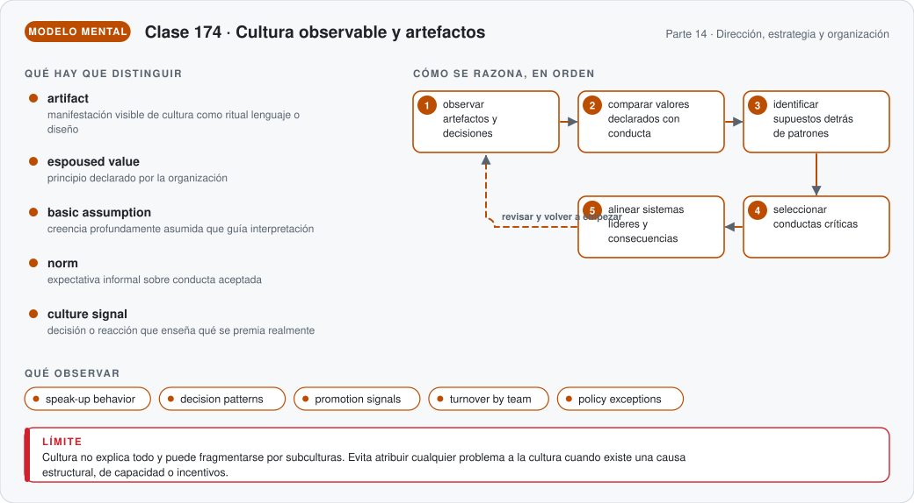

# Clase 174 — Cultura observable y artefactos

<!-- nav:inicio -->
> **Parte 14 · Diseño organizacional, cultura y cambio** — clase 6 de 12 · [índice de la parte](../../README.md) · [temario](../../../../SYLLABUS.md)
<!-- nav:fin -->

**Parte:** 14 — Diseño organizacional, cultura y cambio  
**Nivel:** Etapa 4 — Gerente → Director  
**Duración sugerida:** 150–180 minutos · **Estándar:** deep-class-v2

## 🎯 Propósito

«La cultura se come a la estrategia en el desayuno» es una frase que repiten ejecutivos que nunca definieron qué es cultura. Para muchos es un conjunto de valores en la pared, un clima agradable o «cómo somos aquí», una idea tan amplia que no sirve para decidir nada. Pero la cultura es observable: se ve en **qué se premia y qué se castiga en la práctica**, en **quién habla en una reunión y quién calla**, en **cómo se tratan los errores**, en **qué historias se cuentan** y en **qué decisiones se toman cuando nadie mira**. Entenderla con rigor permite diagnosticarla sin caricaturas, ver las brechas entre lo que se dice y lo que se hace y decidir con realismo cuánto se puede cambiar y cómo.

La clase se apoya en el modelo de niveles de Schein (artefactos, valores declarados y supuestos básicos), en el estudio de Edmondson sobre seguridad psicológica y aprendizaje en equipos, en las ideas de Lencioni sobre salud organizacional y en la visión de Heath y Heath sobre cómo se cambia el comportamiento. Al terminar sabrás observar una cultura en sus niveles, detectar brechas entre discurso y práctica, usar artefactos como evidencia, evaluar la seguridad psicológica y plantear intervenciones realistas.

## 📚 Resultados de aprendizaje

Al finalizar podrás:

1. **Describir** los niveles de la cultura: artefactos, valores declarados y supuestos básicos.
2. **Observar** una cultura con evidencia de varias fuentes.
3. **Detectar** brechas entre lo declarado y lo practicado.
4. **Evaluar** la seguridad psicológica de un equipo.
5. **Plantear** intervenciones sobre artefactos, incentivos y rutinas.

## 🧭 Agenda

| Tramo | Qué se hace |
|---|---|
| 0–20 min | Recuperación: ¿qué le pasa a quien trae una mala noticia en tu empresa? Describe un caso real. |
| 20–60 min | Niveles, observación, brechas, seguridad psicológica e intervención. |
| 60–105 min | Ejemplo trabajado: auditoría cultural en una empresa que dice priorizar la seguridad. |
| 105–150 min | Caso ejecutivo y práctica. |
| 150–175 min | Límites y entregable. |

## 🧩 Conceptos centrales

| Concepto | Definición | Cómo se reconoce |
|---|---|---|
| **Cultura organizacional** | Patrón de supuestos compartidos que un grupo aprendió al resolver problemas y que enseña a los nuevos. | Se ve en lo que se hace de forma natural. |
| **Artefactos** | Elementos visibles: espacios, símbolos, lenguaje, ceremonias, historias, estructuras y procesos. | Se observan; su significado exige interpretación. |
| **Valores declarados** | Principios que la organización dice sostener. | Aparecen en documentos y discursos. |
| **Supuestos básicos** | Creencias tácitas sobre la realidad y cómo funcionan las cosas. | Se dan por sentadas. |
| **Seguridad psicológica** | Creencia compartida de que el equipo es seguro para asumir riesgos interpersonales. | Se habla de errores y dudas. |
| **Brecha cultural** | Diferencia entre lo declarado y lo practicado. | «Decimos X y hacemos Y». |

## 🧠 Modelo mental

**Cómo leer el diagrama.** Una escalera de cuatro niveles, de lo más visible a lo más profundo. Los **artefactos visibles** son espacios, símbolos, lenguaje, historias y ceremonias. Los **comportamientos y rutinas** son lo que la gente hace, qué se premia y qué se tolera. Los **valores declarados** son lo que la organización dice que le importa. Los **supuestos básicos** son creencias tácitas sobre cómo funcionan las cosas. La nota aclara que Schein distingue tres niveles (artefactos, valores declarados y supuestos); aquí se separan los comportamientos para poder registrarlos, y que las brechas entre niveles revelan la cultura real.

## 📖 Desarrollo

### 1. Tres niveles de la cultura

Schein define la cultura como un **patrón de supuestos básicos compartidos** que un grupo aprendió al resolver sus problemas de adaptación externa e integración interna, que funcionó lo bastante bien como para considerarse válido y que se enseña a los nuevos como la manera correcta de percibir, pensar y sentir. Distingue tres niveles: los **artefactos** (lo visible: estructuras, procesos, espacios, ceremonias, lenguaje, historias), los **valores y creencias declarados** (estrategias, objetivos y filosofías) y los **supuestos básicos subyacentes** (creencias inconscientes que determinan percepciones y conductas). Para observar una cultura se empieza por lo visible, pero su significado se descifra al preguntar por lo que hay detrás.

### 2. Observar sin caricaturizar

Se recolecta **evidencia de varias fuentes**: **observación** de reuniones, espacios y rutinas (quién habla, quién interrumpe, cómo se decide); **documentos** (políticas, presentaciones, comunicados, descripciones de cargo, criterios de evaluación); **datos** (rotación, ausentismo, promociones, quejas, encuestas, incidentes reportados); **historias** (¿a quién se admira?, ¿qué errores se cuentan y cómo?, ¿qué ocurrió con quien disintió?); y **entrevistas** (con personas de distintos niveles, antigüedades y áreas). Se buscan **patrones**, no anécdotas, y se contrastan diferentes subculturas (áreas, turnos, sedes). Una cultura no es homogénea, y cualquier descripción debe reconocer variaciones.

### 3. Qué dicen los artefactos

Los artefactos son pistas. **Quién tiene la mejor oficina**, **cómo se asignan los espacios**, **qué se celebra** (ventas, seguridad, innovación), **qué se mide y se muestra en pantallas**, **qué lenguaje se usa** («recursos» frente a «personas»), **a quién se promueve**, **qué reuniones existen y cuánto duran**, **cómo se tratan los errores** (¿se escriben en una lista de culpables o en una de aprendizajes?). Cada uno revela lo que la organización realmente valora, a menudo en contradicción con lo declarado. Se registran de forma descriptiva («los lunes la dirección revisa ventas durante 90 minutos y seguridad durante 10») antes de interpretarlos.

### 4. Brechas entre lo declarado y lo practicado

La **brecha cultural** es la distancia entre los valores declarados y los comportamientos observados. Ejemplos: «la seguridad es lo primero» con metas de producción que castigan detener una línea; «valoramos la colaboración» con evaluaciones y bonos individuales; «la innovación es clave» sin tolerancia al fracaso; «puertas abiertas» con consecuencias para quien las usa. Las personas aprenden de lo que **ven que ocurre**, no de lo que se les dice: si el que reporta un problema es castigado, aprenderán a callar, sea cual sea el valor en la pared. Identificar las brechas y sus causas (incentivos, estructura, ejemplos de los líderes) es el corazón del diagnóstico cultural.

### 5. Seguridad psicológica y aprendizaje

Edmondson estudió equipos de hospitales y encontró que los **equipos mejores** informaban **más errores**, no menos: porque en ellos era seguro reportar. Definió la **seguridad psicológica** como la creencia compartida de que el equipo es seguro para asumir riesgos interpersonales: preguntar, reconocer errores, pedir ayuda, disentir. Su efecto sobre el aprendizaje y el desempeño es especialmente relevante en trabajos complejos y de incertidumbre. Se **evalúa** con observación (¿se hacen preguntas?, ¿se reconocen errores?), con **encuestas breves** validadas y con conversaciones. Se **construye** con conductas de liderazgo: reconocer la propia falibilidad, invitar a opinar, responder de forma constructiva a las malas noticias y separar el análisis del problema de la búsqueda de culpables.

### 6. Salud organizacional

Lencioni sostiene que las organizaciones sanas —con **equipo directivo cohesionado**, **claridad** sobre propósito, valores y prioridades, **comunicación** de esa claridad de forma reiterada y **refuerzo** mediante sistemas (contratación, evaluación, reuniones)— superan a las inteligentes pero disfuncionales. Aunque su evidencia proviene más de la práctica que de estudios controlados, ofrece una lista útil de elementos observables: ¿el equipo directivo discute con franqueza y se compromete después?, ¿las prioridades son pocas y conocidas?, ¿los valores se usan para contratar y despedir? Estos elementos conectan la cultura con el diseño organizacional (clase 169) y con las rutinas de gobierno (clase 172).

### 7. Intervenir sobre la cultura

La cultura no se cambia con campañas. Heath y Heath describen tres palancas del cambio de comportamiento: **dirigir al jinete** (dar claridad sobre qué hacer), **motivar al elefante** (apelar a las emociones y a la identidad) y **moldear el camino** (cambiar el entorno para facilitar la conducta). En términos de cultura: cambiar **artefactos** (reuniones, métricas, espacios, rituales), **incentivos** (clase 175), **procesos** (cómo se contrata, evalúa, promueve y trata el error), **ejemplos de líderes** (conductas visibles y consistentes) y **narrativas** (qué historias se cuentan). El cambio se **mide** con indicadores de comportamiento (incidentes reportados, preguntas en reunión, decisiones escaladas, rotación) y con la repetición de las conversaciones. Se acepta que la cultura cambia lento y que algunas subculturas permanecerán.

## 📚 Lectura comparada

| Obra | Qué aporta | Qué no resuelve | Pregunta para contrastar |
|---|---|---|---|
| Schein y Schein | Niveles de la cultura y método de diagnóstico. | Interpretar supuestos exige práctica y juicio. | ¿Qué supuesto sostiene este artefacto? |
| Edmondson (1999) | Seguridad psicológica y aprendizaje en equipos. | Estudio en equipos específicos; medición por cuestionario. | ¿Es seguro decir una mala noticia aquí? |
| Edmondson (*The Fearless Organization*) | Cómo construir seguridad psicológica en organizaciones. | Evidencia mixta sobre intervenciones. | ¿Qué hacen los líderes para invitar a opinar? |
| Lencioni | Salud organizacional, claridad y refuerzo. | Evidencia basada en la práctica. | ¿Tu equipo directivo es cohesionado? |
| Heath y Heath | Palancas para el cambio de comportamiento. | Marco práctico. | ¿Qué cambia el camino de las personas? |

## 🧮 Ejemplo trabajado

**Situación (hipotética).** Una empresa minera con 1.800 empleados declara como primer valor «La seguridad ante todo». En los últimos dos años, los accidentes con tiempo perdido subieron de 9 a 15 al año, y un accidente grave ocurrió en una faena donde «nadie vio ningún problema». La gerencia encarga un diagnóstico cultural.

**Artefactos observados.**

| Artefacto | Observación |
|---|---|
| Pantallas en el hall | Producción diaria con colores; seguridad aparece en la última pantalla, semanal |
| Reunión de gerencia de los lunes | 90 minutos de producción y costos; 10 minutos de seguridad al final |
| Reconocimientos del año | 12 de 14 premios por producción o ahorro; 2 por seguridad |
| Sistema de reporte de cuasi accidentes | 38 reportes en el año para 1.800 personas (benchmark interno sugiere más de 300) |
| Historia que se cuenta | «El supervisor que detuvo la línea un viernes y perdió el bono del turno» |
| Bonos | 70 % de producción, 10 % de seguridad (solo si no hay accidentes con tiempo perdido) |

**Entrevistas (32 personas, 4 turnos).** «Si detienes la faena, tienes que justificar el costo»; «reportar un cuasi accidente trae auditorías y papeleo»; «si hay un accidente, lo oculto hasta fin de mes para no perder el bono» (dicho por tres personas). Encuesta breve de seguridad psicológica (24 ítems validados; 410 respuestas): 41 % está de acuerdo con «aquí puedo señalar un problema sin temer consecuencias» (en turnos de noche, 28 %).

**Lectura por niveles.** Valor declarado: seguridad. Comportamientos: se detienen pocas veces; se oculta información. Artefactos: reconocimiento, reunión y bonos premian producción. Supuesto subyacente: «la producción paga las cuentas y quien la detiene es un obstáculo».

**Brechas y causas.** La brecha se explica por incentivos (bono), por el ejemplo de los líderes (reunión de los lunes), por el costo del reporte (papeleo) y por una experiencia de castigo (la historia del supervisor). No se explica por falta de capacitación.

**Intervención.** (1) Cambiar el bono: 30 % seguridad con indicadores adelantados (reportes de cuasi accidentes, acciones correctivas cerradas) y no solo accidentes; (2) la reunión de los lunes inicia con seguridad 30 minutos; (3) reporte simplificado en el teléfono en dos minutos, sin auditoría por reportar; (4) autoridad explícita de detener cualquier trabajo sin consecuencias, con casos públicos reconocidos; (5) formación de supervisores en conversaciones de seguridad psicológica; (6) revisión trimestral de indicadores de comportamiento: reportes, detenciones, seguridad psicológica por turno.

**Resultados a 12 meses.** Reportes de cuasi accidentes: de 38 a 410; accidentes con tiempo perdido: de 15 a 9; seguridad psicológica: de 41 % a 63 % (noche: 52 %); la producción baja 1,5 % durante el primer semestre y se recupera. Se descubre que un jefe de turno castiga a quienes reportan; se interviene individualmente.

**Cuidados.** Los datos de encuestas se tratan de forma confidencial y agregada; las normas de seguridad minera y laboral aplicables se verifican en su fuente vigente y con asesoría.

**Qué muestra.** (1) Los artefactos contradecían el valor declarado. (2) La brecha tenía causas de diseño. (3) La intervención cambió incentivos y rutinas y se midió con comportamientos.

## 🔀 Comparación y límites

**Cultura frente a clima.** El clima es la percepción compartida de prácticas y políticas en un momento; la cultura es el patrón más profundo de supuestos. El clima se mide con encuestas; la cultura requiere observación e interpretación.

**Límites.** Los modelos de niveles son una ayuda interpretativa y no una medición objetiva. La interpretación de supuestos depende del observador. Las encuestas de seguridad psicológica miden percepciones, que pueden variar por turno, área y confianza en el anonimato. Las intervenciones de cultura tardan en mostrar efectos y no garantizan cambios profundos. Los datos de personas se tratan con confidencialidad y de acuerdo con la normativa de protección de datos. Las cifras del ejemplo son ilustrativas.

## 🪜 De profesional a owner

| Nivel | Cómo participa en la cultura |
|---|---|
| **Profesional** | Practica los valores aun cuando es incómodo y señala brechas. |
| **Jefe / Team Lead** | Crea seguridad psicológica y responde bien a las malas noticias. |
| **Gerente** | Alinea incentivos, rutinas y mensajes con los valores declarados. |
| **CEO / Director** | Da el ejemplo visible y protege a quienes advierten problemas. |
| **Founder / Owner** | Es consciente de que su comportamiento define la cultura inicial. |

## 🏢 Caso ejecutivo

Una empresa de tecnología financiera con 700 empleados declara como valores «Transparencia, Colaboración y Cliente primero». En la práctica: los directivos comparten poca información sobre resultados; los equipos de ventas y de producto compiten por recursos y se culpan mutuamente; las quejas de clientes se atienden por área y en tres sistemas distintos; la rotación de ingenieros es de 31 %; una encuesta anónima mostró que solo el 33 % cree que «aquí se puede decir lo que se piensa sin consecuencias»; el CEO fue visto interrumpiendo y menospreciando a una gerente que presentó malas noticias en el comité. El director de personas propone una campaña de valores con carteles y talleres; el CEO quiere «un programa de cultura» en seis meses.

Entrega un **diagnóstico cultural y plan de intervención** que contenga: (a) la evidencia en los cuatro niveles con fuentes múltiples; (b) las brechas entre valores declarados y prácticas, con sus causas; (c) la evaluación de la seguridad psicológica por equipo y el efecto del ejemplo de los líderes; (d) las intervenciones sobre artefactos, incentivos, procesos y conductas del liderazgo, con una secuencia realista; (e) los indicadores de comportamiento para medir el cambio; (f) los cuidados de confidencialidad y las verificaciones laborales y de datos que se harán con las normas vigentes.

## 🧪 Práctica

1. Observa una reunión y registra quién habla, quién interrumpe y cómo se tratan los desacuerdos.
2. Lista diez artefactos de tu organización y qué valor real revelan.
3. Identifica una brecha entre lo declarado y lo practicado y sus causas.
4. Aplica una encuesta breve de seguridad psicológica a tu equipo y comparte los resultados.
5. Diseña dos intervenciones sobre artefactos o incentivos que cambiarían un comportamiento.

## ⚠️ Errores frecuentes

| Error | Por qué ocurre | Cómo corregirlo |
|---|---|---|
| Cultura = valores en la pared | Se mira lo declarado | Observar comportamientos y artefactos. |
| Diagnosticar con una encuesta | Es rápido | Triangular con observación, datos y entrevistas. |
| Campañas en lugar de cambios | Es visible y barato | Cambiar incentivos, procesos y ejemplo. |
| Culpar a las personas | Se ve la conducta | Buscar causas de diseño y de liderazgo. |
| Generalizar | Se simplifica | Reconocer subculturas. |
| Esperar cambios rápidos | Se busca resultados en meses | Medir comportamientos y sostener. |

## ❓ Preguntas de comprobación

1. ¿Qué niveles distingue Schein en la cultura?
2. ¿Qué evidencia se usa para observar una cultura?
3. ¿Qué es una brecha cultural y cómo se origina?
4. ¿Qué es la seguridad psicológica y por qué importa?
5. ¿Qué elementos observables describe Lencioni de una organización sana?
6. ¿Qué palancas ofrecen Heath y Heath para el cambio de comportamiento?
7. ¿Qué límites tiene el diagnóstico cultural?

Claves de respuesta

1. Artefactos, valores declarados y supuestos básicos subyacentes.
2. Observación, documentos, datos (rotación, incidentes, promociones), historias y entrevistas de distintos niveles y áreas.
3. La distancia entre lo declarado y lo practicado; se origina en incentivos, estructura, ejemplos de líderes y experiencias de castigo.
4. La creencia compartida de que el equipo es seguro para asumir riesgos interpersonales; permite reportar errores, preguntar y disentir y favorece el aprendizaje.
5. Equipo directivo cohesionado, claridad sobre propósito y prioridades, comunicación reiterada y refuerzo mediante sistemas.
6. Dirigir al jinete (claridad), motivar al elefante (emoción e identidad) y moldear el camino (entorno).
7. Es interpretativo, depende del observador, las encuestas miden percepciones y los cambios son lentos y no garantizados.

## 📥 Entregable

Guarda en `portfolio/174-cultura-observable-y-artefactos/`:

- `leadership-decision-brief.md` (plantilla [Leadership Decision Brief](../../../../templates/leadership-decision-brief.md)) con el diagnóstico y el plan del caso ejecutivo;
- `team-charter.md` (plantilla [Team charter](../../../../templates/team-charter.md)) con acuerdos de funcionamiento y de seguridad psicológica;
- `decision-journal.md` con las evidencias, las brechas y los indicadores de seguimiento.

## 📗 Fuentes y verificación

- Edgar H. Schein & Peter A. Schein — *Organizational Culture and Leadership* (John Wiley & Sons, Incorporated, 1991). **Uso en esta clase:** niveles de la cultura y método de diagnóstico. Lectura selectiva sobre **cultura observable y artefactos**. **Localizador:** [ISBN-13 9780470640562](https://openlibrary.org/isbn/9780470640562).
- Amy C. Edmondson — *Psychological Safety and Learning Behavior in Work Teams* (Administrative Science Quarterly, 1999). **Uso en esta clase:** seguridad psicológica y aprendizaje en equipos. Lectura selectiva sobre **cultura observable y artefactos**. **Localizador:** [DOI 10.2307/2666999](https://doi.org/10.2307/2666999).
- Amy C. Edmondson — *The Fearless Organization* (Wiley, 2018). **Uso en esta clase:** cómo construir seguridad psicológica en organizaciones. Lectura selectiva sobre **cultura observable y artefactos**. **Localizador:** [ISBN-13 9781119477242](https://openlibrary.org/isbn/9781119477242).
- Patrick Lencioni — *The Advantage* (John Wiley & Sons, Incorporated, 2012). **Uso en esta clase:** salud organizacional, claridad y refuerzo. Lectura selectiva sobre **cultura observable y artefactos**. **Localizador:** [ISBN-13 9781118147856](https://openlibrary.org/isbn/9781118147856).
- Chip Heath & Dan Heath — *Switch* (Penguin Random House, 1999). **Uso en esta clase:** palancas para el cambio de comportamiento. Lectura selectiva sobre **cultura observable y artefactos**. **Localizador:** [ISBN-13 9781847940308](https://openlibrary.org/isbn/9781847940308).

> **Regla de fuentes para Cultura observable y artefactos:** las obras anteriores estructuran las perspectivas de esta materia; cualquier norma, ley o estándar vivo mencionado debe comprobarse nuevamente en su fuente primaria vigente, incluidas las normas de seguridad minera y laboral y de protección de datos. Los ejemplos y casos son hipotéticos, con cifras ilustrativas. El desarrollo es original y no reproduce capítulos protegidos.

<!-- pie:inicio -->
---

| Anterior | Índice | Siguiente |
|---|---|---|
| [← 173 · RACI, RAPID y derechos de decisión](../173-raci-rapid-y-derechos-de-decision/README.md) | [Parte 14](../../README.md) · [Programa](../../../../SYLLABUS.md) | [175 · Incentivos y comportamientos →](../175-incentivos-y-comportamientos/README.md) |
<!-- pie:fin -->
