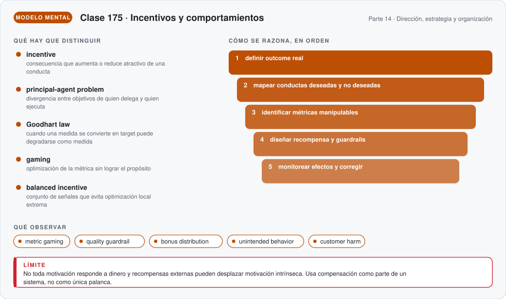

# Clase 175 — Incentivos y comportamientos

<!-- nav:inicio -->
> **Parte 14 · Diseño organizacional, cultura y cambio** — clase 7 de 12 · [índice de la parte](../../README.md) · [temario](../../../../SYLLABUS.md)
<!-- nav:fin -->

**Parte:** 14 — Diseño organizacional, cultura y cambio  
**Nivel:** Etapa 4 — Gerente → Director  
**Duración sugerida:** 150–180 minutos · **Estándar:** deep-class-v2

## 🎯 Propósito

Una organización consigue, casi siempre, lo que sus incentivos premian, y no lo que sus carteles declaran. Cuando un bono depende de las ventas del trimestre, los vendedores adelantan cierres; cuando un indicador mide llamadas atendidas por hora, los agentes cortan llamadas difíciles; cuando se premia a quien apaga incendios, nadie previene. Los incentivos son una **señal sobre qué importa**, y las personas, racionales o no, responden a esa señal. Diseñarlos mal produce justamente el comportamiento que la dirección lamenta.

La clase examina qué dice la evidencia sobre incentivos monetarios y no monetarios: el estudio de Gneezy y Rustichini sobre una multa en guarderías que aumentó los atrasos, el metaanálisis de Deci, Koestner y Ryan sobre recompensas y motivación intrínseca, la teoría de la autodeterminación de Ryan y Deci, y el trabajo de Kerzner sobre medición de desempeño en proyectos. Al terminar sabrás distinguir incentivos que alinean de incentivos que distorsionan, anticipar efectos laterales, combinar medidas con contrapesos y diseñar un esquema que sostenga el rediseño organizacional.

## 📚 Resultados de aprendizaje

Al finalizar podrás:

1. **Explicar** por qué un incentivo es una señal y no solo un pago.
2. **Distinguir** motivación intrínseca y extrínseca y los efectos de las recompensas.
3. **Anticipar** efectos laterales de una métrica con un ejercicio de «cómo la jugaría».
4. **Diseñar** un esquema con contrapesos y medidas de equilibrio.
5. **Alinear** incentivos con estructura, derechos de decisión y cultura.

## 🧭 Agenda

| Tramo | Qué se hace |
|---|---|
| 0–20 min | Recuperación: ¿qué métrica de tu área se puede «jugar» sin crear valor? |
| 20–60 min | Señales, motivación, efectos laterales, contrapesos y alineación. |
| 60–105 min | Ejemplo trabajado: rediseño del bono de un equipo comercial. |
| 105–150 min | Caso ejecutivo y práctica. |
| 150–175 min | Límites y entregable. |

## 🧩 Conceptos centrales

| Concepto | Definición | Cómo se reconoce |
|---|---|---|
| **Incentivo** | Cualquier consecuencia anticipada que influye en la conducta: pago, reconocimiento, promoción, sanción. | La persona ajusta lo que hace según lo que espera obtener. |
| **Motivación intrínseca** | Hacer una actividad por interés o satisfacción propia. | Se trabaja sin recompensa externa. |
| **Motivación extrínseca** | Hacer algo por una consecuencia externa. | Depende del premio o la sanción. |
| **Efecto de desplazamiento** | Una recompensa externa que reduce el interés intrínseco. | Al retirar el premio, baja el esfuerzo. |
| **Efecto lateral** | Conducta no buscada que provoca una métrica. | Se optimiza el número, no el resultado. |
| **Medida de equilibrio** | Indicador que vigila lo que la métrica principal podría dañar. | Se mide calidad junto a velocidad. |

## 🧠 Modelo mental

**Cómo leer el diagrama.** Dos paneles. A la izquierda, tres rasgos de un incentivo que alinea: premia lo que realmente importa, es controlable por la persona y se acompaña de un contrapeso. A la derecha, tres rasgos de uno que distorsiona: premia lo medible en lugar de lo valioso, desplaza la motivación intrínseca y genera competencia interna que esconde información. La nota recuerda que el incentivo es una señal y que, si contradice el discurso, la gente sigue la señal; el pie advierte que la evidencia depende de la tarea.

## 📖 Desarrollo

### 1. El incentivo como señal

Un incentivo comunica **qué espera y qué valora la organización**. Si el discurso dice «calidad» y el bono depende de volumen, el mensaje real es volumen. Por eso el diseño de incentivos es parte del diseño organizacional (clases 169 a 173): la estructura reparte tareas y decisiones, los derechos de decisión dicen quién decide, y los incentivos aseguran que quien decide tenga razones para hacerlo bien. Cuando los tres se contradicen, domina el que tiene consecuencias personales, normalmente el incentivo. La pregunta de diagnóstico es simple: ¿qué conducta me conviene a mí, como persona, en este sistema?

### 2. Cuando una multa se vuelve un precio

Gneezy y Rustichini estudiaron guarderías israelíes donde los padres llegaban tarde a recoger a sus hijos. Introdujeron una multa por retraso, esperando menos atrasos. Ocurrió lo contrario: los atrasos **aumentaron** y no volvieron a bajar al retirar la multa. Su lectura es que la multa convirtió una obligación moral implícita en una **tarifa**: pagar por llegar tarde pasó a ser un servicio legítimo. La lección no es que las multas sean siempre malas, sino que un incentivo económico puede cambiar la **definición de la situación** y desplazar normas sociales previas. Antes de introducir un incentivo, hay que preguntar qué norma ya estaba funcionando.

### 3. Recompensas y motivación intrínseca

Deci, Koestner y Ryan revisaron decenas de experimentos y concluyeron que las **recompensas tangibles contingentes** (pagar por realizar una actividad interesante) tienden a **reducir la motivación intrínseca** medida como interés y persistencia posteriores, mientras que el elogio informativo suele aumentarla. Ryan y Deci, en su teoría de la autodeterminación, explican el mecanismo: las personas necesitan **autonomía, competencia y vínculo**; las recompensas percibidas como control debilitan la autonomía, y las que informan sobre competencia la fortalecen. Esto importa más en tareas creativas y complejas que en tareas rutinarias y bien definidas, donde un pago por rendimiento suele mejorar la cantidad. La evidencia es debatida en sus detalles, por lo que conviene tratarla como advertencia, no como ley.

### 4. Lo que se mide es lo que se juega

Cualquier métrica usada para premiar se vuelve objetivo y, al volverse objetivo, tiende a perder su valor como medida (idea que suele asociarse a Goodhart y Campbell). Ejemplos: tiempo medio de atención que lleva a cortar llamadas; tasa de aprobación de crédito que lleva a aprobar sin criterio; cierres de tickets que lleva a cerrar sin resolver. Un ejercicio útil antes de lanzar un incentivo es **«cómo lo jugaría»**: el equipo lista las formas de subir el número sin crear valor y se diseñan contramedidas. Si se encuentran tres maneras fáciles de jugarlo, el diseño no está listo.

### 5. Contrapesos y medidas de equilibrio

Un buen esquema combina una medida principal con **medidas de equilibrio**: ventas con margen y devoluciones; velocidad con calidad; costo con satisfacción de cliente; entregas con incidentes. Kerzner insiste, en gestión de proyectos, en que los indicadores se definen con su propósito, su fuente de datos y su uso, y en que un conjunto equilibrado evita sobreoptimizar una dimensión. También ayudan los **umbrales** (se paga solo si calidad supera un mínimo), los **horizontes largos** (diferir parte del pago para que aparezcan las consecuencias) y las **revisiones cualitativas** que corrigen lo que el número no ve.

### 6. Individual, de equipo y de empresa

Un incentivo **individual** promueve esfuerzo personal, pero puede romper la colaboración; uno **de equipo** fomenta ayuda mutua, pero genera polizones si el equipo es grande; uno **de empresa** alinea con el resultado total, pero la persona siente poca influencia sobre él. Katzenbach y Smith mostraron que los equipos efectivos comparten metas y responsabilidad mutua; premiar solo lo individual contradice ese diseño. La regla práctica es combinar niveles según la interdependencia de la tarea: a mayor interdependencia, mayor peso del componente colectivo. Y conviene que la persona **controle razonablemente** lo que se le mide.

### 7. Incentivos no monetarios y conducta del liderazgo

Reconocimiento, autonomía, oportunidades de aprender, claridad del propósito y trato justo son incentivos potentes y baratos. Los líderes envían señales con sus gestos: a quién promueven, qué preguntan primero en una reunión, qué errores perdonan. Un esquema de bonos impecable queda anulado si el director promueve a quien incumple las reglas pero entrega cifras. Los incentivos también deben ser **percibidos como justos**: criterios conocidos, procesos transparentes y posibilidad de reclamar. La compensación variable tiene, además, marco laboral y tributario que se verifica con asesoría y normas vigentes antes de implementarla.

## 📚 Lectura comparada

| Obra | Qué aporta | Qué no resuelve | Pregunta para contrastar |
|---|---|---|---|
| Gneezy y Rustichini | Una multa puede convertirse en precio y aumentar la conducta indeseada. | Un caso específico en un contexto específico. | ¿Qué norma social había antes del incentivo? |
| Deci, Koestner y Ryan | Efectos de las recompensas sobre la motivación intrínseca. | Los resultados varían según tarea y tipo de recompensa. | ¿La tarea es creativa o rutinaria? |
| Ryan y Deci | Autonomía, competencia y vínculo como necesidades. | Teoría general; exige adaptar al contexto. | ¿El esquema da control o informa competencia? |
| Kerzner | Indicadores con propósito, fuente y uso, y conjuntos equilibrados. | Marco de proyectos; hay que traducirlo. | ¿Qué mide el contrapeso? |
| Katzenbach y Smith | Equipos con metas y responsabilidad mutua. | No fija montos ni fórmulas. | ¿Cuánta interdependencia tiene la tarea? |

## 🧮 Ejemplo trabajado

**Situación (hipotética).** Un equipo comercial de 20 vendedores recibe un bono de 4 % de la venta cerrada en el trimestre. El equipo vendió 900 millones de pesos; el margen cayó de 31 % a 24 %, las devoluciones subieron de 3 % a 7 % y la satisfacción de clientes bajó. Los vendedores entregan descuentos altos y prometen plazos que operaciones no puede cumplir.

**Cálculo del costo del esquema.**

| Concepto | Antes | Después |
|---|---|---|
| Venta trimestral | 820 millones | 900 millones |
| Margen | 31 % → 254,2 millones | 24 % → 216,0 millones |
| Devoluciones | 3 % → 24,6 millones | 7 % → 63,0 millones |
| Bono (4 % de la venta) | 32,8 millones | 36,0 millones |

La venta subió 9,8 % (80 sobre 820), pero el margen bruto bajó 38,2 millones y las devoluciones aumentaron 38,4 millones; el bono subió 3,2 millones. El esquema pagó más por un resultado que destruyó valor.

**«Cómo lo jugaría».** Descuentos fuertes, ventas empujadas a fin de trimestre, promesas irrealistas y clientes poco rentables.

**Rediseño.** (1) El bono pasa a basarse en **margen bruto** y no en venta; (2) se paga solo si las devoluciones están bajo 4 % y la satisfacción sobre un umbral; (3) 30 % del bono se difiere seis meses y se ajusta por devoluciones; (4) 25 % depende de un resultado de equipo (cumplimiento de plazos prometidos); (5) los descuentos sobre un límite requieren aprobación (derecho de decisión, clase 173).

**Resultado esperado a dos trimestres.** Venta de 850 millones, margen de 30 % (255 millones), devoluciones de 3,5 % (29,8 millones). Si el bono es 6 % del margen: 15,3 millones. Frente al esquema anterior, el margen es 39,0 millones más alto y las devoluciones 33,3 millones menores.

**Cuidados.** Los vendedores pueden reaccionar por la reducción del pago aparente; se explica el cambio, se hace una transición y se verifica con asesoría laboral el efecto contractual del cambio de la compensación variable.

**Qué muestra.** (1) Una métrica única llevó a un resultado dañino. (2) El ejercicio de juego anticipa el problema. (3) Contrapesos y diferimiento alinean mejor.

## 🔀 Comparación y límites

**Incentivar frente a explicar.** Un incentivo no sustituye la claridad del propósito ni la capacidad. Si la persona no sabe cómo lograr el resultado, el incentivo solo genera frustración.

**Límites.** La evidencia de laboratorio y de campo sobre incentivos varía según la tarea, la cultura y el monto. Los estudios citados no se extrapolan sin cuidado. Los esquemas de compensación se ajustan a normas laborales, tributarias y de gobierno corporativo vigentes, que se verifican con asesoría. Las cifras del ejemplo son ilustrativas.

## 🪜 De profesional a owner

| Nivel | Cómo trata los incentivos |
|---|---|
| **Profesional** | Entiende qué se premia y señala efectos no deseados. |
| **Jefe / Team Lead** | Reconoce y da retroalimentación coherente con las metas. |
| **Gerente** | Diseña métricas con contrapesos y ejecuta el ejercicio de juego. |
| **CEO / Director** | Alinea incentivos con estrategia, estructura y cultura. |
| **Founder / Owner** | Cuida que el reparto de premios y de propiedad refleje lo que quiere construir. |

## 🏢 Caso ejecutivo

Una empresa de servicios de 900 personas tiene un centro de atención con 120 agentes. Se les mide por **tiempo medio de llamada** (objetivo de 5 minutos) con un bono mensual de 8 % del sueldo si lo cumplen. En seis meses, el tiempo medio bajó de 7,2 a 4,6 minutos, pero las **llamadas repetidas** por el mismo problema subieron de 18 % a 34 %, la satisfacción cayó de 82 a 68 puntos y la rotación de agentes pasó a 41 % anual. El gerente quiere «subir el bono a 12 % para motivar» y mantener la métrica.

Entrega un **rediseño de incentivos** que contenga: (a) el diagnóstico de la conducta que el esquema produce y su efecto en el cliente; (b) el ejercicio «cómo lo jugaría» y las contramedidas; (c) la nueva combinación de métricas, con una principal y medidas de equilibrio, y los umbrales; (d) el equilibrio entre incentivo individual y de equipo según la interdependencia; (e) incentivos no monetarios y conductas de liderazgo; (f) la verificación laboral y tributaria y el plan de transición y comunicación.

## 🧪 Práctica

1. Elige una métrica de tu área y lista cinco maneras de subirla sin crear valor.
2. Diseña una medida de equilibrio para esa métrica y define un umbral.
3. Identifica una norma social que podría desplazar un incentivo económico y cómo lo evitarías.
4. Decide cuánto de un esquema debe ser individual y cuánto de equipo, y por qué.
5. Describe tres señales no monetarias que tu equipo recibe hoy y qué mensaje dan.

## ⚠️ Errores frecuentes

| Error | Por qué ocurre | Cómo corregirlo |
|---|---|---|
| Premiar lo fácil de medir | El dato está disponible | Medir el resultado que importa, aunque sea más difícil. |
| Una sola métrica | Es simple de explicar | Añadir medidas de equilibrio y umbrales. |
| Subir el monto como solución | Se busca más motivación | Revisar la señal y la capacidad antes de subir. |
| Ignorar normas previas | Se asume que el dinero lo arregla todo | Preguntar qué norma había y qué cambia el incentivo. |
| Incentivos que contradicen la estructura | Se diseñan por separado | Alinear con derechos de decisión y roles. |
| Cambiar sin transición | Urgencia de resultados | Explicar, probar y verificar el marco laboral. |

## ❓ Preguntas de comprobación

1. ¿Por qué se dice que un incentivo es una señal?
2. ¿Qué mostraron Gneezy y Rustichini con las guarderías?
3. ¿Qué indica el metaanálisis de Deci, Koestner y Ryan sobre las recompensas?
4. ¿Para qué sirve el ejercicio «cómo lo jugaría»?
5. ¿Qué son las medidas de equilibrio y los umbrales?
6. ¿Cuándo conviene dar más peso al incentivo de equipo?
7. ¿Qué límites tiene la evidencia sobre incentivos?

Claves de respuesta

1. Porque comunica qué valora la organización; si contradice el discurso, la gente sigue la señal.
2. Que una multa por retraso aumentó los atrasos, porque convirtió una obligación moral en una tarifa y desplazó la norma previa.
3. Que las recompensas tangibles contingentes tienden a reducir la motivación intrínseca, mientras el elogio informativo suele aumentarla, con variaciones según la tarea.
4. Para anticipar cómo se puede subir la métrica sin crear valor y diseñar contramedidas antes de lanzarla.
5. Indicadores que vigilan lo que la métrica principal podría dañar; los umbrales condicionan el pago a un mínimo de calidad.
6. Cuando la tarea tiene alta interdependencia y se necesita colaboración.
7. Varía por tarea, cultura y monto; hay debate sobre los detalles y se debe verificar el marco laboral y tributario.

## 📥 Entregable

Guarda en `portfolio/175-incentivos-y-comportamientos/`:

- `leadership-decision-brief.md` (plantilla [Leadership Decision Brief](../../../../templates/leadership-decision-brief.md)) con el rediseño del caso ejecutivo;
- `role-scorecard.md` (plantilla [Role scorecard](../../../../templates/role-scorecard.md)) con las métricas, los contrapesos y los umbrales;
- `decision-journal.md` con el ejercicio «cómo lo jugaría» y las verificaciones pendientes.

## 📗 Fuentes y verificación

- Uri Gneezy & Aldo Rustichini — *A Fine is a Price* (The Journal of Legal Studies, 2000). **Uso en esta clase:** una multa que aumentó los atrasos y desplazó una norma social. Lectura selectiva sobre **incentivos y comportamientos**. **Localizador:** [DOI 10.1086/468061](https://doi.org/10.1086/468061).
- Edward L. Deci, Richard Koestner & Richard M. Ryan — *A meta-analytic review of experiments examining the effects of extrinsic rewards on intrinsic motivation* (Psychological Bulletin, 1999). **Uso en esta clase:** efectos de las recompensas sobre la motivación intrínseca. Lectura selectiva sobre **incentivos y comportamientos**. **Localizador:** [DOI 10.1037/0033-2909.125.6.627](https://doi.org/10.1037/0033-2909.125.6.627).
- Richard M. Ryan & Edward L. Deci — *Self-Determination Theory and the Facilitation of Intrinsic Motivation, Social Development, and Well-Being* (American Psychologist, 2000). **Uso en esta clase:** autonomía, competencia y vínculo en la motivación. Lectura selectiva sobre **incentivos y comportamientos**. **Localizador:** [DOI 10.1037/0003-066X.55.1.68](https://doi.org/10.1037/0003-066X.55.1.68).
- Harold Kerzner — *Project Management* (John Wiley & Sons Inc, 2003). **Uso en esta clase:** indicadores con propósito, fuente y uso, y conjuntos equilibrados. Lectura selectiva sobre **incentivos y comportamientos**. **Localizador:** [ISBN-13 9780471281580](https://openlibrary.org/isbn/9780471281580).
- Jon R. Katzenbach & Douglas K. Smith — *The Wisdom of Teams* (McGraw-Hill, 2005). **Uso en esta clase:** equipos con metas y responsabilidad mutua. Lectura selectiva sobre **incentivos y comportamientos**. **Localizador:** [ISBN-13 9780077111687](https://openlibrary.org/isbn/9780077111687).

> **Regla de fuentes para Incentivos y comportamientos:** las obras anteriores estructuran las perspectivas de esta materia; cualquier norma, ley o estándar vivo mencionado debe comprobarse nuevamente en su fuente primaria vigente, incluido el marco laboral y tributario de la compensación variable. Los ejemplos y casos son hipotéticos, con cifras ilustrativas. El desarrollo es original y no reproduce capítulos protegidos.

<!-- pie:inicio -->
---

| Anterior | Índice | Siguiente |
|---|---|---|
| [← 174 · Cultura observable y artefactos](../174-cultura-observable-y-artefactos/README.md) | [Parte 14](../../README.md) · [Programa](../../../../SYLLABUS.md) | [176 · Diagnóstico de cambio →](../176-diagnostico-de-cambio/README.md) |
<!-- pie:fin -->
