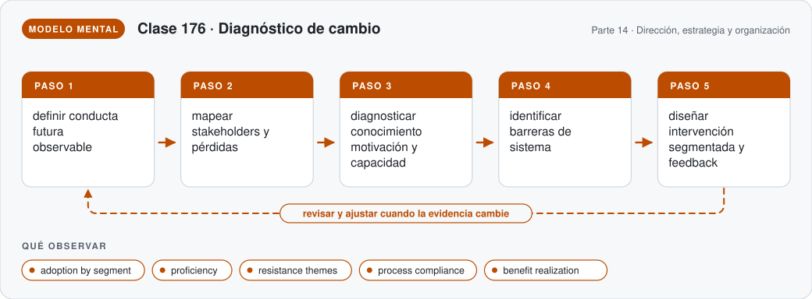

# Clase 176 — Diagnóstico de cambio

<!-- nav:inicio -->
> **Parte 14 · Diseño organizacional, cultura y cambio** — clase 8 de 12 · [índice de la parte](../../README.md) · [temario](../../../../SYLLABUS.md)
<!-- nav:fin -->

**Parte:** 14 — Diseño organizacional, cultura y cambio  
**Nivel:** Etapa 4 — Gerente → Director  
**Duración sugerida:** 150–180 minutos · **Estándar:** deep-class-v2

## 🎯 Propósito

La mayoría de los cambios organizacionales se anuncian antes de entenderse. Se decide una reestructura, un sistema nuevo o una fusión de áreas, y luego se «comunica» para que las personas se alineen. El resultado habitual es resistencia, adopción superficial y vuelta a las viejas prácticas. Un **diagnóstico de cambio** invierte el orden: antes de diseñar la estrategia de adopción, se averigua **qué cambia, para quién, con qué impacto, con qué disposición y con qué riesgos**. No es un trámite: decide el ritmo, la secuencia y el tipo de apoyo.

La clase se apoya en la lógica de Kotter sobre cambios que se sostienen, en el modelo de Armenakis y Harris sobre cómo crear disposición al cambio mediante el mensaje, en las ideas de Heath y Heath sobre conductas concretas y entorno, y en la visión sistémica de Meadows y Senge para anticipar efectos. Al terminar sabrás describir un cambio con precisión, identificar grupos afectados, medir impacto y disposición por grupo, detectar riesgos y elegir una estrategia diferenciada.

## 📚 Resultados de aprendizaje

Al finalizar podrás:

1. **Describir** un cambio como una diferencia concreta de conducta, no como una consigna.
2. **Identificar** los grupos afectados y el impacto en cada uno.
3. **Evaluar** la disposición con conversaciones y datos de comportamiento.
4. **Detectar** riesgos humanos, operativos y de sostenibilidad.
5. **Elegir** una estrategia de cambio distinta para cada grupo.

## 🧭 Agenda

| Tramo | Qué se hace |
|---|---|
| 0–20 min | Recuperación: describe un cambio que fracasó en tu organización y qué se ignoró al lanzarlo. |
| 20–60 min | Definición del cambio, grupos, impacto, disposición, riesgos y estrategia. |
| 60–105 min | Ejemplo trabajado: diagnóstico de un nuevo sistema de planificación en una empresa de distribución. |
| 105–150 min | Caso ejecutivo y práctica. |
| 150–175 min | Límites y entregable. |

## 🧩 Conceptos centrales

| Concepto | Definición | Cómo se reconoce |
|---|---|---|
| **Diagnóstico de cambio** | Análisis previo de qué cambia, a quién afecta y con qué disposición. | Precede al plan de comunicación. |
| **Brecha de conducta** | Diferencia entre cómo se trabaja hoy y cómo se trabajará. | Se describe en acciones observables. |
| **Grupo afectado** | Conjunto de personas con el mismo tipo de impacto. | Comparte roles, riesgos y beneficios. |
| **Disposición al cambio** | Grado en que las personas creen que el cambio es necesario, viable y bueno para ellas. | Se infiere de conversaciones y conductas. |
| **Impacto** | Magnitud de lo que el cambio exige a un grupo: tareas, habilidades, poder, estatus. | Se estima por grupo. |
| **Fatiga de cambio** | Cansancio por la acumulación de iniciativas simultáneas. | Baja la adopción de todo. |

## 🧠 Modelo mental

**Cómo leer el diagrama.** Un cuadrante con la disposición de las personas en el eje horizontal (de baja a alta) y el impacto del cambio en el vertical (de bajo a alto). Alto impacto con baja disposición exige **preparar y escuchar**; alto impacto con alta disposición permite **acelerar con cuidado**; bajo impacto con baja disposición pide **informar y acompañar**; bajo impacto con alta disposición permite **avanzar**. La nota subraya que el diagnóstico se hace por grupos, no en promedio.

## 📖 Desarrollo

### 1. Definir el cambio con precisión

«Ser más ágiles» o «digitalizar la operación» no son cambios; son aspiraciones. Un cambio se describe como **diferencia observable**: antes, los pedidos se aprobaban por correo en tres niveles; después, se aprobarán en el sistema con un nivel y reglas de excepción. Para cada cambio se especifican: qué **deja de hacerse**, qué **empieza a hacerse**, qué **continúa**, quiénes lo ejecutan y desde cuándo. Esta precisión evita que cada grupo interprete algo distinto, revela decisiones aún no tomadas y permite estimar el esfuerzo real. Heath y Heath recomiendan «**guiones de conducta críticos**»: acciones concretas que la gente pueda ejecutar el primer día.

### 2. Mapear grupos afectados

Se identifican los **grupos** que viven el cambio de formas distintas: quienes lo diseñan, quienes lo operan, quienes dependen de sus resultados, quienes pierden poder o estatus, quienes ganan capacidad. Para cada grupo se registra: tamaño, qué cambia para ellos, qué ganan y qué pierden, qué habilidades necesitan, qué calendario tienen (por ejemplo, cierre de mes o temporada alta) y quién los influye. Un mapa de partes interesadas ayuda, pero el foco aquí es el **impacto sobre el trabajo diario**. Un cambio que parece menor para la dirección puede ser enorme para un turno de operaciones.

### 3. Estimar el impacto

El impacto se estima en varias dimensiones: **tareas** (cuántas cambian), **habilidades** (qué nuevo hay que aprender), **relaciones** (con quién se trabaja), **poder y estatus** (quién decide, quién pierde control), **carga** (más trabajo temporal durante la transición) y **riesgo personal** (empleo, evaluación, desempeño). Una escala simple de bajo, medio y alto, con una frase de justificación por dimensión, es suficiente. Lo importante es **no promediar**: un grupo pequeño con impacto alto, como los coordinadores de planta, puede decidir el éxito del cambio.

### 4. Medir la disposición

Armenakis y Harris proponen que la disposición al cambio se construye con **mensajes** que responden cinco creencias: que hay una **discrepancia** (algo debe cambiar), que el cambio es **apropiado** (la solución es adecuada), que existe **eficacia** (somos capaces), que hay **apoyo** principal (los líderes están comprometidos) y que hay **valencia** (me beneficia). Un diagnóstico explora cada creencia por grupo mediante **conversaciones**, **observación** y **datos de comportamiento** (asistencia a capacitaciones, uso de pilotos, preguntas, quejas). Una encuesta ayuda, pero tiene límites: las personas no siempre dicen lo que piensan en un entorno de temor o de fatiga.

### 5. Riesgos del cambio

Se listan riesgos **humanos** (pérdida de personas clave, conflictos, desgaste), **operativos** (caída de servicio durante la transición, errores por doble sistema), **técnicos** (datos migrados incorrectamente, integraciones), **de gobierno** (decisiones sin dueño, derechos de decisión ambiguos) y **de sostenibilidad** (regresión a la práctica anterior al terminar el proyecto). Meadows y Senge enseñan a mirar la **dinámica del sistema**: retardos entre acción y efecto, ciclos de refuerzo y soluciones que mueven el problema a otra parte. Un riesgo frecuente es la **fatiga de cambio**: si diez iniciativas llegan a la vez a un mismo equipo, ninguna se adopta.

### 6. Elegir la estrategia por grupo

La estrategia depende de la combinación de impacto y disposición. Con **alto impacto y baja disposición**, se prepara y se escucha: espacios para plantear dudas, razones claras, participación en el diseño y apoyo concreto. Con **alto impacto y alta disposición**, se acelera con cuidado: se aprovechan campeones, se asegura capacitación y se evita saturarlos. Con **bajo impacto y baja disposición**, se informa y se acompaña. Con **bajo impacto y alta disposición**, se avanza con comunicación simple. Se decide también el **ritmo**: piloto en un grupo, olas secuenciales o implantación simultánea, según riesgo y dependencia.

### 7. Del diagnóstico a la decisión

El diagnóstico termina en **decisiones**: qué se hará, con qué secuencia, qué se pospone, qué se necesita para empezar (condiciones previas) y con qué indicadores se sabrá si funciona. Se definen **criterios de parada o ajuste**: por ejemplo, si el uso del sistema nuevo no supera 60 % a las seis semanas, se revisa. El diagnóstico se actualiza durante el cambio, porque la disposición evoluciona. Kotter advierte que declarar victoria demasiado pronto es una causa común de regresión; por eso se mide más allá del lanzamiento.

## 📚 Lectura comparada

| Obra | Qué aporta | Qué no resuelve | Pregunta para contrastar |
|---|---|---|---|
| Kotter (*Leading Change*) | Pasos y errores típicos de un cambio sostenido. | Es un marco, no un diagnóstico cuantitativo. | ¿Qué paso estamos saltando? |
| Armenakis y Harris | Mensajes que crean disposición según cinco creencias. | Exige conversaciones reales para evaluar creencias. | ¿Cuál de las cinco creencias falta? |
| Heath y Heath | Guiones de conducta críticos, emoción y entorno. | Marco práctico, no medición. | ¿Qué acción concreta cambia el primer día? |
| Meadows | Pensamiento sistémico, retardos y ciclos. | Es abstracto y requiere aplicación. | ¿Dónde puede mover el problema a otro sitio? |
| Senge | Aprendizaje organizacional y modelos mentales. | Exige tiempo y práctica. | ¿Qué supuestos impiden ver el efecto? |

## 🧮 Ejemplo trabajado

**Situación (hipotética).** Una distribuidora de 1.400 personas implementará un sistema de planificación de demanda que reemplaza hojas de cálculo en cuatro regiones. La dirección piensa en una implantación simultánea en tres meses y un plan de comunicación con carteles.

**Cambio definido.** Antes: cada coordinador regional estima la demanda en su planilla y la corrige con su criterio. Después: se usa un pronóstico central con ajustes autorizados y registro de cada ajuste. Deja de hacerse: reescribir planillas locales. Empieza: registrar ajustes con motivo. Continúa: la validación con el cliente clave.

**Grupos e impacto.**

| Grupo | Personas | Impacto | Disposición (conversaciones) |
|---|---|---|---|
| Coordinadores regionales | 24 | Alto: pierden control de su planilla | Baja: «el sistema no conoce mi zona» |
| Planificadores centrales | 12 | Alto: nuevas tareas y responsabilidad | Alta |
| Vendedores | 180 | Medio: nuevas fechas de corte | Media |
| Bodegueros | 320 | Bajo: reciben órdenes más estables | Alta |
| Finanzas | 15 | Medio: cambia el proceso de proyección | Media |

**Datos de comportamiento.** De 24 coordinadores, 9 asistieron a la demostración voluntaria; el piloto en la región sur mostró un error de pronóstico de 14 % con el sistema frente a 19 % con planillas, pero los coordinadores corrigieron manualmente 31 % de las recomendaciones.

**Riesgos.** Pérdida de coordinadores con conocimiento local (riesgo humano); doble sistema durante el cierre de año (riesgo operativo); ajustes manuales que anulan el modelo (sostenibilidad).

**Estrategia.** Los coordinadores son el grupo crítico: no es solo informar, es **preparar y escuchar**. Se incorporan 6 de ellos al diseño de las reglas de ajuste, se reconoce su conocimiento local como insumo autorizado, se programa la implantación en tres olas separadas por dos meses (sur, centro y norte con la cuarta región) y se evita el cierre de año. La capacitación se hace con casos reales y los líderes usan el sistema primero. Criterio de ajuste: si los ajustes manuales superan 20 % a las seis semanas de cada ola, se revisan las reglas con los coordinadores.

**Indicadores.** Error de pronóstico (meta: 12 %); uso del sistema (meta: 85 %); ajustes manuales (meta: bajo 20 %); rotación de coordinadores; satisfacción de coordinadores; nivel de servicio.

**Cuidados.** Si el cambio afecta cargos o funciones, las condiciones laborales se verifican con asesoría y normas vigentes; la información de personas se trata de forma confidencial.

**Qué muestra.** (1) El impacto y la disposición se analizaron por grupo. (2) El grupo crítico no era el más numeroso. (3) La estrategia cambió la secuencia y el diseño.

## 🔀 Comparación y límites

**Diagnóstico frente a comunicación.** La comunicación informa; el diagnóstico decide qué se informa, a quién y cuándo, y qué se debe cambiar antes de comunicar.

**Límites.** La disposición es difícil de medir y cambia con el tiempo. Las conversaciones dependen de la confianza; las encuestas, de su anonimato percibido. Los marcos de Kotter y de Armenakis y Harris son modelos, no leyes. Las cifras del ejemplo son ilustrativas. Los cambios que afectan condiciones laborales exigen revisión legal y laboral actual.

## 🪜 De profesional a owner

| Nivel | Cómo participa en el diagnóstico |
|---|---|
| **Profesional** | Dice con franqueza qué cambia en su trabajo y qué le preocupa. |
| **Jefe / Team Lead** | Recoge las dudas del equipo y las lleva al diseño. |
| **Gerente** | Hace el diagnóstico por grupos y ajusta el ritmo. |
| **CEO / Director** | Prioriza cambios para evitar fatiga y protege a los grupos críticos. |
| **Founder / Owner** | Cuida que el cambio se explique con razones reales y con coherencia. |

## 🏢 Caso ejecutivo

Un banco regional con 2.600 empleados decide unificar sus tres plataformas de atención en una sola y, a la vez, reorganizar las sucursales en zonas, implementar un nuevo sistema de evaluación y migrar el correo. La dirección prevé hacerlo todo en el segundo semestre. Una encuesta rápida mostró 58 % de acuerdo con «la unificación es necesaria»; pero entre los ejecutivos de sucursal, solo 31 %. En otro análisis se ve que el 22 % de los equipos de sucursales participa en más de tres iniciativas simultáneas, y la rotación en ese segmento subió de 11 % a 17 %.

Entrega un **diagnóstico de cambio** que contenga: (a) la definición precisa de cada cambio y la brecha de conducta; (b) el mapa de grupos afectados con su impacto; (c) la disposición por grupo con las evidencias y sus límites; (d) los riesgos, incluida la fatiga de cambio, y una propuesta de secuencia y priorización; (e) la estrategia diferenciada por grupo; (f) los indicadores, los criterios de ajuste y las verificaciones laborales necesarias.

## 🧪 Práctica

1. Describe un cambio de tu organización como antes, después y qué deja de hacerse.
2. Identifica cinco grupos afectados y estima su impacto y disposición.
3. Planifica tres conversaciones con el grupo de mayor impacto para evaluar las cinco creencias de Armenakis y Harris.
4. Lista los cambios simultáneos que recibe un equipo y propone qué posponer.
5. Define dos criterios de ajuste y los indicadores para monitorear la adopción.

## ⚠️ Errores frecuentes

| Error | Por qué ocurre | Cómo corregirlo |
|---|---|---|
| Comunicar antes de diagnosticar | Se busca avanzar rápido | Diagnosticar primero y diferenciar mensajes. |
| Promediar la disposición | Es más simple | Analizar por grupo y destacar los críticos. |
| Cambio vago | Se usan consignas | Describir la diferencia de conducta. |
| Ignorar la fatiga de cambio | Cada iniciativa se ve aislada | Priorizar y secuenciar el portafolio de cambios. |
| Confiar solo en encuestas | Son rápidas | Triangular con conversaciones y comportamientos. |
| Declarar victoria al lanzar | Se mide la implementación | Medir adopción y sostenibilidad. |

## ❓ Preguntas de comprobación

1. ¿Por qué hay que describir un cambio como una diferencia de conducta?
2. ¿Qué dimensiones tiene el impacto de un cambio sobre un grupo?
3. ¿Qué cinco creencias subyacen a la disposición según Armenakis y Harris?
4. ¿Qué estrategia corresponde a alto impacto y baja disposición?
5. ¿Qué es la fatiga de cambio y cómo se maneja?
6. ¿Por qué no se debe promediar la disposición?
7. ¿Qué límites tiene el diagnóstico de cambio?

Claves de respuesta

1. Porque permite saber qué se hará distinto, estimar el esfuerzo real, evitar interpretaciones diferentes y definir acciones concretas.
2. Tareas, habilidades, relaciones, poder y estatus, carga y riesgo personal.
3. Discrepancia, adecuación del cambio, eficacia, apoyo de los líderes y valencia (beneficio personal).
4. Preparar y escuchar: diálogo, razones claras, participación en el diseño y apoyo concreto.
5. Cansancio por demasiadas iniciativas simultáneas; se prioriza y se secuencia el portafolio de cambios.
6. Porque un grupo pequeño con alto impacto y baja disposición puede determinar el resultado, y el promedio lo oculta.
7. La disposición es difícil de medir y cambia; los marcos son modelos; las cifras de ejemplos son ilustrativas y las condiciones laborales exigen revisión actual.

## 📥 Entregable

Guarda en `portfolio/176-diagnostico-de-cambio/`:

- `risk-governance-brief.md` (plantilla [Risk Governance Brief](../../../../templates/risk-governance-brief.md)) con el diagnóstico del caso ejecutivo;
- `stakeholder-legitimacy-map.md` (plantilla [Stakeholder legitimacy map](../../../../templates/stakeholder-legitimacy-map.md)) con los grupos afectados;
- `decision-journal.md` con las evidencias de disposición y los criterios de ajuste.

## 📗 Fuentes y verificación

- John P. Kotter — *Leading Change* (Harvard Business School Press, 1996). **Uso en esta clase:** pasos y errores de un cambio sostenido. Lectura selectiva sobre **diagnóstico de cambio**. **Localizador:** [ISBN-13 9780875847474](https://openlibrary.org/isbn/9780875847474).
- Achilles A. Armenakis & Stanley G. Harris — *Crafting a change message to create transformational readiness* (Journal of Organizational Change Management, 2002). **Uso en esta clase:** mensajes que crean disposición al cambio. Lectura selectiva sobre **diagnóstico de cambio**. **Localizador:** [DOI 10.1108/09534810210423080](https://doi.org/10.1108/09534810210423080).
- Chip Heath & Dan Heath — *Switch* (Penguin Random House, 1999). **Uso en esta clase:** guiones de conducta, emoción y entorno. Lectura selectiva sobre **diagnóstico de cambio**. **Localizador:** [ISBN-13 9781847940308](https://openlibrary.org/isbn/9781847940308).
- Donella H. Meadows — *Thinking in Systems* (Earthscan, 2009). **Uso en esta clase:** pensamiento sistémico, retardos y ciclos. Lectura selectiva sobre **diagnóstico de cambio**. **Localizador:** [ISBN-13 9781849773386](https://openlibrary.org/isbn/9781849773386).
- Peter M. Senge — *The Fifth Discipline* (Random House Audio, 1994). **Uso en esta clase:** aprendizaje organizacional y modelos mentales. Lectura selectiva sobre **diagnóstico de cambio**. **Localizador:** [ISBN-13 9780553473216](https://openlibrary.org/isbn/9780553473216).

> **Regla de fuentes para Diagnóstico de cambio:** las obras anteriores estructuran las perspectivas de esta materia; cualquier norma, ley o estándar vivo mencionado debe comprobarse nuevamente en su fuente primaria vigente, incluidas las condiciones laborales de los cambios que afecten cargos o funciones. Los ejemplos y casos son hipotéticos, con cifras ilustrativas. El desarrollo es original y no reproduce capítulos protegidos.

<!-- pie:inicio -->
---

| Anterior | Índice | Siguiente |
|---|---|---|
| [← 175 · Incentivos y comportamientos](../175-incentivos-y-comportamientos/README.md) | [Parte 14](../../README.md) · [Programa](../../../../SYLLABUS.md) | [177 · Coalición, narrativa y adopción →](../177-coalicion-narrativa-y-adopcion/README.md) |
<!-- pie:fin -->
