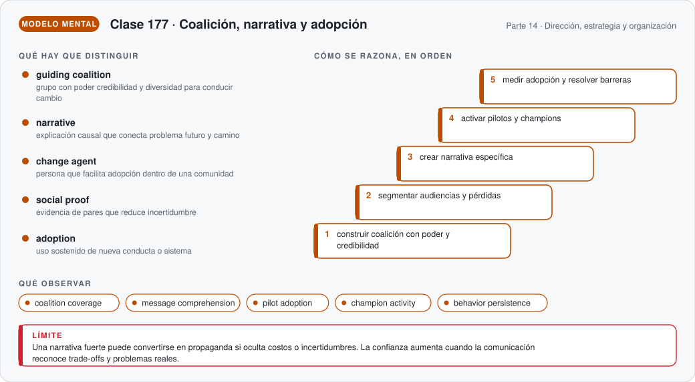

# Clase 177 — Coalición, narrativa y adopción

<!-- nav:inicio -->
> **Parte 14 · Diseño organizacional, cultura y cambio** — clase 9 de 12 · [índice de la parte](../../README.md) · [temario](../../../../SYLLABUS.md)
<!-- nav:fin -->

**Parte:** 14 — Diseño organizacional, cultura y cambio  
**Nivel:** Etapa 4 — Gerente → Director  
**Duración sugerida:** 150–180 minutos · **Estándar:** deep-class-v2

## 🎯 Propósito

Un cambio que solo cuenta con el apoyo formal de la dirección rara vez se adopta. Se necesita que **personas con credibilidad** lo respalden, que exista **una historia clara** de por qué, adónde y cómo, y que adoptar sea **fácil y visible**. Sin coalición, el cambio parece una ocurrencia de la cúpula; sin narrativa, cada uno inventa su propia versión; sin facilidades, la voluntad se agota ante la fricción. La adopción no se decreta: se construye con personas, mensajes y entorno.

La clase integra el modelo de Kotter para liderar cambios, las ideas de Heath y Heath sobre mensajes que se recuerdan y conductas que se facilitan, y la teoría de Rogers sobre la difusión de innovaciones. Al terminar sabrás formar una coalición guía, construir una narrativa con razón y emoción, aprovechar adoptantes tempranos y redes de influencia, conseguir victorias visibles y anclar el cambio en rutinas, incentivos y cultura.

## 📚 Resultados de aprendizaje

Al finalizar podrás:

1. **Formar** una coalición guía con poder, credibilidad y diversidad.
2. **Construir** una narrativa que explique el porqué, el adónde y el cómo.
3. **Aprovechar** la difusión de innovaciones: adoptantes tempranos y redes.
4. **Habilitar** la adopción retirando obstáculos y creando victorias tempranas.
5. **Anclar** el cambio en rutinas, incentivos y cultura.

## 🧭 Agenda

| Tramo | Qué se hace |
|---|---|
| 0–20 min | Recuperación: ¿quién en tu organización, sin cargo alto, logra que la gente adopte cosas? |
| 20–60 min | Coalición, narrativa, difusión, habilitación y anclaje. |
| 60–105 min | Ejemplo trabajado: adopción de un nuevo proceso de cierre en una empresa de servicios. |
| 105–150 min | Caso ejecutivo y práctica. |
| 150–175 min | Límites y entregable. |

## 🧩 Conceptos centrales

| Concepto | Definición | Cómo se reconoce |
|---|---|---|
| **Coalición guía** | Grupo con poder, credibilidad y compromiso que conduce el cambio. | Reúne cargos y reputaciones distintas. |
| **Narrativa del cambio** | Historia que explica por qué cambiar, adónde ir y cómo. | Se repite con ejemplos concretos. |
| **Adoptantes tempranos** | Personas que prueban antes que la mayoría. | Se involucran en pilotos y comentan resultados. |
| **Victoria temprana** | Resultado visible y atribuible logrado pronto. | Se celebra y se usa como evidencia. |
| **Obstáculo** | Estructura, proceso o creencia que impide actuar. | Se identifica al seguir el camino de la persona. |
| **Anclaje** | Integrar el cambio en la forma habitual de operar. | Pasa a rutinas, métricas y contratación. |

## 🧠 Modelo mental

**Cómo leer el diagrama.** Una cadena de cinco movimientos: **urgencia honesta** (por qué ahora), **coalición** (quién lo guía), **narrativa y visión** (adónde y por qué), **habilitar y victorias** (quitar obstáculos y mostrar resultados) y **anclar** (integrar en rutinas, incentivos y cultura). Una flecha de retorno indica que lo aprendido ajusta la narrativa y la coalición. La nota recuerda que la adopción no se decreta y que los pasos no son una receta rígida: se superponen y se repiten.

## 📖 Desarrollo

### 1. Urgencia honesta

Kotter sostiene que muchos cambios fracasan porque no se construye una **urgencia** suficiente: la gente no ve por qué dejar lo conocido. Una urgencia honesta usa **datos y casos** (pérdida de clientes, costos, riesgos, oportunidades) y evita tanto la complacencia como el pánico fabricado. La urgencia falsa, repetida, erosiona la credibilidad. La pregunta es: ¿qué evidencia haría que una persona razonable en el área afectada concluya que no cambiar tiene un costo mayor que cambiar? Se presenta esa evidencia y se escucha lo que falta.

### 2. La coalición guía

Una coalición eficaz combina **poder de posición** (alguien que pueda decidir y asignar recursos), **experiencia** (conocimiento del trabajo), **credibilidad** (personas respetadas por sus pares) y **liderazgo** (capacidad de mover a otros). Debe incluir voces de las áreas más afectadas, no solo de la oficina central, y tener la **confianza** y los **objetivos compartidos** suficientes para trabajar en equipo. Katzenbach y Smith recuerdan que un grupo de trabajo no es un equipo hasta que comparte metas y responsabilidad mutua. Se define cuánto tiempo dedica cada miembro, cómo se decide y cómo se comunica; una coalición que solo se reúne para fotos no sirve.

### 3. La narrativa

Una buena narrativa responde cuatro preguntas: **¿por qué cambiar?** (situación y evidencia), **¿hacia dónde?** (una visión concreta y comprensible), **¿cómo lo haremos?** (pasos, plazos y apoyos) y **¿qué significa para mí?** (impacto por grupo). Heath y Heath describen mensajes que se recuerdan: **simples, inesperados, concretos, creíbles, emocionales y con historias**. Un esquema de diapositivas con quince objetivos no se recuerda; una historia sobre un cliente que dejó de comprar porque el pedido llegó dos veces incompleto, sí. Armenakis y Harris muestran que el mensaje debe abordar las creencias de necesidad, adecuación, capacidad, apoyo y beneficio personal. La narrativa se prueba con quienes la escucharán y se ajusta.

### 4. Cómo se difunde un cambio

Rogers describe cómo se difunden las innovaciones: una minoría de **innovadores** y **adoptantes tempranos** prueba primero; luego la **mayoría temprana** observa y adopta si ve resultados; la **mayoría tardía** adopta por presión o necesidad; los **rezagados** lo hacen al final. Importan los atributos percibidos: **ventaja relativa**, **compatibilidad** con prácticas y valores, **complejidad**, **posibilidad de probar** y **observabilidad** de resultados. En una organización, esto sugiere pilotos con adoptantes tempranos creíbles, resultados visibles para sus pares y reducción de la complejidad. Las redes informales importan: la adopción sigue relaciones de confianza, no organigramas.

### 5. Habilitar: quitar obstáculos

Heath y Heath insisten en **moldear el camino**: muchas veces la resistencia es en realidad fricción. Si el nuevo proceso exige tres autorizaciones, un formulario confuso y una capacitación en horario de atención, aunque la persona quiera, no lo hará. Se revisa el **camino completo**: herramientas, tiempos, permisos, incentivos y conflicto con otras tareas. También se retiran **obstáculos estructurales** (una norma interna que contradice el nuevo proceso, un sistema que no se integra, un jefe que castiga el cambio). Si hay obstáculos que no se pueden retirar, se dice con claridad y se acuerda cómo sortearlos.

### 6. Victorias tempranas y evidencia visible

Las **victorias tempranas** mantienen el impulso y convencen a los escépticos. Para que cuenten, deben ser **visibles** (otros las ven), **inequívocas** (no depende de interpretaciones) y **relacionadas con el cambio** (no con otra cosa). Se planifican: se eligen pilotos con alta probabilidad de éxito, se miden antes y después y se comparten los resultados con detalle y con reconocimiento a los equipos. También se comparten **los fracasos y lo aprendido**: ocultarlos reduce la credibilidad. Kotter advierte contra **declarar victoria definitiva** demasiado pronto: el cambio aún no está anclado.

### 7. Anclar

Anclar es lograr que el cambio sea **la forma normal de trabajar**: se incorpora en procesos, descripciones de cargo, indicadores, incentivos, inducción de personas nuevas y rutinas de gobierno. Se **cierran** las prácticas antiguas (apagar el sistema anterior, eliminar reportes que ya no se usan) para evitar la doble carga. Se asignan **dueños** y **revisiones periódicas**. Y se cuenta la historia de por qué se cambió, para que las personas nuevas la reciban. Si el cambio depende de que ciertas personas «recuerden hacerlo», no está anclado. La cultura se mueve cuando la conducta nueva produce resultados y reconocimiento (clase 174).

## 📚 Lectura comparada

| Obra | Qué aporta | Qué no resuelve | Pregunta para contrastar |
|---|---|---|---|
| Kotter (*Leading Change*) | Etapas: urgencia, coalición, visión, victorias, anclaje. | Es un marco amplio; el orden real es iterativo. | ¿Qué etapa se descuidó? |
| Kotter (*Accelerate*) | Estructura dual: jerarquía y red de voluntarios. | Exige cultura que lo permita. | ¿Cómo participa la red? |
| Heath y Heath (*Switch*) | Jinete, elefante y camino. | Marco práctico, no medición. | ¿Qué fricción retiramos? |
| Heath y Heath (*Made to Stick*) | Mensajes simples, concretos y con historias. | Se debe probar con la audiencia. | ¿Se recuerda la historia a la semana? |
| Rogers | Difusión de innovaciones, adoptantes y atributos. | Basado en innovaciones específicas; se adapta. | ¿Quiénes son los adoptantes tempranos creíbles? |

## 🧮 Ejemplo trabajado

**Situación (hipotética).** Una empresa de servicios con 600 personas y 14 equipos de finanzas y operaciones quiere reducir el cierre mensual de 12 a 6 días con un proceso nuevo de conciliación. Un primer anuncio con una presentación de 40 diapositivas dio por resultado que, al tercer mes, solo 3 de 14 equipos lo usan.

**Diagnóstico.** Los equipos no ven el porqué (el cierre largo les parece normal); la coalición era la gerencia de finanzas sin voces operativas; el nuevo proceso exige cargar datos en dos sistemas; los bonos de los equipos dependen de otros indicadores; el sistema anterior sigue activo.

**Intervención.**

| Movimiento | Acción |
|---|---|
| Urgencia | Se muestra que el cierre largo retrasa decisiones de compras: en tres meses hubo 4 compras urgentes con sobrecosto de 7 % (calculado sobre 120 millones: 8,4 millones) por falta de cifras a tiempo |
| Coalición | Directora de operaciones, dos jefes de equipo respetados, un analista senior, un auditor interno y la gerente de finanzas; 4 horas semanales cada uno durante 12 semanas |
| Narrativa | Historia de la compra urgente y qué pasa con 6 días; mensaje: «cerrar en 6 días para decidir mejor» |
| Habilitar | Se integra la carga en un solo sistema, se elimina un reporte duplicado y se ofrece capacitación en horario laboral |
| Victorias | Piloto con 3 equipos adoptantes tempranos: cierre de 12 a 7 días en dos meses; se comparte con detalle y se reconoce a los equipos |
| Anclar | Se apaga el proceso anterior en cuatro meses; se incorpora el cierre en los indicadores de cada equipo; se actualiza la inducción |

**Resultados a seis meses (hipotéticos).** Equipos que usan el proceso: 12 de 14 (86 %); cierre promedio: 6,8 días; compras urgentes: de 4 a 1 en el trimestre, con sobrecosto de 8,4 a 2,1 millones (ahorro de 6,3 millones). Los dos equipos restantes tienen un sistema distinto y se tratan con un plan específico.

**Cuidados.** Si el cambio altera funciones o cargas de trabajo, se verifican las condiciones laborales con asesoría y normas vigentes.

**Qué muestra.** (1) La urgencia usó evidencia propia. (2) La coalición incluyó voces operativas. (3) La adopción mejoró al retirar fricción y anclar.

## 🔀 Comparación y límites

**Coalición frente a comité.** Un comité representa áreas; una coalición guía el cambio con tiempo, objetivos y capacidad de decidir. Un comité de aprobación puede frenar más que ayudar.

**Límites.** Los modelos de Kotter y de Rogers describen patrones generales y se adaptan a cada organización. La adopción también depende de factores externos (mercado, regulación, crisis). Las narrativas no sustituyen cambios reales: si el discurso contradice la práctica, pierde credibilidad. Las cifras del ejemplo son ilustrativas.

## 🪜 De profesional a owner

| Nivel | Cómo participa |
|---|---|
| **Profesional** | Prueba pronto, da retroalimentación y ayuda a sus pares. |
| **Jefe / Team Lead** | Adopta primero y retira fricción en su equipo. |
| **Gerente** | Integra la coalición y vincula el cambio con incentivos y rutinas. |
| **CEO / Director** | Sostiene la narrativa con coherencia y asigna recursos. |
| **Founder / Owner** | Es el primer ejemplo del cambio y protege a quienes lo impulsan. |

## 🏢 Caso ejecutivo

Una aseguradora con 1.100 empleados lanza una nueva política de atención al cliente: resolver casos en el primer contacto y reducir derivaciones entre áreas. El anuncio fue un correo del gerente general y una charla de una hora. Seis meses después, el 38 % de las áreas cumple el proceso, las derivaciones solo bajaron de 29 % a 26 %, y circulan versiones distintas sobre qué significa «resolver». Un grupo de ejecutivas de reclamos logró 68 % de resolución en primer contacto con un método propio, pero nadie lo conoce fuera de su equipo. El director de personas propone una campaña de carteles; la gerente de operaciones, un nuevo sistema; el gerente general, exigir cumplimiento por línea jerárquica.

Entrega un **plan de adopción** que contenga: (a) la urgencia basada en datos y casos propios; (b) la composición y las reglas de la coalición guía; (c) la narrativa con las cuatro preguntas y la historia principal; (d) cómo se aprovechará al grupo de reclamos y la red de adoptantes tempranos; (e) los obstáculos que se retirarán y las victorias que se mostrarán; (f) el anclaje en rutinas, incentivos y cultura, los indicadores y las verificaciones laborales y regulatorias.

## 🧪 Práctica

1. Escribe en una página la narrativa de un cambio con las cuatro preguntas.
2. Compón una coalición de seis personas para un cambio y justifica cada una.
3. Identifica tres obstáculos de fricción en un proceso que quieres cambiar.
4. Diseña una victoria temprana visible, inequívoca y atribuible.
5. Lista cinco acciones de anclaje que evitarían volver a la práctica anterior.

## ⚠️ Errores frecuentes

| Error | Por qué ocurre | Cómo corregirlo |
|---|---|---|
| Anunciar sin coalición | Se confía en la autoridad | Formar una coalición con credibilidad. |
| Mensajes abstractos | Se busca generalidad | Historias y ejemplos concretos. |
| Culpar a la resistencia | No se mira la fricción | Revisar el camino de la persona. |
| Victorias poco claras | Se miden otras cosas | Definir métricas antes y mostrar resultados. |
| Declarar victoria pronto | Se agota la energía | Medir adopción sostenida. |
| No cerrar lo antiguo | Se teme el riesgo | Apagar el sistema anterior con plan. |

## ❓ Preguntas de comprobación

1. ¿Qué características debe reunir una coalición guía?
2. ¿Qué cuatro preguntas responde una narrativa del cambio?
3. ¿Qué atributos de una innovación influyen en su adopción según Rogers?
4. ¿Por qué conviene retirar fricción antes de culpar a la resistencia?
5. ¿Qué hace que una victoria temprana sea útil?
6. ¿Qué significa anclar un cambio?
7. ¿Qué límites tienen los modelos de Kotter y Rogers?

Claves de respuesta

1. Poder de posición, experiencia, credibilidad y liderazgo, con voces de las áreas afectadas y objetivos compartidos.
2. Por qué cambiar, hacia dónde, cómo se hará y qué significa para cada persona.
3. Ventaja relativa, compatibilidad, complejidad, posibilidad de probar y observabilidad.
4. Porque muchas veces la dificultad es un camino lleno de fricción y no falta de voluntad; retirarla facilita la conducta.
5. Es visible, inequívoca y atribuible al cambio, y se comparte con detalle y reconocimiento.
6. Integrar el cambio en procesos, cargos, indicadores, incentivos e inducción, y cerrar las prácticas antiguas.
7. Son patrones generales que se adaptan; los factores externos también influyen; el discurso debe coincidir con la práctica.

## 📥 Entregable

Guarda en `portfolio/177-coalicion-narrativa-y-adopcion/`:

- `leadership-decision-brief.md` (plantilla [Leadership Decision Brief](../../../../templates/leadership-decision-brief.md)) con el plan de adopción del caso ejecutivo;
- `stakeholder-legitimacy-map.md` (plantilla [Stakeholder legitimacy map](../../../../templates/stakeholder-legitimacy-map.md)) con la coalición y las redes de influencia;
- `decision-journal.md` con la narrativa, las victorias previstas y los indicadores de adopción.

## 📗 Fuentes y verificación

- John P. Kotter — *Leading Change* (Harvard Business School Press, 1996). **Uso en esta clase:** urgencia, coalición, visión, victorias y anclaje. Lectura selectiva sobre **coalición, narrativa y adopción**. **Localizador:** [ISBN-13 9780875847474](https://openlibrary.org/isbn/9780875847474).
- John P. Kotter — *Accelerate* (Harvard Business Review Press, 2014). **Uso en esta clase:** estructura dual con jerarquía y red de voluntarios. Lectura selectiva sobre **coalición, narrativa y adopción**. **Localizador:** [ISBN-13 9781625271747](https://openlibrary.org/isbn/9781625271747).
- Chip Heath & Dan Heath — *Switch* (Penguin Random House, 1999). **Uso en esta clase:** jinete, elefante y camino. Lectura selectiva sobre **coalición, narrativa y adopción**. **Localizador:** [ISBN-13 9781847940308](https://openlibrary.org/isbn/9781847940308).
- Chip Heath & Dan Heath — *Made to Stick* (Penguin Random House, 2007). **Uso en esta clase:** mensajes simples, concretos y con historias. Lectura selectiva sobre **coalición, narrativa y adopción**. **Localizador:** [ISBN-13 9781905211562](https://openlibrary.org/isbn/9781905211562).
- Everett M. Rogers — *Diffusion of Innovations* (Free Press, 2003). **Uso en esta clase:** difusión de innovaciones y atributos que favorecen la adopción. Lectura selectiva sobre **coalición, narrativa y adopción**. **Localizador:** [ISBN-13 9780743222099](https://openlibrary.org/isbn/9780743222099).

> **Regla de fuentes para Coalición, narrativa y adopción:** las obras anteriores estructuran las perspectivas de esta materia; cualquier norma, ley o estándar vivo mencionado debe comprobarse nuevamente en su fuente primaria vigente, incluidas las condiciones laborales de cambios que afecten funciones. Los ejemplos y casos son hipotéticos, con cifras ilustrativas. El desarrollo es original y no reproduce capítulos protegidos.

<!-- pie:inicio -->
---

| Anterior | Índice | Siguiente |
|---|---|---|
| [← 176 · Diagnóstico de cambio](../176-diagnostico-de-cambio/README.md) | [Parte 14](../../README.md) · [Programa](../../../../SYLLABUS.md) | [178 · Transformación empresarial →](../178-transformacion-empresarial/README.md) |
<!-- pie:fin -->
