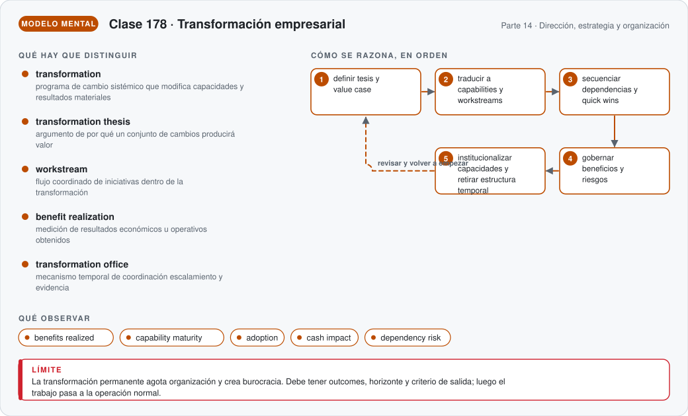

# Clase 178 — Transformación empresarial

<!-- nav:inicio -->
> **Parte 14 · Diseño organizacional, cultura y cambio** — clase 10 de 12 · [índice de la parte](../../README.md) · [temario](../../../../SYLLABUS.md)
<!-- nav:fin -->

**Parte:** 14 — Diseño organizacional, cultura y cambio  
**Nivel:** Etapa 4 — Gerente → Director  
**Duración sugerida:** 150–180 minutos · **Estándar:** deep-class-v2

## 🎯 Propósito

Una transformación empresarial no es un proyecto grande: es un cambio simultáneo en **cómo se genera valor, cómo se organiza el trabajo y cómo se toman decisiones**. Por eso suele ser larga, costosa y arriesgada. Las empresas que se transforman se enfrentan a una tensión permanente: deben seguir operando el negocio que paga las cuentas mientras construyen el que podría pagarlas en el futuro. Descuidar lo primero pone en riesgo la caja; descuidar lo segundo, la relevancia. La mayoría de las transformaciones fracasa por una de esas dos razones, o por perder el hilo entre la intención estratégica y el trabajo diario.

La clase se apoya en la propuesta de Kotter de una estructura dual (jerarquía y red), en las ideas de Dignan sobre sistemas operativos organizacionales más adaptativos, en el panorama de Laloux sobre formas de organizar el trabajo, y en las ideas de Senge sobre aprendizaje organizacional. Al terminar sabrás delimitar una transformación, organizarla en tres frentes, decidir qué se prueba y qué se escala, gobernarla con indicadores y detectar señales de que se estanca.

## 📚 Resultados de aprendizaje

Al finalizar podrás:

1. **Delimitar** una transformación y distinguirla de proyectos y mejoras.
2. **Organizar** tres frentes: estabilizar la base, construir lo nuevo y transferir y anclar.
3. **Decidir** qué se prueba, qué se escala y qué se cierra.
4. **Gobernar** la transformación con indicadores, hitos y puntos de decisión.
5. **Detectar** señales de estancamiento y de agotamiento organizacional.

## 🧭 Agenda

| Tramo | Qué se hace |
|---|---|
| 0–20 min | Recuperación: ¿qué transformación vivió tu organización y qué frente se descuidó? |
| 20–60 min | Delimitación, tres frentes, pilotos, escalamiento, gobierno y señales. |
| 60–105 min | Ejemplo trabajado: transformación de un distribuidor tradicional hacia un modelo mixto. |
| 105–150 min | Caso ejecutivo y práctica. |
| 150–175 min | Límites y entregable. |

## 🧩 Conceptos centrales

| Concepto | Definición | Cómo se reconoce |
|---|---|---|
| **Transformación** | Cambio profundo y simultáneo en modelo, organización y conducta. | Afecta varias áreas y dura años. |
| **Estructura dual** | Jerarquía para operar y red para impulsar el cambio. | Coexisten equipos permanentes y voluntarios. |
| **Estabilizar la base** | Proteger y mejorar el negocio actual. | Se financia y se opera sin descuidos. |
| **Piloto** | Prueba acotada para aprender antes de escalar. | Tiene hipótesis, plazo y métricas. |
| **Escalar** | Extender lo que funcionó a más áreas. | Exige cambios de roles, incentivos y gobierno. |
| **Sistema operativo organizacional** | Conjunto de prácticas con que una organización decide, coordina y aprende. | Reuniones, presupuestos, roles, reglas. |

## 🧠 Modelo mental

**Cómo leer el diagrama.** Tres columnas. **Estabilizar la base**: proteger el negocio que paga hoy, resolver los problemas que bloquean y liberar capacidad para el cambio. **Construir lo nuevo**: pilotos y equipos que prueban el modelo, capacidades nuevas, decisiones por evidencia. **Transferir y anclar**: escalar lo que funciona, cambiar incentivos, roles y gobierno, y cerrar lo que ya no se usa. La nota explica que la transformación fracasa cuando se descuida la operación actual o cuando la innovación queda aislada, y que Kotter propone una estructura dual.

## 📖 Desarrollo

### 1. Qué es y qué no es una transformación

Una **mejora** optimiza lo existente (reducir el tiempo de despacho). Un **proyecto** entrega algo definido con plazo (implementar un sistema). Una **transformación** altera **la forma de ganar dinero y de trabajar**: nuevos clientes o canales, nuevas capacidades, nuevas reglas de decisión, otra estructura. Se reconoce porque requiere **cambios en varias dimensiones a la vez** (estrategia, estructura, procesos, personas, tecnología, cultura) y porque ningún área puede hacerla sola. Nombrar como «transformación» cualquier iniciativa diluye el término y la atención de la dirección. Antes de lanzarla, se escribe en una página: qué problema u oportunidad la justifica, qué será distinto en tres años y qué se arriesga.

### 2. Tres frentes simultáneos

El diagrama propone tres frentes. **Estabilizar la base** asegura que el negocio actual siga generando caja, servicio y confianza: sin ello no hay recursos ni credibilidad. **Construir lo nuevo** crea capacidades y modelos en espacios protegidos: equipos pequeños, pilotos, métricas de aprendizaje. **Transferir y anclar** lleva lo que funciona a la organización principal, cambia incentivos, roles y gobierno y cierra lo que ya no se usa. Los frentes se **coordinan** pero no se mezclan: exigir que el equipo piloto cumpla las métricas de la base lo ahoga, y dejarlo aislado impide que lo aprendido llegue al núcleo. Las personas se asignan con claridad para evitar sobrecargar a quienes operan.

### 3. Estructura dual

Kotter plantea que las organizaciones jerárquicas son buenas para operar con eficiencia, pero lentas para detectar y aprovechar cambios. Propone sumar a la jerarquía una **red** de personas voluntarias de distintas áreas y niveles, orientada a oportunidades estratégicas, con una **coalición guía** y una visión compartida. La red no reemplaza la jerarquía: la complementa. Su éxito depende de que la jerarquía **libere tiempo y atención** de las personas, de que la dirección apoye sus propuestas y de que haya canales para convertir ideas en decisiones. Sin esos elementos, la red es un club de entusiastas sin efecto.

### 4. Pilotos y aprendizaje

Un buen piloto tiene una **hipótesis** (qué creemos que ocurrirá), un **alcance acotado**, un **plazo**, **métricas** definidas antes (de resultado y de aprendizaje) y **criterios de decisión** (escalar, ajustar, cerrar). Senge enfatiza el aprendizaje organizacional: los pilotos solo valen si lo aprendido circula. Se evita el «piloto eterno» sin decisión y el «piloto de laboratorio» con recursos que no existirán al escalar. Se registran los fracasos con la misma seriedad que los éxitos. Un piloto exitoso en condiciones especiales (mejores personas, más atención) puede no repetirse; por eso se prueba la capacidad de replicar.

### 5. Escalar y anclar

Escalar exige **cambiar el sistema** que rodea a lo nuevo: roles y cargos, incentivos, presupuestos, procesos de aprobación, gobierno de datos y capacitación. Se decide la **secuencia** (por unidad, región o proceso), se cuida el **ritmo** para no saturar a los equipos y se establece un **dueño** claro. Anclar significa **cerrar lo antiguo**: apagar sistemas, eliminar reportes y reunir presupuestos, para evitar dobles cargas. Los incentivos (clase 175), los derechos de decisión (clase 173) y la cultura (clase 174) deben coincidir con lo nuevo; si no, la organización vuelve al comportamiento anterior.

### 6. Otras formas de organizar el trabajo

Laloux describe organizaciones que operan con **autogestión** y propósito evolutivo, y Dignan propone mejorar el «sistema operativo» de las organizaciones (cómo se decide, se financia, se estructura y se aprende) mediante experimentos pequeños. Estas ideas ofrecen ejemplos y preguntas útiles: ¿qué decisiones podrían tomarse más cerca del trabajo?, ¿qué reuniones y aprobaciones pueden eliminarse? Sin embargo, la evidencia sobre su aplicabilidad general es limitada y proviene principalmente de casos; se adaptan por etapas, con experimentos y con atención a los límites legales y de gobierno de cada empresa, y no como moda.

### 7. Gobierno y señales de estancamiento

Una transformación necesita **gobierno**: un patrocinador con autoridad, un equipo de dirección con tiempo, una **oficina o función de coordinación** ligera, reuniones periódicas de decisión (no solo de informe), un **tablero** con indicadores de resultado, de adopción, de salud de la base y de personas, y **puntos de decisión** fijados de antemano (continuar, reorientar, detener). Señales de estancamiento: los hitos se cumplen pero los resultados no mejoran; los mejores talentos salen o se agotan; la base se deteriora; los pilotos no llegan a escala; el discurso cambia pero no los incentivos; la dirección pierde interés tras la primera fase. Ante estas señales se revisa la hipótesis, no solo la ejecución.

## 📚 Lectura comparada

| Obra | Qué aporta | Qué no resuelve | Pregunta para contrastar |
|---|---|---|---|
| Kotter (*Accelerate*) | Estructura dual de jerarquía y red. | Basado en casos; requiere apoyo de la dirección. | ¿Qué libera tiempo a la red? |
| Kotter (*Leading Change*) | Etapas de un cambio sostenido. | No detalla métricas de negocio. | ¿Qué etapa está débil? |
| Dignan | Experimentar con el sistema operativo de la organización. | Evidencia mayormente de casos. | ¿Qué decisión puede acercarse al trabajo? |
| Laloux | Panorama de organizaciones autogestionadas. | Aplicabilidad general discutida. | ¿Qué condiciones se necesitan? |
| Senge | Aprendizaje organizacional y pensamiento sistémico. | Exige disciplina y tiempo. | ¿Qué aprendimos y dónde se registró? |

## 🧮 Ejemplo trabajado

**Situación (hipotética).** Un distribuidor mayorista de ferretería con 1.500 personas vende 85 % por vendedores en terreno y 15 % en un canal digital incipiente. Su margen operativo cayó de 8,0 % a 4,5 % en tres años por la competencia de plataformas. Facturación: 240.000 millones de pesos. La dirección anuncia una «transformación digital» con 30 iniciativas simultáneas.

**Delimitación.** No es una mejora ni un proyecto: cambia el modelo (de venta presencial a venta mixta), la organización (equipos de producto y de datos) y la conducta (decisiones por evidencia). Se escribe en una página: por qué, qué será distinto en tres años y qué se arriesga.

**Tres frentes.**

| Frente | Contenido | Dueño |
|---|---|---|
| Estabilizar la base | Margen y servicio de la venta presencial: renegociar condiciones con 40 proveedores, reducir 12 % el costo logístico, proteger a los 60 vendedores principales | Gerencia comercial y operaciones |
| Construir lo nuevo | Equipo de 25 personas para el canal digital con piloto en dos regiones, catálogo, precios y logística de última milla | Director digital |
| Transferir y anclar | Cambiar incentivos de vendedores para premiar clientes migrados, rediseñar roles y cerrar tres reportes y dos sistemas | Gerente general y personas |

**Reducción de iniciativas.** De 30 a 7, con un criterio explícito: alineada con tres hipótesis, con dueño y con impacto estimado. Cada iniciativa tiene una métrica.

**Estructura dual.** Se crea una red de 60 voluntarios, 4 horas semanales, liberados por sus jefes, con una coalición guía de 8 personas y reunión quincenal.

**Cifras de referencia.** El margen de 4,5 % sobre 240.000 millones equivale a 10.800 millones; con 8 % serían 19.200 millones, una diferencia de 8.400 millones. Meta a tres años: 6,5 % con ventas de 255.000 millones, es decir 16.575 millones. El piloto se financia con 1.800 millones (0,75 % de la facturación). El canal digital debe alcanzar 12 % de las ventas.

**Piloto y decisión.** Hipótesis: 30 % de los clientes pequeños migra al canal digital con un costo de servir 35 % menor. A los seis meses migró 22 %, el costo de servir bajó 28 %, pero la logística de última milla excede lo previsto. Decisión: continuar, ajustar logística y extender a una región más.

**Señales de seguimiento.** Margen, ventas digitales, migración, costo de servir, rotación de vendedores clave, satisfacción, adopción de la red y salud de la base.

**Cuidados.** Los cambios de roles de vendedores y de condiciones se verifican con asesoría laboral y normas vigentes; las cifras son ilustrativas.

**Qué muestra.** (1) Delimitar reduce iniciativas dispersas. (2) Cada frente tiene dueño y métrica. (3) El gobierno decide con evidencia del piloto.

## 🔀 Comparación y límites

**Transformación frente a mejora continua.** La mejora continua refina; la transformación cambia el modelo. Ambas son necesarias y se confunden con facilidad.

**Límites.** No hay una receta única; la evidencia proviene en gran parte de casos y de marcos de consultoría y académicos con alcances distintos. Las organizaciones con alta regulación o con restricciones laborales y sindicales tienen más condiciones que verificar. Las cifras del ejemplo son ilustrativas y no corresponden a una empresa real.

## 🪜 De profesional a owner

| Nivel | Cómo participa en la transformación |
|---|---|
| **Profesional** | Participa en pilotos y comparte aprendizajes. |
| **Jefe / Team Lead** | Libera tiempo para la red y protege la operación. |
| **Gerente** | Dirige un frente con métricas y dueños claros. |
| **CEO / Director** | Patrocina, prioriza y decide en los puntos de revisión. |
| **Founder / Owner** | Asegura caja y propósito durante el cambio de modelo. |

## 🏢 Caso ejecutivo

Una empresa de educación técnica con 2.100 personas y 38 sedes quiere pasar de un modelo presencial a uno híbrido. Hay 26 iniciativas, tres consultoras trabajando en paralelo y un comité directivo que se reúne mensualmente para escuchar reportes. La matrícula presencial cayó 9 % anual; el 14 % de los docentes ha participado en alguna prueba de contenidos digitales; el margen bajó de 11 % a 6 %. Un grupo de sedes del sur logró un modelo híbrido con 82 % de aprobación estudiantil, pero se le exige cumplir los mismos indicadores que a las sedes tradicionales, y varios directivos de sede piden detener todo para «no perder matrícula».

Entrega un **plan de transformación** que contenga: (a) la delimitación en una página; (b) los tres frentes con dueños y presupuesto; (c) la reducción y priorización de iniciativas; (d) la estructura dual y el gobierno, con puntos de decisión; (e) los pilotos con hipótesis, métricas y criterios de escalamiento; (f) las señales de estancamiento, los indicadores del tablero y las verificaciones laborales y regulatorias.

## 🧪 Práctica

1. Escribe una página con el problema, el estado a tres años y el riesgo de una transformación.
2. Asigna iniciativas a los tres frentes y define un dueño para cada una.
3. Diseña un piloto con hipótesis, métricas y criterios de decisión.
4. Elimina o pospone cinco iniciativas y explica el criterio.
5. Define seis indicadores para el tablero y tres puntos de decisión.

## ⚠️ Errores frecuentes

| Error | Por qué ocurre | Cómo corregirlo |
|---|---|---|
| Llamar transformación a todo | Se busca relevancia | Delimitar y reservar el término para cambios de modelo. |
| Descuidar la base | La atención va a lo nuevo | Asignar dueños y metas a la operación actual. |
| Piloto aislado | Se protege a la innovación | Definir el camino de transferencia desde el inicio. |
| Demasiadas iniciativas | Cada área propone las suyas | Priorizar por hipótesis, impacto y capacidad. |
| Gobierno de informes | Se prefieren los reportes | Reuniones de decisión con puntos de revisión. |
| No cerrar lo antiguo | Se teme el riesgo | Apagar con plan y fechas. |

## ❓ Preguntas de comprobación

1. ¿En qué se diferencia una transformación de una mejora o un proyecto?
2. ¿Cuáles son los tres frentes de la transformación?
3. ¿Qué propone Kotter con la estructura dual?
4. ¿Qué elementos debe tener un buen piloto?
5. ¿Qué hay que cambiar para escalar lo que funcionó?
6. ¿Qué señales indican estancamiento?
7. ¿Qué límites tienen las ideas de Laloux y Dignan?

Claves de respuesta

1. La transformación cambia el modelo, la organización y la conducta a la vez; la mejora optimiza lo existente y el proyecto entrega algo definido.
2. Estabilizar la base, construir lo nuevo y transferir y anclar.
3. Sumar a la jerarquía una red de voluntarios orientada a oportunidades, con coalición guía y visión compartida.
4. Hipótesis, alcance acotado, plazo, métricas previas y criterios de decisión.
5. Roles, incentivos, presupuestos, procesos, gobierno de datos y capacitación, con un dueño claro, y cerrar lo antiguo.
6. Hitos que se cumplen sin resultados, salida o agotamiento de talento, deterioro de la base, pilotos que no escalan o dirección que pierde interés.
7. La evidencia proviene sobre todo de casos; su aplicabilidad general es discutida y se adapta por etapas y con límites legales.

## 📥 Entregable

Guarda en `portfolio/178-transformacion-empresarial/`:

- `risk-governance-brief.md` (plantilla [Risk Governance Brief](../../../../templates/risk-governance-brief.md)) con el plan del caso ejecutivo;
- `project-charter.md` (plantilla [Project charter](../../../../templates/project-charter.md)) con los frentes, dueños e hitos;
- `decision-journal.md` con las hipótesis de los pilotos y los puntos de decisión.

## 📗 Fuentes y verificación

- John P. Kotter — *Accelerate* (Harvard Business Review Press, 2014). **Uso en esta clase:** estructura dual de jerarquía y red. Lectura selectiva sobre **transformación empresarial**. **Localizador:** [ISBN-13 9781625271747](https://openlibrary.org/isbn/9781625271747).
- John P. Kotter — *Leading Change* (Harvard Business School Press, 1996). **Uso en esta clase:** etapas de un cambio sostenido. Lectura selectiva sobre **transformación empresarial**. **Localizador:** [ISBN-13 9780875847474](https://openlibrary.org/isbn/9780875847474).
- Aaron Dignan — *Brave New Work* (Portfolio, 2019). **Uso en esta clase:** experimentos sobre el sistema operativo de la organización. Lectura selectiva sobre **transformación empresarial**. **Localizador:** [ISBN-13 9780525536208](https://openlibrary.org/isbn/9780525536208).
- Frederic Laloux — *Reinventing Organizations* (Nelson Parker, 2014). **Uso en esta clase:** panorama de organizaciones autogestionadas. Lectura selectiva sobre **transformación empresarial**. **Localizador:** [ISBN-13 9782960133516](https://openlibrary.org/isbn/9782960133516).
- Peter M. Senge — *The Fifth Discipline* (Random House Audio, 1994). **Uso en esta clase:** aprendizaje organizacional y pensamiento sistémico. Lectura selectiva sobre **transformación empresarial**. **Localizador:** [ISBN-13 9780553473216](https://openlibrary.org/isbn/9780553473216).

> **Regla de fuentes para Transformación empresarial:** las obras anteriores estructuran las perspectivas de esta materia; cualquier norma, ley o estándar vivo mencionado debe comprobarse nuevamente en su fuente primaria vigente, incluidas las condiciones laborales y regulatorias de los cambios de roles. Los ejemplos y casos son hipotéticos, con cifras ilustrativas. El desarrollo es original y no reproduce capítulos protegidos.

<!-- pie:inicio -->
---

| Anterior | Índice | Siguiente |
|---|---|---|
| [← 177 · Coalición, narrativa y adopción](../177-coalicion-narrativa-y-adopcion/README.md) | [Parte 14](../../README.md) · [Programa](../../../../SYLLABUS.md) | [179 · Reorganizaciones y riesgos humanos →](../179-reorganizaciones-y-riesgos-humanos/README.md) |
<!-- pie:fin -->
