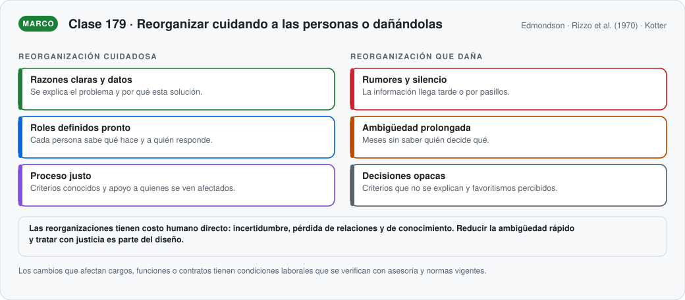

# Clase 179 — Reorganizaciones y riesgos humanos

<!-- nav:inicio -->
> **Parte 14 · Diseño organizacional, cultura y cambio** — clase 11 de 12 · [índice de la parte](../../README.md) · [temario](../../../../SYLLABUS.md)
<!-- nav:fin -->

**Parte:** 14 — Diseño organizacional, cultura y cambio  
**Nivel:** Etapa 4 — Gerente → Director  
**Duración sugerida:** 150–180 minutos · **Estándar:** deep-class-v2

## 🎯 Propósito

Toda reorganización se justifica en un organigrama y se paga en personas. Cambiar jefaturas, fusionar áreas o mover funciones altera relaciones, estatus, rutinas y seguridad laboral de personas concretas, y esos efectos aparecen antes y duran más que los beneficios del nuevo diseño. Es frecuente ver reorganizaciones técnicamente razonables que destruyen confianza, hacen perder talento clave, generan meses de ambigüedad de roles y terminan revertidas. El costo humano no es un «daño colateral»: es una variable del diseño que se estima, se reduce y se gestiona.

La clase integra la evidencia sobre ambigüedad y conflicto de rol (Rizzo, House y Lirtzman), sobre seguridad psicológica (Edmondson), sobre cambios organizacionales (Kotter) y sobre la dinámica de los equipos (Katzenbach y Smith). Al terminar sabrás estimar los riesgos humanos de una reorganización, reducir la ambigüedad rápido, tratar con justicia a las personas afectadas, retener a quienes importan sin crear privilegios opacos y verificar los aspectos laborales con asesoría y normas vigentes.

## 📚 Resultados de aprendizaje

Al finalizar podrás:

1. **Estimar** los riesgos humanos y operativos de una reorganización antes de decidirla.
2. **Reducir** la ambigüedad de roles y de decisión con rapidez.
3. **Diseñar** un proceso justo, con criterios conocidos y apoyo a los afectados.
4. **Retener** conocimiento y talento crítico sin generar inequidad opaca.
5. **Verificar** el marco laboral y de datos con asesoría y fuentes oficiales.

## 🧭 Agenda

| Tramo | Qué se hace |
|---|---|
| 0–20 min | Recuperación: ¿qué costó realmente la última reorganización de tu empresa, más allá del organigrama? |
| 20–60 min | Riesgos, ambigüedad, comunicación, justicia, retención y verificación. |
| 60–105 min | Ejemplo trabajado: fusión de dos áreas de operaciones con 140 personas. |
| 105–150 min | Caso ejecutivo y práctica. |
| 150–175 min | Límites y entregable. |

## 🧩 Conceptos centrales

| Concepto | Definición | Cómo se reconoce |
|---|---|---|
| **Ambigüedad de rol** | Falta de claridad sobre qué se espera, con qué autoridad y con qué criterio de evaluación. | «No sé quién decide esto». |
| **Conflicto de rol** | Expectativas incompatibles de distintas personas sobre un mismo rol. | Dos jefes piden cosas opuestas. |
| **Justicia procedimental** | Percepción de que el proceso para decidir es justo. | Criterios conocidos, voz y trato respetuoso. |
| **Persona crítica** | Quien concentra conocimiento o relaciones difíciles de reemplazar. | Su salida frena un proceso. |
| **Fuga de conocimiento** | Pérdida de saber tácito cuando se van las personas. | Aumentan errores tras las salidas. |
| **Período de transición** | Lapso entre el anuncio y el nuevo funcionamiento estable. | Mezcla estructuras y reglas. |

## 🧠 Modelo mental

**Cómo leer el diagrama.** Dos paneles. A la izquierda, una reorganización cuidadosa: **razones claras y datos**, **roles definidos pronto** y **proceso justo** con criterios conocidos y apoyo. A la derecha, una que daña: **rumores y silencio**, **ambigüedad prolongada** y **decisiones opacas** con favoritismos percibidos. La nota explica que las reorganizaciones tienen costo humano directo y que reducir la ambigüedad rápido es parte del diseño; el pie recuerda que los cambios que afectan cargos, funciones o contratos tienen condiciones laborales que se verifican con asesoría y normas vigentes.

## 📖 Desarrollo

### 1. El costo oculto de reorganizar

Los costos visibles son indemnizaciones, traslados y capacitación. Los **ocultos** suelen ser mayores: pérdida de productividad durante meses, salida de personas valiosas, decisiones paralizadas por no saber quién decide, conflictos entre equipos recién mezclados y erosión de la confianza en la dirección. Una regla práctica es estimar, antes de decidir, tres escenarios del impacto en productividad durante la transición (optimista, base y pesimista) y compararlos con el beneficio esperado. Si el beneficio depende de que no haya ninguna pérdida de productividad, el diseño es frágil. También se compara con alternativas menos invasivas: ajustar procesos, derechos de decisión o interfaces antes de mover personas.

### 2. Ambigüedad y conflicto de rol

Rizzo, House y Lirtzman estudiaron cómo la **ambigüedad** (no saber qué se espera) y el **conflicto** (recibir exigencias incompatibles) se asocian con menor satisfacción y mayor tensión en el trabajo. Una reorganización los genera de forma natural: durante semanas, las personas no saben quién es su jefe, qué decisiones les corresponden ni cómo se evaluará su desempeño. La respuesta es **definir rápido y por escrito** lo esencial: a quién reporta cada persona, qué decisiones toma cada rol (clase 173), cuáles son sus metas del período y cómo se resolverán los conflictos entre jefaturas. Lo que no se puede definir aún, se dice con una fecha en la que se definirá.

### 3. Comunicar con verdad y a tiempo

En ausencia de información, las personas **inventan** explicaciones, casi siempre peores. Una comunicación efectiva incluye: **qué se decidió y por qué** (con datos), **qué no se ha decidido** y cuándo se sabrá, **cómo afecta a cada grupo**, **qué apoyos habrá** y **dónde se pueden hacer preguntas**. Se informa primero a los directamente afectados y a sus jefes inmediatos, antes de cualquier comunicación general, y se evita que se enteren por la prensa o por terceros. Los jefes necesitan material y entrenamiento para dar noticias difíciles. Se aclara además qué información es confidencial y se cumple con los deberes de información que la normativa laboral y de datos establezca, que se verifican con asesoría.

### 4. Proceso justo

La **justicia procedimental** importa tanto como el resultado: las personas aceptan mejor decisiones adversas cuando el proceso es percibido como justo. Elementos: **criterios conocidos** (por ejemplo, para seleccionar a quién ocupa un cargo nuevo), **voz** (posibilidad de ser escuchado antes de decidir), **consistencia** (mismas reglas para todos), **trato respetuoso** y **explicación** (razones comprensibles). Se documentan las decisiones y los criterios, y se evita que las personas sean elegidas por relaciones. Si hay desvinculaciones, el proceso respeta la normativa vigente, que se verifica con asesoría laboral, y se acompaña con apoyo concreto (outplacement, plazos, certificados) más allá del mínimo legal cuando sea posible.

### 5. Retener sin crear privilegios opacos

Es habitual querer **retener** a personas críticas con bonos o mejoras. Esto puede ser razonable, pero tiene riesgos: genera percepción de inequidad si no se explican criterios, y no sustituye la claridad de rol ni la perspectiva de futuro. Antes de ofrecer retención se identifican **personas y conocimientos críticos** (qué procesos se detendrían sin ellas), se **documenta** el saber tácito y se prepara **reemplazo o respaldo**. La retención se ofrece con criterios, plazos y condiciones acordes con la política de compensación y las normas vigentes. La mejor retención es un trabajo con sentido, un jefe confiable y claridad sobre el futuro.

### 6. Equipos nuevos y confianza

Al mezclar equipos, las personas llegan con lealtades, rutinas y lenguajes distintos. Katzenbach y Smith muestran que los equipos efectivos requieren propósito, metas de desempeño, habilidades complementarias y responsabilidad mutua; esto **no ocurre automáticamente** al juntar personas. Se facilita con una **definición de metas comunes**, **reglas de trabajo** (team charter), espacios para conocerse, **ganancias tempranas** compartidas y un líder que escuche. Edmondson subraya la seguridad psicológica: sin ella, los equipos recién formados ocultan errores y dudas justo cuando más se necesitan. Se mide con conversaciones y con indicadores de conducta, no solo con encuestas.

### 7. Medir, ajustar y aprender

Una reorganización se trata como hipótesis: se definen indicadores de **negocio** (productividad, calidad, tiempos), de **personas** (rotación voluntaria, ausentismo, clima, ambigüedad percibida) y de **gobierno** (decisiones escaladas, conflictos entre jefaturas). Se fijan **revisiones** a los 30, 90 y 180 días con autoridad para ajustar diseño o reglas. Se acepta que el diseño original tendrá errores y se corrige sin culpas. Se registra lo aprendido para la próxima vez. Un error común es no medir nada después del anuncio y asumir que el nuevo organigrama «funciona» por existir.

## 📚 Lectura comparada

| Obra | Qué aporta | Qué no resuelve | Pregunta para contrastar |
|---|---|---|---|
| Rizzo, House y Lirtzman | Conflicto y ambigüedad de rol y su efecto en las personas. | Estudio de 1970 en ciertas organizaciones. | ¿Quién decide esto hoy? |
| Edmondson | Seguridad psicológica y aprendizaje en equipos. | No da pasos específicos para una fusión. | ¿Se pueden decir errores aquí? |
| Kotter | Errores comunes y pasos de cambios sostenidos. | Marco general. | ¿Qué paso falta en esta reorganización? |
| Katzenbach y Smith | Qué distingue un equipo de un grupo de trabajo. | No fija el diseño organizacional. | ¿Tenemos metas y responsabilidad mutua? |
| Galbraith | Diseño de estructura, procesos, personas y recompensas. | Poco sobre el proceso humano de transición. | ¿El diseño toma en cuenta la transición? |

## 🧮 Ejemplo trabajado

**Situación (hipotética).** Una empresa de logística fusiona dos áreas de operaciones (zona norte, 80 personas, y zona sur, 60 personas) en una sola dirección con 140 personas para ahorrar costos. Se prevén 6 salidas por duplicidad de cargos directivos y un ahorro anual de 410 millones de pesos. El plan inicial: anunciar el lunes y comenzar a operar el 1 del mes siguiente.

**Estimación de riesgos humanos.**

| Riesgo | Evidencia | Probabilidad e impacto |
|---|---|---|
| Ambigüedad de decisión entre jefaturas | Dos jefes de planificación con roles solapados | Alta y alto |
| Salida de personas críticas | 9 personas con conocimiento exclusivo de rutas y clientes | Media y alto |
| Pérdida de productividad | Casos previos con caída de 8–12 % por tres meses | Alta y medio |
| Conflicto entre equipos | Diferencias de turnos y de bonos entre zonas | Media y medio |

**Costo de la transición.** Si la productividad cae 10 % durante 3 meses en una operación cuyo costo mensual es de 700 millones (nivel de personas y flota), la pérdida estimada es 10 % × 700 × 3 = 210 millones. Si la caída fuera 12 % durante 4 meses: 12 % × 700 × 4 = 336 millones. El ahorro anual de 410 millones se recupera en 6 a 10 meses, no «de inmediato»; por tanto, el diseño es viable pero exige proteger la transición.

**Diseño del proceso.**

1. Definición de roles y reporte para todos los cargos en 15 días, con criterios publicados para seleccionar a las jefaturas; una persona de cada zona participa en un panel.
2. Anuncio escalonado: primero a los afectados directos y jefes, luego a todos con preguntas y respuestas, y un canal para consultas.
3. Matriz de decisiones (clase 173) para planificación, asignación de rutas y atención de clientes durante la transición.
4. Identificación de las 9 personas críticas, documentación de su conocimiento en 30 días y conversaciones individuales sobre su rol futuro; retención solo con criterios y dentro de la política vigente.
5. Para las 6 salidas: proceso conforme a la normativa laboral vigente, verificado con asesoría; apoyo de transición laboral y plazos razonables.
6. Equipos mixtos con metas comunes, team charter y primeras victorias compartidas.
7. Revisiones a los 30, 90 y 180 días con indicadores de productividad, entregas a tiempo, rotación y ambigüedad percibida.

**Resultados a seis meses (hipotéticos).** Productividad cayó 7 % el primer mes y 3,5 % el segundo, y se recuperó el nivel previo en el tercero; la pérdida estimada fue 7 % × 700 + 3,5 % × 700 = 49 + 24,5 = 73,5 millones, bastante menor que el escenario base de 210 millones; se perdió una persona crítica de las nueve; la rotación voluntaria fue de 6 %. Se ajustó la matriz de decisiones en la revisión de los 30 días.

**Qué muestra.** (1) El costo de transición se estimó con escenarios. (2) La ambigüedad se redujo con roles y decisiones definidos pronto. (3) Se cuidó el proceso y se verificó el marco laboral.

## 🔀 Comparación y límites

**Reorganizar frente a ajustar.** A veces basta con cambiar derechos de decisión, interfaces o procesos sin mover personas. Se evalúa esta alternativa antes de recurrir a una reestructura completa.

**Límites.** Las estimaciones de productividad perdida son aproximadas y dependen del contexto. Los estudios de ambigüedad de rol son antiguos y de contextos específicos, aunque sus ideas siguen siendo útiles. Las condiciones de desvinculación, modificación de funciones, traslados, información y consulta a representantes de las personas trabajadoras dependen de la legislación y de los contratos y convenios vigentes; esta clase no las interpreta y remite a fuentes oficiales y asesoría laboral. Los datos personales se tratan con confidencialidad.

## 🪜 De profesional a owner

| Nivel | Cómo participa |
|---|---|
| **Profesional** | Hace preguntas, documenta lo que sabe y cuida la continuidad. |
| **Jefe / Team Lead** | Comunica con honestidad, cuida al equipo y pide aclaraciones de rol. |
| **Gerente** | Define roles y decisiones rápido y vigila los indicadores de personas. |
| **CEO / Director** | Decide con alternativas, asume el costo humano y sostiene el proceso justo. |
| **Founder / Owner** | Es consciente del efecto de sus decisiones sobre la confianza. |

## 🏢 Caso ejecutivo

Una empresa de retail con 3.200 personas anuncia un viernes por la tarde, mediante un correo, una nueva estructura por categorías que elimina las gerencias regionales. El nuevo organigrama entra en vigencia en 20 días. Se desconoce a quién reportarán 140 personas de sucursales y 45 de abastecimiento. Circula una lista no oficial de 90 cargos que desaparecerían. Tres gerentes regionales clave presentan su renuncia; las ventas de la categoría electro bajan 6 % en dos semanas; una encuesta interna muestra que solo 29 % comprende los motivos. El directorio exige ahorros de 1.900 millones de pesos al año y pide «no detener el plan».

Entrega un **plan de reorganización responsable** que contenga: (a) la estimación de riesgos humanos y operativos con escenarios y costo de transición; (b) las alternativas menos invasivas consideradas; (c) la definición de roles, reportes y decisiones con plazos; (d) el plan de comunicación y de proceso justo; (e) el plan de retención y de conocimiento crítico; (f) los indicadores de negocio, de personas y de gobierno con sus revisiones; (g) las verificaciones laborales, de datos y de comunicación con asesoría y normas vigentes.

## 🧪 Práctica

1. Estima el costo de transición de una reorganización con tres escenarios.
2. Escribe qué decisiones tomará cada rol durante los primeros 90 días.
3. Redacta un mensaje de anuncio con lo decidido, lo no decidido y los apoyos.
4. Identifica cinco personas críticas y un plan para documentar su conocimiento.
5. Define tres indicadores de personas y fechas de revisión.

## ⚠️ Errores frecuentes

| Error | Por qué ocurre | Cómo corregirlo |
|---|---|---|
| Anunciar sin definir roles | Se quiere avanzar | Definir reportes y decisiones antes o junto al anuncio. |
| Silencio por confidencialidad | Se teme a los rumores | Comunicar lo que se pueda y fijar fechas para lo demás. |
| Ignorar el costo de transición | Se mira solo el ahorro | Estimar escenarios y comparar. |
| Retener con privilegios opacos | Se actúa por urgencia | Criterios, plazos y coherencia con la política. |
| Mezclar equipos sin metas | Se asume que funcionará | Team charter y objetivos comunes. |
| No medir después del anuncio | Se da por terminado | Revisiones a los 30, 90 y 180 días. |

## ❓ Preguntas de comprobación

1. ¿Qué costos ocultos tiene una reorganización?
2. ¿Qué son la ambigüedad y el conflicto de rol?
3. ¿Qué debe incluir una comunicación de reorganización?
4. ¿Qué elementos componen la justicia procedimental?
5. ¿Qué riesgos tiene una retención con bonos opacos?
6. ¿Qué indicadores se usan para medir la reorganización?
7. ¿Qué verificaciones externas se necesitan y por qué?

Claves de respuesta

1. Pérdida de productividad, salida de talento, decisiones paralizadas, conflictos entre equipos y erosión de la confianza.
2. Ambigüedad: no saber qué se espera o con qué autoridad; conflicto: recibir exigencias incompatibles sobre el mismo rol.
3. Lo decidido y por qué, lo no decidido y cuándo se sabrá, el efecto por grupo, los apoyos y dónde preguntar.
4. Criterios conocidos, voz, consistencia, trato respetuoso y explicación.
5. Percepción de inequidad, incentivos distorsionados y falsa sensación de seguridad si no se aclaran el rol y el futuro.
6. De negocio (productividad, calidad), de personas (rotación, clima, ambigüedad) y de gobierno (decisiones escaladas, conflictos).
7. Las normas laborales, de datos y de comunicación vigentes y los convenios aplicables, que se verifican con asesoría y fuentes oficiales.

## 📥 Entregable

Guarda en `portfolio/179-reorganizaciones-y-riesgos-humanos/`:

- `risk-governance-brief.md` (plantilla [Risk Governance Brief](../../../../templates/risk-governance-brief.md)) con el plan del caso ejecutivo;
- `people-decision-brief.md` (plantilla [People decision brief](../../../../templates/people-decision-brief.md)) con el proceso justo, los criterios y la retención;
- `decision-journal.md` con los escenarios de costo, los indicadores y las revisiones.

## 📗 Fuentes y verificación

- John R. Rizzo, Robert J. House & Sidney I. Lirtzman — *Role Conflict and Ambiguity in Complex Organizations* (Administrative Science Quarterly, 1970). **Uso en esta clase:** conflicto y ambigüedad de rol y su efecto en las personas. Lectura selectiva sobre **reorganizaciones y riesgos humanos**. **Localizador:** [DOI 10.2307/2391486](https://doi.org/10.2307/2391486).
- Amy C. Edmondson — *Psychological Safety and Learning Behavior in Work Teams* (Administrative Science Quarterly, 1999). **Uso en esta clase:** seguridad psicológica y aprendizaje en equipos. Lectura selectiva sobre **reorganizaciones y riesgos humanos**. **Localizador:** [DOI 10.2307/2666999](https://doi.org/10.2307/2666999).
- John P. Kotter — *Leading Change* (Harvard Business School Press, 1996). **Uso en esta clase:** errores y pasos de un cambio sostenido. Lectura selectiva sobre **reorganizaciones y riesgos humanos**. **Localizador:** [ISBN-13 9780875847474](https://openlibrary.org/isbn/9780875847474).
- Jon R. Katzenbach & Douglas K. Smith — *The Wisdom of Teams* (McGraw-Hill, 2005). **Uso en esta clase:** qué distingue un equipo de un grupo de trabajo. Lectura selectiva sobre **reorganizaciones y riesgos humanos**. **Localizador:** [ISBN-13 9780077111687](https://openlibrary.org/isbn/9780077111687).
- Jay R. Galbraith — *Designing Organizations* (Jossey-Bass Publishers, 1995). **Uso en esta clase:** diseño de estructura, procesos, personas y recompensas. Lectura selectiva sobre **reorganizaciones y riesgos humanos**. **Localizador:** [ISBN-13 9780787900915](https://openlibrary.org/isbn/9780787900915).

> **Regla de fuentes para Reorganizaciones y riesgos humanos:** las obras anteriores estructuran las perspectivas de esta materia; cualquier norma, ley o estándar vivo mencionado debe comprobarse nuevamente en su fuente primaria vigente, incluidas las normas laborales, de datos y de comunicación aplicables a reorganizaciones y desvinculaciones. Los ejemplos y casos son hipotéticos, con cifras ilustrativas. El desarrollo es original y no reproduce capítulos protegidos.

<!-- pie:inicio -->
---

| Anterior | Índice | Siguiente |
|---|---|---|
| [← 178 · Transformación empresarial](../178-transformacion-empresarial/README.md) | [Parte 14](../../README.md) · [Programa](../../../../SYLLABUS.md) | [180 · Capstone: rediseño organizacional →](../180-capstone-rediseno-organizacional/README.md) |
<!-- pie:fin -->
