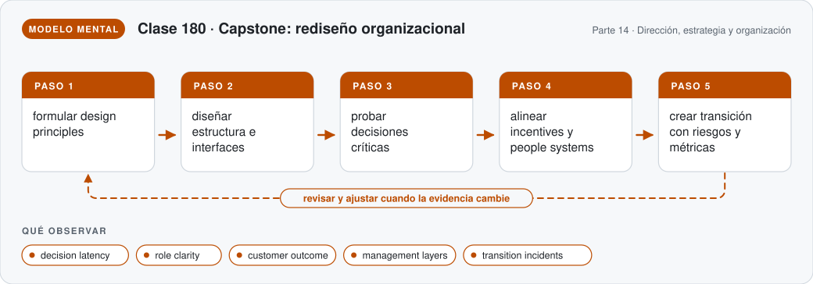

# Clase 180 — Capstone: rediseño organizacional

<!-- nav:inicio -->
> **Parte 14 · Diseño organizacional, cultura y cambio** — clase 12 de 12 · [índice de la parte](../../README.md) · [temario](../../../../SYLLABUS.md)
<!-- nav:fin -->

**Parte:** 14 — Diseño organizacional, cultura y cambio  
**Nivel:** Etapa 4 — Gerente → Director  
**Duración sugerida:** 150–180 minutos · **Estándar:** deep-class-v2

## 🎯 Propósito

Esta clase integra la parte 14. Rediseñar una organización no consiste en dibujar un organigrama nuevo: es **formular una hipótesis** sobre cómo mejorar la coordinación, sostenerla con un diseño coherente (estructura, tramos, modelo operativo y derechos de decisión), alinear incentivos y cultura, gestionar el cambio con atención a las personas y **medir** si funcionó. Cada clase anterior aportó una pieza: la organización como diseño (169), las estructuras (170), los tramos y capas (171), el modelo operativo (172), los derechos de decisión (173), la cultura (174), los incentivos (175), el diagnóstico de cambio (176), la coalición y la narrativa (177), la transformación (178) y los riesgos humanos (179). El capstone las articula en un caso con restricciones y presiones reales.

El trabajo es **un expediente de rediseño**: diagnóstico, alternativas, diseño elegido, plan de cambio, riesgos y métricas, con la honestidad de decir qué se sabe, qué se supone y qué falta verificar. Se apoya en Galbraith, Lawrence y Lorsch, Mankins, Kotter, Edmondson y Skelton y Pais, a quienes se remite para el detalle. Al terminar tendrás un documento que podrías presentar a un comité de dirección.

## 📚 Resultados de aprendizaje

Al finalizar podrás:

1. **Diagnosticar** los problemas de coordinación, estructura, decisión y cultura de una organización.
2. **Comparar** alternativas de diseño con criterios y costos explícitos.
3. **Definir** derechos de decisión, incentivos y gobierno coherentes con el diseño.
4. **Planificar** el cambio con atención a coalición, narrativa y riesgos humanos.
5. **Medir** el resultado y definir criterios de ajuste y de parada.

## 🧭 Agenda

| Tramo | Qué se hace |
|---|---|
| 0–20 min | Recuperación: ¿qué decisión de diseño de la parte 14 cambió tu manera de ver tu organización? |
| 20–60 min | Método integrador en cinco pasos. |
| 60–105 min | Ejemplo trabajado: rediseño de una empresa de servicios de ingeniería. |
| 105–150 min | Caso ejecutivo y práctica. |
| 150–175 min | Límites y entregable. |

## 🧩 Conceptos centrales

| Concepto | Definición | Cómo se reconoce |
|---|---|---|
| **Rediseño organizacional** | Cambio deliberado de estructura, procesos, decisiones, incentivos y cultura para mejorar la coordinación. | Parte de un problema, no de un organigrama. |
| **Hipótesis de diseño** | Afirmación comprobable de cómo un cambio mejorará un resultado. | «Si hacemos X, esperamos Y medido por Z». |
| **Alternativa** | Opción de diseño comparable con otras. | Tiene ventajas, costos y riesgos explícitos. |
| **Coherencia** | Ajuste entre estructura, decisiones, incentivos, personas y cultura. | Los elementos se refuerzan, no se contradicen. |
| **Criterio de ajuste** | Umbral que obliga a revisar el diseño. | Se fija antes de implantar. |
| **Expediente de rediseño** | Documento con diagnóstico, diseño, plan y métricas. | Se puede auditar y comparar con el resultado. |

## 🧠 Modelo mental

**Cómo leer el diagrama.** Una cadena de cinco pasos con retorno. **Diagnosticar**: problema de coordinación, estructura y cultura actuales (clases 169 a 174). **Diseñar**: estructura, tramos y modelo operativo (170 a 172). **Definir decisiones**: derechos de decisión, incentivos y gobierno (173 y 175). **Gestionar el cambio**: coalición, narrativa y riesgos humanos (176 a 179). **Medir y ajustar**: indicadores de coordinación, desempeño y clima. El retorno indica que lo medido corrige el diseño. La nota recuerda que un rediseño es una hipótesis que se prueba en una parte de la organización antes de generalizar.

## 📖 Desarrollo

### 1. Empezar por el problema, no por el organigrama

Mankins y Galbraith coinciden en que el diseño parte de **la estrategia y de los problemas de coordinación**. Antes de dibujar cajas se escribe: ¿qué decisiones se toman tarde, mal o por quien no corresponde?, ¿dónde se pierde tiempo en traspasos?, ¿qué conflictos se repiten?, ¿qué clientes se atienden mal por la forma en que estamos organizados? Se recogen **datos** (tiempos de ciclo, escalamientos, retrabajos, rotación, quejas) y **evidencia cualitativa** (entrevistas, observación de reuniones). Un buen diagnóstico distingue los problemas de **diseño** (se resuelven con estructura o decisiones) de los de **personas** (se resuelven con desarrollo o cambios de rol) y de **proceso** (se resuelven con mejora).

### 2. Alternativas y criterios

Se plantean **al menos tres alternativas**, incluida «mejorar sin reorganizar» y una intermedia (por ejemplo, ajustar derechos de decisión e interfaces). Se evalúan con criterios fijados de antemano: **coordinación** que mejora, **capacidad de respuesta** al cliente, **eficiencia**, **claridad de responsabilidad**, **costo de transición**, **riesgo humano** y **reversibilidad**. Lawrence y Lorsch recuerdan que más diferenciación entre áreas exige más integración; Skelton y Pais invitan a mirar la carga cognitiva y la interacción entre equipos. Se evita la alternativa única «preferida del jefe» presentada como inevitable. Una matriz con ponderaciones y justificaciones hace visible la elección y sus límites.

### 3. Diseño coherente

La alternativa elegida se desarrolla en **seis dimensiones** del marco de Galbraith: **estrategia**, **estructura**, **procesos y decisiones**, **recompensas**, **personas** y, agregamos aquí, **cultura**. Se definen: unidades y reportes (clase 170), tramos y capas con la carga de las jefaturas (171), el modelo operativo con sus rutinas y gobierno (172), los derechos de decisión con RACI o RAPID para decisiones críticas (173), los incentivos con contrapesos (175) y los comportamientos que se esperan (174). La **coherencia** se verifica con una prueba: para cada decisión importante, ¿la estructura la facilita, el derecho de decisión la asigna, el incentivo la premia y la cultura la tolera?

### 4. Plan de cambio

Con el diseño se construye el plan: **diagnóstico de cambio** por grupos (176), **coalición y narrativa** (177), **secuencia y frentes** (178) y **gestión de riesgos humanos** (179). Se define qué se prueba en un piloto, qué se escala y qué se cierra; qué se comunica, a quién y cuándo; qué apoyos se ofrecen; y qué se verifica con asesoría laboral, de datos y regulatoria. Se prevé la fatiga de cambio y se priorizan iniciativas. El plan incluye **dueños**, **hitos**, **recursos** y **puntos de decisión**, y reconoce explícitamente lo que no se sabe.

### 5. Medir y ajustar

Se definen indicadores de **coordinación** (tiempo de decisión, escalamientos, retrabajos), de **desempeño** (resultados de negocio, calidad, servicio), de **personas** (rotación voluntaria, clima, seguridad psicológica, ambigüedad percibida) y de **gobierno** (decisiones tomadas por el rol asignado). Se fija una **línea base**, **metas realistas** y **revisiones** a 30, 90 y 180 días. Los **criterios de ajuste** se escriben antes: por ejemplo, «si el tiempo de decisión no mejora 20 % a los 90 días, se revisan derechos de decisión». Se registran los aprendizajes. Se evita atribuir causalidad sin cuidado: otros factores afectan los resultados.

### 6. Presentar con honestidad

El expediente explica **qué se hizo, por qué, qué se espera y qué podría salir mal**. Distingue **evidencia**, **supuestos** y **juicio**. Incluye los costos de transición, las alternativas descartadas y los riesgos humanos. Evita el lenguaje grandilocuente («transformar», «alinear») sin definición. Una buena prueba: ¿podría alguien ajeno entender el problema, la decisión, el plan y cómo sabremos si funcionó? Si no puede, falta claridad. Y si las condiciones cambian (mercado, regulación, estrategia), el expediente se revisa y se deja constancia.

## 📚 Lectura comparada

| Obra | Qué aporta | Qué no resuelve | Pregunta para contrastar |
|---|---|---|---|
| Galbraith | Dimensiones del diseño: estrategia, estructura, procesos, recompensas y personas. | No detalla la transición humana. | ¿Hay coherencia entre dimensiones? |
| Lawrence y Lorsch | Diferenciación e integración según el entorno. | Estudio clásico de ciertas industrias. | ¿Qué integración exige la diferenciación elegida? |
| Mankins | Decisiones, tiempo y atención de la dirección. | Se centra en el nivel directivo. | ¿Dónde se pierden decisiones? |
| Kotter | Cambio sostenido con coalición y narrativa. | Marco general. | ¿Quién guía y cómo se anclará? |
| Skelton y Pais | Carga cognitiva y tipos de interacción entre equipos. | Pensado para equipos de tecnología. | ¿Qué equipo está sobrecargado? |

## 🧮 Ejemplo trabajado

**Situación (hipotética).** Una empresa de ingeniería con 420 personas y ventas de 38.000 millones de pesos está organizada por disciplinas (civil, eléctrica, mecánica, sistemas). Los proyectos multidisciplinarios demoran: el tiempo medio de aprobación de cambios de alcance es 11 días; el 34 % de los proyectos excede el presupuesto; los jefes de disciplina están sobrecargados con 14 reportes directos en promedio; la rotación de ingenieros senior es de 19 %; una encuesta indica que solo 36 % cree que las decisiones se toman en el nivel adecuado.

**Diagnóstico.** Problema de coordinación entre disciplinas, derechos de decisión poco claros sobre cambios de alcance, tramos excesivos de jefaturas y un incentivo individual que premia horas facturadas.

**Alternativas.**

| Alternativa | Descripción | Coordinación | Costo de transición | Riesgo humano | Reversibilidad |
|---|---|---|---|---|---|
| A. Mejorar sin reorganizar | Reglas de cambio de alcance, reunión semanal por proyecto | Media | Bajo | Bajo | Alta |
| B. Matricial ligera | Líderes de proyecto con autoridad sobre alcance y presupuesto, disciplinas mantienen competencia técnica | Alta | Medio | Medio | Media |
| C. Por unidades de negocio | Cuatro unidades con equipos multidisciplinarios fijos | Alta | Alto | Alto | Baja |

**Elección.** B, con elementos de A como primer paso. Se justifica por mejor coordinación, costo y riesgo manejables y reversibilidad media. C se descarta por riesgo humano y baja reversibilidad con los datos actuales.

**Diseño.**

- Estructura: 12 líderes de proyecto con autoridad sobre alcance y presupuesto del proyecto; los jefes de disciplina conservan estándares técnicos y desarrollo.
- Tramos: de 14 a 8 reportes por jefe con la creación de 6 coordinadores de equipo.
- Decisiones: matriz RAPID para cambios de alcance: el líder de proyecto decide hasta 5 % del presupuesto; sobre 5 %, el comité de portafolio.
- Incentivos: 40 % del bono variable depende de resultados del proyecto (margen y plazo), 30 % de calidad técnica y satisfacción, 30 % individual; se verifica con asesoría el efecto laboral de cambiar la compensación variable.
- Cultura: reuniones de aprendizaje de proyecto sin culpas; se mide la seguridad psicológica.

**Cálculo de impacto.** Si el 34 % de excesos de presupuesto promedia 9 % sobre proyectos que suman 38.000 millones: 0,34 × 38.000 × 0,09 = 1.162,8 millones al año. Meta: bajar a 20 % de los proyectos y 6 % de exceso: 0,20 × 38.000 × 0,06 = 456 millones; mejora de 706,8 millones. Costo de transición estimado: 6 coordinadores nuevos (cargos internos o contratados, 150 millones anuales) y capacitación (80 millones), más pérdida de productividad de 3 % durante dos meses (sobre costos de personal de 2.400 millones mensuales: 0,03 × 2.400 × 2 = 144 millones). Total primer año: 374 millones; mejora neta estimada: 706,8 − 374 = 332,8 millones.

**Plan de cambio.** Diagnóstico por grupos (jefes de disciplina con alto impacto y baja disposición), coalición con dos jefes de disciplina respetados y dos líderes de proyecto, narrativa con un caso de sobrecosto real, piloto en tres proyectos durante cuatro meses, escalado por olas, cierre de reportes redundantes.

**Medición.** Línea base: aprobación de cambios 11 días (meta 5); proyectos sobre presupuesto 34 % (meta 20 %); reportes por jefe 14 (meta 8); rotación senior 19 % (meta 13 %); decisiones en el nivel adecuado 36 % (meta 60 %). Criterios de ajuste: si la aprobación no baja a 8 días a los 90 días, se revisa la matriz; si la rotación senior sube sobre 22 %, se revisa el diseño de carrera.

**Cuidados.** Todas las cifras son ilustrativas; los cambios de cargos, funciones y compensación se verifican con asesoría laboral y normas vigentes.

**Qué muestra.** (1) Se compararon alternativas con criterios. (2) El diseño abarcó estructura, decisiones, incentivos y cultura. (3) El plan incluyó piloto, métricas y criterios de ajuste.

## 🔀 Comparación y límites

**Capstone frente a caso de clase.** Un caso individual practica una pieza; el capstone exige integrar, priorizar y aceptar compromisos entre ellas.

**Límites.** Los diseños dependen del contexto; lo que funciona en una empresa de ingeniería no se traslada sin adaptación a una de retail. Las cifras son ilustrativas y no hay causalidad garantizada. Las condiciones laborales, de datos y regulatorias deben verificarse con asesoría y fuentes vigentes. Un rediseño es una hipótesis que puede fallar; el valor está en definir cómo se detectará y se corregirá.

## 🪜 De profesional a owner

| Nivel | Cómo participa en un rediseño |
|---|---|
| **Profesional** | Aporta evidencia del trabajo diario y prueba los cambios. |
| **Jefe / Team Lead** | Aplica el diseño en su equipo y reporta efectos. |
| **Gerente** | Diseña y conduce un rediseño en su área con métricas. |
| **CEO / Director** | Decide el diseño, patrocina el cambio y sostiene la coherencia. |
| **Founder / Owner** | Equilibra propósito, caja, personas y control al rediseñar. |

## 🏢 Caso ejecutivo

Una empresa de salud con 1.900 personas, 11 clínicas y un área central de servicios compartidos enfrenta lo siguiente: tiempos de aprobación de compras de 17 días; clínicas que compran por separado y pagan hasta 22 % más por insumos comunes; un modelo de reporte funcional que obliga a los médicos jefes a coordinar con cinco gerencias centrales; 12 reportes directos promedio en gerencias de clínica; rotación de enfermería de 24 %; y una evaluación de seguridad psicológica de 44 % favorable. El directorio pide un rediseño en seis meses con ahorro de 1.500 millones anuales sin afectar la calidad clínica. El gerente general inclina por centralizar todo; los médicos jefes, por descentralizar.

Entrega un **expediente de rediseño organizacional** que contenga: (a) el diagnóstico con datos y evidencia cualitativa; (b) al menos tres alternativas con criterios, ponderaciones y costos; (c) el diseño elegido con estructura, tramos, modelo operativo, derechos de decisión, incentivos y comportamientos; (d) el plan de cambio con coalición, narrativa, piloto y riesgos humanos; (e) el cálculo de impacto y costo de transición con supuestos; (f) los indicadores, las revisiones y los criterios de ajuste; (g) lo que no se sabe y las verificaciones laborales, regulatorias y de datos pendientes.

## 🧪 Práctica

1. Escribe el problema de coordinación de una organización en una página, con datos.
2. Diseña tres alternativas y una matriz de criterios con ponderaciones justificadas.
3. Elabora una matriz de derechos de decisión para cinco decisiones críticas.
4. Calcula el beneficio y el costo de transición con tres escenarios.
5. Define diez indicadores, sus metas y tres criterios de ajuste.

## ⚠️ Errores frecuentes

| Error | Por qué ocurre | Cómo corregirlo |
|---|---|---|
| Partir del organigrama | Es lo visible | Partir del problema y de los datos. |
| Alternativa única | Se busca avanzar | Comparar al menos tres con criterios. |
| Diseño incoherente | Se diseña por partes | Verificar estructura, decisiones, incentivos y cultura. |
| Ignorar el costo humano | Se mide el ahorro | Estimar la transición y proteger personas. |
| No medir | Se confía en el diseño | Línea base, metas y criterios de ajuste. |
| Presentar certezas | Se busca convencer | Distinguir evidencia, supuestos y juicio. |

## ❓ Preguntas de comprobación

1. ¿Por qué se parte del problema y no del organigrama?
2. ¿Qué alternativas conviene incluir siempre?
3. ¿Qué dimensiones debe cubrir un diseño coherente?
4. ¿Qué incluye un plan de cambio responsable?
5. ¿Qué tipos de indicadores se usan y para qué?
6. ¿Qué es un criterio de ajuste y cuándo se define?
7. ¿Qué límites tiene un rediseño y cómo se explicitan?

Claves de respuesta

1. Porque el diseño debe resolver problemas reales de coordinación y de decisión; el organigrama es una consecuencia.
2. Mejorar sin reorganizar y una intermedia, además de la reorganización mayor.
3. Estrategia, estructura, procesos y decisiones, recompensas, personas y cultura.
4. Diagnóstico por grupos, coalición, narrativa, secuencia con pilotos, gestión de riesgos humanos, dueños e hitos y verificaciones laborales.
5. De coordinación, desempeño, personas y gobierno, para saber si el diseño funciona y corregirlo.
6. Un umbral que obliga a revisar el diseño; se define antes de implantar.
7. Dependen del contexto, las cifras son estimaciones y no hay causalidad garantizada; se explicitan distinguiendo evidencia, supuestos y juicio.

## 📥 Entregable

Guarda en `portfolio/180-capstone-rediseno-organizacional/`:

- `leadership-decision-brief.md` (plantilla [Leadership Decision Brief](../../../../templates/leadership-decision-brief.md)) con el expediente de rediseño del caso ejecutivo;
- `org-design.md` (plantilla [Org design](../../../../templates/org-design.md)) con la estructura, los tramos y la matriz de decisiones;
- `risk-governance-brief.md` (plantilla [Risk Governance Brief](../../../../templates/risk-governance-brief.md)) con los riesgos humanos y de transición;
- `decision-journal.md` con los supuestos, las alternativas descartadas y los criterios de ajuste.

## 📗 Fuentes y verificación

- Jay R. Galbraith — *Designing Organizations* (Jossey-Bass Publishers, 1995). **Uso en esta clase:** dimensiones del diseño organizacional y coherencia. Lectura selectiva sobre **capstone: rediseño organizacional**. **Localizador:** [ISBN-13 9780787900915](https://openlibrary.org/isbn/9780787900915).
- Paul R. Lawrence & Jay W. Lorsch — *Differentiation and Integration in Complex Organizations* (Administrative Science Quarterly, 1967). **Uso en esta clase:** diferenciación e integración según el entorno. Lectura selectiva sobre **capstone: rediseño organizacional**. **Localizador:** [DOI 10.2307/2391211](https://doi.org/10.2307/2391211).
- Michael C. Mankins & Eric Garton — *Time, Talent, Energy* (Harvard Business Review Press, 2017). **Uso en esta clase:** decisiones, tiempo y atención de la dirección. Lectura selectiva sobre **capstone: rediseño organizacional**. **Localizador:** [ISBN-13 9781633691766](https://openlibrary.org/isbn/9781633691766).
- John P. Kotter — *Leading Change* (Harvard Business School Press, 1996). **Uso en esta clase:** cambio sostenido con coalición y narrativa. Lectura selectiva sobre **capstone: rediseño organizacional**. **Localizador:** [ISBN-13 9780875847474](https://openlibrary.org/isbn/9780875847474).
- Matthew Skelton & Manuel Pais — *Team Topologies* (IT Revolution Press, 2019). **Uso en esta clase:** carga cognitiva e interacción entre equipos. Lectura selectiva sobre **capstone: rediseño organizacional**. **Localizador:** [ISBN-13 9781942788812](https://openlibrary.org/isbn/9781942788812).

> **Regla de fuentes para el Capstone de rediseño organizacional:** las obras anteriores estructuran las perspectivas de esta materia; cualquier norma, ley o estándar vivo mencionado debe comprobarse nuevamente en su fuente primaria vigente, incluidas las condiciones laborales, de datos y regulatorias de un rediseño. Los ejemplos y casos son hipotéticos, con cifras ilustrativas. El desarrollo es original y no reproduce capítulos protegidos.

<!-- pie:inicio -->
---

| Anterior | Índice | Siguiente |
|---|---|---|
| [← 179 · Reorganizaciones y riesgos humanos](../179-reorganizaciones-y-riesgos-humanos/README.md) | [Parte 14](../../README.md) · [Programa](../../../../SYLLABUS.md) | [181 · Enterprise Risk Management →](../../../15-risk-legal-compliance-cyber-ai-governance/classes/181-enterprise-risk-management/README.md) |
<!-- pie:fin -->
