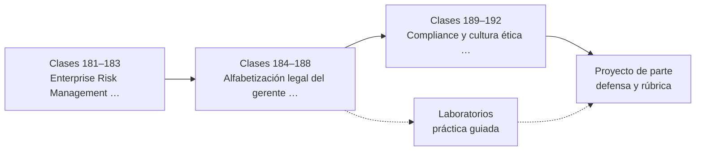

# Parte 15 — Riesgo, legal, compliance, ciberseguridad e IA

<!-- parte:inicio -->

> ← [Parte 14 — Diseño organizacional, cultura y cambio](../14-organization-design-culture-change/README.md) · [Temario](../../SYLLABUS.md) · [Parte 16 — Alta dirección y oficina del CEO](../16-executive-leadership-ceo-office/README.md) →

*Supervisar riesgos que exigen especialistas sin delegar la responsabilidad*

**Etapa:** 4 — Dirección, estrategia y organización  
**Duración:** 12 clases · 30 horas  
**Resultado de salida:** Ejercer supervisión ejecutiva sobre riesgos que requieren especialistas sin delegar la responsabilidad de dirección.

🟠 [Ver las 6 etapas](../../SYLLABUS.md) · 12 clases (181–192) · 4 laboratorios · [proyecto de parte](project.md)

## 🎯 De qué trata esta parte

Un ejecutivo no necesita ser abogado, ingeniero de seguridad ni auditor, pero responde por lo que ocurre. Esta parte enseña a hacer las preguntas correctas, entender las respuestas y decidir con riesgos que otros miden.

El eje es **responsabilidad indelegable**. Cubre riesgo empresarial, controles, marco legal, contratos, datos, ciberseguridad, IA, ética, crisis y continuidad, e incorpora la gestión de crisis con comité y vocería.

## 🧱 Con qué hay que llegar

| Parte | Qué aporta |
|---|---|
| [01 — Pensamiento crítico y toma de decisiones](../01-critical-thinking-and-decisions/README.md) | Decisión bajo incertidumbre. |
| [07 — Operaciones, procesos y calidad](../07-operations-process-quality/README.md) | Procesos y continuidad. |
| [03 — Inteligencia emocional, resiliencia y liderazgo adaptativo](../03-emotional-intelligence-resilience-adaptive-leadership/README.md) | Dilemas éticos. |

Cada clase supone la anterior: el orden importa, y saltarse una deja sin base a las que vienen después.

## 📚 Resultados de la parte

Al terminar esta parte podrás:

1. **Fijar** apetito y límites de riesgo.
2. **Revisar** controles y segregación de funciones.
3. **Detectar** riesgos legales y contractuales antes de firmar.
4. **Supervisar** privacidad, ciberseguridad e IA sin sustituir al especialista.
5. **Constituir** un comité de crisis con autoridad, escalamiento y vocería.

## 🗺️ Mapa de la parte

## 🧭 Cómo se encadenan las 12 clases

Las clases **181 a 183** fijan el marco: gestión de riesgo, apetito y controles.

Las clases **184 a 188** cubren los dominios: legal, contratos, datos, ciberseguridad y IA.

Las clases **189 a 192** cubren la cultura y la respuesta: ética, crisis y escalamiento, continuidad y el capstone de comité de riesgos.

## 📘 Las 12 clases

| # | Clase | Qué se trabaja | Entregable | Min |
|---:|---|---|---|---:|
| 181 | [Enterprise Risk Management](classes/181-enterprise-risk-management/README.md) | Riesgo, Escenario de riesgo, Exposición inherente | [leadership-decision-brief](../../templates/leadership-decision-brief.md) | 150 |
| 182 | [Apetito, tolerancia y límites de riesgo](classes/182-apetito-tolerancia-y-limites-de-riesgo/README.md) | Capacidad de riesgo, Apetito de riesgo, Tolerancia al riesgo | [risk-governance-brief](../../templates/risk-governance-brief.md) | 150 |
| 183 | [Controles internos y segregación](classes/183-controles-internos-y-segregacion/README.md) | Control interno, Control preventivo, Control detectivo | [leadership-decision-brief](../../templates/leadership-decision-brief.md) | 150 |
| 184 | [Alfabetización legal del gerente](classes/184-alfabetizacion-legal-del-gerente/README.md) | Riesgo legal, Detección de temas, Escalamiento | [risk-governance-brief](../../templates/risk-governance-brief.md) | 150 |
| 185 | [Contratos: riesgos que un ejecutivo debe detectar](classes/185-contratos-riesgos-que-un-ejecutivo-debe-detectar/README.md) | Contrato incompleto, Especificidad de activos, Dependencia (hold-up) | [risk-governance-brief](../../templates/risk-governance-brief.md) | 150 |
| 186 | [Privacidad y gobierno de datos](classes/186-privacidad-y-gobierno-de-datos/README.md) | Dato personal, Dato sensible, Tratamiento | [risk-governance-brief](../../templates/risk-governance-brief.md) | 150 |
| 187 | [Gobierno de ciberseguridad](classes/187-gobierno-de-ciberseguridad/README.md) | Ciberriesgo, Activos críticos, Función Gobernar | [risk-governance-brief](../../templates/risk-governance-brief.md) | 150 |
| 188 | [Gobierno responsable de IA](classes/188-gobierno-responsable-de-ia/README.md) | Sistema de IA, Gobierno de IA, Supervisión humana efectiva | [risk-governance-brief](../../templates/risk-governance-brief.md) | 150 |
| 189 | [Compliance y cultura ética](classes/189-compliance-y-cultura-etica/README.md) | Compliance, Cultura ética, Desvanecimiento ético | [risk-governance-brief](../../templates/risk-governance-brief.md) | 150 |
| 190 | [Crisis, incidentes y escalamiento](classes/190-crisis-incidentes-y-escalamiento/README.md) | Incidente, Crisis, Declarar un incidente | [crisis-committee-charter](../../templates/crisis-committee-charter.md) | 150 |
| 191 | [Business continuity y resiliencia](classes/191-business-continuity-y-resiliencia/README.md) | Continuidad de negocio, Análisis de impacto (BIA), RTO | [risk-governance-brief](../../templates/risk-governance-brief.md) | 150 |
| 192 | [Capstone: comité integrado de riesgos](classes/192-capstone-comite-integrado-de-riesgos/README.md) | Comité integrado de riesgos, Mapa común, Restricción dura | [risk-governance-brief](../../templates/risk-governance-brief.md) | 150 |

## ⚠️ Riesgos característicos

- Delegar el riesgo y creer que se delegó la responsabilidad.
- Confiar en un control sin probarlo.
- Firmar un contrato sin entender qué riesgo transfiere.
- Improvisar la autoridad durante la crisis.

## 🔤 Glosario de la parte

72 conceptos definidos en las clases, con la definición operacional que usa cada una.

| Concepto | Definición operacional |
|---|---|
| **Activos críticos** | Sistemas, datos y procesos sin los que el negocio no opera. |
| **Análisis de impacto (BIA)** | Estudio de las consecuencias de interrumpir cada proceso en el tiempo. |
| **Apetito de riesgo** | Tipo y cantidad de riesgo que la organización busca asumir para lograr sus objetivos. |
| **Canal de denuncia** | Vía para reportar sospechas con protección. |
| **Capacidad de riesgo** | Máximo de riesgo que la organización puede soportar sin poner en peligro su existencia u obligaciones. |
| **Ciberriesgo** | Riesgo de pérdida por fallas o ataques a sistemas y datos. |
| **Comité de crisis** | Grupo ejecutivo con autoridad definida para decidir las acciones de mayor impacto durante la crisis. |
| **Comité integrado de riesgos** | Instancia que revisa, prioriza y decide sobre los riesgos de todos los dominios. |
| **Compliance** | Conjunto de políticas, procesos y controles para cumplir normas y valores propios. |
| **Consulta legal** | Pregunta formulada con hechos, objetivo y opciones. |
| **Continuidad de negocio** | Capacidad de seguir entregando productos y servicios a niveles aceptables durante una interrupción. |
| **Contrato incompleto** | Acuerdo que no puede prever todas las contingencias. |
| **Control básico** | Medida de alto efecto y bajo costo relativo. |
| **Control compensatorio** | Control alternativo cuando no se puede segregar. |
| **Control correctivo** | Repara y evita la repetición. |
| **Control detectivo** | Descubre lo que ya ocurrió. |
| **Control interno** | Proceso que da seguridad razonable sobre objetivos de operaciones, reporte y cumplimiento. |
| **Control preventivo** | Impide que ocurra el error o el abuso. |
| **Crisis** | Evento percibido como impredecible que amenaza expectativas importantes de los interesados y puede afectar seriamente a la organización (Coombs, 2007). |
| **Cultura ética** | Normas compartidas sobre lo que se hace y se tolera, más allá de lo escrito. |
| **Dato personal** | Información que identifica o puede identificar a una persona. |
| **Dato sensible** | Dato cuyo tratamiento puede afectar gravemente a la persona. |
| **Declarar un incidente** | Decisión formal de activar la respuesta coordinada, con su mando y su registro. |
| **Dependencia (hold-up)** | Riesgo de que la otra parte aproveche que no hay salida fácil. |
| **Deriva** | Cambio del comportamiento del modelo cuando cambian los datos o el entorno. |
| **Desvanecimiento ético** | Proceso por el que la dimensión ética de una decisión deja de verse. |
| **Detección de temas** | Capacidad de ver el componente legal de una decisión. |
| **Escalamiento** | Llevar un tema a asesoría o a una instancia superior. |
| **Escenario de riesgo** | Historia concreta: causa, evento y consecuencia. |
| **Especificidad de activos** | Inversión que vale mucho en esta relación y poco fuera de ella. |
| **Evidencia documental** | Registros que pueden usarse para probar lo ocurrido. |
| **Excepción** | Autorización formal para exceder un límite de forma temporal. |
| **Exposición inherente** | Riesgo antes de considerar los controles. |
| **Exposición residual** | Riesgo que queda tras los controles y respuestas. |
| **Ficha de modelo** | Documento breve sobre uso previsto, desempeño y límites de un modelo. |
| **Finalidad** | Propósito específico y legítimo para el que se usan los datos. |
| **Fuente oficial** | Texto de la norma publicado por la autoridad competente. |
| **Función Gobernar** | Conjunto de decisiones de estrategia, roles, políticas y supervisión. |
| **Gobierno de IA** | Roles, políticas y controles para usar IA de forma responsable. |
| **Incidente** | Evento que interrumpe o degrada una operación, o pone en riesgo a personas, datos o activos, y que exige una respuesta coordinada. |
| **Indicador clave de riesgo (KRI)** | Medida que anticipa que un riesgo se acerca a su límite. |
| **Indicador de riesgo** | Medida que muestra la cercanía al límite. |
| **Límite** | Umbral medible que activa una acción o una decisión superior. |
| **Límite de responsabilidad** | Tope de lo que una parte debe pagar por daños. |
| **Mando del incidente** | Rol único que decide y responde por la respuesta, mientras otros roles ejecutan partes separadas del trabajo (Beyer et al., 2016). |
| **Mapa común** | Registro único de escenarios con los mismos criterios de medición. |
| **Minimización** | Recolectar y conservar solo lo necesario. |
| **Nivel de servicio (SLA)** | Compromiso medible de calidad o disponibilidad, con consecuencias. |
| **Periodo máximo tolerable** | Tiempo tras el cual el daño es inaceptable. |
| **Regla de escalamiento** | Criterio que lleva una decisión al directorio. |
| **Renovación automática** | Prórroga que ocurre si nadie avisa en un plazo. |
| **Represalia** | Trato adverso contra quien denuncia o colabora. |
| **Resiliencia** | Capacidad de resistir, adaptarse y recuperarse. |
| **Responsable y encargado** | Quien decide sobre el tratamiento y quien lo ejecuta por cuenta de otro. |
| **Restricción dura** | Condición que no se negocia, como un límite legal o un periodo máximo tolerable. |
| **Revisión sin culpas** | Análisis posterior que busca causas del sistema y acciones correctivas, no responsables individuales (Beyer et al., 2016). |
| **Riesgo** | Efecto de la incertidumbre sobre los objetivos. |
| **Riesgo interdependiente** | Riesgo que se activa o agrava cuando otro ocurre. |
| **Riesgo legal** | Posibilidad de sanción, reclamo o pérdida por incumplir normas o contratos. |
| **RPO** | Cantidad máxima aceptable de datos perdidos, expresada en tiempo. |
| **RTO** | Tiempo objetivo para recuperar un proceso o sistema. |
| **Segregación de funciones** | Reparto de tareas incompatibles entre personas distintas. |
| **Sesgo** | Diferencias sistemáticas de desempeño o de resultado que perjudican a grupos. |
| **Sistema de IA** | Sistema que infiere, a partir de datos, resultados como predicciones, contenidos o decisiones. |
| **Superficie de ataque** | Conjunto de puntos por los que se puede atacar. |
| **Supervisión humana efectiva** | Revisión por personas con información, tiempo y autoridad para corregir. |
| **Tablero de riesgos** | Vista breve con tendencias, excepciones y decisiones requeridas. |
| **Tiempos de recuperación** | Cuánto tarda la empresa en volver a operar. |
| **Tolerancia al riesgo** | Variación aceptable respecto de un objetivo concreto. |
| **Tono desde arriba** | Señales de los líderes sobre lo que importa y lo que se permite. |
| **Tratamiento** | Cualquier operación sobre datos: recolectar, usar, compartir, almacenar, eliminar. |
| **Universo de riesgos** | Conjunto de fuentes de riesgo de una organización. |

## 📦 Qué queda como evidencia

- Un registro de riesgos con apetito y controles.
- Una revisión de contrato con riesgos detectados.
- Un acta de comité de crisis con matriz de responsabilidades.
- El capstone: comité integrado de riesgos.

## 🔗 Cómo se conecta

La parte 16 lleva la crisis al nivel del CEO, la 17 la supervisa desde el directorio y la 23 cierra con ética y reputación. El impacto reputacional se detalla en [docs/REPUTATION_AND_CRISIS_LEADERSHIP.md](../../docs/REPUTATION_AND_CRISIS_LEADERSHIP.md).

## 🧪 Cómo se trabaja

Son **12 clases de 150 minutos** —30 horas— con **4 laboratorios** y un proyecto integrador. Cada clase trae su propósito, sus conceptos, un caso, práctica, errores frecuentes, preguntas de comprobación, entregable y fuentes, y se evalúa con su `assessment.md`. Los laboratorios se resuelven con datos propios o sintéticos, nunca con datos reales de terceros, y la parte se cierra con el proyecto y su defensa. Las reglas de recorrido están en [la guía de navegación](../../docs/NAVIGATION.md).

<!-- parte:fin -->

## Laboratorios

- [Lab 01 — Risk register](labs/lab-01.md)
- [Lab 02 — Control design](labs/lab-02.md)
- [Lab 03 — Cyber tabletop](labs/lab-03.md)
- [Lab 04 — AI governance review](labs/lab-04.md)

## Proyecto de parte

Presidir un comité de riesgos ante incidente cibernético, exposición legal y presión comercial.

## Bibliografía rectora

- COSO — *Enterprise Risk Management—Integrating with Strategy and Performance* (Riesgo)
- John C. Hull — *Risk Management and Financial Institutions* (Riesgo)
- NIST — *Cybersecurity Framework (CSF) 2.0* (Ciberseguridad)
- NIST — *AI Risk Management Framework (AI RMF 1.0)* (IA responsable)
- OECD — *OECD AI Principles* (IA responsable)

## Criterio de aprobación

80/100 y entrega del proyecto integrador.
