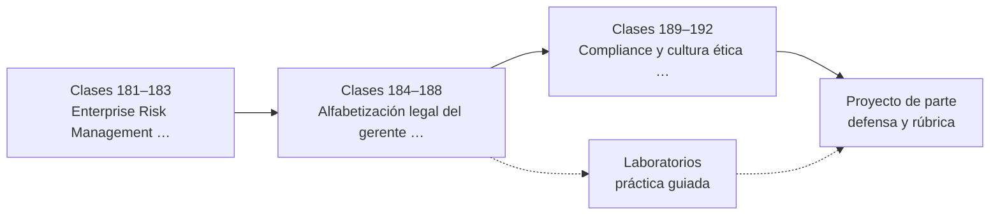

# Parte 15 — Riesgo, legal, compliance, ciberseguridad e IA

<!-- parte:inicio -->

> ← [Parte 14 — Diseño organizacional, cultura y cambio](../14-organization-design-culture-change/README.md) · [Temario](../../SYLLABUS.md) · [Parte 16 — Alta dirección y oficina del CEO](../16-executive-leadership-ceo-office/README.md) →

*Supervisar riesgos que exigen especialistas sin delegar la responsabilidad*

**Etapa:** 4 — Dirección, estrategia y organización  
**Duración:** 12 clases · 30 horas  
**Resultado de salida:** Ejercer supervisión ejecutiva sobre riesgos que requieren especialistas sin delegar la responsabilidad de dirección.

🟠 [Ver las 6 etapas](../../SYLLABUS.md) · 12 clases (181–192) · 4 laboratorios · [proyecto de parte](project.md)

## 🎯 De qué trata esta parte

Un ejecutivo no necesita ser abogado, ingeniero de seguridad ni auditor, pero responde por lo que ocurre. Esta parte enseña a hacer las preguntas correctas, entender las respuestas y decidir con riesgos que otros miden.

El eje es **responsabilidad indelegable**. Cubre riesgo empresarial, controles, marco legal, contratos, datos, ciberseguridad, IA, ética, crisis y continuidad, e incorpora la gestión de crisis con comité y vocería.

## 🧱 Con qué hay que llegar

| Parte | Qué aporta |
|---|---|
| [01 — Pensamiento crítico y toma de decisiones](../01-critical-thinking-and-decisions/README.md) | Decisión bajo incertidumbre. |
| [07 — Operaciones, procesos y calidad](../07-operations-process-quality/README.md) | Procesos y continuidad. |
| [03 — Inteligencia emocional, resiliencia y liderazgo adaptativo](../03-emotional-intelligence-resilience-adaptive-leadership/README.md) | Dilemas éticos. |

Cada clase supone la anterior: el orden importa, y saltarse una deja sin base a las que vienen después.

## 📚 Resultados de la parte

Al terminar esta parte podrás:

1. **Fijar** apetito y límites de riesgo.
2. **Revisar** controles y segregación de funciones.
3. **Detectar** riesgos legales y contractuales antes de firmar.
4. **Supervisar** privacidad, ciberseguridad e IA sin sustituir al especialista.
5. **Constituir** un comité de crisis con autoridad, escalamiento y vocería.

## 🗺️ Mapa de la parte

## 🧭 Cómo se encadenan las 12 clases

Las clases **181 a 183** fijan el marco: gestión de riesgo, apetito y controles.

Las clases **184 a 188** cubren los dominios: legal, contratos, datos, ciberseguridad y IA.

Las clases **189 a 192** cubren la cultura y la respuesta: ética, crisis y escalamiento, continuidad y el capstone de comité de riesgos.

## 📘 Las 12 clases

| # | Clase | Qué se trabaja | Entregable | Min |
|---:|---|---|---|---:|
| 181 | [Enterprise Risk Management](classes/181-enterprise-risk-management/README.md) | risk, risk universe, risk owner | [leadership-decision-brief](../../templates/leadership-decision-brief.md) | 150 |
| 182 | [Apetito, tolerancia y límites de riesgo](classes/182-apetito-tolerancia-y-limites-de-riesgo/README.md) | risk appetite, risk tolerance, limit | [risk-governance-brief](../../templates/risk-governance-brief.md) | 150 |
| 183 | [Controles internos y segregación](classes/183-controles-internos-y-segregacion/README.md) | internal control, segregation of duties, preventive control | [leadership-decision-brief](../../templates/leadership-decision-brief.md) | 150 |
| 184 | [Alfabetización legal del gerente](classes/184-alfabetizacion-legal-del-gerente/README.md) | legal issue spotting, legal privilege, regulatory obligation | [risk-governance-brief](../../templates/risk-governance-brief.md) | 150 |
| 185 | [Contratos: riesgos que un ejecutivo debe detectar](classes/185-contratos-riesgos-que-un-ejecutivo-debe-detectar/README.md) | scope, limitation of liability, indemnity | [risk-governance-brief](../../templates/risk-governance-brief.md) | 150 |
| 186 | [Privacidad y gobierno de datos](classes/186-privacidad-y-gobierno-de-datos/README.md) | data governance, data minimization, purpose limitation | [risk-governance-brief](../../templates/risk-governance-brief.md) | 150 |
| 187 | [Gobierno de ciberseguridad](classes/187-gobierno-de-ciberseguridad/README.md) | cyber risk, NIST CSF, critical asset | [risk-governance-brief](../../templates/risk-governance-brief.md) | 150 |
| 188 | [Gobierno responsable de IA](classes/188-gobierno-responsable-de-ia/README.md) | AI governance, AI risk, human oversight | [risk-governance-brief](../../templates/risk-governance-brief.md) | 150 |
| 189 | [Compliance y cultura ética](classes/189-compliance-y-cultura-etica/README.md) | compliance, code of conduct, speak-up | [risk-governance-brief](../../templates/risk-governance-brief.md) | 150 |
| 190 | [Crisis, incidentes y escalamiento](classes/190-crisis-incidentes-y-escalamiento/README.md) | incident, crisis, incident commander | [leadership-decision-brief](../../templates/leadership-decision-brief.md) | 150 |
| 191 | [Business continuity y resiliencia](classes/191-business-continuity-y-resiliencia/README.md) | BIA, RTO, RPO | [risk-governance-brief](../../templates/risk-governance-brief.md) | 150 |
| 192 | [Capstone: comité integrado de riesgos](classes/192-capstone-comite-integrado-de-riesgos/README.md) | risk portfolio, risk aggregation, KRI | [risk-governance-brief](../../templates/risk-governance-brief.md) | 150 |

## ⚠️ Riesgos característicos

- Delegar el riesgo y creer que se delegó la responsabilidad.
- Confiar en un control sin probarlo.
- Firmar un contrato sin entender qué riesgo transfiere.
- Improvisar la autoridad durante la crisis.

## 🔤 Glosario de la parte

60 conceptos definidos en las clases, con la definición operacional que usa cada una.

| Concepto | Definición operacional |
|---|---|
| **AI governance** | sistema de responsabilidades y controles para desarrollar o usar IA. |
| **AI inventory** | registro de sistemas owners finalidad datos y criticidad. |
| **AI risk** | posible daño o pérdida derivada de comportamiento uso o dependencia de IA. |
| **BIA** | business impact analysis que identifica procesos críticos y efectos de interrupción. |
| **breach** | superación de un límite que activa respuesta. |
| **business continuity plan** | procedimientos para sostener o recuperar operación. |
| **capacity** | máxima pérdida o exposición que la organización puede soportar. |
| **code of conduct** | marco de comportamientos y principios esperados. |
| **compliance** | adhesión a obligaciones legales regulatorias y políticas internas. |
| **contractual duty** | obligación nacida de un acuerdo. |
| **control assurance** | evidencia independiente sobre diseño y operación de controles. |
| **control owner** | rol responsable de diseño y operación del control. |
| **crisis** | evento que amenaza objetivos críticos y requiere coordinación ejecutiva. |
| **critical asset** | activo cuya afectación causa impacto material. |
| **cyber risk** | posible pérdida derivada de amenazas sobre sistemas datos y operación. |
| **data governance** | roles políticas y controles sobre ciclo de vida de datos. |
| **data lineage** | rastreo de origen transformación y uso de datos. |
| **data minimization** | recopilar solo datos necesarios para propósito legítimo. |
| **decision log** | registro de decisiones supuestos y responsables durante respuesta. |
| **detective control** | control que identifica después de ocurrir. |
| **human oversight** | intervención humana con autoridad y capacidad real de revisar. |
| **incident** | evento gestionable dentro de capacidades operativas normales. |
| **incident commander** | rol que coordina respuesta y prioridades. |
| **incident response** | capacidad organizada para contener erradicar y recuperar. |
| **indemnity** | obligación de cubrir determinadas pérdidas o reclamaciones. |
| **internal control** | proceso diseñado para dar seguridad razonable sobre objetivos. |
| **IP ownership** | regla sobre titularidad o licencia de propiedad intelectual. |
| **KRI** | indicador que señala cambio en exposición. |
| **legal basis** | fundamento jurídico que autoriza tratamiento cuando la ley lo exige. |
| **legal escalation** | derivación oportuna a asesoría especializada. |
| **legal issue spotting** | capacidad de reconocer hechos que pueden activar una norma u obligación. |
| **legal privilege** | protección que puede aplicar a ciertas comunicaciones jurídicas según jurisdicción. |
| **limit** | umbral cuantitativo u operativo que restringe exposición. |
| **limitation of liability** | tope o exclusión de responsabilidad contractual. |
| **model evaluation** | medición de desempeño robustez y riesgos en contexto. |
| **NIST CSF** | marco de funciones Govern Identify Protect Detect Respond y Recover. |
| **preventive control** | control que evita ocurrencia. |
| **purpose limitation** | usar datos de acuerdo con finalidad definida. |
| **regulatory obligation** | deber impuesto por autoridad competente. |
| **remediation** | acciones para corregir causa daño y control fallido. |
| **residual risk** | exposición restante después de controles. |
| **resilience** | capacidad de resistir adaptarse y recuperarse de disrupción. |
| **retaliation** | consecuencia adversa por denunciar o participar de buena fe. |
| **risk** | efecto de incertidumbre sobre objetivos. |
| **risk aggregation** | análisis de cómo riesgos interactúan o se concentran. |
| **risk appetite** | nivel y tipo de riesgo aceptable en busca de objetivos. |
| **risk owner** | rol accountable por gestionar una exposición. |
| **risk portfolio** | vista agregada de exposiciones y dependencias. |
| **risk response** | evitar reducir transferir aceptar o explotar según contexto. |
| **risk tolerance** | rango de variación aceptable alrededor de objetivos. |
| **risk treatment plan** | acciones owner y plazo para llevar riesgo al nivel aceptado. |
| **risk universe** | taxonomía de fuentes de riesgo relevantes. |
| **RPO** | punto máximo de pérdida de datos aceptable. |
| **RTO** | tiempo objetivo máximo para restaurar una actividad. |
| **scope** | definición de prestaciones y límites del acuerdo. |
| **security control** | salvaguarda técnica administrativa o física. |
| **segregation of duties** | separación de funciones incompatibles para reducir fraude o error. |
| **situation report** | resumen periódico de hechos impacto acciones y necesidades. |
| **speak-up** | capacidad segura de reportar inquietudes. |
| **termination right** | facultad de poner fin al contrato bajo condiciones definidas. |

## 📦 Qué queda como evidencia

- Un registro de riesgos con apetito y controles.
- Una revisión de contrato con riesgos detectados.
- Un acta de comité de crisis con matriz de responsabilidades.
- El capstone: comité integrado de riesgos.

## 🔗 Cómo se conecta

La parte 16 lleva la crisis al nivel del CEO, la 17 la supervisa desde el directorio y la 23 cierra con ética y reputación. El impacto reputacional se detalla en [docs/REPUTATION_AND_CRISIS_LEADERSHIP.md](../../docs/REPUTATION_AND_CRISIS_LEADERSHIP.md).

## 🧪 Cómo se trabaja

Son **12 clases de 150 minutos** —30 horas— con **4 laboratorios** y un proyecto integrador. Cada clase trae su propósito, sus conceptos, un caso, práctica, errores frecuentes, preguntas de comprobación, entregable y fuentes, y se evalúa con su `assessment.md`. Los laboratorios se resuelven con datos propios o sintéticos, nunca con datos reales de terceros, y la parte se cierra con el proyecto y su defensa. Las reglas de recorrido están en [la guía de navegación](../../docs/NAVIGATION.md).

<!-- parte:fin -->

## Laboratorios

- [Lab 01 — Risk register](labs/lab-01.md)
- [Lab 02 — Control design](labs/lab-02.md)
- [Lab 03 — Cyber tabletop](labs/lab-03.md)
- [Lab 04 — AI governance review](labs/lab-04.md)

## Proyecto de parte

Presidir un comité de riesgos ante incidente cibernético, exposición legal y presión comercial.

## Bibliografía rectora

- COSO — *Enterprise Risk Management—Integrating with Strategy and Performance* (Riesgo)
- John C. Hull — *Risk Management and Financial Institutions* (Riesgo)
- NIST — *Cybersecurity Framework (CSF) 2.0* (Ciberseguridad)
- NIST — *AI Risk Management Framework (AI RMF 1.0)* (IA responsable)
- OECD — *OECD AI Principles* (IA responsable)

## Criterio de aprobación

80/100 y entrega del proyecto integrador.
