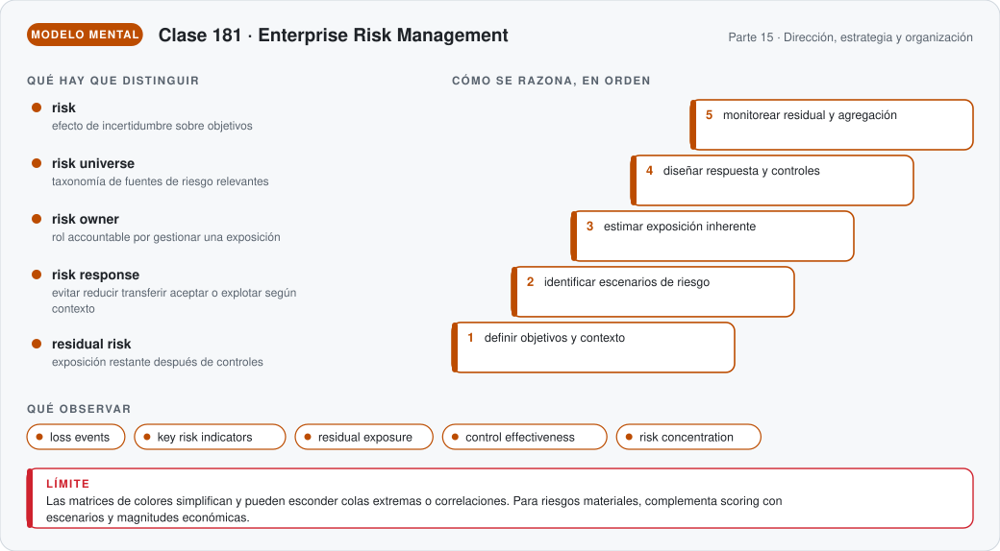

# Clase 181 — Enterprise Risk Management

<!-- nav:inicio -->
> **Parte 15 · Riesgo, legal, compliance, ciberseguridad e IA** — clase 1 de 12 · [índice de la parte](../../README.md) · [temario](../../../../SYLLABUS.md)
<!-- nav:fin -->

**Parte:** 15 — Riesgo, legal, compliance, ciberseguridad e IA  
**Nivel:** Etapa 4 — Gerente → Director  
**Duración sugerida:** 150–180 minutos · **Estándar:** deep-class-v2

## 🎯 Propósito

En muchas empresas el riesgo se gestiona por silos: finanzas mira el tipo de cambio, operaciones la continuidad, tecnología la ciberseguridad, legal las demandas, personas la rotación. Cada área tiene su lista, su lenguaje y su escala, y nadie ve el conjunto. El resultado es doble: se invierte mucho en riesgos pequeños y bien conocidos, y se descuidan las **combinaciones** que realmente amenazan los objetivos de la empresa, como un proveedor único cuya falla coincide con un ciberataque. La **gestión integrada de riesgos** (ERM, por *Enterprise Risk Management*) intenta ver el riesgo como lo ve el negocio: como lo que podría impedir lograr los objetivos, medido con un lenguaje común y decidido por quien tiene la autoridad.

La clase se apoya en el marco COSO de gestión de riesgos empresariales, en la norma ISO 31000, en la definición de riesgo como conjunto de escenarios, probabilidades y consecuencias de Kaplan y Garrick, en la mirada cuantitativa de Hull y en la advertencia de Taleb sobre las colas extremas. Al terminar sabrás construir un registro de escenarios con dueño, estimar exposición inherente y residual, elegir respuestas con criterio y agregar riesgos sin engañarte con promedios.

## 📚 Resultados de aprendizaje

Al finalizar podrás:

1. **Definir** el riesgo en relación con los objetivos y distinguir riesgo, incidente y problema.
2. **Describir** un escenario de riesgo con causa, evento, consecuencia, dueño y estimación.
3. **Calcular** exposición inherente y residual con supuestos explícitos.
4. **Elegir** una respuesta (evitar, reducir, transferir o aceptar) comparando costo y beneficio.
5. **Agregar** riesgos entre áreas reconociendo correlaciones y colas.

## 🧭 Agenda

| Tramo | Qué se hace |
|---|---|
| 0–20 min | Recuperación: ¿qué riesgo de tu área no aparece en el registro de nadie más y por qué? |
| 20–60 min | Definición, escenarios, estimación, respuestas, agregación y gobierno. |
| 60–105 min | Ejemplo trabajado: cuatro escenarios en una empresa de alimentos. |
| 105–150 min | Caso ejecutivo y práctica. |
| 150–175 min | Límites y entregable. |

## 🧩 Conceptos centrales

| Concepto | Definición | Cómo se reconoce |
|---|---|---|
| **Riesgo** | Efecto de la incertidumbre sobre los objetivos. | Se expresa en relación con algo que se quiere lograr. |
| **Escenario de riesgo** | Historia concreta: causa, evento y consecuencia. | Se puede estimar, asignar y vigilar. |
| **Exposición inherente** | Riesgo antes de considerar los controles. | Muestra qué pasaría sin protección. |
| **Exposición residual** | Riesgo que queda tras los controles y respuestas. | Se compara con el apetito. |
| **Universo de riesgos** | Conjunto de fuentes de riesgo de una organización. | Se ordena por objetivos y procesos. |
| **Indicador clave de riesgo (KRI)** | Medida que anticipa que un riesgo se acerca a su límite. | Cambia antes de que ocurra la pérdida. |

## 🧠 Modelo mental

**Cómo leer el diagrama.** Una cadena de cinco pasos con retorno. Se parte de los **objetivos y el contexto**, se escriben **escenarios de riesgo** concretos, se estima la **exposición inherente** (antes de controles), se elige la **respuesta y los controles** y se mide el **riesgo residual** y su agregación entre áreas. La flecha de retorno indica que lo observado reabre los escenarios. La nota advierte que un registro sin objetivos, dueños y escenarios es un inventario y no una gestión.

## 📖 Desarrollo

### 1. Riesgo: una cuestión de objetivos

La norma ISO 31000 define el riesgo como el efecto de la incertidumbre sobre los objetivos, y subraya que el efecto puede ser negativo, positivo o ambos. Esto cambia la conversación: no se pregunta «¿qué puede salir mal?», sino «¿qué podría impedirnos lograr lo que queremos, o ayudarnos a lograrlo?». Sin objetivos, no hay riesgo, solo preocupaciones. Por eso la gestión parte de la estrategia y de los objetivos del período, no de un catálogo de peligros. También conviene separar tres cosas que se confunden: el **riesgo** (algo que puede ocurrir), el **incidente** (algo que ocurrió) y el **problema** (una condición actual que ya perjudica). Cada uno se gestiona de manera distinta.

### 2. El marco COSO y la norma ISO 31000

COSO organiza la gestión de riesgos empresariales en cinco componentes entrelazados: **gobierno y cultura**, **estrategia y fijación de objetivos**, **desempeño**, **revisión** e **información, comunicación y reporte**. La idea central es que el riesgo se integra con la estrategia y el desempeño, no se agrega al final. ISO 31000 propone **principios**, un **marco** de implementación y un **proceso** (alcance y contexto, evaluación de riesgos, tratamiento, seguimiento, comunicación y registro). Ambos coinciden en lo esencial: liderazgo comprometido, integración en la toma de decisiones, mejora continua y lenguaje común. No son obligatorios por sí mismos; se adoptan por decisión de la dirección o por exigencia de un regulador o un cliente, y su texto vigente se consulta en la fuente oficial.

### 3. Escenarios: la unidad de trabajo

Kaplan y Garrick propusieron definir el riesgo como un conjunto de **tripletas**: ¿qué puede ocurrir?, ¿con qué probabilidad? y ¿cuáles son las consecuencias? De ahí la práctica de trabajar con **escenarios**: «si el único proveedor de envases falla durante más de cinco días, la planta se detiene y perdemos entregas por 1.500 millones». Un buen escenario nombra causa, evento y consecuencia, tiene **dueño** (quien puede actuar), una estimación con su rango y supuestos, y los **controles** actuales. Una lista de rótulos como «riesgo cibernético» o «riesgo reputacional» no permite estimar ni decidir: se descompone en escenarios.

### 4. Estimar: inherente y residual

La **exposición inherente** considera el escenario sin controles; la **residual**, con ellos. La **pérdida esperada** se estima como probabilidad anual por impacto, pero es solo un resumen: dos escenarios con igual pérdida esperada pueden ser muy distintos si uno es frecuente y pequeño y el otro raro y devastador. Por eso se reportan también el **peor caso razonable** y su relación con la capacidad de la empresa (por ejemplo, frente al EBITDA o el patrimonio). Hull, desde las finanzas, subraya que los modelos dependen de supuestos sobre distribuciones y correlaciones; se estima con datos propios cuando existen, con juicio de expertos estructurado cuando no, y se deja constancia de la incertidumbre. La percepción importa: Slovic mostró que las personas sobreestiman riesgos dramáticos y subestiman los silenciosos, por eso las estimaciones se contrastan con datos y con varias miradas.

### 5. Responder: cuatro opciones

Las respuestas clásicas son **evitar** (no hacer la actividad), **reducir** (controles que bajan probabilidad o impacto), **transferir o compartir** (seguros, contratos, coinversión) y **aceptar** (con conocimiento y dentro del apetito). Cada una tiene costo y efectos secundarios: transferir con un seguro no elimina el daño reputacional; reducir con un segundo proveedor aumenta costos y complejidad. Se compara el **beneficio** (reducción de exposición) con el **costo** de la respuesta y con el riesgo nuevo que genera. Aceptar un riesgo es una decisión legítima que se documenta, con nombre del que la toma y fecha de revisión; ignorarlo sin decidir no lo es.

### 6. Agregar: ver el conjunto

Sumar pérdidas esperadas por escenario da una primera visión, pero **oculta correlaciones**: una crisis de abastecimiento y un ciberataque pueden ocurrir juntos si comparten un proveedor; una caída del tipo de cambio afecta costos y deuda a la vez. Taleb advierte que los riesgos de cola, raros y de gran magnitud, dominan los resultados y son los peor estimados; propone preferir estructuras que resistan o se beneficien de la volatilidad y no depender de predecir. En la práctica se complementa la suma con **escenarios combinados** (qué pasa si dos cosas fallan a la vez), **pruebas de estrés** y la revisión de **concentraciones**: dependencia de un cliente, un proveedor, una persona o un sistema.

### 7. Gobierno, indicadores y cultura

Un sistema de riesgos funciona si hay **roles claros**: el directorio fija el apetito y supervisa; la dirección ejecuta y es dueña de los riesgos; una función de riesgos facilita metodología, desafía y consolida; la auditoría interna aporta una mirada independiente. Se usan **indicadores clave de riesgo** con umbrales que activan acciones, y un **reporte** periódico breve con tendencias y excepciones. La cultura pesa más que el formulario: si reportar un riesgo se castiga, el registro se llena de generalidades (clase 174). Y un riesgo no se «cierra» al escribirse: se vigila hasta que cambia el objetivo, la exposición o la respuesta.

## 📚 Lectura comparada

| Obra | Qué aporta | Qué no resuelve | Pregunta para contrastar |
|---|---|---|---|
| COSO ERM | Integración del riesgo con estrategia y desempeño; cinco componentes. | No fija métodos de medición. | ¿Qué objetivo está en juego? |
| ISO 31000 | Principios, marco y proceso de gestión del riesgo. | Norma genérica; no certifica por sí misma. | ¿Qué parte del proceso está débil? |
| Kaplan y Garrick | Riesgo como escenarios, probabilidades y consecuencias. | No da datos para estimar. | ¿Cuál es el escenario y su rango? |
| Hull | Medición cuantitativa y límites de los modelos. | Orientado a instituciones financieras. | ¿Qué supuesto sostiene el número? |
| Taleb | Colas extremas, fragilidad y robustez. | Crítica general; exige juicio práctico. | ¿Qué pasa en el peor caso razonable? |

## 🧮 Ejemplo trabajado

**Situación (hipotética).** Una empresa de alimentos con 1.200 personas tiene ingresos de 60.000 millones de pesos y EBITDA de 7.200 millones (12 %). El comité pide un mapa de riesgos integrado con cuatro escenarios prioritarios.

**Exposición inherente (por año).**

| Escenario | Probabilidad | Impacto | Pérdida esperada |
|---|---|---|---|
| A. Falla del único proveedor de envases (5 días de parada) | 20 % | 1.500 millones | 300 millones |
| B. Ransomware en la planta | 10 % | 2.400 millones | 240 millones |
| C. Retiro de producto por contaminación | 4 % | 5.000 millones | 200 millones |
| D. Fraude en pagos a proveedores | 15 % | 400 millones | 60 millones |
| **Total** | | | **800 millones** |

**Respuestas y exposición residual.**

| Escenario | Respuesta | Prob. residual | Impacto residual | Residual | Costo anual |
|---|---|---|---|---|---|
| A | Segundo proveedor calificado | 8 % | 600 millones | 48 millones | 40 millones |
| B | Segmentación de red y respaldos fuera de línea | 5 % | 900 millones | 45 millones | 50 millones |
| C | Mejora de controles de calidad y seguro (cubre 1.000 millones) | 2 % | 4.000 millones | 80 millones | 20 millones |
| D | Doble aprobación y conciliación | 3 % | 300 millones | 9 millones | 10 millones |
| **Total** | | | | **182 millones** | **120 millones** |

**Lectura.** La pérdida esperada baja de 800 a 182 millones: una reducción de 618 millones. Restando el costo anual de 120 millones, el beneficio neto esperado es 498 millones al año.

**Lo que el promedio esconde.** El escenario C, aun con respuesta, tiene un peor caso de 4.000 millones, que equivale a 55,6 % del EBITDA (4.000 ÷ 7.200); sin respuesta eran 5.000 millones, el 69,4 %. Además, A y B se correlacionan si el proveedor de envases usa un sistema conectado a la planta: si ambos ocurren, la pérdida sería de 600 + 900 = 1.500 millones solo con los impactos residuales, pero con los inherentes sería 3.900 millones (1.500 + 2.400). El comité pide un escenario combinado, un seguro adicional para C y una prueba de estrés anual.

**Gobierno.** Cada escenario tiene un dueño (compras, tecnología, calidad y finanzas), un indicador (proveedores calificados, parches críticos pendientes, no conformidades, pagos sin doble aprobación) y una revisión trimestral.

**Cuidados.** Las probabilidades son estimaciones con incertidumbre; los seguros, los contratos y las obligaciones sanitarias y regulatorias se verifican con asesoría y fuentes oficiales.

**Qué muestra.** (1) Los escenarios se estimaron con supuestos visibles. (2) La respuesta se comparó con su costo. (3) La mirada de cola y de correlación corrigió la lectura del promedio.

## 🔀 Comparación y límites

**Registro de riesgos frente a gestión de riesgos.** El registro es un documento; la gestión es un conjunto de decisiones con dueños, límites y seguimiento. Un registro bien llenado no garantiza gestión.

**Límites.** Las probabilidades y los impactos son estimaciones inciertas y sesgadas por la percepción. Las matrices de colores simplifican y pueden esconder colas y correlaciones; para riesgos materiales se complementan con escenarios y magnitudes económicas. Los marcos COSO e ISO son guías y su texto vigente se consulta en la fuente oficial. Las cifras del ejemplo son ilustrativas.

## 🪜 De profesional a owner

| Nivel | Cómo participa en la gestión de riesgos |
|---|---|
| **Profesional** | Identifica y reporta riesgos de su trabajo sin esperar permiso. |
| **Jefe / Team Lead** | Mantiene escenarios de su equipo con indicadores. |
| **Gerente** | Es dueño de riesgos, decide respuestas y rinde cuentas. |
| **CEO / Director** | Integra riesgos con estrategia, fija límites y exige un reporte útil. |
| **Founder / Owner** | Protege la continuidad del negocio y su patrimonio personal ligado a él. |

## 🏢 Caso ejecutivo

Una empresa de transporte y logística con 2.300 personas tiene ingresos de 120.000 millones de pesos y un EBITDA de 13.200 millones. Cada gerencia mantiene su propio registro: tecnología lista 41 riesgos, operaciones 63, finanzas 22 y legal 18, con escalas distintas. El comité de dirección nunca ha visto un mapa único. Una auditoría detectó que el 38 % de los riesgos de «alto» nivel no tiene dueño ni fecha de revisión; que tres clientes concentran el 46 % de los ingresos; y que un único proveedor de combustible abastece el 70 % de la flota. En el último año hubo un retraso masivo por una falla de software que costó 900 millones. El gerente general quiere «un sistema de gestión de riesgos moderno» y el directorio pide un informe en 60 días.

Entrega un **diseño de gestión integrada de riesgos** que contenga: (a) la definición de objetivos y el mapa de escenarios prioritarios (no más de diez) con causa, evento y consecuencia; (b) la estimación inherente y residual con supuestos y rangos; (c) las respuestas con su costo y su efecto; (d) las concentraciones y los escenarios combinados; (e) los roles, los indicadores y el reporte al directorio; (f) las verificaciones contractuales, regulatorias y de seguros pendientes.

## 🧪 Práctica

1. Reescribe tres «riesgos» genéricos de tu área como escenarios con causa, evento y consecuencia.
2. Estima probabilidad e impacto de uno, con rango y supuestos, y calcula su pérdida esperada.
3. Diseña una respuesta y compara su costo con la reducción de exposición.
4. Identifica una concentración (cliente, proveedor, sistema o persona) y un escenario combinado.
5. Define un indicador de riesgo con umbral y la acción que activa.

## ⚠️ Errores frecuentes

| Error | Por qué ocurre | Cómo corregirlo |
|---|---|---|
| Registro sin objetivos | Se parte de listas de peligros | Anclar cada escenario a un objetivo. |
| Rótulos en vez de escenarios | Es más rápido | Describir causa, evento y consecuencia. |
| Confiar solo en el promedio | Es un número simple | Mirar el peor caso y la relación con la capacidad. |
| Sumar sin correlaciones | Se supone independencia | Construir escenarios combinados y revisar concentraciones. |
| Riesgos sin dueño | Se diluye la responsabilidad | Asignar un dueño con autoridad. |
| Aceptar sin decidir | Se ignora el riesgo | Documentar quién acepta, por qué y hasta cuándo. |

## ❓ Preguntas de comprobación

1. ¿Cómo define ISO 31000 el riesgo y qué cambia respecto de «lo que puede salir mal»?
2. ¿Qué componentes tiene el marco COSO de gestión de riesgos?
3. ¿Qué elementos tiene un buen escenario de riesgo?
4. ¿Qué diferencia hay entre exposición inherente y residual?
5. ¿Cuáles son las cuatro respuestas clásicas a un riesgo?
6. ¿Por qué no basta sumar pérdidas esperadas?
7. ¿Qué límites tienen las matrices de colores?

Claves de respuesta

1. Como el efecto de la incertidumbre sobre los objetivos; liga el riesgo con lo que se quiere lograr y admite efectos positivos y negativos.
2. Gobierno y cultura, estrategia y fijación de objetivos, desempeño, revisión e información, comunicación y reporte.
3. Causa, evento, consecuencia, dueño, estimación con rango y supuestos, y controles actuales.
4. La inherente es antes de los controles; la residual es la que queda después de las respuestas.
5. Evitar, reducir, transferir o compartir, y aceptar.
6. Porque el promedio oculta colas extremas y correlaciones; se complementa con peor caso, escenarios combinados y concentraciones.
7. Simplifican, pueden esconder colas y correlaciones y dar una falsa precisión; para riesgos materiales se usan escenarios y magnitudes económicas.

## 📥 Entregable

Guarda en `portfolio/181-enterprise-risk-management/`:

- `leadership-decision-brief.md` (plantilla [Leadership Decision Brief](../../../../templates/leadership-decision-brief.md)) con el diseño del caso ejecutivo;
- `risk-register.md` (plantilla [Risk register](../../../../templates/risk-register.md)) con los escenarios, dueños e indicadores;
- `decision-journal.md` con los supuestos de estimación y las verificaciones pendientes.

## 📗 Fuentes y verificación

- COSO — *Enterprise Risk Management—Integrating with Strategy and Performance*. **Uso en esta clase:** componentes del marco de gestión integrada de riesgos. **Fuente primaria:** <https://www.coso.org/>.
- ISO — *ISO 31000 Risk management*. **Uso en esta clase:** definición de riesgo, principios, marco y proceso. **Localizador pendiente:** ver [el registro de fuentes](../../../../docs/FUENTES.md).
- Stanley Kaplan & B. John Garrick — *On The Quantitative Definition of Risk* (Risk Analysis, 1981). **Uso en esta clase:** riesgo como escenarios, probabilidades y consecuencias. Lectura selectiva sobre **enterprise risk management**. **Localizador:** [DOI 10.1111/j.1539-6924.1981.tb01350.x](https://doi.org/10.1111/j.1539-6924.1981.tb01350.x).
- John C. Hull — *Risk Management and Financial Institutions* (John Wiley & Sons, Incorporated, 2006). **Uso en esta clase:** medición cuantitativa y límites de los modelos. Lectura selectiva sobre **enterprise risk management**. **Localizador:** [ISBN-13 9781118286388](https://openlibrary.org/isbn/9781118286388).
- Nassim Nicholas Taleb — *Antifragile* (Random House, 2012). **Uso en esta clase:** colas extremas, fragilidad y robustez. Lectura selectiva sobre **enterprise risk management**. **Localizador:** [ISBN-13 9780679645276](https://openlibrary.org/isbn/9780679645276).
- Paul Slovic — *Perception of Risk* (Science, 1987). **Uso en esta clase:** percepción del riesgo y sesgos al estimar. Lectura selectiva sobre **enterprise risk management**. **Localizador:** [DOI 10.1126/science.3563507](https://doi.org/10.1126/science.3563507).

> **Regla de fuentes para Enterprise Risk Management:** las obras anteriores estructuran las perspectivas de esta materia; cualquier norma, ley o estándar vivo mencionado debe comprobarse nuevamente en su fuente primaria vigente, incluidos los marcos COSO e ISO y las obligaciones sectoriales de gestión de riesgos. Los ejemplos y casos son hipotéticos, con cifras ilustrativas. El desarrollo es original y no reproduce capítulos protegidos.

<!-- pie:inicio -->
---

| Anterior | Índice | Siguiente |
|---|---|---|
| [← 180 · Capstone: rediseño organizacional](../../../14-organization-design-culture-change/classes/180-capstone-rediseno-organizacional/README.md) | [Parte 15](../../README.md) · [Programa](../../../../SYLLABUS.md) | [182 · Apetito, tolerancia y límites de riesgo →](../182-apetito-tolerancia-y-limites-de-riesgo/README.md) |
<!-- pie:fin -->
