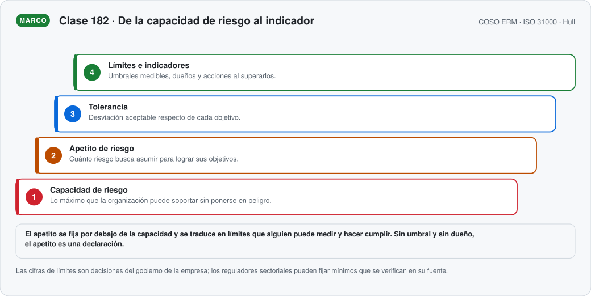

# Clase 182 — Apetito, tolerancia y límites de riesgo

<!-- nav:inicio -->
> **Parte 15 · Riesgo, legal, compliance, ciberseguridad e IA** — clase 2 de 12 · [índice de la parte](../../README.md) · [temario](../../../../SYLLABUS.md)
<!-- nav:fin -->

**Parte:** 15 — Riesgo, legal, compliance, ciberseguridad e IA  
**Nivel:** Etapa 4 — Gerente → Director  
**Duración sugerida:** 150–180 minutos · **Estándar:** deep-class-v2

## 🎯 Propósito

«No somos amigos del riesgo» es una frase que casi todas las empresas escriben y casi ninguna puede usar. No dice cuánta deuda es demasiada, cuántas horas de caída de un sistema son tolerables, qué porcentaje de ingresos puede depender de un cliente ni quién decide cuando una oportunidad exige pasarse del límite. Sin números, dueños y consecuencias, el **apetito de riesgo** es una declaración de buenas intenciones, y cada gerente lo interpreta a su manera: unos asumen riesgos que el directorio jamás aprobaría y otros renuncian a oportunidades que sí aprobaría.

La clase explica cómo pasar de una frase a un sistema de decisión: distinguir **capacidad**, **apetito**, **tolerancia** y **límites**, traducirlos a indicadores medibles, fijar umbrales con acciones asociadas y gobernar las excepciones. Se apoya en COSO, en ISO 31000, en la práctica cuantitativa de límites descrita por Hull y en la teoría de las perspectivas de Kahneman y Tversky, que explica por qué las personas toman riesgos distintos según estén ganando o perdiendo. Al terminar sabrás redactar un enunciado de apetito, derivar límites, diseñar semáforos de indicadores y decidir una excepción con criterio.

## 📚 Resultados de aprendizaje

Al finalizar podrás:

1. **Distinguir** capacidad, apetito, tolerancia y límite de riesgo.
2. **Redactar** un enunciado de apetito con criterios medibles por tipo de riesgo.
3. **Derivar** límites e indicadores con umbrales y acciones.
4. **Probar** un límite con pruebas de estrés antes de adoptarlo.
5. **Gobernar** excepciones y excesos con roles y plazos.

## 🧭 Agenda

| Tramo | Qué se hace |
|---|---|
| 0–20 min | Recuperación: ¿qué límite de riesgo de tu empresa conoces con número y con dueño? |
| 20–60 min | Capacidad, apetito, tolerancia, límites, estrés y excepciones. |
| 60–105 min | Ejemplo trabajado: apetito de endeudamiento ante una expansión. |
| 105–150 min | Caso ejecutivo y práctica. |
| 150–175 min | Límites y entregable. |

## 🧩 Conceptos centrales

| Concepto | Definición | Cómo se reconoce |
|---|---|---|
| **Capacidad de riesgo** | Máximo de riesgo que la organización puede soportar sin poner en peligro su existencia u obligaciones. | Compromisos financieros, regulatorios y de continuidad. |
| **Apetito de riesgo** | Tipo y cantidad de riesgo que la organización busca asumir para lograr sus objetivos. | Se aprueba por el directorio y es menor que la capacidad. |
| **Tolerancia al riesgo** | Variación aceptable respecto de un objetivo concreto. | Rango alrededor de una meta. |
| **Límite** | Umbral medible que activa una acción o una decisión superior. | Número, dueño y consecuencia. |
| **Indicador de riesgo** | Medida que muestra la cercanía al límite. | Se reporta con semáforo y tendencia. |
| **Excepción** | Autorización formal para exceder un límite de forma temporal. | Tiene aprobador, motivo y vencimiento. |

## 🧠 Modelo mental

**Cómo leer el diagrama.** Una escalera de cuatro niveles. La **capacidad de riesgo** es lo máximo que se puede soportar sin ponerse en peligro. El **apetito** es cuánto riesgo se busca asumir y se fija por debajo de la capacidad. La **tolerancia** es la desviación aceptable respecto de cada objetivo. Los **límites e indicadores** son los umbrales medibles, con dueños y acciones cuando se superan. La nota recuerda que sin umbral y sin dueño el apetito es una declaración; el pie aclara que las cifras son decisiones del gobierno de la empresa y que los reguladores sectoriales pueden fijar mínimos.

## 📖 Desarrollo

### 1. Cuatro conceptos que se confunden

El marco COSO de gestión de riesgos empresariales distingue el **apetito** (amplio, estratégico) de la **tolerancia** (acotada a objetivos específicos) y exige que ambos se integren en la fijación de estrategia y objetivos. La norma ISO 31000 habla de criterios de riesgo que reflejan los valores, objetivos y recursos de la organización. A estos dos se suma la **capacidad**, que es un hecho (cuánto puede perder la empresa antes de incumplir obligaciones o quebrar) y no una preferencia. El orden lógico es: primero se conoce la capacidad; después el directorio decide cuánta de ella está dispuesto a usar (apetito); luego se define cuánta desviación se tolera en cada objetivo (tolerancia); finalmente se fijan límites operables. Confundir apetito con capacidad lleva a apostar todo; confundir apetito con tolerancia lleva a reglas contradictorias.

### 2. Conocer la capacidad

La capacidad se calcula con **restricciones duras**: covenants de deuda, liquidez mínima para pagar sueldos y proveedores durante cierto período, capital regulatorio si existe, límites de seguros y requisitos de continuidad con clientes críticos. Se expresa en unidades que la dirección entiende: «podemos perder 9.000 millones antes de incumplir el covenant» o «no podemos estar más de 48 horas sin sistema de despacho». También incluye **capacidades blandas**: reputación, relaciones con clientes clave y estado anímico del equipo. Un cálculo honesto de capacidad suele ser incómodo, porque muestra que la empresa es más frágil de lo que se creía; esa incomodidad es la utilidad del ejercicio.

### 3. Redactar el apetito

Un enunciado útil tiene tres partes: **dirección** (dónde se busca riesgo y dónde se evita), **medida** (con qué indicador se mide) y **nivel** (cuánto). Ejemplos: «aceptamos riesgo de mercado al lanzar productos nuevos, hasta 5 % de los ingresos en inversión sin retorno asegurado»; «no aceptamos riesgos que comprometan la seguridad de las personas ni el cumplimiento legal»; «mantenemos una deuda neta de hasta 2,5 veces el EBITDA». Se diferencia por **categoría**: estratégico, financiero, operativo, de cumplimiento, de datos, de reputación. Algunos riesgos tienen apetito **cero** (seguridad de las personas, delitos), y eso debe decirse con claridad, aunque no siempre sea posible eliminarlos del todo: significa que no se justifica asumirlos a cambio de beneficio.

### 4. Del apetito al límite

Un límite operable cumple cinco condiciones: es **medible** con datos disponibles, tiene un **dueño** que puede actuar, una **frecuencia** de medición, **umbrales escalonados** (por ejemplo, verde, ámbar y rojo) y una **acción** asociada a cada nivel: ámbar exige informar y preparar un plan; rojo exige decisión del comité o del directorio. Hull describe, en el contexto financiero, cómo los límites de exposición, concentración y pérdida se jerarquizan en una institución; la idea se aplica a cualquier empresa: límites de concentración de clientes y proveedores, de caída tolerable de un sistema, de rotación crítica, de incidentes de seguridad, de multas o reclamos. Se cuida que los límites sean **pocos y significativos**: cien indicadores en rojo, ámbar y verde producen ruido, no gobierno.

### 5. Probar los límites con estrés

Antes de adoptar un límite se prueba contra **escenarios adversos**: ¿cómo se ve el indicador si el EBITDA cae 15 %, si el principal cliente se va, si el tipo de cambio sube 20 %? Un límite que se cumple solo en condiciones normales no protege. Se evalúa también la **interacción** entre límites: un nivel de deuda aceptable con ventas estables puede ser inviable con una caída de ventas. Las pruebas de estrés no predicen; revelan fragilidades y ayudan a decidir cuánto margen de seguridad dejar. Y se revisan cuando cambian la estrategia, el entorno o la estructura de la empresa.

### 6. Cómo deciden las personas ante el riesgo

Kahneman y Tversky mostraron en la teoría de las perspectivas que las personas valoran las pérdidas más que las ganancias equivalentes y que tienden a **buscar riesgo cuando están en pérdida** y a evitarlo cuando están ganando. En una empresa, esto significa que un equipo que va atrasado en su meta anual puede asumir riesgos que no tomaría en un buen año, o un gerente con una inversión fallida puede doblar la apuesta para «recuperar». Por eso los límites se fijan **antes** de la presión, se aplican por igual en buenos y malos momentos y se complementan con incentivos que no premien el riesgo oculto (clase 175). También por eso las excepciones deben pasar por un tercero que no esté bajo la misma presión.

### 7. Excepciones, excesos y reporte

Todo sistema de límites necesita un **procedimiento de excepción**: quién puede autorizar qué, por cuánto tiempo, con qué plan de regreso y con qué registro. Los excesos no autorizados se escalan en un plazo corto y se analizan sus causas: ¿el límite era irreal, el dato llegó tarde o alguien decidió ignorarlo? Se reporta al directorio una vista breve: indicadores principales, tendencias, excesos y excepciones vigentes, y las decisiones que requiere. El apetito se **revisa al menos una vez al año** y cuando cambian las condiciones. Si nunca hay excesos, probablemente los límites son demasiado holgados; si siempre los hay, son irreales o están mal medidos.

## 📚 Lectura comparada

| Obra | Qué aporta | Qué no resuelve | Pregunta para contrastar |
|---|---|---|---|
| COSO ERM | Apetito y tolerancia integrados con la estrategia y los objetivos. | No dicta niveles concretos. | ¿Qué objetivo respalda este límite? |
| ISO 31000 | Criterios de riesgo según los valores y recursos de la organización. | Norma genérica. | ¿Quién definió los criterios y con qué base? |
| Hull | Límites de exposición y concentración, pruebas de estrés. | Contexto financiero; hay que adaptarlo. | ¿El límite resiste el estrés? |
| Kahneman y Tversky | Aversión a las pérdidas y búsqueda de riesgo en pérdida. | Evidencia de laboratorio y de decisión individual. | ¿Qué cambia cuando el equipo va perdiendo? |
| Taleb | Cuidado con las colas y con la falsa precisión. | Crítica general. | ¿Qué pasa fuera del rango que modelamos? |

## 🧮 Ejemplo trabajado

**Situación (hipotética).** Una distribuidora tiene ventas de 80.000 millones de pesos, EBITDA de 9.000 millones y deuda neta de 20.700 millones (2,3 veces el EBITDA). Sus créditos exigen no superar 3,0 veces. La gerencia propone una expansión de 4.000 millones financiada con deuda.

**Capacidad.** Con el covenant de 3,0 veces y el EBITDA actual, la deuda máxima es 27.000 millones (3,0 × 9.000). Holgura actual: 27.000 − 20.700 = 6.300 millones.

**Apetito y tolerancia (aprobados por el directorio).** Apetito: deuda neta hasta 2,5 veces el EBITDA (22.500 millones con el EBITDA actual). Tolerancia: entre 2,5 y 2,8 veces se informa al directorio y se presenta un plan de regreso; sobre 2,8 se exige decisión del directorio.

**Prueba de la propuesta.**

| Escenario | Deuda neta | EBITDA | Razón |
|---|---|---|---|
| Hoy | 20.700 | 9.000 | 2,30 |
| Expansión con deuda, EBITDA estable | 24.700 | 9.000 | 2,74 |
| Expansión con deuda y EBITDA −15 % (7.650) | 24.700 | 7.650 | 3,23 |
| Hoy con EBITDA −15 % | 20.700 | 7.650 | 2,71 |

**Lectura.** La propuesta de 4.000 millones queda fuera del apetito (2,74 > 2,5), dentro de la zona de tolerancia (por debajo de 2,8) y, bajo estrés, rompe el covenant (3,23 > 3,0). Aun sin expansión, un EBITDA −15 % lleva la razón a 2,71, por encima del apetito.

**Alternativas.** (1) Financiar 2.000 millones con deuda y 2.000 con arriendo operativo o capital propio: deuda 22.700, razón de 2,52 (apenas sobre el apetito) y 2,97 con estrés (apenas bajo el covenant, margen insuficiente). (2) Hacer la expansión en dos etapas: primera de 2.000 millones ahora y segunda condicionada a que la razón esté bajo 2,3 tras seis meses. (3) Renegociar el covenant antes de invertir.

**Decisión propuesta.** Alternativa 2 con aprobación formal de una **excepción** acotada: se acepta una razón de hasta 2,55 durante un trimestre, con plan de regreso a 2,3 y revisión mensual; se agrega un indicador adelantado (ventas semanales contra presupuesto) con umbral ámbar si caen más de 7 % durante tres semanas.

**Cuidados.** Los contratos de crédito y los covenants se leen en su texto vigente con asesoría; las cifras son ilustrativas.

**Qué muestra.** (1) La capacidad se calculó antes del apetito. (2) El estrés cambió la lectura de la propuesta. (3) La excepción quedó con aprobador, plazo y plan.

## 🔀 Comparación y límites

**Apetito frente a plan de negocios.** El plan dice qué se quiere lograr; el apetito dice qué riesgos se aceptan para lograrlo. Un plan que supera el apetito exige cambiar el plan o aprobar conscientemente el riesgo.

**Límites.** Los números dependen de supuestos y de la calidad de los datos. Los límites muy rígidos pueden empujar a ocultar o a manipular mediciones; los muy flexibles no protegen. La teoría de las perspectivas describe tendencias, no destinos. Los mínimos regulatorios y contractuales dependen de su texto vigente y se verifican en la fuente. Las cifras del ejemplo son ilustrativas.

## 🪜 De profesional a owner

| Nivel | Cómo participa |
|---|---|
| **Profesional** | Conoce los límites que le afectan y alerta cuando se acercan. |
| **Jefe / Team Lead** | Mide los indicadores de su equipo y escala a tiempo. |
| **Gerente** | Es dueño de límites, propone excepciones con plan y rinde cuentas. |
| **CEO / Director** | Propone el apetito, lo integra en la estrategia y lo hace cumplir. |
| **Founder / Owner** | Aprueba el apetito sabiendo cuánto de su patrimonio personal expone. |

## 🏢 Caso ejecutivo

Una empresa de tecnología financiera con 650 empleados tiene ingresos anuales de 48.000 millones de pesos y una caja de 9.000 millones. El directorio aprobó este enunciado: «Somos una empresa innovadora, con apetito moderado de riesgo». Mientras tanto: tres clientes suman el 52 % de los ingresos; un solo proveedor en la nube aloja el 100 % de la plataforma, y el último incidente dejó la plataforma sin servicio durante 9 horas; los créditos otorgados a clientes aumentaron 40 % en un año y la morosidad pasó de 3 % a 6,5 %; y el equipo comercial, que va 18 % bajo la meta, propone relajar los criterios de aprobación para «llegar al número». La gerencia de riesgos no tiene límites escritos y el comité de riesgos no recibe indicadores.

Entrega un **sistema de apetito y límites** que contenga: (a) el cálculo de capacidad con restricciones duras; (b) un enunciado de apetito por categoría de riesgo, con apetito cero donde corresponda; (c) los límites con indicador, dueño, frecuencia, umbrales y acciones; (d) la prueba de estrés de al menos tres límites; (e) el procedimiento de excepción y de reporte al directorio, incluyendo cómo tratar la propuesta del equipo comercial; (f) las verificaciones regulatorias y contractuales pendientes.

## 🧪 Práctica

1. Calcula la capacidad de tu empresa o unidad con tres restricciones duras.
2. Redacta tres enunciados de apetito con dirección, medida y nivel.
3. Define cinco límites con indicador, dueño, frecuencia y umbrales.
4. Prueba un límite con un escenario de estrés y evalúa si sigue protegiendo.
5. Escribe el procedimiento de excepción para un límite: quién aprueba, por cuánto y con qué plan.

## ⚠️ Errores frecuentes

| Error | Por qué ocurre | Cómo corregirlo |
|---|---|---|
| Apetito como frase | Se evita comprometer números | Medir, asignar dueños y fijar acciones. |
| Confundir apetito con capacidad | No se calculó la capacidad | Partir de restricciones duras. |
| Demasiados indicadores | Se quiere cubrir todo | Pocos límites y significativos. |
| Límites no probados | Se fijan en condiciones normales | Pruebas de estrés y revisión periódica. |
| Excepciones informales | Presión por resultados | Procedimiento con aprobador, plazo y plan. |
| Aplicar límites solo en malos tiempos | Se reacciona a la crisis | Definir antes y aplicar siempre. |

## ❓ Preguntas de comprobación

1. ¿Qué diferencia hay entre capacidad y apetito de riesgo?
2. ¿Qué tres partes tiene un buen enunciado de apetito?
3. ¿Qué condiciones debe cumplir un límite operable?
4. ¿Para qué sirve una prueba de estrés de un límite?
5. ¿Qué enseña la teoría de las perspectivas sobre las decisiones de riesgo?
6. ¿Qué debe tener una excepción formal?
7. ¿Qué señales indican que los límites están mal calibrados?

Claves de respuesta

1. La capacidad es lo máximo que se puede soportar sin ponerse en peligro; el apetito es lo que se decide asumir, siempre por debajo de ella.
2. Dirección (dónde se busca o evita riesgo), medida (indicador) y nivel (cuánto).
3. Es medible, tiene dueño, frecuencia, umbrales escalonados y acciones asociadas, y es pocos y significativo.
4. Para verificar que sigue protegiendo en escenarios adversos y ver interacciones entre límites.
5. Que se valoran más las pérdidas que las ganancias y se tiende a buscar riesgo cuando se va perdiendo; por eso se fijan límites antes de la presión.
6. Aprobador, motivo, plazo de vencimiento, plan de regreso y registro.
7. Si nunca hay excesos, son holgados; si siempre los hay, son irreales o están mal medidos; también si se ocultan o manipulan mediciones.

## 📥 Entregable

Guarda en `portfolio/182-apetito-tolerancia-y-limites-de-riesgo/`:

- `risk-governance-brief.md` (plantilla [Risk Governance Brief](../../../../templates/risk-governance-brief.md)) con el sistema de apetito y límites del caso ejecutivo;
- `enterprise-risk.md` (plantilla [Enterprise risk](../../../../templates/enterprise-risk.md)) con el enunciado de apetito por categoría;
- `decision-journal.md` con los supuestos de capacidad, las pruebas de estrés y las excepciones.

## 📗 Fuentes y verificación

- COSO — *Enterprise Risk Management—Integrating with Strategy and Performance*. **Uso en esta clase:** apetito y tolerancia integrados con estrategia y objetivos. **Fuente primaria:** <https://www.coso.org/>.
- ISO — *ISO 31000 Risk management*. **Uso en esta clase:** criterios de riesgo según valores y recursos de la organización. **Localizador pendiente:** ver [el registro de fuentes](../../../../docs/FUENTES.md).
- John C. Hull — *Risk Management and Financial Institutions* (John Wiley & Sons, Incorporated, 2006). **Uso en esta clase:** límites de exposición y concentración y pruebas de estrés. Lectura selectiva sobre **apetito, tolerancia y límites de riesgo**. **Localizador:** [ISBN-13 9781118286388](https://openlibrary.org/isbn/9781118286388).
- Daniel Kahneman & Amos Tversky — *Prospect Theory: An Analysis of Decision under Risk* (Econometrica, 1979). **Uso en esta clase:** aversión a las pérdidas y búsqueda de riesgo en pérdida. Lectura selectiva sobre **apetito, tolerancia y límites de riesgo**. **Localizador:** [DOI 10.2307/1914185](https://doi.org/10.2307/1914185).
- Nassim Nicholas Taleb — *Antifragile* (Random House, 2012). **Uso en esta clase:** cuidado con las colas y la falsa precisión. Lectura selectiva sobre **apetito, tolerancia y límites de riesgo**. **Localizador:** [ISBN-13 9780679645276](https://openlibrary.org/isbn/9780679645276).

> **Regla de fuentes para Apetito, tolerancia y límites de riesgo:** las obras anteriores estructuran las perspectivas de esta materia; cualquier norma, ley o estándar vivo mencionado debe comprobarse nuevamente en su fuente primaria vigente, incluidos covenants, mínimos regulatorios y requisitos contractuales. Los ejemplos y casos son hipotéticos, con cifras ilustrativas. El desarrollo es original y no reproduce capítulos protegidos.

<!-- pie:inicio -->
---

| Anterior | Índice | Siguiente |
|---|---|---|
| [← 181 · Enterprise Risk Management](../181-enterprise-risk-management/README.md) | [Parte 15](../../README.md) · [Programa](../../../../SYLLABUS.md) | [183 · Controles internos y segregación →](../183-controles-internos-y-segregacion/README.md) |
<!-- pie:fin -->
