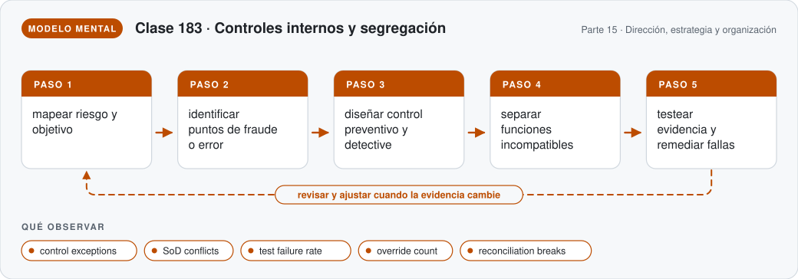

# Clase 183 — Controles internos y segregación

<!-- nav:inicio -->
> **Parte 15 · Riesgo, legal, compliance, ciberseguridad e IA** — clase 3 de 12 · [índice de la parte](../../README.md) · [temario](../../../../SYLLABUS.md)
<!-- nav:fin -->

**Parte:** 15 — Riesgo, legal, compliance, ciberseguridad e IA  
**Nivel:** Etapa 4 — Gerente → Director  
**Duración sugerida:** 150–180 minutos · **Estándar:** deep-class-v2

## 🎯 Propósito

Casi todos los fraudes internos y muchos errores graves tienen una causa común: una sola persona podía iniciar, aprobar, ejecutar y registrar una operación, y nadie más miraba. Los controles internos existen para que la empresa no dependa de la honestidad ni de la atención perfecta de nadie: reparten funciones, exigen segundas miradas y dejan huellas. Un buen control no es un obstáculo burocrático; es la diferencia entre una empresa que detecta una irregularidad en semanas y otra que la descubre al año, cuando ya es una pérdida material. Y un mal control, aparatoso y fácil de esquivar, cuesta tiempo y entrega una falsa seguridad.

La clase se apoya en el marco COSO de control interno, en la visión de Anderson sobre ingeniería de seguridad y separación de funciones, en el modelo de capas de defensa de Reason, en los datos del informe de la ACFE sobre fraude ocupacional y en la ISO 31000 para integrar controles con riesgos. Al terminar sabrás diseñar controles preventivos, detectivos y correctivos, aplicar la segregación de funciones, compensar cuando el tamaño del equipo no la permite y probar si los controles realmente funcionan.

## 📚 Resultados de aprendizaje

Al finalizar podrás:

1. **Describir** los componentes del control interno y su relación con los riesgos.
2. **Diseñar** controles preventivos, detectivos y correctivos para un proceso.
3. **Aplicar** la segregación de funciones y controles compensatorios.
4. **Probar** el diseño y la operación de un control con evidencia.
5. **Equilibrar** el costo del control con el riesgo que reduce.

## 🧭 Agenda

| Tramo | Qué se hace |
|---|---|
| 0–20 min | Recuperación: ¿qué proceso de tu empresa depende de la confianza en una sola persona? |
| 20–60 min | Marco, tipos de control, segregación, compensación, pruebas y costo. |
| 60–105 min | Ejemplo trabajado: control de pagos a proveedores. |
| 105–150 min | Caso ejecutivo y práctica. |
| 150–175 min | Límites y entregable. |

## 🧩 Conceptos centrales

| Concepto | Definición | Cómo se reconoce |
|---|---|---|
| **Control interno** | Proceso que da seguridad razonable sobre objetivos de operaciones, reporte y cumplimiento. | Está incorporado en el trabajo diario. |
| **Control preventivo** | Impide que ocurra el error o el abuso. | Autorización previa, límites de acceso. |
| **Control detectivo** | Descubre lo que ya ocurrió. | Conciliaciones, alertas, auditoría. |
| **Control correctivo** | Repara y evita la repetición. | Plan de acción, ajuste, sanción. |
| **Segregación de funciones** | Reparto de tareas incompatibles entre personas distintas. | Quien aprueba no ejecuta ni registra. |
| **Control compensatorio** | Control alternativo cuando no se puede segregar. | Revisión del dueño, límites y alertas. |

## 🧠 Modelo mental

**Cómo leer el diagrama.** Tres columnas. **Prevenir**: autorizaciones antes de actuar, separación entre quien pide, aprueba, ejecuta y registra, y accesos con el mínimo necesario. **Detectar**: conciliaciones y revisiones periódicas, alertas por patrones atípicos y auditoría o pruebas independientes. **Corregir**: respuesta a hallazgos con dueño y plazo, aprendizaje sin culpas y ajuste del control o del proceso. La nota recuerda que ningún control es perfecto y que las barreras se combinan en capas; el pie, que el costo de un control se compara con el riesgo que reduce.

## 📖 Desarrollo

### 1. Qué es un sistema de control interno

El marco COSO de control interno, ampliamente usado, define el control interno como un proceso, ejecutado por el directorio, la dirección y el resto del personal, diseñado para dar una **seguridad razonable** (no absoluta) sobre el logro de objetivos de operaciones, de reporte y de cumplimiento. Describe cinco componentes: **ambiente de control** (integridad, estructura, responsabilidades), **evaluación de riesgos**, **actividades de control**, **información y comunicación** y **monitoreo**. Subraya que el control no es un departamento: es una responsabilidad de todos, y que el tono de la dirección determina si los controles se respetan o se sortean. Su texto vigente se consulta en la fuente oficial.

### 2. De los riesgos a los controles

Un control sin riesgo asociado es burocracia; un riesgo sin control es una apuesta. El diseño parte de los **escenarios** (clase 181): «un empleado crea un proveedor ficticio y se aprueban facturas falsas». Para cada uno se pregunta qué control **previene**, cuál **detecta** y cuál **corrige**. Se prefiere combinar: un control preventivo fuerte y barato (doble aprobación) más uno detectivo (conciliación mensual de proveedores nuevos contra el maestro de proveedores). Los controles se documentan con: objetivo, riesgo que cubre, responsable, frecuencia, evidencia y qué se hace con las excepciones. Y se prefiere **automatizarlos** cuando se pueda, porque los controles manuales dependen de la disciplina y se debilitan con la rutina.

### 3. Segregación de funciones

El principio es simple: las tareas **incompatibles** no deben concentrarse en una persona. Se consideran incompatibles las que, juntas, permiten cometer y ocultar un error o un abuso: **iniciar**, **autorizar**, **custodiar** (los activos), **ejecutar** y **registrar** o **conciliar**. En pagos, por ejemplo, quien da de alta un proveedor no debe aprobar sus facturas ni emitir los pagos; quien custodia el inventario no debe registrarlo. Anderson, en su tratado de ingeniería de seguridad, muestra que la separación de funciones y el **control dual** (dos personas deben actuar) son defensas clásicas que tienen un equivalente en sistemas informáticos: roles, privilegios mínimos y registros de auditoría. Pero también muestra sus límites: dos personas pueden coludirse, y los sistemas con permisos acumulados con los años anulan la separación sin que nadie lo note.

### 4. Cuando no se puede segregar

En equipos pequeños, una persona puede hacer varias tareas. No es una excusa para abandonar el control: se usan **controles compensatorios**. Ejemplos: el dueño o el gerente revisa **mensualmente** la conciliación bancaria y los pagos fuera de patrón; se fijan **límites** por transacción con aprobación de un segundo; se rota al personal en tareas sensibles; se obliga a **vacaciones** continuas en puestos de riesgo; un tercero externo verifica periódicamente. Se documenta qué segregación falta, qué control la compensa y quién lo ejecuta. El control compensatorio debe ser **independiente** y **efectivo**: una firma sin revisión real es solo un trámite.

### 5. Capas de defensa y fallas latentes

Reason, en su análisis de errores y accidentes, describe las defensas como **capas con agujeros**, como rebanadas de queso: los accidentes ocurren cuando los agujeros se alinean. Los agujeros pueden ser **fallas activas** (un error de una persona) o **condiciones latentes** (diseño deficiente, accesos excesivos, presión por resultados) que existían antes. De aquí se deducen dos prácticas: combinar controles distintos e independientes (de manera que fallen por razones diferentes) y **buscar las condiciones latentes** antes de culpar a la persona. Un control que depende de que alguien «se acuerde» es frágil; uno incorporado al flujo (el sistema no permite pagar sin doble aprobación) es robusto.

### 6. Fraude, presión y oportunidad

El informe de la ACFE sobre fraude ocupacional recopila casos reales y muestra patrones: muchos fraudes duran meses o años antes de detectarse, y una parte importante se descubre por **denuncias** de personas, más que por auditorías. Esto refuerza la importancia de un canal de denuncia confiable (clase 189) y de controles detectivos. Una explicación clásica del fraude combina **presión** (necesidad o meta imposible), **oportunidad** (control débil) y **racionalización** (justificación interna). El control interno actúa sobre la oportunidad; la cultura y los incentivos sobre la presión y la racionalización. Las cifras del informe se consultan en su edición vigente y se interpretan con cautela, porque provienen de casos reportados.

### 7. Probar que el control funciona

Un control puede estar bien **diseñado** pero **no operar** (nadie lo ejecuta), o operar pero no cubrir el riesgo. Se prueba con **evidencia**: observación, revisión de registros y **muestreo**. Si se prueba una muestra de 25 aprobaciones y hay 2 excepciones (8 %), y la tolerancia definida es 4 %, el control no es efectivo y se corrige. La función de **auditoría interna**, independiente, evalúa; en el modelo de tres líneas, la primera línea (la gerencia operativa) es dueña de los riesgos y controles, la segunda (riesgos, cumplimiento) los supervisa y desafía, y la tercera (auditoría interna) aporta aseguramiento independiente al directorio. Y se vigila el **costo**: un control cuesta tiempo y dinero; si la fricción supera el riesgo, la gente lo evita y se pierde el control completo.

## 📚 Lectura comparada

| Obra | Qué aporta | Qué no resuelve | Pregunta para contrastar |
|---|---|---|---|
| COSO Control Interno | Cinco componentes y el concepto de seguridad razonable. | No diseña controles específicos. | ¿Qué componente está débil? |
| Anderson | Separación de funciones, control dual y sus límites técnicos. | Orientado a seguridad de sistemas. | ¿Qué permisos acumuló esta persona? |
| Reason | Capas de defensa y condiciones latentes. | Modelo conceptual, no una receta. | ¿Qué agujeros se pueden alinear? |
| ACFE | Patrones de fraude ocupacional, duración y detección. | Casos reportados, no toda la población. | ¿Cómo lo habríamos detectado? |
| ISO 31000 | Integra controles con el tratamiento de riesgos. | No define controles. | ¿Qué riesgo cubre este control? |

## 🧮 Ejemplo trabajado

**Situación (hipotética).** Una empresa mediana procesa 1.200 pagos a proveedores al mes. Una analista de compras con permisos de alta de proveedores y de aprobación de facturas registró un proveedor ficticio y aprobó una factura mensual de 6,5 millones de pesos durante 14 meses, hasta que una conciliación detectó una cuenta bancaria repetida en dos proveedores.

**Pérdida.** 6,5 × 14 = 91 millones de pesos.

**Diagnóstico.** No había separación entre alta de proveedor, aprobación y registro; el único control detectivo era una conciliación anual; las facturas no se contrastaban con recepción de bienes; el sistema no alertaba cuentas bancarias repetidas.

**Diseño de controles.**

| Tipo | Control | Responsable | Frecuencia |
|---|---|---|---|
| Preventivo | Alta de proveedores solo por finanzas, con verificación externa de existencia | Finanzas | Cada alta |
| Preventivo | Aprobación dual para pagos sobre 2 millones | Jefatura y tesorería | Cada pago |
| Preventivo | Pago solo con recepción conforme (tres vías: orden, recepción, factura) | Sistema | Automático |
| Detectivo | Alerta por cuenta bancaria repetida o proveedor nuevo con pagos recurrentes | Sistema y control interno | Semanal |
| Detectivo | Conciliación mensual y revisión por el gerente de pagos atípicos | Gerente financiero | Mensual |
| Correctivo | Revocación de accesos, revisión de la muestra de 24 meses y plan de acción | Control interno | Por caso |

**Costo del control principal.** Si el 18 % de los pagos supera 2 millones: 0,18 × 1.200 = 216 pagos al mes. Con 6 minutos adicionales de aprobación por pago: 216 × 6 = 1.296 minutos, es decir 21,6 horas al mes. A 12.000 pesos la hora, el costo es 259.200 pesos al mes, unos 3,1 millones al año. Frente a una pérdida de 91 millones, la relación es de unas 29 veces (91 ÷ 3,1).

**Prueba de operación.** A los seis meses se toma una muestra de 25 pagos sobre 2 millones: 2 no tienen doble aprobación (8 %). La tolerancia es 4 %. El control no es efectivo: se descubre que el sistema permite una aprobación de emergencia sin registro. Se bloquea la ruta y se exige justificación por escrito; la nueva prueba arroja 0 excepciones en 25.

**Compensación.** En la sucursal de dos personas, donde no es posible separar, el gerente revisa semanalmente los pagos y concilia el banco cada mes, y finanzas revisa una muestra trimestral.

**Cuidados.** Las obligaciones de registro, de información y de protección de datos de proveedores se verifican con asesoría; las cifras son ilustrativas.

**Qué muestra.** (1) La concentración de funciones permitió el fraude. (2) Los controles combinaron prevenir, detectar y corregir. (3) La prueba de operación encontró una falla latente.

## 🔀 Comparación y límites

**Control interno frente a auditoría.** El control interno es parte del trabajo diario y lo ejecuta la gerencia; la auditoría evalúa de forma independiente si los controles funcionan.

**Límites.** El control interno da seguridad razonable, no absoluta: puede fallar por colusión, error humano o presión de la dirección. Un exceso de controles reduce la agilidad y genera evasión. Los casos de la ACFE provienen de fraudes reportados y no representan a todas las empresas. Las exigencias legales de control y de reporte (sociedades abiertas, sectores regulados) se verifican en su fuente. Las cifras del ejemplo son ilustrativas.

## 🪜 De profesional a owner

| Nivel | Cómo participa |
|---|---|
| **Profesional** | Cumple los controles aunque sean incómodos y avisa de debilidades. |
| **Jefe / Team Lead** | Revisa con atención y no aprueba por costumbre. |
| **Gerente** | Es dueño de los controles de su proceso y prueba que operan. |
| **CEO / Director** | Marca el tono, no pide excepciones por conveniencia y exige aseguramiento independiente. |
| **Founder / Owner** | Acepta revisar personalmente lo que no se puede segregar. |

## 🏢 Caso ejecutivo

Una cadena de farmacias con 40 locales y 1.100 empleados tiene un sistema de inventario donde los encargados de local pueden ajustar existencias sin aprobación. En un año, los ajustes negativos pasaron de 0,6 % a 1,9 % de las ventas (que son de 52.000 millones de pesos), y tres locales concentran el 55 % de los ajustes. Las cajas se cuadran con una firma de la misma persona que cuenta el efectivo; los descuentos manuales no tienen tope; en la central, un analista tiene permisos para crear usuarios y modificar sus roles. Una denuncia anónima, que llegó a un correo sin responsable, menciona colusión entre un encargado y un proveedor de medicamentos de alta rotación. La gerencia propone contratar más supervisores; el directorio pide «un sistema de control moderno» sin aumentar la planilla.

Entrega un **diseño de controles** que contenga: (a) los escenarios de riesgo con su estimación; (b) la matriz de segregación de funciones en local y en central; (c) los controles preventivos, detectivos y correctivos con responsable, frecuencia y evidencia; (d) los controles compensatorios para los locales pequeños; (e) el plan de prueba de diseño y de operación con muestreo y tolerancias; (f) el costo de los controles frente al riesgo y las verificaciones legales y laborales pendientes.

## 🧪 Práctica

1. Elige un proceso (pagos, compras, nómina o inventario) y dibuja quién inicia, autoriza, ejecuta y registra.
2. Identifica las tareas incompatibles que hoy concentra una persona.
3. Diseña un control preventivo, uno detectivo y uno correctivo para un escenario.
4. Define una prueba de operación con tamaño de muestra y tolerancia.
5. Estima el costo anual del control y compáralo con la pérdida del escenario.

## ⚠️ Errores frecuentes

| Error | Por qué ocurre | Cómo corregirlo |
|---|---|---|
| Un solo control | Se confía en la persona | Combinar preventivos, detectivos y correctivos. |
| Segregar solo en el papel | Los permisos se acumulan | Revisar accesos con frecuencia. |
| Control que depende de la memoria | Se omite la automatización | Incorporarlo al flujo del sistema. |
| Nunca probar | Se asume que funciona | Probar diseño y operación con evidencia. |
| Culpar a la persona | Se ve el error activo | Buscar condiciones latentes. |
| Controlar todo igual | Se quiere cubrir todo | Concentrar en riesgos materiales y comparar costos. |

## ❓ Preguntas de comprobación

1. ¿Qué componentes tiene el control interno según COSO?
2. ¿Qué diferencia hay entre control preventivo, detectivo y correctivo?
3. ¿Qué tareas se consideran incompatibles y por qué?
4. ¿Qué es un control compensatorio y qué condiciones debe cumplir?
5. ¿Qué enseña el modelo de capas con agujeros de Reason?
6. ¿Cómo se prueba la operación de un control?
7. ¿Qué papel tienen las tres líneas en el control?

Claves de respuesta

1. Ambiente de control, evaluación de riesgos, actividades de control, información y comunicación, y monitoreo.
2. El preventivo impide el hecho, el detectivo lo descubre y el correctivo lo repara y evita su repetición.
3. Iniciar, autorizar, custodiar, ejecutar y registrar o conciliar, porque juntas permiten cometer y ocultar un abuso o error.
4. Un control alternativo cuando no se puede segregar; debe ser independiente, efectivo, documentado y ejecutarse de verdad.
5. Que los incidentes ocurren cuando se alinean fallas en varias defensas y que hay que buscar condiciones latentes y combinar controles independientes.
6. Con evidencia: observación, revisión de registros y muestreo comparado con una tolerancia definida.
7. La primera línea es dueña de riesgos y controles, la segunda supervisa y desafía, y la tercera (auditoría interna) da aseguramiento independiente.

## 📥 Entregable

Guarda en `portfolio/183-controles-internos-y-segregacion/`:

- `leadership-decision-brief.md` (plantilla [Leadership Decision Brief](../../../../templates/leadership-decision-brief.md)) con el diseño de controles del caso ejecutivo;
- `risk-register.md` (plantilla [Risk register](../../../../templates/risk-register.md)) con los escenarios de fraude y error y sus controles;
- `decision-journal.md` con la matriz de segregación, el plan de pruebas y los controles compensatorios.

## 📗 Fuentes y verificación

- COSO — *Internal Control - Integrated Framework* (2013). **Uso en esta clase:** componentes del control interno y seguridad razonable. **Fuente primaria:** <https://www.coso.org/guidance-on-ic>.
- Ross Anderson — *Security Engineering* (John Wiley & Sons, Incorporated, 2001). **Uso en esta clase:** separación de funciones, control dual y sus límites técnicos. Lectura selectiva sobre **controles internos y segregación**. **Localizador:** [ISBN-13 9781119642831](https://openlibrary.org/isbn/9781119642831).
- James Reason — *Human error: models and management* (BMJ, 2000). **Uso en esta clase:** capas de defensa y condiciones latentes. Lectura selectiva sobre **controles internos y segregación**. **Localizador:** [DOI 10.1136/bmj.320.7237.768](https://doi.org/10.1136/bmj.320.7237.768).
- ACFE — *Occupational Fraud: Report to the Nations* (2024). **Uso en esta clase:** patrones de fraude ocupacional, duración y detección. **Fuente primaria:** <https://www.acfe.com/report-to-the-nations/2024/>.
- ISO — *ISO 31000 Risk management*. **Uso en esta clase:** integración de controles con el tratamiento de riesgos. **Localizador pendiente:** ver [el registro de fuentes](../../../../docs/FUENTES.md).

> **Regla de fuentes para Controles internos y segregación:** las obras anteriores estructuran las perspectivas de esta materia; cualquier norma, ley o estándar vivo mencionado debe comprobarse nuevamente en su fuente primaria vigente, incluidos los marcos de control y las exigencias legales de control y reporte. Los ejemplos y casos son hipotéticos, con cifras ilustrativas. El desarrollo es original y no reproduce capítulos protegidos.

<!-- pie:inicio -->
---

| Anterior | Índice | Siguiente |
|---|---|---|
| [← 182 · Apetito, tolerancia y límites de riesgo](../182-apetito-tolerancia-y-limites-de-riesgo/README.md) | [Parte 15](../../README.md) · [Programa](../../../../SYLLABUS.md) | [184 · Alfabetización legal del gerente →](../184-alfabetizacion-legal-del-gerente/README.md) |
<!-- pie:fin -->
