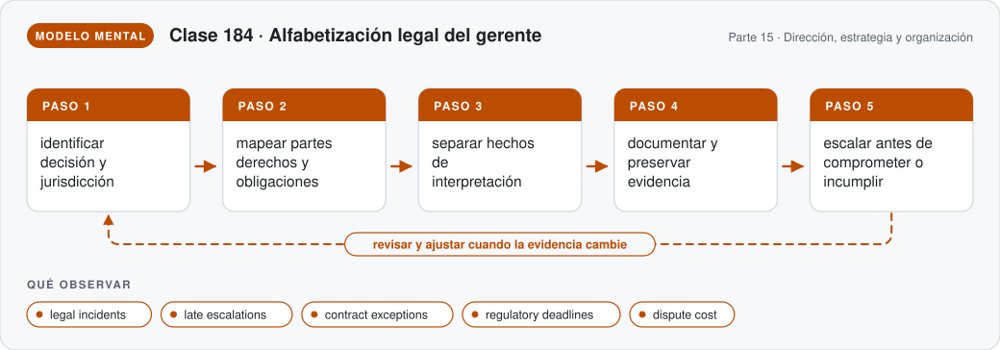

# Clase 184 — Alfabetización legal del gerente

<!-- nav:inicio -->
> **Parte 15 · Riesgo, legal, compliance, ciberseguridad e IA** — clase 4 de 12 · [índice de la parte](../../README.md) · [temario](../../../../SYLLABUS.md)
<!-- nav:fin -->

**Parte:** 15 — Riesgo, legal, compliance, ciberseguridad e IA  
**Nivel:** Etapa 4 — Gerente → Director  
**Duración sugerida:** 150–180 minutos · **Estándar:** deep-class-v2

## 🎯 Propósito

Un gerente no necesita ser abogado, pero sí reconocer cuándo una decisión de negocio es también una decisión legal. Firma contratos, contrata y despide, maneja datos de clientes, promete plazos, usa marcas y software de terceros, se reúne con competidores en asociaciones gremiales y responde a autoridades. En cada una de esas acciones puede comprometer a la empresa, y a veces a sí mismo, de maneras que no se ven hasta que hay un reclamo. La **alfabetización legal** es la capacidad de detectar el tema, reunir los hechos, formular una buena pregunta y escalar a tiempo, sin pretender reemplazar a la asesoría ni interpretar normas de memoria.

La clase no enseña derecho de ninguna jurisdicción: enseña a **trabajar con el derecho**. Se apoya en la visión de Tricker sobre gobierno corporativo, en el estudio clásico de Macaulay sobre cómo las empresas usan realmente los contratos y las relaciones, en el trabajo de Bazerman y Moore sobre los sesgos de juicio de los gerentes y en la ISO 31000 para tratar los riesgos legales como cualquier otro. Para las normas, remite a las fuentes oficiales, como el portal LeyChile de la Biblioteca del Congreso Nacional de Chile. Al terminar sabrás clasificar riesgos legales, decidir qué escalar, documentar con criterio y gestionar la relación con la asesoría.

## 📚 Resultados de aprendizaje

Al finalizar podrás:

1. **Reconocer** los principales ámbitos de riesgo legal en las decisiones gerenciales.
2. **Distinguir** qué decide el gerente, qué se valida con asesoría y qué se escala de inmediato.
3. **Formular** una consulta legal con hechos, objetivo, plazo y opciones.
4. **Documentar** decisiones y comunicaciones sabiendo que pueden ser evidencia.
5. **Verificar** normas en fuentes oficiales sin interpretarlas de memoria.

## 🧭 Agenda

| Tramo | Qué se hace |
|---|---|
| 0–20 min | Recuperación: ¿qué decisión tomaste el último mes que, mirada de nuevo, tenía un componente legal? |
| 20–60 min | Ámbitos, detección, consulta, documentación, límites y relación con la asesoría. |
| 60–105 min | Ejemplo trabajado: triaje legal de contratos en una empresa de servicios. |
| 105–150 min | Caso ejecutivo y práctica. |
| 150–175 min | Límites y entregable. |

## 🧩 Conceptos centrales

| Concepto | Definición | Cómo se reconoce |
|---|---|---|
| **Riesgo legal** | Posibilidad de sanción, reclamo o pérdida por incumplir normas o contratos. | Aparece en decisiones comerciales, laborales y de datos. |
| **Detección de temas** | Capacidad de ver el componente legal de una decisión. | Se hacen preguntas antes de actuar. |
| **Escalamiento** | Llevar un tema a asesoría o a una instancia superior. | Tiene criterios y plazos. |
| **Consulta legal** | Pregunta formulada con hechos, objetivo y opciones. | Permite una respuesta útil y rápida. |
| **Evidencia documental** | Registros que pueden usarse para probar lo ocurrido. | Correos, mensajes, actas, contratos. |
| **Fuente oficial** | Texto de la norma publicado por la autoridad competente. | Fecha, vigencia y versión verificables. |

## 🧠 Modelo mental

**Cómo leer el diagrama.** Una tabla con cuatro situaciones de complejidad creciente. En la **rutinaria con plantilla aprobada** decide el gerente dentro de su límite. En la **variación de condiciones** decide con visto bueno del área legal. Ante una **nueva obligación o regulación** decide un comité con asesoría legal y se documenta la fuente oficial consultada. Ante una **disputa o requerimiento de una autoridad**, decide la dirección con asesoría especializada y se escala de inmediato. La nota aclara que el gerente reconoce, reúne hechos y escala a tiempo; el pie, que toda decisión con efecto legal se verifica en la fuente oficial vigente.

## 📖 Desarrollo

### 1. Dónde aparece el riesgo legal

Los ámbitos más frecuentes en decisiones gerenciales son: **contratos** con clientes, proveedores y socios (clase 185); **relaciones laborales** (contratación, evaluación, cambios de funciones, término de la relación, acoso, seguridad y salud); **datos personales** (clase 186); **competencia** (acuerdos con competidores, precios, exclusividades); **consumo y publicidad** (promesas, promociones, garantías); **propiedad intelectual** (marcas, software, contenidos de terceros); **tributario y financiero**; **ambiental, sanitario y sectorial**; y **responsabilidad penal** de la empresa y de las personas (cohecho, lavado de activos, delitos informáticos). La lista no es una guía legal: es un mapa de **dónde mirar**. En Chile, por ejemplo, la normativa se consulta en LeyChile y en los portales de las autoridades competentes; en otro país, en las fuentes equivalentes.

### 2. Detectar el tema antes de actuar

La mayoría de los problemas legales no nace de mala fe sino de **no haber visto el tema**. Algunas señales de que hay un componente legal: aparece la palabra «exclusividad», «garantía», «indemnización» o «confidencial»; se va a usar información de personas; se va a modificar la situación de una persona trabajadora; una autoridad pide información; alguien dice «hagámoslo así y no lo escribamos»; se va a copiar algo de un tercero; el negocio es nuevo y no hay precedente. Una práctica útil es una **lista breve de verificación** previa a decisiones importantes, con preguntas como: ¿hay terceros involucrados?, ¿hay datos de personas?, ¿hay promesas o garantías?, ¿hay plazos legales o contractuales?, ¿quién más debería verlo? Bazerman y Moore muestran que los gerentes tienden a la **sobreconfianza** y a pasar por alto información desfavorable; una lista obliga a mirar.

### 3. Qué decide el gerente y qué se escala

Se define por escrito una **escalera de decisión**. En lo rutinario con plantillas aprobadas, decide el gerente dentro de su límite de autoridad. Cuando se apartan condiciones esenciales (responsabilidad, plazos, datos, exclusividad), se pide **visto bueno** del área legal. Ante nuevas obligaciones, cambios regulatorios o dudas de vigencia, se consulta con asesoría y se documenta la fuente oficial. Ante disputas, notificaciones de autoridades, denuncias graves o sospecha de delito, se **escala de inmediato** a la dirección y a la asesoría, y no se responde por cuenta propia. Los criterios de escalamiento se definen con **montos, plazos y tipo de materia**, y se prueban en casos reales para que sean realistas.

### 4. Formular una buena consulta

Una consulta legal eficaz contiene: **hechos** (qué ocurrió, quiénes, fechas, documentos), **objetivo** (qué se quiere lograr), **restricciones** (plazos, costos, relaciones), **opciones** consideradas y **pregunta concreta** («¿podemos terminar este contrato con 30 días de aviso?» y no «¿qué hacemos con el proveedor?»). Se adjuntan documentos y se indica la **urgencia real**. Se evita adelantar conclusiones («esto es legal, ¿verdad?») y se pide la respuesta con sus **supuestos y riesgos**, no solo un sí o un no. Una buena consulta ahorra horas de asesoría y reduce errores; también facilita que el área legal priorice.

### 5. Los documentos son evidencia

Correos, mensajes, presentaciones y actas pueden convertirse en **evidencia** en un reclamo, una fiscalización o un juicio. Las prácticas básicas: escribir con **precisión y sobriedad** (sin especular sobre culpas ni exagerar), no destruir información cuando hay un reclamo o investigación anunciada (el área legal indicará la **retención**), separar los comentarios personales de los asuntos de negocio y usar los canales corporativos. Las reglas sobre **confidencialidad de las comunicaciones con abogados**, plazos de conservación de documentos y valor probatorio de registros electrónicos varían según el país y la materia; no se asumen, se consultan con asesoría y fuentes oficiales.

### 6. Contratos, relaciones y realidad

Macaulay estudió cómo las empresas hacen negocios y halló que, a menudo, las relaciones, la reputación y la expectativa de seguir comerciando pesan más que los contratos formales; muchas disputas se resuelven sin recurrir a ellos. Esto no autoriza a descuidar los contratos, pero explica por qué un gerente prudente **cuida la relación** y a la vez **documenta** lo esencial. Un contrato bien hecho cumple tres funciones: **planificar** (qué se espera), **repartir riesgos** (quién responde por qué) y **resolver desacuerdos** (cómo salir). Un contrato como arma para sorprender al otro rara vez conviene a largo plazo, y el mejor momento para hablar de lo que podría salir mal es antes de firmar.

### 7. Trabajar con la asesoría legal y con las fuentes oficiales

El área legal, interna o externa, rinde mejor cuando se la **involucra temprano**, se le explica el negocio, se acuerdan **plazos y prioridades** y se le pide opinar sobre riesgos y alternativas, no solo sobre la legalidad. Se distingue entre lo **ilegal** (no se puede), lo **riesgoso** (se puede, con consecuencias posibles que la dirección debe aceptar) y lo **inconveniente** (es legal, pero mala idea). Las normas se verifican siempre en su **versión oficial vigente**: LeyChile para leyes chilenas, el Diario Oficial para su publicación, los sitios de las superintendencias y servicios para criterios sectoriales y, en comercio internacional, los textos oficiales de cada jurisdicción. Un resumen de memoria o una nota de prensa no basta. Tricker subraya que el gobierno corporativo incluye el **cumplimiento** como responsabilidad de la dirección, no solo de los abogados.

## 📚 Lectura comparada

| Obra | Qué aporta | Qué no resuelve | Pregunta para contrastar |
|---|---|---|---|
| Tricker | Gobierno corporativo y responsabilidad de la dirección sobre el cumplimiento. | No sustituye derecho local. | ¿Quién responde en la dirección? |
| Macaulay | Uso real de contratos y relaciones en los negocios. | Estudio de un contexto específico y de su época. | ¿Qué parte del acuerdo depende de la relación? |
| Bazerman y Moore | Sesgos de juicio, sobreconfianza y puntos ciegos. | No da reglas legales. | ¿Qué estamos pasando por alto? |
| ISO 31000 | Tratar el riesgo legal con el mismo proceso que otros riesgos. | No dice qué exige cada ley. | ¿Qué probabilidad e impacto estimamos? |
| LeyChile (BCN) | Texto oficial y vigente de la legislación chilena. | No es asesoría ni interpretación. | ¿Qué versión estamos leyendo y desde cuándo rige? |

## 🧮 Ejemplo trabajado

**Situación (hipotética).** Una empresa de servicios gestiona 140 contratos por trimestre con clientes y proveedores. El equipo legal tiene 120 horas disponibles por trimestre y se queja de saturación. El gerente general propone contratar más abogados; la gerencia de operaciones, que «todo lo apruebe legal».

**Triaje por tipo.**

| Tipo | Proporción | Contratos | Horas de legal por contrato | Horas totales |
|---|---|---|---|---|
| Estándar con plantilla aprobada | 70 % | 98 | 0 | 0 |
| Con variaciones de condiciones | 20 % | 28 | 2 | 56 |
| Especiales (nuevos riesgos, datos, exclusividad) | 10 % | 14 | 8 | 112 |
| **Total** | 100 % | 140 | | **168** |

**Brecha.** 168 − 120 = 48 horas por trimestre. Costo con horas internas a 45.000 pesos y externas a 110.000: 120 × 45.000 = 5,40 millones, más 48 × 110.000 = 5,28 millones; total 10,68 millones por trimestre.

**Mejora de plantillas.** Un análisis de las variaciones muestra que 40 % se debe a la misma cláusula de pagos. Se rediseña la plantilla con una alternativa pre aprobada. Las variaciones bajan de 20 % a 12 %: 140 × 12 % ≈ 17 contratos × 2 horas = 34 horas; con 112 horas de especiales, el total es 146 horas. La brecha baja a 26 horas: 120 × 45.000 = 5,40 millones más 26 × 110.000 = 2,86 millones; total 8,26 millones. El ahorro es 10,68 − 8,26 = 2,42 millones por trimestre.

**Escalera de decisión.** Se aprueba: estándar, el gerente decide hasta 50 millones; con variación, visto bueno de legal en 3 días hábiles; especiales, comité semanal; disputas o notificaciones de autoridades, escalamiento inmediato al gerente general y a legal con el formulario de consulta.

**Consulta tipo.** Hechos (cliente, monto, plazo, borrador, cambios solicitados), objetivo, restricciones, opciones, pregunta concreta y fecha límite.

**Cuidados.** La lista de materias y los límites se revisan cada año con asesoría; las normas aplicables se verifican en su fuente oficial vigente; las cifras son ilustrativas.

**Qué muestra.** (1) El triaje redujo la carga sin quitar control. (2) La plantilla resolvió la causa. (3) La escalera dio claridad sobre quién decide.

## 🔀 Comparación y límites

**Alfabetización legal frente a asesoría legal.** La primera permite ver y preguntar; la segunda interpreta y responde. Un gerente que cree saber derecho es tan riesgoso como uno que lo ignora.

**Límites.** Esta clase no interpreta ninguna ley ni sustituye asesoría profesional. Las normas cambian y varían por país, sector y materia. La confidencialidad de comunicaciones con abogados, los plazos de prescripción y las obligaciones de conservar documentos se consultan en la fuente oficial y con asesoría. El estudio de Macaulay es antiguo y de un contexto específico. Las cifras del ejemplo son ilustrativas.

## 🪜 De profesional a owner

| Nivel | Cómo trabaja con lo legal |
|---|---|
| **Profesional** | Reconoce temas, pregunta antes de comprometerse y guarda registros. |
| **Jefe / Team Lead** | Usa las plantillas y escala las variaciones a tiempo. |
| **Gerente** | Mantiene la escalera de decisión y formula buenas consultas. |
| **CEO / Director** | Define el apetito de riesgo legal y responde por el cumplimiento. |
| **Founder / Owner** | Entiende que sus decisiones pueden comprometer a la empresa y a su patrimonio. |

## 🏢 Caso ejecutivo

Una empresa de educación en línea con 300 empleados lanza una campaña con promesas de empleo para quienes terminen un curso. El equipo de marketing envía correos masivos a una base de 85.000 contactos obtenida de un evento, ofrece «garantía de reembolso total» sin condiciones escritas, y usa en un video una música sin licencia. Una persona trabajadora denuncia, por correo interno, un trato hostil de su jefe; el gerente de personas responde por mensajería instantánea con comentarios sobre el carácter de la denunciante. Mientras tanto, un funcionario de una autoridad pide por teléfono información de la campaña y el gerente comercial le adelanta cifras sin consultar. El gerente general dice: «lo legal es cosa de legal; nosotros vendemos».

Entrega un **protocolo de alfabetización legal** que contenga: (a) el mapa de temas legales presentes en el caso; (b) la escalera de decisión con quién decide qué y en qué plazos; (c) la consulta legal modelo para uno de los temas; (d) las prácticas de documentación y de retención de información que corresponden; (e) las fuentes oficiales y asesorías que se consultarán antes de actuar; (f) el plan para evitar que el equipo repita estos errores.

## 🧪 Práctica

1. Lista diez decisiones recientes de tu área y marca las que tenían un componente legal.
2. Redacta una lista de verificación de cinco preguntas para decisiones importantes.
3. Diseña una escalera de decisión con montos, plazos y materias.
4. Formula una consulta legal sobre un caso real con hechos, objetivo, opciones y pregunta.
5. Busca una norma en su fuente oficial y anota versión, fecha y vigencia sin interpretarla.

## ⚠️ Errores frecuentes

| Error | Por qué ocurre | Cómo corregirlo |
|---|---|---|
| No ver el tema | Se mira solo el negocio | Usar una lista de verificación previa. |
| Escalar tarde | Se teme parecer incompetente | Criterios claros de escalamiento. |
| Consultas vagas | Falta preparación | Hechos, objetivo, opciones y pregunta concreta. |
| Escribir sin cuidado | Se cree que es privado | Sobriedad y canales corporativos. |
| Fiarse de resúmenes | Es más rápido | Consultar la fuente oficial vigente. |
| Ver al abogado como freno | Se involucra tarde | Involucrarlo temprano y pedir alternativas. |

## ❓ Preguntas de comprobación

1. ¿Qué ámbitos de riesgo legal aparecen en decisiones gerenciales?
2. ¿Qué señales indican que una decisión tiene un componente legal?
3. ¿Qué situaciones exigen escalamiento inmediato?
4. ¿Qué elementos tiene una buena consulta legal?
5. ¿Por qué los documentos pueden ser evidencia y qué prácticas se recomiendan?
6. ¿Qué enseña Macaulay sobre los contratos?
7. ¿Cómo se verifica una norma sin interpretarla de memoria?

Claves de respuesta

1. Contratos, laboral, datos, competencia, consumo y publicidad, propiedad intelectual, tributario, sectorial y responsabilidad penal.
2. Terceros, datos de personas, promesas o garantías, plazos legales, cambios a la situación de personas trabajadoras, requerimientos de autoridades y negocios sin precedente.
3. Disputas, notificaciones de autoridades, denuncias graves y sospecha de delito.
4. Hechos, objetivo, restricciones, opciones, pregunta concreta, documentos y urgencia real.
5. Porque pueden usarse para probar lo ocurrido; conviene escribir con precisión, usar canales corporativos y no destruir información cuando hay un reclamo o investigación.
6. Que las relaciones y la reputación pesan a menudo más que el contrato formal, pero el contrato sigue siendo útil para planificar, repartir riesgos y resolver desacuerdos.
7. Consultando el texto oficial vigente (por ejemplo LeyChile) y a la asesoría, anotando versión y fecha.

## 📥 Entregable

Guarda en `portfolio/184-alfabetizacion-legal-del-gerente/`:

- `risk-governance-brief.md` (plantilla [Risk Governance Brief](../../../../templates/risk-governance-brief.md)) con el protocolo del caso ejecutivo;
- `decision-brief.md` (plantilla [Decision Brief](../../../../templates/decision-brief.md)) con la lista de verificación previa y la consulta legal modelo;
- `decision-journal.md` con la escalera de decisión, la consulta modelo y las fuentes oficiales consultadas.

## 📗 Fuentes y verificación

- Bob Tricker — *Corporate Governance* (Oxford University Press, 2019). **Uso en esta clase:** gobierno corporativo y responsabilidad de la dirección sobre el cumplimiento. Lectura selectiva sobre **alfabetización legal del gerente**. **Localizador:** [ISBN-13 9780198809869](https://openlibrary.org/isbn/9780198809869).
- Stewart Macaulay — *Non-Contractual Relations in Business: A Preliminary Study* (American Sociological Review, 1963). **Uso en esta clase:** uso real de contratos y relaciones en los negocios. Lectura selectiva sobre **alfabetización legal del gerente**. **Localizador:** [DOI 10.2307/2090458](https://doi.org/10.2307/2090458).
- Max H. Bazerman & Don A. Moore — *Judgment in Managerial Decision Making* (John Wiley & Sons Inc). **Uso en esta clase:** sesgos de juicio y sobreconfianza de los gerentes. Lectura selectiva sobre **alfabetización legal del gerente**. **Localizador:** [ISBN-13 9781119427384](https://openlibrary.org/isbn/9781119427384).
- ISO — *ISO 31000 Risk management*. **Uso en esta clase:** tratamiento del riesgo legal con el proceso general de riesgos. **Localizador pendiente:** ver [el registro de fuentes](../../../../docs/FUENTES.md).
- Biblioteca del Congreso Nacional de Chile — *LeyChile: responsabilidad penal de las personas jurídicas (Ley 20.393)* (2009). **Uso en esta clase:** texto oficial de la responsabilidad penal de las personas jurídicas. **Fuente primaria:** <https://www.bcn.cl/leychile/>.

> **Regla de fuentes para Alfabetización legal del gerente:** las obras anteriores estructuran las perspectivas de esta materia; cualquier norma, ley o estándar vivo mencionado debe comprobarse nuevamente en su fuente primaria vigente y con asesoría legal, sin interpretar su contenido de memoria. Los ejemplos y casos son hipotéticos, con cifras ilustrativas. El desarrollo es original y no reproduce capítulos protegidos.

<!-- pie:inicio -->
---

| Anterior | Índice | Siguiente |
|---|---|---|
| [← 183 · Controles internos y segregación](../183-controles-internos-y-segregacion/README.md) | [Parte 15](../../README.md) · [Programa](../../../../SYLLABUS.md) | [185 · Contratos: riesgos que un ejecutivo debe detectar →](../185-contratos-riesgos-que-un-ejecutivo-debe-detectar/README.md) |
<!-- pie:fin -->
