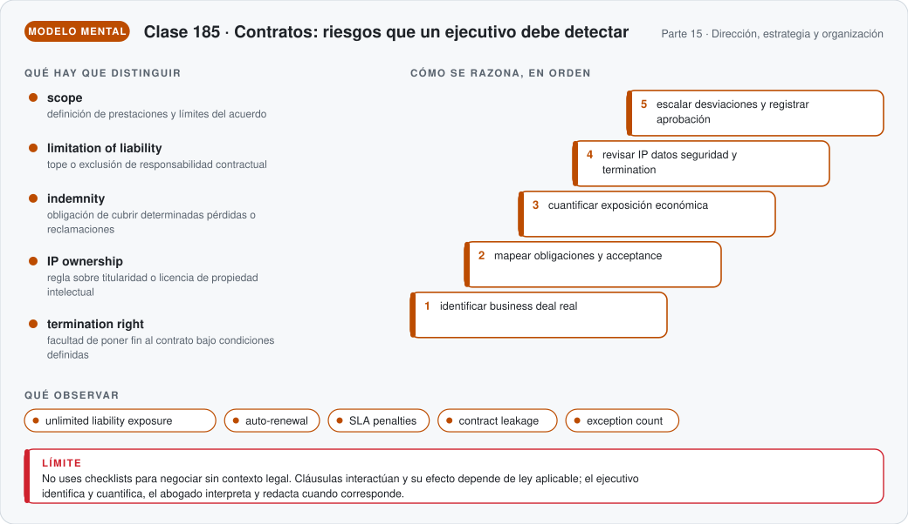

# Clase 185 — Contratos: riesgos que un ejecutivo debe detectar

<!-- nav:inicio -->
> **Parte 15 · Riesgo, legal, compliance, ciberseguridad e IA** — clase 5 de 12 · [índice de la parte](../../README.md) · [temario](../../../../SYLLABUS.md)
<!-- nav:fin -->

**Parte:** 15 — Riesgo, legal, compliance, ciberseguridad e IA  
**Nivel:** Etapa 4 — Gerente → Director  
**Duración sugerida:** 150–180 minutos · **Estándar:** deep-class-v2

## 🎯 Propósito

Un contrato no es un trámite que se firma al final de una negociación comercial: es el instrumento que reparte entre dos partes los costos de lo que salga mal. Cuando todo funciona, nadie lo lee; cuando algo falla, es lo único que importa. Los ejecutivos suelen firmar contratos que no leyeron completos, confiados en que «legal lo revisó» o en que la relación comercial es buena, y descubren más tarde que se obligaron a renovar automáticamente con un alza, que la responsabilidad del proveedor quedó limitada a una fracción del daño posible o que no pueden recuperar sus datos si terminan la relación.

La clase no enseña a redactar cláusulas: enseña a **detectar riesgos** que un ejecutivo debe entender antes de firmar y a hacer las preguntas correctas a la asesoría legal. Se apoya en la economía de los costos de transacción de Williamson, en el estudio de Macaulay sobre relaciones y contratos, en los sesgos de negociación descritos por Bazerman y Moore, en las técnicas de negociación de Voss y en las lecciones de Flyvbjerg sobre sobrecostos y plazos. Al terminar sabrás revisar un contrato con una matriz de riesgos, cuantificar su exposición, preparar una negociación y definir qué se acepta y qué no.

## 📚 Resultados de aprendizaje

Al finalizar podrás:

1. **Identificar** los riesgos económicos, operativos y de dependencia de un contrato.
2. **Cuantificar** la exposición frente a límites de responsabilidad, créditos y costos de salida.
3. **Reconocer** cláusulas que crean dependencia o atrapan a la empresa.
4. **Preparar** una negociación con prioridades, alternativas y concesiones.
5. **Escalar** a asesoría con una lista concreta de puntos a revisar.

## 🧭 Agenda

| Tramo | Qué se hace |
|---|---|
| 0–20 min | Recuperación: ¿qué contrato de tu empresa se renovó solo y cuánto cuesta salir de él? |
| 20–60 min | Mapa de riesgos, dependencia, responsabilidad, negociación y salida. |
| 60–105 min | Ejemplo trabajado: contrato de un sistema logístico en la nube. |
| 105–150 min | Caso ejecutivo y práctica. |
| 150–175 min | Límites y entregable. |

## 🧩 Conceptos centrales

| Concepto | Definición | Cómo se reconoce |
|---|---|---|
| **Contrato incompleto** | Acuerdo que no puede prever todas las contingencias. | Deja lagunas que se resuelven por relación o disputa. |
| **Especificidad de activos** | Inversión que vale mucho en esta relación y poco fuera de ella. | Costo alto de cambiarse. |
| **Dependencia (hold-up)** | Riesgo de que la otra parte aproveche que no hay salida fácil. | Aumentos de precio o condiciones difíciles al renovar. |
| **Límite de responsabilidad** | Tope de lo que una parte debe pagar por daños. | Frecuentemente expresado en múltiplos de los pagos. |
| **Nivel de servicio (SLA)** | Compromiso medible de calidad o disponibilidad, con consecuencias. | Porcentajes, tiempos y créditos. |
| **Renovación automática** | Prórroga que ocurre si nadie avisa en un plazo. | Plazos de aviso y alzas pactadas. |

## 🧠 Modelo mental

**Cómo leer el diagrama.** Una tabla con cinco áreas de riesgo, la pregunta que debe hacerse el ejecutivo y el control o cláusula a revisar. **Precio y pagos**: qué pasa si el costo sube o el cliente paga tarde. **Plazos y entregables**: qué se entrega, cuándo y quién lo acepta. **Responsabilidad**: hasta cuánto se responde si algo sale mal. **Salida y dependencia**: si se puede terminar sin quedar atrapado. **Datos y confidencialidad**: qué información se comparte y cómo se protege. La nota aclara que el ejecutivo busca entender qué riesgos asume y que la redacción corresponde a la asesoría.

## 📖 Desarrollo

### 1. Qué hace un contrato

Un contrato cumple tres funciones: **planificar** (qué se espera de cada parte), **repartir riesgos** (quién soporta cada contingencia) y **resolver desacuerdos** (cómo se corrigen los incumplimientos y cómo se sale). Macaulay observó que muchas empresas hacen negocios sin recurrir a los contratos formales y que, a menudo, prefieren resolver los problemas por la relación; los contratos importan más cuando la relación se rompe o cuando hay mucho en juego. Williamson, desde la economía, añade que los contratos son **incompletos**: no pueden prever todo, y su diseño depende de cuánto se invierte en la relación y de cuánto cuesta adaptarse. Por eso el ejecutivo se pregunta: ¿qué pasa si algo falla?, ¿cuánto costaría y quién lo pagaría?

### 2. Precio y pagos

Se revisan: **forma de cálculo** (fijo, variable, por uso), **reajustes** (cómo y cuándo suben), **plazos de pago** (propios y de los clientes), **intereses y garantías**, **impuestos**, **moneda** y **cargos adicionales** (implementación, soporte, excedentes). Los riesgos típicos: alzas automáticas sin tope; cobros por excedentes difíciles de predecir; pagos a clientes que se atrasan mientras los pagos a proveedores son rígidos; garantías que inmovilizan caja. Se calcula el **costo total** del contrato durante su vida, no solo el primer año, y se simula con escenarios de uso alto y bajo.

### 3. Plazos, entregables y aceptación

Se aclara **qué** se entrega, **cuándo** y **con qué criterio de aceptación**. Los problemas frecuentes: entregables vagos («solución adecuada»), aceptación tácita por el silencio, hitos de pago desconectados de resultados, cambios de alcance sin precio ni plazo definido y dependencias de la otra parte que no se registran. Flyvbjerg, en su estudio de grandes proyectos, muestra que los sobrecostos y los atrasos son comunes por **optimismo y subestimación**; un contrato con plazos y costos fijos sin margen para lo imprevisto traslada el problema a la relación. Se prefieren **hitos verificables**, procedimientos de cambio y pagos ligados a la aceptación.

### 4. Responsabilidad, garantías y seguros

La responsabilidad define quién paga si algo sale mal: **garantías** (qué se promete sobre el producto o servicio), **indemnidades** (quién asume reclamos de terceros), **exclusiones** (daños que no se compensan, como lucro cesante) y **límites** (a menudo un múltiplo de lo pagado). Un límite bajo frente al daño posible es un **riesgo retenido** por el cliente. La pregunta del ejecutivo es: ¿cuánto podría costarnos un incidente grave y cuánto de eso cubre el proveedor?, ¿hay seguros que respalden las obligaciones? Hay que mirar también el reverso: los límites y las garantías que la propia empresa otorga a sus clientes y que podrían exceder lo que sus proveedores cubren, dejando una **brecha** en la cadena.

### 5. Dependencia y salida

Williamson explica que cuando una parte realiza inversiones específicas (integraciones, formación, datos migrados) se vuelve **dependiente**, y la otra puede aprovecharlo al renovar o modificar condiciones. Los contratos con **renovación automática**, plazos largos de aviso, penalidades de término anticipado, exclusividades y falta de **portabilidad de datos** aumentan esta dependencia. Se revisa: ¿qué plazo y costo hay para terminar?, ¿se pueden exportar los datos en un formato usable?, ¿hay asistencia de transición?, ¿qué ocurre si el proveedor es adquirido, quiebra o cambia sus condiciones? Un criterio práctico es estimar el **costo de salida** y compararlo con el costo anual: si es muy superior, la negociación ya está inclinada.

### 6. Datos, confidencialidad y propiedad

Cada vez más contratos implican **compartir datos**. Se revisa: qué datos se entregan, para qué fin, quién es responsable de qué (clase 186), qué medidas de seguridad se exigen, cómo se notifican los incidentes, qué ocurre con los datos al terminar, quién es dueño de lo creado (desarrollos, modelos, informes) y qué se puede hacer con la información confidencial. En contratos de tecnología e inteligencia artificial, se añaden preguntas sobre si los datos de la empresa se usan para entrenar modelos del proveedor y sobre la propiedad de resultados (clase 188). Las obligaciones legales aplicables dependen de la normativa vigente y se verifican con asesoría.

### 7. Negociar con método

Bazerman y Moore advierten sobre sesgos frecuentes: asumir que la negociación es un **suma cero** (si el otro gana, yo pierdo), el **anclaje** en la primera cifra, el exceso de confianza y no considerar el punto de vista de la otra parte. Voss propone técnicas de negociación basadas en escuchar, hacer preguntas abiertas y revelar lo que de verdad importa. Una preparación sólida incluye: **prioridades** (qué es imprescindible, qué es deseable, qué se puede conceder), **alternativas** (qué haré si no hay acuerdo), **intereses** del otro, **paquetes** de concesiones (cambiar precio por plazo o por garantías) y los **límites** de autoridad propios. El ejecutivo decide la estrategia comercial; la asesoría protege que lo acordado se refleje en el texto.

## 📚 Lectura comparada

| Obra | Qué aporta | Qué no resuelve | Pregunta para contrastar |
|---|---|---|---|
| Williamson | Contratos incompletos, especificidad de activos y dependencia. | Teoría; exige adaptarla al caso. | ¿Cuánto cuesta salir de esta relación? |
| Macaulay | Relación y reputación frente a contrato formal. | Estudio antiguo de un contexto particular. | ¿Qué parte depende de la confianza? |
| Bazerman y Moore | Sesgos de negociación y de juicio. | No da cláusulas. | ¿Qué sesgo opera en nuestra postura? |
| Voss | Técnicas de escucha y de negociación. | Orientado a la práctica; hay que adaptarlo. | ¿Qué le importa de verdad al otro? |
| Flyvbjerg | Sobrecostos y atrasos en grandes proyectos. | Se centra en proyectos de infraestructura. | ¿Qué margen tiene el plazo? |

## 🧮 Ejemplo trabajado

**Situación (hipotética).** Una empresa de distribución evalúa el contrato de un sistema logístico en la nube con un proveedor. Costo: 8 millones de pesos al mes (96 millones al año). Condiciones propuestas: disponibilidad mensual de 99,5 % con crédito del 5 % de la tarifa mensual si no se cumple; responsabilidad máxima igual a los pagos de los últimos tres meses; renovación automática anual con alza de 12 % y aviso con 90 días de anticipación; sin cláusula de exportación de datos.

**Disponibilidad.** Un mes de 30 días tiene 720 horas. Con 99,5 %, el tiempo de caída permitido es 0,005 × 720 = 3,6 horas al mes. Con 99,9 % sería 0,001 × 720 = 0,72 horas (43,2 minutos).

**Impacto de un incidente.** Una caída de un día completo costaría a la empresa unos 35 millones en ventas perdidas y 10 millones en compensaciones a sus clientes: 45 millones.

**Cobertura del contrato propuesto.**

| Concepto | Valor |
|---|---|
| Crédito por incumplir el SLA | 5 % de 8 millones = 0,4 millones |
| Límite de responsabilidad (3 meses) | 24 millones |
| Daño del incidente | 45 millones |
| Parte cubierta como máximo | 24 ÷ 45 = 53 % |
| Parte retenida por la empresa | 21 millones |

**Dependencia.** Costo estimado de migrar a otro proveedor tras dos años: 60 millones (integración, datos, formación). Con el alza de 12 %, el costo del año 2 sería 96 × 1,12 = 107,52 millones, y quedan sin salida clara por la falta de exportación de datos.

**Posición de negociación.** Prioridades imprescindibles: exportación de datos en formato estándar y asistencia de transición; tope al alza de renovación; límite de responsabilidad mayor. Deseables: SLA de 99,9 % con créditos escalonados (10 %, 25 % y 50 % según gravedad); derecho a terminar tras tres incumplimientos en seis meses. Concesiones posibles: contrato de tres años con descuento y pago anual anticipado.

**Resultado acordado (hipotético).** Límite de responsabilidad equivalente a 12 meses de pagos (96 millones); SLA de 99,9 %; alza máxima ligada a la inflación con tope de 5 %; derecho a exportar datos y 60 días de transición. Cobertura del incidente: 96 ÷ 45 = 213 % (el límite excede el daño de ese escenario). A cambio, la empresa se compromete a tres años y paga por adelantado un año con descuento de 6 %: 96 × 0,94 = 90,24 millones.

**Cuidados.** La redacción de las cláusulas y la verificación de su efecto legal (límites, penalidades, protección de datos) corresponden a la asesoría; las cifras son ilustrativas.

**Qué muestra.** (1) La exposición se cuantificó en pesos. (2) La dependencia se midió con el costo de salida. (3) La negociación cambió paquetes y no solo el precio.

## 🔀 Comparación y límites

**Contrato frente a relación.** El contrato protege cuando la relación falla; la relación evita muchas disputas. Se cuida la relación y se protege con el contrato lo esencial.

**Límites.** Los contratos son incompletos y su interpretación depende de la ley aplicable y de los hechos. Esta clase no interpreta cláusulas ni sustituye asesoría. Los sesgos de negociación son tendencias; los resultados dependen del poder relativo. Las cifras del ejemplo son ilustrativas y no corresponden a ningún proveedor real.

## 🪜 De profesional a owner

| Nivel | Cómo se relaciona con los contratos |
|---|---|
| **Profesional** | Cumple lo pactado y avisa de desviaciones. |
| **Jefe / Team Lead** | Conoce los compromisos que afectan a su equipo. |
| **Gerente** | Lee los riesgos de los contratos de su área y negocia con preparación. |
| **CEO / Director** | Define límites de autoridad y exige análisis de dependencia en los contratos críticos. |
| **Founder / Owner** | Entiende cuándo un contrato compromete el patrimonio o el control de la empresa. |

## 🏢 Caso ejecutivo

Una clínica privada con 900 personas firma, con un proveedor de software de historia clínica, un contrato de cinco años por 180 millones de pesos al año. El contrato fija: renovación automática por cinco años más si no se avisa con seis meses de anticipación; un alza anual de 9 %; responsabilidad máxima del proveedor igual a un mes de pagos (15 millones); propiedad del proveedor sobre los informes y modelos derivados de los datos de la clínica; exportación de datos «previa evaluación del proveedor» y con cargos; y soporte de lunes a viernes. Una caída de dos días en un fin de semana obligó a la clínica a atender con papel, atrasó cirugías por 70 millones y generó reclamos de pacientes. El proveedor ofrece un crédito de 3 millones. Cambiar de proveedor costaría 400 millones. El gerente general quiere «negociar duro» y el gerente de tecnología prefiere no tensar la relación.

Entrega un **informe de riesgos contractuales** que contenga: (a) la matriz de riesgos del contrato con las cinco áreas; (b) la cuantificación de la exposición, de la dependencia y del costo total a cinco años; (c) las cláusulas críticas y sus alternativas de redacción a revisar con asesoría; (d) la estrategia de negociación con prioridades, alternativas y concesiones; (e) la gestión de datos y de continuidad que se exigirá; (f) las verificaciones legales y de protección de datos pendientes.

## 🧪 Práctica

1. Toma un contrato real y completa la matriz de cinco riesgos con la pregunta del ejecutivo.
2. Calcula el costo total en tres años con escenarios de uso alto y bajo.
3. Estima el costo de salida y compáralo con el costo anual.
4. Cuantifica un incidente grave y compara con el límite de responsabilidad.
5. Prepara una lista de prioridades, alternativas y concesiones para una negociación.

## ⚠️ Errores frecuentes

| Error | Por qué ocurre | Cómo corregirlo |
|---|---|---|
| Firmar sin leer lo esencial | Se confía en que legal lo vio | Leer la matriz de riesgos y preguntar. |
| Mirar solo el precio | Es lo más visible | Calcular costo total y de salida. |
| Ignorar el límite de responsabilidad | Parece un detalle técnico | Compararlo con el daño posible. |
| Renovar sin decidir | Se vence el plazo de aviso | Calendario de vencimientos con alertas. |
| Dar por supuesto el suma cero | Sesgo de negociación | Buscar paquetes que beneficien a ambos. |
| Dejar la relación al azar | Se cree que el texto basta | Gestionar la relación y los cambios. |

## ❓ Preguntas de comprobación

1. ¿Qué tres funciones cumple un contrato?
2. ¿Qué significa que un contrato sea incompleto?
3. ¿Qué es la dependencia o *hold-up* y cómo se reduce?
4. ¿Cómo se compara un límite de responsabilidad con el daño posible?
5. ¿Qué riesgos tienen las renovaciones automáticas?
6. ¿Qué elementos incluye una preparación de negociación?
7. ¿Qué límites tiene esta clase frente a la asesoría legal?

Claves de respuesta

1. Planificar lo esperado, repartir riesgos y resolver desacuerdos.
2. Que no puede prever todas las contingencias; deja lagunas que se resuelven por la relación o por la disputa.
3. Es el riesgo de que la otra parte aproveche la falta de salida; se reduce con portabilidad de datos, topes de reajuste, alternativas y plazos de término razonables.
4. Estimando el costo de un incidente grave y calculando qué porcentaje cubre el límite, y qué parte retiene la empresa.
5. Que se prorroguen sin decisión, con alzas, si no se avisa a tiempo.
6. Prioridades, alternativas, intereses de la otra parte, paquetes de concesiones y límites de autoridad.
7. No redacta ni interpreta cláusulas; ordena preguntas y exposición y remite a la asesoría.

## 📥 Entregable

Guarda en `portfolio/185-contratos-riesgos-que-un-ejecutivo-debe-detectar/`:

- `risk-governance-brief.md` (plantilla [Risk Governance Brief](../../../../templates/risk-governance-brief.md)) con el informe del caso ejecutivo;
- `commercial-decision-brief.md` (plantilla [Commercial decision brief](../../../../templates/commercial-decision-brief.md)) con la estrategia de negociación;
- `decision-journal.md` con la cuantificación de exposición, dependencia y puntos que se enviarán a asesoría.

## 📗 Fuentes y verificación

- Oliver E. Williamson — *Transaction-Cost Economics: The Governance of Contractual Relations* (The Journal of Law and Economics, 1979). **Uso en esta clase:** contratos incompletos, especificidad de activos y dependencia. Lectura selectiva sobre **contratos: riesgos que un ejecutivo debe detectar**. **Localizador:** [DOI 10.1086/466942](https://doi.org/10.1086/466942).
- Stewart Macaulay — *Non-Contractual Relations in Business: A Preliminary Study* (American Sociological Review, 1963). **Uso en esta clase:** relación y reputación frente al contrato formal. Lectura selectiva sobre **contratos: riesgos que un ejecutivo debe detectar**. **Localizador:** [DOI 10.2307/2090458](https://doi.org/10.2307/2090458).
- Max H. Bazerman & Don A. Moore — *Judgment in Managerial Decision Making* (John Wiley & Sons Inc). **Uso en esta clase:** sesgos de negociación y de juicio. Lectura selectiva sobre **contratos: riesgos que un ejecutivo debe detectar**. **Localizador:** [ISBN-13 9781119427384](https://openlibrary.org/isbn/9781119427384).
- Chris Voss & Tahl Raz — *Never Split the Difference* (Penguin Random House, 2016). **Uso en esta clase:** técnicas de escucha y negociación. Lectura selectiva sobre **contratos: riesgos que un ejecutivo debe detectar**. **Localizador:** [ISBN-13 9781847941480](https://openlibrary.org/isbn/9781847941480).
- Bent Flyvbjerg & Dan Gardner — *How Big Things Get Done* (Currency, 2023). **Uso en esta clase:** sobrecostos y atrasos en grandes proyectos. Lectura selectiva sobre **contratos: riesgos que un ejecutivo debe detectar**. **Localizador:** [ISBN-13 9780593239513](https://openlibrary.org/isbn/9780593239513).

> **Regla de fuentes para Contratos: riesgos que un ejecutivo debe detectar:** las obras anteriores estructuran las perspectivas de esta materia; cualquier norma, ley o estándar vivo mencionado debe comprobarse nuevamente en su fuente primaria vigente y con asesoría legal, sin interpretar cláusulas ni normas de memoria. Los ejemplos y casos son hipotéticos, con cifras ilustrativas. El desarrollo es original y no reproduce capítulos protegidos.

<!-- pie:inicio -->
---

| Anterior | Índice | Siguiente |
|---|---|---|
| [← 184 · Alfabetización legal del gerente](../184-alfabetizacion-legal-del-gerente/README.md) | [Parte 15](../../README.md) · [Programa](../../../../SYLLABUS.md) | [186 · Privacidad y gobierno de datos →](../186-privacidad-y-gobierno-de-datos/README.md) |
<!-- pie:fin -->
