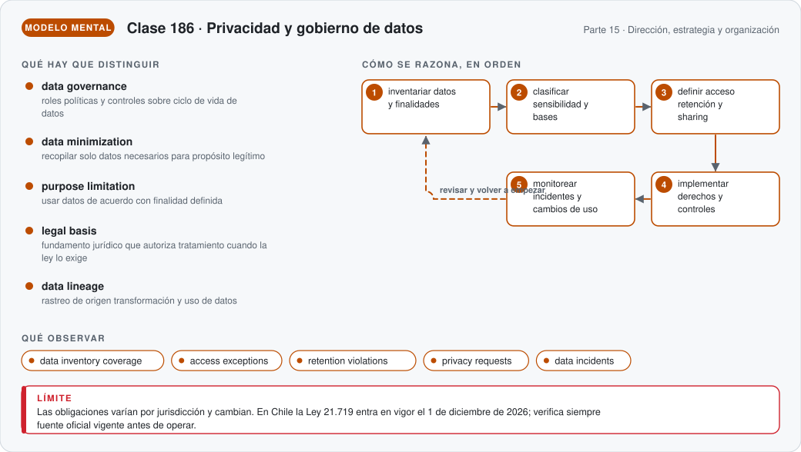

# Clase 186 — Privacidad y gobierno de datos

<!-- nav:inicio -->
> **Parte 15 · Riesgo, legal, compliance, ciberseguridad e IA** — clase 6 de 12 · [índice de la parte](../../README.md) · [temario](../../../../SYLLABUS.md)
<!-- nav:fin -->

**Parte:** 15 — Riesgo, legal, compliance, ciberseguridad e IA  
**Nivel:** Etapa 4 — Gerente → Director  
**Duración sugerida:** 150–180 minutos · **Estándar:** deep-class-v2

## 🎯 Propósito

Los datos de clientes, empleados y proveedores son uno de los activos más valiosos de una empresa y, a la vez, una de sus mayores fuentes de riesgo. Se recolectan por costumbre («por si sirven»), se copian a planillas, se comparten con proveedores sin revisar qué hacen con ellos, se conservan indefinidamente y se descubren recién cuando hay una filtración, una solicitud de una persona o una fiscalización. Gobernar los datos no es una tarea técnica reservada al área de tecnología: exige decisiones de negocio sobre qué datos se necesitan, para qué, quién puede usarlos, con quién se comparten, cuánto tiempo se guardan y cómo se atienden los derechos de las personas.

La clase se apoya en la taxonomía de problemas de privacidad de Solove, en las obligaciones y principios que formulan el Reglamento europeo de protección de datos y la legislación chilena (a la que remite sin interpretarla), en la visión de seguridad de Anderson y en la responsabilidad del gobierno corporativo descrita por Tricker. Al terminar sabrás mapear datos, aplicar principios de minimización y finalidad, gobernar a los proveedores que los tratan, preparar la respuesta a incidentes y a solicitudes de las personas, y decidir con criterio qué verificar con asesoría y fuentes oficiales.

## 📚 Resultados de aprendizaje

Al finalizar podrás:

1. **Describir** el ciclo de vida de los datos personales en una organización.
2. **Aplicar** los principios de finalidad, minimización, calidad, seguridad y conservación limitada.
3. **Gobernar** a proveedores y terceros que tratan datos.
4. **Preparar** la respuesta a incidentes y a solicitudes de las personas.
5. **Verificar** las obligaciones legales en fuentes oficiales sin interpretarlas de memoria.

## 🧭 Agenda

| Tramo | Qué se hace |
|---|---|
| 0–20 min | Recuperación: ¿dónde están hoy los datos personales de tus clientes y quién puede verlos? |
| 20–60 min | Inventario, principios, terceros, derechos, incidentes y gobierno. |
| 60–105 min | Ejemplo trabajado: minimización y retención en una empresa de comercio. |
| 105–150 min | Caso ejecutivo y práctica. |
| 150–175 min | Límites y entregable. |

## 🧩 Conceptos centrales

| Concepto | Definición | Cómo se reconoce |
|---|---|---|
| **Dato personal** | Información que identifica o puede identificar a una persona. | Nombre, identificador, ubicación, datos de uso. |
| **Dato sensible** | Dato cuyo tratamiento puede afectar gravemente a la persona. | Salud, biometría, creencias; categorías según la ley vigente. |
| **Tratamiento** | Cualquier operación sobre datos: recolectar, usar, compartir, almacenar, eliminar. | Cubre todo el ciclo de vida. |
| **Finalidad** | Propósito específico y legítimo para el que se usan los datos. | Informado a la persona y registrado. |
| **Minimización** | Recolectar y conservar solo lo necesario. | Cada campo tiene justificación. |
| **Responsable y encargado** | Quien decide sobre el tratamiento y quien lo ejecuta por cuenta de otro. | Se verifican los términos en la ley aplicable. |

## 🧠 Modelo mental

**Cómo leer el diagrama.** Una cadena de cinco etapas. **Recolectar**: solo lo necesario y con una finalidad clara. **Usar**: dentro de la finalidad informada y con acceso mínimo. **Compartir**: con terceros bajo contrato y medidas de seguridad. **Conservar**: por el tiempo necesario y protegido. **Eliminar**: cuando cesa la necesidad o se solicita. Una flecha de retorno indica que el inventario de datos mantiene todo al día. La nota recuerda que gobernar datos es saber qué hay, por qué se tiene, quién accede y cuándo se elimina; el pie, que las obligaciones concretas dependen de la ley vigente.

## 📖 Desarrollo

### 1. Por qué la privacidad es un problema de negocio

Solove propone entender la privacidad no como un concepto único, sino como una familia de **problemas**: recolección, procesamiento, difusión e intrusión, cada uno con daños distintos (pérdida de control, discriminación, exposición, manipulación, inseguridad). Para una empresa, esto significa que el riesgo de datos no se limita a una filtración: incluye usos que la persona no esperaba, decisiones automatizadas injustas, retención excesiva y comunicaciones no solicitadas. Los daños recaen sobre las personas, pero vuelven a la empresa en forma de **sanciones**, **demandas**, **pérdida de confianza** y **costos operativos**. Tricker subraya que el cumplimiento y la protección de información son parte de la responsabilidad del gobierno corporativo; el directorio y la alta dirección responden por el marco, no solo el área técnica.

### 2. Saber qué datos hay: inventario y clasificación

No se puede proteger lo que no se conoce. El primer paso es un **inventario de tratamientos**: qué datos, de quién, para qué, dónde se guardan, quién accede, con quién se comparten, por cuánto tiempo y con qué base legal o autorización. Se **clasifican** por sensibilidad (públicos, internos, confidenciales, sensibles) y se asocia cada clase a controles mínimos. El inventario descubre sorpresas: planillas con datos de clientes en correos personales, bases de pruebas con datos reales, copias olvidadas en proveedores. Debe tener un **dueño de negocio** por cada conjunto de datos, no solo un administrador de sistemas, y actualizarse cuando cambian procesos, sistemas o proveedores.

### 3. Principios de tratamiento

La legislación de protección de datos de distintos países, entre ellas el Reglamento (UE) 2016/679 y las leyes chilenas, se organiza en torno a principios comunes que el ejecutivo debe conocer en su idea central, sin sustituir la lectura del texto vigente: **licitud y lealtad** (tratar datos con una base legítima y de forma justa), **finalidad** (usos específicos y compatibles con lo informado), **minimización** (solo lo necesario), **calidad** (datos exactos y actualizados), **limitación del plazo de conservación**, **seguridad** (medidas adecuadas al riesgo), **transparencia** (informar de forma clara) y **responsabilidad proactiva** (poder demostrar el cumplimiento). Los términos exactos, las bases de licitud, las categorías especiales y los plazos de aplicación en Chile, incluida la entrada en vigor de la normativa más reciente, se verifican en LeyChile y con asesoría.

### 4. Terceros: proveedores y socios

Gran parte de los incidentes ocurre en la cadena de proveedores. Antes de compartir datos se pregunta: ¿es necesario?, ¿qué hace el tercero con ellos?, ¿cómo los protege?, ¿en qué países los almacena?, ¿quiénes son sus subcontratistas?, ¿cómo avisará de un incidente?, ¿qué ocurre con los datos al terminar el contrato? Se formalizan estas condiciones en el contrato (clase 185) y se **verifica** periódicamente con cuestionarios, certificaciones o auditorías según la criticidad. La empresa que decide el uso de los datos sigue siendo responsable frente a las personas aunque los trate un proveedor. Los términos legales (quién es responsable y quién encargado, y qué obligaciones tiene cada uno) dependen de la ley aplicable y se confirman con asesoría.

### 5. Derechos de las personas

Las leyes de protección de datos reconocen derechos de las personas sobre sus datos, como **acceder** a ellos, **rectificarlos**, **eliminarlos** o **oponerse** a ciertos tratamientos, con alcances y plazos que fija cada norma. Operativamente, esto requiere un **proceso**: un canal para recibir solicitudes, verificación de identidad, ubicación de los datos en todos los sistemas, decisión y respuesta documentada dentro del plazo legal. Sin inventario, atender un solo pedido puede tomar semanas. La respuesta debe ser coherente con los demás deberes (por ejemplo, conservación de documentos por obligación legal). Los derechos concretos, los plazos y las excepciones se verifican en la fuente oficial vigente.

### 6. Incidentes de seguridad con datos

Un incidente de datos requiere responder rápido con orden: **contener** el problema, **evaluar** qué datos y personas están afectados, **notificar** a las autoridades y a las personas cuando la ley lo exija, **corregir** las causas y **aprender**. El Reglamento europeo, por ejemplo, establece un plazo corto de notificación a la autoridad en ciertos casos, y las normas chilenas de ciberseguridad y de datos establecen sus propias obligaciones; los **plazos y requisitos exactos** se verifican en las fuentes oficiales y con asesoría, y se incorporan al plan de respuesta (clases 187 y 190). Anderson recuerda que la seguridad es un problema de ingeniería y de incentivos: sistemas diseñados con acceso amplio, contraseñas compartidas o cuentas sin revisar crean los incidentes que luego se lamentan.

### 7. Gobierno de datos

Gobernar datos es asignar **roles y reglas**: un comité o responsable que fije políticas, dueños de datos por dominio, un responsable de privacidad (o función equivalente, con independencia cuando la ley o el tamaño lo requieran), **evaluaciones de impacto** antes de proyectos con alto riesgo (nuevas bases, perfilamiento, datos sensibles, uso de IA), **capacitación** y **auditoría**. Se establecen métricas: porcentaje de sistemas inventariados, solicitudes atendidas a tiempo, incidentes, proveedores evaluados y datos eliminados por vencimiento. Y se cuida el equilibrio: el exceso de restricciones paraliza el negocio y lleva a los equipos a usar herramientas no autorizadas; el defecto genera riesgo. La mejor protección es **tener menos datos**: lo que no se recolecta ni se conserva no se puede filtrar.

## 📚 Lectura comparada

| Obra | Qué aporta | Qué no resuelve | Pregunta para contrastar |
|---|---|---|---|
| Solove | Taxonomía de problemas y daños de privacidad. | No da obligaciones legales. | ¿Qué daño sufriría la persona? |
| Reglamento (UE) 2016/679 | Principios, derechos y obligaciones de un régimen influyente. | No rige en Chile por sí mismo; se usa como comparación. | ¿Qué principio ilustra este caso? |
| LeyChile (BCN) | Textos oficiales de la normativa chilena de datos. | No es asesoría ni resumen. | ¿Qué versión y qué fecha de vigencia? |
| Anderson | Seguridad como ingeniería e incentivos. | Técnico; hay que traducirlo a decisiones. | ¿Quién tiene acceso y por qué? |
| Tricker | Responsabilidad del gobierno corporativo. | No es específico de datos. | ¿Quién responde ante el directorio? |

## 🧮 Ejemplo trabajado

**Situación (hipotética).** Una empresa de comercio minorista tiene 500.000 registros de clientes distribuidos en 14 sistemas. Un inventario muestra que el formulario de registro pide 38 campos, de los cuales solo 21 se usan en algún proceso; que los registros se conservan por tiempo indefinido y que el 40 % corresponde a clientes sin compras en más de tres años.

**Escenario de incidente.** Una filtración expondría el 20 % de la base. Costo estimado por registro expuesto (notificación, soporte, monitoreo, asesoría, pérdidas de clientes): 12.000 pesos. Probabilidad anual de incidente con exposición: 8 %.

**Antes.** Registros expuestos: 0,20 × 500.000 = 100.000. Costo del incidente: 100.000 × 12.000 = 1.200 millones. Pérdida esperada anual: 0,08 × 1.200 = 96 millones.

**Medidas de minimización.**

1. Eliminar los 17 campos innecesarios (38 − 21) del formulario y de la base.
2. Anonimizar o eliminar los registros de clientes inactivos por más de tres años (40 %): 200.000 registros; quedan 300.000.
3. Reducir los sistemas con copias de los datos de 14 a 9.
4. Establecer un plazo de conservación y una purga automática.

**Después.** Registros expuestos: 0,20 × 300.000 = 60.000. Costo del incidente: 60.000 × 12.000 = 720 millones. Pérdida esperada anual: 0,08 × 720 = 57,6 millones. Reducción: 96 − 57,6 = 38,4 millones al año. Si el proyecto cuesta 45 millones una vez, se recupera en 45 ÷ 38,4 ≈ 1,2 años (unos 14 meses). Además, bajan el riesgo de sanciones y los costos de atender solicitudes.

**Lo que el cálculo no captura.** El daño a las personas, la pérdida de confianza y la sanción regulatoria no se reducen a un costo por registro; los datos sensibles, si existieran, requerirían tratamiento especial.

**Gobierno.** Cada conjunto de datos tiene un dueño; se aprueba una política de conservación; se crea un procedimiento de solicitudes de personas con plazo interno de 10 días hábiles; se revisan los 30 proveedores con acceso a datos, priorizando los 6 más críticos.

**Cuidados.** El costo por registro es una hipótesis para el ejemplo; las bases legales, los plazos de conservación, los derechos y las obligaciones de notificación se verifican en la normativa vigente con asesoría.

**Qué muestra.** (1) El inventario reveló datos innecesarios. (2) Tener menos datos redujo la exposición. (3) El gobierno asignó dueños y procesos.

## 🔀 Comparación y límites

**Privacidad frente a seguridad.** La seguridad protege los datos frente a accesos indebidos; la privacidad decide qué datos se tratan, para qué y con qué derechos. Sin seguridad no hay privacidad; con seguridad sola, se puede tratar datos de forma inapropiada.

**Límites.** Esta clase no interpreta normas ni sustituye asesoría. La normativa chilena de datos ha cambiado y tiene plazos de aplicación diferenciados; el Reglamento europeo se cita como comparación y no como norma aplicable por sí misma. Los costos por registro varían ampliamente y las cifras del ejemplo son ilustrativas. Las decisiones automatizadas y el uso de IA añaden obligaciones que se verifican por separado (clase 188).

## 🪜 De profesional a owner

| Nivel | Cómo participa |
|---|---|
| **Profesional** | Trata los datos con el mínimo necesario y reporta incidentes de inmediato. |
| **Jefe / Team Lead** | Conoce qué datos maneja su equipo y controla los accesos. |
| **Gerente** | Es dueño de datos de su dominio y evalúa a sus proveedores. |
| **CEO / Director** | Fija la política, financia el programa y rinde cuentas al directorio. |
| **Founder / Owner** | Entiende que la confianza en el uso de datos es parte del valor de la empresa. |

## 🏢 Caso ejecutivo

Una aseguradora de salud con 1.400 empleados y 380.000 afiliados usa datos de salud para tarificar y para ofrecer programas de bienestar. Un proveedor de marketing recibió una base con 120.000 afiliados, incluidos diagnósticos, para una campaña, sin contrato específico de protección de datos. Un empleado de atención descargó listados a su correo personal para «trabajar desde casa». El sistema de análisis conserva datos de afiliados que se retiraron hace diez años. Una afiliada pidió por correo que se le informe qué datos tiene la empresa y ante quién se han compartido; la solicitud lleva 40 días sin respuesta. Se detecta además que un proveedor de nube de un país extranjero almacena respaldos con datos de salud. El directorio pregunta «si estamos en regla».

Entrega un **programa de gobierno de datos** que contenga: (a) el inventario y la clasificación de los tratamientos críticos; (b) la evaluación de los principios aplicados y de las brechas, con las fuentes oficiales a verificar; (c) la gobernanza de proveedores y de transferencias; (d) el proceso de atención de solicitudes y el de respuesta a incidentes con roles y plazos a confirmar con asesoría; (e) las medidas de minimización y de conservación; (f) los indicadores y el reporte al directorio.

## 🧪 Práctica

1. Inventaria cinco conjuntos de datos personales de tu área con finalidad, ubicación, accesos y plazo.
2. Clasifica los datos por sensibilidad y define controles mínimos.
3. Revisa un proveedor con una lista de siete preguntas y detecta brechas.
4. Diseña el procedimiento interno para atender una solicitud de acceso o eliminación.
5. Elimina o reduce tres datos que tu equipo guarda sin necesidad y estima el beneficio.

## ⚠️ Errores frecuentes

| Error | Por qué ocurre | Cómo corregirlo |
|---|---|---|
| Recolectar «por si sirve» | Se piensa que más es mejor | Justificar cada campo y eliminar lo innecesario. |
| Dejar la privacidad en tecnología | Se cree que es técnico | Dueños de negocio y gobierno corporativo. |
| Compartir sin contrato | Se confía en el proveedor | Contratos, verificación y control de subcontratistas. |
| Conservar indefinidamente | Es más fácil no borrar | Plazos de conservación y purga automática. |
| No tener proceso de solicitudes | No se anticipa | Canal, responsables y plazos definidos. |
| Improvisar ante incidentes | No hay plan | Plan ensayado con roles y verificación legal. |

## ❓ Preguntas de comprobación

1. ¿Qué problemas distingue Solove en materia de privacidad?
2. ¿Qué contiene un inventario de tratamientos?
3. ¿Qué principios comunes organizan la protección de datos?
4. ¿Qué se pregunta antes de compartir datos con un tercero?
5. ¿Qué requiere operativamente atender los derechos de las personas?
6. ¿Qué pasos sigue la respuesta a un incidente de datos?
7. ¿Por qué se dice que la mejor protección es tener menos datos?

Claves de respuesta

1. Recolección, procesamiento, difusión e intrusión, con daños distintos como pérdida de control, discriminación o exposición.
2. Qué datos, de quién, para qué, dónde se guardan, quién accede, con quién se comparten, por cuánto tiempo y con qué base legal.
3. Licitud y lealtad, finalidad, minimización, calidad, conservación limitada, seguridad, transparencia y responsabilidad proactiva.
4. Si es necesario, qué hará con ellos, cómo los protege, dónde los almacena, quiénes son sus subcontratistas, cómo avisará de incidentes y qué pasa al terminar.
5. Un proceso con canal, verificación de identidad, ubicación de los datos, respuesta documentada en plazo y coherencia con otros deberes.
6. Contener, evaluar, notificar según la ley, corregir causas y aprender.
7. Porque lo que no se recolecta ni se conserva no se puede filtrar, y se reducen costos y obligaciones.

## 📥 Entregable

Guarda en `portfolio/186-privacidad-y-gobierno-de-datos/`:

- `risk-governance-brief.md` (plantilla [Risk Governance Brief](../../../../templates/risk-governance-brief.md)) con el programa del caso ejecutivo;
- `risk-register.md` (plantilla [Risk register](../../../../templates/risk-register.md)) con los riesgos de datos, dueños y controles;
- `decision-journal.md` con el inventario, las brechas y las fuentes oficiales a verificar.

## 📗 Fuentes y verificación

- Daniel J. Solove — *Understanding Privacy* (Harvard University Press, 2008). **Uso en esta clase:** taxonomía de problemas y daños de privacidad. Lectura selectiva sobre **privacidad y gobierno de datos**. **Localizador:** [ISBN-13 9780674035072](https://openlibrary.org/isbn/9780674035072).
- Unión Europea — *Reglamento (UE) 2016/679 de protección de datos* (EUR-Lex, 2016). **Uso en esta clase:** principios, derechos y obligaciones de un régimen de referencia. **Fuente primaria:** <https://eur-lex.europa.eu/eli/reg/2016/679/oj>.
- Biblioteca del Congreso Nacional de Chile — *LeyChile: protección de datos personales (Ley 19.628 y Ley 21.719)* (2024). **Uso en esta clase:** texto oficial de la normativa chilena de datos personales. **Fuente primaria:** <https://www.bcn.cl/leychile/>.
- Ross Anderson — *Security Engineering* (John Wiley & Sons, Incorporated, 2001). **Uso en esta clase:** seguridad como ingeniería e incentivos. Lectura selectiva sobre **privacidad y gobierno de datos**. **Localizador:** [ISBN-13 9781119642831](https://openlibrary.org/isbn/9781119642831).
- Bob Tricker — *Corporate Governance* (Oxford University Press, 2019). **Uso en esta clase:** responsabilidad del gobierno corporativo sobre el cumplimiento. Lectura selectiva sobre **privacidad y gobierno de datos**. **Localizador:** [ISBN-13 9780198809869](https://openlibrary.org/isbn/9780198809869).

> **Regla de fuentes para Privacidad y gobierno de datos:** las obras anteriores estructuran las perspectivas de esta materia; cualquier norma, ley o estándar vivo mencionado debe comprobarse nuevamente en su fuente primaria vigente, en particular la legislación de datos personales, sus plazos de aplicación y las obligaciones de notificación de incidentes. Los ejemplos y casos son hipotéticos, con cifras ilustrativas. El desarrollo es original y no reproduce capítulos protegidos.

<!-- pie:inicio -->
---

| Anterior | Índice | Siguiente |
|---|---|---|
| [← 185 · Contratos: riesgos que un ejecutivo debe detectar](../185-contratos-riesgos-que-un-ejecutivo-debe-detectar/README.md) | [Parte 15](../../README.md) · [Programa](../../../../SYLLABUS.md) | [187 · Gobierno de ciberseguridad →](../187-gobierno-de-ciberseguridad/README.md) |
<!-- pie:fin -->
