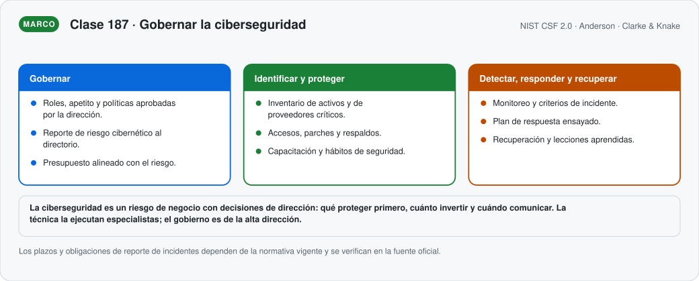

# Clase 187 — Gobierno de ciberseguridad

<!-- nav:inicio -->
> **Parte 15 · Riesgo, legal, compliance, ciberseguridad e IA** — clase 7 de 12 · [índice de la parte](../../README.md) · [temario](../../../../SYLLABUS.md)
<!-- nav:fin -->

**Parte:** 15 — Riesgo, legal, compliance, ciberseguridad e IA  
**Nivel:** Etapa 4 — Gerente → Director  
**Duración sugerida:** 150–180 minutos · **Estándar:** deep-class-v2

## 🎯 Propósito

Cuando una empresa sufre un ciberataque, la pregunta del directorio no es técnica: ¿por qué no estábamos preparados?, ¿quién era responsable?, ¿cuánto nos costó y cuánto pudo costarnos?, ¿qué le dijimos a los clientes y a las autoridades? La ciberseguridad se trata muchas veces como un asunto de informática, delegado en un equipo técnico que pide presupuesto sin un lenguaje de negocio, y una dirección que aprueba o recorta sin entender qué protege ni qué riesgo acepta. El resultado son controles básicos incompletos, incidentes que se descubren tarde y decisiones de crisis improvisadas.

Esta clase trata la ciberseguridad como **riesgo de negocio con gobierno de dirección**: qué activos importan, qué escenarios amenazan al negocio, cuánto riesgo se acepta, qué controles básicos son innegociables, cómo se mide el avance y cómo se responde. Se apoya en el marco de ciberseguridad del NIST en su versión 2.0, que incorporó el gobierno como función central, en la visión de ingeniería y economía de la seguridad de Anderson, en el análisis estratégico de Clarke y Knake, y remite a las fuentes oficiales chilenas (la legislación de ciberseguridad y la Agencia Nacional de Ciberseguridad) para las obligaciones. Al terminar sabrás conducir una conversación ejecutiva de ciberseguridad, priorizar con criterio de riesgo, exigir indicadores significativos y preparar la respuesta.

## 📚 Resultados de aprendizaje

Al finalizar podrás:

1. **Traducir** la ciberseguridad a escenarios de negocio con activos críticos e impacto.
2. **Estructurar** el gobierno con roles, apetito, políticas y reporte al directorio.
3. **Priorizar** controles básicos según el riesgo y el costo.
4. **Exigir** indicadores que midan reducción de riesgo y no actividad.
5. **Preparar** la respuesta y la comunicación con verificación legal de obligaciones.

## 🧭 Agenda

| Tramo | Qué se hace |
|---|---|
| 0–20 min | Recuperación: ¿cuáles son los tres activos digitales sin los cuales tu empresa no opera? |
| 20–60 min | Activos, escenarios, marco NIST, controles básicos, terceros, métricas y respuesta. |
| 60–105 min | Ejemplo trabajado: priorización de inversión frente a un escenario de ransomware. |
| 105–150 min | Caso ejecutivo y práctica. |
| 150–175 min | Límites y entregable. |

## 🧩 Conceptos centrales

| Concepto | Definición | Cómo se reconoce |
|---|---|---|
| **Ciberriesgo** | Riesgo de pérdida por fallas o ataques a sistemas y datos. | Se expresa en escenarios con impacto de negocio. |
| **Activos críticos** | Sistemas, datos y procesos sin los que el negocio no opera. | Su caída detiene ingresos o genera daños graves. |
| **Función Gobernar** | Conjunto de decisiones de estrategia, roles, políticas y supervisión. | Incorporada como función propia en NIST CSF 2.0. |
| **Control básico** | Medida de alto efecto y bajo costo relativo. | Autenticación fuerte, parches, respaldos, privilegios mínimos. |
| **Superficie de ataque** | Conjunto de puntos por los que se puede atacar. | Se amplía con proveedores, nube y trabajo remoto. |
| **Tiempos de recuperación** | Cuánto tarda la empresa en volver a operar. | Se prueban, no se suponen. |

## 🧠 Modelo mental

**Cómo leer el diagrama.** Tres columnas. **Gobernar**: roles, apetito y políticas aprobadas por la dirección, reporte de riesgo cibernético al directorio y presupuesto alineado con el riesgo. **Identificar y proteger**: inventario de activos y de proveedores críticos, accesos, parches y respaldos, capacitación y hábitos de seguridad. **Detectar, responder y recuperar**: monitoreo y criterios de incidente, plan de respuesta ensayado, recuperación y lecciones aprendidas. La nota subraya que la ciberseguridad es un riesgo de negocio con decisiones de la alta dirección; el pie, que los plazos y obligaciones de reporte se verifican en la fuente oficial.

## 📖 Desarrollo

### 1. Qué protege la ciberseguridad

La seguridad de la información se suele describir con tres propiedades: **confidencialidad** (solo accede quien debe), **integridad** (los datos y sistemas no se alteran sin autorización) y **disponibilidad** (el servicio funciona cuando se necesita). Para un ejecutivo, la pregunta útil es qué **procesos de negocio** dependen de qué sistemas y datos, y qué ocurre si se pierde cada propiedad: filtración de información de clientes (confidencialidad), manipulación de precios o registros (integridad), detención de la planta o de la tienda en línea (disponibilidad). De este análisis surgen los **activos críticos** y los escenarios prioritarios, que alimentan el mapa de riesgos (clase 181) y el apetito (clase 182).

### 2. El marco de ciberseguridad del NIST 2.0

El marco de ciberseguridad (CSF) del NIST, en su versión 2.0, organiza los resultados deseables en seis funciones: **Gobernar**, **Identificar**, **Proteger**, **Detectar**, **Responder** y **Recuperar**. La novedad de la versión 2.0 es que **Gobernar** pasa a ser una función propia: define el contexto organizacional, la estrategia de gestión de riesgos, los roles y responsabilidades, las políticas, la supervisión y la gestión de riesgos de la cadena de suministro. Esto refleja que los incidentes más graves suelen tener causas de gobierno: nadie era dueño, el presupuesto no seguía al riesgo o el directorio no recibía información útil. El marco es voluntario y flexible; se adapta según el tamaño y el riesgo, y su texto vigente se consulta en la fuente oficial del NIST.

### 3. Gobernar: roles, apetito y reporte

El gobierno comienza con **dueños**: un responsable de seguridad de la información (a veces llamado CISO) con acceso al comité de dirección y a quien corresponda del directorio, con independencia suficiente para informar sin filtros; y **dueños de negocio** de los activos y procesos críticos, que aceptan o no los riesgos. El directorio aprueba el **apetito** de ciberriesgo y supervisa; la dirección ejecuta y rinde cuentas. Se aprueban políticas básicas (acceso, uso aceptable, gestión de incidentes, proveedores) y un **presupuesto** coherente con el riesgo. El reporte al directorio debe ser breve, con **escenarios**, **tendencias**, **excepciones** y **decisiones requeridas**; un informe de cientos de alertas técnicas informa poco.

### 4. Controles básicos: lo que más reduce el riesgo

Gran parte de los incidentes explota fallas básicas, no sofisticaciones. Un conjunto de **controles básicos** de alto efecto incluye: **autenticación multifactor** en accesos críticos y remotos; **parches** de vulnerabilidades críticas en plazos definidos; **respaldos** con copia fuera de línea y **pruebas de restauración**; **privilegios mínimos** y revisión de accesos; **segmentación** de redes críticas; **protección de correo y de equipos**; **capacitación** y simulacros; y **registro y monitoreo** de actividades. Anderson insiste en que la seguridad depende de incentivos y de diseño: los controles que obstaculizan el trabajo se evaden; los que se incorporan al flujo funcionan. Se prioriza con criterio de riesgo y costo, no con listas interminables.

### 5. Cadena de suministro y terceros

La superficie de ataque incluye **proveedores** con acceso a sistemas o datos, **software** de terceros, **servicios en la nube** y **socios**. Muchos incidentes entran por un tercero. Se clasifican los proveedores por criticidad, se exigen **requisitos de seguridad** en contratos (clase 185), se verifican con evidencias proporcionales (certificaciones, cuestionarios, pruebas) y se definen **planes de contingencia** si un proveedor crítico falla o es atacado. También se considera la **concentración**: depender de un único proveedor de nube o de un solo software de producción es un riesgo estratégico, no solo técnico.

### 6. Métricas que importan

Las métricas de actividad (número de alertas, de bloqueos, de capacitaciones) no dicen si el riesgo baja. Se prefieren **indicadores de reducción de riesgo**: porcentaje de sistemas críticos con autenticación multifactor; tiempo medio para corregir vulnerabilidades críticas; porcentaje de respaldos probados con éxito en el último trimestre; tiempo de detección y de contención de incidentes; proporción de proveedores críticos evaluados; resultados de simulacros de phishing y de respuesta. Cada indicador tiene **meta**, **dueño** y **umbral de escalamiento**. Y se complementa con **pruebas independientes** (pruebas de intrusión, auditorías) que verifican la realidad y no solo los reportes internos.

### 7. Respuesta, recuperación y obligaciones

Un **plan de respuesta** define: quién declara el incidente, quién lidera, cómo se contiene, cómo se preserva evidencia, cuándo se informa a clientes, autoridades y seguros, y quién habla (clase 190). Se **ensaya** con ejercicios de mesa que incluyan a la dirección. La **recuperación** se mide en tiempos reales de restauración (clase 191). Clarke y Knake argumentan que la defensa efectiva combina **resiliencia** (poder operar bajo ataque y recuperarse) con **prevención**; asumir que el atacante podría entrar orienta las inversiones hacia detección y recuperación. Las **obligaciones legales** de reporte de incidentes y de gestión de ciberseguridad en Chile, incluidas las que derivan de la legislación de ciberseguridad y de datos y de las instrucciones de la Agencia Nacional de Ciberseguridad, tienen sujetos obligados, plazos y contenidos que se verifican en las fuentes oficiales vigentes y con asesoría.

## 📚 Lectura comparada

| Obra | Qué aporta | Qué no resuelve | Pregunta para contrastar |
|---|---|---|---|
| NIST CSF 2.0 | Seis funciones, incluida Gobernar, y un lenguaje común. | No dice qué controles concretos implementar en cada caso. | ¿Quién gobierna y rinde cuentas? |
| Anderson | Seguridad como ingeniería, economía e incentivos. | Técnico; hay que traducirlo para decisiones ejecutivas. | ¿Qué incentivos favorecen al atacante? |
| Clarke y Knake | Resiliencia y estrategia de defensa frente a ataques. | Enfoque de seguridad nacional más que empresarial. | ¿Podemos operar bajo ataque? |
| LeyChile (BCN) | Textos oficiales de la legislación de ciberseguridad y delitos informáticos. | No es asesoría ni interpretación. | ¿Somos sujeto obligado y desde cuándo? |
| ANCI | Portal oficial de la autoridad de ciberseguridad de Chile. | No reemplaza la lectura del texto legal. | ¿Qué instrucciones vigentes nos aplican? |

## 🧮 Ejemplo trabajado

**Situación (hipotética).** Una empresa de comercio electrónico con 900 personas tiene ingresos de 50.000 millones de pesos y un EBITDA de 3.600 millones. El comité evalúa el escenario de **ransomware** que cifra los sistemas de pedidos y de bodega.

**Estimación del escenario sin mejoras.** Probabilidad anual: 12 %. Tiempo de recuperación: 9 días. Pérdida diaria de ventas y margen: 60 millones. Costos de respuesta (especialistas, comunicaciones, soporte, restauración): 200 millones.

- Impacto: 9 × 60 + 200 = 540 + 200 = 740 millones.
- Pérdida esperada anual: 0,12 × 740 = 88,8 millones.

**Paquete de controles básicos propuesto (45 millones al año).** Autenticación multifactor para todos los accesos administrativos y remotos, copias fuera de línea con pruebas trimestrales de restauración, segmentación de la red de bodega, revisión de privilegios y simulacros de respuesta. Efecto estimado: probabilidad baja a 5 %; tiempo de recuperación baja a 3 días.

- Impacto: 3 × 60 + 200 = 180 + 200 = 380 millones.
- Pérdida esperada anual: 0,05 × 380 = 19,0 millones.
- Reducción: 88,8 − 19,0 = 69,8 millones.
- Relación beneficio/costo: 69,8 ÷ 45 ≈ 1,55.

**Peor caso razonable.** Si la recuperación demora 15 días: 15 × 60 + 200 = 1.100 millones, el 30,6 % del EBITDA (1.100 ÷ 3.600). Con el paquete, el peor caso razonable baja a 6 días: 560 millones (15,6 %).

**Lo que el cálculo no incluye.** Obligaciones de notificación, daño reputacional, posible filtración de datos de clientes, sanciones y efectos en seguros. Por eso la decisión no se toma solo por el valor esperado.

**Indicadores propuestos para el directorio.** Porcentaje de accesos críticos con autenticación multifactor (meta 100 %); tiempo de corrección de vulnerabilidades críticas (meta de 14 días como máximo); respaldos restaurados con éxito en la prueba trimestral (meta 100 %); proveedores críticos evaluados (meta 100 % de 12); tiempo de detección y de contención en el simulacro.

**Decisión.** Aprobar el paquete, designar dueños, programar un ejercicio de mesa con el comité y verificar con asesoría las obligaciones de reporte y la cobertura del seguro.

**Cuidados.** Las probabilidades y los costos son estimaciones; las obligaciones legales aplicables a la empresa dependen de su sector y tamaño y se verifican en las fuentes oficiales.

**Qué muestra.** (1) El escenario se tradujo a pesos y días. (2) Los controles básicos redujeron probabilidad y tiempo. (3) La decisión consideró lo que el cálculo no captura.

## 🔀 Comparación y límites

**Seguridad frente a cumplimiento.** Cumplir una norma o una lista no garantiza estar seguro; estar seguro no garantiza cumplir. Se necesitan ambos, con foco en el riesgo real.

**Límites.** Las probabilidades de ataque son inciertas y cambian con rapidez. Un marco como el del NIST es voluntario y genérico. Ninguna defensa es perfecta; el objetivo es reducir probabilidad e impacto y recuperarse. Las obligaciones legales chilenas de ciberseguridad y de reporte dependen de normas recientes y de sus plazos de aplicación; se verifican en LeyChile, en el portal de la ANCI y con asesoría. Las cifras del ejemplo son ilustrativas.

## 🪜 De profesional a owner

| Nivel | Cómo participa |
|---|---|
| **Profesional** | Cumple los hábitos de seguridad y reporta lo sospechoso sin demora. |
| **Jefe / Team Lead** | Controla accesos de su equipo y no pide excepciones por comodidad. |
| **Gerente** | Es dueño de los procesos críticos y acepta o corrige riesgos con datos. |
| **CEO / Director** | Fija el apetito, asigna presupuesto según riesgo y exige reportes útiles. |
| **Founder / Owner** | Reconoce que un ataque grave puede poner en riesgo la empresa completa. |

## 🏢 Caso ejecutivo

Un operador logístico con 2.800 empleados y ingresos de 140.000 millones de pesos descubre que un atacante lleva tres semanas dentro de su red. Los hechos: el acceso remoto no usa autenticación multifactor; hay 14 cuentas administrativas compartidas; los respaldos están conectados a la misma red y nunca se probó su restauración; el área de seguridad (cuatro personas) depende de tecnología y reporta una vez al año; tres proveedores críticos tienen acceso permanente a los sistemas; un reporte técnico reciente de 200 páginas no llegó al directorio. El atacante cifra los sistemas de despacho un viernes y exige un pago. Los clientes principales piden información y la prensa pregunta. El gerente general dice: «pagar es más barato que parar»; el responsable de seguridad pide detener todo; el director de operaciones quiere seguir operando con papel.

Entrega un **plan ejecutivo de gobierno de ciberseguridad** que contenga: (a) los activos críticos y los escenarios con impacto de negocio; (b) la estructura de gobierno, roles, apetito y reporte al directorio; (c) los controles básicos priorizados con costo y efecto; (d) la gestión de proveedores críticos; (e) los indicadores con meta y dueño; (f) el plan de respuesta, incluidas las decisiones sobre pagos y comunicación, y las verificaciones legales de obligaciones de reporte con asesoría y fuentes oficiales.

## 🧪 Práctica

1. Identifica tres procesos críticos y los sistemas y datos de los que dependen.
2. Redacta un escenario de ciberataque con probabilidad, impacto en días y pesos y costos de respuesta.
3. Prioriza cinco controles básicos con costo estimado y reducción de riesgo.
4. Define seis indicadores para el directorio con meta, dueño y umbral.
5. Diseña un ejercicio de mesa de una hora con las decisiones que debería tomar la dirección.

## ⚠️ Errores frecuentes

| Error | Por qué ocurre | Cómo corregirlo |
|---|---|---|
| Delegar todo en tecnología | Se ve como asunto técnico | Dueños de negocio y reporte al directorio. |
| Medir actividad | Es fácil de contar | Indicadores de reducción de riesgo. |
| Respaldos no probados | Se asume que funcionan | Pruebas de restauración periódicas. |
| Ignorar a los proveedores | Se confía en ellos | Clasificar, exigir y verificar. |
| Improvisar la respuesta | No hay plan | Plan ensayado con decisiones previas. |
| Ceder al pánico | Se decide bajo presión | Criterios previos y asesoría especializada. |

## ❓ Preguntas de comprobación

1. ¿Cuáles son las seis funciones del marco NIST CSF 2.0 y qué aporta Gobernar?
2. ¿Qué tres propiedades protege la seguridad de la información?
3. ¿Qué controles básicos reducen más el riesgo?
4. ¿Por qué hay que gobernar la cadena de suministro?
5. ¿Qué diferencia hay entre una métrica de actividad y una de reducción de riesgo?
6. ¿Qué debe incluir un plan de respuesta?
7. ¿Qué se verifica en fuentes oficiales y con asesoría?

Claves de respuesta

1. Gobernar, Identificar, Proteger, Detectar, Responder y Recuperar; Gobernar fija contexto, estrategia de riesgos, roles, políticas, supervisión y cadena de suministro.
2. Confidencialidad, integridad y disponibilidad.
3. Autenticación multifactor, parches, respaldos probados, privilegios mínimos, segmentación, protección de correo y equipos, capacitación y monitoreo.
4. Porque los proveedores, el software y la nube amplían la superficie de ataque y muchos incidentes entran por terceros.
5. La de actividad cuenta acciones (alertas, capacitaciones); la de reducción de riesgo mide la mejora (por ejemplo, porcentaje de accesos con autenticación multifactor).
6. Quién declara y lidera, contención, evidencia, comunicación a clientes, autoridades y seguros, voceros y ensayos.
7. Las obligaciones de ciberseguridad y de reporte de incidentes, sus sujetos obligados, plazos y contenidos.

## 📥 Entregable

Guarda en `portfolio/187-gobierno-de-ciberseguridad/`:

- `risk-governance-brief.md` (plantilla [Risk Governance Brief](../../../../templates/risk-governance-brief.md)) con el plan del caso ejecutivo;
- `board-or-executive-memo.md` (plantilla [Board or executive memo](../../../../templates/board-or-executive-memo.md)) con el reporte de ciberriesgo al directorio;
- `decision-journal.md` con los escenarios, los indicadores y las verificaciones legales pendientes.

## 📗 Fuentes y verificación

- NIST — *Cybersecurity Framework (CSF) 2.0*. **Uso en esta clase:** seis funciones del marco, incluida Gobernar. **Fuente primaria:** <https://www.nist.gov/cyberframework>.
- Ross Anderson — *Security Engineering* (John Wiley & Sons, Incorporated, 2001). **Uso en esta clase:** seguridad como ingeniería, economía e incentivos. Lectura selectiva sobre **gobierno de ciberseguridad**. **Localizador:** [ISBN-13 9781119642831](https://openlibrary.org/isbn/9781119642831).
- Richard A. Clarke & Robert K. Knake — *The Fifth Domain* (Penguin Press, 2019). **Uso en esta clase:** resiliencia y estrategia de defensa. Lectura selectiva sobre **gobierno de ciberseguridad**. **Localizador:** [ISBN-13 9780525561965](https://openlibrary.org/isbn/9780525561965).
- Biblioteca del Congreso Nacional de Chile — *LeyChile: ciberseguridad y delitos informáticos (Ley 21.663 y Ley 21.459)* (2024). **Uso en esta clase:** texto oficial de la legislación de ciberseguridad y delitos informáticos. **Fuente primaria:** <https://www.bcn.cl/leychile/>.
- Agencia Nacional de Ciberseguridad de Chile — *Portal oficial de la ANCI* (2024). **Uso en esta clase:** portal oficial de la autoridad de ciberseguridad de Chile. **Fuente primaria:** <https://www.anci.gob.cl/>.

> **Regla de fuentes para Gobierno de ciberseguridad:** las obras anteriores estructuran las perspectivas de esta materia; cualquier norma, ley o estándar vivo mencionado debe comprobarse nuevamente en su fuente primaria vigente, en particular las obligaciones de ciberseguridad y los plazos de notificación de incidentes. Los ejemplos y casos son hipotéticos, con cifras ilustrativas. El desarrollo es original y no reproduce capítulos protegidos.

<!-- pie:inicio -->
---

| Anterior | Índice | Siguiente |
|---|---|---|
| [← 186 · Privacidad y gobierno de datos](../186-privacidad-y-gobierno-de-datos/README.md) | [Parte 15](../../README.md) · [Programa](../../../../SYLLABUS.md) | [188 · Gobierno responsable de IA →](../188-gobierno-responsable-de-ia/README.md) |
<!-- pie:fin -->
