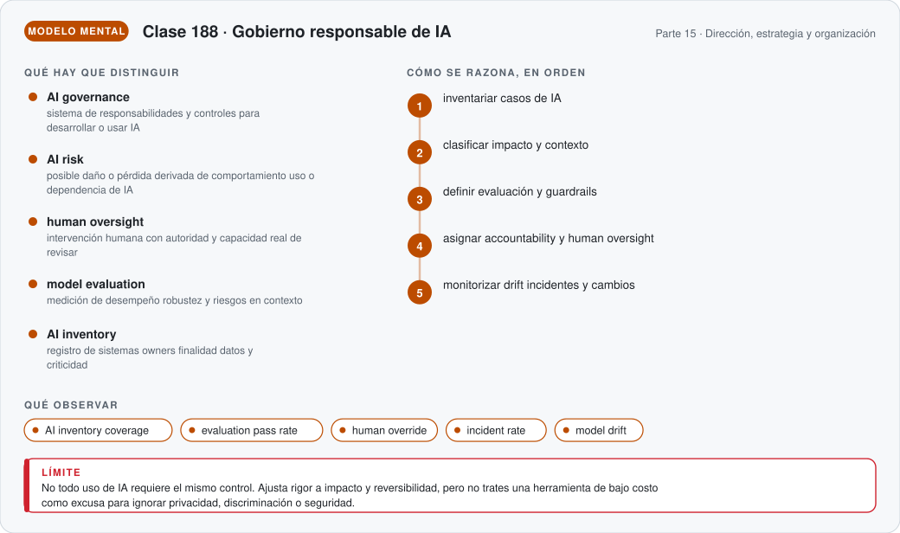

# Clase 188 — Gobierno responsable de IA

<!-- nav:inicio -->
> **Parte 15 · Riesgo, legal, compliance, ciberseguridad e IA** — clase 8 de 12 · [índice de la parte](../../README.md) · [temario](../../../../SYLLABUS.md)
<!-- nav:fin -->

**Parte:** 15 — Riesgo, legal, compliance, ciberseguridad e IA  
**Nivel:** Etapa 4 — Gerente → Director  
**Duración sugerida:** 150–180 minutos · **Estándar:** deep-class-v2

## 🎯 Propósito

La inteligencia artificial entra a las empresas por la puerta de atrás: un equipo prueba una herramienta generativa con datos de clientes, un proveedor incorpora un modelo en su software sin avisar, un área compra un sistema de selección de personal o de aprobación de crédito que «puntúa» personas. Cuando la dirección pregunta qué sistemas de IA se usan, quién los aprobó, con qué datos, con qué pruebas y quién responde si se equivocan, a menudo nadie sabe. El riesgo no es la tecnología en sí, sino usarla sin gobierno: decisiones injustas o erróneas, fuga de información, dependencia de proveedores, incumplimientos y pérdida de confianza.

La clase propone un gobierno proporcional al riesgo. Se apoya en el marco de gestión de riesgos de IA del NIST (con sus funciones Gobernar, Mapear, Medir y Gestionar), en los principios de la OCDE para una IA confiable, en el enfoque basado en riesgos del reglamento europeo de IA (como referencia comparada, remitiendo a su texto oficial) y en las prácticas de documentación propuestas por las fichas de modelos (Mitchell y otros) y las hojas de datos (Gebru y otros). Al terminar sabrás inventariar usos de IA, clasificarlos por riesgo, definir supervisión humana efectiva, exigir pruebas y documentación, y gobernar a los proveedores.

## 📚 Resultados de aprendizaje

Al finalizar podrás:

1. **Inventariar** y clasificar los usos de IA según el impacto sobre personas y negocio.
2. **Definir** roles, políticas y supervisión humana efectiva.
3. **Exigir** pruebas de desempeño, sesgo y robustez antes y después del despliegue.
4. **Documentar** modelos y datos con fichas y registros.
5. **Gobernar** proveedores y verificar obligaciones legales con fuentes oficiales.

## 🧭 Agenda

| Tramo | Qué se hace |
|---|---|
| 0–20 min | Recuperación: ¿qué sistemas de IA usa tu empresa hoy, incluidos los que nadie aprobó formalmente? |
| 20–60 min | Inventario, clasificación, marcos, supervisión, pruebas, documentación y proveedores. |
| 60–105 min | Ejemplo trabajado: un sistema de preselección de candidatos y su prueba de sesgo. |
| 105–150 min | Caso ejecutivo y práctica. |
| 150–175 min | Límites y entregable. |

## 🧩 Conceptos centrales

| Concepto | Definición | Cómo se reconoce |
|---|---|---|
| **Sistema de IA** | Sistema que infiere, a partir de datos, resultados como predicciones, contenidos o decisiones. | Incluye modelos propios, de proveedores y herramientas generativas. |
| **Gobierno de IA** | Roles, políticas y controles para usar IA de forma responsable. | Inventario, aprobación, monitoreo y responsabilidades. |
| **Supervisión humana efectiva** | Revisión por personas con información, tiempo y autoridad para corregir. | Se corrigen decisiones y se registran las intervenciones. |
| **Sesgo** | Diferencias sistemáticas de desempeño o de resultado que perjudican a grupos. | Se mide con pruebas por grupo. |
| **Ficha de modelo** | Documento breve sobre uso previsto, desempeño y límites de un modelo. | Acompaña el despliegue. |
| **Deriva** | Cambio del comportamiento del modelo cuando cambian los datos o el entorno. | Se detecta con monitoreo. |

## 🧠 Modelo mental

**Cómo leer el diagrama.** Un cuadrante con la autonomía en el eje horizontal (una persona decide frente a decide el sistema solo) y el impacto en el vertical (bajo frente a alto). **Alto impacto con una persona que decide**: control humano documentado, asegurando que la revisión sea real. **Alto impacto con decisión automática**: supervisión intensiva con evaluación previa, pruebas, bitácora y revisión efectiva. **Bajo impacto con una persona que decide**: uso con reglas básicas, con guía de uso y datos permitidos. **Bajo impacto con decisión automática**: monitoreo ligero con métricas de calidad. La nota indica que el gobierno se gradúa por el impacto, no por la sofisticación técnica; el pie, que las obligaciones legales cambian con rapidez.

## 📖 Desarrollo

### 1. Qué hay que gobernar

Conviene distinguir tres situaciones: **IA propia** (modelos desarrollados o ajustados por la empresa), **IA comprada** (sistemas de proveedores que incorporan modelos) y **IA de uso personal** (herramientas generativas que empleados usan por su cuenta). La tercera suele ser la menos visible y genera riesgos de **fuga de información confidencial**, de **errores** presentados con seguridad y de **propiedad intelectual**. El primer paso del gobierno es un **inventario**: qué sistemas hay, para qué, qué datos usan, quién es el dueño de negocio, qué proveedor lo sirve y qué decisiones influyen. Sin inventario, no hay gobierno.

### 2. Clasificar por riesgo

La intensidad del gobierno se gradúa por el **impacto potencial** sobre las personas y el negocio y por el **grado de autonomía**. Una IA que sugiere un borrador de correo tiene un riesgo distinto de una que decide quién obtiene un crédito, quién es entrevistado o qué tratamiento se prioriza. El reglamento europeo de IA, como referencia comparada, adopta un enfoque basado en niveles de riesgo (usos prohibidos, de alto riesgo, con obligaciones de transparencia y de riesgo mínimo); sus definiciones, plazos y sujetos obligados se verifican en el texto oficial en EUR-Lex y con asesoría, y no se aplican a Chile por sí mismos. Los principios de la OCDE para una IA confiable (valores centrados en las personas, transparencia, robustez y seguridad, rendición de cuentas) ofrecen una base ética común que se traduce a criterios internos.

### 3. El marco del NIST: cuatro funciones

El marco de gestión de riesgos de IA del NIST (AI RMF 1.0) propone cuatro funciones. **Gobernar** establece cultura, políticas, roles y rendición de cuentas. **Mapear** describe el contexto del sistema: propósito, usuarios, datos, impactos posibles y quiénes podrían verse afectados. **Medir** evalúa y monitorea los riesgos con métricas y pruebas. **Gestionar** prioriza y trata los riesgos, con planes de respuesta y recuperación. El marco es voluntario, flexible y no certifica; sirve como lenguaje común y como lista de preguntas: ¿está claro el propósito?, ¿qué podría salir mal y para quién?, ¿cómo lo medimos?, ¿qué haremos si ocurre? Su texto vigente se consulta en la fuente oficial.

### 4. Supervisión humana que sí funciona

Poner «una persona en el circuito» no basta. Existe el **sesgo de automatización**: las personas tienden a confiar en las recomendaciones de un sistema, sobre todo si son frecuentes y casi siempre acertadas, y dejan de revisarlas. Una supervisión efectiva requiere: **información** suficiente para entender y cuestionar la recomendación, **tiempo** para revisar, **autoridad** real para contradecir sin consecuencias, **capacitación** en límites del sistema y **medición** de la intervención (¿con qué frecuencia se corrige una recomendación?). Si el revisor aprueba el 99,5 % sin cambios, es probable que la revisión sea formal. Para decisiones de alto impacto, se define además una vía de **reclamación** para las personas afectadas.

### 5. Pruebas: desempeño, sesgo y robustez

Antes del despliegue se evalúa: **desempeño** en datos representativos (no solo en los de entrenamiento), **sesgo** por grupos relevantes (diferencias de error y de resultados), **robustez** ante casos atípicos y entradas maliciosas, **seguridad** (filtración de datos, inyección de instrucciones en sistemas generativos) y **explicabilidad** suficiente para el uso. Después del despliegue, se **monitorea** la deriva y se registran los incidentes. Las pruebas de sesgo usan medidas como la comparación de tasas de selección entre grupos; ninguna medida única define lo justo, y las decisiones sobre qué equilibrio aceptar son de negocio y éticas, con asesoría legal, no solo estadísticas. La documentación de las pruebas queda disponible para auditoría.

### 6. Documentar: fichas y hojas de datos

Mitchell y otros propusieron las **fichas de modelo**: documentos breves que describen el uso previsto, los usos desaconsejados, el desempeño medido por grupos y condiciones, y las limitaciones. Gebru y otros propusieron las **hojas de datos para conjuntos de datos**: cómo se recolectaron los datos, con qué fines, qué contienen, qué sesgos pueden tener y cómo deben usarse. En una empresa, equivalen a una **ficha de sistema de IA** por cada uso relevante, con propósito, dueño, datos, pruebas, supervisión, límites y fecha de revisión. Para sistemas comprados, se exige al proveedor documentación equivalente y se verifica con pruebas propias en los casos de mayor impacto.

### 7. Proveedores, datos y obligaciones

Con IA comprada, la empresa sigue siendo responsable de sus decisiones. Se revisa: qué datos recibe el proveedor, si los usa para entrenar sus modelos, dónde los almacena, cómo trata los incidentes, qué garantías da sobre desempeño y sesgo, qué derechos de auditoría concede y qué ocurre al terminar el contrato (clases 185 y 186). Se define una **política de uso aceptable** para herramientas generativas: qué datos no se pueden ingresar, qué usos están permitidos, cómo se verifica el contenido generado y cómo se declara su uso. Las obligaciones legales (datos personales, propiedad intelectual, no discriminación, protección del consumidor, normas sectoriales y las específicas de IA que se dicten) cambian con rapidez y se verifican en fuentes oficiales y con asesoría.

## 📚 Lectura comparada

| Obra | Qué aporta | Qué no resuelve | Pregunta para contrastar |
|---|---|---|---|
| NIST AI RMF | Cuatro funciones y lenguaje común para gestionar riesgos de IA. | Voluntario y genérico; no certifica. | ¿Quién gobierna y cómo se mide? |
| OCDE, principios de IA | Valores y principios para una IA confiable. | Principios de alto nivel. | ¿Cómo se traduce en criterios internos? |
| Reglamento (UE) 2024/1689 | Enfoque basado en riesgos y obligaciones por nivel. | Aplica a la UE; en Chile se usa como comparación. | ¿Qué nivel tendría este uso? |
| Mitchell y otros | Fichas de modelo con uso, desempeño y límites. | Depende de que se llenen con honestidad. | ¿Qué límites declara el modelo? |
| Gebru y otros | Hojas de datos sobre origen y características de los datos. | Exige trabajo de documentación. | ¿De dónde vienen los datos y qué faltan? |

## 🧮 Ejemplo trabajado

**Situación (hipotética).** Una empresa de servicios con 3.000 empleados usa un sistema comprado para **preseleccionar** candidatos a partir de currículos. En el último proceso recibió 1.000 postulaciones: 600 del grupo A y 400 del grupo B (definidos para la prueba por una característica protegida que la empresa puede verificar de forma agregada y legal).

**Clasificación.** Impacto alto (afecta oportunidades de empleo) y autonomía parcial (preselecciona; una persona entrevista). Corresponde supervisión intensiva y control humano documentado.

**Prueba de resultados.**

| Grupo | Postulantes | Preseleccionados | Tasa |
|---|---|---|---|
| A | 600 | 180 | 30 % |
| B | 400 | 84 | 21 % |

**Razón de tasas.** 21 ÷ 30 = 0,70. Como referencia, la regla de los cuatro quintos usada en algunos contextos de evaluación de selección considera señal de alerta una razón menor de 0,80; no es una prueba legal ni concluyente, y su uso se discute con asesoría. Aquí la señal exige investigación.

**Revisión humana.** Entre las 264 preseleccionadas (180 + 84), los reclutadores modificaron 5 recomendaciones: 1,9 % (5 ÷ 264), lo que sugiere sesgo de automatización. Entre los no preseleccionados no se revisa ninguno, y es allí donde ocurre la exclusión.

**Investigación.** El sistema penaliza interrupciones de trayectoria y universidades no incluidas en su base de entrenamiento; ambas correlacionan con el grupo B. El proveedor confirma que su ficha de modelo no incluía pruebas por grupo.

**Medidas.**

1. Exigir al proveedor la ficha del modelo con pruebas por grupo y el derecho de auditoría.
2. Reemplazar el filtro de trayectoria continua por criterios relacionados con el cargo.
3. Revisar una muestra aleatoria de 10 % de los no preseleccionados por personas capacitadas.
4. Monitoreo mensual de tasas por grupo con umbral de alerta en 0,85 y decisión del comité si cae bajo ese umbral.
5. Canal de reclamación para candidatos y aviso de que se usa un sistema automatizado.

**Resultado tras ajustes (hipotético).** Tasa del grupo A: 29 %; tasa del grupo B: 25 %; razón 25 ÷ 29 ≈ 0,86. La precisión de la preselección, medida por la proporción de preseleccionados que pasan a la entrevista final, baja de 78 % a 75 %; el comité acepta esa pérdida de 3 puntos a cambio de la mejora.

**Cuidados.** Las pruebas de sesgo, el uso de datos de características protegidas, la información a los candidatos y la validez de decisiones automatizadas en selección dependen de la normativa vigente y se verifican con asesoría; las cifras son ilustrativas.

**Qué muestra.** (1) La clasificación fijó la intensidad del gobierno. (2) La prueba por grupos reveló un problema invisible en el promedio. (3) La supervisión formal no bastó y se rediseñó.

## 🔀 Comparación y límites

**Gobierno de IA frente a gobierno de datos y de ciberseguridad.** Se solapan, pero no son lo mismo: la IA añade preguntas sobre decisiones, sesgo, explicabilidad y deriva que los otros no cubren.

**Límites.** Los marcos son voluntarios o de referencia comparada, y la regulación cambia con rapidez según el país. Ninguna medida de sesgo es suficiente por sí sola; las compensaciones entre equidad y precisión son decisiones de valor. La documentación puede ser incompleta o inexacta, especialmente en modelos de terceros. Las cifras del ejemplo son ilustrativas.

## 🪜 De profesional a owner

| Nivel | Cómo participa |
|---|---|
| **Profesional** | Usa IA solo con datos permitidos, verifica sus resultados y declara su uso. |
| **Jefe / Team Lead** | Conoce los usos de IA de su equipo y revisa con criterio. |
| **Gerente** | Es dueño de los sistemas de su área y exige pruebas y supervisión efectiva. |
| **CEO / Director** | Aprueba la política y el apetito, y pide reportes de usos de alto impacto. |
| **Founder / Owner** | Equilibra velocidad de adopción con confianza de clientes y empleados. |

## 🏢 Caso ejecutivo

Una entidad de crédito de consumo con 1.600 empleados usa tres sistemas de IA: un modelo de **puntaje crediticio** comprado a un proveedor, que decide automáticamente el 70 % de las solicitudes hasta cierto monto; un **asistente generativo** para el servicio al cliente, que los agentes alimentan con datos reales de clientes desde cuentas personales; y un modelo propio de **cobranza** que prioriza llamadas. En seis meses, las reclamaciones por rechazos subieron 45 %; un análisis muestra que la tasa de aprobación para solicitantes de una región es 38 % frente a 51 % del resto, con riesgo observado similar. Un agente pegó una lista de clientes en una herramienta pública. El proveedor del modelo de puntaje se niega a compartir detalles técnicos. El directorio pide un informe y un plan antes del cierre trimestral.

Entrega un **marco de gobierno de IA** que contenga: (a) el inventario y la clasificación de los tres usos; (b) los roles, la política de uso aceptable y la estructura de aprobación; (c) las pruebas de desempeño, sesgo y robustez, con métricas y umbrales; (d) el diseño de supervisión humana y de reclamación; (e) las exigencias a proveedores y los cambios contractuales; (f) los indicadores, el monitoreo y las verificaciones legales y regulatorias pendientes.

## 🧪 Práctica

1. Inventaria cinco usos de IA de tu organización y clasifícalos por impacto y autonomía.
2. Redacta cinco reglas de uso aceptable para herramientas generativas.
3. Diseña una prueba de resultados por grupos para un sistema que decide sobre personas.
4. Define cómo medirías si la supervisión humana es efectiva.
5. Lista diez preguntas que harías a un proveedor de IA antes de contratarlo.

## ⚠️ Errores frecuentes

| Error | Por qué ocurre | Cómo corregirlo |
|---|---|---|
| No saber qué IA se usa | Entra por áreas y proveedores | Inventario y proceso de aprobación. |
| «Persona en el circuito» formal | Se cree que basta | Medir intervención y dar autoridad real. |
| Probar solo el promedio | Es más simple | Pruebas por grupos y casos atípicos. |
| Confiar en el proveedor | Se supone que ya lo probó | Exigir fichas, auditoría y pruebas propias. |
| Prohibir sin alternativa | Se teme el riesgo | Herramientas aprobadas y reglas claras. |
| Gobierno igual para todo | Se busca uniformidad | Graduar por impacto y autonomía. |

## ❓ Preguntas de comprobación

1. ¿Cuáles son las cuatro funciones del marco NIST AI RMF?
2. ¿Por qué se gradúa el gobierno según impacto y autonomía?
3. ¿Qué es el sesgo de automatización y cómo se enfrenta?
4. ¿Qué evalúan las pruebas previas y posteriores al despliegue?
5. ¿Qué contiene una ficha de modelo?
6. ¿Qué se revisa al contratar IA de un proveedor?
7. ¿Qué límites tiene el uso de una sola medida de sesgo?

Claves de respuesta

1. Gobernar, Mapear, Medir y Gestionar.
2. Porque el riesgo depende de cuánto afecta a las personas y al negocio y de cuánto decide el sistema sin una persona; así se asigna esfuerzo donde importa.
3. La tendencia a confiar en las recomendaciones del sistema; se enfrenta con información, tiempo, autoridad, capacitación y medición de las intervenciones.
4. Desempeño, sesgo, robustez, seguridad y explicabilidad antes; deriva e incidentes después.
5. Uso previsto y desaconsejado, desempeño medido por grupos y condiciones, y limitaciones.
6. Datos que recibe, uso para entrenar, almacenamiento, incidentes, garantías, derechos de auditoría y qué pasa al terminar.
7. Ninguna medida define lo justo por sí sola; las compensaciones entre equidad y precisión son decisiones de valor que requieren asesoría legal y ética.

## 📥 Entregable

Guarda en `portfolio/188-gobierno-responsable-de-ia/`:

- `risk-governance-brief.md` (plantilla [Risk Governance Brief](../../../../templates/risk-governance-brief.md)) con el marco del caso ejecutivo;
- `ai-business-case.md` (plantilla [AI business case](../../../../templates/ai-business-case.md)) con la evaluación de beneficios, riesgos y controles de un uso;
- `decision-journal.md` con el inventario, las pruebas y las verificaciones legales pendientes.

## 📗 Fuentes y verificación

- NIST — *AI Risk Management Framework (AI RMF 1.0)*. **Uso en esta clase:** cuatro funciones para gestionar riesgos de IA. **Fuente primaria:** <https://www.nist.gov/itl/ai-risk-management-framework>.
- OECD — *OECD AI Principles*. **Uso en esta clase:** principios para una IA confiable. **Fuente primaria:** <https://oecd.ai/en/ai-principles>.
- Unión Europea — *Reglamento (UE) 2024/1689 sobre inteligencia artificial* (EUR-Lex, 2024). **Uso en esta clase:** enfoque basado en riesgos como referencia comparada. **Fuente primaria:** <https://eur-lex.europa.eu/eli/reg/2024/1689/oj>.
- Margaret Mitchell et al. — *Model Cards for Model Reporting* (ACM FAccT, 2019). **Uso en esta clase:** fichas de modelo con uso, desempeño y límites. Lectura selectiva sobre **gobierno responsable de ia**. **Localizador:** [DOI 10.1145/3287560.3287596](https://doi.org/10.1145/3287560.3287596).
- Timnit Gebru et al. — *Datasheets for datasets* (Communications of the ACM, 2021). **Uso en esta clase:** hojas de datos sobre origen y características de los datos. Lectura selectiva sobre **gobierno responsable de ia**. **Localizador:** [DOI 10.1145/3458723](https://doi.org/10.1145/3458723).

> **Regla de fuentes para Gobierno responsable de IA:** las obras anteriores estructuran las perspectivas de esta materia; cualquier norma, ley o estándar vivo mencionado debe comprobarse nuevamente en su fuente primaria vigente, en particular la regulación de IA, de datos personales y de no discriminación. Los ejemplos y casos son hipotéticos, con cifras ilustrativas. El desarrollo es original y no reproduce capítulos protegidos.

<!-- pie:inicio -->
---

| Anterior | Índice | Siguiente |
|---|---|---|
| [← 187 · Gobierno de ciberseguridad](../187-gobierno-de-ciberseguridad/README.md) | [Parte 15](../../README.md) · [Programa](../../../../SYLLABUS.md) | [189 · Compliance y cultura ética →](../189-compliance-y-cultura-etica/README.md) |
<!-- pie:fin -->
