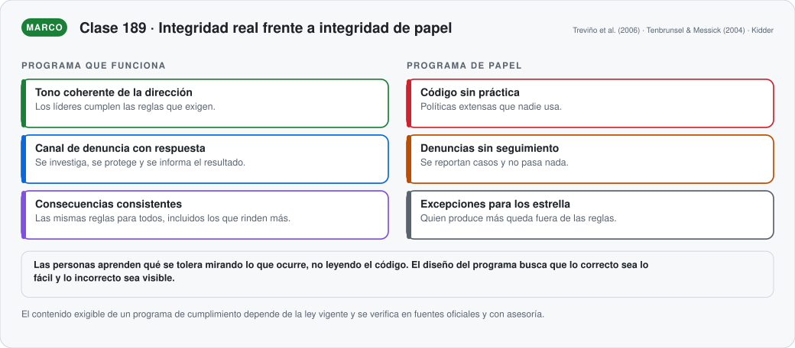

# Clase 189 — Compliance y cultura ética

<!-- nav:inicio -->
> **Parte 15 · Riesgo, legal, compliance, ciberseguridad e IA** — clase 9 de 12 · [índice de la parte](../../README.md) · [temario](../../../../SYLLABUS.md)
<!-- nav:fin -->

**Parte:** 15 — Riesgo, legal, compliance, ciberseguridad e IA  
**Nivel:** Etapa 4 — Gerente → Director  
**Duración sugerida:** 150–180 minutos · **Estándar:** deep-class-v2

## 🎯 Propósito

Casi todas las empresas tienen un código de ética, una política anticorrupción y una capacitación anual en línea. Y casi todas conocen casos en que alguien con buenos resultados quedó fuera de las reglas, una denuncia no tuvo respuesta o un gerente presionó para «cerrar la venta como sea». La brecha entre el programa de papel y la conducta real es el problema central del compliance: no se resuelve con más documentos, sino con una combinación de **diseño** (reglas claras y fáciles de cumplir), **incentivos** (que no premien lo incorrecto), **ejemplo** de los líderes, **canales** confiables y **consecuencias** consistentes. Un programa que funciona hace visible lo incorrecto y fácil lo correcto.

La clase integra el trabajo de Treviño, Weaver y Reynolds sobre ética conductual en las organizaciones, el concepto de desvanecimiento ético de Tenbrunsel y Messick, la mirada de Kidder sobre dilemas entre valores en conflicto, la seguridad psicológica de Edmondson como condición para hablar, y remite a las fuentes oficiales chilenas sobre responsabilidad penal de las personas jurídicas sin interpretarlas. Al terminar sabrás diseñar los elementos de un programa de cumplimiento, evaluar su efectividad con evidencia, manejar denuncias y conflictos de interés y decidir ante presiones reales.

## 📚 Resultados de aprendizaje

Al finalizar podrás:

1. **Explicar** por qué las personas incumplen y qué factores de la organización lo favorecen.
2. **Diseñar** los elementos de un programa de cumplimiento basado en riesgos.
3. **Gestionar** un canal de denuncias, investigaciones y medidas con protección y consistencia.
4. **Evaluar** si el programa funciona, con indicadores de conducta y de percepción.
5. **Decidir** ante presiones y dilemas con un método explícito.

## 🧭 Agenda

| Tramo | Qué se hace |
|---|---|
| 0–20 min | Recuperación: ¿qué le ocurre en tu empresa a quien denuncia algo y a quien rinde mucho y rompe una regla? |
| 20–60 min | Por qué se incumple, elementos del programa, denuncias, incentivos, evaluación y dilemas. |
| 60–105 min | Ejemplo trabajado: rediseño del canal de denuncias y de las investigaciones. |
| 105–150 min | Caso ejecutivo y práctica. |
| 150–175 min | Límites y entregable. |

## 🧩 Conceptos centrales

| Concepto | Definición | Cómo se reconoce |
|---|---|---|
| **Compliance** | Conjunto de políticas, procesos y controles para cumplir normas y valores propios. | Programa con responsables, riesgos, controles y revisión. |
| **Cultura ética** | Normas compartidas sobre lo que se hace y se tolera, más allá de lo escrito. | Se ve en decisiones bajo presión. |
| **Desvanecimiento ético** | Proceso por el que la dimensión ética de una decisión deja de verse. | Se habla de «números», «plazos» o «prácticas del mercado». |
| **Tono desde arriba** | Señales de los líderes sobre lo que importa y lo que se permite. | Coherencia entre discurso y decisiones. |
| **Canal de denuncia** | Vía para reportar sospechas con protección. | Confiable, accesible y con respuesta. |
| **Represalia** | Trato adverso contra quien denuncia o colabora. | Cambios de funciones, aislamiento, evaluaciones injustas. |

## 🧠 Modelo mental

**Cómo leer el diagrama.** Dos paneles. A la izquierda, el **programa que funciona**: tono coherente de la dirección (los líderes cumplen las reglas que exigen), canal de denuncia con respuesta (se investiga, se protege y se informa el resultado) y consecuencias consistentes (mismas reglas para todos, incluidos los que más rinden). A la derecha, el **programa de papel**: código sin práctica, denuncias sin seguimiento y excepciones para los estrella. La nota explica que las personas aprenden de lo que ocurre, no de lo que se lee; el pie, que el contenido exigible de un programa depende de la ley vigente.

## 📖 Desarrollo

### 1. Por qué las personas incumplen

Treviño, Weaver y Reynolds revisaron décadas de estudios y mostraron que la conducta ética en las organizaciones depende de **factores individuales** (valores, juicio moral), pero también, y de forma importante, de **factores del contexto**: las normas del grupo, los incentivos, el ejemplo de los líderes, la claridad de las reglas y las consecuencias que se observan. Tenbrunsel y Messick describen el **desvanecimiento ético**: mediante un lenguaje que disfraza lo ético («ajustar», «optimizar»), la autoengaño y la presión por metas, las personas dejan de ver que una decisión tiene una dimensión moral y se consideran éticas aunque actúen de manera que no lo es. Por eso un programa basado solo en la capacitación sobre «lo que es correcto» llega tarde: la mayoría sabe lo que es correcto; lo que falta es **ver** la situación y tener condiciones para actuar bien.

### 2. Elementos de un programa de cumplimiento

Un programa efectivo, por lo general, incluye: **evaluación de riesgos** (dónde están los riesgos de corrupción, fraude, conflictos de interés, libre competencia, acoso y datos); **políticas y procedimientos** claros y accesibles; **liderazgo y supervisión** (un responsable con independencia, acceso al directorio y recursos); **capacitación** basada en casos y roles; **canales de consulta y denuncia**; **investigación** y **medidas** consistentes; **monitoreo** y **pruebas**; y **mejora continua**. La responsabilidad penal de las personas jurídicas en Chile y el modelo de prevención de delitos que la ley contempla se consultan en su texto oficial (LeyChile) y con asesoría; esta clase no los interpreta. Las normas internacionales de sistemas de gestión de cumplimiento ofrecen guías de referencia que se consultan en la fuente.

### 3. El riesgo manda

Un programa que trata igual a todo ofrece poca protección. Se parte de **riesgos concretos**: ¿quiénes se relacionan con funcionarios públicos?, ¿quién negocia con clientes o proveedores grandes?, ¿dónde hay pagos por intermediarios?, ¿qué áreas manejan información sensible?, ¿qué metas son agresivas?, ¿dónde hay conflictos de interés frecuentes? Para cada riesgo se definen **controles específicos** (debida diligencia de terceros, aprobación de regalos y atenciones, registro de reuniones, separación de funciones) y **señales de alerta**. El **conflicto de interés** merece atención propia: se declara por escrito, se evalúa por un tercero y se gestiona con medidas (abstención, separación, transparencia).

### 4. Hablar y ser escuchado: canal, investigación y protección

Las personas denuncian si creen que **no habrá represalia** y que **algo ocurrirá**. Edmondson muestra que la seguridad psicológica es condición del aprendizaje y del reporte; sin ella, los problemas se esconden. Un canal efectivo es **accesible** (varios medios, confidencial o anónimo según la política), **independiente** de quienes podrían ser denunciados, **ágil** (acuse en pocos días y plazos de investigación) y **trazable**. La investigación debe ser **imparcial**, documentada, respetuosa de los derechos de todas las personas y proporcional. Se informa al denunciante, en lo posible, el cierre del caso. Se **protege** contra las represalias y se vigila activamente. Las normas laborales y de protección de denunciantes, y los protocolos obligatorios sobre ciertas conductas (por ejemplo, acoso y violencia en el trabajo), se verifican en su texto vigente y con asesoría.

### 5. Consecuencias consistentes

Nada comunica tanto como lo que ocurre cuando alguien rinde mucho y rompe una regla. Si se le perdona, el mensaje es que las reglas son para los demás. La **consistencia** exige criterios previos (gravedad, intención, reiteración, cooperación), decisión por una instancia que no dependa del resultado comercial del infractor y comunicación **sobria** de las medidas sin exponer innecesariamente a las personas. También exige **premiar lo correcto**: reconocer a quienes plantean dudas, rechazan un negocio dudoso o reportan un error. Los incentivos (clase 175) pueden empujar al incumplimiento: metas imposibles, bonos solo por resultados y ausencia de contrapesos.

### 6. Dilemas: cuando los valores chocan

Kidder distingue entre dilemas de **bien contra mal** (donde la decisión es clara aunque cueste) y dilemas de **bien contra bien**, donde dos valores legítimos chocan: verdad frente a lealtad, individuo frente a comunidad, corto plazo frente a largo plazo, justicia frente a compasión. Propone principios de resolución: basarse en **resultados** (el mayor bien para el mayor número), en **reglas** (lo que se haría si todos actuaran así) o en el **cuidado** (hacer lo que querrías que hicieran contigo). Un método práctico: identificar los hechos, nombrar los valores en juego, listar opciones, probar con las tres perspectivas, consultar a alguien de confianza y a las instancias formales (compliance, legal), decidir y **documentar** el razonamiento.

### 7. Evaluar si funciona

Se necesita evidencia de efectividad, no solo de actividad. Indicadores de **actividad** (capacitados, políticas publicadas) son un mínimo. Más informativos son: **tasa de denuncias** por cada cien empleados (muy baja puede indicar desconfianza), **tiempo de cierre**, **proporción de casos con medidas**, **percepción** de que se puede denunciar sin represalias (encuestas), **incidentes** detectados por controles frente a los que llegan por denuncia, **rotación** de personas con denuncias y **resultados de pruebas** de los controles. Se revisa el programa cuando cambian riesgos, estructura o normas, y se informa al directorio con una vista honesta, incluidos los casos graves y las lecciones.

## 📚 Lectura comparada

| Obra | Qué aporta | Qué no resuelve | Pregunta para contrastar |
|---|---|---|---|
| Treviño, Weaver y Reynolds | Factores individuales y de contexto de la conducta ética. | Es una revisión; no prescribe un programa. | ¿Qué factor del contexto empuja a incumplir? |
| Tenbrunsel y Messick | Desvanecimiento ético y autoengaño. | No ofrece un procedimiento operativo. | ¿Qué lenguaje oculta la dimensión ética? |
| Kidder | Dilemas de bien contra bien y principios de resolución. | No sustituye normas ni asesoría. | ¿Qué valores chocan aquí? |
| Edmondson | Seguridad psicológica y reporte de problemas. | No cubre investigaciones formales. | ¿Quién calla y por qué? |
| LeyChile (BCN) | Texto oficial sobre responsabilidad penal de personas jurídicas. | No es asesoría ni interpretación. | ¿Qué versión rige y desde cuándo? |

## 🧮 Ejemplo trabajado

**Situación (hipotética).** Una empresa de servicios con 1.800 empleados tiene un canal de denuncias externo contratado hace tres años. En el último año recibió 6 denuncias. Una encuesta de clima mostró que solo 34 % de las personas cree que «se puede denunciar sin consecuencias negativas». Una investigación sobre un jefe comercial tardó 74 días en promedio, y en dos casos la persona denunciada supervisaba a quien debía recoger los antecedentes.

**Indicadores iniciales.**

- Denuncias por cada 100 empleados: 6 ÷ 1.800 × 100 = 0,33.
- Tiempo promedio de cierre: 74 días.
- Confianza en el canal: 34 %.

**Diagnóstico.** Pocas denuncias no significan pocos problemas: la desconfianza explica el silencio. Las investigaciones dependían de la línea jerárquica, y no se informaba el cierre a los denunciantes.

**Rediseño.**

1. Comité de ética independiente con la gerencia de personas, un integrante del directorio y un asesor externo; ninguna persona investiga a su línea.
2. Plazos: acuse en 3 días, investigación en 30 días hábiles como meta y cierre informado.
3. Protección: monitoreo de las condiciones laborales del denunciante durante 12 meses.
4. Criterios previos de medidas por gravedad, intención, reiteración y cooperación, aplicados por el comité sin considerar el resultado comercial.
5. Capacitación con casos reales, para líderes y para equipos, y comunicación trimestral de lecciones aprendidas (casos anonimizados).
6. Un incentivo: 20 % del bono de gerentes depende de indicadores de cultura (cumplimiento de controles y clima ético), sin penalizar por casos reportados.

**Resultados a 12 meses (hipotéticos).**

- Denuncias: 31; por cada 100 empleados: 31 ÷ 1.800 × 100 = 1,72.
- Casos con hallazgos sustentados: 12 de 31, es decir, 38,7 %.
- Tiempo promedio de cierre: 28 días, una reducción de 46 días (74 − 28), el 62,2 % (46 ÷ 74).
- Confianza en el canal: de 34 % a 58 %.
- Un vendedor de alto desempeño, responsable del 4 % de los ingresos, es sancionado por violar una regla de regalos; se mantiene la sanción pese a la presión comercial.

**Lectura.** El aumento de denuncias es una señal de mayor confianza, no necesariamente de más infracciones. La sanción al vendedor mostró consistencia. Los indicadores se vigilan junto con auditorías y pruebas de controles.

**Cuidados.** Los plazos de investigación, la protección de los denunciantes, los derechos de la persona denunciada y los protocolos obligatorios se verifican con asesoría y en las fuentes oficiales vigentes; los datos de las personas se tratan con confidencialidad. Las cifras son ilustrativas.

**Qué muestra.** (1) Pocas denuncias pueden ser mala señal. (2) El diseño del proceso cambió la confianza. (3) La consistencia con un estrella dio credibilidad.

## 🔀 Comparación y límites

**Compliance frente a ética.** El cumplimiento asegura que se respeten normas; la ética va más allá: orienta lo correcto cuando la norma calla o permite algo cuestionable. Un programa sólido atiende ambos.

**Límites.** Las evidencias sobre qué elementos de un programa reducen las infracciones son mixtas y dependen del contexto. Los indicadores de percepción pueden estar sesgados. Los dilemas no tienen respuestas únicas. Las obligaciones legales (modelos de prevención, protección de denunciantes, protocolos laborales) se verifican en LeyChile y con asesoría. Las cifras del ejemplo son ilustrativas.

## 🪜 De profesional a owner

| Nivel | Cómo participa |
|---|---|
| **Profesional** | Cumple las reglas, consulta ante dudas y reporta sin temor. |
| **Jefe / Team Lead** | Da ejemplo, escucha y no permite represalias. |
| **Gerente** | Aplica las consecuencias con consistencia y cuida los incentivos. |
| **CEO / Director** | Marca el tono, apoya la independencia del compliance y se somete a las mismas reglas. |
| **Founder / Owner** | Acepta perder un negocio antes que torcer una regla. |

## 🏢 Caso ejecutivo

Una empresa de construcción con 3.400 empleados participa en licitaciones públicas y privadas. En los últimos dos años se detectó que un gerente de proyectos autorizó pagos a un intermediario sin respaldo por 140 millones de pesos para «agilizar permisos». La persona es la responsable de proyectos que suman 18 % de los ingresos y está a dos años de un cargo directivo. Dos ingenieros habían advertido el problema a su jefe, que les respondió «no se metan». Uno de ellos fue trasladado a otra obra. El canal de denuncias recibe cuatro casos al año. El código de conducta tiene 70 páginas y la capacitación es anual y en línea con 96 % de asistencia. Un competidor fue sancionado por hechos similares. El directorio pide si «tenemos un problema real» y el gerente general propone «resolverlo con discreción».

Entrega un **plan de integridad** que contenga: (a) el diagnóstico de factores de contexto y de desvanecimiento ético; (b) la evaluación de riesgos y los controles específicos (terceros, pagos, permisos, regalos, conflictos); (c) el rediseño del canal, la investigación y la protección contra represalias; (d) el tratamiento del caso del gerente con criterios previos y consistencia; (e) los incentivos, el liderazgo y la comunicación; (f) los indicadores de efectividad y las verificaciones legales y de protección de datos pendientes.

## 🧪 Práctica

1. Identifica tres factores del contexto de tu organización que empujan a incumplir.
2. Reescribe tres frases que disfrazan lo ético («ajustar», «agilizar») en lenguaje claro.
3. Evalúa tu canal de denuncias con cinco preguntas de confianza, independencia y respuesta.
4. Define criterios previos de medidas disciplinarias por gravedad, intención y reiteración.
5. Resuelve un dilema de bien contra bien con los tres principios de Kidder y documenta tu razonamiento.

## ⚠️ Errores frecuentes

| Error | Por qué ocurre | Cómo corregirlo |
|---|---|---|
| Capacitar y dar por cumplido | Es medible y barato | Medir conducta y confianza. |
| Excepciones a quienes rinden | Presión comercial | Criterios previos e instancia independiente. |
| Investigar por la línea jerárquica | Es el camino habitual | Independencia del comité y de los investigadores. |
| Premiar solo resultados | Metas y bonos | Contrapesos e indicadores de conducta. |
| Interpretar pocas denuncias como éxito | Se mide la cantidad | Evaluar confianza, percepción y detección por controles. |
| Resolver «con discreción» | Se teme el escándalo | Proceso formal con confidencialidad adecuada. |

## ❓ Preguntas de comprobación

1. ¿Qué factores del contexto favorecen la conducta no ética según Treviño y otros?
2. ¿Qué es el desvanecimiento ético?
3. ¿Qué elementos básicos tiene un programa de cumplimiento?
4. ¿Qué características debe tener un canal de denuncias efectivo?
5. ¿Por qué importa la consistencia de las consecuencias?
6. ¿Qué tipos de dilemas distingue Kidder y qué principios propone?
7. ¿Por qué pocas denuncias pueden ser una mala señal?

Claves de respuesta

1. Normas del grupo, incentivos, ejemplo de los líderes, claridad de reglas y consecuencias observadas.
2. El proceso por el que la dimensión ética de una decisión deja de verse por lenguaje eufemístico, autoengaño y presión.
3. Evaluación de riesgos, políticas, responsable independiente, capacitación, canales, investigación y medidas, monitoreo y mejora.
4. Accesible, independiente, ágil, trazable, con protección contra represalias y con respuesta al denunciante.
5. Porque las personas aprenden de lo que ocurre; si las reglas no se aplican a quienes rinden, pierden credibilidad.
6. Bien contra mal y bien contra bien; principios de resultados, de reglas y de cuidado.
7. Porque puede reflejar desconfianza o miedo a las represalias, no ausencia de problemas.

## 📥 Entregable

Guarda en `portfolio/189-compliance-y-cultura-etica/`:

- `risk-governance-brief.md` (plantilla [Risk Governance Brief](../../../../templates/risk-governance-brief.md)) con el plan del caso ejecutivo;
- `influence-and-conflict-disclosure-brief.md` (plantilla [Ficha de influencia y declaración de conflictos](../../../../templates/influence-and-conflict-disclosure-brief.md)) con el protocolo de conflictos de interés;
- `decision-journal.md` con los indicadores de efectividad y las verificaciones legales pendientes.

## 📗 Fuentes y verificación

- Linda K. Treviño, Gary R. Weaver & Scott J. Reynolds — *Behavioral Ethics in Organizations: A Review* (Journal of Management, 2006). **Uso en esta clase:** factores individuales y de contexto de la conducta ética. Lectura selectiva sobre **compliance y cultura ética**. **Localizador:** [DOI 10.1177/0149206306294258](https://doi.org/10.1177/0149206306294258).
- Ann E. Tenbrunsel & David M. Messick — *Ethical Fading: The Role of Self-Deception in Unethical Behavior* (Social Justice Research, 2004). **Uso en esta clase:** desvanecimiento ético y autoengaño. Lectura selectiva sobre **compliance y cultura ética**. **Localizador:** [DOI 10.1023/B:SORE.0000027411.35832.53](https://doi.org/10.1023/B:SORE.0000027411.35832.53).
- Rushworth M. Kidder — *How Good People Make Tough Choices* (William Morrow, 2009). **Uso en esta clase:** dilemas de bien contra bien y principios de resolución. Lectura selectiva sobre **compliance y cultura ética**. **Localizador:** [ISBN-13 9780061968723](https://openlibrary.org/isbn/9780061968723).
- Amy C. Edmondson — *The Fearless Organization* (Wiley, 2018). **Uso en esta clase:** seguridad psicológica y reporte de problemas. Lectura selectiva sobre **compliance y cultura ética**. **Localizador:** [ISBN-13 9781119477242](https://openlibrary.org/isbn/9781119477242).
- Biblioteca del Congreso Nacional de Chile — *LeyChile: responsabilidad penal de las personas jurídicas (Ley 20.393)* (2009). **Uso en esta clase:** texto oficial sobre responsabilidad penal de las personas jurídicas. **Fuente primaria:** <https://www.bcn.cl/leychile/>.

> **Regla de fuentes para Compliance y cultura ética:** las obras anteriores estructuran las perspectivas de esta materia; cualquier norma, ley o estándar vivo mencionado debe comprobarse nuevamente en su fuente primaria vigente, incluidos los modelos de prevención de delitos, la protección de denunciantes y los protocolos laborales. Los ejemplos y casos son hipotéticos, con cifras ilustrativas. El desarrollo es original y no reproduce capítulos protegidos.

<!-- pie:inicio -->
---

| Anterior | Índice | Siguiente |
|---|---|---|
| [← 188 · Gobierno responsable de IA](../188-gobierno-responsable-de-ia/README.md) | [Parte 15](../../README.md) · [Programa](../../../../SYLLABUS.md) | [190 · Crisis, incidentes y escalamiento →](../190-crisis-incidentes-y-escalamiento/README.md) |
<!-- pie:fin -->
