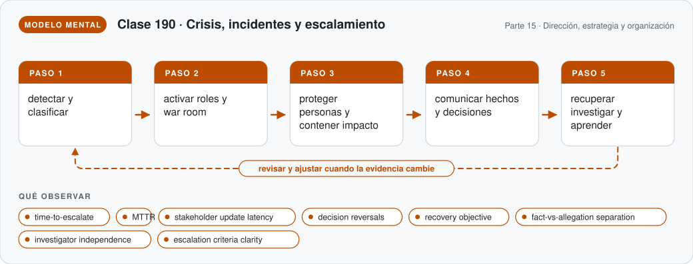

# Clase 190 — Crisis, incidentes y escalamiento

<!-- nav:inicio -->
> **Parte 15 · Riesgo, legal, compliance, ciberseguridad e IA** — clase 10 de 12 · [índice de la parte](../../README.md) · [temario](../../../../SYLLABUS.md)
<!-- nav:fin -->

**Parte:** 15 — Riesgo, legal, compliance, ciberseguridad e IA  
**Nivel:** Etapa 4 — Gerente → Director  
**Duración sugerida:** 150–180 minutos · **Estándar:** deep-class-v2

## 🎯 Propósito

La mayoría de las crisis empieza como un incidente pequeño que alguien conoció primero y tardó en contar. Cuando por fin llega a quien decide, ya hay clientes afectados, información dispersa y varias personas dando órdenes distintas. Esta clase trata de evitarlo con tres decisiones que se toman **antes** de que ocurra el problema: **cuándo se declara un incidente, quién manda y cuándo y a quién se sube.**

Al terminar sabrás diseñar un sistema de escalamiento por niveles con criterios de paso, constituir un comité de crisis con autoridad escrita y conducir las primeras horas de un incidente con roles separados, prioridades en orden y un registro que permita reconstruir las decisiones después.

## 📚 Resultados de aprendizaje

Al finalizar podrás:

1. **Distinguir** incidente, crisis y escalamiento, y decidir cuándo corresponde declarar un incidente.
2. **Asignar** el mando único y los roles separados de un incidente, y explicar por qué quien repara no habla por la empresa.
3. **Ordenar** las prioridades de las primeras horas y justificar ese orden.
4. **Diseñar** niveles de escalamiento con criterios de paso y un comité de crisis con matriz de responsabilidades.
5. **Separar** hechos, alegaciones y juicios cuando el incidente involucra a una persona clave, y comunicar sin adelantar conclusiones.
6. **Convocar** una revisión posterior sin búsqueda de culpables que produzca cambios verificables.

## 🧭 Agenda

| Tramo | Qué se hace |
|---|---|
| 0–20 min | Recuperación: describe el último incidente que conociste; ¿quién mandaba?, ¿cuándo se supo arriba?, ¿qué se registró? |
| 20–60 min | Declarar, mandar y escalar: el diagrama de la clase y las fuentes. |
| 60–100 min | Ejemplo trabajado: las primeras 24 horas de una filtración de datos de clientes. |
| 100–135 min | Caso ejecutivo: niveles, comité y primer comunicado. |
| 135–150 min | Revisión sin culpas, límites del enfoque y entregable. |

## 🧩 Conceptos centrales

| Concepto | Definición | Cómo se reconoce |
|---|---|---|
| **Incidente** | Evento que interrumpe o degrada una operación, o pone en riesgo a personas, datos o activos, y que exige una respuesta coordinada. | Hay un impacto observable y alguien debe actuar ya. |
| **Crisis** | Evento percibido como impredecible que amenaza expectativas importantes de los interesados y puede afectar seriamente a la organización (Coombs, 2007). | Hay incertidumbre, presión de tiempo y atención externa. |
| **Declarar un incidente** | Decisión formal de activar la respuesta coordinada, con su mando y su registro. | Existe una hora de inicio y un responsable nombrado. |
| **Mando del incidente** | Rol único que decide y responde por la respuesta, mientras otros roles ejecutan partes separadas del trabajo (Beyer et al., 2016). | Todos saben a quién preguntar y quién decide. |
| **Escalamiento** | Paso de un asunto a un nivel con más autoridad, según criterios fijados de antemano y no según el rango de quien lo sabe. | Hay un criterio escrito que dice cuándo se sube. |
| **Comité de crisis** | Grupo ejecutivo con autoridad definida para decidir las acciones de mayor impacto durante la crisis. | Su composición, sus facultades y sus decisiones están escritas. |
| **Revisión sin culpas** | Análisis posterior que busca causas del sistema y acciones correctivas, no responsables individuales (Beyer et al., 2016). | Termina en acciones con dueño y fecha. |

## 🧠 Modelo mental

**Cómo leer el diagrama.** A la izquierda, la escalera dice *cuándo* sube un asunto: cada peldaño tiene un criterio, no un nombre de persona. A la derecha, el mando dice *quién* decide, y los roles separados evitan que la misma persona repare, comunique y registre a la vez. Abajo, las prioridades dicen *en qué orden* se actúa cuando todo parece urgente.

## 📖 Desarrollo

### 1. Incidente, crisis y la decisión de declarar

Un incidente es un problema que exige respuesta coordinada; una crisis es la lectura que hacen los interesados cuando ese problema amenaza algo que esperaban de la organización. La misma falla técnica puede ser un incidente interno o una crisis pública según quién se entere y cuánto tarde la empresa en hablar.

La decisión clave es **declarar**. El libro de ingeniería de confiabilidad de Google propone criterios simples para hacerlo, y sirven como ejemplo: declarar si se necesita un segundo equipo, si el problema es visible para los clientes o si sigue sin resolverse tras una hora de análisis concentrado. Declarar es barato —se activa un mando y un registro— y no declarar es caro: se pierde tiempo hasta que la situación se impone sola. La regla pedagógica es *ante la duda, declara y baja el nivel después*.

### 2. Mando único y roles separados

Beyer y sus colegas describen la respuesta organizada de un incidente a partir de los sistemas de mando usados en emergencias: **una persona manda**, y las demás funciones se separan. En su descripción, el mando coordina y delega; las operaciones ejecutan los cambios técnicos; la comunicación entrega información al exterior y a los interesados; y la planificación sostiene el registro y los relevos. Quien manda puede delegar roles pero no se queda con la tarea de reparar.

La razón es práctica: cuando una misma persona intenta resolver, informar y decidir, hace mal las tres cosas. Y cuando hay dos mandos, el equipo recibe órdenes contradictorias. Legal, personas y comunicaciones **asesoran** al mando; no lo reemplazan.

### 3. Prioridades en orden

En el incidente lo urgente compite con lo importante. La clase propone un orden fijo para no improvisarlo con estrés: **1) proteger a las personas, 2) detener el daño, 3) preservar la evidencia y 4) restablecer.** El libro de confiabilidad enuncia como prioridades detener el daño, restablecer el servicio y preservar la evidencia; la clase añade la protección de las personas como primera por una razón de responsabilidad directiva, no técnica. Restablecer antes de preservar puede destruir la prueba necesaria para entender qué ocurrió y para cumplir deberes de notificación.

### 4. Escalar por criterio, no por rango

Un sistema de escalamiento define niveles y **criterios de paso**: la operación resuelve lo que puede contener con su autoridad; la gerencia interviene si hace falta otro equipo o no hay avance; el comité de crisis, si hay clientes, datos personales, un regulador, personas en riesgo o exposición pública; el directorio, si compromete la continuidad o la licencia para operar. Escalar no es admitir fracaso ni trasladar la culpa; es poner la decisión donde está la autoridad para tomarla.

El error habitual es escalar por jerarquía —solo sube lo que el jefe decide que sube— y producir un silencio que se descubre tarde. Los criterios escritos protegen a quien sube un asunto.

### 5. El comité de crisis y su autoridad

El comité es útil si su **autoridad está definida antes** del evento: quién lo preside, quién puede activarlo, qué decide sin consultar y qué debe elevar al directorio. Su matriz de responsabilidades asigna, para cada decisión, **una sola** persona que decide, quién ejecuta, a quién se consulta y a quién solo se informa. Una comisión sin responsable único discute en lugar de decidir.

Composición habitual: presidencia (quien responde por la decisión), operaciones, legal y cumplimiento, personas, comunicaciones y una secretaría que registra hechos y decisiones. Cada organización la adapta; lo que no debe faltar es un acta firmada de sus facultades.

### 6. Cuando el incidente involucra a una persona clave

Si surge una alegación contra un directivo, se mezclan con facilidad tres capas: **hechos confirmados, alegaciones y juicios sobre la vida privada**. El protocolo de las primeras 72 horas de la clase las separa: 1) **preservar** registros relevantes; 2) **separar** en una tabla hecho / alegación / fuente / estado de verificación; 3) **gobernar**: designar a quien investiga y asegurar su independencia respecto del investigado; 4) **proteger**: limitar accesos que puedan afectar la investigación, sin presumir culpa; 5) **comunicar** un mensaje breve y verificable que no adelante conclusiones; 6) **revisar** en una fecha fijada.

Las medidas cautelares no son sanciones, y la conducta privada solo importa en la medida en que genere un riesgo concreto para el cargo o la organización, evaluado con proceso y evidencia. Este protocolo es un método docente de la clase, no un estándar de una fuente.

### 7. Comunicar en la crisis y aprender después

Coombs sostiene que, ante una crisis, la primera respuesta es **informar e instruir**: decir qué ocurrió, qué debe hacer quien está en riesgo y reconocer el daño humano, antes de ocuparse de la reputación. La clase 200 desarrolla las posturas posteriores. Aquí basta con la regla de que la comunicación declara lo que se sabe, lo que no se sabe, lo que se está haciendo y cuándo habrá novedades, y que habla **una sola** voz.

Después, la **revisión sin culpas**: se reconstruye la secuencia con el registro, se buscan causas del sistema y se acuerdan acciones con dueño y fecha. Edmondson muestra por qué: si equivocarse se castiga, la próxima vez el aviso llega más tarde. Weick y Sutcliffe describen en las organizaciones de alta confiabilidad una **preocupación por el fallo** y una **deferencia a la experticia**: durante el incidente, la autoridad para decidir un detalle técnico migra hacia quien más sabe, sin perder la claridad de quién manda.

## 📚 Lectura comparada

| Obra | Qué aporta | Qué no resuelve | Pregunta para contrastar |
|---|---|---|---|
| Beyer et al. (2016) | Mando único, roles separados, criterios para declarar y revisión sin culpas. | Nace de la ingeniería de software; no trata de crisis de reputación. | ¿Qué parte se transfiere a una crisis no técnica? |
| Coombs (2007) | Qué comunicar primero y cómo la responsabilidad atribuida condiciona la respuesta. | No dice cómo operar el incidente. | ¿Qué diría tu comunicado de los primeros 60 minutos? |
| Weick y Sutcliffe (2015) | Cómo organizaciones de alta confiabilidad atienden señales débiles y resisten simplificar. | No fija un procedimiento. | ¿Qué señal débil se ignoró en el último incidente? |
| Klein (1999) | Cómo decide la experiencia bajo presión de tiempo. | No asegura que la intuición acierte. | ¿Cuándo conviene frenar una decisión intuitiva? |
| Edmondson (2018) | Seguridad psicológica y aprendizaje del error. | No define niveles ni roles. | ¿Qué cuesta hoy avisar de un problema? |

## 🧮 Ejemplo trabajado

**Situación (hipotética, con cifras ilustrativas).** Una analista de seguridad de una empresa de servicios detecta un acceso inusual a una base de clientes. A las 09:10 lo informa por el canal de operación. Veamos cómo se aplican el diagrama y la matriz.

| Hora | Hecho o decisión | Quién decide | Por qué |
|---|---|---|---|
| 09:10 | Detección y primer aviso | Operación (nivel 1) | Alcanza para contener credenciales sospechosas. |
| 09:50 | Se declara el incidente: hay datos personales posiblemente comprometidos | Gerente de seguridad | Cumple el criterio de paso al nivel 3. |
| 10:30 | Se constituye el comité; el director general preside | Presidencia | La acta de facultades ya existe. |
| 10:40 | Se revocan accesos y se preservan registros antes de reiniciar sistemas | Mando del incidente | Prioridades: detener el daño y preservar evidencia. |
| 11:30 | Primer mensaje interno: qué se sabe, qué no, cuándo habrá novedades | Comunicación, aprobado por la presidencia | Una sola voz; los hechos coinciden hacia dentro y fuera. |
| 14:00 | Se evalúan obligaciones de notificación a la autoridad y a los afectados | Presidencia, con asesoría legal | Verificar la norma vigente y sus plazos con el asesor; no se improvisa. |
| 17:00 | Informe de estado y nueva hora de actualización | Secretaría | Registro continuo y relevo ordenado. |

**Qué muestra.** (1) Cada decisión tiene **un** responsable. (2) Preservar evidencia ocurre *antes* de restablecer. (3) El comunicado no promete lo que no se sabe. (4) Si el alcance se amplía, se declara un nivel más alto, no se cambia al responsable.

## 🔀 Comparación y límites

**Incidente técnico frente a crisis de reputación.** Un incidente puede cerrarse en horas; una crisis de reputación puede durar meses porque depende de percepciones. El comité de crisis integra ambos, pero cada uno tiene su ritmo.

**Mando del incidente frente a comité.** El mando decide la operación minuto a minuto; el comité decide lo de mayor impacto. Si el comité se mete en los detalles, la respuesta se paraliza.

**Límites.** El marco de mando y roles viene de la ingeniería de confiabilidad y de los sistemas de emergencia; su transferencia a otras industrias requiere adaptación. La teoría de comunicación de crisis se apoya en estudios experimentales y de casos, y la percepción del público varía según la cultura y el momento. Las obligaciones legales de notificación dependen de la jurisdicción y deben verificarse con asesoría.

## 🪜 De profesional a owner

| Nivel | Responsabilidad en un incidente |
|---|---|
| **Profesional** | Avisa de inmediato lo que detecta, sin esperar certeza, y conserva evidencia. |
| **Jefe / Team Lead** | Ejerce el mando de un incidente de su equipo y registra las decisiones. |
| **Gerente** | Declara el incidente cuando cumple el criterio y sube al comité sin demora. |
| **CEO / Director** | Preside el comité, decide lo de alto impacto y responde ante clientes, autoridad y directorio. |
| **Founder / Owner** | Responde con su patrimonio: define el acta antes, y garantiza que la mala noticia le llegue rápido. |

## 🏢 Caso ejecutivo

Un proveedor de nube deja sin servicio por seis horas a clientes de una empresa de logística. Durante la falla, un investigador externo escribe al correo de soporte diciendo haber accedido a datos de rutas y contactos de clientes. La gerencia comercial duda si se trata de un reclamo extorsivo. El director de operaciones quiere restablecer el servicio de inmediato; el jefe de seguridad pide preservar los registros.

Entrega un **acta de comité de crisis** con: (a) criterios que declaran el incidente y el nivel de escalamiento; (b) composición, mando y matriz de responsabilidades; (c) el orden de prioridades aplicado a la tensión entre restablecer y preservar; (d) un mensaje inicial a clientes que separe lo que se sabe de lo que no; (e) a quién se consulta sobre las obligaciones legales; (f) fecha y condiciones de la revisión sin culpas.

## 🧪 Práctica

1. Escribe los criterios con los que tu organización declararía un incidente. ¿Quién puede declararlo?
2. Dibuja los niveles de escalamiento de tu entorno y marca en qué punto el criterio depende hoy de «lo que decida el jefe».
3. Redacta la matriz de responsabilidades para tres decisiones: restablecer un servicio, notificar a clientes y suspender a un directivo investigado.
4. Escribe el mensaje de los primeros 60 minutos con la estructura *qué sabemos, qué no sabemos, qué hacemos, cuándo informaremos*.
5. Escribe una revisión sin culpas de un incidente pasado: causa del sistema, tres acciones, dueño y fecha.

## ⚠️ Errores frecuentes

| Error | Por qué ocurre | Cómo corregirlo |
|---|---|---|
| Esperar certeza para avisar | Se teme alarmar | Declarar ante la duda y bajar el nivel después. |
| Dos mandos | Ambos cargos creen que les corresponde | Un solo mando nombrado en el acta. |
| Que el técnico hable por la empresa | Es quien más sabe | Separar reparación y comunicación. |
| Restablecer antes de preservar | La presión por volver a operar | Fijar el orden de prioridades de antemano. |
| Escalar por rango | Solo sube lo que el jefe decide | Criterios de paso escritos. |
| Buscar culpables | Se quiere cerrar el caso rápido | Revisión sin culpas, con acciones y dueño. |
| Prometer lo que no se sabe | Se quiere tranquilizar | Decir lo que se sabe, lo que no, y cuándo habrá novedades. |

## ❓ Preguntas de comprobación

1. ¿Qué criterios sirven para decidir que un asunto es un incidente y no una molestia?
2. ¿Por qué el mando de un incidente no debería ser quien repara el sistema?
3. ¿En qué orden se ubican las prioridades de las primeras horas y por qué preservar la evidencia precede a restablecer?
4. ¿Qué diferencia hay entre escalar por criterio y escalar por rango? Da un ejemplo.
5. ¿Qué debe contener el acta de un comité de crisis para que tenga autoridad?
6. ¿Qué dice Coombs que se debe comunicar primero en una crisis, y qué agrega la clase?
7. ¿Qué es una revisión sin culpas y qué resultado concreto debe producir?

Claves de respuesta

1. Que se necesite un segundo equipo, que sea visible para clientes o que siga sin resolverse tras un análisis concentrado de una hora (ejemplos del libro de confiabilidad); cada organización fija los suyos.
2. Porque quien repara no puede decidir, informar y registrar a la vez; y el mando debe conservar la visión de conjunto.
3. Personas, detener el daño, preservar evidencia, restablecer. Reiniciar antes de preservar puede destruir la prueba necesaria para entender y notificar.
4. Por criterio: sube cuando se cumple una condición escrita (datos personales, cliente afectado). Por rango: sube si el jefe decide; produce silencios.
5. Composición, quién preside, quién puede activarla, facultades, matriz de decisiones y criterios de escalamiento.
6. Informar e instruir: qué ocurrió, qué debe hacer quien está en riesgo y reconocer el daño. La clase agrega separar lo que se sabe de lo que no y hablar con una sola voz.
7. Análisis posterior centrado en causas del sistema, no en responsables; debe terminar en acciones con dueño y fecha.

## 📥 Entregable

Guarda en `portfolio/190-crisis-incidentes-y-escalamiento/`:

- `crisis-committee-charter.md` (plantilla [acta del comité de crisis](../../../../templates/crisis-committee-charter.md)) con el caso ejecutivo resuelto;
- `reading-note.md` con una tensión entre dos de las fuentes y su efecto en tu acta;
- `decision-journal.md` con las decisiones del ejemplo y la revisión sin culpas.

## 📗 Fuentes y verificación

- Betsy Beyer, Chris Jones, Jennifer Petoff & Niall Richard Murphy — *Site Reliability Engineering* (O'Reilly Media, 2016). **Uso en esta clase:** mando único, roles separados, criterios para declarar un incidente y revisión sin culpas. Lectura selectiva sobre **crisis, incidentes y escalamiento**. **Localizador:** [ISBN-13 9781491929124](https://openlibrary.org/isbn/9781491929124).
- W. Timothy Coombs — *Protecting Organization Reputations During a Crisis: The Development and Application of Situational Crisis Communication Theory* (Corporate Reputation Review, 2007). **Uso en esta clase:** qué comunicar primero y cómo la responsabilidad atribuida condiciona la respuesta. Lectura selectiva sobre **crisis, incidentes y escalamiento**. **Localizador:** [DOI 10.1057/palgrave.crr.1550049](https://doi.org/10.1057/palgrave.crr.1550049).
- Karl E. Weick & Kathleen M. Sutcliffe — *Managing the Unexpected* (Jossey-Bass, 2015). **Uso en esta clase:** preocupación por el fallo y deferencia a la experticia en organizaciones de alta confiabilidad. Lectura selectiva sobre **crisis, incidentes y escalamiento**. **Localizador:** [ISBN-13 9781118862414](https://openlibrary.org/isbn/9781118862414).
- Gary Klein — *Sources of Power* (The MIT Press, 1999). **Uso en esta clase:** cómo decide la experiencia bajo presión de tiempo y cuándo conviene frenar. Lectura selectiva sobre **crisis, incidentes y escalamiento**. **Localizador:** [ISBN-13 9780262611466](https://openlibrary.org/isbn/9780262611466).
- Amy C. Edmondson — *The Fearless Organization* (Wiley, 2018). **Uso en esta clase:** seguridad psicológica y aprendizaje del error. Lectura selectiva sobre **crisis, incidentes y escalamiento**. **Localizador:** [ISBN-13 9781119477242](https://openlibrary.org/isbn/9781119477242).

> **Regla de fuentes para Crisis, incidentes y escalamiento:** las obras anteriores estructuran las perspectivas de esta materia; cualquier norma, ley o estándar vivo mencionado debe comprobarse nuevamente en su fuente primaria vigente, en particular los plazos de notificación. El ejemplo y el caso son hipotéticos y no describen a ninguna empresa real. El desarrollo es original y no reproduce capítulos protegidos.

<!-- pie:inicio -->
---

| Anterior | Índice | Siguiente |
|---|---|---|
| [← 189 · Compliance y cultura ética](../189-compliance-y-cultura-etica/README.md) | [Parte 15](../../README.md) · [Programa](../../../../SYLLABUS.md) | [191 · Business continuity y resiliencia →](../191-business-continuity-y-resiliencia/README.md) |
<!-- pie:fin -->
