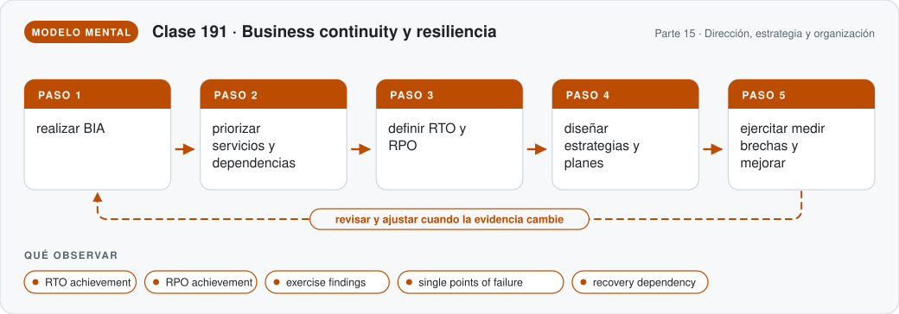

# Clase 191 — Business continuity y resiliencia

<!-- nav:inicio -->
> **Parte 15 · Riesgo, legal, compliance, ciberseguridad e IA** — clase 11 de 12 · [índice de la parte](../../README.md) · [temario](../../../../SYLLABUS.md)
<!-- nav:fin -->

**Parte:** 15 — Riesgo, legal, compliance, ciberseguridad e IA  
**Nivel:** Etapa 4 — Gerente → Director  
**Duración sugerida:** 150–180 minutos · **Estándar:** deep-class-v2

## 🎯 Propósito

Toda empresa depende de unos pocos procesos, sistemas, personas y proveedores sin los cuales deja de operar: el sistema de pedidos, la planta, el centro de datos, el proveedor único, el equipo que sabe cómo funciona algo. Cuando uno falla, la pregunta es cuánto tiempo puede estar la empresa sin él antes de que el daño se vuelva irreversible, y cuánto tiempo tardaría en recuperarlo. La **continuidad de negocio** convierte esas preguntas en decisiones previas: qué se protege primero, con qué tiempos de recuperación, con qué costo y con qué pruebas. La **resiliencia** va más allá: es la capacidad de absorber el golpe, adaptarse y seguir.

La clase se apoya en la norma ISO 22301 sobre sistemas de gestión de continuidad, en el estudio de Weick y Sutcliffe sobre organizaciones de alta confiabilidad, en la mirada de Perrow sobre accidentes normales en sistemas complejos, en el análisis de Vaughan sobre la normalización de la desviación y en el pensamiento de Taleb sobre robustez y antifragilidad. Al terminar sabrás hacer un análisis de impacto, fijar objetivos de recuperación, comparar estrategias por costo y riesgo, planificar y probar, y construir hábitos de resiliencia.

## 📚 Resultados de aprendizaje

Al finalizar podrás:

1. **Realizar** un análisis de impacto de negocio e identificar procesos críticos.
2. **Definir** objetivos de recuperación de tiempo y de datos con criterio de negocio.
3. **Comparar** estrategias de continuidad por costo, tiempo y riesgo.
4. **Planificar y probar** la continuidad con ejercicios realistas.
5. **Cultivar** prácticas de resiliencia y aprendizaje de las fallas.

## 🧭 Agenda

| Tramo | Qué se hace |
|---|---|
| 0–20 min | Recuperación: ¿cuántas horas puede estar tu empresa sin su proceso más crítico antes de un daño grave? |
| 20–60 min | Impacto, objetivos, estrategias, planes, pruebas y resiliencia. |
| 60–105 min | Ejemplo trabajado: elección de estrategia de recuperación para el sistema de pedidos. |
| 105–150 min | Caso ejecutivo y práctica. |
| 150–175 min | Límites y entregable. |

## 🧩 Conceptos centrales

| Concepto | Definición | Cómo se reconoce |
|---|---|---|
| **Continuidad de negocio** | Capacidad de seguir entregando productos y servicios a niveles aceptables durante una interrupción. | Planes, roles y pruebas. |
| **Análisis de impacto (BIA)** | Estudio de las consecuencias de interrumpir cada proceso en el tiempo. | Tabla de procesos, impactos y dependencias. |
| **RTO** | Tiempo objetivo para recuperar un proceso o sistema. | Se mide en horas o minutos. |
| **RPO** | Cantidad máxima aceptable de datos perdidos, expresada en tiempo. | Define la frecuencia de respaldos o réplicas. |
| **Periodo máximo tolerable** | Tiempo tras el cual el daño es inaceptable. | El RTO debe ser menor. |
| **Resiliencia** | Capacidad de resistir, adaptarse y recuperarse. | Se ve en cómo responde la organización ante lo inesperado. |

## 🧠 Modelo mental

**Cómo leer el diagrama.** Una cadena de cinco pasos con retorno. **Análisis de impacto**: qué procesos son críticos y qué pasa si se detienen. **Objetivos de recuperación**: tiempo y pérdida de datos tolerables por proceso. **Estrategias y planes**: alternativas, respaldos, proveedores y roles. **Pruebas y simulacros**: ensayar para encontrar fallas antes del evento. **Mejora continua**: corregir lo aprendido y revisar tras cambios. La flecha indica que cada prueba corrige los planes. La nota afirma que un plan que no se ha ensayado es una hipótesis; el pie, que los objetivos de recuperación son decisiones de negocio que comparan el costo de protección con el de la interrupción.

## 📖 Desarrollo

### 1. Qué es continuidad y qué no es

La norma ISO 22301 describe un sistema de gestión de continuidad de negocio: una forma organizada de **prepararse, responder y recuperarse** de incidentes disruptivos. No es lo mismo que la respuesta a incidentes (clase 190), que se ocupa de manejar el evento en las primeras horas, ni que la recuperación ante desastres de tecnología, que es una parte. La continuidad abarca **procesos, personas, instalaciones, tecnología, proveedores e información**. Y no es un proyecto único: se revisa cuando cambian procesos, sistemas, proveedores o la estructura. El texto vigente de la norma se consulta en la fuente oficial.

### 2. Análisis de impacto de negocio

El análisis de impacto (BIA) responde, proceso por proceso: ¿cuál es la **consecuencia** de que se detenga a las 2 horas, 8 horas, 1 día, 3 días, 1 semana? Consecuencias: pérdida de ingresos, costos adicionales, incumplimiento contractual y legal, daño a clientes, reputación, seguridad de las personas. De ahí se obtiene el **periodo máximo tolerable** de interrupción y la **prioridad** de recuperación. También se mapean las **dependencias**: sistemas, datos, proveedores, personas con conocimiento exclusivo, instalaciones. Un hallazgo habitual es que un proceso «menor» depende del mismo sistema o proveedor que uno crítico, o que el plan de recuperación del sistema A necesita al sistema B, que se recupera después.

### 3. Objetivos de recuperación: tiempo y datos

Para cada proceso crítico se fijan: el **RTO** (en cuánto tiempo debe volver a funcionar) y el **RPO** (cuántos datos se puede aceptar perder, expresado en tiempo: «hasta una hora de transacciones»). El RTO debe ser menor que el periodo máximo tolerable. Estos objetivos son **decisiones de negocio**, no técnicas: determinan el costo de la solución. Un RTO de 15 minutos exige redundancia activa y cuesta mucho más que un RTO de 24 horas con restauración de respaldos. La pregunta del ejecutivo es: ¿cuánto vale reducir el tiempo de recuperación?, es decir, ¿cuánto pérdida evita cada hora menos, frente al costo anual de la solución?

### 4. Estrategias de continuidad

Las estrategias típicas incluyen: **respaldos y restauración** (barato, lento), **sitio de respaldo en espera** (intermedio), **redundancia activa** o múltiples zonas (rápido, costoso), **procedimientos manuales** de contingencia (operar con papel o con capacidad reducida), **proveedores alternativos** y acuerdos de capacidad, **inventarios de seguridad** para insumos críticos, **trabajo remoto** para continuidad de oficinas, **entrenamiento cruzado** de personas y **seguros** que cubran parte de la pérdida. Se elige por proceso con el criterio de menor costo total que cumpla el periodo máximo tolerable. Un proceso con un tiempo tolerable de semanas no justifica una inversión de redundancia activa.

### 5. Planes, roles y comunicación

Un plan de continuidad define: **activación** (quién y con qué criterios declara), **roles** (líder, comunicaciones, tecnología, operaciones, personas), **procedimientos** por proceso crítico, **recursos** requeridos (ubicaciones alternativas, equipos, accesos), **contactos** y **comunicación** a empleados, clientes, proveedores y autoridades. Se guarda en formatos **accesibles sin los sistemas que se han caído** (impreso, en dispositivos fuera de la red). Cada persona clave tiene un **suplente**. Los planes son cortos y operativos: en una crisis nadie lee un manual de cien páginas. Se vinculan con el comité de crisis (clase 190) y con el plan de ciberseguridad (clase 187).

### 6. Probar: de la hipótesis a la evidencia

Los planes se prueban con ejercicios de distinta intensidad: **revisión de escritorio** (¿está completo?), **ejercicio de mesa** (la dirección decide frente a un escenario), **prueba técnica** (restaurar un sistema desde respaldo) y **simulacro** a escala real. Las pruebas buscan **fallas**, no aprobar: respaldos corruptos, contraseñas que solo conocía una persona, teléfonos desactualizados, dependencias no vistas. Se mide el tiempo real frente al RTO y la pérdida de datos real frente al RPO. Los resultados se documentan, se corrigen y se vuelven a probar. Los equipos de ingeniería de confiabilidad enseñan además a **aprender sin culpas**: las revisiones posteriores a incidentes buscan causas del sistema, no culpables.

### 7. Resiliencia: más allá del plan

Weick y Sutcliffe estudiaron organizaciones de alta confiabilidad (portaaviones, plantas nucleares, control de tráfico) y describieron cinco principios: **preocupación por el fallo** (se atienden las señales débiles), **reticencia a simplificar** las interpretaciones, **sensibilidad a las operaciones** (los líderes saben lo que ocurre en primera línea), **compromiso con la resiliencia** (capacidad de improvisar y recuperarse) y **deferencia a la experticia** (decide quien sabe, no quien manda). Perrow mostró que en sistemas **complejos y estrechamente acoplados** los accidentes son, en cierto sentido, «normales»: las fallas se combinan de manera imprevista. Vaughan describió cómo las organizaciones llegan a **normalizar la desviación**: se acepta, paso a paso, un riesgo que antes no se habría aceptado, hasta que ocurre el desastre. Taleb propone diseñar para **resistir y beneficiarse de la volatilidad**: redundancia donde importa, evitar la sobreoptimización y limitar el daño de los peores casos.

## 📚 Lectura comparada

| Obra | Qué aporta | Qué no resuelve | Pregunta para contrastar |
|---|---|---|---|
| ISO 22301 | Sistema de gestión de continuidad: análisis, estrategias, planes y pruebas. | Norma genérica; no define objetivos concretos. | ¿Qué proceso es crítico y cuánto tolera? |
| Weick y Sutcliffe | Cinco principios de organizaciones de alta confiabilidad. | Casos de alto riesgo; hay que adaptarlos. | ¿Se escuchan las señales débiles? |
| Perrow | Accidentes normales en sistemas complejos y acoplados. | Visión pesimista; no ofrece una receta. | ¿Qué fallas pueden combinarse? |
| Vaughan | Normalización de la desviación. | Caso específico del Challenger. | ¿Qué desviación hemos dejado de ver? |
| Taleb | Robustez, redundancia y límites a las pérdidas extremas. | Concepto general. | ¿Qué pasa en el peor caso? |

## 🧮 Ejemplo trabajado

**Situación (hipotética).** Una empresa de comercio electrónico con ingresos de 50.000 millones de pesos al año procesa unos 120 pedidos por hora, con un ticket promedio de 45.000 pesos. El BIA muestra que, si el sistema de pedidos queda caído, el costo es de unos 6 millones de pesos por hora (ventas perdidas, soporte y compensaciones), y que tras 12 horas los clientes corporativos cancelan contratos: periodo máximo tolerable de 12 horas. Probabilidad anual de una falla grave que requiera recuperación completa: 10 %.

**Datos en juego (RPO).** Pedidos por hora: 120 × 45.000 = 5,4 millones de pesos por hora. Con respaldo diario (RPO de 24 horas), la pérdida máxima de transacciones sería 24 × 5,4 = 129,6 millones; con réplica cada 15 minutos (RPO de 15 minutos), 0,25 × 5,4 = 1,35 millones.

**Opciones.**

| Opción | RTO | Costo anual | Costo esperado de interrupción | Total anual |
|---|---|---|---|---|
| A. Restauración desde respaldos | 24 h | 12 millones | 0,10 × 24 × 6 = 14,4 millones | 26,4 millones |
| B. Sitio en espera con réplica | 4 h | 60 millones | 0,10 × 4 × 6 = 2,4 millones | 62,4 millones |
| C. Redundancia activa | 0,25 h | 180 millones | 0,10 × 0,25 × 6 = 0,15 millones | 180,15 millones |

**Lectura.** En costo total esperado, A es la más barata (26,4 millones). Pero su RTO de 24 horas **supera el periodo máximo tolerable de 12 horas**: no cumple. La restricción de negocio manda sobre el valor esperado. Entre las que cumplen (B y C), B es la de menor costo: 62,4 millones frente a 180,15. Se elige B para el sistema de pedidos; A se mantiene para procesos de menor criticidad, como reportes internos.

**Prueba.** En el ejercicio técnico, la restauración del sistema tardó 31 horas frente a las 24 horas planificadas para la opción A actual, y se descubrió que la contraseña de cifrado de los respaldos estaba en poder de una sola persona y que el procedimiento exigía un servidor que ya no existía. Se corrigen estas fallas y se programa una nueva prueba con medición de tiempos.

**Plan.** Se contrata el sitio en espera; se prueba cada seis meses; se define un procedimiento manual para tomar pedidos por teléfono durante cuatro horas; se designan suplentes para las personas con conocimiento exclusivo; y se incluye en el tablero el porcentaje de procesos críticos con prueba exitosa en los últimos 12 meses.

**Cuidados.** Las obligaciones contractuales y regulatorias de continuidad, así como los seguros, se verifican con asesoría; las cifras son ilustrativas.

**Qué muestra.** (1) El periodo máximo tolerable descartó la opción más barata. (2) La prueba reveló fallas que el plan no mostraba. (3) La decisión distinguió procesos por criticidad.

## 🔀 Comparación y límites

**Continuidad frente a recuperación ante desastres.** La recuperación ante desastres restaura sistemas de tecnología; la continuidad mantiene el negocio funcionando, incluso con procedimientos manuales, proveedores alternativos y personas. La primera es parte de la segunda.

**Límites.** Los costos de interrupción y las probabilidades son estimaciones. Ningún plan cubre todo; los eventos reales combinan fallas de forma imprevista. Las pruebas realistas cuestan y a veces interrumpen la operación; se diseñan para minimizarlo. La resiliencia no se reduce a documentos: depende de la cultura y del aprendizaje. Las cifras del ejemplo son ilustrativas.

## 🪜 De profesional a owner

| Nivel | Cómo participa |
|---|---|
| **Profesional** | Conoce su rol en un incidente y mantiene actualizados contactos y accesos. |
| **Jefe / Team Lead** | Tiene suplentes y procedimientos manuales de su proceso. |
| **Gerente** | Es dueño del análisis de impacto y de las pruebas de sus procesos. |
| **CEO / Director** | Aprueba los objetivos de recuperación y el presupuesto, y participa en los ejercicios. |
| **Founder / Owner** | Protege la supervivencia del negocio, incluso a costa de eficiencia. |

## 🏢 Caso ejecutivo

Una empresa de alimentos con una sola planta (4.200 millones de pesos de ventas mensuales) abastece a tres cadenas de supermercados con contratos que penalizan faltantes. El análisis muestra que la planta depende de un único proveedor de energía y de una sola línea de envasado; el sistema de producción corre en un servidor local con respaldos semanales; el responsable del control de calidad es la única persona que conoce el procedimiento de liberación de lotes; y un incendio en una bodega vecina, el año pasado, interrumpió el acceso a la planta durante 36 horas. Un cálculo preliminar estima 150 millones de pesos por día de interrupción en ventas y penalizaciones, con un máximo tolerable de cuatro días antes de perder una cadena. El directorio pide un plan de continuidad en 60 días con un presupuesto limitado a 400 millones.

Entrega un **plan de continuidad** que contenga: (a) el análisis de impacto con procesos críticos, dependencias y periodo máximo tolerable; (b) los objetivos de recuperación (RTO y RPO) por proceso; (c) las estrategias comparadas por costo total y cumplimiento del tolerable, y la selección dentro del presupuesto; (d) los planes, roles, suplentes y comunicaciones; (e) el programa de pruebas con métricas y criterios de éxito; (f) las prácticas de resiliencia, las verificaciones contractuales y de seguros pendientes.

## 🧪 Práctica

1. Identifica cinco procesos críticos y estima el costo por hora de su interrupción.
2. Define el periodo máximo tolerable, el RTO y el RPO de uno de ellos.
3. Compara tres estrategias por costo anual y costo esperado de interrupción.
4. Lista las dependencias ocultas de un proceso crítico (sistemas, proveedores, personas).
5. Diseña un ejercicio de mesa de una hora con un escenario y tres decisiones de la dirección.

## ⚠️ Errores frecuentes

| Error | Por qué ocurre | Cómo corregirlo |
|---|---|---|
| Plan sin probar | Parece suficiente tenerlo | Pruebas con tiempos reales y correcciones. |
| Mismo objetivo para todo | Se busca simplicidad | Diferenciar por criticidad. |
| Ignorar dependencias | Se mira cada proceso aislado | Mapear sistemas, proveedores y personas. |
| Elegir solo por costo esperado | Se ignora la restricción | Cumplir primero el periodo máximo tolerable. |
| Planes en sistemas que se caen | Comodidad | Copia accesible fuera de la red. |
| Normalizar desviaciones | Presión por eficiencia | Revisar señales débiles y límites. |

## ❓ Preguntas de comprobación

1. ¿Qué es un análisis de impacto de negocio y qué produce?
2. ¿Qué diferencia hay entre RTO y RPO?
3. ¿Por qué el RTO debe ser menor que el periodo máximo tolerable?
4. ¿Qué estrategias de continuidad existen y cómo se eligen?
5. ¿Para qué se prueban los planes y qué se mide?
6. ¿Cuáles son los principios de las organizaciones de alta confiabilidad?
7. ¿Qué significa normalización de la desviación?

Claves de respuesta

1. Un estudio de las consecuencias de interrumpir cada proceso en el tiempo; produce prioridades, periodos tolerables y dependencias.
2. El RTO es el tiempo para recuperar el proceso; el RPO es la cantidad de datos que se puede perder, expresada en tiempo.
3. Porque después del periodo máximo tolerable el daño es inaceptable; el objetivo debe cumplirse antes.
4. Respaldos, sitio en espera, redundancia activa, procedimientos manuales, proveedores alternativos, inventarios, entrenamiento cruzado y seguros; se elige el menor costo total que cumpla el tolerable.
5. Para encontrar fallas antes del evento; se mide el tiempo real frente al RTO y la pérdida real de datos frente al RPO.
6. Preocupación por el fallo, reticencia a simplificar, sensibilidad a las operaciones, compromiso con la resiliencia y deferencia a la experticia.
7. Aceptar, paso a paso, riesgos o desviaciones que antes no se habrían aceptado, hasta que ocurre un desastre.

## 📥 Entregable

Guarda en `portfolio/191-business-continuity-y-resiliencia/`:

- `risk-governance-brief.md` (plantilla [Risk Governance Brief](../../../../templates/risk-governance-brief.md)) con el plan del caso ejecutivo;
- `process-map.md` (plantilla [Process map](../../../../templates/process-map.md)) con los procesos críticos y sus dependencias;
- `decision-journal.md` con los objetivos de recuperación, las estrategias comparadas y los resultados de pruebas.

## 📗 Fuentes y verificación

- ISO — *ISO 22301 Business continuity management systems*. **Uso en esta clase:** sistema de gestión de continuidad de negocio. **Localizador pendiente:** ver [el registro de fuentes](../../../../docs/FUENTES.md).
- Karl E. Weick & Kathleen M. Sutcliffe — *Managing the Unexpected* (Jossey-Bass, 2015). **Uso en esta clase:** principios de las organizaciones de alta confiabilidad. Lectura selectiva sobre **business continuity y resiliencia**. **Localizador:** [ISBN-13 9781118862414](https://openlibrary.org/isbn/9781118862414).
- Charles Perrow — *Normal Accidents* (Princeton University Press, 1999). **Uso en esta clase:** accidentes normales en sistemas complejos y acoplados. Lectura selectiva sobre **business continuity y resiliencia**. **Localizador:** [ISBN-13 9780691004129](https://openlibrary.org/isbn/9780691004129).
- Diane Vaughan — *The Challenger Launch Decision* (University of Chicago Press, 1996). **Uso en esta clase:** normalización de la desviación. Lectura selectiva sobre **business continuity y resiliencia**. **Localizador:** [ISBN-13 9780226851761](https://openlibrary.org/isbn/9780226851761).
- Nassim Nicholas Taleb — *Antifragile* (Random House, 2012). **Uso en esta clase:** robustez, redundancia y límites a las pérdidas extremas. Lectura selectiva sobre **business continuity y resiliencia**. **Localizador:** [ISBN-13 9780679645276](https://openlibrary.org/isbn/9780679645276).

> **Regla de fuentes para Business continuity y resiliencia:** las obras anteriores estructuran las perspectivas de esta materia; cualquier norma, ley o estándar vivo mencionado debe comprobarse nuevamente en su fuente primaria vigente, incluidos los requisitos contractuales, regulatorios y de seguros de continuidad. Los ejemplos y casos son hipotéticos, con cifras ilustrativas. El desarrollo es original y no reproduce capítulos protegidos.

<!-- pie:inicio -->
---

| Anterior | Índice | Siguiente |
|---|---|---|
| [← 190 · Crisis, incidentes y escalamiento](../190-crisis-incidentes-y-escalamiento/README.md) | [Parte 15](../../README.md) · [Programa](../../../../SYLLABUS.md) | [192 · Capstone: comité integrado de riesgos →](../192-capstone-comite-integrado-de-riesgos/README.md) |
<!-- pie:fin -->
