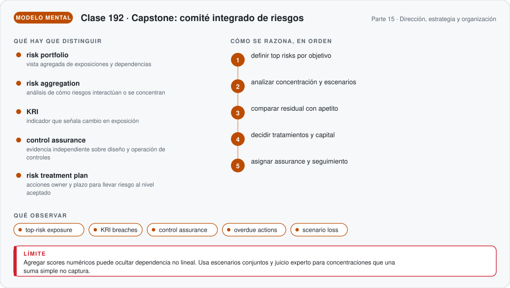

# Clase 192 — Capstone: comité integrado de riesgos

<!-- nav:inicio -->
> **Parte 15 · Riesgo, legal, compliance, ciberseguridad e IA** — clase 12 de 12 · [índice de la parte](../../README.md) · [temario](../../../../SYLLABUS.md)
<!-- nav:fin -->

**Parte:** 15 — Riesgo, legal, compliance, ciberseguridad e IA  
**Nivel:** Etapa 4 — Gerente → Director  
**Duración sugerida:** 150–180 minutos · **Estándar:** deep-class-v2

## 🎯 Propósito

Esta clase integra la parte 15. Cada una de las clases anteriores trató un tipo de riesgo con su lenguaje y sus herramientas: escenarios y exposición (181), apetito y límites (182), controles (183), temas legales y contratos (184 y 185), datos (186), ciberseguridad (187), inteligencia artificial (188), cumplimiento y ética (189), crisis (190) y continuidad (191). En una empresa real, los riesgos no llegan separados: un incidente de ciberseguridad es también un riesgo legal, de datos, de continuidad, de reputación y de cumplimiento; una decisión sobre un proveedor de IA afecta el contrato, los datos, el sesgo y la dependencia. El **comité integrado de riesgos** existe para mirar esas interacciones, decidir con un lenguaje común y asignar recursos limitados donde más reducen el riesgo.

El trabajo es un **paquete de decisión para el comité**: mapa de riesgos integrado, priorización con restricciones, plan de respuesta con dueños, tablero y reglas de escalamiento. Se apoya en COSO, ISO 31000, el marco de ciberseguridad y el de IA del NIST y en el gobierno corporativo de Tricker, y se cierra con honestidad sobre lo que se sabe, lo que se supone y lo que debe verificarse con asesoría y fuentes oficiales. Al terminar tendrás un documento que podrías presentar a un directorio.

## 📚 Resultados de aprendizaje

Al finalizar podrás:

1. **Integrar** riesgos de distintos dominios en un mapa único con un lenguaje común.
2. **Priorizar** inversiones con costo, efecto, restricciones y apetito.
3. **Asignar** dueños, controles, indicadores y plazos.
4. **Diseñar** el reporte y las reglas de escalamiento del comité.
5. **Declarar** supuestos, límites y verificaciones legales pendientes.

## 🧭 Agenda

| Tramo | Qué se hace |
|---|---|
| 0–20 min | Recuperación: ¿qué riesgo de tu empresa se activa cuando otro falla y quién lo ve hoy? |
| 20–60 min | Mandato, mapa integrado, lenguaje común, priorización, tablero y escalamiento. |
| 60–105 min | Ejemplo trabajado: asignar 195 millones entre siete riesgos de una empresa. |
| 105–150 min | Caso ejecutivo y práctica. |
| 150–175 min | Límites y entregable. |

## 🧩 Conceptos centrales

| Concepto | Definición | Cómo se reconoce |
|---|---|---|
| **Comité integrado de riesgos** | Instancia que revisa, prioriza y decide sobre los riesgos de todos los dominios. | Tiene mandato, miembros, agenda y decisiones. |
| **Mapa común** | Registro único de escenarios con los mismos criterios de medición. | Todas las áreas usan la misma escala. |
| **Restricción dura** | Condición que no se negocia, como un límite legal o un periodo máximo tolerable. | Prevalece sobre el cálculo de costo-beneficio. |
| **Riesgo interdependiente** | Riesgo que se activa o agrava cuando otro ocurre. | Comparten proveedor, sistema, persona o dato. |
| **Regla de escalamiento** | Criterio que lleva una decisión al directorio. | Umbrales de monto, impacto o apetito. |
| **Tablero de riesgos** | Vista breve con tendencias, excepciones y decisiones requeridas. | Una o dos páginas con indicadores. |

## 🧠 Modelo mental

**Cómo leer el diagrama.** Una cadena de cinco pasos con retorno. **Inventariar**: riesgos operativos, legales, de datos, ciberseguridad e IA en un mapa común. **Medir contra el apetito**: exposición residual frente a límites aprobados. **Asignar**: dueño, control y plazo para cada riesgo relevante. **Reportar**: un tablero para la dirección con tendencias y excepciones. **Decidir y revisar**: aceptar, reducir, transferir o evitar, y volver a medir. La flecha de retorno indica que las decisiones y los incidentes actualizan el mapa. La nota afirma que el valor del comité está en ver las interacciones entre riesgos y en decidir con un mismo lenguaje.

## 📖 Desarrollo

### 1. Mandato y composición

Un comité integrado necesita un **mandato escrito**: qué decide, qué recomienda al directorio, con qué frecuencia se reúne y qué información recibe. Tricker recuerda que el gobierno corporativo asigna al directorio la supervisión del riesgo y a la dirección su gestión; el comité es el espacio donde la dirección rinde cuentas y se alinea. Su **composición** incluye a quienes pueden decidir y ejecutar: gerencia general o su delegado, finanzas, operaciones, tecnología y seguridad, legal y cumplimiento, personas y, según el caso, auditoría interna como observador independiente. Se evita que sea un comité de «informar»: cada sesión tiene decisiones, responsables y fechas. Y se cuida que la función de riesgos no sea dueña de los riesgos de las áreas: facilita, consolida y desafía, pero los dueños son los gerentes.

### 2. Un mapa y un lenguaje comunes

El primer trabajo es unificar. Los registros de cada área suelen usar escalas, definiciones y horizontes distintos. El comité define **criterios comunes**: escalas de probabilidad e impacto en pesos, en días de interrupción, en personas afectadas y en consecuencias legales; horizonte temporal; categorías de riesgo; y reglas para estimar. COSO e ISO 31000 coinciden en la importancia de un proceso y un lenguaje compartidos. El mapa se construye con **escenarios** (clase 181), cada uno con dueño, estimación inherente y residual, controles, indicadores y vínculos con otros escenarios. Se identifican las **interdependencias**: un mismo proveedor, sistema, persona o conjunto de datos que aparece en varios escenarios, lo que sugiere riesgos de concentración.

### 3. Medir contra el apetito y las restricciones

Cada escenario se compara con el **apetito y los límites** aprobados (clase 182): ¿está dentro, en tolerancia o fuera? Se distinguen las **restricciones duras** (cumplimiento legal, seguridad de las personas, periodo máximo tolerable de procesos críticos, covenants) de las **preferencias económicas**. Las restricciones duras se cumplen primero; el análisis costo-beneficio ordena lo demás. Un escenario cuyo peor caso razonable supera un umbral del apetito (por ejemplo, 25 % del EBITDA) requiere tratamiento aunque su pérdida esperada sea baja. Se incluye el **riesgo de cola** y los escenarios combinados: ¿qué pasa si un ciberataque ocurre cuando falla el proveedor único?

### 4. Priorizar con recursos limitados

El presupuesto de riesgo es limitado, y el comité asigna con un procedimiento explícito: 1) financiar las **restricciones duras**; 2) ordenar el resto por **reducción de pérdida esperada por peso invertido**; 3) revisar el **riesgo de cola** y las interdependencias; 4) considerar **medidas de bajo costo** que reducen varios riesgos; 5) decidir qué **no se financia**, con una **medida interina** y un dueño que acepta formalmente el riesgo remanente. La priorización es un apoyo para la decisión y no un cálculo automático: los datos son estimaciones, hay efectos no cuantificables (reputación, confianza, seguridad de las personas) y las obligaciones legales y éticas no se negocian por precio.

### 5. Dueños, controles e indicadores

Cada riesgo priorizado tiene un **dueño** con autoridad, un **plan** con hitos y fechas, **indicadores** con umbrales y un **responsable del monitoreo**. Se alinean los controles entre dominios: un mismo control puede servir a varios riesgos (autenticación multifactor reduce riesgos de ciberseguridad, de fraude y de datos). Se vigila la **carga** sobre los equipos para no saturarlos y se coordina con otras iniciativas de cambio (clase 176). Los **incentivos** se revisan: si los bonos premian metas que empujan a asumir riesgos, los controles no bastan (clase 175). La **auditoría interna** evalúa de forma independiente el diseño y la operación.

### 6. Tablero y reglas de escalamiento

El tablero para el comité y el directorio cabe en una o dos páginas: **top de riesgos** (por exposición residual), **tendencia** frente al período anterior, **indicadores en rojo o ámbar** con su causa y su plan, **excepciones** y **aceptaciones de riesgo** vigentes, **incidentes** relevantes y lecciones, y **decisiones requeridas**. Las **reglas de escalamiento** definen cuándo un tema pasa al directorio: riesgos fuera de apetito, incidentes con impacto sobre un umbral, hallazgos graves de auditoría, cambios regulatorios relevantes, sospecha de delito. Se establecen plazos: por ejemplo, un incidente grave se informa al presidente del directorio en 24 horas. El tablero es honesto: incluye lo que va mal.

### 7. Integración con la crisis, la continuidad y el aprendizaje

El comité conecta con el **comité de crisis** (clase 190): define qué incidentes lo activan y revisa sus lecciones; con la **continuidad** (clase 191): aprueba objetivos de recuperación y verifica resultados de pruebas; con **cumplimiento** (clase 189): recibe el reporte de denuncias y casos; con **ciberseguridad** (clase 187), **datos** (clase 186) e **IA** (clase 188): revisa indicadores y excepciones. Después de cada incidente se hace una **revisión sin culpas** que actualiza el mapa, los controles y los supuestos. Cada año se **revisa el apetito**, se **valida** el mapa con datos propios y se **prueba** el comité con un ejercicio que incluya un escenario combinado.

### 8. Declarar lo que no se sabe

Un buen paquete de decisión separa **evidencia** (datos y pruebas), **supuestos** (probabilidades, costos, efectividad de controles) y **juicio** (criterios de priorización), e indica **qué se verificará** con asesoría y fuentes oficiales: contratos, normas de datos, ciberseguridad e IA, obligaciones sectoriales, seguros, plazos de notificación. También indica qué decisiones **dependen** de esas verificaciones. Evita la falsa precisión: presenta rangos y sensibilidades. Y es explícito sobre lo que **no** se financia y por qué. La credibilidad del comité nace de esa honestidad.

## 📚 Lectura comparada

| Obra | Qué aporta | Qué no resuelve | Pregunta para contrastar |
|---|---|---|---|
| COSO ERM | Integración del riesgo con estrategia y desempeño. | No fija métodos de medición. | ¿Qué objetivo está en juego? |
| ISO 31000 | Proceso y lenguaje comunes de gestión del riesgo. | Norma genérica. | ¿Estamos usando los mismos criterios? |
| NIST CSF 2.0 | Gobierno y resultados de ciberseguridad. | No prioriza entre dominios. | ¿Cómo entra el ciberriesgo en el mapa común? |
| NIST AI RMF | Gestión de riesgos de IA con cuatro funciones. | Voluntario y genérico. | ¿Qué usos de IA están en el inventario? |
| Tricker | Gobierno corporativo y responsabilidades del directorio. | No es específico de riesgos. | ¿Qué debe decidir el directorio? |

## 🧮 Ejemplo trabajado

**Situación (hipotética).** El comité de la empresa de comercio electrónico de las clases anteriores (ingresos de 50.000 millones y EBITDA de 3.600 millones) debe asignar un presupuesto anual de riesgo de **195 millones de pesos** entre siete escenarios. La regla de apetito dice que todo escenario cuyo peor caso razonable supere el 25 % del EBITDA (900 millones) debe tratarse.

**Mapa integrado (valores anuales, en millones de pesos).**

| # | Escenario | Pérdida esperada inherente | Pérdida esperada residual con la medida | Costo anual de la medida | Reducción | Reducción por peso invertido |
|---|---|---|---|---|---|---|
| 1 | Ransomware en sistemas de pedidos | 88,8 | 19,0 | 45 | 69,8 | 1,55 |
| 2 | Fraude en pagos a proveedores | 60,0 | 9,0 | 10 | 51,0 | 5,10 |
| 3 | Falla del proveedor único de envases | 300,0 | 48,0 | 40 | 252,0 | 6,30 |
| 4 | Filtración de datos de clientes | 96,0 | 57,6 | 15 (45 en tres años) | 38,4 | 2,56 |
| 5 | Sesgo en la preselección con IA | 40,0 | 10,0 | 20 | 30,0 | 1,50 |
| 6 | Soluciones de continuidad del sistema de pedidos | 14,4 | 2,4 | 48 adicionales | 12,0 | 0,25 |
| 7 | Incumplimiento anticorrupción en licitaciones | 120,0 | 30,0 | 35 | 90,0 | 2,57 |
| | **Total inherente** | **719,2** | | | | |

**Paso 1: restricciones duras.** (a) El escenario 6 es obligatorio: el periodo máximo tolerable de 12 horas exige el sitio en espera (clase 191), con un costo adicional de 48 millones (60 menos 12 de la opción actual). (b) El escenario 1 debe tratarse: su peor caso razonable es 1.100 millones, que equivale al 30,6 % del EBITDA (1.100 ÷ 3.600), por encima del 25 %. Costo comprometido: 48 + 45 = 93 millones. Quedan 195 − 93 = 102 millones.

**Paso 2: orden por reducción por peso.** Proveedor único (6,30) con 40 millones, queda 62. Fraude de pagos (5,10) con 10, queda 52. Incumplimiento anticorrupción (2,57) con 35, queda 17. Datos de clientes (2,56) con 15, queda 2. El escenario 5, con 20 millones, no cabe.

**Resultado.**

- Costo total: 93 + 40 + 10 + 35 + 15 = 193 millones, dentro de los 195.
- Reducción total de pérdida esperada: 12,0 + 69,8 + 252,0 + 51,0 + 90,0 + 38,4 = 513,2 millones.
- Relación global: 513,2 ÷ 193 ≈ 2,66.
- Pérdida esperada residual: 719,2 − 513,2 = 206,0 millones (suma de 19,0 + 9,0 + 48,0 + 57,6 + 40,0 + 30,0 + 2,4).

**Lo que no se financia.** El escenario 5 (IA) queda con un residual de 40 millones. Medida interina sin costo adicional: se suspende el rechazo automático, toda preselección pasa por revisión humana con muestra de las descartadas, y el dueño (gerente de personas) acepta formalmente el riesgo remanente hasta el próximo ciclo, con revisión en 90 días.

**Interdependencias.** El proveedor único de envases y el ransomware comparten un sistema de integración; si ambos ocurren, el impacto combinado es mayor que la suma. El comité pide un escenario combinado y un ejercicio de mesa.

**Reglas de escalamiento.** Al directorio: cualquier incidente con impacto estimado sobre 300 millones o con datos personales de más de 10.000 personas (informar en 24 horas); cualquier riesgo fuera de apetito por más de 30 días; y hallazgos graves de auditoría.

**Cuidados.** Las estimaciones son hipotéticas y con incertidumbre; las obligaciones de datos, ciberseguridad, IA, anticorrupción y contratos se verifican con asesoría y fuentes oficiales; la lista de lo no financiado se informa al directorio.

**Qué muestra.** (1) Las restricciones duras se financiaron primero. (2) El resto se ordenó por reducción por peso invertido. (3) Lo no financiado tiene dueño, medida interina y fecha de revisión.

## 🔀 Comparación y límites

**Comité integrado frente a comités por dominio.** Los comités especializados profundizan; el integrado decide asignaciones y mira interacciones. Pueden coexistir si sus mandatos están claros.

**Límites.** El orden por reducción por peso invertido depende de estimaciones inciertas y no captura daños no cuantificables ni obligaciones legales y éticas. Las interdependencias se detectan con análisis cuidadoso y se subestiman con facilidad. Un comité sin autoridad real o sin información veraz no gobierna. Las cifras del ejemplo son ilustrativas y no describen a ninguna empresa real.

## 🪜 De profesional a owner

| Nivel | Cómo participa |
|---|---|
| **Profesional** | Reporta riesgos y cumple los controles asignados. |
| **Jefe / Team Lead** | Mantiene los escenarios de su área con datos y señales. |
| **Gerente** | Es dueño de riesgos, presenta al comité y ejecuta sus decisiones. |
| **CEO / Director** | Preside el comité, fija el apetito y decide qué no se financia. |
| **Founder / Owner** | Acepta o no los riesgos remanentes que afectan su patrimonio y su empresa. |

## 🏢 Caso ejecutivo

Una empresa de servicios de salud con 2.600 empleados, ingresos de 90.000 millones de pesos y un EBITDA de 8.100 millones no tiene un comité integrado. Cada área mantiene su registro: tecnología (36 riesgos), clínica (41), legal (19), finanzas (22) y personas (17). En un trimestre ocurrieron: un incidente de ransomware que dejó sin historia clínica electrónica a dos centros durante 18 horas; una denuncia de acoso con investigación de 95 días; una fiscalización por tratamiento de datos de salud; un contrato con un proveedor de IA de apoyo diagnóstico sin evaluación de sesgo; y una falla de un proveedor de gases medicinales que casi detiene cirugías. El presupuesto de riesgo disponible es de 520 millones de pesos. El directorio pide, en 45 días, un paquete de decisión integrado y un diseño de comité.

Entrega un **paquete de decisión del comité integrado** que contenga: (a) el mandato, la composición y las reglas del comité; (b) el mapa integrado con criterios comunes, interdependencias y estimaciones con rangos; (c) la medición contra el apetito y las restricciones duras; (d) la priorización del presupuesto con cálculo, lo no financiado y las medidas interinas; (e) el tablero, los dueños, los indicadores y las reglas de escalamiento; (f) los supuestos, los límites y las verificaciones legales, regulatorias y contractuales pendientes.

## 🧪 Práctica

1. Reúne los registros de riesgos de tres áreas y unifícalos en un solo formato con criterios comunes.
2. Identifica tres interdependencias (proveedor, sistema, persona o dato) entre riesgos de distintos dominios.
3. Fija una regla de apetito para riesgos de cola y aplícala a tu mapa.
4. Asigna un presupuesto hipotético con el procedimiento de restricciones duras y reducción por peso invertido.
5. Diseña un tablero de una página con diez indicadores y tres reglas de escalamiento.

## ⚠️ Errores frecuentes

| Error | Por qué ocurre | Cómo corregirlo |
|---|---|---|
| Sumar registros sin unificar | Cada área usa su escala | Criterios comunes de probabilidad e impacto. |
| Comité para informar | Se evita decidir | Agenda con decisiones, dueños y fechas. |
| Priorizar solo por promedios | Es más simple | Revisar cola, interdependencias y restricciones duras. |
| No decidir qué no se financia | Se evita el conflicto | Medida interina, dueño y revisión. |
| Tablero cargado de indicadores | Se quiere mostrar todo | Dos páginas con tendencias y excepciones. |
| Ocultar lo que va mal | Se teme al directorio | Reporte honesto y lecciones. |

## ❓ Preguntas de comprobación

1. ¿Qué debe contener el mandato de un comité integrado de riesgos?
2. ¿Por qué se necesita un lenguaje y un mapa comunes?
3. ¿Cómo se distinguen restricciones duras y preferencias económicas?
4. ¿Qué pasos sigue la priorización con recursos limitados?
5. ¿Qué incluye un tablero de riesgos para el directorio?
6. ¿Qué reglas de escalamiento conviene definir?
7. ¿Qué debe declarar un paquete de decisión honesto?

Claves de respuesta

1. Qué decide y qué recomienda, frecuencia, miembros, información que recibe y obligación de producir decisiones con dueños y fechas.
2. Para comparar riesgos de distintas áreas con las mismas escalas y poder agregar y priorizar entre ellos.
3. Las restricciones duras (leyes, seguridad de las personas, periodo máximo tolerable, covenants) se cumplen primero; las preferencias económicas se ordenan por costo y efecto.
4. Financiar restricciones duras, ordenar por reducción por peso invertido, revisar colas e interdependencias, considerar medidas transversales y decidir lo no financiado con medida interina.
5. Principales riesgos, tendencias, indicadores en rojo o ámbar con plan, excepciones y aceptaciones vigentes, incidentes y decisiones requeridas.
6. Riesgos fuera de apetito, incidentes sobre un umbral de impacto, hallazgos graves de auditoría, cambios regulatorios relevantes y sospecha de delito, con plazos.
7. Evidencia, supuestos y juicio; verificaciones pendientes; incertidumbre con rangos; y lo que no se financia con sus razones.

## 📥 Entregable

Guarda en `portfolio/192-capstone-comite-integrado-de-riesgos/`:

- `risk-governance-brief.md` (plantilla [Risk Governance Brief](../../../../templates/risk-governance-brief.md)) con el paquete de decisión del caso ejecutivo;
- `enterprise-risk.md` (plantilla [Enterprise risk](../../../../templates/enterprise-risk.md)) con el mapa integrado y la priorización;
- `board-or-executive-memo.md` (plantilla [Board or executive memo](../../../../templates/board-or-executive-memo.md)) con el tablero y las reglas de escalamiento;
- `decision-journal.md` con los supuestos, las medidas interinas y las verificaciones legales pendientes.

## 📗 Fuentes y verificación

- COSO — *Enterprise Risk Management—Integrating with Strategy and Performance*. **Uso en esta clase:** integración del riesgo con estrategia y desempeño. **Fuente primaria:** <https://www.coso.org/>.
- ISO — *ISO 31000 Risk management*. **Uso en esta clase:** proceso y lenguaje comunes de gestión del riesgo. **Localizador pendiente:** ver [el registro de fuentes](../../../../docs/FUENTES.md).
- NIST — *Cybersecurity Framework (CSF) 2.0*. **Uso en esta clase:** gobierno y resultados de ciberseguridad. **Fuente primaria:** <https://www.nist.gov/cyberframework>.
- NIST — *AI Risk Management Framework (AI RMF 1.0)*. **Uso en esta clase:** gestión de riesgos de IA con cuatro funciones. **Fuente primaria:** <https://www.nist.gov/itl/ai-risk-management-framework>.
- Bob Tricker — *Corporate Governance* (Oxford University Press, 2019). **Uso en esta clase:** gobierno corporativo y responsabilidades del directorio. Lectura selectiva sobre **capstone: comité integrado de riesgos**. **Localizador:** [ISBN-13 9780198809869](https://openlibrary.org/isbn/9780198809869).

> **Regla de fuentes para el Capstone del comité integrado de riesgos:** las obras anteriores estructuran las perspectivas de esta materia; cualquier norma, ley o estándar vivo mencionado debe comprobarse nuevamente en su fuente primaria vigente, incluidas las obligaciones de datos, ciberseguridad, IA, anticorrupción y sectoriales. Los ejemplos y casos son hipotéticos, con cifras ilustrativas. El desarrollo es original y no reproduce capítulos protegidos.

<!-- pie:inicio -->
---

| Anterior | Índice | Siguiente |
|---|---|---|
| [← 191 · Business continuity y resiliencia](../191-business-continuity-y-resiliencia/README.md) | [Parte 15](../../README.md) · [Programa](../../../../SYLLABUS.md) | [193 · Transición de gerente a ejecutivo →](../../../16-executive-leadership-ceo-office/classes/193-transicion-de-gerente-a-ejecutivo/README.md) |
<!-- pie:fin -->
