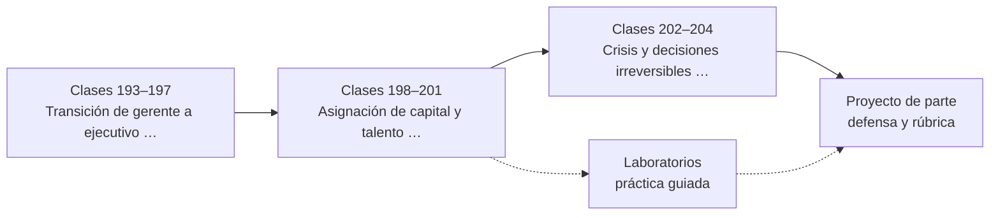

# Parte 16 — Alta dirección y oficina del CEO

<!-- parte:inicio -->

> ← [Parte 15 — Riesgo, legal, compliance, ciberseguridad e IA](../15-risk-legal-compliance-cyber-ai-governance/README.md) · [Temario](../../SYLLABUS.md) · [Parte 17 — Directorios y gobierno corporativo](../17-boards-corporate-governance/README.md) →

*Dirigir la empresa completa, no una función*

**Etapa:** 5 — Alta dirección y gobierno  
**Duración:** 12 clases · 30 horas  
**Resultado de salida:** Integrar estrategia, personas, capital, operaciones y stakeholders desde una perspectiva de empresa completa.

🔴 [Ver las 6 etapas](../../SYLLABUS.md) · 12 clases (193–204) · 4 laboratorios · [proyecto de parte](project.md)

## 🎯 De qué trata esta parte

El paso de gerente a ejecutivo no es de más trabajo sino de otro trabajo: integrar estrategia, personas, capital y stakeholders, y decidir qué no hacer. Esta parte entrena esa perspectiva de empresa.

El eje es **asignar y responder**: el CEO asigna atención, capital y talento, comunica ante todas las audiencias y responde por decisiones difíciles de revertir. Incluye crisis, comunicación y sucesión.

## 🧱 Con qué hay que llegar

| Parte | Qué aporta |
|---|---|
| [13 — Estrategia y competencia](../13-strategy-competition/README.md) | Estrategia. |
| [14 — Diseño organizacional, cultura y cambio](../14-organization-design-culture-change/README.md) | Diseño organizacional. |
| [15 — Riesgo, legal, compliance, ciberseguridad e IA](../15-risk-legal-compliance-cyber-ai-governance/README.md) | Riesgo y crisis. |
| [08 — Sistemas de gestión, KPI y OKR](../08-management-systems-kpis-okrs/README.md) | Gestión por indicadores. |

Cada clase supone la anterior: el orden importa, y saltarse una deja sin base a las que vienen después.

## 📚 Resultados de la parte

Al terminar esta parte podrás:

1. **Transitar** de gerente a ejecutivo y pensar a nivel empresa.
2. **Construir** el equipo ejecutivo y su arquitectura de decisiones.
3. **Asignar** atención, capital y talento con criterio.
4. **Comunicar** como CEO ante empleados, directorio, clientes y mercado.
5. **Decidir** en crisis y planificar la sucesión.

## 🗺️ Mapa de la parte

## 🧭 Cómo se encadenan las 12 clases

Las clases **193 a 197** definen el rol: transición, visión de empresa, equipo, decisiones y agenda.

Las clases **198 a 201** cubren el ejercicio: capital y talento, balance entre grupos de interés, comunicación y pipeline de liderazgo.

Las clases **202 a 204** cubren la prueba: crisis y decisiones irreversibles, sucesión y el capstone de primeros 100 días.

## 📘 Las 12 clases

| # | Clase | Qué se trabaja | Entregable | Min |
|---:|---|---|---|---:|
| 193 | [Transición de gerente a ejecutivo](classes/193-transicion-de-gerente-a-ejecutivo/README.md) | Perspectiva de empresa, Mandato, Agenda de aprendizaje | [leadership-decision-brief](../../templates/leadership-decision-brief.md) | 150 |
| 194 | [Pensar a nivel empresa](classes/194-pensar-a-nivel-empresa/README.md) | Valor de empresa, ROIC, Restricción | [leadership-decision-brief](../../templates/leadership-decision-brief.md) | 150 |
| 195 | [Construir el executive team](classes/195-construir-el-executive-team/README.md) | Equipo ejecutivo, Defensor de función, Mandato colectivo | [leadership-decision-brief](../../templates/leadership-decision-brief.md) | 150 |
| 196 | [Arquitectura de decisiones ejecutivas](classes/196-arquitectura-de-decisiones-ejecutivas/README.md) | Arquitectura de decisiones, Reversibilidad, Latencia de decisión | [leadership-decision-brief](../../templates/leadership-decision-brief.md) | 150 |
| 197 | [Agenda y tiempo del CEO](classes/197-agenda-y-tiempo-del-ceo/README.md) | Agenda del CEO, Actividad de alto apalancamiento, Auditoría de tiempo | [board-or-executive-memo](../../templates/board-or-executive-memo.md) | 150 |
| 198 | [Asignación de capital y talento](classes/198-asignacion-de-capital-y-talento/README.md) | Asignación de capital, Asignación de talento, Tasa mínima de retorno | [modelo-financiero-y-memo-de-decision](../../templates/modelo-financiero-y-memo-de-decision.md) | 150 |
| 199 | [Balance entre clientes, personas, accionistas y sociedad](classes/199-balance-entre-clientes-personas-accionistas-y-sociedad/README.md) | Parte interesada, Materialidad, Externalidad | [commercial-decision-brief](../../templates/commercial-decision-brief.md) | 150 |
| 200 | [Comunicación del CEO](classes/200-comunicacion-del-ceo/README.md) | Teoría situacional de comunicación de crisis, Atribución de responsabilidad, Intensificadores | [executive-spokesperson-manual](../../templates/executive-spokesperson-manual.md) | 150 |
| 201 | [Leadership pipeline](classes/201-leadership-pipeline/README.md) | Pasaje de liderazgo, Cargo crítico, Preparación (readiness) | [commercial-decision-brief](../../templates/commercial-decision-brief.md) | 150 |
| 202 | [Crisis y decisiones irreversibles](classes/202-crisis-y-decisiones-irreversibles/README.md) | Decisión irreversible, Reconocimiento de patrones, Colapso del sentido | [leadership-decision-brief](../../templates/leadership-decision-brief.md) | 150 |
| 203 | [Sucesión y continuidad de liderazgo](classes/203-sucesion-y-continuidad-de-liderazgo/README.md) | Sucesión planificada, Sucesión de emergencia, Perfil del sucesor | [people-decision-brief](../../templates/people-decision-brief.md) | 150 |
| 204 | [Capstone: primeros 100 días como CEO](classes/204-capstone-primeros-100-dias-como-ceo/README.md) | Mandato de transición, Plan de aprendizaje, Riesgo crítico | [integrated-executive-decision-brief](../../templates/integrated-executive-decision-brief.md) | 150 |

## ⚠️ Riesgos característicos

- Seguir resolviendo problemas de la función de origen.
- Decidir lo que otro debía decidir.
- Decir al mercado algo que los hechos internos contradicen.
- No preparar la sucesión hasta que es urgente.

## 🔤 Glosario de la parte

73 conceptos definidos en las clases, con la definición operacional que usa cada una.

| Concepto | Definición operacional |
|---|---|
| **Actividad de alto apalancamiento** | Actividad cuyo efecto se multiplica en la organización. |
| **Agenda de aprendizaje** | Plan para entender rápido la situación, las personas y los números. |
| **Agenda del CEO** | Distribución deliberada de tiempo y atención según las prioridades de la empresa. |
| **Arquitectura de decisiones** | Diseño de quién decide qué, dónde, con qué información y con qué revisión. |
| **Asignación de capital** | Decisión de a qué proyectos, negocios o usos se destinan los recursos financieros. |
| **Asignación de talento** | Decisión de dónde se ubican las personas más capaces. |
| **Atribución de responsabilidad** | Grado en que los interesados creen que la organización causó la crisis; se agrupa en víctima, accidental y evitable. |
| **Auditoría de tiempo** | Registro y clasificación de cómo se usó el tiempo. |
| **Banco de talento** | Visión de personas y su preparación para cargos críticos. |
| **Cadencia operativa** | Ritmo de reuniones, revisiones y comunicación. |
| **Candidato listo ahora** | Persona que podría asumir de inmediato con alta probabilidad de éxito. |
| **Cargo crítico** | Rol cuya vacancia o mal desempeño afecta gravemente a la empresa. |
| **Cartera de decisiones pendientes** | Decisiones esperando al CEO. |
| **CEO interino** | Persona que dirige de forma transitoria mientras se decide el relevo. |
| **Colapso del sentido** | Pérdida de la capacidad de interpretar una situación durante una crisis. |
| **Compromiso** | Adhesión visible a una decisión, incluso con desacuerdo previo. |
| **Confianza** | Disposición a mostrarse vulnerable ante los demás. |
| **Confianza en la transición** | Credibilidad que se construye con conducta y coherencia. |
| **Conflicto sobre ideas** | Discusión franca sobre asuntos, sin ataque personal. |
| **Decisión de empresa** | Decisión cuyo efecto cruza varias funciones o afecta la estrategia. |
| **Decisión irreversible** | Decisión difícil o imposible de deshacer a costo razonable. |
| **Defensor de función** | Ejecutivo que actúa principalmente para proteger su área. |
| **Desafío independiente** | Revisión por alguien sin interés en el resultado, cuyo rol es buscar fallas. |
| **Equipo ejecutivo** | Grupo pequeño que responde en conjunto por la empresa. |
| **Estrategias de respuesta** | Negación, disminución, reconstrucción y refuerzo, con variantes en cada grupo. |
| **Externalidad** | Costo o beneficio que la empresa causa a terceros sin pagarlo ni cobrarlo. |
| **Información de ajuste** | Reconocimiento del daño y apoyo para afrontarlo emocionalmente. |
| **Información de instrucción** | Qué ocurrió y qué debe hacer quien está en riesgo para protegerse. |
| **Intensificadores** | Historial de crisis similares y reputación previa: aumentan la responsabilidad atribuida. |
| **Latencia de decisión** | Tiempo desde que surge la decisión hasta que se toma. |
| **Mandato** | Lo que se espera que el nuevo ejecutivo logre y bajo qué condiciones. |
| **Mandato colectivo** | Asuntos que solo el equipo puede resolver juntos. |
| **Mandato de transición** | Lo que el directorio y la empresa esperan lograr con el nuevo CEO. |
| **Manual de vocería** | Documento previo que define quién habla, qué dice, qué no dirá y cómo se corrige un error. |
| **Margen** | Tiempo no comprometido para lo imprevisto. |
| **Materialidad** | Importancia de una parte o un tema para el valor y los riesgos de la empresa. |
| **Maximización ilustrada** | Maximizar el valor de largo plazo atendiendo a todas las partes que lo sostienen. |
| **Mensaje central** | Una frase verificable que sostiene toda la comunicación; todo lo demás la respalda. |
| **Parte interesada** | Persona o grupo que afecta a la empresa o es afectado por ella. |
| **Pasaje de liderazgo** | Transición a un nivel que exige cambiar de trabajo, de uso del tiempo y de valores. |
| **Perfil del sucesor** | Conjunto de capacidades que la empresa necesitará. |
| **Perspectiva de empresa** | Mirada que subordina la función a los objetivos del conjunto. |
| **Plan de aprendizaje** | Estrategia para entender rápido mercado, clientes, números, personas y riesgos. |
| **Potencial** | Capacidad de crecer hasta niveles superiores en el tiempo. |
| **Pre-lectura** | Documento breve que prepara una decisión. |
| **Preparación (readiness)** | Capacidad actual de asumir el nivel siguiente. |
| **Prioridad** | Objetivo de alto impacto con dueño, recursos y métrica. |
| **Reconocimiento de patrones** | Uso de la experiencia para ver una situación como familiar y actuar. |
| **Registro de decisión** | Documento con contexto, supuestos, alternativas y razones. |
| **Regla de parada** | Condición pactada de antemano que obliga a detenerse o revisar. |
| **Rendición de cuentas** | Responder por decisiones con datos y responsables. |
| **Restricción** | Elemento que limita el desempeño del sistema completo. |
| **Retorno marginal** | Retorno de cada peso adicional invertido. |
| **Reversibilidad** | Facilidad y costo de deshacer una decisión. |
| **Riesgo crítico** | Amenaza grave que no puede esperar. |
| **ROIC** | Retorno sobre el capital invertido: utilidad operativa después de impuestos dividida por el capital invertido. |
| **Ruido** | Variabilidad no deseada en juicios que deberían ser iguales. |
| **Subóptimo local** | Optimizar una parte perjudicando al conjunto. |
| **Sucesión de emergencia** | Plan para cubrir la salida repentina del CEO. |
| **Sucesión planificada** | Relevo organizado del CEO con tiempo y proceso. |
| **Sucesor listo ahora** | Persona que podría asumir el cargo de inmediato. |
| **Talento en prioridades** | Proporción de líderes clave asignados a las prioridades de la empresa. |
| **Tasa de anulación** | Proporción de decisiones delegadas que el CEO revierte. |
| **Tasa de reasignación** | Proporción del capital que cambia de uso en un período. |
| **Tasa mínima de retorno** | Retorno mínimo que debe superar una inversión para aprobarse. |
| **Teoría situacional de comunicación de crisis** | Marco de Coombs (2007) que relaciona la responsabilidad que el público atribuye a la organización con las respuestas más adecuadas. |
| **Trabajo profundo** | Trabajo de concentración sin interrupciones. |
| **Trade-off** | Elección en la que se gana algo y se pierde algo. |
| **Transición** | Período de traspaso de la información, relaciones y decisiones. |
| **Valor compartido** | Valor económico que se crea resolviendo necesidades de la sociedad. |
| **Valor de empresa** | Valor presente de la caja futura que genera la empresa. |
| **Victoria temprana** | Resultado visible y creíble en los primeros meses. |
| **Índice de rentabilidad** | Valor presente neto por unidad de capital invertido. |

## 📦 Qué queda como evidencia

- Un calendario del CEO auditado.
- Un acta de equipo ejecutivo y su arquitectura de decisiones.
- Un manual de vocería ejecutiva.
- El capstone: plan de primeros 100 días.

## 🔗 Cómo se conecta

La parte 17 sitúa al CEO frente al directorio y la 22 lleva estas capacidades al dueño de empresa. La vocería ejecutiva se entrena con las plantillas del programa.

## 🧪 Cómo se trabaja

Son **12 clases de 150 minutos** —30 horas— con **4 laboratorios** y un proyecto integrador. Cada clase trae su propósito, sus conceptos, un caso, práctica, errores frecuentes, preguntas de comprobación, entregable y fuentes, y se evalúa con su `assessment.md`. Los laboratorios se resuelven con datos propios o sintéticos, nunca con datos reales de terceros, y la parte se cierra con el proyecto y su defensa. Las reglas de recorrido están en [la guía de navegación](../../docs/NAVIGATION.md).

<!-- parte:fin -->

## Laboratorios

- [Lab 01 — CEO calendar audit](labs/lab-01.md)
- [Lab 02 — Executive team charter](labs/lab-02.md)
- [Lab 03 — CEO dashboard](labs/lab-03.md)
- [Lab 04 — First 100 days](labs/lab-04.md)

## Proyecto de parte

Asumir una empresa en crisis y presentar el plan de los primeros 100 días.

## Bibliografía rectora

- Peter F. Drucker — *The Effective Executive* (Ejecución y liderazgo personal)
- Andrew S. Grove — *High Output Management* (Management)
- Ben Horowitz — *The Hard Thing About Hard Things* (CEO / Founder)
- Matt Mochary — *The Great CEO Within* (CEO)
- Larry Bossidy & Ram Charan — *Execution* (Ejecución)

## Criterio de aprobación

80/100 y entrega del proyecto integrador.
