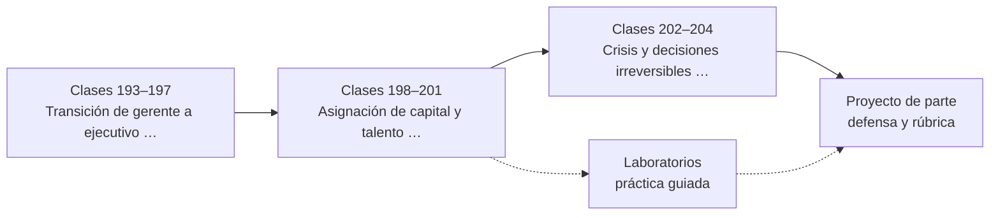

# Parte 16 — Alta dirección y oficina del CEO

<!-- parte:inicio -->

> ← [Parte 15 — Riesgo, legal, compliance, ciberseguridad e IA](../15-risk-legal-compliance-cyber-ai-governance/README.md) · [Temario](../../SYLLABUS.md) · [Parte 17 — Directorios y gobierno corporativo](../17-boards-corporate-governance/README.md) →

*Dirigir la empresa completa, no una función*

**Etapa:** 5 — Alta dirección y gobierno  
**Duración:** 12 clases · 30 horas  
**Resultado de salida:** Integrar estrategia, personas, capital, operaciones y stakeholders desde una perspectiva de empresa completa.

🔴 [Ver las 6 etapas](../../SYLLABUS.md) · 12 clases (193–204) · 4 laboratorios · [proyecto de parte](project.md)

## 🎯 De qué trata esta parte

El paso de gerente a ejecutivo no es de más trabajo sino de otro trabajo: integrar estrategia, personas, capital y stakeholders, y decidir qué no hacer. Esta parte entrena esa perspectiva de empresa.

El eje es **asignar y responder**: el CEO asigna atención, capital y talento, comunica ante todas las audiencias y responde por decisiones difíciles de revertir. Incluye crisis, comunicación y sucesión.

## 🧱 Con qué hay que llegar

| Parte | Qué aporta |
|---|---|
| [13 — Estrategia y competencia](../13-strategy-competition/README.md) | Estrategia. |
| [14 — Diseño organizacional, cultura y cambio](../14-organization-design-culture-change/README.md) | Diseño organizacional. |
| [15 — Riesgo, legal, compliance, ciberseguridad e IA](../15-risk-legal-compliance-cyber-ai-governance/README.md) | Riesgo y crisis. |
| [08 — Sistemas de gestión, KPI y OKR](../08-management-systems-kpis-okrs/README.md) | Gestión por indicadores. |

Cada clase supone la anterior: el orden importa, y saltarse una deja sin base a las que vienen después.

## 📚 Resultados de la parte

Al terminar esta parte podrás:

1. **Transitar** de gerente a ejecutivo y pensar a nivel empresa.
2. **Construir** el equipo ejecutivo y su arquitectura de decisiones.
3. **Asignar** atención, capital y talento con criterio.
4. **Comunicar** como CEO ante empleados, directorio, clientes y mercado.
5. **Decidir** en crisis y planificar la sucesión.

## 🗺️ Mapa de la parte

## 🧭 Cómo se encadenan las 12 clases

Las clases **193 a 197** definen el rol: transición, visión de empresa, equipo, decisiones y agenda.

Las clases **198 a 201** cubren el ejercicio: capital y talento, balance entre grupos de interés, comunicación y pipeline de liderazgo.

Las clases **202 a 204** cubren la prueba: crisis y decisiones irreversibles, sucesión y el capstone de primeros 100 días.

## 📘 Las 12 clases

| # | Clase | Qué se trabaja | Entregable | Min |
|---:|---|---|---|---:|
| 193 | [Transición de gerente a ejecutivo](classes/193-transicion-de-gerente-a-ejecutivo/README.md) | enterprise perspective, transition, stakeholder map | [leadership-decision-brief](../../templates/leadership-decision-brief.md) | 150 |
| 194 | [Pensar a nivel empresa](classes/194-pensar-a-nivel-empresa/README.md) | enterprise value, portfolio view, cross-subsidy | [leadership-decision-brief](../../templates/leadership-decision-brief.md) | 150 |
| 195 | [Construir el executive team](classes/195-construir-el-executive-team/README.md) | executive team, functional advocacy, collective accountability | [leadership-decision-brief](../../templates/leadership-decision-brief.md) | 150 |
| 196 | [Arquitectura de decisiones ejecutivas](classes/196-arquitectura-de-decisiones-ejecutivas/README.md) | decision architecture, reversibility, decision velocity | [leadership-decision-brief](../../templates/leadership-decision-brief.md) | 150 |
| 197 | [Agenda y tiempo del CEO](classes/197-agenda-y-tiempo-del-ceo/README.md) | CEO agenda, high-leverage activity, calendar audit | [board-or-executive-memo](../../templates/board-or-executive-memo.md) | 150 |
| 198 | [Asignación de capital y talento](classes/198-asignacion-de-capital-y-talento/README.md) | capital allocation, talent allocation, sunk cost | [modelo-financiero-y-memo-de-decision](../../templates/modelo-financiero-y-memo-de-decision.md) | 150 |
| 199 | [Balance entre clientes, personas, accionistas y sociedad](classes/199-balance-entre-clientes-personas-accionistas-y-sociedad/README.md) | stakeholder, shareholder return, externality | [commercial-decision-brief](../../templates/commercial-decision-brief.md) | 150 |
| 200 | [Comunicación del CEO](classes/200-comunicacion-del-ceo/README.md) | Teoría situacional de comunicación de crisis, Atribución de responsabilidad, Intensificadores | [executive-spokesperson-manual](../../templates/executive-spokesperson-manual.md) | 150 |
| 201 | [Leadership pipeline](classes/201-leadership-pipeline/README.md) | leadership passage, readiness, succession bench | [commercial-decision-brief](../../templates/commercial-decision-brief.md) | 150 |
| 202 | [Crisis y decisiones irreversibles](classes/202-crisis-y-decisiones-irreversibles/README.md) | irreversible decision, pre-mortem, red team | [leadership-decision-brief](../../templates/leadership-decision-brief.md) | 150 |
| 203 | [Sucesión y continuidad de liderazgo](classes/203-sucesion-y-continuidad-de-liderazgo/README.md) | CEO succession, emergency succession, successor profile | [people-decision-brief](../../templates/people-decision-brief.md) | 150 |
| 204 | [Capstone: primeros 100 días como CEO](classes/204-capstone-primeros-100-dias-como-ceo/README.md) | transition mandate, learning plan, stakeholder coalition | [integrated-executive-decision-brief](../../templates/integrated-executive-decision-brief.md) | 150 |

## ⚠️ Riesgos característicos

- Seguir resolviendo problemas de la función de origen.
- Decidir lo que otro debía decidir.
- Decir al mercado algo que los hechos internos contradicen.
- No preparar la sucesión hasta que es urgente.

## 🔤 Glosario de la parte

63 conceptos definidos en las clases, con la definición operacional que usa cada una.

| Concepto | Definición operacional |
|---|---|
| **100-day plan** | secuencia de aprendizaje acciones y revisiones en transición. |
| **Atribución de responsabilidad** | Grado en que los interesados creen que la organización causó la crisis; se agrupa en víctima, accidental y evitable. |
| **attention residue** | costo cognitivo de cambiar continuamente de contexto. |
| **calendar audit** | análisis de cómo tiempo real se compara con prioridades. |
| **capital allocation** | distribución de recursos financieros entre usos alternativos. |
| **CEO agenda** | distribución deliberada de tiempo y atención ejecutiva. |
| **CEO succession** | proceso para asegurar continuidad del máximo liderazgo. |
| **collective accountability** | responsabilidad compartida por decisiones de empresa. |
| **constructive conflict** | desacuerdo sustantivo que mejora decisión sin dañar relación. |
| **critical role** | posición cuya vacancia crea riesgo material. |
| **cross-subsidy** | uso deliberado de recursos de una unidad para apoyar otra. |
| **decision architecture** | mapa de decisiones derechos foros e información. |
| **decision velocity** | tiempo desde necesidad hasta decisión ejecutable. |
| **delegation boundary** | límite explícito de autoridad transferida. |
| **development assignment** | experiencia diseñada para cerrar una brecha de liderazgo. |
| **early decision** | elección temprana que reduce riesgo o crea dirección. |
| **early win** | resultado temprano que crea credibilidad sin hipotecar estrategia. |
| **emergency succession** | plan para reemplazo inmediato no planificado. |
| **enterprise perspective** | lente que prioriza resultado total sobre función propia. |
| **enterprise trade-off** | elección donde mejorar una parte puede empeorar otra. |
| **enterprise value** | valor económico y estratégico del sistema completo. |
| **Estrategias de respuesta** | Negación, disminución, reconstrucción y refuerzo, con variantes en cada grupo. |
| **exception** | caso fuera de políticas o tolerancias. |
| **executive team** | grupo colectivo accountable por resultados enterprise. |
| **externality** | costo o beneficio impuesto a terceros no reflejado completamente en precio. |
| **functional advocacy** | defensa legítima de una función que no debe dominar interés total. |
| **high-leverage activity** | actividad cuyo efecto multiplica resultados de otros. |
| **hurdle rate** | retorno mínimo requerido para una inversión. |
| **Información de ajuste** | Reconocimiento del daño y apoyo para afrontarlo emocionalmente. |
| **Información de instrucción** | Qué ocurrió y qué debe hacer quien está en riesgo para protegerse. |
| **Intensificadores** | Historial de crisis similares y reputación previa: aumentan la responsabilidad atribuida. |
| **internal candidate** | persona desarrollada dentro de la organización. |
| **irreversible decision** | elección cuyo costo de deshacer es alto o imposible. |
| **leadership passage** | transición a un nivel con nuevas responsabilidades y valores. |
| **learning agenda** | preguntas prioritarias que guían diagnóstico inicial. |
| **learning plan** | agenda estructurada de preguntas y fuentes. |
| **license to operate** | aceptación social regulatoria y reputacional para operar. |
| **long-term value** | valor creado considerando efectos y riesgos más allá del trimestre. |
| **Manual de vocería** | Documento previo que define quién habla, qué dice, qué no dirá y cómo se corrige un error. |
| **Mensaje central** | Una frase verificable que sostiene toda la comunicación; todo lo demás la respalda. |
| **operating rhythm** | cadencia que agrupa decisiones y revisiones recurrentes. |
| **portfolio view** | perspectiva comparativa de negocios productos o capacidades. |
| **pre-mortem** | ejercicio que imagina fracaso futuro para revelar riesgos. |
| **readiness** | grado de preparación para ejecutar trabajo del siguiente nivel. |
| **red team** | grupo que desafía supuestos y plan. |
| **reversibility** | grado en que una decisión puede deshacerse a costo razonable. |
| **shareholder return** | valor económico entregado a propietarios. |
| **staged commitment** | desembolso o compromiso por etapas ligado a evidencia. |
| **stakeholder** | parte afectada o capaz de afectar la organización. |
| **stakeholder coalition** | red de actores necesarios para ejecutar. |
| **stakeholder map** | mapa de actores cuyo apoyo o información es crítico. |
| **stop rule** | condición predefinida para detener o reevaluar. |
| **strategic capacity** | capacidad reservada para prioridades y opciones futuras. |
| **succession bench** | conjunto de candidatos internos con potencial y preparación. |
| **successor profile** | criterios de capacidades y contexto requeridos. |
| **sunk cost** | costo pasado irrecuperable que no debería determinar decisión futura. |
| **system constraint** | cuello que limita desempeño total. |
| **talent allocation** | asignación de personas escasas a prioridades. |
| **team charter** | acuerdo sobre propósito decisiones y normas del equipo. |
| **Teoría situacional de comunicación de crisis** | Marco de Coombs (2007) que relaciona la responsabilidad que el público atribuye a la organización con las respuestas más adecuadas. |
| **transition** | periodo en que expectativas relaciones y capacidades cambian. |
| **transition mandate** | expectativas explícitas del rol y contexto. |
| **transition plan** | secuencia para transferir relaciones información y autoridad. |

## 📦 Qué queda como evidencia

- Un calendario del CEO auditado.
- Un acta de equipo ejecutivo y su arquitectura de decisiones.
- Un manual de vocería ejecutiva.
- El capstone: plan de primeros 100 días.

## 🔗 Cómo se conecta

La parte 17 sitúa al CEO frente al directorio y la 22 lleva estas capacidades al dueño de empresa. La vocería ejecutiva se entrena con las plantillas del programa.

## 🧪 Cómo se trabaja

Son **12 clases de 150 minutos** —30 horas— con **4 laboratorios** y un proyecto integrador. Cada clase trae su propósito, sus conceptos, un caso, práctica, errores frecuentes, preguntas de comprobación, entregable y fuentes, y se evalúa con su `assessment.md`. Los laboratorios se resuelven con datos propios o sintéticos, nunca con datos reales de terceros, y la parte se cierra con el proyecto y su defensa. Las reglas de recorrido están en [la guía de navegación](../../docs/NAVIGATION.md).

<!-- parte:fin -->

## Laboratorios

- [Lab 01 — CEO calendar audit](labs/lab-01.md)
- [Lab 02 — Executive team charter](labs/lab-02.md)
- [Lab 03 — CEO dashboard](labs/lab-03.md)
- [Lab 04 — First 100 days](labs/lab-04.md)

## Proyecto de parte

Asumir una empresa en crisis y presentar el plan de los primeros 100 días.

## Bibliografía rectora

- Peter F. Drucker — *The Effective Executive* (Ejecución y liderazgo personal)
- Andrew S. Grove — *High Output Management* (Management)
- Ben Horowitz — *The Hard Thing About Hard Things* (CEO / Founder)
- Matt Mochary — *The Great CEO Within* (CEO)
- Larry Bossidy & Ram Charan — *Execution* (Ejecución)

## Criterio de aprobación

80/100 y entrega del proyecto integrador.
